# 016：进程抽象介绍 🖥️

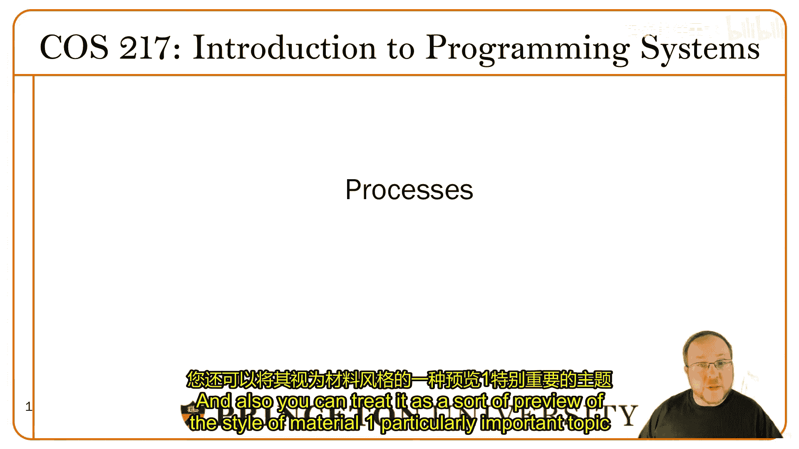

在本节课中，我们将快速了解**进程抽象**。通过本次学习，你将更好地理解程序运行时发生了什么。同时，这也可以作为对系统课程（如3.16或3.18）中重要主题和材料风格的一次预览。

在本系列讲座中，我们将从**进程抽象**开始，许多其他底层系统概念都围绕它展开。然后，我们将不仅探讨进程本身，还会学习如何编写管理进程的C程序，以及如何通过信号进行有限形式的进程间通信来控制其他进程。

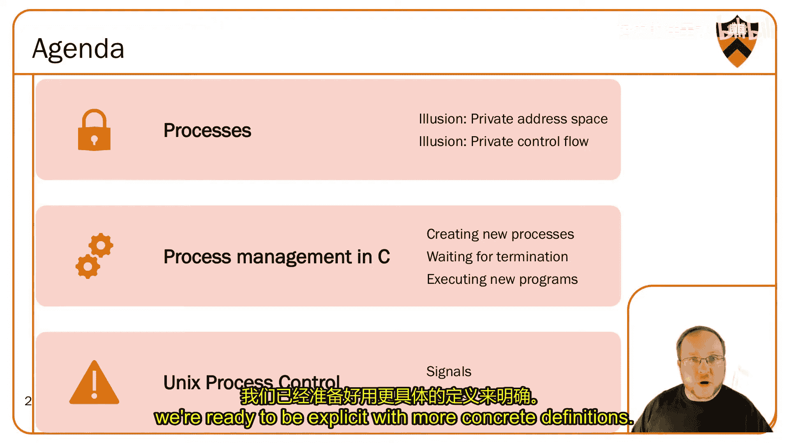

## 程序与进程 📁

上一节我们介绍了课程的整体目标，本节中我们来看看**程序**和**进程**这两个核心概念的具体定义。

你的**程序**是我们反复讨论的构建过程的最终产物。当链接器最终构建出可执行文件时，它就定义了你的程序。如果你修改了某些内容并重新构建，这本质上就是一个不同的程序，即使你给它相同的名字。它更像是一个全新的程序，而非旧程序的更新版本。

一个**进程**，则是该程序实际执行的一个**实例**。更专业的说法是，进程是你的程序在时间上的积分，是该特定程序执行过程中所有状态的总和。这包括寄存器的状态、内存的状态、执行条件分支时的控制流等。

当进程运行时，它与机器上的许多其他进程共享计算机资源。例如，当你运行你的进程时，你的代码编辑器可能也在运行。无论如何，至少还有一个运行着你的shell的进程在运行。因为全班170名同学都不可避免地会在作业截止日期前的最后48小时工作，所以不仅你的进程在运行，你所有同学的进程也在运行。

## 进程标识符（PID） 🔢

每个同时运行的进程都有自己的标识符，即**进程ID**，通常缩写为**PID**。例如，上图中的10882或92684。

当一个进程开始运行时，操作系统会为其分配一个PID。该PID在**所有同时运行的进程中必须是唯一的**，但如果某个PID不再使用，它可以被重用。通常，PID会按顺序分配，直到达到最大进程ID后溢出回较小的数字。在我们的系统上，这个最大值是98304（即2^15）。最开始的几百个PID通常为操作系统内核保留，实际上，内核会使用前几千个PID，因为操作系统会在任何其他程序有机会执行之前启动许多长期运行的进程。

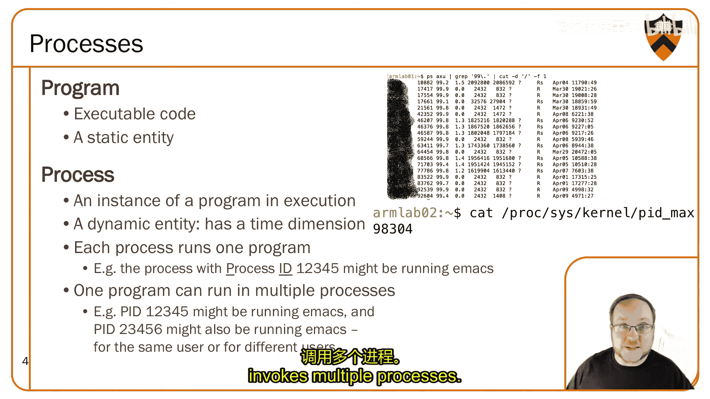

当我们开始讨论运行一个会调用多个进程的程序时，这个PID将成为一个重要的属性。

## 进程抽象的强大之处 ✨

进程抽象非常强大。尽管可能有成千上万个进程在运行，但每个进程都可以（如果它愿意）在一种**假象**下运行，即它是机器上唯一的进程，并且拥有所有可能的资源，甚至比实际存在的资源还要多。

让我们简要看看在底层实现这种假象的两种主要方式。

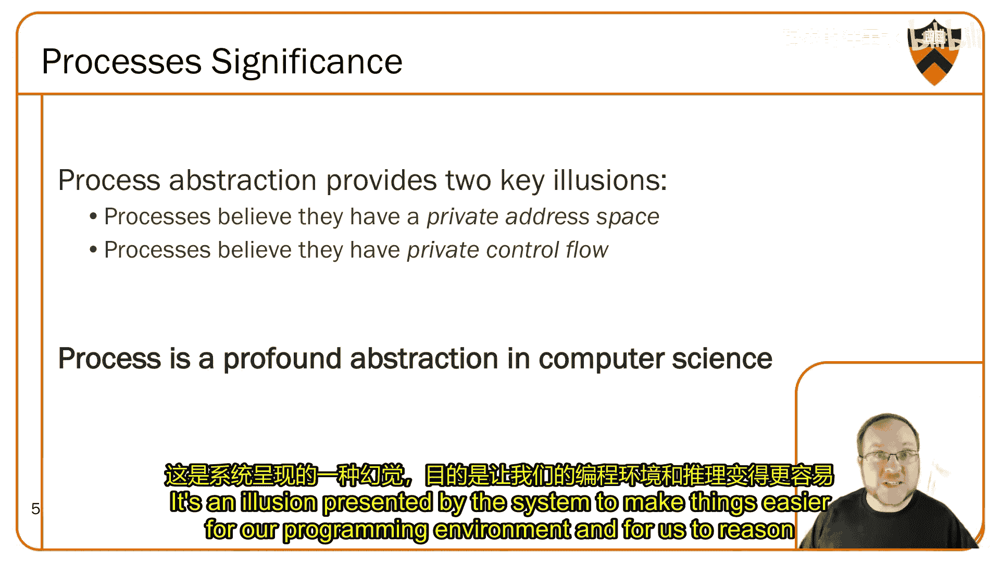

## 私有地址空间的假象 🗺️

首先，是它们拥有**私有地址空间**的假象。一个进程感觉它拥有机器上的所有内存，实际上，它感觉拥有的内存甚至比运行它的机器或任何机器可能拥有的内存还要多。

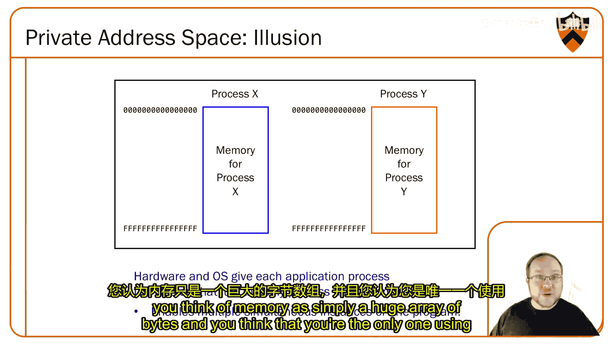

其次，进程可以认为它们**始终独占处理器**。这当然是错误的，但它提供了一个很好的抽象，这种抽象一直渗透到栈的底层，甚至到机器语言代码层面。在课程中，我们即将向下探索语言层级，从C语言开始，接下来会看到汇编甚至机器语言。我们会感觉自己在深入到非常底层的世界，然而，所有这些的基础仍然是我们在一个虚拟世界中工作。这是系统呈现的一种假象，旨在使我们的编程环境和我们的推理更加容易。

## 内存管理的假象 💾

接下来，我们快速概述第一种假象，但这只是一个非常粗略的介绍。在应用程序层面编程时，你将内存视为一个巨大的字节数组，并且认为你是唯一使用它的人，用于你的栈、堆和所有其他内存段。

但现实中，机器拥有的内存可能更少。实际上，它肯定比我们想象的要少。我们把这个数组想象成从0到0xFFFFFFFFFFFFFFFF（16个F）的可寻址字节。但我录制此视频的笔记本电脑有16GB内存，这已经很多了，但2^64可寻址字节是它的数十亿倍以上。

此外，你的进程正在使用的内存中，只有一部分会实际驻留在物理内存中，即物理处理器的内存以及芯片和硬件上的物理RAM中。实际上，你的地址空间中有很大一部分根本没有被使用。如果你有一个叫做“Hello World”的小程序，它做不了多少事情，你真的会使用2^64字节吗？当然不会。

即使是你正在使用的内存，也可能不在物理内存中。例如，你可能还不需要它，所以程序还没有必要把它放入物理内存；或者它最近没有被使用过。实际上，有许多进程同时在运行，它们都在竞争这些资源。

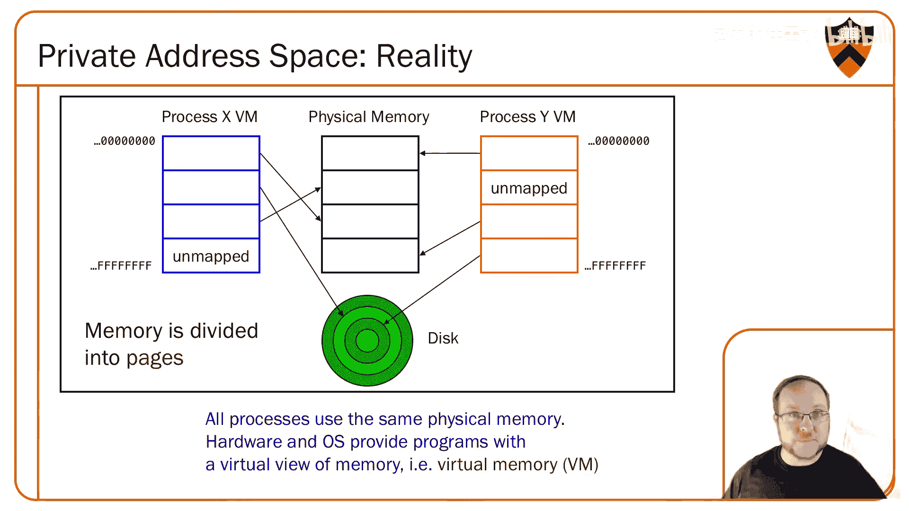

因此，在应用程序层面编程时，硬件和操作系统完全将你与这些细节隔离开来。你在一种假象下操作，即你的地址0到0xFFFFFFFFFFFFFFFF是真实的，但它们不是。它们是虚拟的，并且在操作系统的帮助下，通过硬件几乎无缝地转换为物理内存位置。此外，该位置甚至可能根本不在物理内存中，它可能被存储在磁盘的某个地方。

再者，我们将内存视为一个巨大的数组。实际上，它是一个由不同内存组成的层次结构。我们将在下周详细讨论这一点，但简单来说，存在一个硬件层次结构，范围从速度极快但容量极小，到容量几乎无限但速度极慢。系统和内存管理中的一个核心主题就是如何利用层次结构中的所有不同存储级别，以同时提供大容量和高速的假象。

## 私有控制流的假象 ⏱️

好的，我说过关于内存的部分只是一个快速的旁白，到此为止。进程抽象提供的第二个假象是，**每个进程都有其私有的控制流**。

如今许多计算机都有多个CPU，例如每台ARM实验室计算机有96个CPU，但这仍然不足以让每个进程始终拥有处理器。为了简化问题，我们在单独和交互地推理进程时，通常假设只有一个CPU，许多结论仍然可以推广到多个CPU的情况。

因此，对于那个单一处理器，我们感知到我们的进程一直在运行，但这当然不可能是真的。实际上，它必须与机器上运行的所有其他进程在极短的时间片内进行时间共享。所以，进程X的一些指令会运行，然后是进程Y的一些指令。有时发生这种情况是因为一个进程暂时不需要CPU，例如，它正在等待操作系统返回，因为它查找了被发送到磁盘的内存，或者它建立了一个网络连接，正在等待实际的物理连接从世界另一端发送字节。其他时候，是因为操作系统主动介入并说：“嘿，友好点，分享是关爱，你应该与其他进程分享。”

然而，特别是对于交互式进程，每个进程必须定期获得其应得的CPU份额，以维持这种私有控制流的假象。当你正在某个进程中操作，突然发现：“等等，我应该能在这里输入，但它不接受我的输入”，或者“它应该立即给我一个答案。这是一个非常简单的函数。为什么它什么都没打印？”这时，这种假象的维持就变得非常明显。

因此，我们必须让时间片相对较快，以便我们仍然能感知到这一点。我们经常在这里谈论**并发执行**，但英语单词“concurrent”在这里并不完全合适。从技术上讲，如果只有一个CPU，X和Y不能同时在CPU上运行。在系统中，如果X在Y的生命周期内开始，或者Y在X的生命周期内开始，我们就说X和Y被设置为并发运行。这与我们通常认为的“并发”并不完全相同。

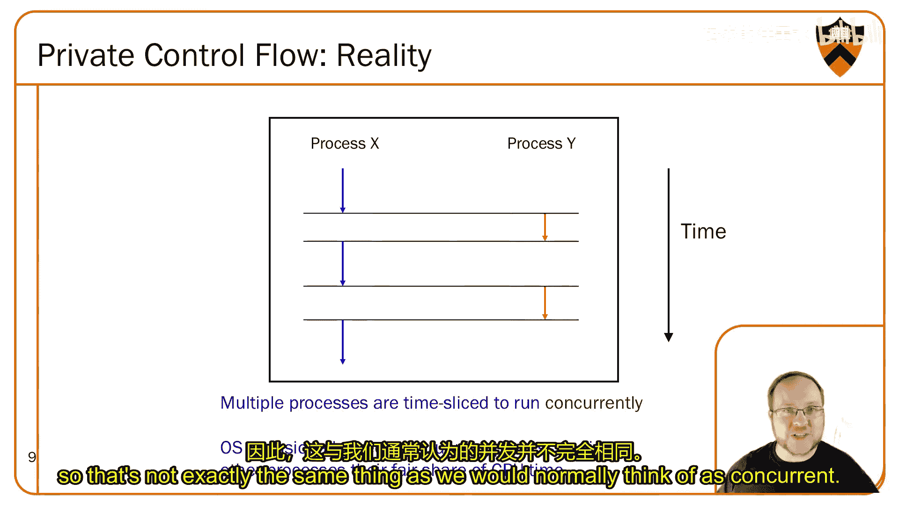

## 进程状态与转换 🔄

在任意给定时间，一个进程可能处于以下几种状态之一：
*   **运行中**：CPU正在主动执行该进程的指令。
*   **就绪**：进程有可以运行的指令，但CPU尚未选择让它运行，它正在与其他进程共享。
*   **阻塞**：进程正在等待其控制范围之外的某些事情发生。例如，操作系统可能正在为它做某事，或者像I/O这样的操作。

这些状态之间的转换实际上是本课程中**确定性有限自动机**出现的又一个实例。一个进程进入就绪状态后，它唯一能转换到的状态是运行状态，因为它不能在运行状态之外请求阻塞操作来实际发出该请求。操作系统最终会决定轮到该进程运行，并将其转换到运行状态。它会运行一段时间，然后要么执行一个再次阻塞的操作（如I/O或需要操作系统干预的操作）并转换到阻塞状态，要么操作系统介入并说：“你已经得到了公平的份额，让出来吧，其他进程需要运行”，于是它又回到就绪状态。在阻塞状态，最终无论它等待的是什么——操作系统、输入/输出等——都会完成，因此现在只要下次轮到它，它就能运行，于是它转换到就绪状态。

在简要描述了进程状态的DFA概念并看过状态图后，我们可以看一个更详细的、加入了时间元素的先前图表版本。如果进程之间的切换在足够小的时间尺度上进行，每个进程都可以维持独占机器的假象，但在进程数量足够多时，这是一场微妙的舞蹈。

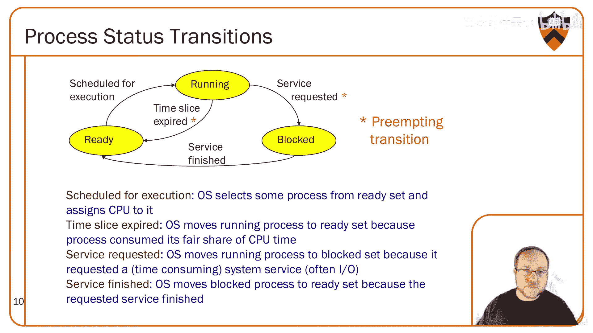

## 上下文切换的代价 ⚖️

此外，**上下文切换并非没有代价**。它涉及保存进程X的内容。这个内容或上下文就是我们通常所说的“上下文切换”中的上下文。但它实际上是内存的内容、处理器的内容，以及该进程在被抢占时发生的一切。它必须被保存起来。然后，进程Y在被抢占时的上下文必须被加载回来。

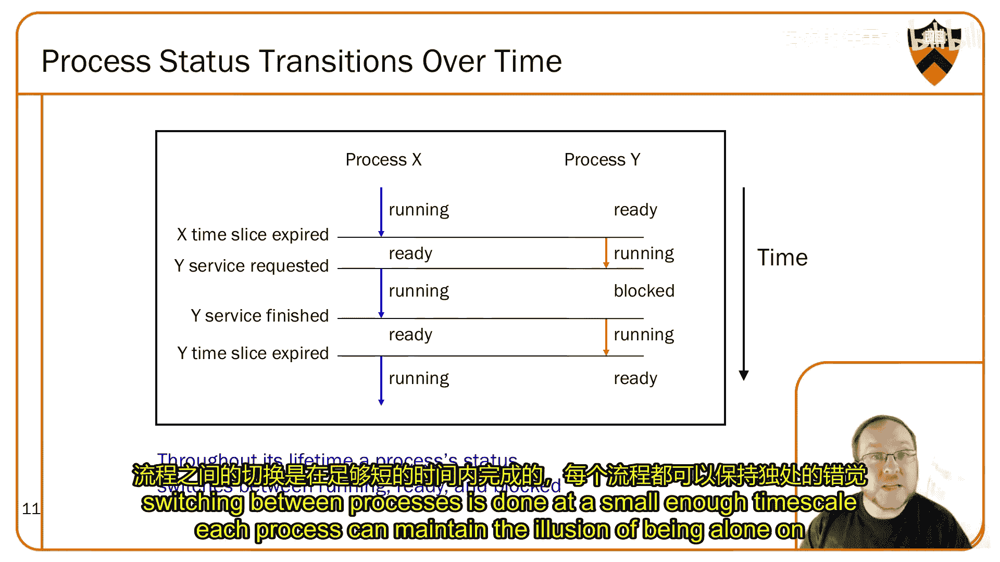

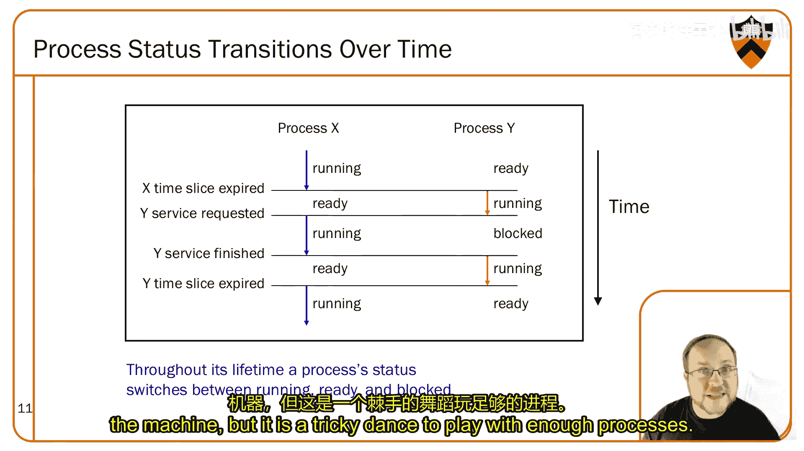

因此，如果切换过于频繁，这听起来对维持感知上的隔离和完全控制的假象是件好事，但切换本身会产生大量开销。实际上，上下文切换每秒发生50到数千次不等，具体取决于系统规格和负载，这可能相当频繁。

这是一个经典的例子，说明了系统领域一切问题的答案通常是：“嗯，这要看情况”，或者说这是一种**权衡**。如果我们给进程分配大的时间片，我们可能会让其他进程因得不到处理器而“饥饿”，从而打破我们私有控制流的假象。但如果我们使用太小时的时间片，我们会在保存和恢复上下文上浪费大量时间，而这些时间本可以用来做有用的工作。在这种情况下，我们所有的程序都会因此运行得更慢。

## 总结 📝

本节课中我们一起学习了**进程抽象**的核心概念。我们明确了**程序**（静态的可执行代码）与**进程**（动态的执行实例）的区别，并认识了进程的唯一标识符**PID**。我们深入探讨了操作系统为每个进程营造的两个关键假象：**私有地址空间**（感觉拥有全部内存）和**私有控制流**（感觉独占CPU）。为了实现这些假象，进程在**运行**、**就绪**和**阻塞**状态间转换，并通过**上下文切换**在CPU上分时运行。最后，我们了解到系统设计需要在**给予进程足够长的运行时间以维持假象**和**频繁切换以避免其他进程“饥饿”** 之间进行权衡，因为上下文切换本身存在开销。

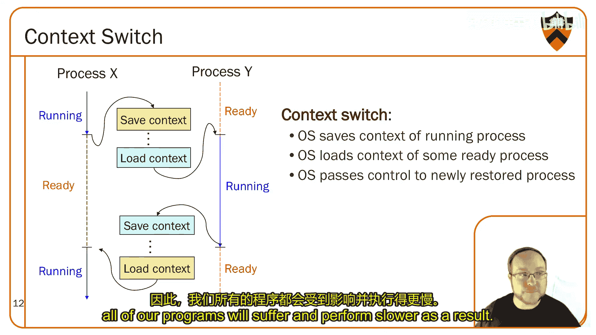

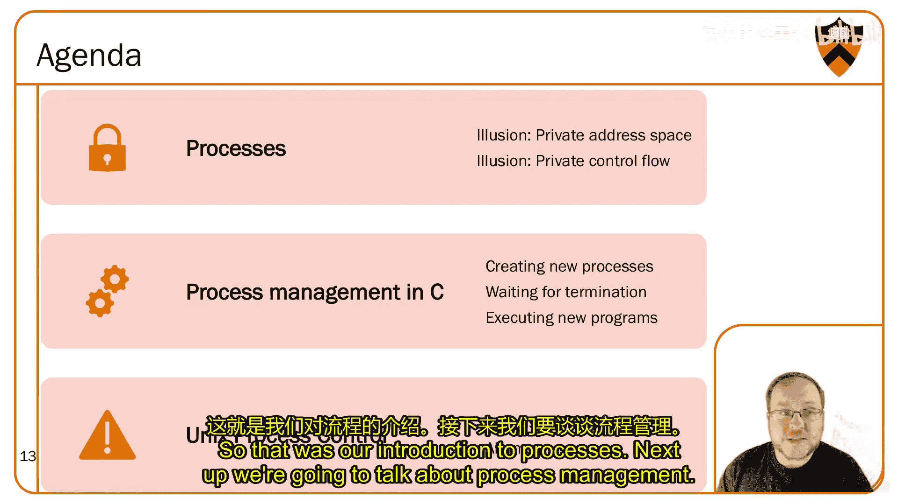

下一节，我们将讨论**进程管理**。