# 018：信号 📡

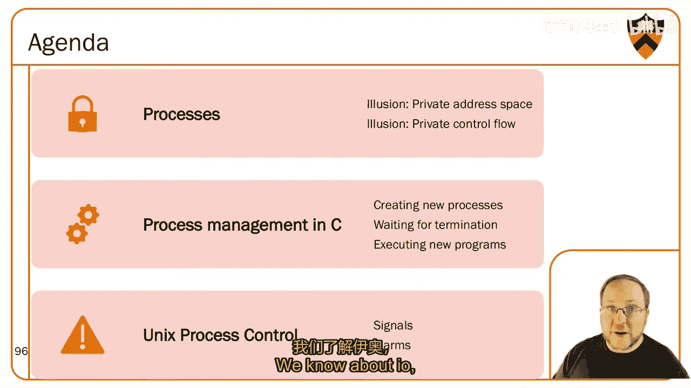

在本节课中，我们将学习进程间通信的一种新机制——信号。信号是操作系统向进程发送的一种异步通知，用于告知进程发生了某些需要处理的事件，例如用户按下中断键（Ctrl+C）或程序出现非法内存访问。

---

## 信号是什么？🤔

上一节我们介绍了进程的基本概念，本节中我们来看看信号。信号是操作系统注入到进程正常执行流程中的一种通知。当发生异常事件（如键盘中断或内存访问错误）时，操作系统会获得CPU控制权，并向目标进程发送一个信号。这个信号本质上是在进程的状态位中设置一个标志位。

例如，当你运行一个无限循环的程序并按下 `Ctrl+C` 时，键盘控制器会向CPU发起一个中断。操作系统注意到这个中断，读取键盘数据，并将其解释为一个请求：中断当前正在运行的进程。操作系统随后向该进程发送**信号2**，即 `SIGINT`（中断信号）。该信号的默认处理行为是终止进程。

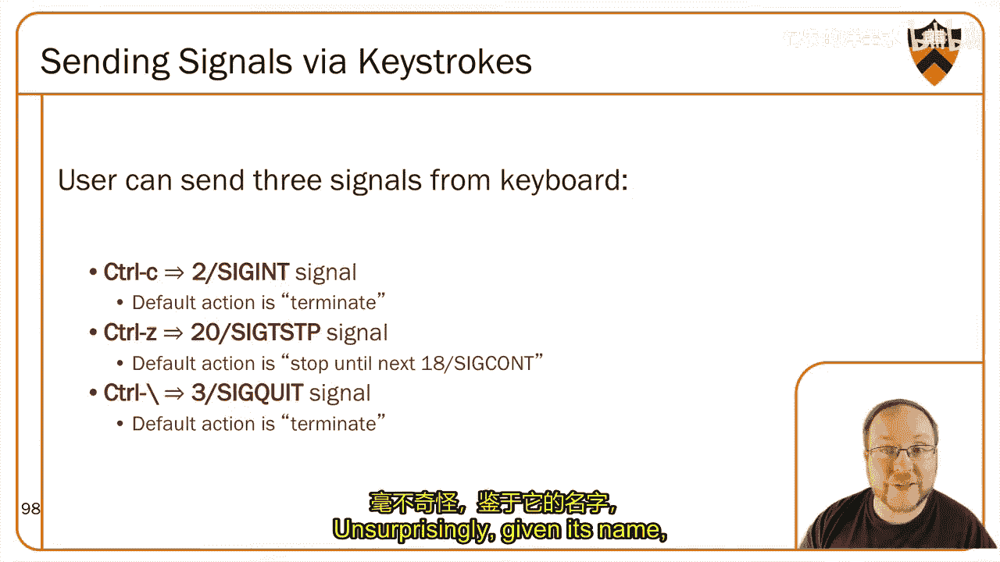

以下是几个常见的用户触发信号及其默认行为：

*   **`SIGINT` (信号 2)**：由 `Ctrl+C` 触发。默认行为是终止进程。
*   **`SIGTSTP` (信号 20)**：由 `Ctrl+Z` 触发。默认行为是停止（挂起）进程。
*   **`SIGQUIT` (信号 3)**：由 `Ctrl+\` 触发。默认行为是终止进程。

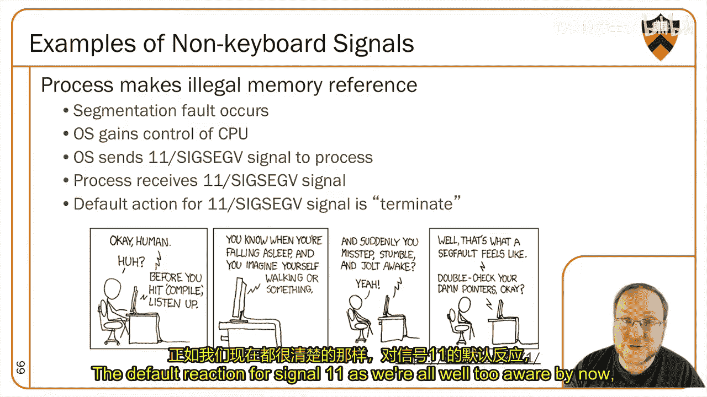

另一个常见的信号例子是 `SIGSEGV`（信号11，段错误信号）。当我们执行一条导致非法内存访问的指令时，会触发一个中断，操作系统获得控制权并向进程发送 `SIGSEGV` 信号，其默认行为同样是终止进程。

---

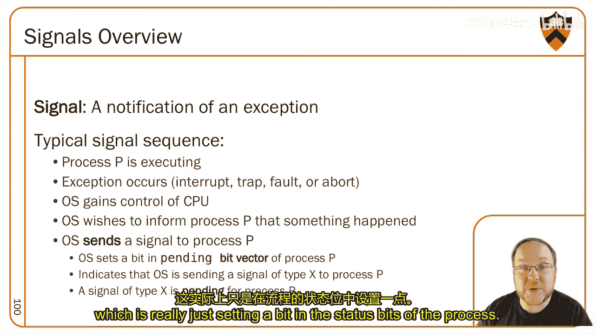

## 信号的生命周期 🔄

现在我们已经了解了信号的来源，让我们深入看看信号从发送到处理的完整过程。

1.  **异常发生**：进程P正在执行时，发生了一个打破程序标准控制流的异常事件。这可能是键盘中断、内存访问错误，或者其他进程请求操作系统发送信号。
2.  **OS介入**：操作系统获得CPU控制权来处理这个异常。
3.  **发送信号**：操作系统通过设置进程P状态位中的一个标志位，向其发送信号。
4.  **接收信号**：稍后（通常是立即），进程P恢复执行。操作系统通知P有信号待处理，并清除相应的状态位。
5.  **处理信号**：进程P触发其**信号处理器**。这可能是默认处理器，也可能是程序自定义的处理器。
6.  **恢复执行**：如果信号处理没有导致进程终止（例如，自定义处理器选择忽略信号），那么进程将在信号处理器完成后，从被中断的地方继续正常执行。

你可以将信号处理（在进程不终止的情况下）视为正常控制流中的一个临时分支。

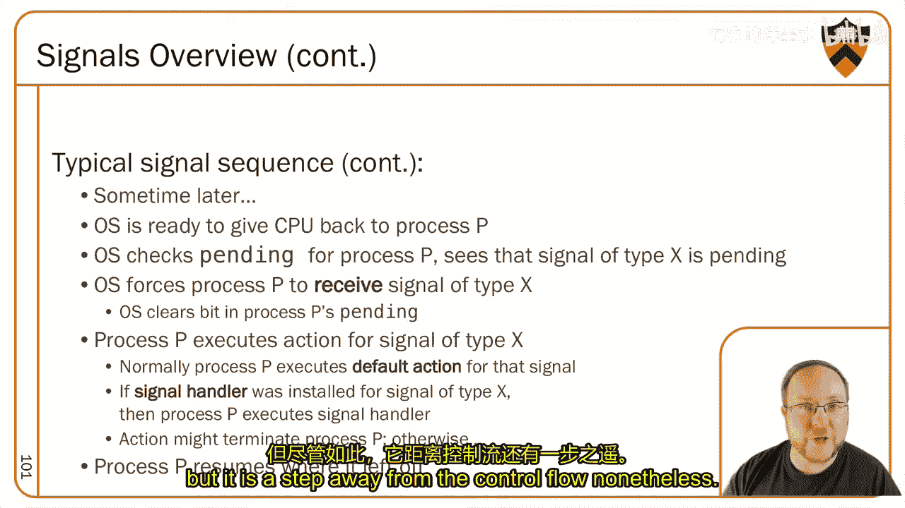

---

## 如何发送信号？📤

除了键盘快捷键，还有其他方式可以向进程发送信号。

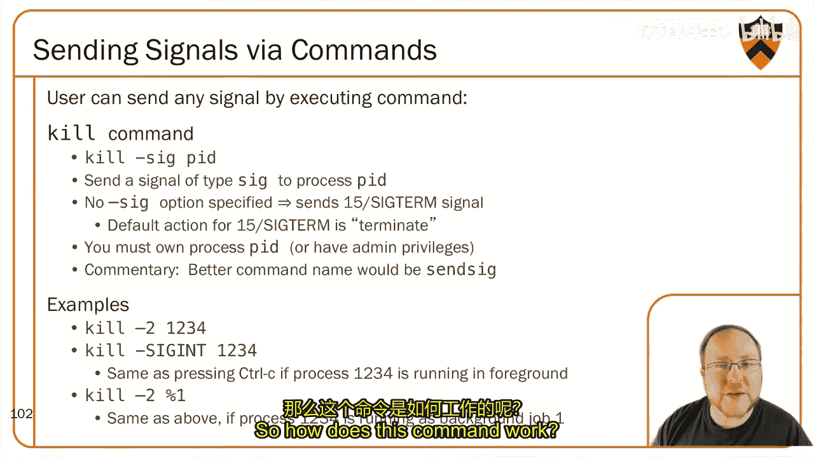

一种方式是通过名为 `kill` 的命令。尽管名字叫“杀死”，但它可以发送任何信号，而不仅仅是终止信号。你需要指定一个信号和接收该信号的进程ID（PID）。

**命令格式**：
```bash
kill -<信号编号> <进程ID>
```
例如，`kill -9 1234` 会向PID为1234的进程发送无法被捕获或忽略的 `SIGKILL` 信号，强制终止它。

`kill` 命令通过向操作系统发起一个**陷阱**来工作，因为发送信号需要提升的权限。

一个实用的场景是管理后台作业。假设你启动了一个长时间运行的前台命令，想把它放到后台。你可以：
1.  按 `Ctrl+Z` 发送 `SIGTSTP` 信号，挂起该进程。
2.  输入 `bg` 命令，将该作业放入后台。
3.  系统会自动向该进程发送 `SIGCONT` 信号，使其在后台继续运行。

这样避免了杀死进程并从头开始的浪费。

要查看系统上所有预定义的信号，可以使用命令：
```bash
kill -l
```

此外，程序自身也可以通过 `raise()` 函数向自己发送信号。虽然这听起来有些奇怪，但它可以用于程序内部的逻辑跟踪或清理工作。更常见的是，程序使用 `kill()` 函数（注意：这是一个C库函数，不是shell命令）向其他进程发送信号，作为一种简单的**进程间通信**方式，例如实现“心跳”机制来确认另一个进程是否存活。

---

## 信号处理器：自定义反应 🛠️

我们已经多次提到信号的默认处理器，现在让我们看看如何自定义它。如果说 `raise()` 或信号发送类似于Java中的 `throw`，那么**信号处理器**就类似于 `catch` 块。

每个信号都有一个默认反应（终止、停止、继续或忽略）。程序也可以安装一个**自定义处理器**，即一个在接收到特定信号时运行的函数，以替代默认行为。这可以用于避免在特定条件下终止，或者在进程必须终止前执行清理工作（如关闭网络连接、保存文件）。

安装信号处理器的函数是 `signal()`。它接收两个参数：信号编号和作为处理器的函数指针。成功时返回旧的处理函数指针，方便后续恢复。

**函数原型**：
```c
void (*signal(int sig, void (*handler)(int)))(int);
```
为了简化，通常使用 `typedef` 定义的类型 `sighandler_t`。

有两个特殊的预定义处理器值：
*   **`SIG_DFL`**：恢复信号的默认处理器。
*   **`SIG_IGN`**：忽略该信号。

需要注意的是，有些信号不能被自定义处理器捕获或忽略，最著名的两个是：
*   **`SIGKILL` (信号 9)**：强制终止。这就是 `kill -9` 如此有效的原因。
*   **`SIGSTOP` (信号 19)**：强制停止（挂起）。

---

## 实践示例：捕获 Ctrl+C 🚫

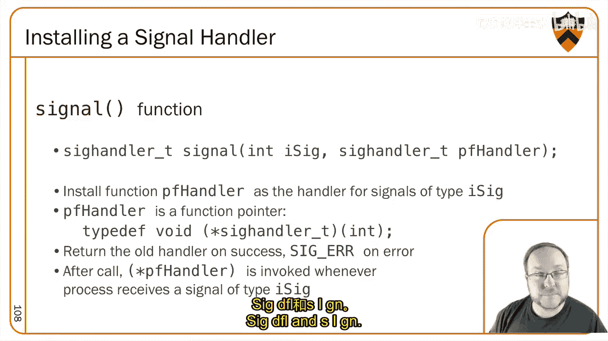

理论介绍完毕，让我们通过代码来实践。以下是一个简单的程序，它安装了一个自定义的 `SIGINT` 处理器，使得 `Ctrl+C` 无法终止程序，而是打印一条消息。

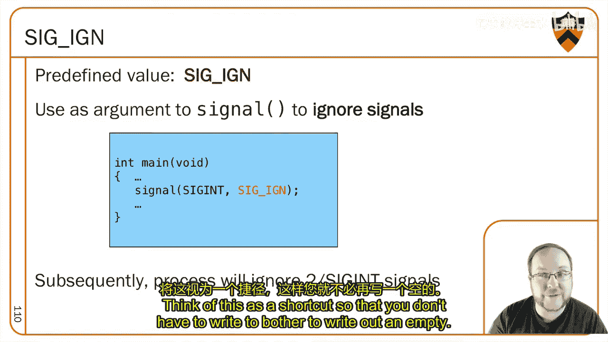

```c
#define _GNU_SOURCE
#include <stdio.h>
#include <signal.h>
#include <unistd.h>

void handle_sigint(int sig) {
    printf("\nCaught signal %d (SIGINT). I won't terminate!\n", sig);
}

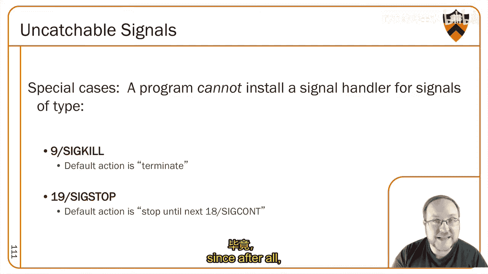

int main() {
    // 安装 SIGINT 的信号处理器
    signal(SIGINT, handle_sigint);

    printf("Try pressing Ctrl+C...\n");
    while(1) {
        pause(); // 等待任何信号
    }
    return 0;
}
```
在这个程序中，`handle_sigint` 函数是自定义处理器。安装后，按下 `Ctrl+C` 将触发这个函数，打印消息，而进程会继续运行（因为处理器没有调用 `exit`）。要终止它，你需要使用其他信号，例如在另一个终端使用 `kill` 命令。

---

## 实践示例：资源清理 🧹

让我们看一个更实际的例子。假设一个程序生成大量数据并写入一个临时日志文件，程序结束时再删除它。如果用户在程序运行中按下 `Ctrl+C`，默认情况下进程会立即终止，导致 `remove()` 函数没有被调用，临时文件残留。

为了解决这个问题，我们可以安装一个 `SIGINT` 处理器来执行清理工作。

```c
#define _GNU_SOURCE
#include <stdio.h>
#include <stdlib.h>
#include <signal.h>
#include <unistd.h>

FILE *logfile;

void cleanup(int sig) {
    if (logfile) {
        fclose(logfile);
        logfile = NULL;
    }
    // 可以在这里删除临时文件
    printf("Cleaned up before exit.\n");
    exit(sig); // 退出，使用信号编号作为退出状态
}

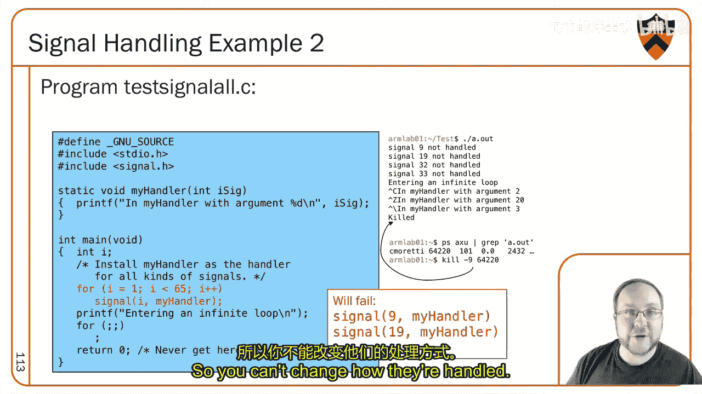

int main() {
    // 安装信号处理器
    signal(SIGINT, cleanup);

    logfile = fopen("temp.log", "w");
    if (!logfile) {
        perror("fopen");
        return 1;
    }

    // 模拟写入大量数据
    for (int i = 0; i < 1000000; ++i) {
        fprintf(logfile, "Data line %d\n", i);
        // 长时间操作中，用户可能按下 Ctrl+C
    }

    // 正常结束时的清理
    cleanup(0);
    return 0; // 这行实际上不会执行，因为 cleanup 调用了 exit
}
```
这样，无论程序是正常结束还是被 `Ctrl+C` 中断，`cleanup` 函数都会被调用，确保文件被正确关闭。注意，`SIGKILL` (`kill -9`) 仍然无法被捕获，因此是强制终止的最终手段。

---

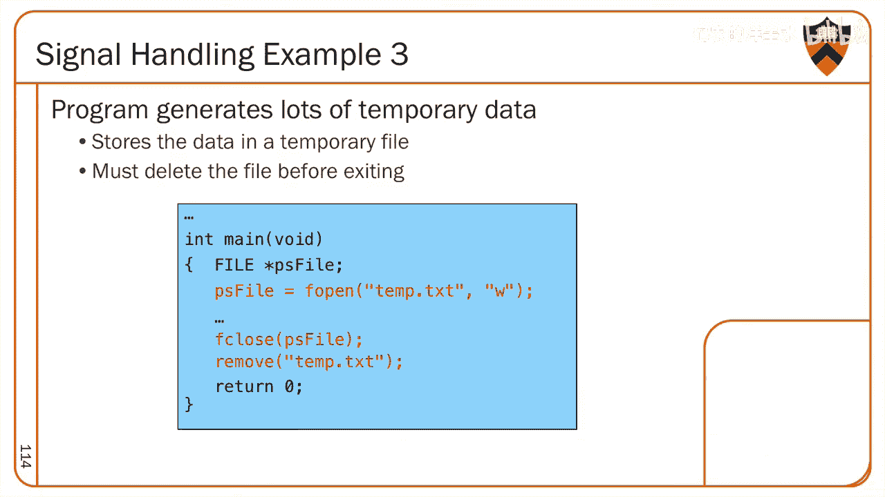

## 闹钟信号：实现超时功能 ⏰

最后一个系统级函数是 `alarm()`。它请求操作系统开始一个倒计时，倒计时结束后向调用进程发送 `SIGALRM`（信号14）。这非常有用，可以用来实现**超时**功能。

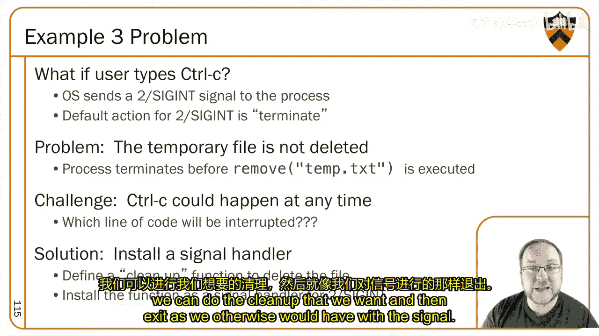

`SIGALRM` 的默认行为也是终止进程，因此通常需要为其安装自定义处理器。

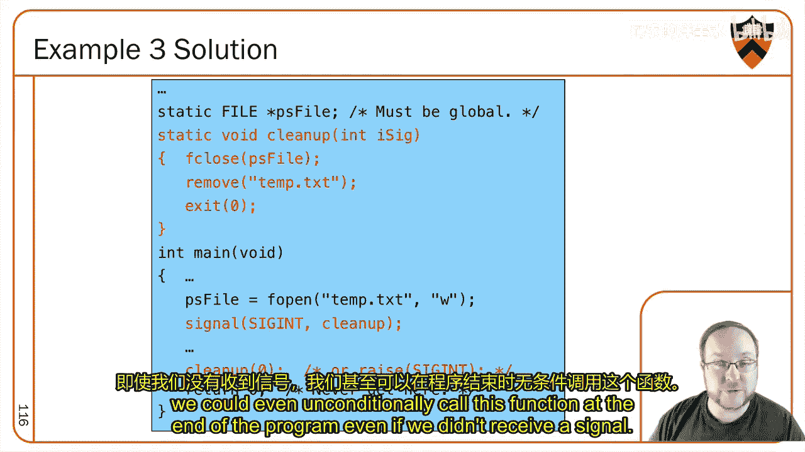

**示例1：周期性提醒**
```c
#define _GNU_SOURCE
#include <stdio.h>
#include <signal.h>
#include <unistd.h>

void handle_alarm(int sig) {
    printf("Timer fired! (%d)\n", sig);
    alarm(2); // 重新设置一个2秒后的闹钟
}

int main() {
    signal(SIGALRM, handle_alarm);
    alarm(2); // 设置第一个2秒闹钟

    while(1) {
        pause(); // 主程序无限等待
    }
    return 0;
}
```
这个程序会每2秒打印一次“Timer fired!”，形成一个简单的定时器。

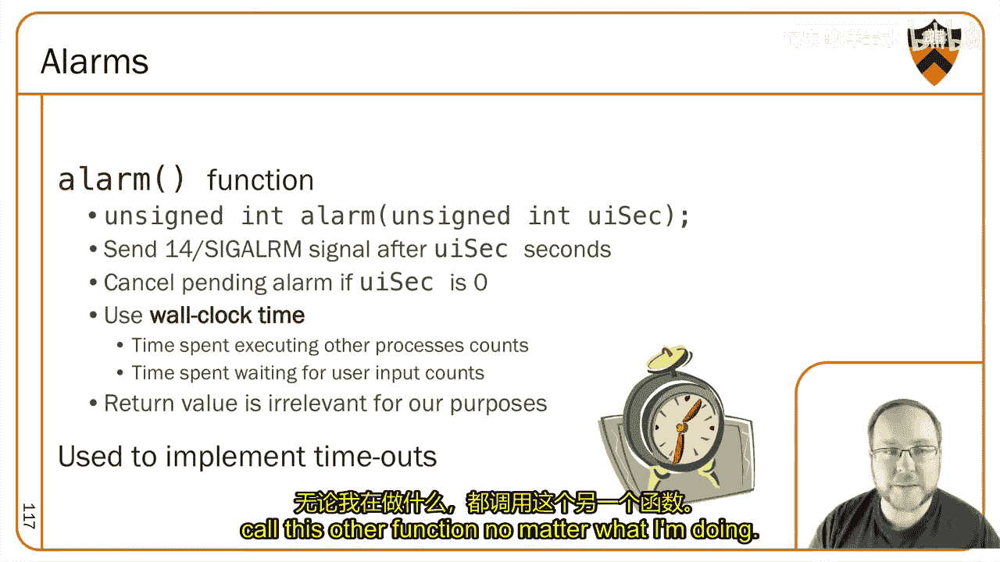

**示例2：输入超时**
```c
#define _GNU_SOURCE
#include <stdio.h>
#include <signal.h>
#include <unistd.h>

void handle_alarm(int sig) {
    printf("\nSorry, you took too long. Exiting.\n");
    exit(1);
}

int main() {
    char name[100];
    signal(SIGALRM, handle_alarm);

    printf("Enter your name (you have 5 seconds): ");
    fflush(stdout);

    alarm(5); // 设置5秒超时

    if (scanf("%99s", name) == 1) {
        alarm(0); // 取消闹钟
        printf("Hello, %s!\n", name);
    } else {
        // scanf 失败或超时发生
        printf("Failed to get input.\n");
    }

    return 0;
}
```
这个程序给用户5秒时间输入名字。如果用户超时，`SIGALRM` 处理器会触发并退出程序。如果用户在5秒内完成输入，则用 `alarm(0)` 取消闹钟。这解决了像 `scanf` 这样的阻塞调用可能无限期等待用户输入的问题。

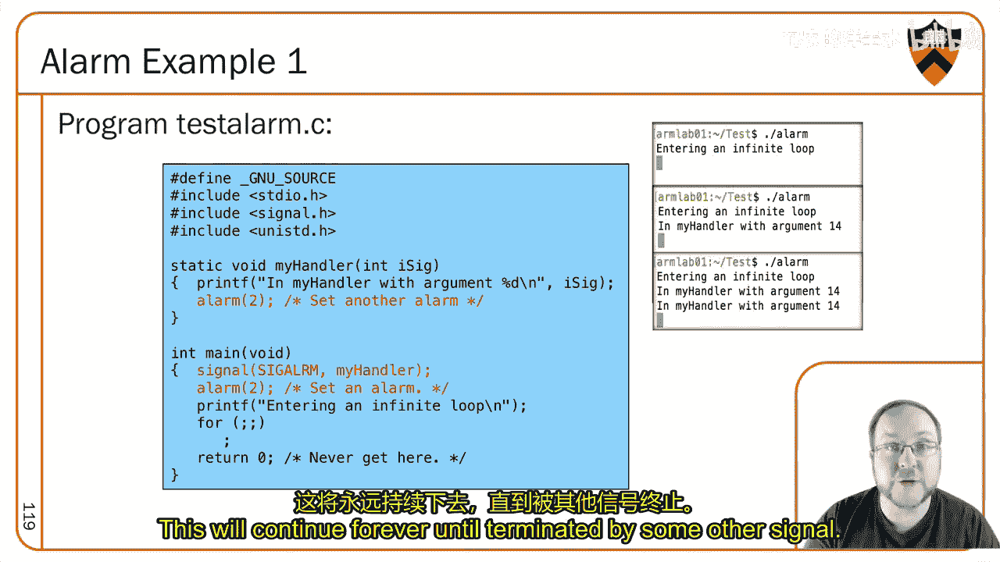

---

## 总结 📝

本节课中我们一起深入学习了**信号**这一重要的进程间通信和异常处理机制。

我们首先了解了信号是什么：它是操作系统异步通知进程发生特定事件的方式。我们探讨了信号的完整生命周期，从触发、发送到接收和处理。

接着，我们学习了多种发送信号的方法，包括键盘快捷键、`kill` 命令以及C语言中的 `raise()` 和 `kill()` 函数。

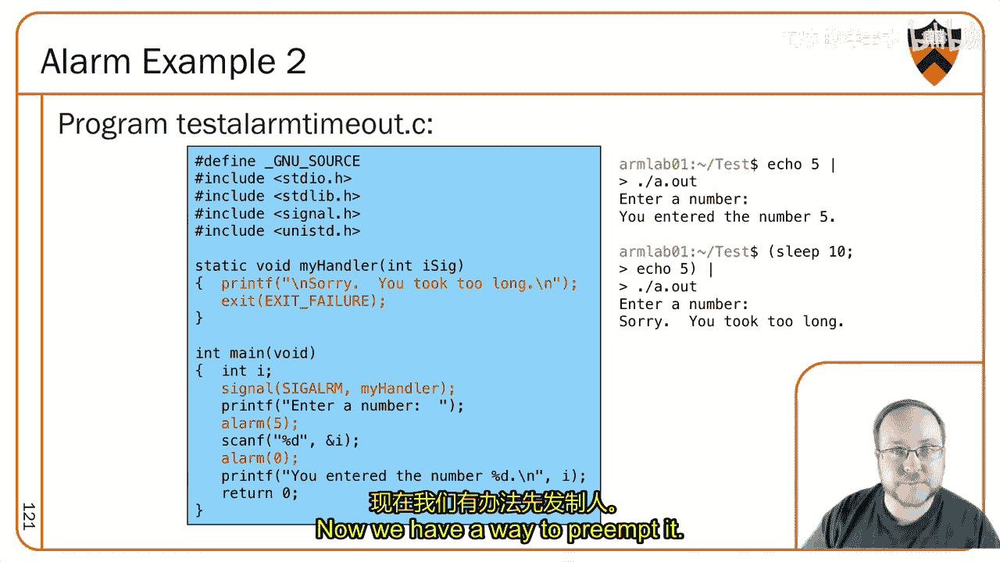

然后，我们掌握了信号处理的核心——如何通过 `signal()` 函数为信号安装**自定义处理器**，以改变其默认行为，并了解了 `SIG_DFL` 和 `SIG_IGN` 这两个特殊值。我们也知道了 `SIGKILL` 和 `SIGSTOP` 是无法被捕获或忽略的。

最后，我们通过几个实践示例巩固了知识：如何捕获 `Ctrl+C` 来防止程序被意外中断，如何在程序退出（包括被信号中断时）进行资源清理，以及如何使用 `alarm()` 和 `SIGALRM` 来实现超时功能，这为处理可能阻塞的操作提供了强大工具。

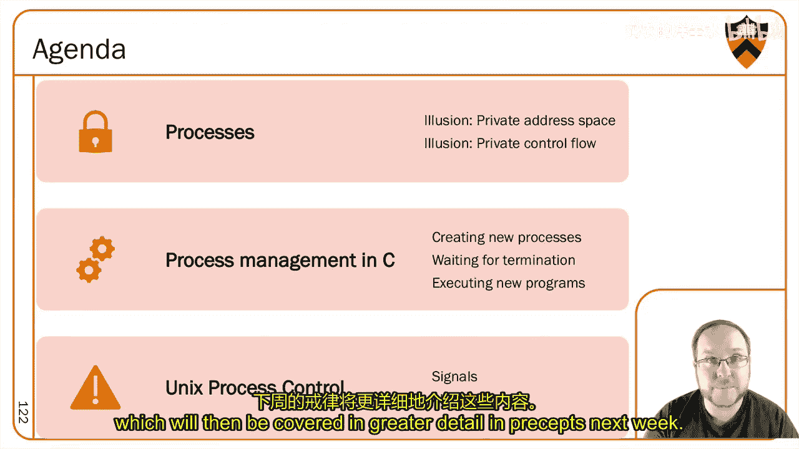

信号是理解操作系统如何与进程交互、如何构建健壮应用程序的关键概念。希望本讲能帮助你更好地理解并运用这一机制。