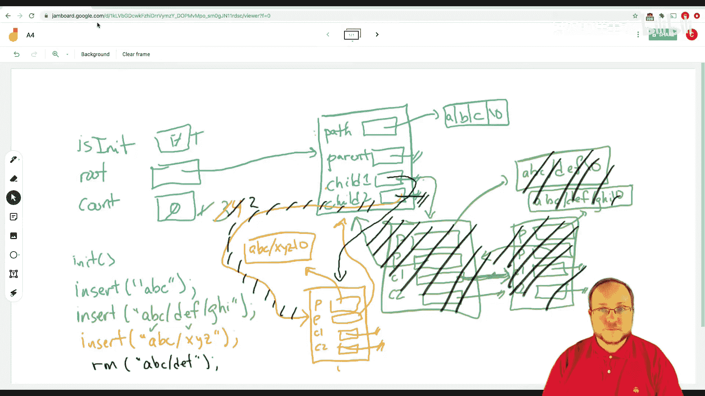
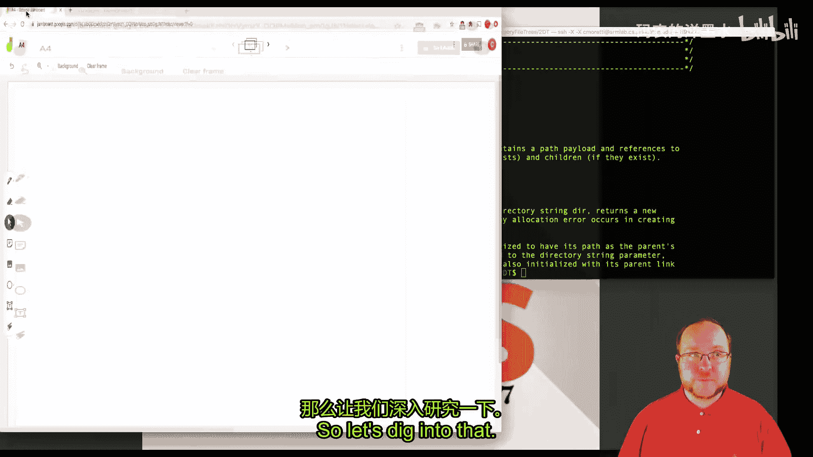
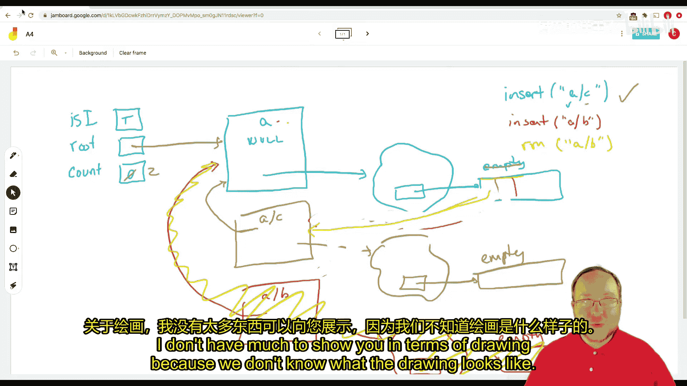
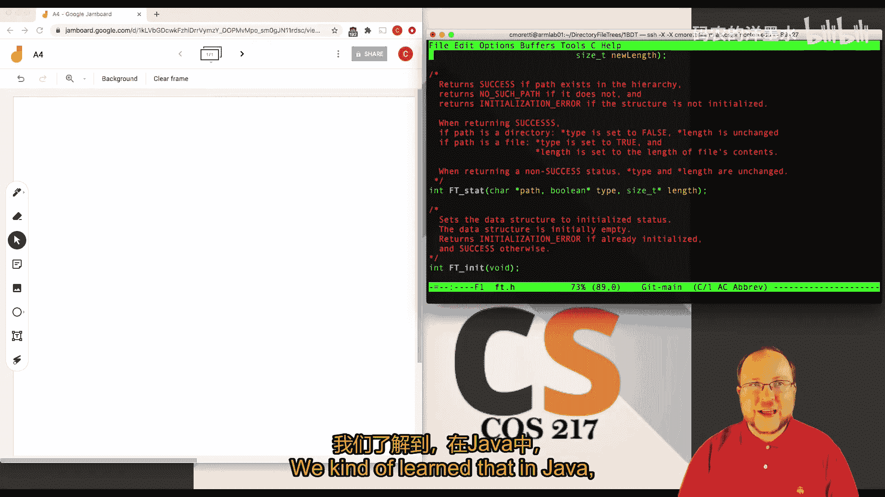

# 019：作业4概述与数据结构详解 🚀

在本节课中，我们将详细介绍第四次作业（Assignment 4）的目标、结构以及核心数据结构。本次作业是课程中第一个合作项目，旨在通过实践提升代码阅读、数据结构应用、调试、测试以及模块化设计的能力。

## 作业目标与结构 🎯

上一节我们回顾了课程进度，本节中我们来看看第四次作业的具体目标。本次作业包含五个主要目标：

1.  **阅读大量非自写代码**：在实际工作中，工程师经常需要理解和维护庞大的现有代码库。本次作业将模拟这一场景。
2.  **深入理解抽象对象范式**：与作业3中的抽象数据类型不同，本次作业将接触类似Java单例模式的**抽象对象模型**。其状态由文件作用域的静态变量维护，方法无需接收实例参数。
3.  **提升GDB调试技能**：作业的第一部分不涉及编码，而是使用GDB分析有缺陷的代码实现，定位其中的错误。
4.  **编写内部测试套件**：您需要编写一个检查器程序，在每次API调用前后验证数据结构的内部状态是否保持正确。
5.  **实践模块化与程序设计**：作业仅规定接口和客户端行为，具体实现方案（如模块划分、底层数据结构）完全由您自主设计，这是发挥创造力的好机会。

## 作业三部曲 📚

作业内容围绕模拟文件系统展开，分为三个循序渐进的部分。

### 第一部分：二叉目录树 (BDT)


在第一部分，我们将实现一个简化的文件系统模型——二叉目录树。它有两个关键约束：
*   **二叉**：每个目录最多只能有两个子节点。
*   **目录**：树中只包含目录，没有文件。

以下是BDT模块的核心接口函数：
```c
BDT_init(); // 初始化数据结构
BDT_destroy(); // 销毁数据结构
BDT_insert_path(path); // 插入路径（类似 mkdir -p）
BDT_contains_path(path); // 检查路径是否存在
BDT_remove_path(path); // 移除路径（类似 rm -r）
BDT_to_string(); // 获取树的字符串表示
```


其数据结构包含三个字段：
*   `bool initialized`： 标记是否已初始化。
*   `Node* root`： 指向树根节点的指针。
*   `size_t count`： 树中节点的总数。

每个节点（Node）包含四个字段：
*   `char* path`： 从根目录到该节点的完整路径字符串。
*   `Node* parent`： 指向父节点的指针。
*   `Node* child1`： 指向第一个子节点的指针。
*   `Node* child2`： 指向第二个子节点的指针。

**操作示例**：插入路径 `“/A/B/C”`。
1.  检查根节点。若为空，则创建路径为 `“A”` 的根节点。
2.  解析剩余路径 `“B”`。检查根节点是否有匹配的子节点。若 `child1` 为空，则在此创建路径为 `“A/B”` 的新节点，并建立链接。
3.  解析剩余路径 `“C”`。重复步骤2，在 `“A/B”` 节点下创建路径为 `“A/B/C”` 的节点。

**重要不变量**：如果一个节点只有一个子节点，那么它必须是 `child1`。在删除操作后，可能需要将 `child2` 的子节点移动到 `child1` 以维持此不变量。

在本部分，您无需编写实现代码，主要任务是使用GDB分析我们提供的、包含错误的实现，并找出缺陷所在。

### 第二部分：目录树 (DT)

在第二部分，我们移除“二叉”限制，实现一个支持任意数量子节点的通用目录树。

其接口与BDT类似，但节点结构变得更复杂。节点（Node ADT）包含：
*   `char* path`： 路径字符串。
*   `Node* parent`： 父节点指针。
*   `DArray* children`： 指向一个动态数组对象的指针，该数组存储其所有子节点。



动态数组（DArray ADT）内部通常包含：
*   `size_t length`： 当前存储的元素数量。
*   `size_t capacity`： 数组的当前容量。
*   `void** array`： 指向指针数组的指针，用于实际存储元素（此处为子节点指针）。



**操作示例**：插入路径 `“/A/B”`。
1.  从根节点开始。若根节点不存在，则创建路径为 `“A”` 的根节点，并为其初始化一个空的 `children` DArray。
2.  解析子路径 `“B”`。在根节点的 `children` DArray 中查找 `“B”`。
3.  若未找到，则在DArray的合适位置（保持子节点按路径名字典序排列）插入新的节点 `“A/B”`。

**重要不变量**：每个节点的子节点在其 `children` DArray 中必须按路径名保持字典序。

在本部分，您同样无需编写树的核心实现代码。主要任务是**深入理解此数据结构**，并基于我们提供的代码框架，编写一个完整的检查器（Checker），用于验证所有操作前后数据结构的不变量是否被保持。

### 第三部分：文件树 (FT)

第三部分是作业的核心编码部分，您将扩展目录树，使其支持文件和目录两种类型，构建一个完整的文件树。

接口在目录树的基础上进行了扩展，主要变化包括：

1.  **路径类型分离**：针对目录和文件有独立的操作接口。
    ```c
    // 目录操作
    FT_insert_dir(path);
    FT_contains_dir(path);
    FT_remove_dir(path);
    // 文件操作
    FT_insert_file(path, contents, length);
    FT_contains_file(path);
    FT_remove_file(path);
    FT_get_file_contents(path, contents, length);
    FT_replace_file_contents(path, new_contents, new_length);
    ```

2.  **文件内容管理**：文件节点需要存储内容（`void*` 指针）和内容长度。

3.  **Stat操作**：新增 `FT_stat(path, &type, &length)` 函数，用于查询路径对应的是文件还是目录，如果是文件则返回其长度。
    ```c
    // 使用示例：读取文件内容
    FileType type;
    size_t len;
    FT_stat("/path/to/item", &type, &len);
    if (type == FILE_TYPE) {
        char* buffer = malloc(len);
        FT_get_file_contents("/path/to/item", buffer, len);
        // 处理 buffer
        free(buffer);
    }
    ```



**关键设计点**：
*   文件是叶节点，不能拥有子节点。
*   目录可以是内部节点或叶节点，拥有子节点（可以是文件或其他目录）。
*   您需要基于第二部分我们提供的、正确的目录树（DT）实现代码进行扩展，以完成文件树的构建。

## 客户端与测试 🧪

每个部分（BDT， DT， FT）我们都提供了一个客户端程序（client.c）。该程序使用一系列 `assert` 语句和打印输出来验证您的实现是否符合接口规范。

例如，在未初始化时调用插入函数，应返回 `INITIALIZATION_ERROR`。客户端会断言此行为。对于 `to_string` 等函数，客户端会打印结果，您可以与预期的标准输出进行比对。我们会在作业说明中提供正确的客户端运行样例。

## 总结与后续 🏁

本节课中我们一起学习了第四次作业的完整蓝图。我们明确了作业的五大核心目标：代码阅读、抽象对象模型、GDB调试、内部测试和模块化设计。我们详细剖析了作业三个部分（二叉目录树、目录树、文件树）的数据结构演变、接口定义和关键操作。

请记住：
*   **第一部分**：使用GDB调试，无编码任务。
*   **第二部分**：理解数据结构，编写检查器模块，无核心编码任务（但提供正确实现供参考和扩展）。
*   **第三部分**：基于第二部分的代码，实现完整的文件树系统，这是主要的编码挑战。



详细的作业规范将于下周初发布，相关的概念（如字符串路径解析、AO细节）也会在接下来的课程和辅导课中深入讲解。建议尽快寻找合作伙伴，共同开启这次系统编程的深入实践之旅。