# 020：存储层级、缓存与局部性 🏗️💾

在本节课中，我们将学习计算机系统中的存储层级结构、缓存的工作原理以及程序局部性的概念。理解这些内容对于编写高效的程序至关重要。

## 概述 📋

上一讲我们介绍了虚拟内存，它让进程以为自己拥有完整的64位地址空间。在讲解过程中，我们多次提到了不同类型的存储硬件，如寄存器、数据缓存、主内存和磁盘。现在，我们将深入探讨这些概念，特别是当我们开始学习更底层的语言时，这些知识将变得更加重要。

## 存储层级结构 🗂️

处理器运行速度极快，例如一个3GHz的处理器每秒可以执行30亿个周期。为了跟上处理器的速度，存储设备也需要足够快。如果存储速度慢于指令执行速度，指令就会等待数据的读取或写入，从而降低整体性能。

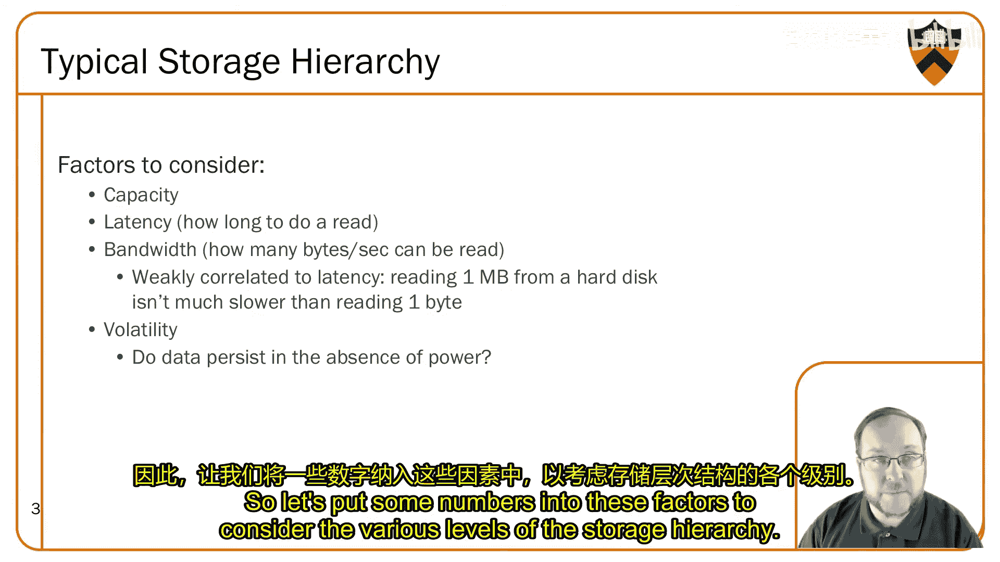

以下是典型的存储层级结构，从快到慢，从小到大：

*   **寄存器**：位于处理器芯片上，速度最快，容量最小（通常只有几十个，总容量约1000字节）。
*   **缓存**：位于处理器和主内存之间，通常分为L1、L2、L3三级。L1缓存最小最快，L3缓存最大最慢。
*   **主内存**：即RAM，速度比缓存慢得多，但容量大。
*   **二级存储**：本地磁盘。
*   **远程存储**：云端存储，容量近乎无限，但通过网络访问，延迟极高。

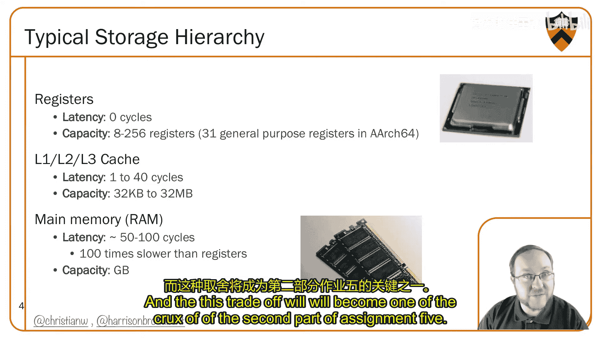

在评估存储设备时，我们关心三个因素：
1.  **容量**：能存储多少数据。
2.  **延迟**：开始读取或写入操作所需的时间。
3.  **带宽**：开始传输后，单位时间内能传输的数据量。

延迟和带宽的区别解释了为什么有时系统会预读大量数据（例如从磁盘）。虽然启动读取的延迟很高，但一旦开始，后续数据的传输成本相对较低。

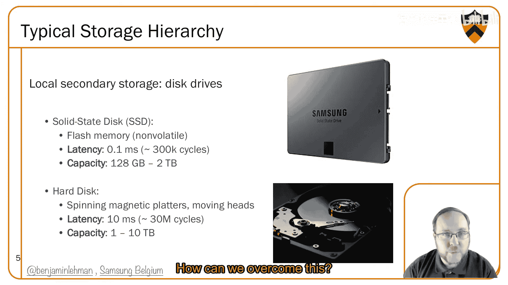

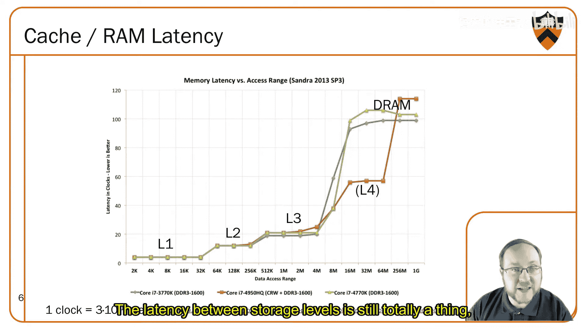

此外，我们还需考虑**易失性**。寄存器中的数据可能在几条指令后就丢失；内存中的数据在断电后会丢失；而磁盘和云端存储的数据是持久化的。

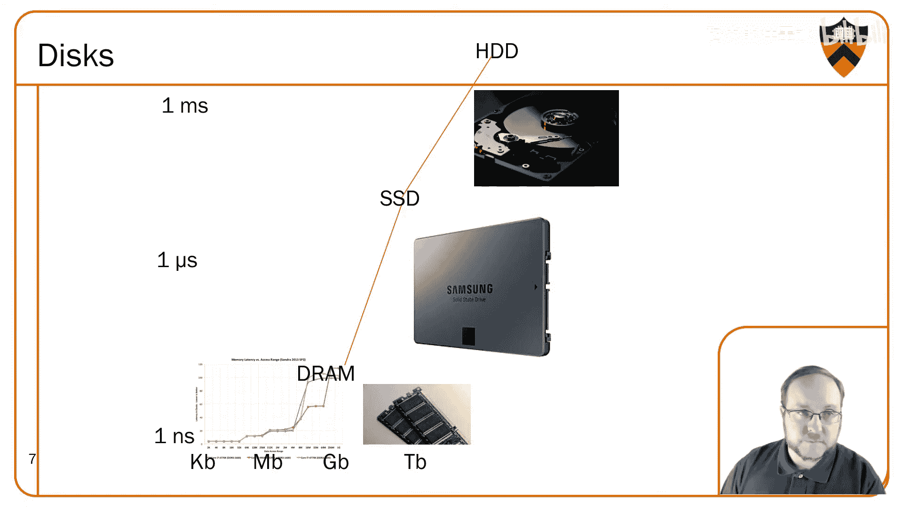

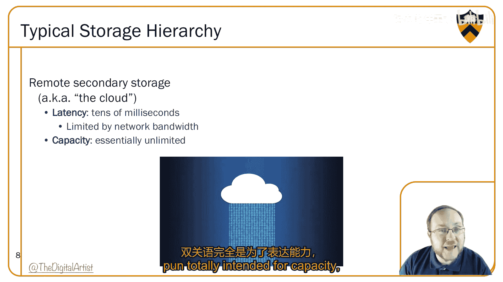

## 性能数据对比 📊

为了更直观地理解各级存储的速度差异，我们来看一些具体的数字对比。

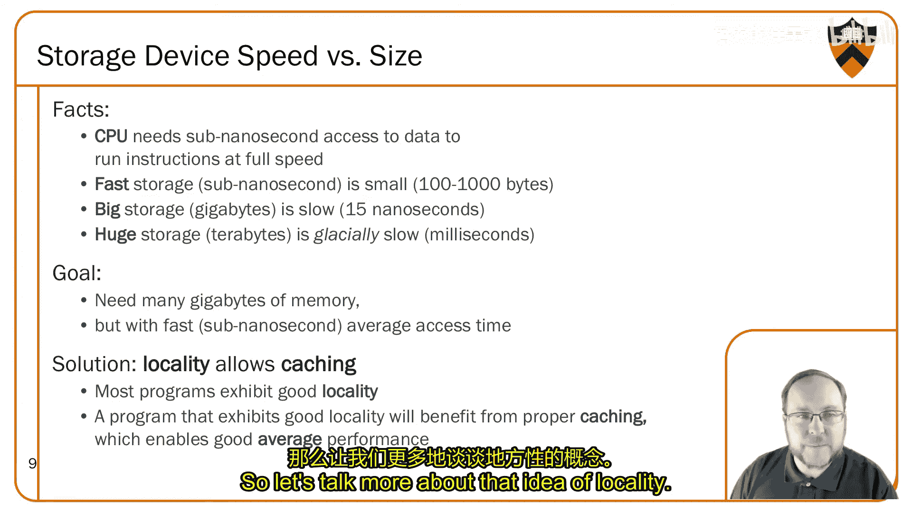

以下是各级存储的典型延迟和容量对比（数据基于约10年前的处理器，但比例关系依然成立）：

| 存储级别 | 延迟 (周期数) | 容量 |
| :--- | :--- | :--- |
| 寄存器 | ~0 | ~1 KB |
| L1 缓存 | ~4 | ~64 KB |
| L2 缓存 | ~10 | ~256 KB |
| L3 缓存 | ~40 | ~8 MB |
| 主内存 | ~200 | ~8 GB |
| SSD 磁盘 | ~100,000 | ~1 TB |
| 网络存储 | ~100,000,000+ | ~无限 |

从图表中可以清晰地看到，从寄存器到网络存储，延迟呈指数级增长。这就是缓存技术至关重要的原因。

## 局部性原理 🎯

要求程序始终使用最快最小缓存中的数据，在实践中是可行的。这是因为大多数程序都具有**局部性**，即它们在一段时间内只访问一小部分数据，并且一旦访问了某些数据，很可能很快会再次访问。

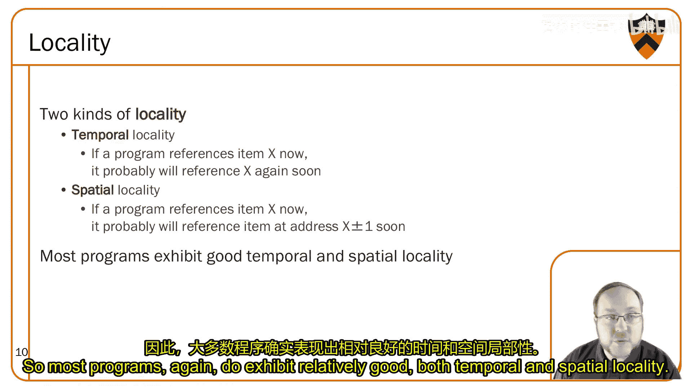

局部性主要分为两类：

1.  **时间局部性**：如果现在访问了某个数据项，很可能在不久的将来会再次访问它。这在循环中很常见，例如循环控制变量和循环体内的指令会被反复访问。
2.  **空间局部性**：如果现在访问了某个数据项，很可能在不久的将来会访问其相邻位置的数据。这在顺序访问数组或顺序执行指令时很常见。

大多数程序都表现出良好的时间和空间局部性。

### 局部性示例

计算数组元素之和是一个具有极佳局部性的例子：
*   **时间局部性**：循环变量 `i` 和 `sum` 在每次迭代中被反复访问，循环指令本身也被重复执行。
*   **空间局部性**：数组元素被顺序访问（`a[0]`, `a[1]`, `a[2]`...），指令也是顺序执行。

## 缓存的工作原理 ⚙️

缓存利用了程序的局部性原理，将近期可能用到的数据保存在更快的存储层级中，从而提升性能。

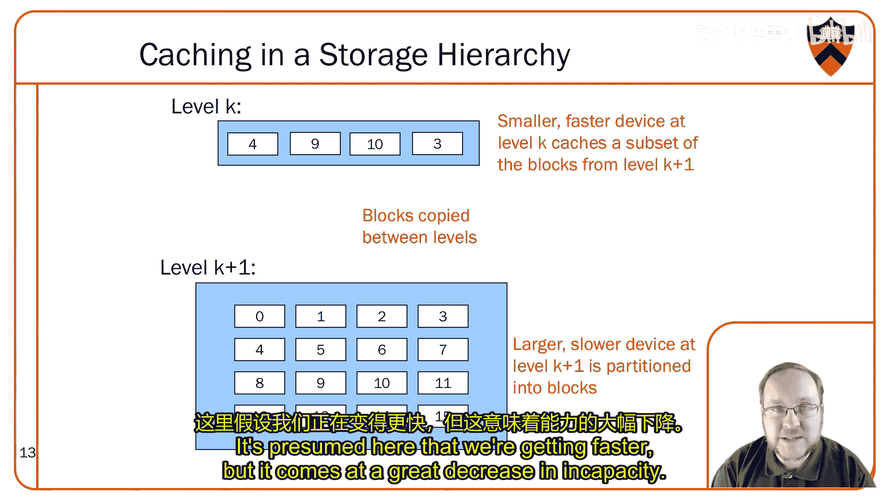

存储层级通常按级别编号，数字越小表示越快、越小。每一级缓存都存储了下一级存储中数据的一个子集。

缓存的工作机制如下：
1.  当需要访问数据时，首先在最快的缓存（如L1）中查找。
2.  **缓存命中**：如果数据在缓存中找到，则直接使用，速度最快。
3.  **缓存未命中**：如果数据不在当前缓存中，则需要到下一级（更慢、更大）的存储中查找。
4.  在下一级找到数据后，会将其**载入**当前缓存，以备后续使用。
5.  由于缓存容量有限，载入新数据时可能需要**驱逐**旧数据。如果被驱逐的数据已被修改，还需要将其写回下一级存储以保持数据一致性。

目标是最大化缓存命中率，最小化未命中率。

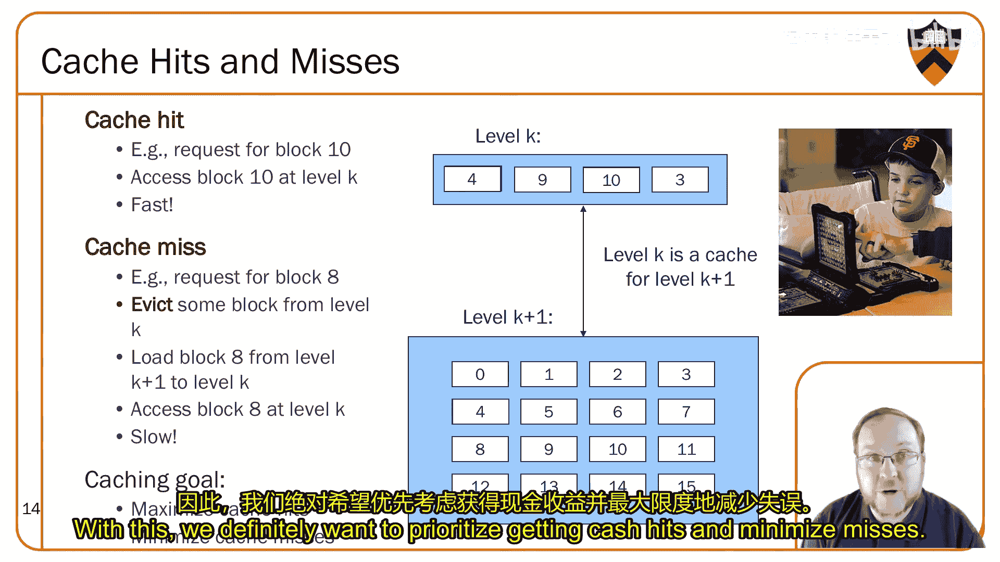

## 缓存替换策略 🔄

当缓存已满且需要载入新数据时，必须决定驱逐哪一项旧数据。理想的策略是驱逐未来最长时间不会被访问的数据，但这需要预知未来，无法实现。

一个合理且常用的策略是 **LRU**：
*   **LRU**：驱逐**最近最少使用**的数据项。
*   其原理是：如果过去很长时间没被访问，那么未来很长时间也可能不会被访问。
*   LRU通常效果很好，但精确实现需要记录每个数据项的访问时间戳，开销较大。因此，实际系统中常使用近似的LRU算法。

一个极端的反例是：如果一个循环需要11条指令，而缓存只能容纳10条，使用LRU策略会导致每次访问第11条指令时，都驱逐即将用到的第1条指令，造成持续的缓存未命中。

## 局部性对性能的影响：矩阵乘法案例 🧮

局部性对程序性能有巨大影响。一个经典例子是矩阵乘法。

C语言以**行主序**存储多维数组。这意味着在内存中，矩阵的一行元素是连续存放的。

考虑计算 `C = A * B` 的三种三重循环实现（`i`, `j`, `k` 为循环变量）：

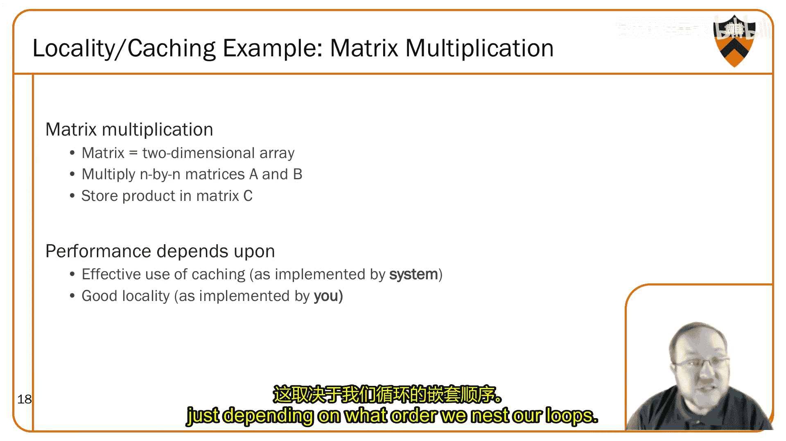

1.  **`i, j, k` 顺序**：这是较自然的写法。对 `A` 和 `C` 的访问具有良好的空间局部性（按行访问），对 `B` 的访问是按列的，局部性较差。性能尚可。
2.  **`j, i, k` 顺序**：这种写法导致对 `A` 和 `C` 的访问都是按列进行的，空间局部性极差。性能比第一种慢两倍以上。
3.  **`k, i, j` 顺序**：这种写法经过优化，对 `A`、`B`、`C` 三个矩阵的访问都实现了按行访问，最大化利用了空间局部性。性能比第一种快约10%。

这个例子表明，即使算法（计算逻辑）完全相同，不同的数据访问顺序（由循环嵌套顺序决定）会因局部性好坏而产生显著的性能差异。虽然聪明的编译器有时能进行此类优化，但程序员了解局部性原理并据此编写代码至关重要。

### 思考题

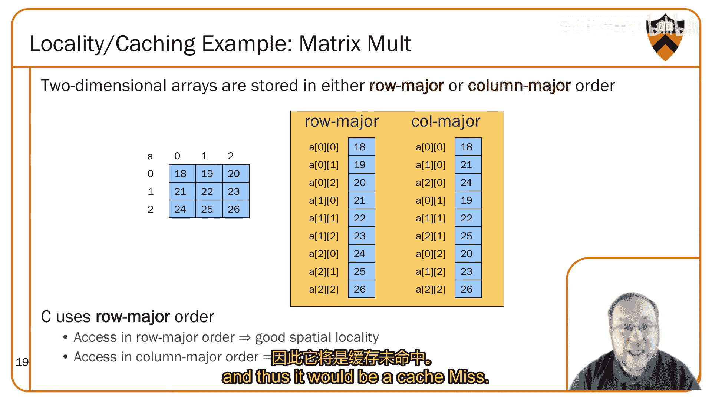

如果C语言使用**列主序**存储数组，那么为了获得良好的性能，矩阵乘法的循环顺序应如何调整？

**答案**：应该使用性能最差的第二种顺序（`j, i, k`）。因为在列主序下，按列访问才具有空间局部性，而这正是第二种顺序所做的。

## 缓存设计考量 🤔

在设计或使用缓存时，有几个关键考量：

1.  **块大小**：一次从下一级存储中读取多少数据。
    *   **大块**：能更好地利用**空间局部性**（一次读取相邻的多个数据），但传输时间更长，且会占用更多缓存空间，可能削弱**时间局部性**的效果（因为能缓存的不同数据项变少了）。
    *   **小块**：反之。

2.  **缓存管理方**：不同层级的缓存由不同角色管理。
    *   **寄存器**：由汇编程序员或编译器管理。
    *   **L1-L3缓存**：由硬件管理，要求速度极快。
    *   **主内存**：由操作系统和硬件共同管理，涉及更复杂的算法（如虚拟内存管理）。
    *   **二级/远程存储**：可能由硬件RAID控制器、文件系统软件（如Dropbox）甚至最终用户管理。

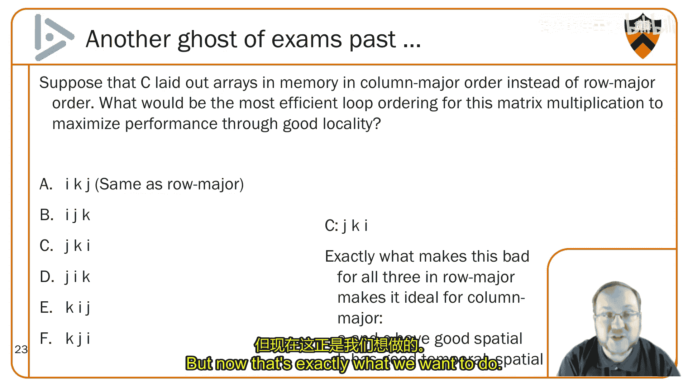

## 总结 📝

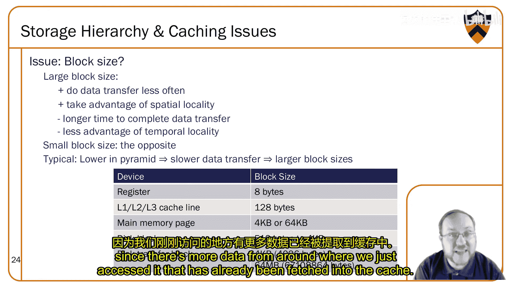

本节课我们一起学习了计算机系统中的存储层级结构。我们了解到，从寄存器到云端存储，速度和容量之间存在巨大的权衡。为了弥合快速处理器和慢速大容量存储之间的差距，系统采用了**缓存**技术。

缓存的有效性依赖于程序的**局部性原理**，包括**时间局部性**和**空间局部性**。我们通过数组求和和矩阵乘法的例子，看到了局部性如何显著影响程序性能。此外，我们还探讨了缓存的基本工作流程、**LRU**等缓存替换策略，以及缓存设计中的块大小和管理方等考量因素。

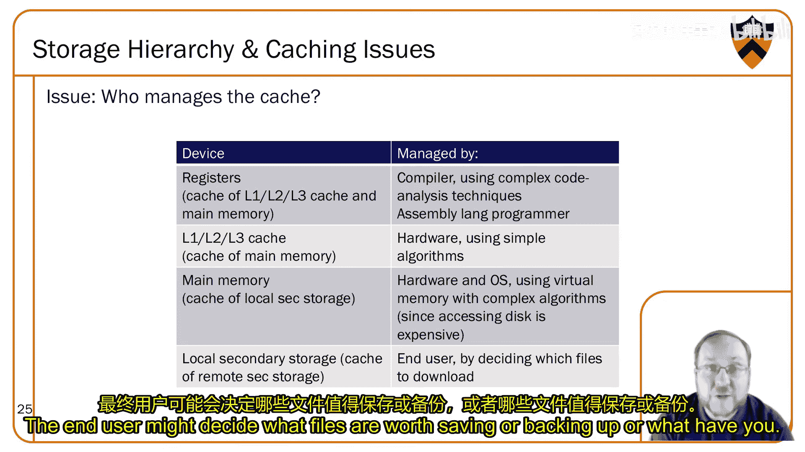

理解这些底层概念，将帮助我们在未来编写更高效的系统程序。

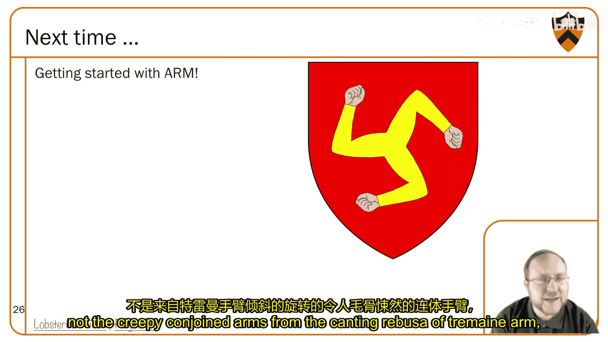

---
**下节预告**：下一讲我们将开始学习ARM64架构和汇编语言，为接下来的作业和课程内容做准备。请务必及时完成当前的作业。祝你好运！