# 021：汇编语言 part1 🖥️

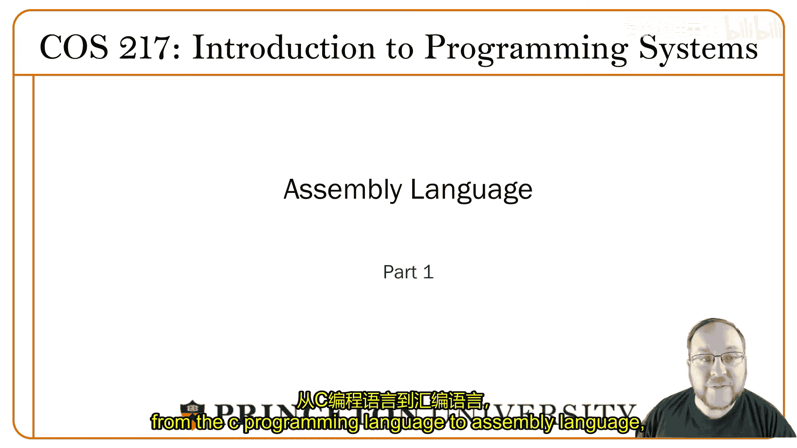

在本节课中，我们将要学习汇编语言的基础知识，了解高级语言（如C）如何被转换为处理器能够直接执行的底层指令。我们将从C语言出发，向下探索汇编语言和机器语言，理解程序在计算机硬件层面的工作原理。

## 课程概述与学习方法 📚

到目前为止，本课程的重点一直是C编程语言以及大型软件工程。现在，我们将转向一个完全不同的领域。我们将开始深入探究，当我们调用那个我们讨论过很多次的、闪亮的四阶段GCC编译命令时，底层究竟发生了什么。这是一次从C编程语言向下到汇编语言，并最终到达处理器实际运行的机器语言指令的旅程。

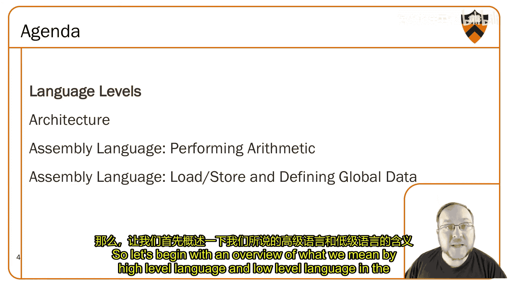

我们的方法类似于之前在课程中为C语言所做的。我们将使用部分汇编语言程序。这些程序没有前向引用，至少我们尽可能避免。但这意味着，仅使用课程材料，在完成最终的汇编语言讲座之前，你将无法编写完整的程序。

另一方面，实验课将从一开始就使用完整的汇编语言程序。但这必然会有一些前向引用，需要在讲解时即时解释，或者暂时略过，稍后再进行补充。

从这个意义上说，讲座和实验课确实是互补的。我希望两者都能对你有所帮助，即使你可能自然更喜欢其中一种。

## 语言层级与抽象概念 🔄

在这次语言层级的探索中，我们将看到一些大型编程的主题，即抽象性和模块化，它们并非高级语言或C语言特有的编程方面，而是任何层级程序设计中普遍存在的基本概念。

因此，从多个层级查看完整语言有助于强化这一理念：完整的系统建立在其他完整的系统之上，这些系统逐渐变得更加抽象、更加模块化、更加用户友好。首先，让我们概述一下我们所说的高级语言和低级语言的含义。

## 高级语言 vs. 低级语言 ⚖️

此时，你可以自信地说，你对两种不同的语言——Java和C——已经有了相当扎实的入门知识。但这两种都是高级语言，它们在某种程度上共享几个共同特征。它们是可移植的，尽管不完全，正如我们在C语言中看到的那样。它们是复杂的。考虑这行代码：`n = n * 3 + 1`。这一行包含变量读取、乘法、加法和变量写入。或者`while`循环，它是C编程的基本构建块，但包含多个不同部分：要检查的条件、要执行的任意循环体、在结束时返回并再次检查条件的逻辑，以及当条件最终失败时跳过循环体的逻辑。

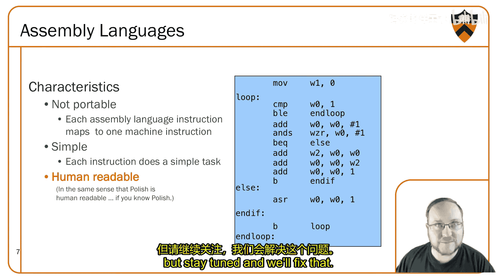

C和Java在很大程度上也是人类可读的。有些语言比其他语言更易读。对于没有编程经验的人来说，C语言可能有些晦涩，但你仍然可以用英语读出这个程序，一个结构思维强的非程序员可能会理解它的意思。至少除了位运算之外的一切。

在截然相反的一端，是机器语言。它们完全不可移植。主导台式机和笔记本电脑市场的X86-64处理器的机器语言，与SPARC处理器、MIPS处理器，或者我们将在本课程中使用的ARM处理器的机器语言完全不同。ARM处理器倾向于主导移动设备和嵌入式系统市场。

它们不那么复杂，因为每条指令执行非常简单的、基础的任务。同样，不同架构之间程度不同。但通常，没有像基础但多步骤的循环那样的东西。在可读性方面，这在任何真实意义上都不是人类可读的。

汇编语言介于两者之间。可以说，凡事皆有度。它不可移植。它是机器语言之上的一层薄薄的人类可读层。因此，如果它只是建立在机器语言之上，那么它的可移植性并不比机器语言强。X86-64、SPARC、MIPS和ARM的汇编语言完全不同。如果你打算用汇编语言编程，你就放弃了所有可移植性的希望，就像你用机器语言本身编程一样。

但像机器语言一样，它很简单。坦率地说，学习像汇编语言这样的语言比学习C语言更容易。它有许多相对较小、紧凑的原则，你可以将它们组合在一起。没有那么多高级的复杂逻辑被塞进一个操作中，就像你在C语言中看到的那样。至少，这是一种推动。但另一方面，它的表达能力不强。这是同一枚硬币的另一面：每条汇编语言指令都如此简单，以至于完成任何给定的工作都需要许多指令。

在可读性方面，我说过，汇编语言是机器语言之上的人类可读外壳。但此刻你可能会对此提出异议。你可能会说，这看起来不太像人类可读的。但请继续关注，我们会解决这个问题。

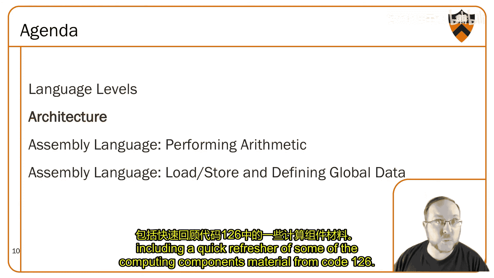

## 学习汇编语言的动机 💡

现在我们来谈谈动机。我知道你们中的许多人在这门课程之后可能再也不会编写汇编语言了，这没关系。尽管如此，我真诚地相信，了解程序内部真正发生的事情可以帮助你发现错误，可以帮助你提高时间或空间性能，并且可以改进你的程序设计，或者至少为你的程序设计提供信息。

了解汇编语言可以帮助你知道底层运行的是什么，这样你就可以实际编写汇编语言来编写更快的代码，或者为应用程序编写更优化的代码。例如，GCC编译器甚至不知道一些指令，但如果你知道它们并且发现它们适合你的应用程序，你可以使用这些有效的指令。

此外，了解汇编语言也可以帮助你在高级语言中编写更好的代码。如果你了解汇编语言以及高级语言代码如何映射到汇编语言，那么你将能够使用快速的高级语言结构，并避免那些慢速的结构。

因此，即使你再也不会用汇编语言编程，至少了解一点汇编语言也是值得的。此外，所有这些都基于一个论点，即你不想再用汇编语言编程。实际上，你可能想继续这样做。当然，许多甚至大多数计算机科学家终其职业生涯都在为他人需求开发计算应用程序。

但一些计算机科学家必须设计计算机，必须设计架构，必须设计其他计算机科学家使用的编译器。也许你想走这条路。如果你决定走这条路，你将需要用汇编语言编程，或者至少能与那些用汇编语言编程的人交流。

## 为什么选择ARM架构？ 🤔

以上是关于汇编语言的一般情况。那么ARM呢？通常人们不会为高级系统编写汇编语言。因此，选择一个在嵌入式系统中典型的架构，一个在嵌入式系统中典型的架构，是一个自然的选择。ARM是嵌入式系统、移动设备和其他你可能实际想为其编写汇编语言的低级硬件的主导硬件集。所以我认为这是一个很好的选择。此外，它更简单，当我们很快进入其指令集时，我们会谈到这一点。

有了这个动机，让我们看看底层架构，包括快速回顾一下CO 126课程中的一些计算组件材料。

## 冯·诺依曼架构基础 🏗️

从根本上说，本课程中使用的ARM架构及其替代品X86架构，都可以追溯到约翰·冯·诺依曼的工作。让我在这里简单介绍一下他。他在普林斯顿大学和IAS（镇上的研究机构）工作了大半生。你可能只是从校园里有一栋以他命名的建筑而听说过他。这栋建筑在校园的最东边，甚至连工程师都会说：“真的，那是霍尔吗？”对于福布斯来说，这几乎是一次跨大陆的航行。是的，他是一个令人恐惧的天才。六岁时，他就能在脑子里进行八位数的乘法和除法。他有一种孩子般的天真，当他看到其他人凝视着太空时，他会问他的母亲：“我想知道他们现在在计算什么复杂的事情。”好像每个孩子，甚至每个人，都会这样做。

他是匈牙利黄金智力一代的一员，这一代产生了许多诺贝尔奖得主和其他在各个领域（包括计算机科学）具有根本重要性的人。但他可能是那一代人的领导者。但当物理诺贝尔奖得主尤金·维格纳被问及匈牙利如何产生了这一代天才时，他实际上拒绝回答。他首先不同意这个前提。他说，经历过冯·诺依曼之后，他可以自信地说，这群人中只有一个天才。而这又是氢弹之父、核链式反应之父以及这一群体中的其他诺贝尔奖得主。

更进一步，另一位诺贝尔奖得主汉斯·贝特推测：“我有时想知道，像冯·诺依曼这样的大脑是否表明存在一种优于人类的物种。”所以我们谈论的是真正的天才之一，类似于爱因斯坦、高斯、欧拉那种类型。

但抛开地理因素，让我们跳入他出现在幻灯片上的实际原因。在他工作的时代，这些新奇的计算机的实验性架构是一种程序与其操作的数据有独立物理内存的架构。这后来被称为哈佛架构。

冯·诺依曼是开发不同范式首批实现之一的先驱。在这种范式中，程序和数据共享相同的内存。与哈佛架构相比，这被称为普林斯顿架构。当然，必须指出，普林斯顿架构被证明比哈佛架构更成功。

话虽如此，EDVAC作为一个整体，这台机器是其中的一部分，是与宾夕法尼亚大学的埃克特和莫奇利合作的项目，它实际上是一项工程壮举，而非核心科学。这个想法本身至少可以追溯到十年前，追溯到你在126课程中学到的图灵通用机的变体。但尽管如此，我们永远不会错过任何一个吹嘘普林斯顿并抨击哈佛的机会。

## 冯·诺依曼架构详解 🧩

在冯·诺依曼架构中，从根本上说，有两个硬件单元：处理器和内存。实际上，可能有几个不同类型的CPU，无论是传统CPU、多核CPU，还是像GPU这样的专用处理器。此外，可能有多块RAM芯片。然后，正如我们上次看到的，处理器和RAM之间有多个不同级别的缓存。还有其他硬件，磁盘、网络设备等等。所以这当然是一个简化，但一个处理器和一个内存的抽象视图对我们来说就足够了。

在物理领域的硬件中，CPU和RAM实际上只是两种不同类型的集成电路或芯片。它们通过主板上的电线进行通信。这条电线称为数据总线。所以有RAM随机存取存储器芯片和CPU或中央处理单元芯片。

我们进一步将CPU分解为三个结构，这与我们在126课程中讨论的三个相同：控制单元、ALU和寄存器。这里的ALU是算术逻辑单元。

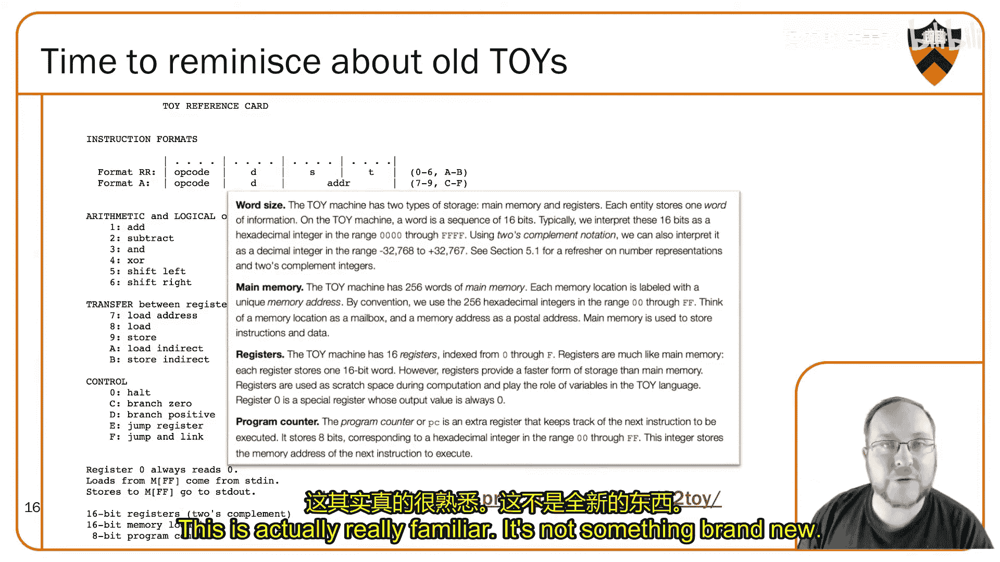

控制单元是CPU的操作控制，可以说是经理。它解释ALU将要计算的指令，并控制CPU和内存之间的数据传输。ALU是大脑或计算器；它实际处理指令和指令所需的数据。大型数学模块。

最后，寄存器，正如我们上次讨论的，是小的、非常快的、在CPU芯片上的存储。你可以把它们看作芯片上的一系列小箱子。它们提供极快的访问速度。我们上次说过，延迟不到一纳秒，但它们非常小。处理器上所有寄存器的总容量不到512字节。

一个程序能用这么小的内存做什么呢？在程序中，这些可以分配来存储变量、指向程序中某个位置的指针、指向内存某部分的指针，甚至只是在多步计算期间用作暂存空间。尽管如此，尽管数量少、容量小，这些寄存器是至关重要的资源。

因此，当控制单元获取要处理的指令时，ALU实际执行处理本身。例如，在算术运算中，我们将从两个源寄存器获取数据，完成操作，并将结果放回指定的目标寄存器。所以控制单元决定数据来自哪个寄存器，或者如何首先将数据放入这些寄存器，而ALU实际进行数学运算。

显然，如果寄存器这么小，总共不到1K字节，那么我们的程序显然需要比这多得多的空间，这就是RAM的用武之地。在大多数普通笔记本电脑中，RAM的容量大约在十亿到数百亿字节之间，这肯定比512字节多得多，但同样，延迟在100纳秒以上，所以慢了100倍。RAM是我们程序运行时使用的所有数据的主要存储位置，正如我们在冯·诺依曼架构中讨论的，这包括程序本身，即实际的指令本身。

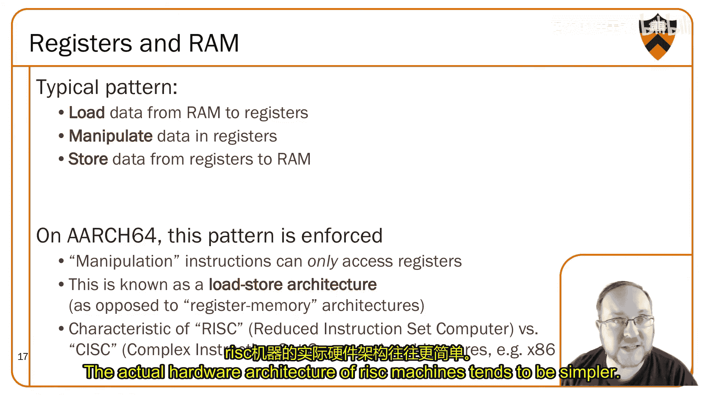

## 从TOY架构到ARM架构的过渡 🚀

现在我们已经看到了将要处理的结构基础，但在深入ARM架构和AArch64的ARM指令集细节之前，让我请你记住你在126课程中学到的关于TOY的内容。处理器，我们说过有ALU和控制单元，正如我们所见。指令集，如果你回想一下，由操作码和一个地址及一个寄存器，或一对寄存器组成。总共有16个寄存器，命名为0到F，其中一个特殊寄存器始终只包含零，那就是零寄存器。有一个额外的寄存器，它不是这个数字运算的可能存储数据的地方，而是始终包含要执行的下一条指令的位置。那就是程序计数器。主内存中有256个字，每个都有自己的地址。通常，我们用十六进制表示它们。内存可以存储数字，这就是它的功能。我们可以将这些解释为无符号整数、有符号整数、内存地址或指令本身。

关键是，ARM几乎完全相同。我们所要做的就是改变数字，扩大规模。我们有更多的指令，需要更多样化的指令格式，但核心仍然是相同的：操作码、一些目标和一些源。ARM有32个寄存器，每个存储64位。但同样，其中一个始终为零。我们有两个额外的寄存器，包含指向内存重要部分的指针：一个程序计数器，就像在TOY中一样，还有一个指向栈顶的指针，即我们当前正在执行的栈帧。有一个主内存的表示，同样，每个位置都有自己的地址，通常用十六进制表示，内存可以再次存储数字、无符号整数、内存地址或指令，无论我们选择如何解释它们。这实际上非常熟悉。这不是什么全新的东西。

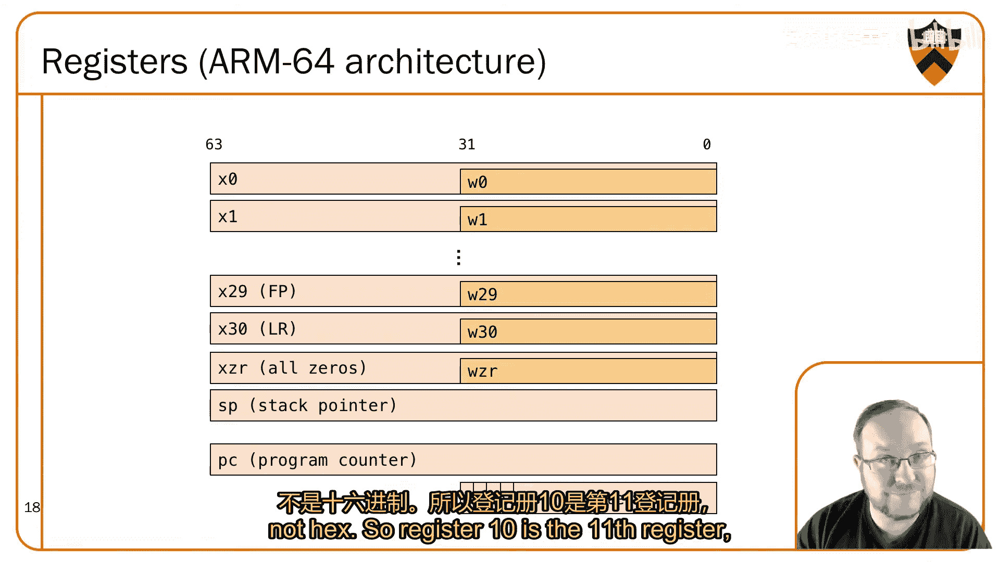

## 加载-存储架构与RISC理念 🧠

让我们再深入一步。在TOY中，有一个相当严格的加载-操作-存储范式。如果数据在内存中，我们必须首先将其加载到寄存器中，然后我们可以在寄存器内操作它，将每个操作的结果依次放入新寄存器，然后在完成所有计算后，将最终结果存储回内存。ARM也是如此。同样是完全相同的加载-存储架构。

在TOY中，指令集非常有限。如果你想做任何复杂的事情，你必须将几条甚至许多条指令组合在一起。但好处是，记住所有存在的指令超级容易，并且能相当深入地理解它们。好吧，也许除了分支链接指令。但同样，ARM也是如此。在本课程中，我们将要担心的指令相对较少。你会对它们有相当深入的了解。

选择拥有一个小指令集是RISC理念的象征，即精简指令集计算机，与CISC或复杂指令集计算机相对。因此，RISC有一个简单的集合，涵盖了所有你需要做的事情，但你可能需要将它们组合在一起来做任何有实质内容的事情。另一方面，CISC有一个复杂的集合，它有一个扩展的操作集，包括一些执行非常特定操作的东西，甚至包括一些不遵循标准加载-操作-存储范式的东西。但为了充分利用这一点，你必须知道它能做什么，它们是什么，并且更难内化整个指令集的范围。此外，在硬件层面，如果我们有这些复杂的指令，我们需要复杂的硬件来使其工作。RISC机器的实际硬件架构往往更简单。

## ARM寄存器详解 📊

好的，现在我希望我已经说服了你，这又不是一个你完全没见过的新东西。你学到的关于TOY的知识确实与我们用ARM要做的事情相关，至少在高层次上是这样。所以让我们深入探讨，但作为系里的安置官，我必须承认，你们中有些人没有上过126课程，你们可能会想：“等等，这是什么？我完全不知道你在说什么，你声称我知道这个，我发誓我不知道。”如果这听起来完全是新的，那没关系。我鼓励你去看看126的材料，浏览一些TOY材料、TOY程序。阅读简单的东西。我不是说去花整整一个月学习126，但这是一个合理的事情。在跳入ARM之前，先去浏览一下材料，看看一个更简单的版本。

那么，ARM有——我们现在就开始——ARM有31个通用寄存器。这里的“通用”有点用词不当。实际上，其中几个在整个程序中扮演着非常专业、非常具体的角色。但当我们说通用时，我们指的是这些寄存器，我们可以（在采取一些预防措施的情况下）操作它们。我们通过编号来寻址它们，寄存器0到寄存器30。请注意，这是十进制，不是十六进制，所以寄存器10是第11个寄存器，而不是第17个。

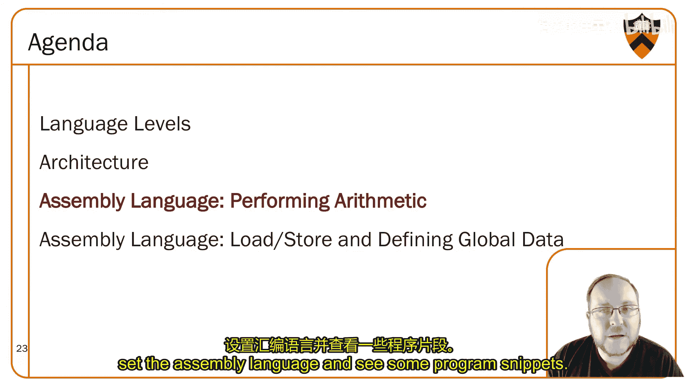

这些寄存器中的每一个都是64位。我们在程序中引用它的方式是使用X加上寄存器编号。有时我们只想使用寄存器的一部分，例如，如果我们存储一个`int`，在我们的系统中`int`是4字节，所以我们只需要32位。在这种情况下，我们可以通过W而不是X来寻址寄存器的低32位。再次注意，虽然我们称这些为通用寄存器，但其中一些实际上在硬件或软件约定中具有特定的用途。因此，我们不能随意选择任何我们想要的寄存器，我们必须承认有些寄存器已经在执行任务，即使我们没有特别指定它们。

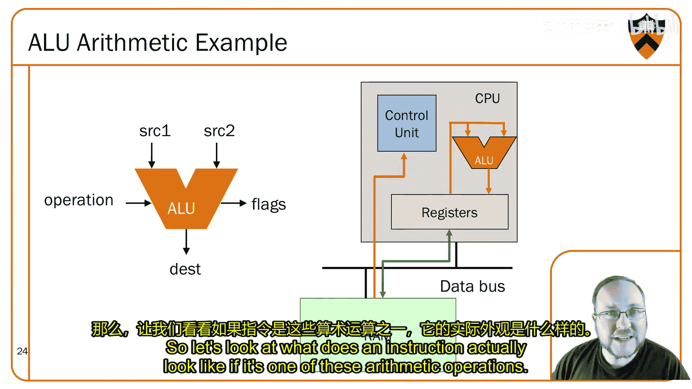

## 特殊寄存器：SP、PC与PSTATE 🎯

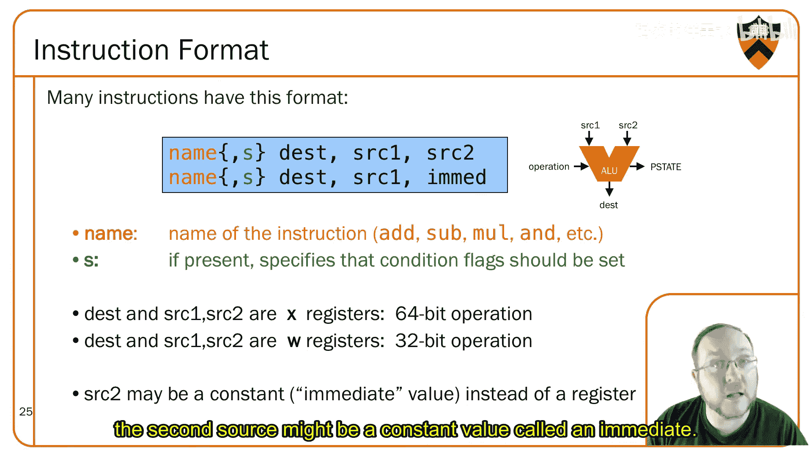

这些是通用寄存器，现在谈谈这些特殊寄存器。每当一个函数被调用时，它会将其参数和局部变量的内存压入栈顶，我们知道这个，内存被称为函数栈帧，就像我们在C语言中讨论的那样。因此，在AArch64架构中有一个叫做SP的寄存器，它指向当前正在执行的函数栈帧的最高地址（最低地址）。所以这就是我们最终如何进行函数调用和局部变量的方式，但这要到几节课之后才会涉及。

与TOY一样，我们有一个程序计数器。它指向内存中将要执行的下一条指令的位置。我们知道这意味着我们指向文本段，因为那是我们指令所在的地方。控制单元负责在处理指令时自动更改PC；如果存在顺序控制流，它可能从一条指令递增到下一条指令；或者如果存在更复杂的流，如条件循环或函数调用，它可能跳转到文本段的完全新部分。

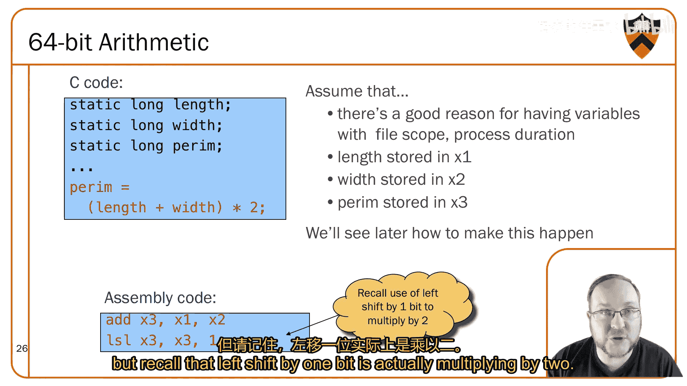

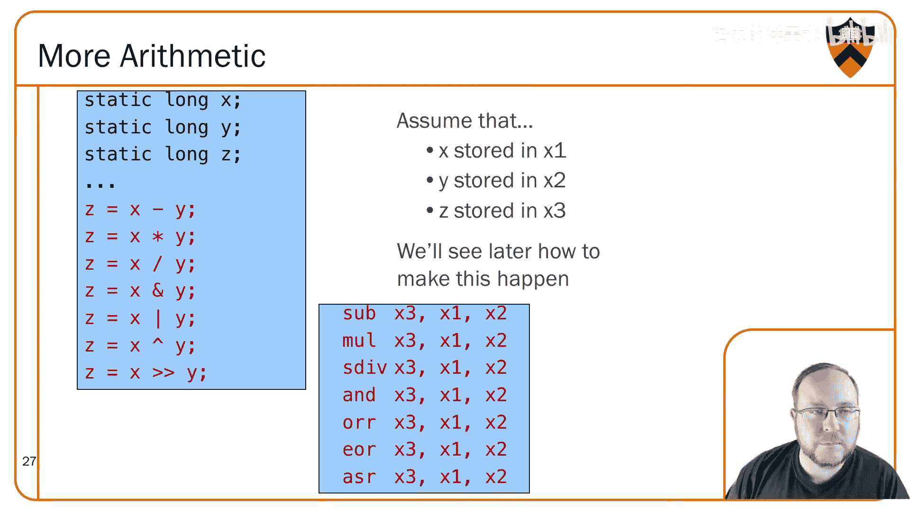

最后一个特殊寄存器是我们在TOY中没有看到的。在TOY中，我们的两条分支指令以寄存器作为参数；在ARM中，它们不是。相反，在我们进行条件分支之前，我们观察一些先前指令的特征，通常是比较操作。例如，我们可能会说，它是否设置了结果为零的标志，或者是否设置了发生溢出的标志？这些条件作为位存储在处理器状态寄存器中。因此，PSTATE是我们需要关心的最后一个特殊寄存器。我们通常不会直接访问PSTATE，而是通过执行条件操作、条件分支来间接访问。

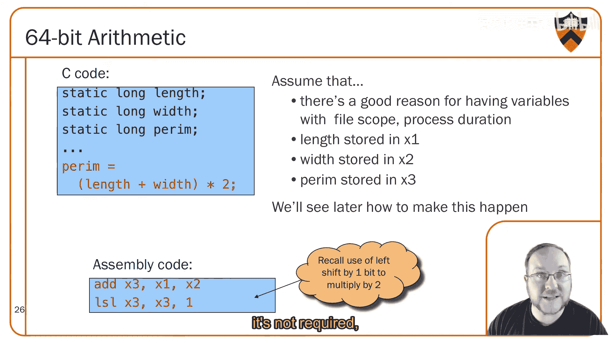

## ARM指令格式与算术运算 ➕

好了，有了这些关于架构、关于指令集（或至少它必须有什么）的基本概念，让我们继续讨论指令集、汇编语言，并看一些程序片段。

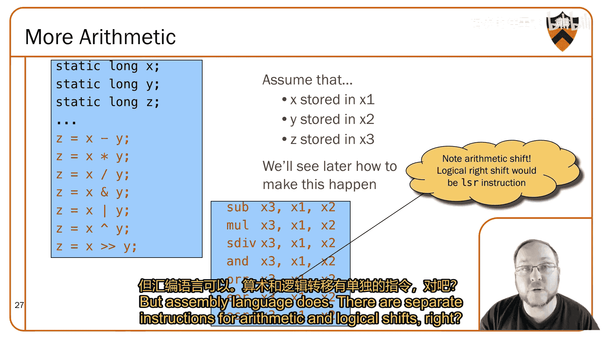

回想一下之前ALU对算术指令的看法。现在，如果你对之前的图表感到困惑，你知道标志是干什么用的了。那么，让我们看看，如果它是这些算术操作之一，一条指令实际上是什么样子的。

每条指令至少有一个在语义上有意义的名字。通常，然后是目标寄存器，接着是源寄存器。所以，如果你还没有学会爱上“目标-源-源”的参数顺序，这里是你更多机会爱上它的地方。在某些情况下，第二个源可能不是一个寄存器，而是一个称为立即数的常量值。

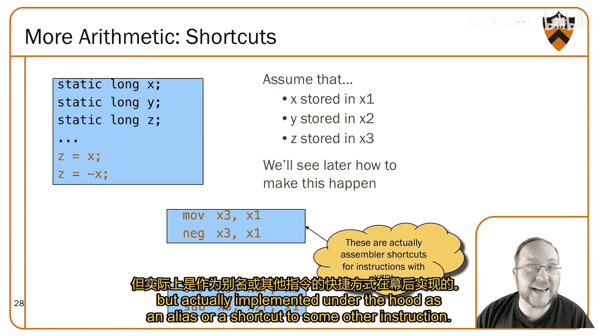

## 第一个汇编程序示例：计算矩形周长 📐

这是我们的第一段汇编代码。矩形的周长是其所有边的总和，所以是宽度和高度之和的两倍。这是一个实现此功能的C程序。请注意，我们在这里假设了全局变量，原因是我们要到很久以后才会看到如何处理局部变量，这涉及到整个函数调用和栈的部分。

有了这些映射到这些寄存器的变量，我们需要一条加法指令和一条乘法指令。哇，等等。LSL，那是乘法吗？不应该是MUL之类的吗？实际上，LSL是左移，但回想一下，左移一位实际上是乘以2。

这里还要注意一件事，书中在立即值前使用井号（即数字符号或标签符号），这对读者来说是一个有用的信号，表明注意这不是X1，这不是W1，这不是某个寄存器1，这实际上是数字1。同样，书中使用了这个。总的来说，我们不会在幻灯片上这样做，这不是必需的，但如果你愿意，你可以在代码中使用它。

## 更多算术运算与指令别名 🔧

好的，现在来看C语言中更多的算术运算以及它们在汇编语言中的样子。这里只是操作的演示，甚至没有假装有一个程序或应用程序；这只是关于ARM内容的纯粹数据转储。大多数名字都很直观，但有些需要解析，特别是异或操作使用EOR而不是XOR，这是学生容易出错的地方。另外，回想一下我们在上一张幻灯片上讨论的移位操作。C语言对于右移操作没有标准规定，是保持有符号整数的符号位，还是总是在左边填充零。但汇编语言有。对于算术右移和逻辑右移，有单独的指令。

一些类似的指令并不完全是它们看起来的样子。虽然我们已经深入底层，首先讨论汇编语言，但让我们再深入一点底层，讨论一下别名或快捷方式。你可能认为将一个变量从一个寄存器移动到另一个寄存器对于汇编语言来说是一个非常原始的操作，但实际上在硬件中是通过与零寄存器进行按位或操作来实现的。这是因为任何数与0进行或运算都是它本身。类似地，我们可能认为一元取反是乘以-1，但实际上在硬件中是通过从零寄存器减去来实现的。这是一件好事，因为减法通常比乘法快。

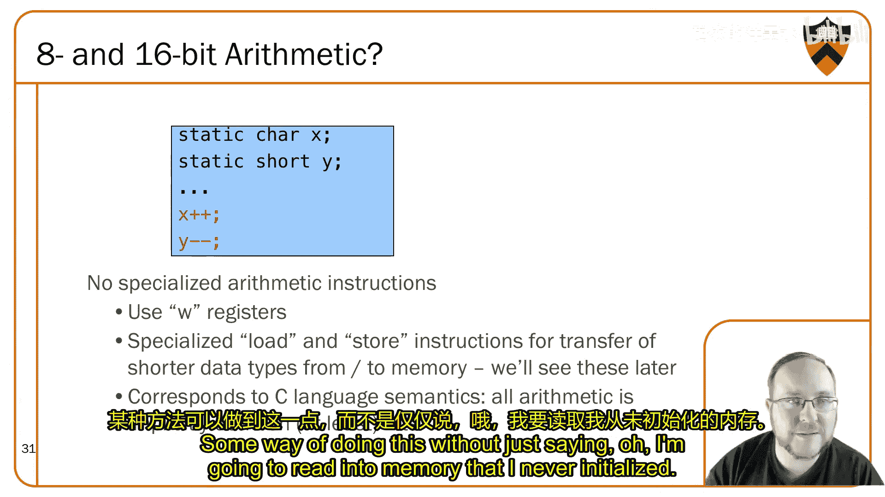

还有其他这样的例子，语言给我们一条在语义上有意义的指令，但实际上在底层将其实现为另一条指令的别名或快捷方式。

## 有符号与无符号运算及寄存器大小 📏

我们还没有提到的一件事是，在讨论C语言中的算术运算时，我们必须担心有符号与无符号。但有了二进制补码，我们得到了一个很好的好处，即大多数操作的底层位操作算法是相同的，无论我们讨论的是有符号还是无符号算术。只是我们如何解释最终结果。因此，我们得到了一个优势，即在ARM中，这些算术运算的指令是相同的，只有少数例外。我们将在未来的讲座中看到，当我们讨论控制流时，有符号/无符号的差异通常不会出现在值本身或我们用来操作这些值的算术指令本身中，而是出现在我们稍后决定条件分支的比较指令中。

好的，继续我们的内容，我们已经看到了一些东西，但我们遗漏了一些我们在C语言中知道的东西。到目前为止，我们只处理了64位算术，这说得通，因为我们设置的寄存器是64位的。但是，如果我们想像之前的周长程序那样使用`int`而不是`long`呢？我们可以使用W命名来寻址寄存器的下半部分，而不是完整的寄存器。我们看到这是一个特性，这里展示了它与我们程序的相关性。当我们使用`long`时，这些是64位或8字节的结构，使用X寄存器来寻址我们知道是8字节的地址是有意义的。但是当我们的程序中有`int`时，我们应该使用寄存器的W版本。当然，在C语言中还有更小的数据类型，但没有更小的、有自己名称的可寻址寄存器部分，所以我们将使用W寄存器来处理`short`或`char`。但这实际上没问题，因为与C语言匹配，因为在算术运算中，`char`或`short`会隐式提升为`int`。你可能不记得在很早的一节课上提到过，但确实，你对`short`或`char`进行的所有算术运算实际上都是`int`运算。这与硬件和汇编语言匹配，我们将使用W寄存器和完全相同的实际指令。

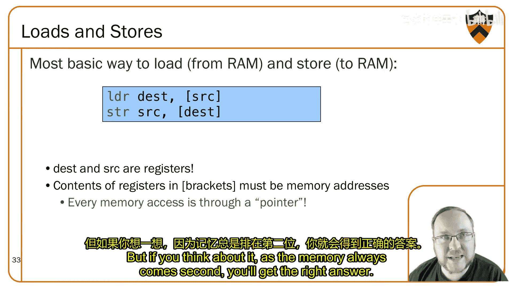

这是针对算术运算的。在几张幻灯片之后，我们将看到有特定大小的加载和存储操作，用于在这些寄存器和内存之间获取数据，这说得通。你不能很好地将完整的4字节寄存器写入内存的单个字节，或者从内存的单个字节读入4字节寄存器。当然，我们必须有某种方法来实现这一点，而不是说：“哦，我要读入我从未初始化的内存。”

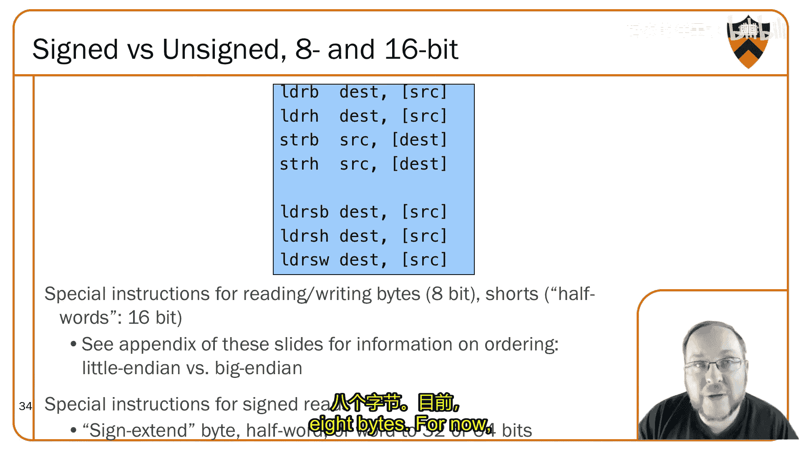

## 加载与存储操作：内存访问 🚚

所以，就加载-操作-存储范式而言，那是操作部分。现在让我们继续讨论如何将数据移入和移出寄存器以及移回内存。

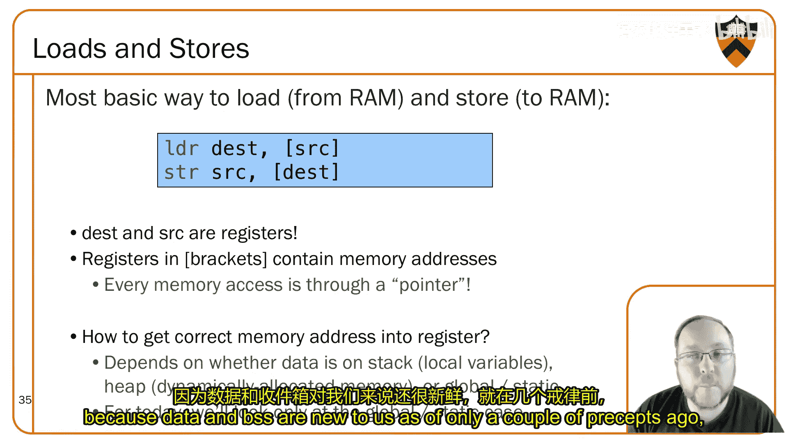

与TOY不同，在TOY中我们可以将字面内存地址放入指令中，而在ARM中，延续其非常纯粹的基于寄存器的加载-存储架构，甚至比TOY更进一步，我们必须首先将该内存地址放入寄存器，以使该寄存器有效地成为指针。你以为你已经学完指针了？还差得远呢。然后，一旦我们有了这个指针，我们解引用该指针以获取用于加载或存储的内存位置本身。

我们在ARM中表示这一点的方式是将寄存器名称放在括号内。我认为这非常漂亮，因为括号是内存的解引用操作符，我们将内存视为一个大数据数组。这与C语言完美匹配，在C语言中，数组索引使用括号操作符完成，我们看到这实际上是对数组起始位置的隐式解引用。因此，在C语言的语法和这种汇编语言的语法之间存在着完美的对称性。

再次注意这里的顺序：对于加载字指令，从第二个操作数引用的内存地址加载到第一个操作数寄存器。对于存储指令，我们从第一个操作数寄存器存储到第二个操作数寄存器引用的内存地址。所以内存操作数总是排在第二位。这是记住这一点的最简单方法。但很容易陷入困惑：“等等，数据流的方向是哪个？”但如果你想到内存操作数总是排在第二位，你就会得到正确答案。

## 不同大小的加载与存储操作 🔄

如前所述，有一些特定的指令用于读取一个字节或两个字节，包括有符号和无符号，以及一些额外的语义指令，用于说明在读取小于8字节的内容时如何填充寄存器内容。不过，现在让我们坚持使用4字节和8字节的量，以使事情更容易。

## 完整示例：周长程序的汇编实现 🧩

好的。我们差不多准备好看一个完整的例子了。但有一件事要注意。我们提到，在加载和存储中，我们将使用包含内存地址的寄存器作为指针。这意味着我们首先需要将该内存地址放入该寄存器中，以充当指针。这将取决于地址位于内存的哪个段，但现在让我们考虑文件作用域和进程持续时间的变量，以便它始终位于数据段或BSS段。这听起来让它变得更复杂，因为数据段和BSS段对我们来说只是几个实验课之前才接触的新概念，但在汇编语言中，实际上最初会让它更容易。

好的，这是稍微扩展了一点的周长程序。这是它的汇编代码。此时，它对我们来说似乎是人类可读的。但如果仍然觉得难以理解，那完全可以理解。所以让我们一步一步来。

我们可以用标签标记或命名内存中的一个位置。例如，`length:` 这是程序将存储`length`变量的内存位置。`.word`指令告诉汇编器在当前内存位置分配四个字节的内存，并将后面的值存储在那里。所以这就是标签和该标签处的`.word`指令。这就是我们在数据段或BSS段分配内存的方式。

但首先，我们需要看看如何定义位于这些段中的数据。我们需要首先进入那个段。所以，让我们不要跳过太多，一次看一个。`.section`指令告诉汇编器我们现在处于正确的内存段。所以在这种情况下，数据段或文本段。这适用于RO数据段、数据段、BSS段和文本段。我们将在未来的讲座中看到如何使用栈，并且在本课程中不会使用堆进行动态分配，所以堆中完全没有东西。

所以我们说过，我们讨论了标签，这是我们标记内存位置以便以后引用的方式。标签名称是有意义的。它们在程序本身中按名称引用，并且希望具有语义意义。通常，如果我们从C语言翻译到汇编，希望这是一个变量名或字符串提示符的名称等等。

同样，`.word`指令只是告诉汇编器：“请为4个字节分配内存，并把这个值放进去。”请注意，这里的`.word`声明的是数据段中的一个`int`。其他数据类型将有不同的尺寸说明符，其他段实际上将使用不同的指令。例如，BSS段使用不同的指令，因为它不需要初始化值。我们将在本讲座接近结束时讨论这些。

现在我们开始进入文本段，我们从哪里开始呢？当然是`main`。我们知道`main`是一个从`_start`调用的函数，我们知道我们没有编写`_start`。所以这一定意味着`main`必须在其自身文件之外可见。在C语言中，我们默认实现这一点。我们隐式地实现它，因为外部链接是默认的。所以只要我们不意外地在`main`前面加上`static`这个词，一切都没问题。但在ARM中，内部链接是默认的。因此，在C语言中，我们必须为内部链接指定`static`，而在ARM中，我们必须用`.global`指令明确指定全局可见的符号。

所以`main`得到一个`.global`。现在，一旦我们前进到`main`开始的内存位置，即`main`指向的位置，我们终于可以回答如何将内存地址放入寄存器以用作加载/存储的指针的问题了。有一个叫做`ADR`的伪指令。地址指令获取标签的内存地址并将其指向一个寄存器。所以`ADR X0, length`表示：找到`length`被标记的地址，并将其放入X0寄存器。

有了这些地址，我们就可以进行加载和存储操作，这些操作我们之前孤立地见过。我们在上一行做了`ADR`，所以我们有一个包含地址的X0。这意味着我们应该将X0视为一个指针。毕竟，这正是C语言中的指针：一个内容为内存地址的变量。我们使用括号表示法作为加载的源或第二个操作数，以及作为存储的目标或第二个操作数来解引用指针。

最后，我们可以使用寄存器0来完成函数。这里使用W0是因为它是一个`int`来存储返回值。请注意，我们在这里一直使用寄存器0。所以与TOY不同，始终为零的寄存器实际上不是寄存器0。在我们的ARM中，它将是WZR或XZR。所以这里的W0或X0在语义上是返回值，是我们将要放入返回值以便返回的地方。

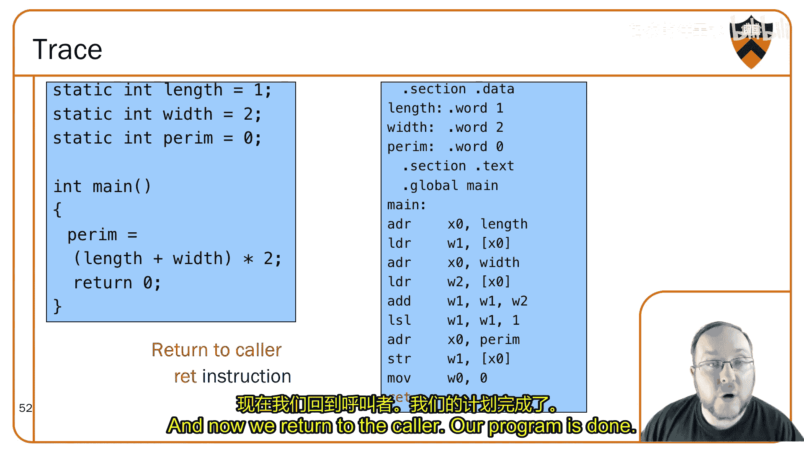

然后`RET`指令是实际导致程序计数器跳转到文本段中新位置而不是继续执行下一条指令的指令，这是我们从一个函数返回的方式。我们将在后面更详细地讨论函数返回、函数以及程序控制。

最后，在逐步讲解了代码中的每条单独指令之后，让我们来跟踪一下。在执行开始时，所有数据段都已填充。`main`开始，第一个操作是建立X0作为指向`length`的指针。我们这样做，X0现在我们可以把它画成一个漂亮的小箭头，所以我们想解引用那个指向`length`的指针，并通过跟随箭头加载我们得到的值，我们将其加载到W1中。我们这样做，现在我们将把X0改为指向`width`的指针。所以我们有寄存器W1的值为1，X0现在指向`width`变量。所以再次，我们解引用指针，我们跟随箭头，这次加载到W2中，所以W2得到值2。接下来，我们将W1和W2相加，得到3，所以1加2是3，我们覆盖W1。所以就像在TOY中一样，源寄存器和目标寄存器实际上可以是同一个。它将对旧值进行操作，然后将新值写回以覆盖寄存器。

我们的下一个操作是左移，我们将值3左移一位。所以之前是30个零后面跟着11，变成了29个零后面跟着110，因为当我们左移时，我们用零填充，所以我们得到。此时，值为6，因为我们有110，那是4和2，0是4加2等于6，但我们真正做的是得到值3，然后乘以2，这就是我们得到6的方式。

接下来，我们将做另一个`ADR`来再次更改指针X0。然后我们再次解引用指针。但这次是在存储中。所以这就像在C语言赋值的左侧解引用，而不是右侧。我们将存储到我们跟随箭头得到的那个位置。按照惯例，返回值被放入寄存器零，所以因为我们的程序在成功时返回零，并且因为我们的C程序在这里返回零，我们必须将零放入寄存器。它是W0，因为同样`main`返回一个`int`，所以它是一个4字节的量，是一个W寄存器，而不是X寄存器。现在我们返回到调用，我们的程序就完成了。

## 附录：数据段定义与字节序问题 📝

好的，本讲座有两个附录部分，我将快速浏览一下，但我鼓励你花点时间更详细地浏览它们，因为同样，我不想信息过载。但考虑一下这里的C代码。每一个都是文件作用域的进程持续时间变量，并且每一个都给出了显式初始化。这意味着它们属于数据段，就像我们之前看到的那样，`i`完全像我们之前看到的那样，使用数据段变量的`.word`指令，该变量是一个`int`。`.short`用于2个字节。这与C类型名称匹配。`.quad`用于8个字节。那里的命名是一个时代错误，但它一直沿用下来。嗯，它没有显示在这张幻灯片上，但它实际上是一个有效的标签吗？因为它不是一个有效的标签。因为在C89中，我们没有它的类型，没有整数类型，但ARM也支持`.octa`用于16字节变量，这相当于C99的`long long int`。有人会指出来，所以我现在就坦白。我们在这里有点不一致。`.short`实际上是`.hword`（半个字）的别名，这是标准的ARM指令。但我们停在那里使用别名是有充分理由的，因为使用与C类型匹配的别名可能会给ARM程序员带来麻烦。是的，有一个`.int`指令，它实际上与`.word`做完全相同的事情。还有一个`.long`别名，它与`.word`做完全相同的事情。`.int`和`.long`都给我们4字节的量。这就是为什么我们区分`.word`和`.quad`，这样你就不会被诱惑使用`.int`和`.long`并灾难性地出错。

还有几点说明，我们在上一张幻灯片上展示给你的别名。它们，对不起，我们展示了标签放在上一行，但它们可以放在同一行，这完全没问题。嗯，基本上，无论对你来说看起来更好，这可能取决于上下文。还要注意，我们在`main`的上下文中看到了`.global`，表示`main`是外部可见的，但是为了声明变量的相同属性，我们也可以对变量使用`.global`，在这种情况下，对一个变量，我们说它是一个恰好位于特定标签处的内存量，所以对标签使用`.global`，完全没问题，即使那不是函数，即使它是一个变量。

我提到BSS将是特殊的。它不使用`.word`或`.quad`等，因为它不需要指定初始值。这就是变量最终进入BSS段的原因。在C程序中，它们没有获得初始值，所以它们进入BSS段，在那里它们可以被假定为0。因此，BSS段不使用`.word`、`.quad`，而是使用`.skip`，它是`.space`的别名，这是一个指令，用于指定标签之间要跳过的字节数，即为该符号（标签）分配的字节数。

最后，RO数据段，我们从本课程最早的日子就注意到，编译器将字符串字面量放入RO数据段。但如果你此时没有使用编译器，并且你希望一个字符串字面量在RO数据段中，你需要自己把它放在那里。`.string`指令正是这样做的。它为字符串分配足够的内存，包括末尾的空字节（`\0`），并将该字符串存储到分配的内存中。

这些幻灯片中的第二个附录讨论了字节序问题。如果你以前没有遇到过这个概念，我鼓励你仔细看看这些幻灯片，以及Pit和Newgeta的第27和28页，我认为King的第520页也有，但那将是在不同的指令集中。因此，当我们有多字节结构时，比如说一个占用4个字节的`int`，我们可能有两种自然的方式在内存中表示它们。一种是从最高有效字节开始写，直到写完。如果我们考虑一个四字节结构，最高有效位在左边，这是我们通常思考数字的方式，这似乎有些道理。这将导致最高有效字节存储在最低内存地址，因为我们考虑从上到下写内存。我们称之为大端序，因为是的，这是对乔纳森·斯威夫特的讽刺作品《格列佛游记》的引用，但大端序的意思是“大端”在前。

相反的就是小端序。小端序说，多字节实体的最低有效字节首先存储，这实际上是ARM所做的，A64架构所做的，因此ARM指令集必须做的。但请注意，这不是反向存储。不要认为所有位都从最低有效位一直翻转到最高有效位。这是一个字节一个字节的。所以是按字节，最低有效字节先存储，然后是下一个最低有效字节，一直到最后一个存储的是最高有效字节。但在字节内部，位是按你期望的顺序排列的。

## 字节序对程序的影响 ⚠️

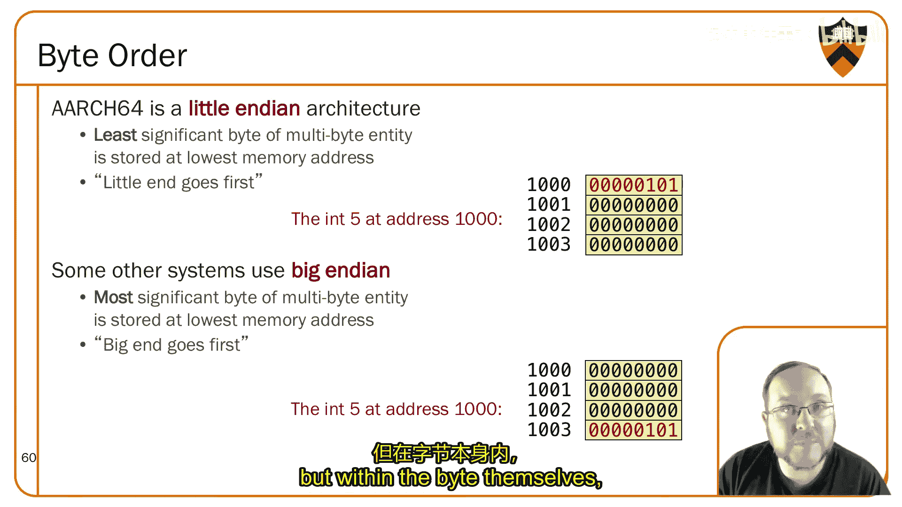

这对一些程序有影响，例如这里的C代码是不可移植的。它在大端序计算机上会有不同的输出，因为它一个字节一个字节地遍历，但这些字节根据字节序以不同的顺序存储。因此，我们一个接一个地访问它们的顺序会改变。

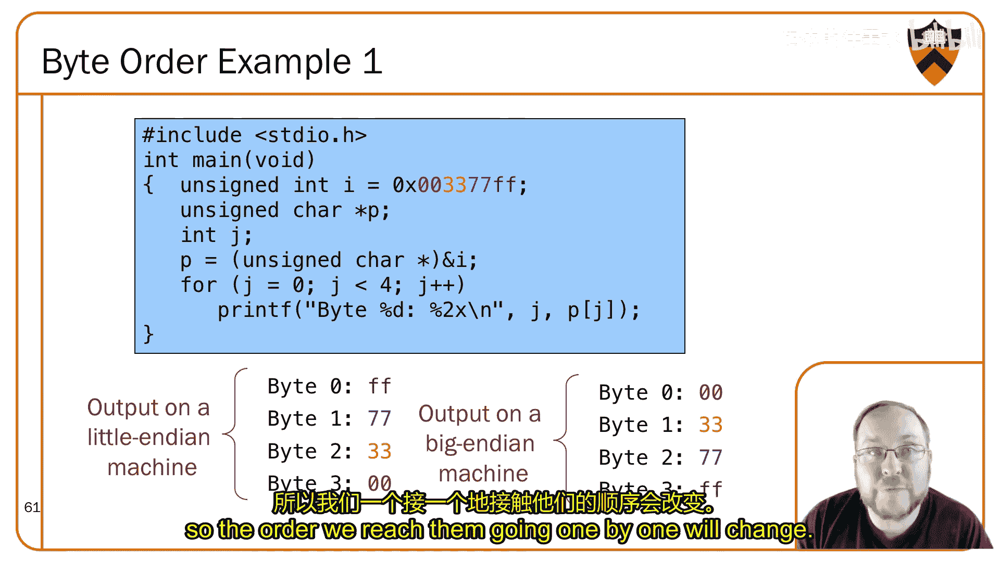

同样，当我们处理多字节数据结构的单个字节时，它也会延续到我们的汇编代码中。在Arlab上的这段代码中，程序返回7，因为A64是小端序，所以获取字中的最低地址会获取包含7的字节。另一方面，大端序机器将返回0。字中的最低地址将导致其最高有效字节，即0。

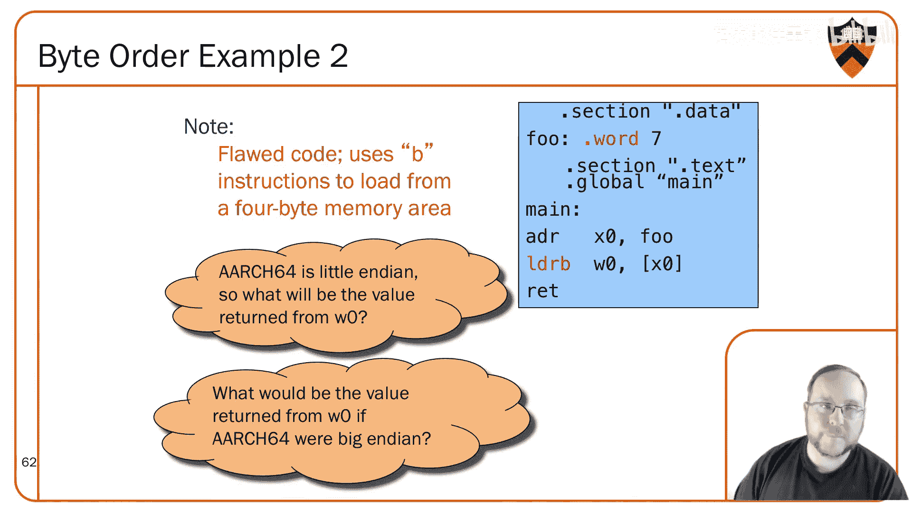

## 课程总结与后续安排 🎓

这是一个巨大的介绍，然而我们才刚刚触及皮毛。下周你将有两个实验课和另外两个关于ARM的讲座，再下周你将有一个关于ARM的讲座和另外两个实验课。还有很多内容要讲。最后一件事，我当然要提一下，在这个国家，周二有一个相当重要的公民活动。我们将在常规时间进行实验课，但如果你在投票站工作或进行“走出去投票”活动，或者你知道你将在一条长长的（希望是社交距离的）队伍中等待，或者即使你只想蜷缩在沙发上观看突发新闻，那完全没问题，只是请提前计划，计划要么参加周一的实验课之一（遵循政策页面上的程序），要么参加周二另一个更适合你日程安排的实验课，根据你的计划。如果其他方法都失败了，你总可以在Canvas的Kaltura上找到录制的讲座、录制的实验课，但我们确实敦促你像往常一样尝试参加一些实验课。选举日也有一节讲座发布，但只要你周三或周四的实验课前观看了它，就没问题，没有必要在周二立即观看。

我很高兴在Ed上看到寻找合作伙伴的帖子，我希望你已经开始熟悉作业4。如果你还没有开始，请务必找一个合作伙伴，请伸出援手，看看我们是否能成为媒人，让大家尽快熟悉新作业。我期待在办公时间与大家见面讨论那个作业。祝你好运。

---

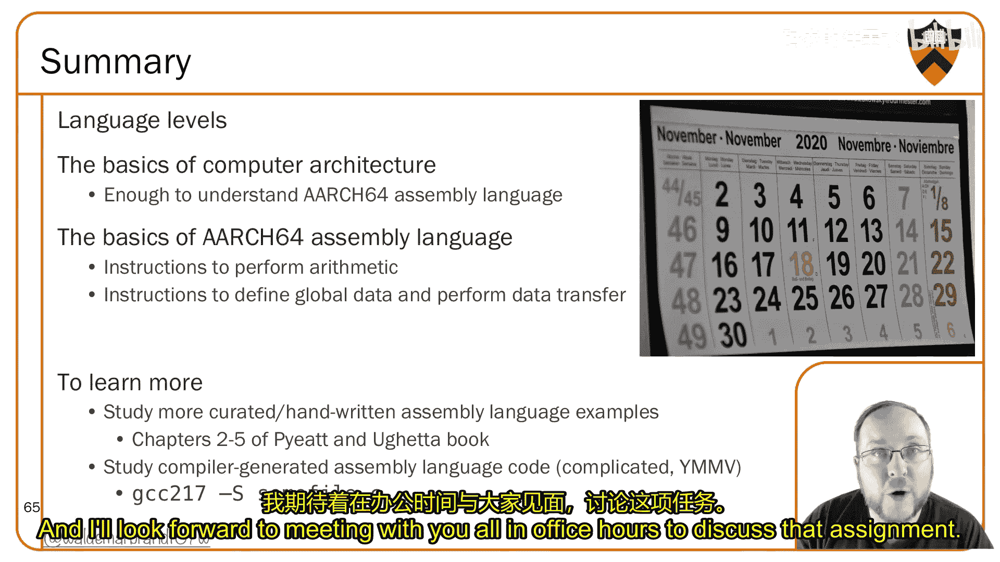

本节课中我们一起学习了汇编语言的基础知识，包括ARM架构、寄存器、指令格式以及简单的加载-存储操作。我们通过一个计算矩形周长的完整示例，将C语言概念映射到了汇编语言层面。理解这些底层原理将帮助我们编写更高效、更优化的代码，并为后续深入学习控制流和函数调用打下坚实基础。