# 023：函数调用与栈帧管理 🧱

在本节课中，我们将深入探讨如何将高级语言（如C语言）中的典型程序翻译成汇编语言。我们将重点关注函数调用这一核心编程概念，学习ARM架构如何通过一套约定和机制来解决函数调用带来的挑战。

## 概述

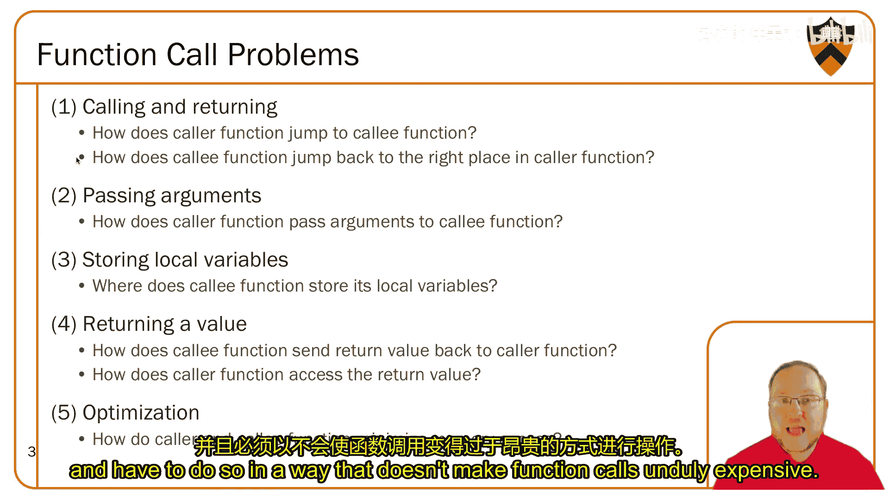

到目前为止，我们编写的程序都较为简单，仅使用了`.text`、`.data`和`.bss`段，并且没有看到`main`函数如何与其他函数交互。本节课将讨论函数调用面临的挑战，以及ARM架构如何通过特定的机制来支持这一基础编程原语。

函数调用的挑战包含多个方面：如何调用函数、如何向函数传递参数、如何建立其栈帧、如何从函数返回值，以及如何从函数返回调用点。所有这些必须在统一的假设和约定下协同工作，并且不能使函数调用变得过于昂贵。

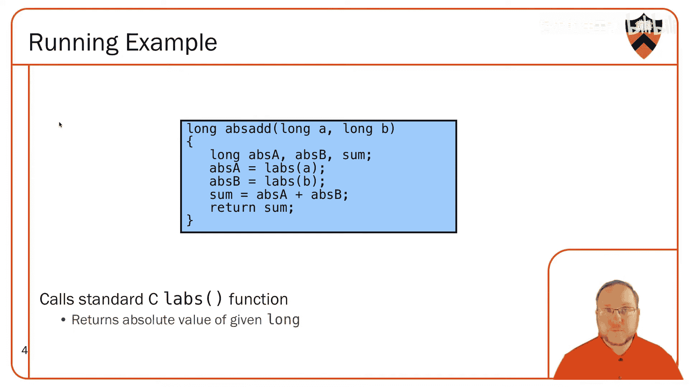


## 函数调用与返回的挑战

上一节我们介绍了汇编语言的基础，本节中我们来看看函数调用的核心问题：如何跳转到另一个位置执行，并安全地返回。

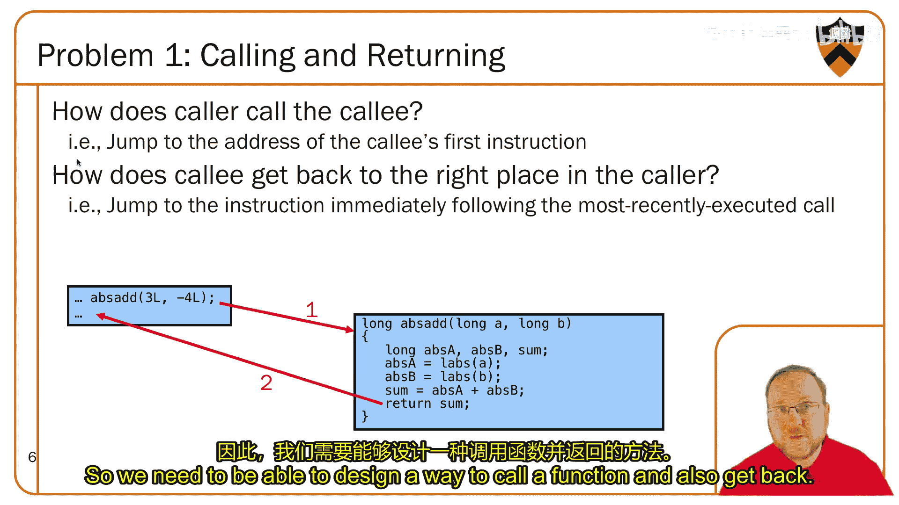

### 如何调用和返回？

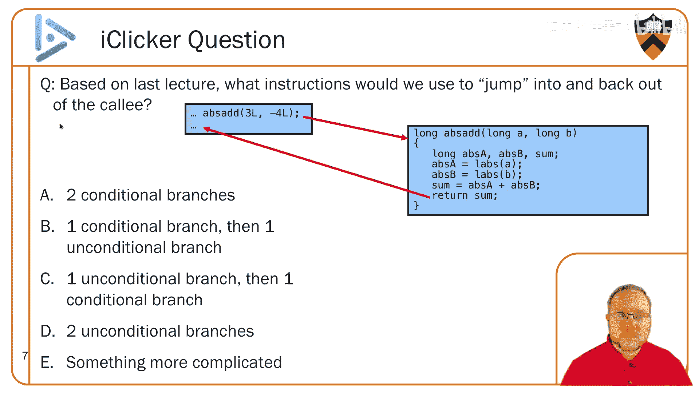

我们需要一种方法，能够停止在`.text`段的某个位置执行，并跳转到另一个位置（同样在`.text`段）开始执行。更重要的是，一旦函数执行完毕，我们需要能够返回到调用它的地方。

以下是实现这一目标的几种思路。

#### 尝试方案一：使用`B`指令

我们记得上一讲中，可以使用`B`指令无条件跳转到一个标签。函数可以通过标签来标识。因此，调用函数可以简单地使用`B`指令跳转到该标签，返回时也可以使用`B`指令跳转回来。

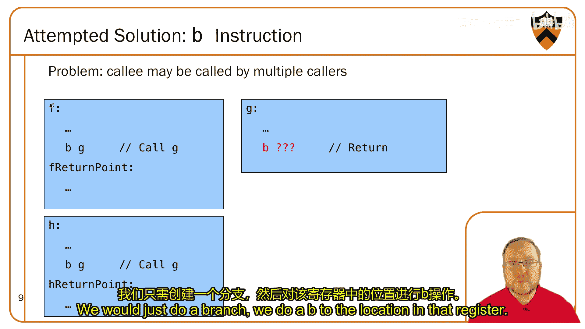

**代码示例：**
```assembly
    B   g           // 调用函数g
    // ... 其他代码
g:
    // ... 函数g的代码
    B   back_to_caller // 返回
```

然而，这种方法存在一个根本问题。我们定义函数通常是为了在不同的上下文中重复使用它。当函数被多个不同地方调用时，它无法知道应该返回到哪个具体的调用点。

#### 尝试方案二：使用寄存器传递返回地址

为了解决上述问题，我们可以在使用`B`指令进行函数调用之前，将紧跟在`B`指令后面的地址（即返回地址）存入某个寄存器。然后，在函数`g`的末尾，使用`B`指令跳转到该寄存器中存储的地址。

**代码示例：**
```assembly
    ADR x9, return_label  // 将返回地址存入x9
    B   g                  // 调用函数g
return_label:
    // ... 调用后的代码
g:
    // ... 函数g的代码
    B   x9                 // 跳转到x9中的地址返回
```

这个方案可以工作，但不够理想。它需要在每次函数调用前都使用`ADR`指令填充寄存器，并且每个函数调用后都需要一个显式的标签供`ADR`引用。此外，调用者和被调用者必须约定使用哪个寄存器。

#### ARM的解决方案：`BL`和`RET`指令

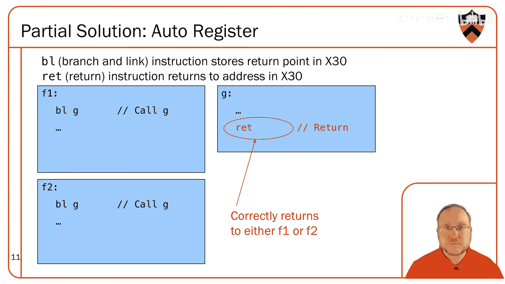

ARM架构提供了专门的指令来优雅地解决这个问题。

*   `BL`（带链接跳转）指令：该指令在跳转到目标标签的同时，**自动**将下一条指令的地址（即返回地址）存入专用寄存器`X30`（也称为链接寄存器`LR`）。
*   `RET`（返回）指令：该指令从函数返回，它会自动跳转到`X30`寄存器中存储的地址。

**代码示例：**
```assembly
    BL  g           // 调用函数g，返回地址自动存入X30
    // ... 调用后的代码
g:
    // ... 函数g的代码
    RET             // 返回到X30中的地址
```

使用`BL`和`RET`，我们可以在单条指令内完成带有正确上下文的函数调用和返回，而无需用一堆仅用于函数调用的标签来污染代码。

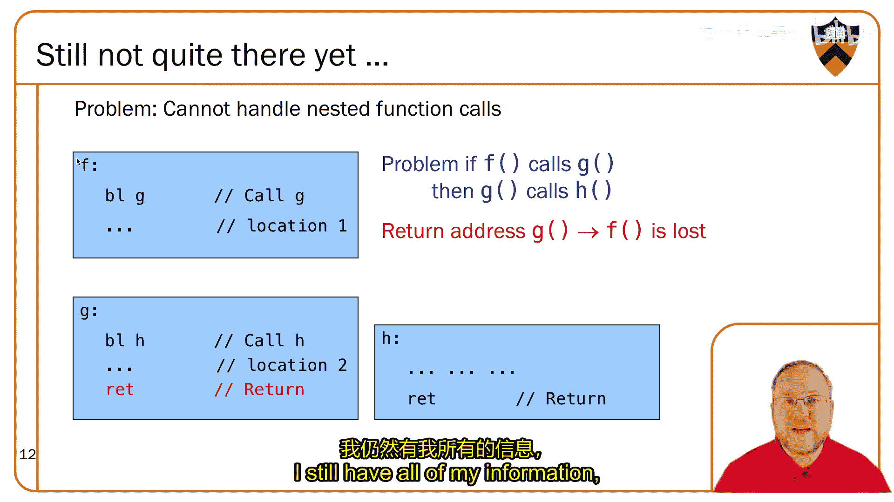

### 嵌套函数调用的问题

然而，上面的方案仍然只是一个“部分解决方案”。考虑一个更复杂的情况：函数`f`调用`g`，而`g`又调用`h`。

1.  `f`调用`g`时，位置1的地址被存入`X30`。
2.  `g`调用`h`时，位置2的地址被存入`X30`，**覆盖了**之前存储的位置1。
3.  `h`执行完毕，`RET`指令根据`X30`（现在是位置2）返回到`g`。
4.  `g`执行完毕，`RET`指令再次根据`X30`（仍然是位置2）试图返回，这导致它错误地跳转回自己内部，而不是返回到`f`。

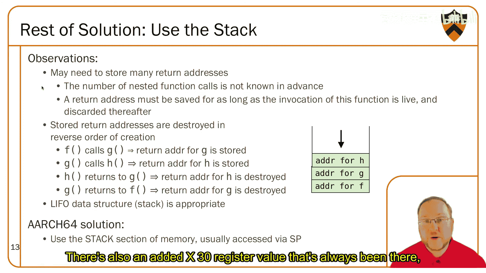

问题在于，当进行嵌套调用时，`X30`寄存器的值会被覆盖。我们需要一种方法来保存每个函数自己的上下文（返回地址），以便在完成嵌套调用后能够恢复。

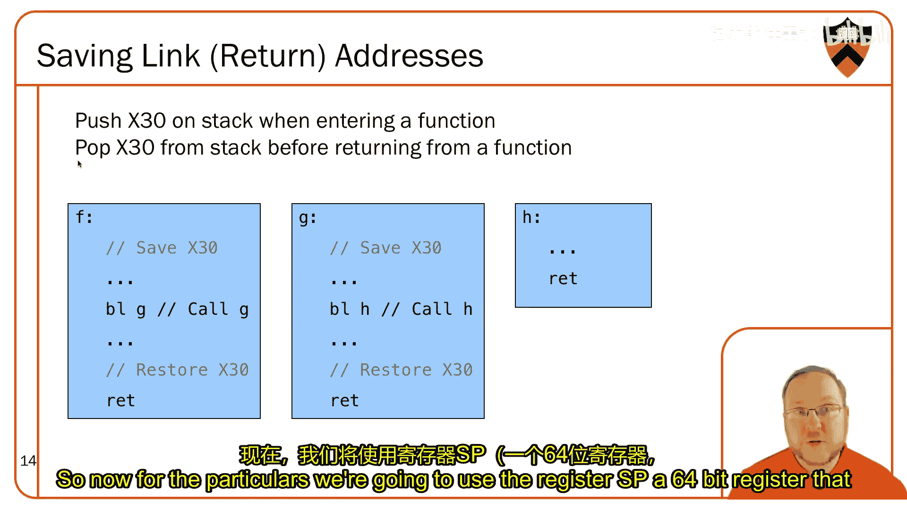

这种“后进先出”（LIFO）的数据结构正是**栈**。在C语言编程中，我们称之为**栈帧**。每个被调用但尚未返回的函数都拥有自己的栈帧，用于存储临时信息，包括它自己的返回地址。

## 栈帧与寄存器保存

上一节我们认识到需要栈来保存上下文，本节中我们来看看如何在ARM汇编中具体实现栈帧管理。

### 栈指针与栈帧分配

我们使用一个特殊的64位寄存器`SP`（栈指针）来指向当前活动栈帧的顶部。要为新的函数栈帧分配空间，我们需要将`SP`向低地址方向移动（即“压栈”）。

**重要**：ARM架构要求`SP`必须**16字节对齐**。即使我们只需要8字节空间来存储`X30`，也必须分配16字节的栈帧空间。

**分配栈帧代码示例：**
```assembly
    SUB SP, SP, #16   // 分配16字节的栈帧空间
```

### 保存与恢复寄存器

分配空间后，我们可以使用`STR`（存储）指令将`X30`的值保存到栈帧中，通常保存在栈帧顶部（`SP`指向的位置）。在函数结束时，我们使用`LDR`（加载）指令从栈中恢复`X30`的值，然后通过给`SP`加回相应的值来释放（弹出）栈帧。

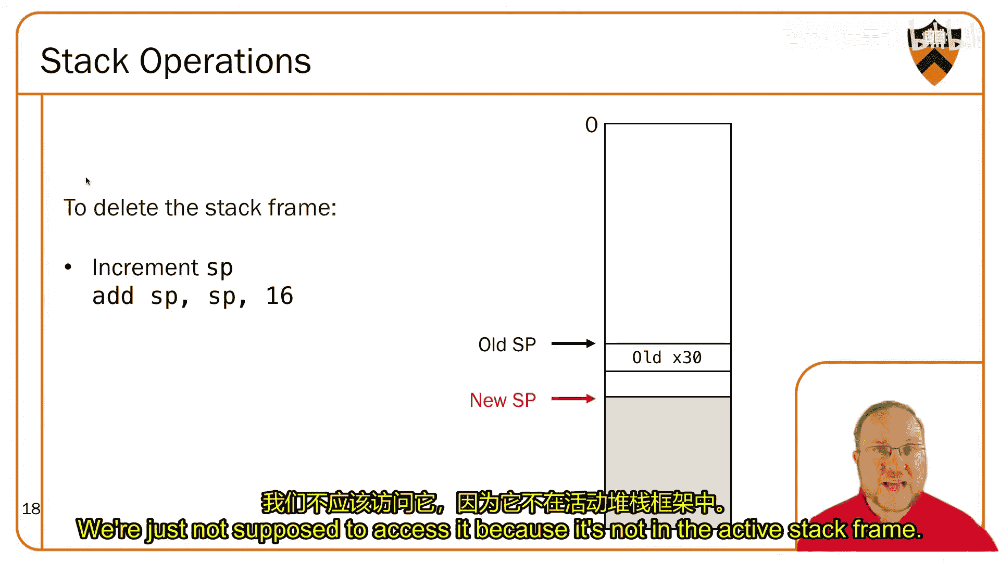

**保存与恢复代码示例：**
```assembly
function_start:
    SUB SP, SP, #16      // 函数序言：分配栈帧
    STR X30, [SP]        // 保存返回地址X30到栈顶

    // ... 函数主体代码

    LDR X30, [SP]        // 函数尾声：从栈顶恢复X30
    ADD SP, SP, #16      // 释放栈帧
    RET                  // 返回
```

### 函数序言与尾声

这就是你在汇编课程中从一开始就看到的**函数序言**和**函数尾声**的完整含义。

*   **序言**：分配栈帧空间，并将需要保存的寄存器（首先是`X30`）存入栈中。
*   **尾声**：从栈中恢复寄存器的值，然后释放栈帧空间。

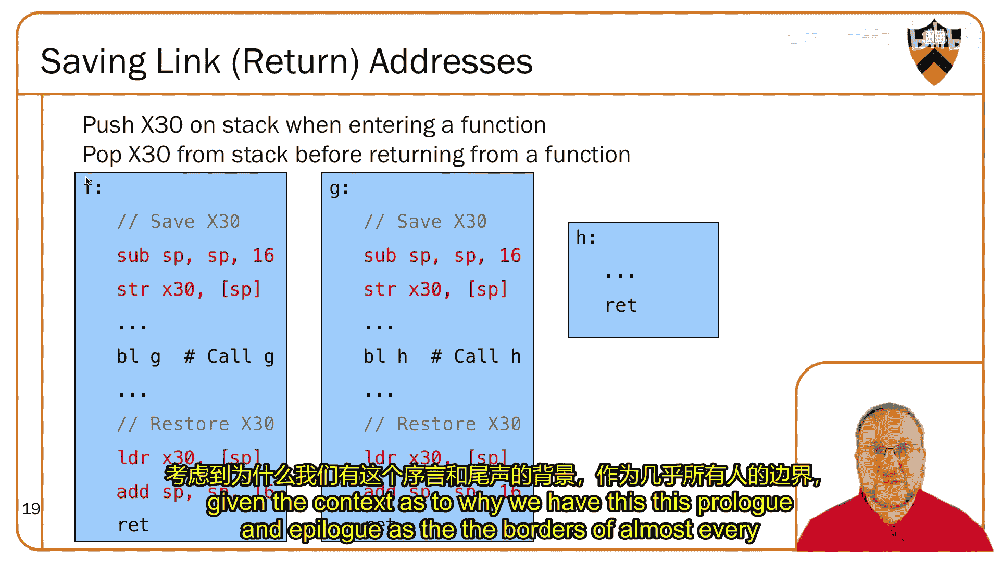

现在，希望你对为什么几乎每个函数都有这样的边框代码有了更清晰的理解。

## 函数参数的传递

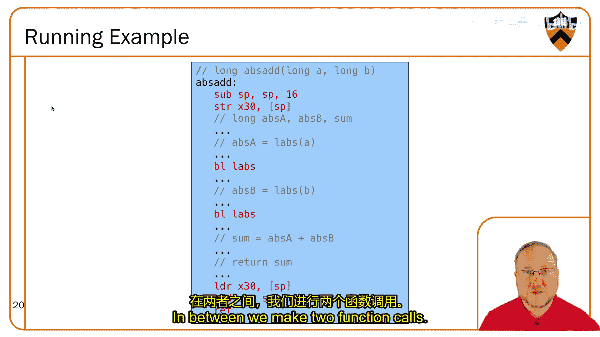

上一节我们解决了调用和返回地址的管理，本节中我们来看看如何向函数传递参数。

### 参数传递寄存器


与返回地址`X30`类似，函数的参数也需要由调用者传递给被调用者。ARM架构约定，函数的**前8个参数**通过寄存器`X0`到`X7`传递。

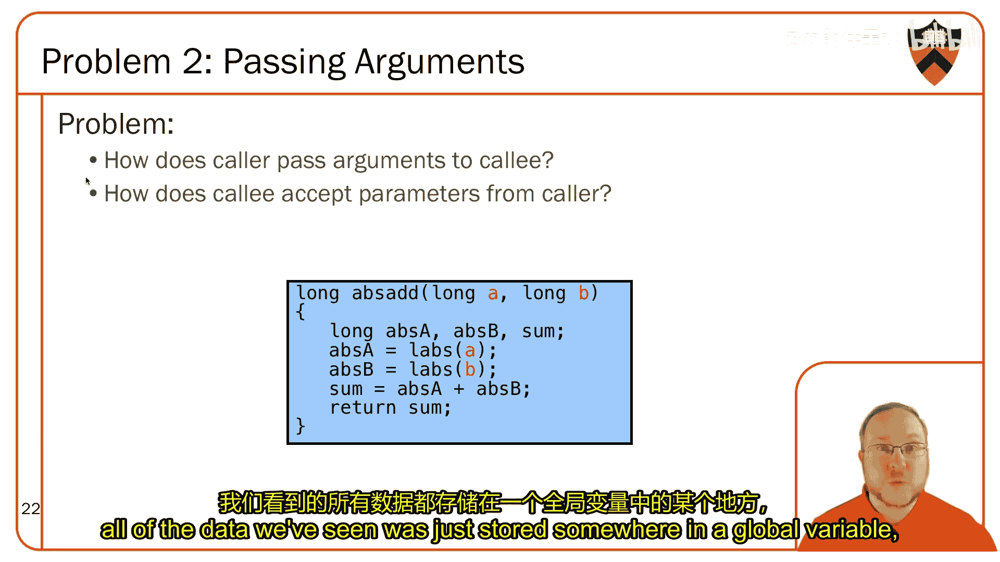

如果函数参数超过8个，或者参数是大于64位的数据结构（如某些结构体），则额外的参数需要通过栈来传递。在COS 217课程中，我们通常不涉及这种情况。

### 保存参数到栈中

如果被调用函数（`callee`）内部需要调用其他函数，或者需要将传入的参数作为局部变量使用，它就需要将`X0`-`X7`中的参数值保存到自己的栈帧中，以防止被后续操作覆盖。

在我们的运行示例`abs_sum`中，我们需要调用`llabs`库函数，而调用`llabs`需要使用`X0`寄存器传递参数。因此，我们必须先将`abs_sum`自己的参数`a`和`b`（通过`X0`和`X1`传入）保存到栈上。

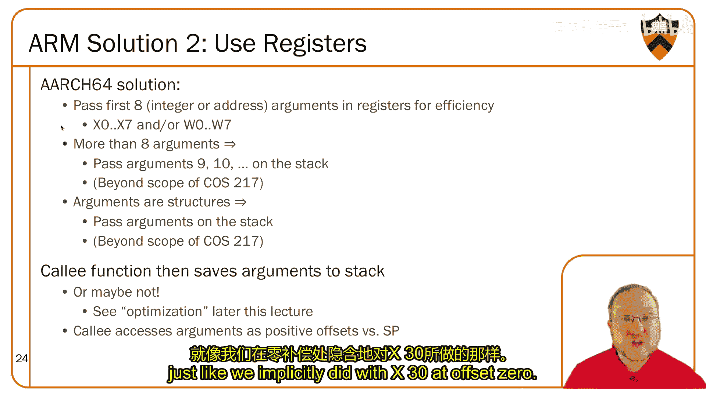

**保存参数代码示例：**
```assembly
abs_sum:
    // 函数序言
    SUB SP, SP, #32      // 分配栈帧（考虑要存X30和两个参数）
    STR X30, [SP]        // 保存返回地址
    STR X0, [SP, #8]     // 保存第一个参数a到SP+8
    STR X1, [SP, #16]    // 保存第二个参数b到SP+16

    // ... 后续代码可以安全地使用X0/X1，因为原值已保存
```

当需要调用`llabs(a)`时，我们再从栈中加载`a`的值到`X0`。

**加载参数进行调用代码示例：**
```assembly
    LDR X0, [SP, #8]     // 将栈上保存的a加载到X0
    BL  llabs            // 调用llabs(a)
    // llabs的返回值在X0中
```

## 总结

本节课中，我们一起学习了ARM汇编语言中函数调用的核心机制：

1.  **调用与返回**：使用`BL`指令进行函数调用，它会自动将返回地址存入`X30`（LR）寄存器；使用`RET`指令从函数返回，它会跳转到`X30`中的地址。
2.  **栈帧的必要性**：为了支持嵌套函数调用，每个函数都需要在栈上拥有自己的帧，用于保存自己的返回地址（`X30`），防止其在调用其他函数时被覆盖。
3.  **栈帧管理**：通过`SP`（栈指针）寄存器管理栈。函数序言中通过`SUB SP, SP, #size`分配空间并保存寄存器；函数尾声中通过`LDR`恢复寄存器并用`ADD SP, SP, #size`释放空间。
4.  **参数传递**：函数的前8个参数通过`X0`-`X7`寄存器传递。被调用函数通常需要将这些参数保存到自己的栈帧中，以便在函数体内安全使用或进行嵌套调用。

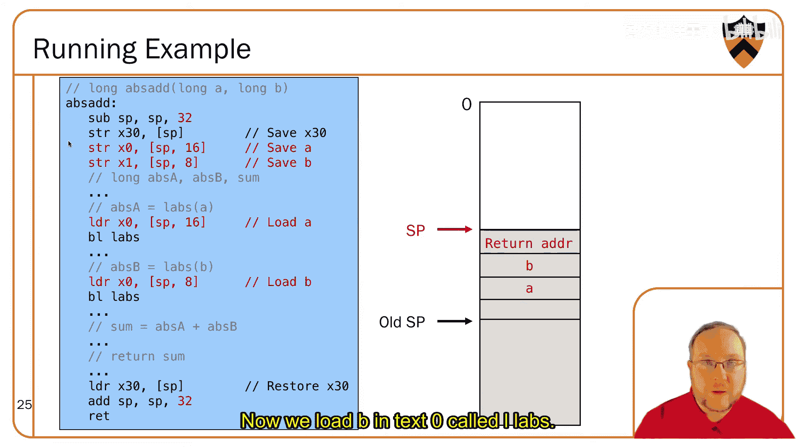

通过理解这些概念和约定，你现在已经掌握了将包含函数调用的C语言代码翻译成ARM汇编语言的关键基础。后续的学习将在此基础上，处理局部变量、返回值等更完整的函数体实现。