# 026：性能提升 🚀

在本节课中，我们将要学习性能剖析与优化的基本概念和技术。我们将探讨如何识别程序中的性能瓶颈，以及使用哪些工具和方法来提升程序运行效率。请注意，优化是一把双刃剑，它可能以牺牲代码的可读性和可维护性为代价，因此我们只在必要时才进行优化。

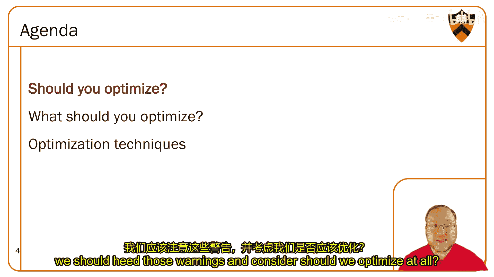

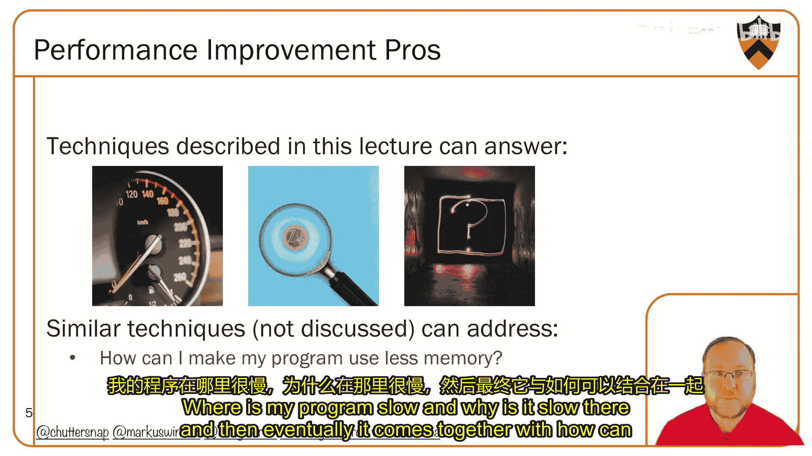

上一节我们介绍了软件工程中设计与实现、调试与测试等开发阶段的话题。本节中，我们来看看与软件维护阶段更相关的性能优化。

## 是否应该优化？🤔

在探讨“优化什么”和“如何优化”之前，我们首先应该考虑“是否应该优化”。

优化可以带来程序运行速度的提升。但目标不应始于“如何让程序更快”，而应始于回答以下问题：
*   我的程序有多慢？
*   我的程序在哪里慢？
*   它为什么在那里慢？

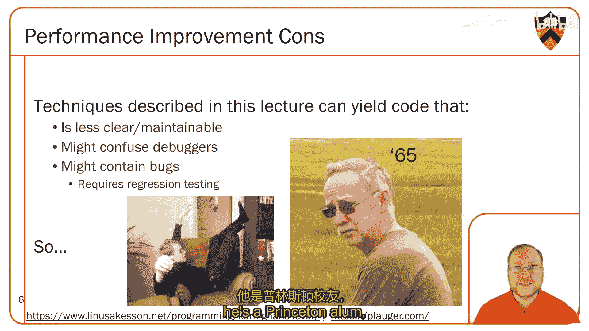

最终，这些问题会导向“如何让程序更快”。

然而，优化的负面影响可能超出你的想象。如果你从一个风格良好、设计清晰、可读性强、易于维护且正确的程序开始，但性能不佳，那么为了修复性能，你可能不得不牺牲上述某些优点。这可能意味着展开循环和内联函数调用，使代码变得混乱。这也可能意味着将变量仅存储在寄存器中，而不在内存中，这会给调试带来困难。

此外，任何代码修改，尤其是那些“巧妙”或“复杂”的修改，都有可能破坏原有功能，因此需要强大的回归测试。

正如Linus Atkinson引用的“Knuth的杠杆”原则（源自《编程风格要素》一书）所言：如果你在编写代码时已经竭尽所能地“聪明”，那么你将如何调试它？

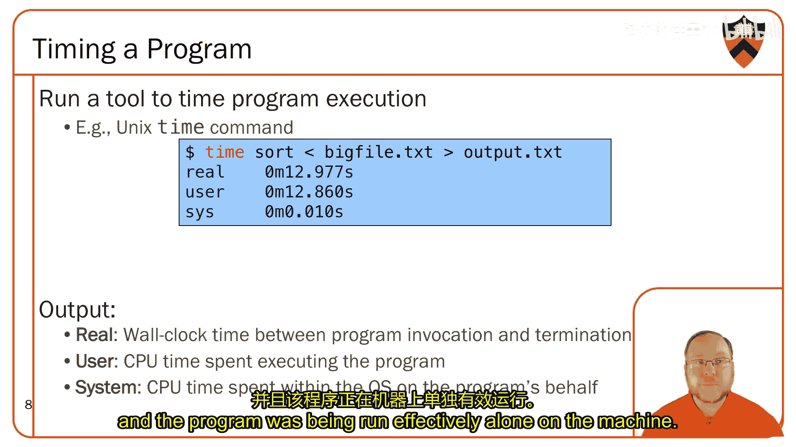

因此，我们需要权衡计算机成本和人力成本。计算机成本是编译和执行程序所需的时间和空间成本。人力成本是长期维护程序所需的劳动力成本。通常情况下，人力成本远高于计算机成本。优化降低了计算机成本，但往往使代码变得不清晰，增加了维护的人力成本。在一般情况下，优化可能会给公司带来净负面的财务影响。因此，我们建议只在有充分理由时才进行优化。

## 测量程序运行时间 ⏱️

判断程序是否耗时过长的最简单方法是计时。

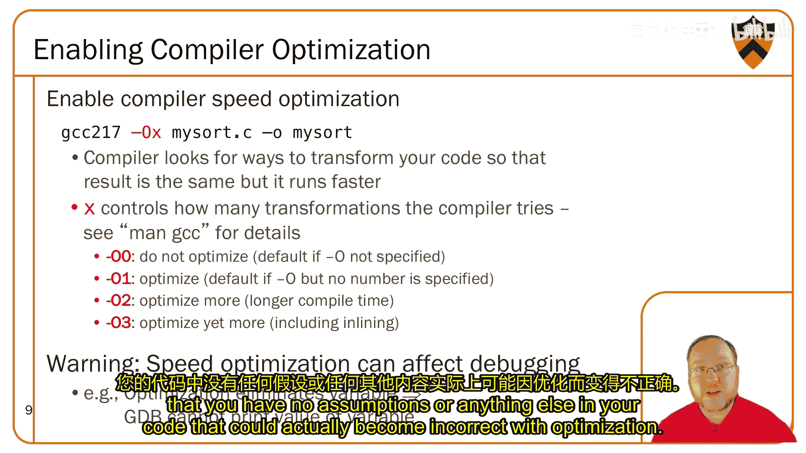

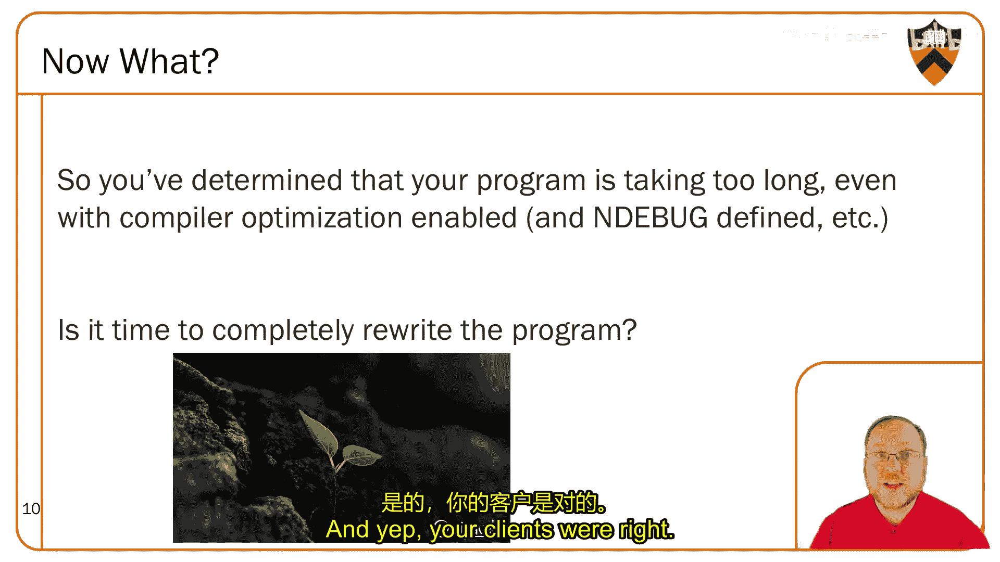

以下是Unix系统中相当于用秒表为代码计时的命令：

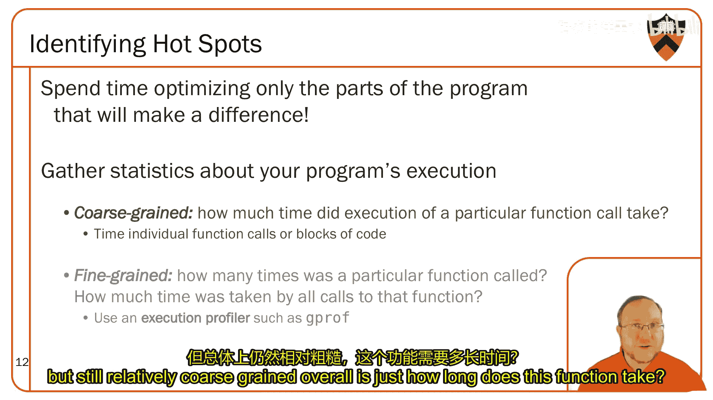

```bash
time ./your_program
```

该命令会输出三个时间值：
*   **real**： 这是挂钟时间，即程序从开始到结束实际经过的时间。
*   **user**： 这是程序在用户态（即你的代码）消耗的CPU时间。
*   **sys**： 这是程序在内核态（即操作系统为程序服务）消耗的CPU时间。

通常，我们最关心的是`user`时间。但在某些情况下，很高的`sys`时间可能表明存在其他问题。请注意，`real`时间可能远高于`user`时间，例如当程序等待输入或等待其他进程时。

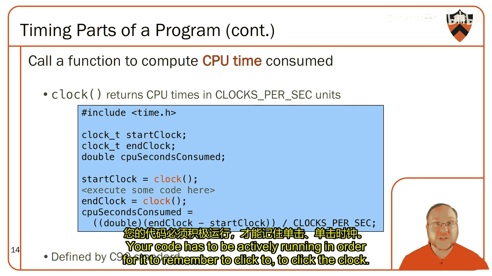

## 编译器优化选项 ⚙️

一种提升性能的方法是让编译器为你做优化。使用`-O`选项（大写O）可以开启编译器优化。

以下是几个常用的优化级别：
*   `-O0`： 关闭所有优化（默认）。
*   `-O1` 或 `-O`： 进行基本优化，在编译时间和代码大小之间取得平衡。
*   `-O2`： 进行更积极的优化，可能会增加编译时间，但能获得更好的性能。
*   `-O3`： 进行非常积极的优化，可能会显著增加编译时间，并尝试所有可行的优化。

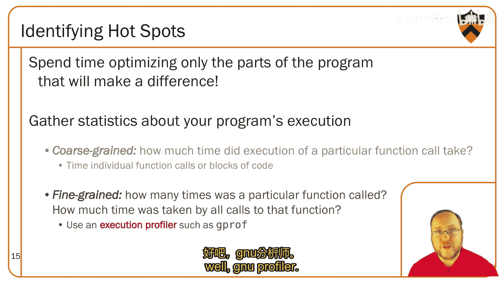

你可能会问，为什么不总是使用优化编译？一个原因是，开启优化后，编译器可能会将变量仅存储在寄存器中，这使得在GDB等调试器中难以或无法按源代码逐行跟踪变量值。因此，建议在开发调试阶段使用`-O0`编译，在确认程序正确后，再使用优化选项（如`-O2`）为最终版本编译。当然，优化后必须再次测试以确保功能正常。

## 性能剖析工具 🔍

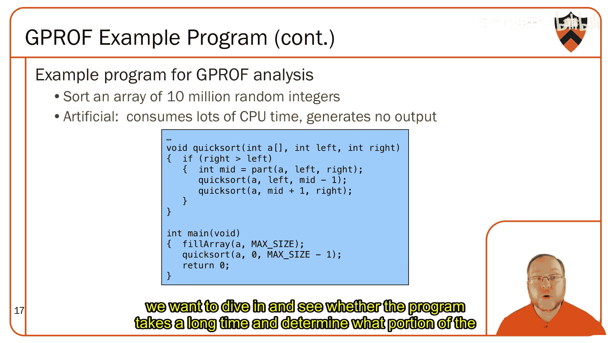

如果你的程序确实运行太慢，仅知道总耗时是不够的。你需要更细粒度的信息，例如“程序运行了10秒，其中9秒花在了`foo`函数里”。这样你才知道该优化哪里。

比测量整个程序耗时更精细的方法是测量单个函数的耗时。

C标准库`<time.h>`提供了时间处理函数。例如，你可以使用`clock()`函数来测量CPU时间（处理器时钟滴答数）。通过将其除以`CLOCKS_PER_SEC`宏，可以得到以秒为单位的时间。这种方法相对准确，并且不受系统负载或I/O等待的显著影响。

然而，你不仅关心一个函数每次调用耗时多久，还关心它被调用了多少次。两者的结合（总耗时）才能告诉你优化它的重要性。一个运行时间很长的函数值得优化，因为它占据了总运行时间的大部分。一个运行时间很短但被调用非常频繁的函数也值得优化，因为微小的改进会被放大。

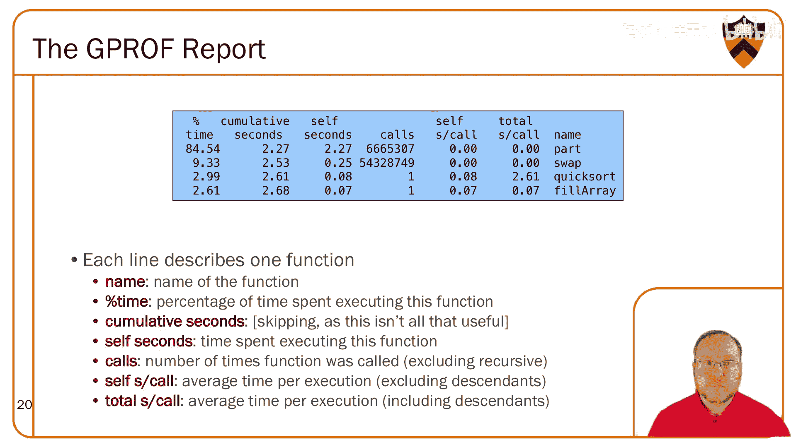

为了获取这些信息（函数调用次数、耗时分布等），我们需要使用执行剖析器。在GNU/Linux平台上的标准工具是`gprof`。

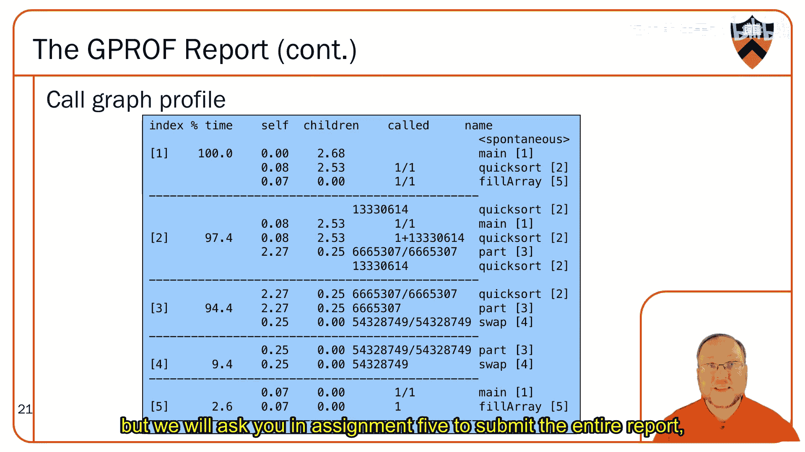

`gprof`通过在程序运行时定期采样来工作。它安排`SIGPROF`信号以固定时间间隔（例如每秒数百次）发送到你的进程。每次信号到达时，`gprof`记录下当前正在执行的函数。通过这种蒙特卡洛方法，它可以推断出程序执行轨迹和各函数的耗时比例。

要使用`gprof`，你需要使用`-pg`标志编译程序以插入检测代码：
```bash
gcc -pg -o your_program your_program.c
```
然后像往常一样运行程序。运行结束后，会生成一个`gmon.out`日志文件。最后，使用`gprof`工具解析该文件并生成报告：
```bash
gprof your_program gmon.out > report.txt
```

生成的报告包含多个部分，其中最有用的是一个函数耗时表格。该表格按耗时百分比降序列出各个函数，并包含以下信息：
*   该函数消耗的总时间百分比。
*   该函数消耗的总时间（秒）。
*   该函数被调用的总次数。
*   每次调用的平均时间（不包括其子函数）。
*   每次调用的平均时间（包括其子函数）。

通过分析这个报告，你可以快速识别出程序中的性能瓶颈。例如，如果一个函数占据了85%的运行时间，并且被调用了数百万次，那么优化它将带来巨大的整体性能提升。

## 优化技术 🛠️

一旦你确定了需要优化的函数，接下来就需要具体的优化技术。当然，一种根本性的方法是使用更高效的算法。但在这里，我们更关注于代码层面的微观优化。

以下是几个优化示例，我们将分析编译器是否能自动完成这些优化，以及为什么：

**示例1：公共子表达式消除**
```c
int g(int x) {
    return f(x) + f(x) + f(x) + f(x);
}
// 能否优化为 return 4 * f(x); ?
```
**答案：** 有时可以，但并非总是有效。如果`f(x)`具有副作用（如修改全局变量、执行I/O操作）或是非确定性的（如返回随机数），那么这种优化会改变程序行为。编译器通常无法确定这一点，因此可能不会进行此优化。但如果你作为程序员知道`f(x)`是纯函数（无副作用，确定性），你可以手动进行此优化。

**示例2：循环不变量外提**
```c
for (int i = 0; i < n; i++) {
    for (int j = 0; j < m; j++) {
        array[n * i + j] = 0; // n*i 是内层循环不变量
    }
}
// 能否将 n*i 的计算移到外层循环？
```
**答案：** 很可能可以。编译器可以看到`n`和`i`在内层循环中没有改变，因此可以将`n*i`的计算外提。但手动进行此优化同样清晰明了。

**示例3：强度削弱**
```c
for (int i = 0; i < n; i++) {
    array[n * i] = 0; // 每次迭代都计算 n*i
}
// 能否优化为累加 n，而不是每次都做乘法？
```
**答案：** 可以。我们可以将循环改为：
```c
int index = 0;
for (int i = 0; i < n; i++) {
    array[index] = 0;
    index += n;
}
```
加法通常比乘法更快。聪明的编译器也可能进行这种优化。

**示例4：避免重复计算**
```c
for (int i = 0; i < strlen(s); i++) { // 每次循环都调用 strlen(s)
    // 使用 s[i]
}
```
**答案：** 编译器很难优化。它需要确认在循环体内`s`的长度没有被修改，并且需要知道`strlen`函数没有副作用。这通常无法保证。你应该手动将长度计算移出循环：
```c
int len = strlen(s);
for (int i = 0; i < len; i++) {
    // 使用 s[i]
}
```

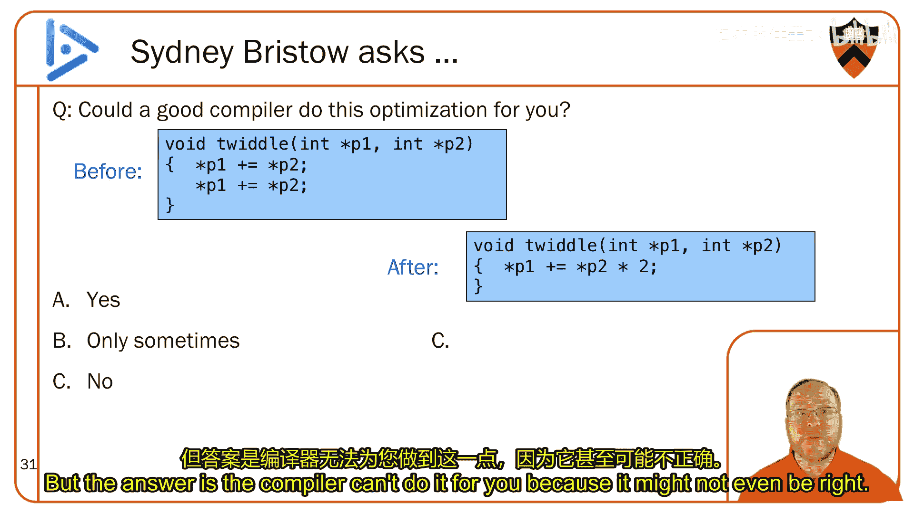

**示例5：指针别名问题**
```c
void add_twice(int *p1, int *p2) {
    *p1 += *p2;
    *p1 += *p2;
}
// 能否优化为 *p1 += 2 * (*p2); ?
```
**答案：** 不能。如果`p1`和`p2`指向同一个内存位置（别名），两种写法会产生不同的结果。编译器无法知道它们是否互为别名，因此不能进行此优化。C99引入了`restrict`关键字，用于向编译器承诺指针不会别名，此时编译器就可以安全地进行优化了。

## 高级优化技术 ⚡

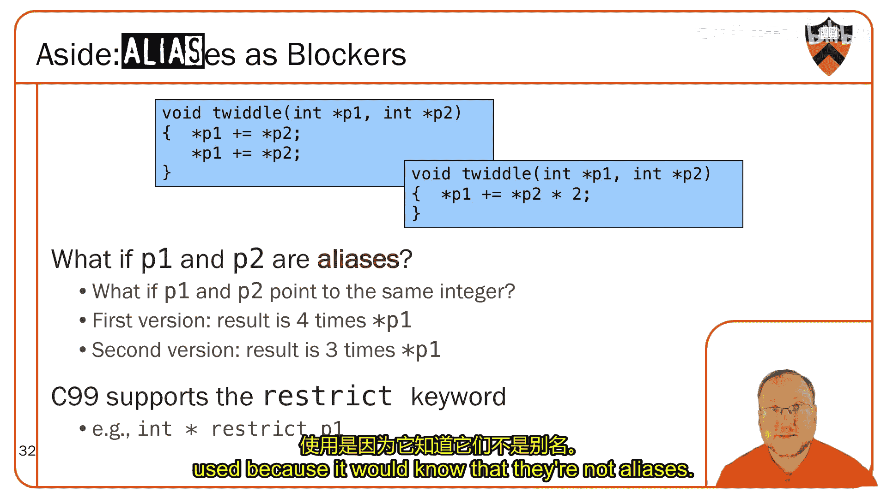

除了上述模式识别，还有两种重要的底层优化技术：

**1. 内联函数**
函数调用涉及跳转、栈帧设置和恢复等开销。内联函数调用就是将函数体直接插入到调用点，从而消除这些开销。编译器在能够看到函数定义时，可能会自动内联小函数。C99及以后版本支持`inline`关键字，作为给编译器的内联建议。

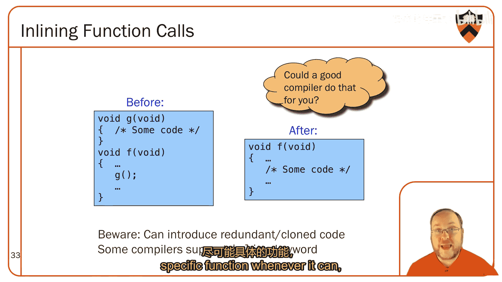

**2. 循环展开**
循环控制（比较和条件跳转）也有开销。更重要的是，在现代处理器流水线中，循环分支可能导致分支预测错误，从而清空流水线，造成性能损失。循环展开通过在一次迭代中处理多个数据项，减少了分支次数，从而可能提升性能。但代价是代码变得冗长且难以维护。一些编译器（如GCC）支持`-funroll-loops`选项来自动进行循环展开。

## 手写汇编代码 💻

最终的优化手段是抛弃编译器，直接用更低级的语言（如汇编）编写代码。这听起来很强大，汇编指令中可能包含编译器不知道或不会充分利用的优化机会。

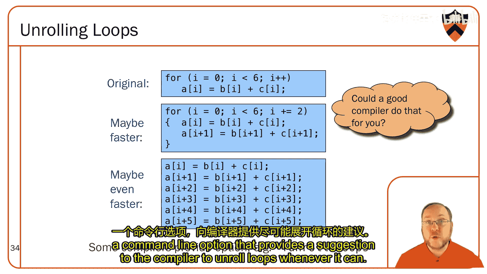

但请记住，现代编译器凝聚了数十年的尖端研究成果，它们极其聪明且高度优化。手写汇编代码通常只是在边际上进行改进。在大多数情况下，编译器生成的优化代码已经非常高效，要超越它需要付出巨大的努力，并且可能只带来微小的性能提升。因此，除非在极其关键且经过充分剖析确认的代码路径上，否则不建议轻易使用手写汇编。

## 总结 📝

本节课中我们一起学习了性能优化的完整流程：
1.  **审慎决策**：首先评估优化的必要性，权衡性能提升与代码可维护性成本。
2.  **测量定位**：使用`time`命令测量总耗时，使用`gprof`等剖析工具定位具体的性能瓶颈函数。
3.  **模式优化**：识别代码中可优化的常见模式，如公共子表达式消除、循环不变量外提、强度削弱、避免重复计算等，并理解编译器在什么情况下能或不能自动完成这些优化。
4.  **应用技术**：在必要时应用内联函数、循环展开等底层优化技术。
5.  **终极手段**：认识到手写汇编是最后的手段，通常收益有限且实现复杂。

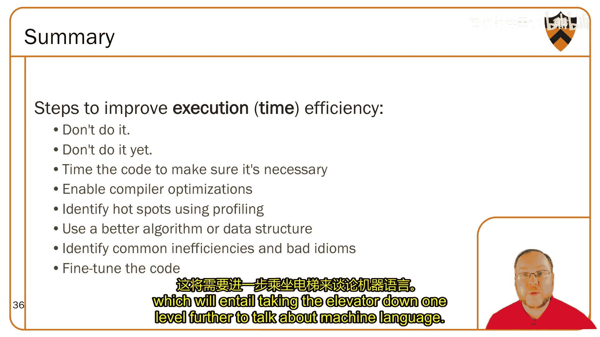

性能优化是一个需要测量、分析、实验和验证的迭代过程。始终基于数据（剖析结果）做出优化决策，并在每次优化后重新测试以确保正确性。