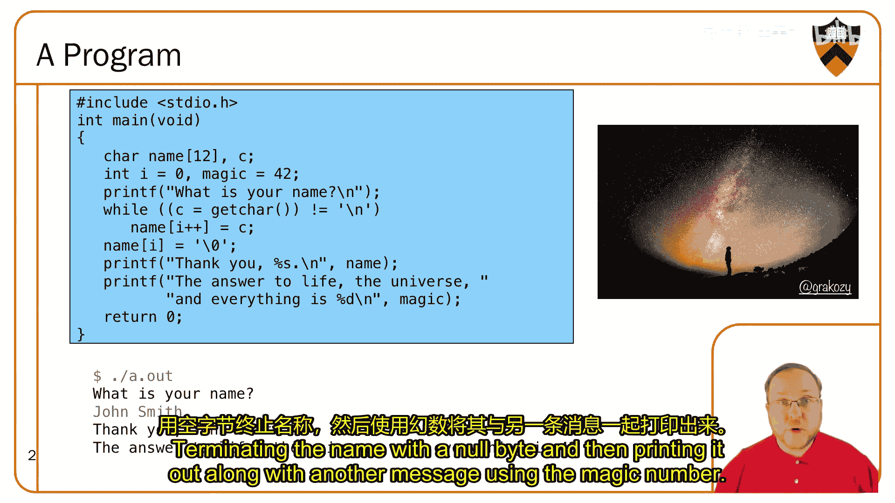
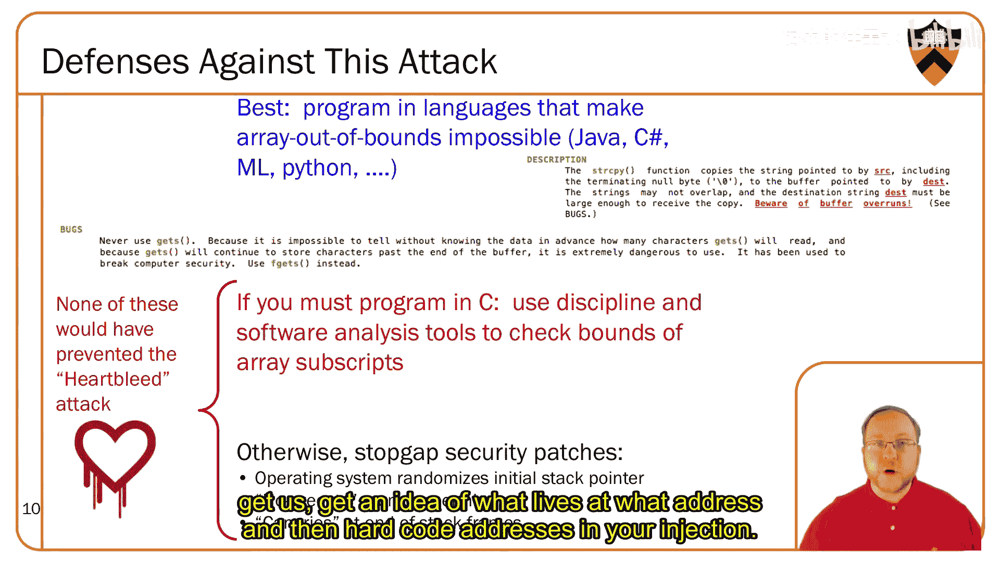
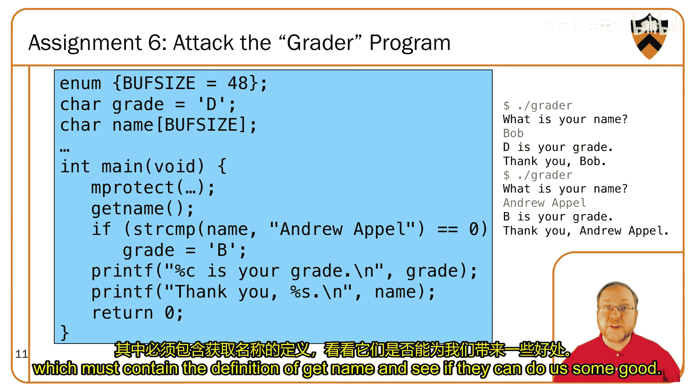
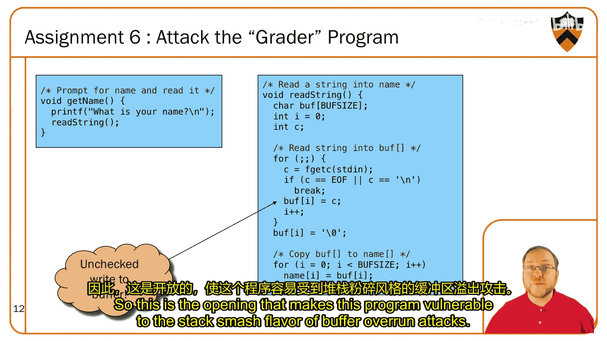
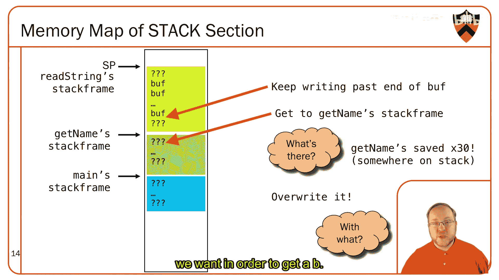
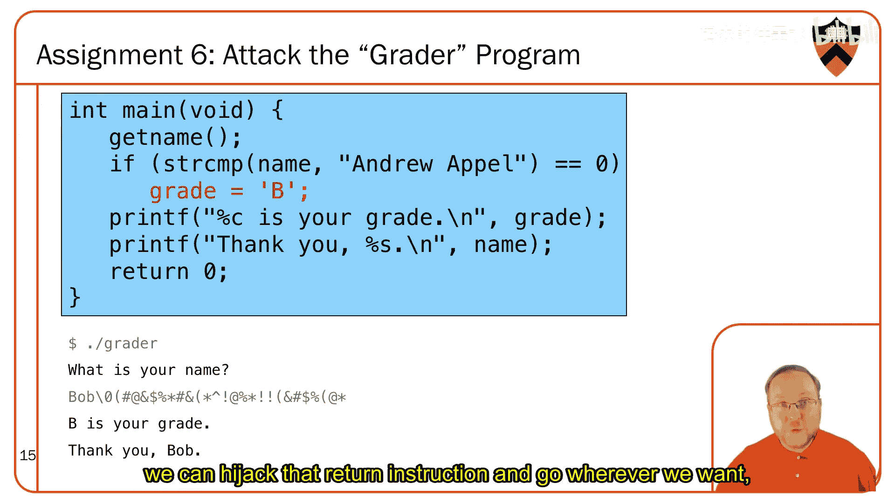
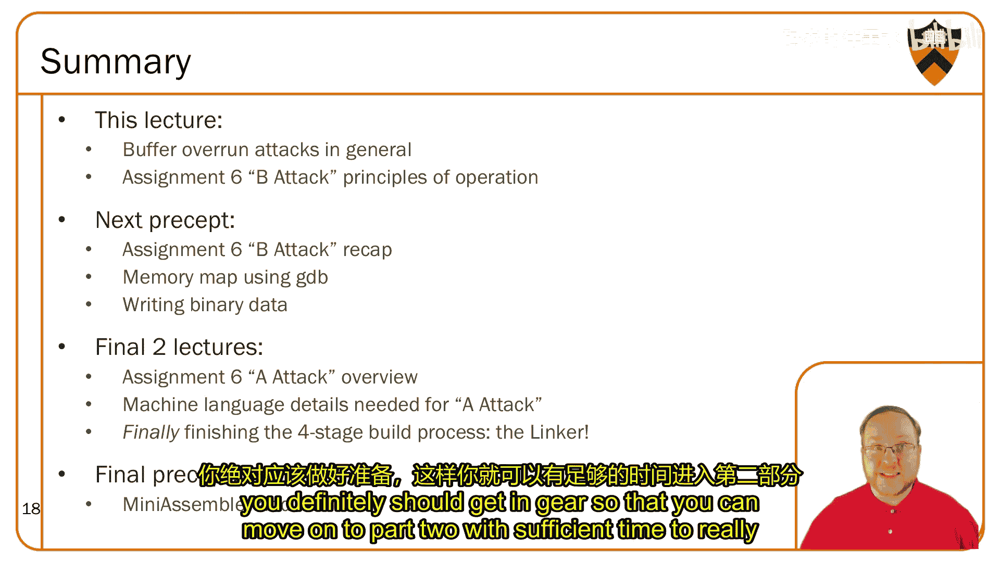

# 027：缓冲区溢出攻击原理与实践 🛡️💥


在本节课中，我们将学习计算机安全领域一个经典且重要的主题：**缓冲区溢出**。我们将通过分析一个存在漏洞的C程序，理解其原理，并探讨如何利用此漏洞改变程序行为。课程最后会介绍课程作业6中的B级攻击的基本思路。

## 概述：什么是缓冲区溢出？



缓冲区溢出是指程序向一个固定长度的缓冲区（如数组）写入数据时，超出了其预分配的边界，从而覆盖了相邻内存区域的数据。这可能导致程序崩溃、数据损坏，甚至被恶意利用来执行非预期的代码。

上一节我们回顾了函数调用栈的基本结构，本节中我们来看看当程序写入数据不检查边界时会发生什么。

## 一个存在漏洞的程序示例

考虑以下C程序代码。它提示用户输入姓名，并逐个字符读取，直到遇到换行符为止。

```c
#include <stdio.h>

int main() {
    char name[12];
    char c;
    int magic = 42;
    int i = 0;

    printf("Enter your name: ");
    while ((c = getchar()) != '\n') {
        name[i++] = c;
    }
    name[i] = '\0';

    printf("Hello, %s! Your magic number is %d.\n", name, magic);
    return 0;
}
```

程序运行看似正常。但如果输入一个超过11个字符（因为需要留一个位置给字符串终止符`\0`）的长名字，例如“Christopher Moretti”，程序行为就会变得异常。

输出可能类似：
```
Hello， Christophe
r Morett！ Your magic number is 6911092.
```

为什么名字被截断并换行？为什么魔法数字变成了6911092？要理解这一点，我们需要查看这些局部变量在栈上的布局。

## 栈内存布局与数据覆盖

所有局部变量都存储在栈上。虽然C语言标准不规定它们在栈上的确切顺序，但在此例中，通过反汇编可以观察到近似以下布局（假设为小端字节序）：

*   `SP + 0x00`: 保存的返回地址（`x30`寄存器值）
*   `SP + 0x08`: 数组 `name[12]` 的起始地址
*   `SP + 0x17`: 字符变量 `c`
*   `SP + 0x18`: 整型变量 `magic`（4字节）
*   `SP + 0x1C`: 整型变量 `i`

以下是输入“Christopher Moretti”并按下回车后，内存覆盖过程的逐步分析：

1.  **填充`name`数组**：“Christopher ”（含空格）正好占满12个字节。
2.  **覆盖填充字节**：循环未遇到换行符，继续读取“Moretti”中的“M”、“o”、“r”。它们被写入`name[12]`、`name[13]`、`name[14]`，这实际上覆盖了`name`数组之后用于内存对齐的**填充字节**。
3.  **覆盖变量`c`**：下一个字符‘e’被读入变量`c`（地址`SP+0x17`），然后立即被程序赋值给`name[15]`。但`name[15]`就是`c`自身的内存位置！所以‘e’在下一轮读取时被覆盖。
4.  **覆盖变量`magic`**：后续字符‘t’，‘t’，‘i’继续被写入。它们越过了`c`的位置，开始覆盖整型变量`magic`（起始于`SP+0x18`）。由于是小端机器，整数的低位字节在前。
    *   ‘t’ (ASCII 0x74) 覆盖了`magic`的第一个字节，将值从42 (0x2A) 变为 0x74。
    *   第二个‘t’覆盖第二个字节，`magic`变为 0x7474 (十进制 29812)。
    *   ‘i’ (0x69) 覆盖第三个字节，`magic`变为 0x697474 (十进制 6911092)。
5.  **循环结束**：最后的换行符‘\n’被读入`c`，覆盖了之前的字符，循环条件满足，循环终止。这也解释了为什么输出的名字中‘e’消失了，并且被换行符打断。



这个例子展示了**溢出缓冲区如何通过覆盖相邻数据来改变程序行为**。我们不仅破坏了名字字符串，还意外修改了“魔法数字”。

## 更严重的后果：控制流劫持



但情况可以变得更糟。如果写入的数据足够多，溢出不仅能覆盖同一函数栈帧内的局部变量，还能**溢出整个函数的栈帧边界**。

在栈上，当前函数栈帧的下方（更低地址）通常是**调用者函数**的栈帧。调用者栈帧的顶部通常保存着关键的**返回地址**（即保存的`x30`寄存器值），该地址指示函数执行完毕后应跳转回哪里。

如果缓冲区溢出覆盖了这个保存的返回地址：
1.  **写入无效地址**：当函数返回时，会将这个被破坏的地址加载回`x30`并跳转，很可能导致**段错误（Segmentation Fault）**。
2.  **写入有效但非预期的地址**：攻击者可以精心构造输入，将返回地址覆盖为程序中另一个合法地址。这可以**劫持程序的控制流**，使其跳转到原本不会执行的代码区域（例如，跳过某些检查直接执行特权操作）。这就是**作业6中B攻击**的核心。
3.  **执行注入的代码**：最危险的情况是，攻击者不仅重定向控制流，还通过其他方式（例如，同一输入）在内存的某个可写区域（如`.bss`段）植入了恶意代码，然后将返回地址指向这片恶意代码。这允许攻击者**执行任意指令**，完全背离程序的原始设计意图。



## 如何防御缓冲区溢出？

好消息是，避免缓冲区溢出攻击相对容易。坏消息是，最根本的防御措施是：**尽量不要使用C这类不会自动进行数组边界检查的语言**。

如果必须使用C，请遵循以下安全实践：

以下是关键的安全编程建议：
*   **避免使用不安全的函数**：如`strcpy`, `gets`。它们不检查目标缓冲区大小。
*   **使用安全替代函数**：始终使用带长度参数的函数，如`strncpy`、`fgets`。
*   **手动进行边界检查**：在向缓冲区写入数据前，始终检查数据长度是否小于缓冲区容量。

此外，现代操作系统提供了运行时保护机制：
*   **NX位（不可执行内存）**：将数据内存区域（如栈、堆）标记为不可执行，防止在其中运行注入的代码。
*   **地址空间布局随机化（ASLR）**：每次程序运行时，随机化栈、堆、库的基地址，增加预测目标地址的难度。

## 作业6：实战缓冲区溢出攻击



在作业6的程序中，我们通过特殊编译选项和调用`imp_protect()`函数，故意**关闭了某些上述保护机制**，使其易于演示攻击。



程序逻辑很简单：`main`函数调用`get_name`函数读取用户输入的名字到`.bss`段的一个全局缓冲区。然后，程序检查输入的名字是否为“Professor Appel”。如果是，则成绩为B；否则，成绩保持默认的D。

你的目标是利用`get_name`函数内部调用的`read_string`函数中的一个漏洞。`read_string`函数将输入读入一个**局部缓冲区**，然后复制到全局缓冲区，但其读取循环**没有进行边界检查**。

以下是攻击的基本步骤概述：
1.  **构造攻击字符串**：你需要精心构造一个输入字符串。
2.  **填充缓冲区**：字符串开头是你的名字（用于最终打印），后跟终止符`\0`。
3.  **覆盖返回地址**：在`\0`之后，你需要填充足够的“垃圾数据”（如`0x00`），使得写入的数据恰好能穿过`read_string`的局部缓冲区，覆盖到`get_name`栈帧中保存的返回地址位置。
4.  **植入目标地址**：最后，你需要将`get_name`的返回地址覆盖为`main`函数中**设置成绩为B的那段代码的起始地址**。
5.  **执行流程**：当`read_string`和`get_name`依次返回时，程序不会返回到`main`中调用`get_name`之后的位置，而是直接跳转到给成绩赋B的代码块，从而让你获得B。

要成功实施此攻击，**创建精确的内存映射图**至关重要。你需要使用GDB等工具确定：
*   局部缓冲区在栈上的确切位置和大小。
*   `get_name`函数保存的返回地址在栈上的偏移量。
*   `main`函数中赋值成绩为B的机器代码的准确内存地址。

在构造攻击字符串时，注意不能直接键入地址数字，因为你需要写入的是**原始的二进制字节**，而不是这些数字的ASCII字符。可以使用`fwrite`等函数来生成包含任意二进制数据的文件。

## 总结

本节课中我们一起学习了缓冲区溢出的原理、危害及利用方式。我们通过一个简单程序看到了数据覆盖如何发生，并深入探讨了通过覆盖返回地址来劫持程序控制流的高级攻击模式。最后，我们概述了作业6中B级攻击的基本思路，其核心在于精确计算内存布局并构造特定的输入数据。理解这些概念是编写安全代码和认识系统脆弱性的基础。



接下来的课程和辅导课将深入讲解如何利用GDB完成内存映射，并介绍更复杂的A级和A+级攻击。请务必在理解本节内容的基础上，继续推进作业5，并为挑战作业6做好准备。