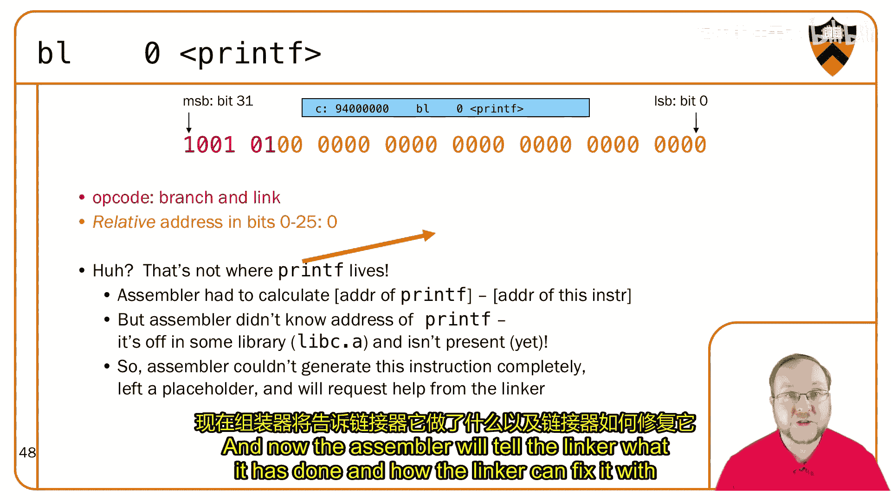
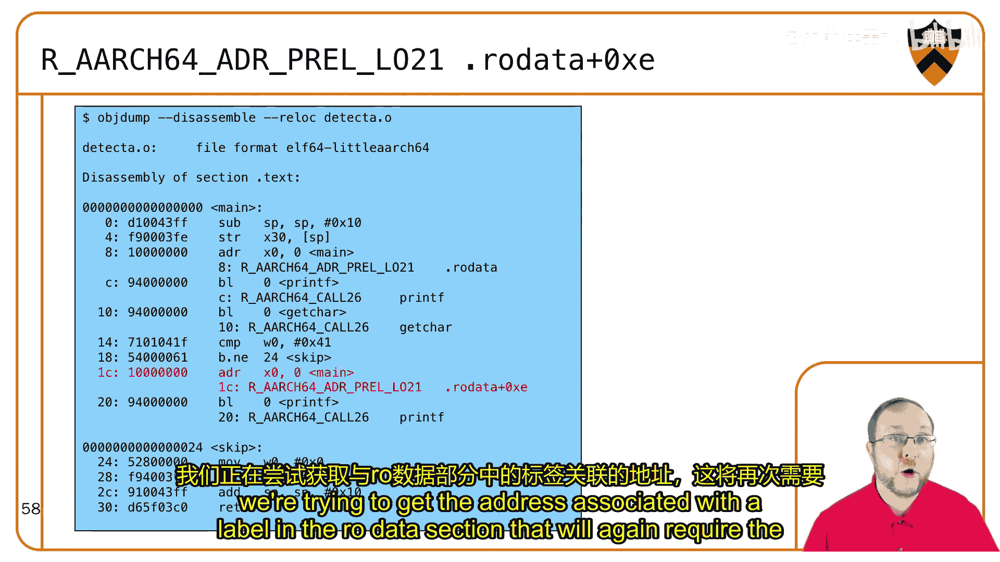
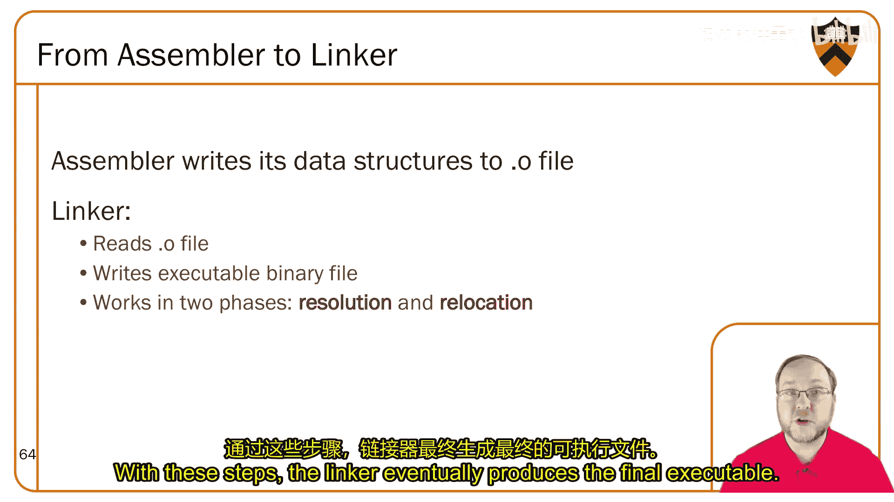
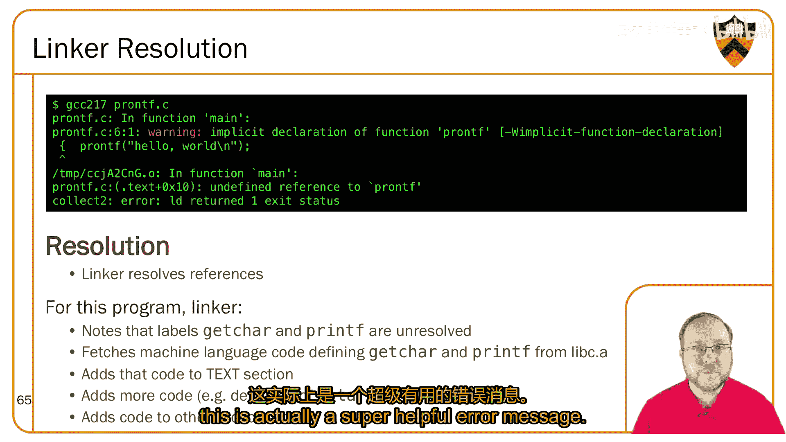

# 029：链接器 🔗

在本节课中，我们将学习链接器（Linker）的工作原理。上一节我们介绍了机器语言指令的基本形式，但那些指令只涉及在汇编时已知的地址引用。本节中，我们将探讨当程序调用外部库函数（如 `printf`）时，汇编器如何与链接器协作，以及链接器如何最终完成机器代码的生成。

## 概述

链接器是构建过程的最后一步，负责将多个目标文件（`.o` 文件）合并成一个可执行文件。当汇编器遇到无法在编译时确定地址的引用（如外部函数或数据）时，它会生成“重定位记录”（Relocation Records），请求链接器在后续阶段完成地址解析和修补工作。

## 一个示例程序

为了理解链接过程，我们分析一个简单的C程序。该程序提示用户输入一个字符，检查是否为‘A’，并打印相应信息。

```c
// 示例C代码
#include <stdio.h>

int main() {
    printf("Enter a character: ");
    char c = getchar();
    if (c == 'A') {
        printf("High\n");
    }
    return 0;
}
```

其汇编版本包含对自身代码段（`.text`）、只读数据段（`.rodata`）以及外部库函数的引用。

## 汇编器的工作与局限

汇编器将汇编代码转换为机器代码，但对于某些引用，它无法确定最终地址。

以下是汇编器处理不同类型指令的方式：

*   **内部跳转**：对于跳转到同一文件内标签（如条件分支到 `skip`）的指令，汇编器可以计算偏移量并直接生成机器代码。
*   **数据引用**：对于引用只读数据段（如字符串 `"Enter a character: "`）的指令（如 `ADR`），汇编器不知道数据段的最终地址，因此会生成一个占位符（通常是0）并创建重定位记录。
*   **外部函数调用**：对于调用外部库函数（如 `printf`、`getchar`）的指令（如 `BL`），汇编器同样不知道函数地址，会生成占位符和重定位记录。

### 查看目标文件内容



使用 `objdump` 命令可以查看目标文件（`.o` 文件）的内容，包括机器代码和重定位记录。

```bash
objdump -d -r example.o
```

输出会显示指令的偏移量（而非绝对地址）以及重定位记录。例如，一个 `ADR` 指令的机器码中，地址部分可能全是0，并附带一条重定位记录，说明需要链接器在后续填充正确的地址。

## 重定位记录详解

重定位记录是汇编器留给链接器的“求助便条”。它包含以下关键信息：
*   **偏移量**：需要修补的指令在目标文件中的位置。
*   **类型**：指示需要何种修补（例如，相对程序计数器的地址 `R_AARCH64_ADR_PREL`）。
*   **符号**：需要解析的标签或函数名（如 `printf`、`message1`）。
*   **附加信息**：如需要填充的比特位数。

例如，一条重定位记录可能意味着：“在 `.text` 段的偏移量 `0x8` 处，有一个 `ADR` 指令。请计算标签 `message1`（位于 `.rodata` 段）相对于该指令的地址，并将这个21位的相对地址填充到指令中。”



## 链接器的两个阶段

链接器接收所有目标文件，分两个阶段工作：

### 1. 符号解析（Resolution）



链接器收集所有目标文件中定义的符号（函数名、变量名）和未解析的引用。如果发现未定义的引用（如 `printf`），它会到指定的库文件（如 `libc.a`）中查找对应的目标文件，并将其代码包含进来。如果找不到定义，则报出链接错误。

```
ld: 错误：未定义的符号 'printf'
```



### 2. 重定位与地址分配（Relocation）

在此阶段，链接器执行核心任务：
1.  **合并与布局**：将所有目标文件的相同段（如 `.text`、`.rodata`）合并，并为它们分配最终的内存地址。
2.  **修补指令**：根据重定位记录，链接器遍历所有需要修补的指令，使用计算出的绝对地址或相对地址替换掉占位符。

完成这些步骤后，链接器将所有段打包，生成最终的可执行文件。

## 查看最终可执行文件

再次使用 `objdump` 查看可执行文件，可以看到所有地址都已被解析和填充。重定位记录消失了，机器指令中包含了真实的地址信息。

```bash
objdump -d example
```

此时，`ADR` 指令中的地址是有效的内存地址，`BL` 指令中的跳转目标也是正确的函数入口地址。

## 总结

本节课中，我们一起深入学习了链接器的工作机制。我们了解到：
1.  汇编器在遇到未知地址引用时会生成包含占位符的机器码和重定位记录。
2.  链接器分两步工作：首先解析所有符号引用，确保没有未定义项；然后合并所有段，分配最终地址，并根据重定位记录修补指令中的占位符。
3.  最终生成的可执行文件中，所有指令都包含了有效的内存地址，可以直接被CPU执行。


理解链接过程对于进行系统级编程和调试至关重要，尤其是在处理多文件项目和库依赖时。这也为我们完成涉及机器代码注入的作业（如攻击实验）奠定了坚实的基础。