# 【全集 秋季版】普林斯顿大学 C语言系统编程 中英字幕 p01 Lecture 1 - 课程概述 -BV1u1feBoEsK_p1-

Welcome to Co 217。 I'm Christopher Merreti。 Let's go ahead and get started。To。

 the plan is to cover many little topics。 The first chunk of lecture is administrative details。

 Your course staff， the goals of the course， what resources are provided to help you succeed in the course and some information about the course grading and policies。

Then we'll get right into the computing environment for the course。

 our Linux cluster using the ba shell。So we'll begin with introductions。As I said。

 I'm Christopher Meredty。 I'm a lecturer here in the Department of Computer Science。

 This is my 11th year at Princeton and my fifth time teaching Co 217。

My background is in distributed computing systems， but these days I focus on computer science education。

We have an awesome course staff this year with Dr X Yan Li is the lead preceptor。

 Donna Gebi and Dr Scott Carllan as experienced faculty preceptors。

 and new to the course this term are four masters students and three PhD students who will be precepting。

The course goals are broken broadly into two things。

 The first is what we call programming in the large。

 Think of this as techniques for software engineering here at Princeton。

 We think of that as sort of a vocational term， but it really does apply to this course。

 We want to help you learn to compose computer programs that are bigger than what you might have written in 1。

26。 And also to have a bigger stake in the design than you did for that course where the exact recipe for every decision was typically found on the provided resources。

More specifically， I can list five items that。Are concrete things that we would like to help you learn。

Composing modular code。Code that reveals abstractions。

 but hides information about implementation and details。

Code that manages resources andnders handles errors in as non user facing a manner as possible and code that can seamlessly be built into other code via well defined interfaces。

Number 2， testing your code more so than just， while there are a handful of of sample cases on the website。

 Let's see if it passes all of those more rigorous structured testing approaches。

Debugging your code again， not just with， let's put print statements everywhere until we figure out what's going on。

 instead of rigorous structured。Better testing approach that uses some of the standard tools in the field。

Number four， improving your code's performance and figuring out when it's not even worth doing so。

And number 5， using tools to support these activities， as I already mentioned。

 learning the standard tools in the field of how to program using the tools in the Gnu tool box in the Linux environment。

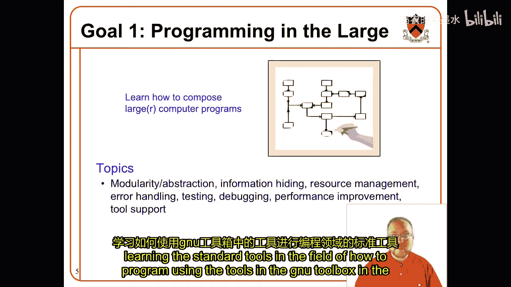

The second goal is to give you some exposure to lower level languages。

 both for practical preparation for future courses and as a window into a universe that maybe you've never really thought about。

 but might find worthy of investigation。If you like toy in 126， that was just scraping the surface。

 and you'll get more experience in this course at what it truly means to program at a low level。

The way that I like to think of this broad section of the course is to consider how often in 126 or 226。

 you hear the phrase Java does， or the computer does。

 But how rarely it comes out why Java did that and what was it all about under the hood in the J VM。

 What does it mean Java does X。So we'll look at some lower level languages。

 both in the sense of older languages that don't have all of the hand holding bells and whistles of modern high level languages。

 but also some actual lower level languages going so far as machine language that isn't human readable at all。

In doing so， we hope to unlock some of the mysteries of just how reference types work。

 what's really going on with memory allocation and collection and other topics that lead into the depths that you'll need in 316 or O or computer organization。

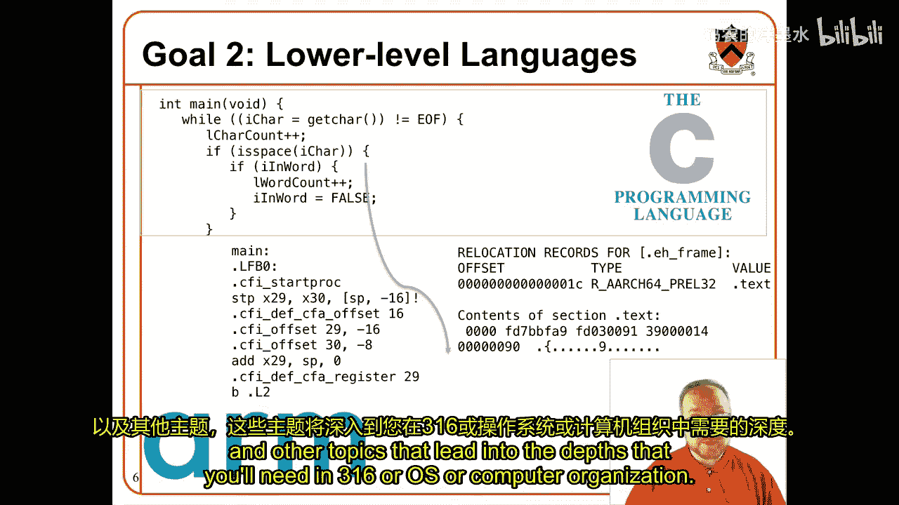

The three in courses in the department each are quite different from each other。

 but they share a common bond。 We want to help you really gain programming maturity。

 or if you will level up your programming skills。We want you to be confident in approaching new specifications for non trivial problems。

 We want you to be able to compose larger programs and do so in a structured manner。

 We want you to be able to break down big problems into sensible modular components。

We want you to know a little bit more about what's going on inside a program and use that knowledge to inform your programming design choices。

And we want you to be comfortable using the standard tools of the trade。Really。

 what this course is about is making sure you have the programming skills that you'll need to go off and excel in your systems and applications。

 Co departmentals。Sure， you'll get to those courses， and there'll still be hard concepts。

 But if you're an accomplished programmer and if you're comfortable with the environment and tools that they assume。

 you'll be able to concentrate on the content knowledge rather than the mechanics。

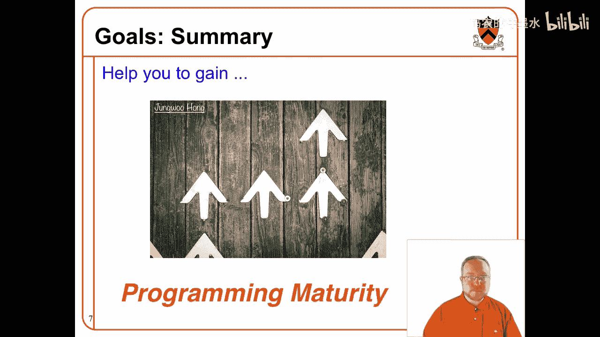

So some common questions， why you C instead of Java or Python or go or what have you？

C supports the idea of stepping down the language stack。 It's lower level than Java。

 It's closely related to assembly language， And it offers a good baseline line as a language for systems programming that gives you all the background you need about memory allocation。

 pointer types， bitwise operations to really get the most out of the exposure to assembly language that this course also offers。

😊，And as mentioned before， it really does set you up to be able to tackle systems programming in a course like OS or 316。

 whether it's offered in C++ or C or go or any other systems language。

S also supports at least indirectly the goal of programming in the large。

Being a lower level language， C provides more opportunities to create abstractions。

 unlike Java or very much Python， where every problem seems to be solved by。

 I know a library just for that。😊，That isn't to say C doesn't have standard libraries that provide a lot of useful tools。

 but the default doesn't seem to be。 Let's poke around and just assume somebody else did it。

 There's a bit more engineering here of constructing it yourself。C also has some flaws。

 Some might say quite a few flaws or flaws that are solved in modern languages。

 Cs flaws motivate discussions of software engineering principles that remain very relevant across languages to。

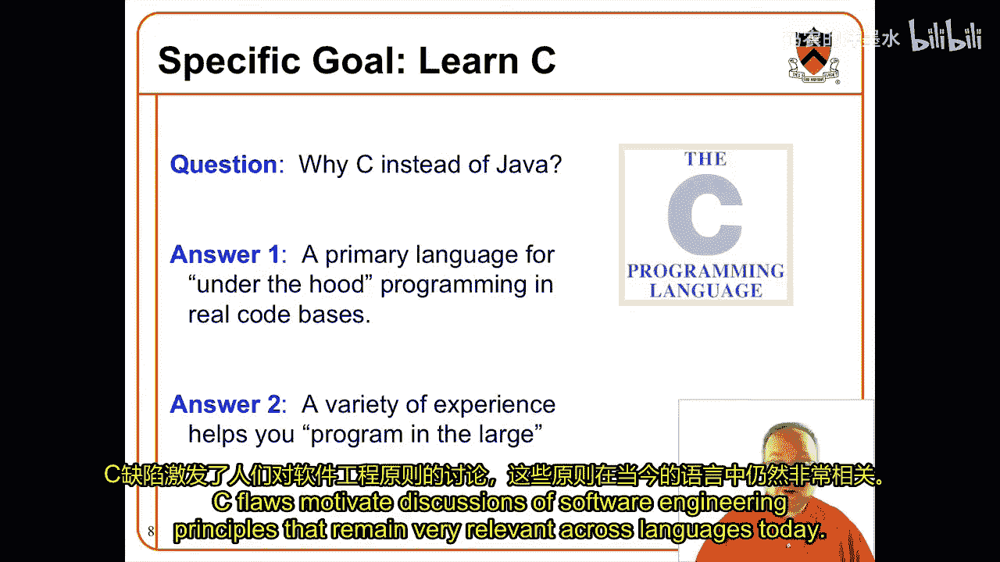

Another specific goal is to learn Linux， and to be clear we won't dig until programming Linux itself。

 but rather writing programs that are clients of the operating system and using the tools typically bundled with the operating system。

Variarianance on Linux are the absolute standard out in industry。

 particularly programming in the Linux environment with the new tools。

 This makes Linux good for education， as well as research。

 It also helps that Linux is open source and well specified So answers to questions like。

 what does it do in that situation， or how does it do that are found by examination of the source individually or within the widespread community。

The Linux environment with the new toolsol is a rich open source programming environment that contains a very standardized but also very extensible tool set。

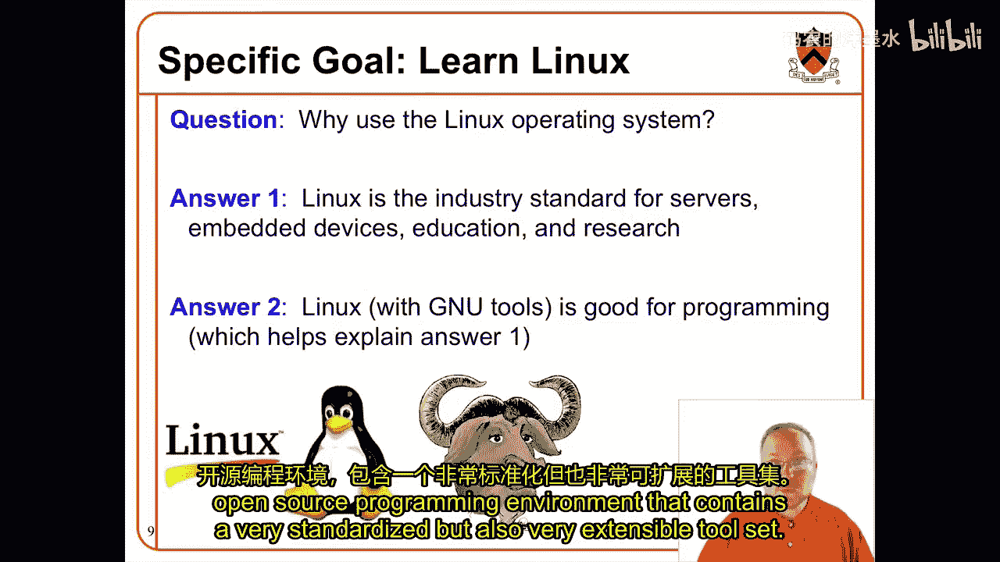

Next up， let's look at what resources are available to you throughout this course to help you learn the course's material。

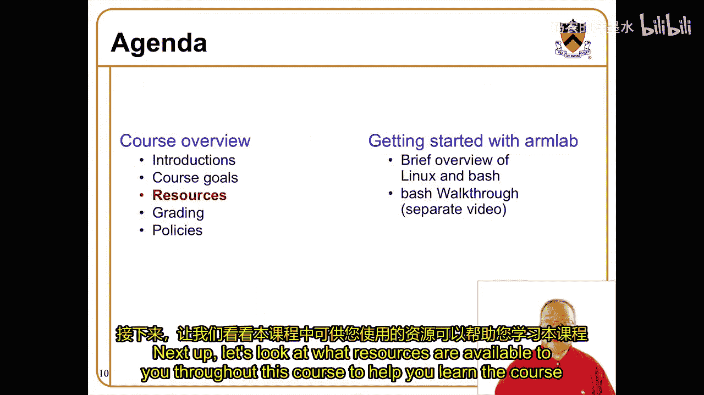

We'll have two lectures per week released Monday night or Tuesday morning and Wednesday night or Thursday morning。

 We'll have a watch party for each lecture。 This is pretty much just me sitting in a zoom room。

 waiting for people to ask me questions about the topics in the lecture。

 I'll have that every Tuesday and Thursday from 10 to 11 AM Eastern time， Princeton time。

So how you do this is is pretty much up to you。 I'd like to encourage people to just hang out while they watch the lecture。

 Then they can pause the video and pipe up with a question as it arises。

 This is the closest thing to how Q And A works in in person lectures。😊，And。

That's about the best we can do in this format。 But it's also totally fine if you watch the lectures ahead of time and come with questions prepared。

That said， please do in the watch party limit questions to the lecture material or related content material。

 as this is a time we've set aside to ensure that everyone has a fair opportunity to ask them without feeling somehow guilty for taking up time in office hours while there's a long queue of students waiting to ask assignment questions。

The lectures work at a mix of different levels of detail and a mix of C specific topics and broader software engineering topics。

 even when the topics are from that higher level。I promise you theres still plan to tie into the current assignment material。

 You might have to work a little harder to see the big picture while bogged down and debugging an assignment。

 but I promise it would be way harder to see the point of the homework as relevant as opposed to just drill or busy work without the continuing tie in to these bigger ideas from lectures。

 So they do go hand in hand。One piece of advice about how to watch the lecture。

 When we were in person， we used eye clickers to let students gauge whether they were following along appropriately。

As the instructor， it also lets me see in the form of bar graphs whether everyone's on the same page。

 what you have crystal clear， if everyone is confused， etc。When using eye clickers。

 I've always stressed the think pair share active learning methodology in which you consider a question。

Formulate your own answer。 Turn to a buddy， see if they agree。

 hash out what your differences might be and eventually come together into a bigger group to discuss sort of the range of possibilities and and hone in on the right answer。

This， of course， doesn't really work when each person is watching a individual A alone。

But I do hope that when I come to a slide that has an eye clicker question。

 I might even leave the eye clicker logo there。Pause the video。 Think about the answer。 In fact。

 even better， have some physical manifestation of your answer or of your vote on the question。

 Write it down。 Signal it。 Sa it out loud。If you don't。

 it's too easy for you to unpause the video and then go， yeah， I knew that。Instead， writing it down。

 you have some， some visceral notation that， yes， you got that wrong and you need to think about it a little bit more。

Next up is precepts as a counterpoint to what I said about lectures being a mix of high and low level material and a mix of language details in software engineering。

 precept is much more focused on the language details and is quite directly connected to the assignments。

 You won't have to struggle to see how they fit。The absolute best way to succeed in this course is to attend precepts。

 be engaged in precepts， and study the precept notes after the fact。

Precepts begin the second precept section this week， so Wednesday and Thursday。

And if you're not registered for the course yet because of scheduling conflict or you are。

 but you're in a precept that doesn't to actually work for you。Hold tight。

 keep checking the registrar's page in the registrar side or in Tiger Hub and see if you can move in。

 our experience is that upward upwards of a quarter of students move at least once。

 so there will be plenty of moving around。And though I'm certainly not trying to。

 I'm sure I'll scare some people away。So we expect that most people will be able to manage this organically of getting into the precept they want。

 but if it comes time that the shopping period is getting tight and you're still not in the precept you want Colleen Kenny whose info is available on the web page is the undergraduate Co coordinator and she can get you into a precept that the only one or the only other one that works for you。

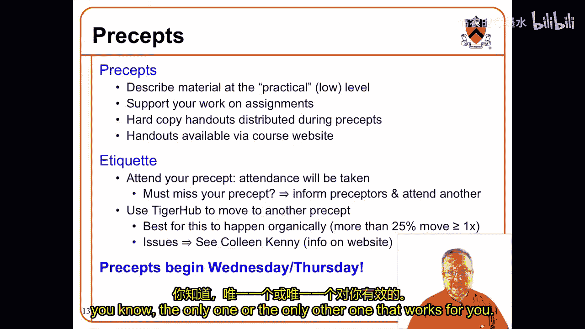

Speaking of the course website， there are a few websites three approximately that you'll need to know about for this class。

 The first is the course website where you'll find the contact information for all of the course staff。

 scheduling information for precepts and office hours， the assignment specifications。

 and also the policies。The second site is canvas。 The new Princeton L M。 S。

 It's sort of replacing blackboard in a rolling rollout。

 We don't use canvas as much as some courses will， but that is where you can find the zoom links for precepts。

 direct links to our  Ed discussion forum， Li to reading materials and an easy link to name coachach。

 If you're not familiar with name coachach。 I do encourage you to go check it out。

 Basically take five minutes to write out your name phonetically and upload recording of it。

 And then your instructors and other people at the university will be able to hear it and read the phonetic version of it from now until the rest of your time at Princeton。

 And this is a great help when trying to learn names and not trying to memorize something and realize you memorized it wrong。

😊，Also， even if your name is a super common American English name that you're like，Ah。

 they can't possibly get it wrong， I still encourage you to do it if only to normalize it for everyone else。

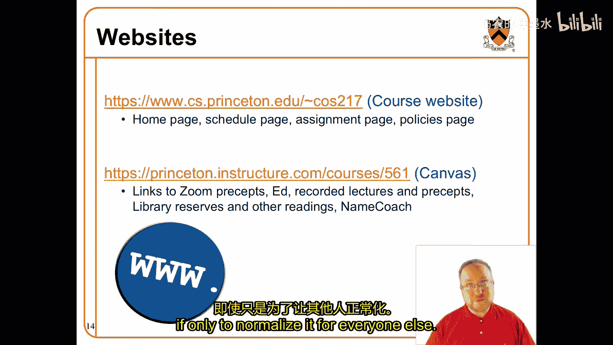

The third site that you'll want to use for this course is Ed discussion。

If you've just come from 126 or 226， you know all about Ed， if you're not familiar with Ed。

 but you know about Piazza， Ed is just a replacement for piazza。

 it has a little bit more student friendly policies with what it does with its data。

And if you're not familiar with either， this is a discussion site。

 you can get Q&A where students can ask questions and get answers from their peers and also the course staff will chip in with answers where appropriate。

Two notes of etiquette， etiquette。First， do try not to spam Ed with every last thought that comes to your brain。

 Instead， go there only after thinking about a problem。

 allowing yourself to get stuck for a little bit。And then hopefully get unstuck。

If you don't get unstuck， now you can go and ask for clarification or see if you're thinking about it the right way。

This also helps you becoming an independent problem solver in addition to other students getting more out of a good signal to noise ratio。

The second note， certainly you must follow the communications policies of the course。

 which include not revealing your solutions on EdD。So along with the three websites。

 there are three core textbooks for the course， the King book is a thorough Sea textbook。

 Pit and Ugeta is an arm assembly textbook that maps pretty well to the features of assembly used in this class。

 and Carnahan and Price and Pike is a primer on designing software from frankly。

 two of the very few actual 10x programmers in history。

 so we can take a lot from the high- levelve software engineering wisdom of that book into the course。

Though it does feel like something's missing on the slide。 so there we go。

 you can't go to Princeton and see references of Princetonians without the good old Princeton postnoials。

Also note that 21， I'm sure that you underclassmen are totally ready to go write a textbook for one of your courses。

 right？Note that King is on limited reserve via the engineering library on canvas。

 and the latter two books are available via Princeton's contract with O'reilly。

 So they' are linked in full from the course website that can inform your your decision in whether to buy them or just look at them。

On your on your computer。

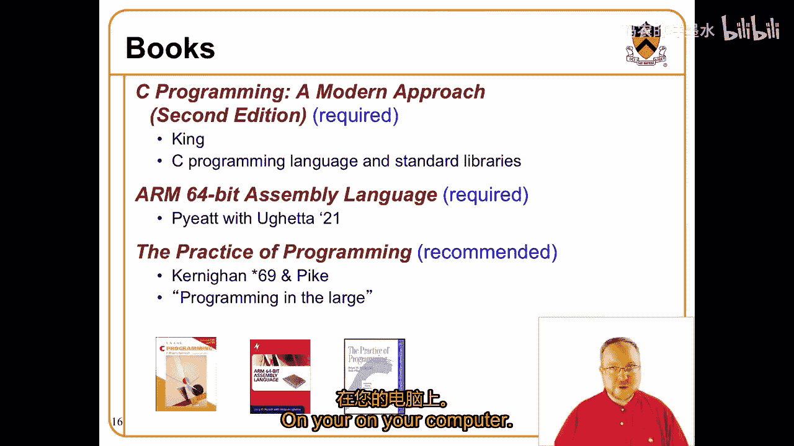

There are also some authoritative hardware architecture and instruction set manuals linked from the website。

 but you totally don't need to buy these or print these or anything。

 these are there for the last couple of assignments in the course that are just to look up one or two things。

Additionally， throughout the course， you'll come to rely heavily on the Linux Man pages for descriptions of tools and library functions。

So I said the best way to， to succeed in the course is really to be engaged in precept。

 That's totally true。 The second best way is to get help by attending office hours。

 Every member of the course staff has at least two hours per week， and we have coverage on every day。

 except Saturday with four more hours four or more hours every weekday。

 and Anne playing the role of your hero by having Sunday office hours this term。

You can go to ask questions about course material， something you didn't understand from lecture or precept or about an assignment topic。

The way we're doing it this term is that you'll start up a Zoom meeting and then add your name to the queue with a link to that meeting。

The the the Q addd is just a Google form that you can find the link on Ed and then in order to be able to see the queue。

 just like you'd be able to see it on a whiteboard outside one of our offices。

 we've shared with the world the spreadsheet of responses to that Google form。

 so you'll be able to see where you stand in the queue。

There are also lab TAs available for those of you who took 126 or 226。

 you know perhaps viscerally how valuable these peers can be。

 but for students new to see us at Princeton， La Ts are your peers。

 their fellow undergraduates who took this course did well and now want to give back to the community by offering up time every single day of the week。

 four to6 hours a day offering to help with debugging on assignments。

 so please make good use of them。I'll just briefly talk about assessments and weights in the course。

 This has changed this year。 it's different because now that we're online。

 we wanted to emphasize the pieces of the course that change the least going online。

 and so assignments make up two thirds of the course grade。I will often， throughout the term。

 remind you of my mantra， which is the way to get better at programming is to program。

 And in the case of 217， it's only by actually doing the assignments that you start to develop that idea of programming maturity。

There's a midter during midterms week and a final after dean's date。

 The exact details are yet to come， but you'll likely have a short window， you know。

 a couple days or so to complete a timed exam， rather than all 200 of you having to take it during the same exact 50 minutes or same exact three hours。

That just wouldn't make sense based on individual schedules， but also time zones。

Your participation grade will be based upon precept attendance and precept participation and possibly some other factors。

 for example， are you a rock star helping people on Ed。As a general guiding principle， we say。

 can we reward the involvement that makes the course a better better experience for all the people concerned。

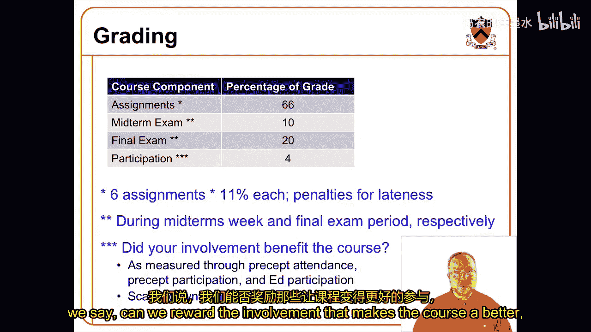

I mentioned the programming assignments。 There's an introductory assignment in which you should really complete ASap it's available now because it helps you get set up with the computing environment。

 Then there are six substantive assignments， The first three are individual and the last three you'll be able to work with a partner。

Assignments are a very important part of the course。

 both in terms of their weight on the grade and also because that's really where the learning and practice takes shape。

The first assignment is also available now。 So assignment 1 is due on September 17。

 That's  two and a half weeks from now。 But I beg you not to say。

 that's infinitely far away and already start to procrastinate。

 That doesn't work nearly as well in this course as some others。

 I know every course says start on us early。 don't， don't wait till the last minute。 I promise you。

 ask any student who's taken 2 17。 They will certainly reinforce this message。2。

17 assignments are much more elaborate than they were in 1，26， In particular。

 debugging is much more involved。 So start early so you have time to get stuck and then unstuck。

 Also， the earlier you start， the more possible office hours and labte hours you can make it too。

The last bit of this first part of the administrative section。

 I don't want to dwell too much on the policies。 they are laying out in imposing detail on the course website。

 but I do want to make my plea to you。There are a ton of resources， videos， reading。

 synchronous classes， office hours， labiers， Ed， even at ridiculous hours of the night。

We will bend over backward to help you。 But the other side of the bargain is that we hope you'll take us very seriously when we beg you。

 Don't cheat。A committee on Disc hearing takes somewhere around 40 to 60 collective hours of instructor's time。

 It makes us jaded and angry at the world， and it very often results in you losing a year of your life waiting to finish your Princeton career。

 So just don't do it。All right。 That's what I've got for you as far as administrative boilerplate。

 I know it's a bit tedious， but this is our best chance to get off on the right foot in terms of establishing expectations and making sure you know what resources are available to you。

If you have any questions about the material leading up to this point。

 please don't hesitate to ask on Ed。 If you have a question。

 I'm sure at least one other of the 200 plus of you has that question。

So now we get to dive into our first real topic， the computing environment that we'll be using all semester in this course。

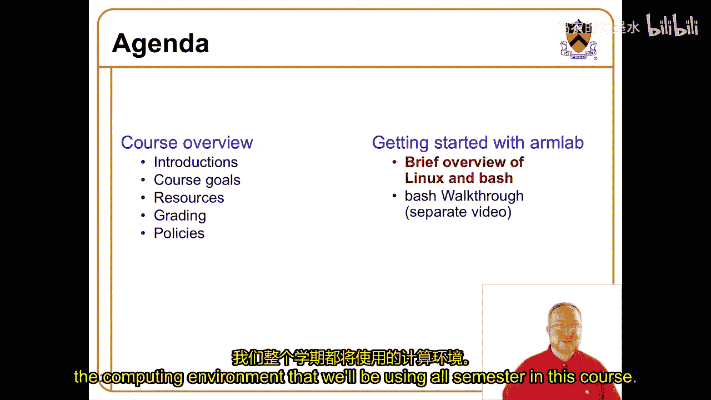

So as mentioned before， we're going to be using the Linux operating system with the Gnu tools extensively throughout the course。

 Linux is an O S， just like Windows or Macos， and it's been around since the 90s。

 And it's actually much older than that in terms of spirit。

 It ancestor being unex datingating to the 70s at Bell Labs。

 And that itself is an offshoot of Mt's Mallttics program from the 60s。 So this is not a new thing。

If you're wondering about the quirky name， Linux， the X comes from its goals as a UniX like system。

 and the LINU comes from the name of its original developer， Linuxs Tvalt。

So Linux is open source and free， meaning that you can run it for any purpose。

 The code is available to study and modify， and further。

 you can modify it for free and redistribute it as you see fit。

This differentiates it quite a bit from other common OSs。

There's a perception out there that maybe I'm playing into with this slide that Linux is just a black command line window with green text flying everywhere used only by super programmegramrs。

 I promise you， that's not the case。 It's actually the backbone of common systems that aren't at all thought of as for power users。

 Consider a Chromebook In the news these days because of supply shortages with online learning in K through 12。

 Chromebooks actually run Linux。And indeed， contrary to the picture on the slide。

 many popular distributions of Linux these days have Windows UI indistinguishable from OSX or from Windows。

That said for our course， for simplicity， for guarantee that anyone in the class can use it。

 in this course we will indeed primarily access Linux servers from the command line。

I say server because this course we use a client server model， again。

 partly for standardization across all students environments。

 the assignments ultimately run on the server， which is good because both C and R assembly are non portable。

Code built for one machine can't necessarily run on another machine。

 and using the server as a uniform environment alleviates this concern。The server。

 which we have named the arm labb cluster， is actually two different machines。 arm Lab 0。

1 and arm labb 0，2。 The name Arlab at Cs that Princeton De E U is an alias that will end up on either one of those two machines in order to balance load between them。

These are big beefy machines， each of them has 96 processors and 128 gigs of RAM。

 so even 200 people logged in at once won't pose a problem。The client， on the other hand。

 is your computer， wherever it might be。 All it needs to be able to do for this course is to log into arm labb using the the secure shell protocol。

 SS S H。

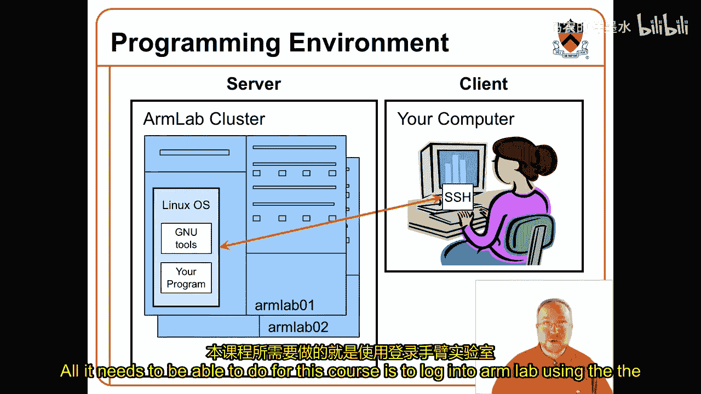

I want to get some terminology here because it's often conflated。

 The program that you'll use to SSH into the server is called a terminal emulator。

 It's a program that provides an input output connection between the keyboard and the screen in order to support some sort of text UI。

In this case， the Linux command line interface in the shell。

Pudty and the Mac terminal program are both terminal emulators， among many others。

We use it using a protocol called SS S H securecu shell to connect to another computer and let our terminal emulator interact with that machine indirectly at our own through our own。

 That is， we can type into a window on our machine and have it be actually typing at the arm lab machine。

So a terminal emulator is actually different from a shell， though you'll often hear them conflated。

 as I said。A shell is a program that accepts instructions to run other programs。

 It's basically a big loop that reads in a command from the user， interprets that command。

 executes it， cleans up， and then waits for a new command。The shell we'll be using is called Bsh。

 which is one of the super standard shells out in the Linux environment。

So we will open a terminal emulator， we'll connect SSH via via SSH2 arm labb to complete the login process。

 and then once we've logged in， the shell starts and we're giving an interface on arm lab via the shell。

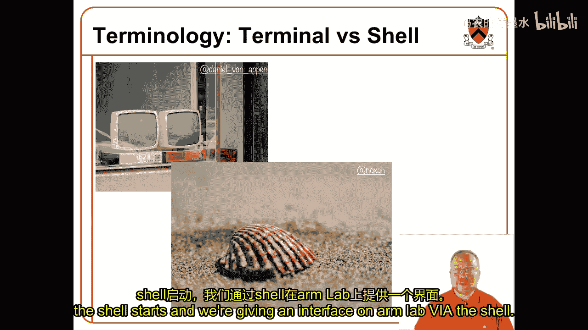

So because the only thing you need to be able to do is connect to ArMLb via SSH over the internet。

 it means the work in this course can be done from anywhere。

Many students choose to do all their development on the server， SS H into the server。

 and then use an editor on the server， something like Eac or V I to compose their programs。

Then as they compose their programs， they're already on the right machine to compile them， test them。

 run them， eventually submit them。But many other students choose to do all of the composition on their own machine。

 perhaps using sublime or at。 And that's totally okay。

You will need to find a way to get the files called St the files on to arm labb for building。

 testing and debugging and eventually submitting。 but that's okay。

The building and testing has to be done on Armlab because of the portability issues mentioned before。

 and the submission is done on Armla because the files are submitted to the file system on that cluster。

 unlike 126 or 226， where they're submitted to the cloud。

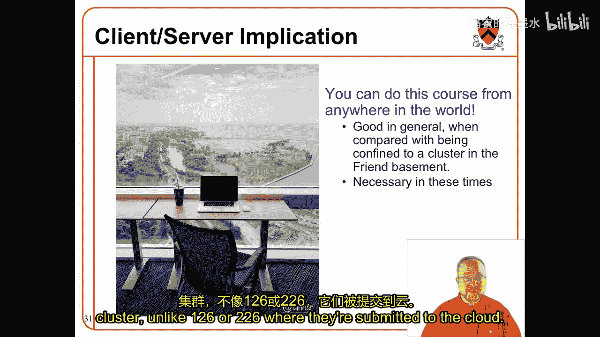

You are totally free to find the workflow that works for you。

 and assignment 0 will help you do this by by giving you some reasonable options to practice。

The final takeaway to dos from this first part of the lecture， number one。

 browse to the course website， read the copious information available there in particular the policies。

And number 2， log on arm lab and start getting yourself comfortable with the environment。

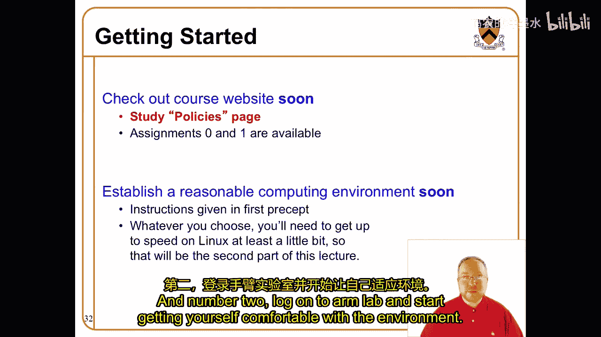

The second part of this lecture will dive into that and help you do this。

