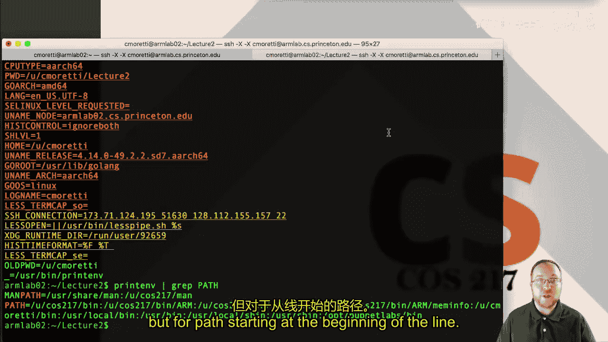
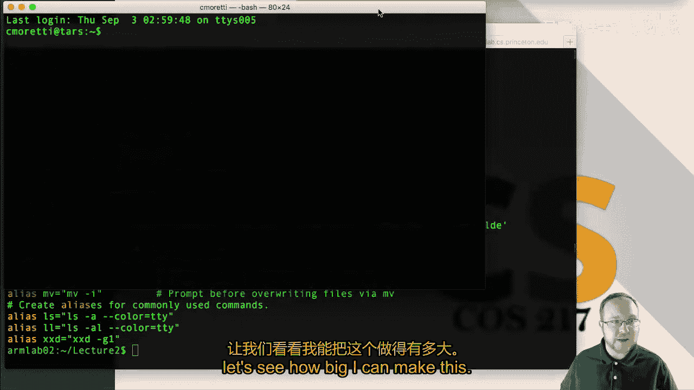
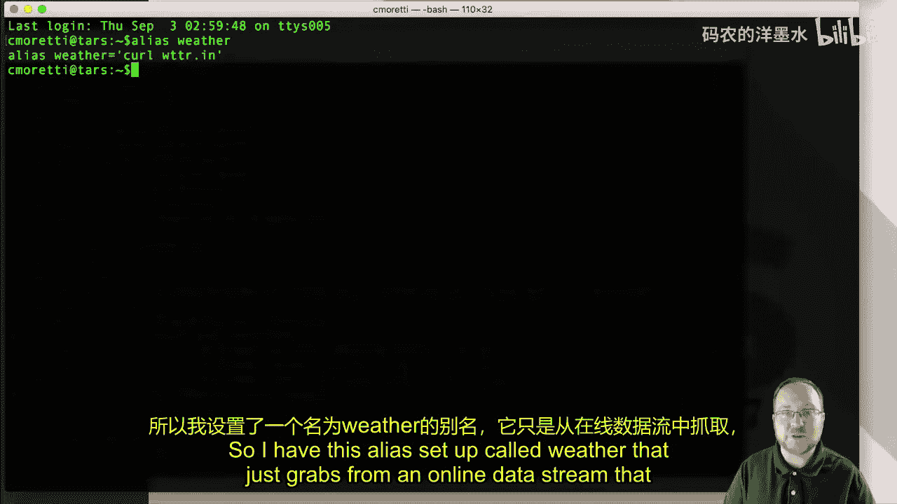
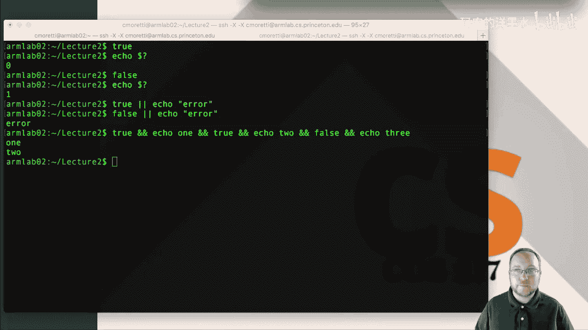

# 【全集 秋季版】普林斯顿大学 C语言系统编程 中英字幕 p03 Lecture 3 - Emacs与Bash -BV1u1feBoEsK_p3-

Welcome back， I hope that you're doing well with getting your Co217 computing environment configured。

 both in terms of where you will be doing your primary development and also getting comfortable with staging files to ArLb and manipulating them there。

I hope that you got something out of the first overview of simple file and directory operations on the best show today。

 I want to follow up on that with a few more common and useful bash command sequences。

 some additional details that make for common idiomatic usage and generally a broad coverage of what is possible in bash without necessarily expecting that you'll use many of these immediately。

I'm a big fan of the space repetition， effective frequency。

 and curve of forgetting pedagogy that all comes out of educational psychology research。

If you see it now and you forget it now， the next time you see it。

 perhaps you'll be more likely to remember it。If not， then， then perhaps the next time after that。

But before we dive into bash， I just wanted to offer a few ems tips and tricks that can make it feel a little bit less like an inter code editor and more like a modern IDdeE。

EX is infinitely configurable and here are some of my favorites。

 you'll know their mind because we're going to start out by just working through a diff between my EMX configuration file and the one that you downloaded from the 217 account。

Note that mine is publicly readable， so you're welcome to go look at Tildasre/。

emax and crib anything you like。So we'll start off with the bonus Linux command before we even start the Linux portion。

 the DF command compares two files and prints their differences that it finds。So let's take a look。

Over here on Ar Lab。Diff， tillilda seam ready。The emax andil the。Coast 217 emex。

So it prints a bunch of stuff， you don't need to worry about diff right now。

 but broadly the things with a less than sign an arrow pointing left are the things that occur in the file that was mentioned first。

 the things with the greater than sign， those that have an arrow pointing right are the ones that occur in the second file and ones that have an arrow。

 sorry not an arrow， a vertical bar a pipe， are ones that occur in both files and just seem to be slightly different between the two。

So looking at this， the first one。Right here is。About showing trailing white space。

This is a setting that already exists in the file that you're given。

 but it's turned off so as you see on the right it's it's commented out the comment in the。

Thatm file is a semicolon。I know that's confusing versus C and Java。

 so you'll see it's turned off and I've turned it on。

This allows me to show trailing white space visually。

Some coding standards in industry require that there be no extra white space at the end of lines。

 It goes back actually far enough that a handful of bytes at the end of a bunch of source code lines could be a considerable amount of disk space when that was in short supply。

 but these days it's primarily about version control。

There are many editors that will automatically suppress Traing whitespace。

 and so if you put it in your file。You have a whole bunch of stuff that as soon as anyone else opens it。

 their editor is going to change those lines and then they'll have a huge diff。

 a huge set of changes that they've made when they commit。

 that it's hard to see what their actual substantive changes were。

 so let's take a look at what this looks like。Over here I have just a directory that has a bunch of files。

 this is going to be your first C file of the year。

 but I promise you don't need to know anything about it。

 it's just some toy code that I took from a old Piazza answer， I think。So when we open it up。

 these ugly red markers at the end here indicate that there is。

File that there is white space at the end。Note that along with this setting。

 so this is turned off for you， but I've turned it on， along with this setting though。

 there is also built into the Em configuration file that you were given a command sequence。

 a shortcut to remove all shing white space， and that's control XW， you can think W for white space。

So if I do control X W。It changed the file， I can see that down here with the two little stars in the bottom status line。

And all of the red marks for trailing white space disappear。So I can save that and we're good to go。

Let's come back over to the diff。Instantly， I turned that on basically so that it reminds me it gives me a visual cue that I need to run that control XW。

 otherwise I forget to do it。All right， the next difference I have。

Is that I have turned on mouse mode。 This is perhaps the number one great from students starting out on our lab。

 Why can't I use the mouse？ Well， here you have it with this enabled external mouse mode 1。

I can click around with it， let's try it out。I'm still over here。

 I'm going to use the mouse and I can click anywhere。And it will actually move。

 This is not by default What happens in your your。ax file configuration。

 so that's something that you might want to turn on if you are a mouse addict or just find that that would be useful。

Do note that there are some windows builds that this seems to sometimes corrupt your ability to copy out from your command prompt window because the mouse is interpreted as being part clicking around an EmX rather than copying the text displayed on the terminal window。

 but if this is ever an issue it's easy to disable the command by commenting it out with a semicolon。

And then restarting EMAC， doing what you need to do， and then turning it back on as you see fit。

All right， so that was mouse mode。Another common complaint is not being able to have multiple files open and visible at once。

 Certainly one option is you can open multiple terminals on your client， but this is still limited。

 you can't as easily go back and forth cutting and pasting between them or it just becomes terminal window overload as there windows everywhere。

Luckily， EmX actually has a really robust set of windowing options， let's look at。So over here。

 I'm going to use some other files at the moment。If we look at file001。

Now I want to look at two files at once if I do control X2。

That will split my window into two separate windows。By default。

 it just gives you the same file that you have open in both of them。

I can move to the other window with control XO， but hang on， we'll talk more about that in a second。

So that was control X2 to split top and bottom we can also split side to side and in fact we can split within splits so now I'm on the bottom here I can do control X3 and now I have one on the top and two on the bottom。

You can keep going until it gets absurd， if you'd like。Ctror X2， Control X3。

 note that it doesn't move you to the new window when you open it。

And also as you get more and more of them， it becomes sort of fidly to move through all of them。

You if it goes too far though， control x0 will eliminate the current window so if I come back over here and I don't like this window here。

I can do control X0 and remove it and then the sort of opposite of control X0 that removes the current window is control X1 that turns the entire screen back into that current window。

2。Again， control X0， a little bit tedious if you look at it。But if you come over here and see that。

In the do emax file， I have a difference that says shift plusarrow window switching。

So what this means is that all I have to do to switch windows is click shift and hold it and use the arrow keys。

 And I can now move around within my windows just up down left right as you as you would personally。

 I think this is a major win over cycling through all of them in。

I think the order that they were created， but it might be haphazard with control X0。

 so for me I think this is a huge help。There is a great depth of other configurable capabilities for buffers and windows。

And arranging and organizing them， but this is the big one of partitioning the window into arbitrary divisions。

 that's the biggest single game for me and frankly it's the only one I really use with any regular。

All right， so let's kill that off。We're going to go back to our see program now。

 this toy see program， the first one of the year that I promise again。

 you absolutely don't need to know anything about it。嗯。

You don't need to understand what you're seeing， you won't see the C topics in it for several weeks yet。

 so even if we had started C， this is more advanced topics than that。

 but I wanted to preview some of the IDE like functionality for C coding that I have within EmX that you might want to try out。

それつける。Bub dub back up here。All right， so first I tend to like having the line numbers visible by default。

 they are visible down here at the bottom this one comma0 says I'm on line1 at column0 so as I move it will update。

But that's a little tricky if you're trying to look at a long bunch of code and say。

 it said the error was on line 63， I'm on line 52， what's 11 more than that it's not necessarily easy to see so personally I like to toggle this back and forth and the configuration file that you're given you can toggle it with control XN。

When I say control XN， what I mean by that is type control X that is holding both of those at once。

 release thumb and then type n。That's different from control X control N。

 which would say type control and X at the same time， release it。

 then type X control and N at the same time。So this is control X N that turns it on。

And it also turns it back off。All right， so a common inefficiency that I see from students is that they're working in EMX and they have to exit EMs to go try to compile their code。

One option is to have multiple separate terminal windows， just like I said before。But that's。

 you know， there are downsides there。Another option is to run the shell in Emax。

 but that's way more of a power user move。 I like the happy medium where I will compile inside Emex。

This is actually built into EMX with the meta key， which if you read the instructions from precept。

 you'll see how to set that to an appropriate key， you can set that to be， for instance。

 the alt or the option key， or you can still do it with escape and then X。

 that will be meta X that's fine。This is built in with MetaX compile。But。嗯。Personally。

 I've set this to be control CM because C to me is evocative of compile and M is evocative of make and also because not on every machine will you necessarily have single key access to meta。

If you're not sure why I said make make is the make file and the make command that helps you build it's basically a recipe book for large see programs。

 and we'll talk about this in a couple of weeks。We'll see why it's relevant here in a second， though。

So by default， alt text compile would do make minus k， so that would use the makeC file。

Again we'll learn about in a couple weeks you don't know about it yet that's okay but until then you're not going to have a make file and so doing make won't do anything Instead we're going to be invoking compiler commands directly just like in 126 when you did。

Java C or Java C， interest CS or what have you， but the Java C was the compiler here were going to have GCC and in fact our version GCC 217。

So there's a nifty function if we go back and look at this di again。That says，If there's a make file。

 use it， but if there's not a make file， do this other ailation command instead。Again。

 this is weird functional programming in EmX list， which is a dialect of a functional programming language that the EmX people know very well and nobody else in the world can make heads or tails out of you don't need to understand this just this is a function that will do this switch off between make and GCC so let's take a look。

If I do control CM。When it comes up， it gives me this GCC217 minus C minus O bub w。

 dot O minus G b up， dot C。Again， don't need to understand what all of this says。

 but this is a common way that we would compile a C file in this course。

 maybe we wouldn't by default use all of these options， but this will work。

For some more complicated programs we might have to change this， but this again。

 this will work for the simple programs and for anything sufficiently complicated。

 we'd use a make file anyway。So when I hit enter here。The compilation happens。

 it goes and compiles the code。And the window splits to show both the code and the results。

Furthermore， it drops me onto the first error， which I think is kind of nice。

I can edit the code here if I know exactly what's going on。But I can also move between errors。

 I can hop between errors with control CN and control Cp So we're still in this control C mode thinking about that as compilation N in P here is just next and previous So I've got a whole bunch of errors and warnings so if I do control CN it's going to jump in the bottom window it actually moves to where that error message is in the top window it moves to the code that triggered it I can do next again。

I can go back with control CP。And going backward control CP。To me。

 this seems way quicker than trying to go back and forth in and out of EMX。

 especially if you have a whole bunch of compilation errors that you want to fix and then go see what happened and fix and go see what happened and fix and go see what happens。

Here we can fix it and see what happens again right here in place。 I see my error again。

 don't expect you necessarily to see it yet， we haven't learned any of this， but I see my error。

 I will make an edit right here， saveve it， and now I could recompile with the exact same command。

Or if I go over into my compilation window I can use my shift down trick if I hit G for go ahead or go again。

 it will recompile。And so that fixed the errors， there are still a couple of warnings that we'll talk about in a second。

So again， this seems way quicker to me than trying to go back and forth in and out of EMX。

 and it's probably just as quick as between two separate terminal windows。

 especially since this will actually jump you directly to the line。

 which is useful when the code is longer than the five lines it is here。All right， before I move on。

 I will mention that I said that this will work if there's no make file。As we just saw。

 it will also work with a make file， let's take a look。阿み。It's going over here and Joe。

Get out of it here so I have a make file here， I just named it badly in order so that they wouldn't find it。

Let's come back over into Bobub Dub。And try again。 So at this point now if I do the control CMm。

Instead of doing that mysterious GCC command， there's the potentially equally mysterious make command。

And so it does the make。Apparently， M minus K puts white space at the end of the line。It's a feature。

 I suppose。All right， so this would invoke the make command instead of the GCC 217 again personally。

 I think this is a huge way。All right， back to the big diff of the emax files。

 this last one is autocomplete。So。This is a completely separate package that I have installed。

 but again， those directories are also world readable so you can go and take a look if you're interested。

So if you've gotten used to your IDE writing all of your code for you， you're not exactly in luck。

 but you can save yourself some typing and save yourself quite a few compilation cycles of fixing syntax errors that are just typos by having some autocomplete turned on。

Let's take a look at what this looks like。All right， back over here in the code。

 there was this one warning， the reason as you'll learn next week is that I'm missing a directive that tells the preprocessor to add some code into the compiler for its use。

So this is called a pound include statement。And as soon as I get to pound in。There it is。

 it's pound include， I can hit tab and it's there。So。The file。

 the code that the preprocessor needs to add in is from a file called STDio。h。

 so I can again type it， it gave me STDo。h is my first thing so I could hit tab but if it wasn't that I can use the arrow keys to move around and again hit tab to when I find the one I want。

The the configuration file that I have has all of the C reserve words and all of the common library names has potential suggestions and the package also automatically includes all strings from your file。

 so that means it'll be able to autocomplete your variable names and other things like that。

 so if I change this to be something longer。Not very much longer， and I start typing。

 it will again provide me the ability to autocomple arbitrary strings from my file。So again。

 I think overall， that's a pretty big win。All right。

 so that's where I've got to show off for Emax at least what I use regularly。

 but certainly in an editor that's arbitrarily configurable， there's a lot more out there。

 So if there's something irritating you that you feel like you're missing out on and that there has to be some sort of better way。

 feel free to ask on it The course staff will share our collective experience and or ask around to find others with even more decades of experience。

 hacking and customizing and borrowing other people's hacks and customizations。

Can't guarantee you we'll find everything， but if there's something that's a real pain point。

Try it out， we'll see if we can make it at least tolerable。All right。

So now let's switch over from the nitty gritty mechanics of one particular editor to more of a broad sweeping survey of the shell that everyone in the class will be using。

Let's go ahead and get started。I'm going to stick here in this lecture too。

Diiry that has all of these mysterious text files and will work in this environment。

The first batchsh topic I want to talk about is along the same lines， actually as the Emax content。

 It's a suite of。Nice cities for working comfortably and efficiently in this environment。嗯。

The first tips I want to share are for people with whom I share one rather shameful characteristics being an awful typist。

So let's first learn some typo correcting magic and next some items that will save a lot of opportunities for error by minimizing typing in the first place。

So I'll start with sort of an obscure one to build up。

So if you often find yourself inverting characters。

 you can fix them without erasing them and typing them again， it's just control C。Control T， sorry。

 So if I do Dc and that is a command， but probably not the 1 I want control T will swap that to D from DCc to。

Cデ。I can go back and forth if I want， but there you have it。

You can actually do the same sort of flip of the words that you typed using alt T instead of control T and it's even pretty smart This starts to be actually a reasonable thing consider this malform pipeline we're trying to pipe first into second。

 but we switch them so if I've got second piped into first。And，h， that wasn't what I wanted。Alt T。

 and now I've got first piped into second。Again， that's the me key。嗯。

I use that one occasionally and I think that's a kind of a cool one and if nothing else that's one that when somebody else is watching you they'll be like wait time out。

 what just happened there so that's kind of fun too。Al right， so with those as a warmup。

 let's talk about perhaps the one thing that if it's the only thing you take away from this entire batchsh part of this lecture。

 I'll still consider it away。It's a cousin of the T completion that I talked about last time。

 and it's something that will save a lot of typing and a lot of silent fuming by labtes and preceptors。

 It's using your bash history。So every command that you type in bash gets locked。

You can see that log with this street command。So here's my history command where I was playing around with Bobub Dub and all of that stuff。

嗯。It's set up in your BachearRC file that we gave you to store the last 1000 commands that you've run。

 so that's approximately where we've gotten， you see that I've got to a000 with my last exit because that was the thousand0 and then as you work it will go beyond 1 thousand and each time you log in it will reset back。

Do note that this is a little bit fragile， there's a race condition here if you've got multiple logins of different sessions editing it。

 you might end up seeing some of the commands from one session and not the other。

 so don't necessarily absolutely rely on your history to be sacrosct。

 but more or less this is indeed a history of what you have done in bash。Also here。

 if you look as I scroll up that's a lot of stuff， so if you haven't storing a ton of commands like the thousand we give you。

 you might want to limit the history to only the most recent ones to avoid thrashing your text down your terminal like I just did。

 you could do this with a pipeline like we saw last time。History piped into detail， there we have it。

 or history itself can take an argument that is a number you want， so history5。All right。

So that's just using the history command。That will show you what's there。

 but if you want to repeat a command in your history， you have several options。

There's a shortcut for your most recent command。Bang bang， exclamation point， exclamation point。

 and that will literally just do exactly what you just did and it will in fact print out history five in this case because that was my last thing。

You can also do bang and a number where that number is one of the commands。

 so 1004 is supposedly a clear， let's see。And hey， it cleared， so that's another option。

The the bang in a number is plausible as something if you if you've run history to see what the number is。

 that makes sense bang bang to me， it's too cute by half because if you haven't realized yet。

 you can just hit up。And that will cycle through your history。

 So going up once versus typeping bang bang。Not a huge deal That being said Bang Bang can be used programmatically so that could be useful as opposed to the up arrow key can be again。

Power user stuff。Note that this works， even if you've just logged in。

 you can add up to get the last commands from your previous session。More common though。

 is that if you have a command that you don't want to have to remember exactly or retype exactly。

 but it's been a few minutes since you used it。You could sit there and hit the upper arrow 10000 times。

Everyone will be pissed off at that， please don't do that。Another option here is that you could。

Use that history command， that's certainly another choice。Another choice。

 if you don't want to look up the history， is you can use the prefix of the command。

So that takes the last command that you ran with that prefix， put an exclamation point both for it。

 and let's do it。 So for instance， the C compiler bang GCC。

That shows the last thing that I used that started with UCCC was this compilation of the Bub duub program。

So that's one next possibility。A more general form of this is if you can remember some of the words the command。

 but not necessarily the prefix， you can do a progressive search through your history。

 This is the number one thing to take away from from this part of the lecture。

 you will have the lab T singing your praises if you can do this。

 So control R we'll start a reverse in criminal search through your history。

 So if I don't remember that it's Bob Dobb， but I know it's a dot C file。

C right there now this was tricky because it was literally the most recent command。

But what about something else， What if I do。嗯。You know， exit that works。We're just IT that works。

So if you realize this， this works great， you can also continue searching with control R。

 you can continue typing and expand it， we can also search with control R and we'll go back so GrP for whitespace in EMX was the previous command that I had done with IT in it。

So that's control R to search in reverse。I find this speed super useful。All right。

 so that was the time saving keyboarding lesson， if you will。

Now on to some meteor topics about Bsh and the Gnu tool set。

Thus far we've been just using commands because we know they exist。

Maybe there was a reference somewhere， but how does the shell do that。

 how does the shell know they exist， where does it find them？

So we can use the which command to find the location of an executable。For example。

 we learned about cat last time， we can do which cat。And it tells us that it's in user bincat。

That explains where the shelf found it， but not how it knew to look there。

Where the shelter decides to look is determined by an environment variable。

Your environment is configured at runtime with some default variables present and many variables set by the BRC configuration files。

Let's look into that file for just a second。Yesす。That better it。You'll see online。12l through 16。

 a whole bunch of commands that seem to be dealing with a variable called PA。So an export command。Is。

It is an indication that I want this variable to be usable within the shell outside this file or by other programs within the shell。

The variable then is there on the left side of equalL sign， that is an assignment。

 as you might guess。So path is， in fact the variable that we care about here。

 It's what determines where the shell looks for your executable commands。 and so that that is where。

It gets set of the list。Delineated with colons as you might be able to see。

 and in this case it's just saying take the existing path and prepen to it some new location each time。

So that's how we set it in our configuration file， what's in that variable。

We can examine the value of a variable in the shell by printing it We'll use Echo to print a value all E does is it prints its command line arguments to standard output。

 so Echo 1，23 literally just prints 1，23 to standard out。

But the command line arguments are interpreted for any special meaning。

 And one such special meaning is that if we put a dollar sign before the argument。

 we mean treat this like a variable。 So if I say instead， echo the path variable is。Destein path。

Now it comes back with the path variable is， and then this big long string。

So we could look through this string and see if we find this slash user slash bin directory where cat lids。

But for long strings， that could be tedious。 So let me tell you another way。

 The command rep is a regular expression searcher that works on anything from strings to entire regular entire file contents。

 It's another of those commands that can take a file name as an argument。

 But if you don't provide one， it works on standard input。So let's try that out。

We're going to do echocho path。Grep for user bin。And indeed， the string is found。

 so it prints if it wasn't found， it would not print when it is found it prints and it in fact highlights it。

So there you go， userr bin is in the path and that's why the shell knows what we mean when we say cat。

GreP is a lot more than this GrP is incredibly powerful it takes extensive regular expression arguments。

 for example， if we give it minus P for pearl regular expressions which roughly match the style you learned in 126 we can look for things like。

😊，T+ that be one or more T's。And indeed， we find in critter and optt and puppet and lots of other places。

As I said， you can use it on files as well， for example。

 we might find all instances of the path variable being referenced in BRC。Gramp path in。B your sea。

And we can see that。We have export path all the one we saw there's also export men path。

 that's a different thing。So as we get to having assignments with many files。

 you might want to hold on to this idea of GrP is a good search tool。

 similar to how Sublime has the nice feature of letting you search across all the open tabs this way you don't have to figure out what file you need to be in before you search。

All right， so that was Gr back backtracking just a little bit。

 I should note that you can see all of your environment variables using the print end of command。

So here's all of our environment variables of which there are many。And since we just saw gripP。

 we can combine print end and grip into another way of instead of just echoing path。

 we could search for it using grip， so if you print end， pipe into grip path。And there you have。

 so it tells us that again。But if you wanted to use fancy regular expression so that we get a unique result。

 we can search not just for path， but for paths starting at the beginning of the line。

And we do this with the carrot indicator。And now manpath goes away because Pa did not appear at the beginning of a line。

Note that the end of the line correspondence is dull sign。

 so if we were looking for something that ends with bin。We can do。べに。Do上。

So now let's backtrack one more time。We now know how the shell finds the commands we're trying to run。

 but there's little more to it。Consider the command we just used Gr。Where is that one？

Here we do see slash user/lash bin/lashG。But there's something more。In this case。

 it tells us that our rep is actually an alias。 Something set up as a shorthand for the shell。

 We can see a list of all of these aliases with just the command alias， without any arguments。

It shows us several， including perhaps ironically witch itself。

 which is an alias that calls alias itself， the purpose here is so that we can report whether a command is an alias or not。

 exactly how we're using it。Mostly aliases are set in order to save us from typing the options that we'd always want。

 for example， standard options for controlling output。

 that's actually what the GrP one does the minus minus color option specifies to highlight the matching region。

Or for safety。For example， the minus I options on several of move and copy that we saw last time。

This was what provided the safety or the cautiousness。

These are all set by the B C configuration file that you run as part of the materials from the first precept。

So we've seen our BacheRC， we can now go and use GrP to find。Ilias inside of that。That or see。

So we can see that there are specific aliases and functions it says。

 that's where we set up the cautious ones， that's where we set up some of the color ones， etc。

You'll note that not all of them are here， our backs see sources from some other files that have more setup beyond that。

All right， so just for fun here， let me note one more alias that I use on my own machine。

If I pull open a new window here， let's see how big I can make this。

So I have this alias setup called Weather that just grabs from an online data stream that my wife recently told me about。

 so let's see what that does。

Yes that's right， I can figure out what the weather is outside without ever leaving the terminal。

 of course the fact that I want to do that probably means that going outside isn't really a thing for me。

All right。So that aside， let's get back to more serious things。

Some of our aliases you've already been using without even knowing it GrP was an example。

 Here's another one， consider LS。LS is an alias for two options， minus minus color equal TTY。

 so that says print some color if you're printing to the shell to the command line。

Let's compare what LS does。We have Bob duub is in green。

 dots and dot dots are in blue and everything else is in the standard color。Vers is。Use your binLS。

Bob Do is not in green anymore， and dot and dot dot disappeared entirely。

The reason for this is that the other part of the alias is minus a， so we said that LS has many。

 many options， minus A says print all files， even ones that begin with the dot。

Our configuration stops the shell from hiding any files for us， for better or for worse。

 to be honest， when I'm not demoing for 217， I usually don't have minus a turned on by default as an alias。

 if only to hide the dot and dot dot of the current parent directory from appearing in every single LS field。

All right， moving on， there are five more topics I want to talk about in Baash before moving on。

 and I'm going to cover the first four as a dependency chain。One idea depends on the nexts and so on。

 and when I bottom them out in the dependency channel I'll backtrack up to topic one。

So I mentioned regular expressions in the context of Bt before。

 but we can also use a different sort of regular expression for the shell itself。

 bash supports wild cards and globs。We'll talk about this in more detail and get back to it eventually。

 but this is topic one。To demonstrate， I'll need topic two。

I'll demonstrate that a very tiny example of how Bsh itself is a fully fledged programming language。

 for example， I can write a loop in bash。But in order to write a nice， concise loop in bash。

 say a fort each loop。I have to go down to topic number three， command substitution。

But before I do that， I need a command to substitute， so topic number four。

I have to sidetrack one more time， the seek command， it's a simple command。We can do a man seek。

It has very few options that's about all it can do。There's a little bit of a description。

 but that's about it so really all it is it's printing out a sequence of terms between two arguments inclusive so secq110 gives us just the numbers one through 10。

I can give it only a single argument in which case it will start off from one。Seek10， same thing。

You can give it a step in the middle as well。Now you may be saying I know how to count。

 why do I need this for the record you probably also know how to count backwards but you can do that too。

And notable for our purposes when I unside track， it accepts this argument minus w for allowing fix with output。

 so we saw it Cq 110 bid。There it is again。There sec minus w110， it says， oh。

 the longest string is two characters， so make all of them two characters。是。

Now we have a seat command that's a great command to substitute。

 Let's talk about command substitution。Command substitution is the process in which you execute a command。

 and rather than having its output print to standard out。

 you save it into a variable or use it as part of another batch construct。

This is a bit like redirecting standard output to a file， except when we use command substitution。

 we're going to have access to the results inside a variable instead of inside the file。

So a command substitution can be done in two ways， one is with backtics。

 that's the sort of inverted apostrophe that's probably next to the one key if you're on a Corty keyboard。

 the same key is the Tilde， you might call this the D accent so we could do something like this。

And we know how to see the value of a variable， so we've set x to be the result。

 the output from running that command。Another way to do this in bash is with the variable command interpretation syntax。

Same thing。Just with a dollar sign and parendez instead of the  vector。All right。

 so why is this useful？Let's go back from topic three up to topic two， where we were writing a loop。

Here's a simple4H loop in bash。starts with four， we've got a looping variable， the word in。

 so just like a enhanced for loop in Java where we would have four and I， colon。

 this is the actual word in， and now we can use the command substitution to say give me a list to iterate over。

All right， the structure of a ba for loop then says the body is opened with the do keyword。

 and then we can put commands in the body so we might say echo， Do sign I。

 that is our looping variable。Output redirect， I know the files already there。

 so I'm going to overwrite them file dollar I， so now I can use the value of a variable inside some other string。

And then the body of the loop ends with done。Again， not super importantly， you know this。

 but seeing it。Seeing that it exists possibly useful。All right。

 so what this does is it says for every element in that sequence 0102，03 up to 10。

Print out that number。And put it into a file called fileile that number up text。So when we do that。

 if we cat file。系 know。Zero9。text。We have the string 09 in it。We could make this even bigger。

 we could certainly go even farther and go all 100 of them。And we have a ton of files there。

So we're looping over integers， that means thats certainly there are normal loops we could you know。

Check whether it's less than or equal to 100 and increment， that's totally fine we could have。

 but this is convenient for number one， it's a common paradigm of a 4H loop。

 and number two it makes it really easy to get the width of the leading zeros correct。All right。

 so this is a very small example of using Bsh as a general programming language。

 it's usually most useful for things like this， text processing using a composition of other Linux commands。

All right， with that， let me backtrack finally to topic one， regular expression structures in bash。

Albeit this is a completely synthetic data set， it does allow me to demonstrate some ways to select and filter among files。

Consider again， completely artificial， a question showing only the files here that have a seven in the ones digit。

What's a reasonable regular expression here？Well， one thing would be to say， okay。

 we want file names that begin with file FIOE and then have two arbitrary digits and then have a seven and then end in text。

In 126， use dot as the regular expression for an arbitrary character of the alphabet in the shell question mark is the single character wild card。

 so I can say LS file question question。Seven dot text。

And then we willll print all of the one with seven in the one's digit。

Another way to do this would be to say， well， actually。I want anything that ends in 7 dot text。

 I know everything's going to start with file。 That's fine。

Luckily makephiile and Bobb Doubbs don't have a seven in it so that won't be a problem。

 so I can use instead of the single character wild card， I can use the G。

 I can use a wild card that matches as much as it can greedily。AndSo here I would say star7 do text。

 so this says match any character， sort of like dot star in the 126 regular expression you've seen so dot star in 126 just star the G in the shell。

7 dot text。There you have it， and we have now again all of these files。

 you'll see here that it was a slightly different number。Why is that？Well。

 we had file 07 do text hanging out here。That was from our first run where I said， yeah。

 let's make 10 of them and then I said， oh， we can make a00 of them。

Recall that Si minus W picks a width that is appropriate for its arguments。 So when I only did 10。

 it created file 0，7 dot text。 Then when I went to 100， it created file 0，0，7 do text。However。

 with the two question marks。I already have excluded the just single zero7， it was filed。

 there's only a single character so that can't match two question marks。

So that that's one difference you might see with gloves versus trying to pick character at a time。

We can see this also if we do LS star7 star， we might say， yeah， we know everything after it。

 but this is actually going to give us something different， this says anything with a seven in it。

We can go even a little deeper still by filtering using explicit character sets。

 Suppose instead of ending with seven， we want to end with either six or seven。

We can put in brackets。File question question， six or seven duck text。

And now we get everything that ends in six and everything that ends in seven。If we wanted to。

 we can invert that with the carrot。You're learning all kinds of fancy ways to use carrot today。

 we saw it in regular expressions and now you're seeing it with the character classes。

So this says everything that's file two characters and anything except a six or seven do text。

And finally， curly Bra expansion， this was the square bracket expansion。

 Curly brace expansion is magic in its own right。 We can do the same thing we just head above。嗯。

This one takes a comma， which the other one doesn't。So there's two options at six or seven。

It also can take an arbitrary set I could do。Give me all files that end in anything from one to five。

And in fact， we can do things with letters and other patterns。And yes。

 that means that the seat command we head above to use the loop for everything we could have done totally just with race expansion。

So。We could have done echo and I'll do echo instead of putting them all out into new files， so file。

And there you have all of the files from 000 through 100 and the putting two zeros right here was how I indicated that it was the same width if I had not done that。

 you see it's file zero file one and it only uses as many as it needs so the second0 gives the equal width。

Anyway， this is only scratching the surface of this topic。

 but hopefully you can see that these operations will be useful when trying to select multiple files in particular filtering out based on regular naming pattern In fact you already did exactly that in 126s assignment the last assignment Atomic when you star to specify all the JPEG files in the renderdirect。

Oh， all right。Very last bash topic， no downward tour of dependencies here。

And it does conveniently lead right into the C programming that we'll start off with next lecture。

So in Java， we didn't often care about the exit status of our programs。

 normally if a program crashed out in failure， we'd read the exception message without caring what happened and not really knowing what happened in the shell because we were going to go to bug。

But unlike Java's public static void mainstream bracket as， Cs main returns an int。

And that inch should follow a meaningfully defined interface convention for Linux programs。

 so we'll have to consider that in our programs that we write。

 how to make that exit status according to the convention。

So rather than just relying on the runtime system to emit a value for us like we did with the JVM and Java。

So in the shell， an exit status of zero means success。

 and a non zero exit status means failure of some sort。

We could use the special variable Do sign question mark to check the exit status。So in the shell。

 we can run two simple commands， true will do nothing and return success。And indeed。

 it returns to zero， and as you might expect now， false will do nothing。And return failure。

So we could do that and this is totally useful。Using this。

 we could then use bash's conditional operations like if then else。

 but I wanted to share one last quick and dirty idiomatic way to do the same thing it uses and and and or or the logical operators。

For comparisons on the exit status and it hinges on the fact that they use short circuit evaluation。

That is， if we have a command on the left side of an order。嗯。The return success， note， remember。

 success here is zero， not one as we would normally think of in terms of bits。

And as we will soon think of in terms of seabuings。

Then there's no reason to ever evaluate the right side of that ore。

 because the entire expression will be a success。 we've gotten one true and true or anything is true。

Thus， we can use or to print an error message for a failed process。Let's see an example。

 true or echo error。Silence， there was no message because true succeeded。On the other hand。

 false or echo error。That prints the message。Because false failed。

 so we continued on trying to see well， are we eventually going to get it true or not as we evaluate this bullying？

And so we had to run the echo。Likewise， if we have a series of ands。

 then the command on the left fails we'll never execute the one on the right because false and anything is false。

Thus， we can use N to abort a series of commands if one fails。

 consider this you know sort of made up example。True and Echo one and true and E2 and false and Echo3。

So here we say true， now we move on and yep， that is ready to print the one。Echo succeeds。

 so we go on and we do true again， Tru succeeds， so we echo two， Echo two succeeds。

 so we would call false， false fails， and so we stop right there。ho。

That was a big knowledge drop all about bash again， we're not expecting to remember all of this。

 but if you picked up a couple of useful tips and tricks here， hopefully this was worthwhile。

Good luck getting started on assignment zero。At this point。

 you have everything you need to know in order to do assignment zero and the first prescept next week will give you more practice with Emax and Bash。

Then in lecture next week， we'll dive into C and you'll be able to get started on assignment one at that point after the first lecture next week。

Good luck。😊。

