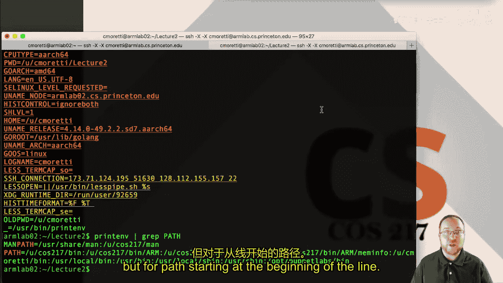
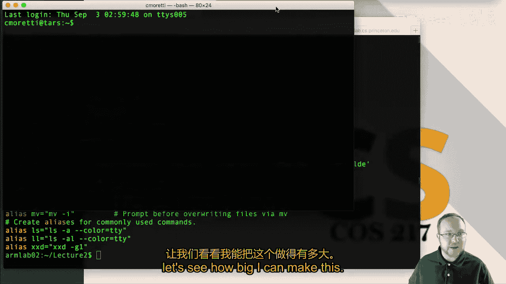
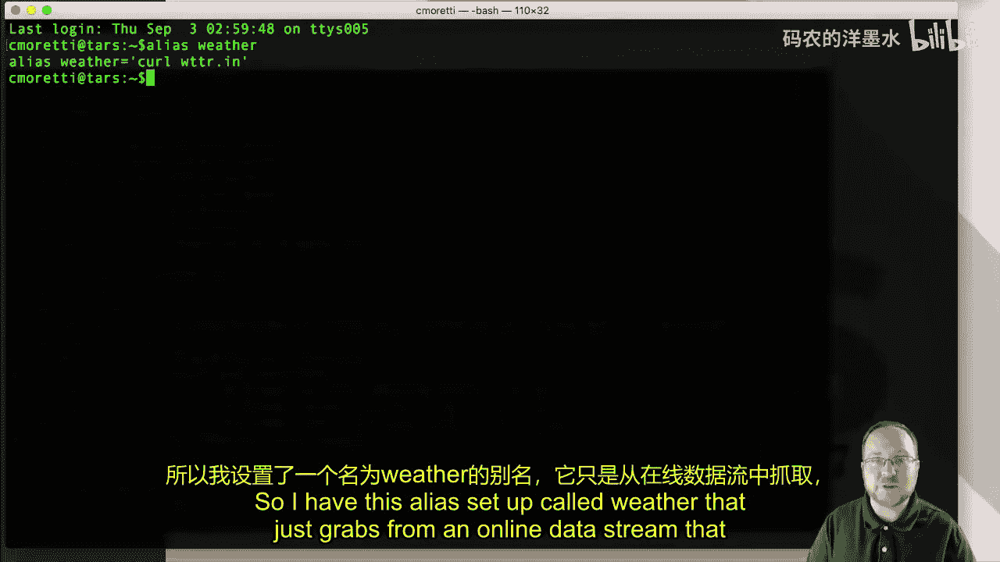
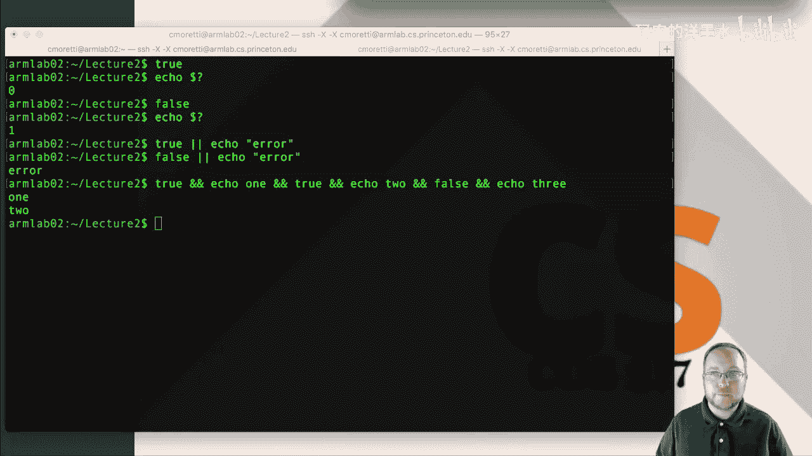

# C语言系统编程：第3讲：Emacs与Bash 🖥️

在本节课中，我们将学习如何更高效地使用Emacs编辑器和Bash命令行环境。我们将从一些实用的Emacs配置技巧开始，然后深入探讨Bash的常用命令、历史记录、环境变量、通配符以及程序退出状态等核心概念。掌握这些工具和技巧，将为你后续的C语言编程打下坚实的基础。

## Emacs配置技巧 🛠️

上一节我们介绍了基本的开发环境配置。本节中，我们来看看如何通过一些配置让Emacs编辑器用起来更顺手，更像一个现代集成开发环境（IDE）。

### 显示并删除尾部空格

在团队协作和版本控制中，代码行尾部的多余空格可能会造成困扰。以下配置可以让你在Emacs中直观地看到这些空格。

在默认的Emacs配置文件中，有一个被注释掉的设置。通过取消注释以下行，可以启用尾部空格高亮显示：
```lisp
(show-trailing-whitespace t)
```
启用后，行尾的空格会以红色标记显示。同时，配置文件还提供了一个快捷键 `Ctrl-x w` 来一键删除所有尾部空格。

### 启用鼠标支持

如果你习惯使用鼠标，可以启用Emacs的鼠标模式。在配置文件中添加或取消注释以下行：
```lisp
(xterm-mouse-mode 1)
```
启用后，你就可以在Emacs窗口中点击光标进行定位了。需要注意的是，在某些Windows终端中，这可能会影响从终端复制文本的功能，必要时可以临时禁用此功能。

### 窗口分割与管理

Emacs支持强大的窗口分割功能，允许你同时查看和编辑多个文件。

以下是管理窗口的常用快捷键：
*   `Ctrl-x 2`: 水平分割当前窗口。
*   `Ctrl-x 3`: 垂直分割当前窗口。
*   `Ctrl-x o`: 在多个窗口间切换焦点。
*   `Ctrl-x 0`: 关闭当前焦点所在的窗口。
*   `Ctrl-x 1`: 关闭其他所有窗口，只保留当前窗口。

为了更直观地在窗口间导航，可以配置使用 `Shift` 加方向键进行切换。在配置文件中添加类似以下设置：
```lisp
(windmove-default-keybindings)
```
配置后，按住 `Shift` 并使用方向键即可在分割的窗口间快速移动。

### 集成编译与错误跳转

无需离开Emacs即可编译代码并快速定位错误，能极大提升效率。

你可以配置一个快捷键（例如 `Ctrl-c m`）来调用编译命令。一个智能的配置是：如果当前目录存在 `Makefile`，则使用 `make` 命令；否则，直接调用 `gcc` 编译器。
```bash
# 示例的编译命令
gcc217 -c -o program.o -g program.c
```
编译后，Emacs会自动分割窗口显示编译输出，并将光标跳转到第一个错误或警告所在行。你可以使用 `Ctrl-c n` 和 `Ctrl-c p` 在错误间向前和向后导航。修复代码后，在编译缓冲区按 `g` 键即可重新编译。

### 代码自动补全

对于提高编码速度和减少拼写错误，自动补全功能非常有帮助。你可以安装并配置 `auto-complete` 之类的插件。配置后，在输入代码时（例如输入 `#include` 或变量名），按 `Tab` 键可以触发补全建议。

以上是一些能显著改善Emacs使用体验的配置。Emacs高度可定制，如果你有其他特定需求，可以随时向课程团队或社区寻求配置建议。

## Bash命令行进阶 🐚

现在，让我们从编辑器的具体细节切换到更广泛的Shell使用技巧上。我们将在这个包含多个文本文件的目录中进行演示。

### 高效输入与历史记录

首先，我们介绍一些能帮助你在命令行中工作得更舒适、更高效的技巧，特别是如何纠正输入错误和减少重复输入。

如果你经常输错字符顺序，可以使用以下快捷键快速交换：
*   `Ctrl-t`: 交换光标前两个字符的位置。
*   `Alt-t`: 交换光标前两个单词的位置。

接下来是本节课Bash部分最重要的技巧之一：利用命令历史记录。Bash会记录你执行过的命令（默认为最近1000条）。查看历史记录的命令是：
```bash
history
```
要重复执行历史命令，有几种方法：
*   `!!`: 执行上一条命令。
*   `!n`: 执行历史记录中编号为 `n` 的命令（通过 `history` 查看编号）。
*   `!prefix`: 执行最近一条以 `prefix` 开头的命令。

最强大的方法是使用反向增量搜索：按下 `Ctrl-r`，然后输入你想查找的命令中的任意连续字符，Bash会实时搜索并显示匹配的历史命令。多次按 `Ctrl-r` 可以继续向前搜索。

### 命令查找与环境变量

我们一直在使用各种命令，但Shell是如何找到这些命令的呢？

`which` 命令可以告诉我们一个可执行文件的位置：
```bash
which cat
```
Shell是根据 `PATH` 环境变量中定义的目录列表来查找命令的。你可以查看这个变量的值：
```bash
echo $PATH
```
`PATH` 变量通常在shell的配置文件（如 `~/.bashrc`）中设置。`export` 命令用于将变量导出，使其在子Shell中也可用。
```bash
# 在 .bashrc 中设置 PATH 的示例
export PATH="/usr/local/bin:$PATH"
```
要查看所有环境变量，可以使用 `printenv` 命令。结合 `grep` 可以筛选特定变量：
```bash
printenv | grep ^PATH
```



### 强大的文本搜索：grep

`grep` 命令用于在文本中搜索匹配指定模式的行。它是一个极其强大的工具。

最基本的用法是在文件中搜索字符串：
```bash
grep "pattern" filename
```
它也可以从标准输入读取数据，因此常与其他命令通过管道（`|`）结合使用：
```bash
echo $PATH | grep "/usr/bin"
```
`grep` 支持复杂的正则表达式。例如，使用 `-P` 选项启用Perl兼容的正则表达式来查找连续出现的“t”：
```bash
grep -P "t+" filename
```





### 命令别名

有些命令你一直在使用，但它们可能并不是“原装”的。`alias` 命令可以创建命令的快捷方式或预设常用选项。

查看当前所有别名：
```bash
alias
```
你会发现，像 `ls`、`grep` 这样的常用命令都被设置了别名，通常是为了添加颜色输出、安全确认等默认选项。例如，`ls` 的别名可能包含了 `--color=auto` 和 `-a` 选项。
这些别名通常定义在 `~/.bashrc` 配置文件中。你可以使用 `grep` 查看它们：
```bash
grep alias ~/.bashrc
```
你也可以创建自己的别名，例如快速查看天气：
```bash
alias weather='curl wttr.in'
```

### Bash编程：循环与命令替换

Bash本身也是一个功能完整的编程语言。下面我们通过一个链条式的例子来演示几个相关概念：通配符、循环、命令替换和 `seq` 命令。

首先，介绍一个简单命令 `seq`，用于生成数字序列：
```bash
seq 1 5        # 输出 1, 2, 3, 4, 5
seq -w 1 10    # 输出 01, 02, ... 10，-w 选项使宽度一致
```
**命令替换** 允许你将一个命令的输出捕获，并作为另一个命令的输入或赋值给变量。有两种语法：
```bash
# 使用反引号
files=`ls *.txt`
# 使用 $()，推荐这种方式，更清晰且易于嵌套
files=$(ls *.txt)
```
现在，我们可以结合 `seq` 和命令替换来创建一个Bash的 `for` 循环：
```bash
for i in $(seq -w 1 10); do
    echo "Number $i" > "file$i.txt"
done
```
这个循环会生成 `file01.txt` 到 `file10.txt` 共10个文件，每个文件内容为对应的数字。

### 文件名通配与花括号展开

Bash支持使用通配符来匹配文件名，这称为“路径名扩展”或“globbing”。

常用的通配符有：
*   `?`: 匹配任意单个字符。
*   `*`: 匹配任意长度的任意字符（包括零个）。
*   `[abc]`: 匹配方括号内的任意一个字符（如a、b或c）。
*   `[^abc]` 或 `[!abc]`: 匹配不在方括号内的任意一个字符。

例如，列出所有以7结尾的文本文件：
```bash
ls *7.txt
```
列出以6或7结尾的文件：
```bash
ls *[67].txt
```
另一种强大的扩展方式是 **花括号扩展**，它可以生成任意组合的字符串：
```bash
# 生成 file1.txt, file2.txt, file3.txt
echo file{1..3}.txt
# 生成 file-a.txt, file-b.txt
echo file-{a,b}.txt
# 结合前导零生成等宽文件名
echo file{001..003}.txt
```

### 程序退出状态

在C语言编程中，`main` 函数会返回一个整数作为程序的退出状态。在Linux/Unix惯例中：
*   **0** 表示成功。
*   **非0** 表示失败（不同的非0值可表示不同类型的错误）。

在Bash中，上一个命令的退出状态保存在特殊变量 `$?` 中。
```bash
true
echo $?  # 输出 0
false
echo $?  # 输出 1
```
你可以利用逻辑运算符 `&&` (AND) 和 `||` (OR) 的短路特性来根据命令成功与否执行后续操作：
```bash
# 如果 command1 成功，则执行 command2
command1 && command2
# 如果 command1 失败，则执行 command2
command1 || command2
```
例如，在失败时打印错误信息：
```bash
false || echo "The command failed."
```

## 总结 📚



本节课我们一起学习了提升Emacs和Bash使用效率的众多技巧。
在Emacs部分，我们探讨了如何配置以显示尾部空格、启用鼠标、管理多窗口、集成编译调试以及使用自动补全。
在Bash部分，我们涵盖了命令历史的高效利用、环境变量`PATH`的作用、强大的`grep`文本搜索、命令别名的设置、以及Bash本身的编程能力如循环和命令替换。我们还学习了文件名通配符的使用和程序退出状态的含义。
这些工具和概念是进行系统编程的基础，熟练掌握它们将使你在后续的C语言学习和项目开发中更加得心应手。接下来，你就可以运用这些知识开始完成作业0了。下周，我们将正式开启C语言的学习之旅。