# 【全集 秋季版】普林斯顿大学 C语言系统编程 中英字幕 p04 Lecture 4 - Git -BV1u1feBoEsK_p4-

This video is a walk through of steps 2 through 5 in assignment 0。

 which are all about getting set up to use Gitthub for your Co 217 assignments。

This video is not mandatory to watch， but it will provide a nice step by step overview of getting set up for those of you who might like it。

Alright， so let's go ahead and go to the assignment page。

Over here on the assignment 0 introductory survey assignment page。

 step 1 was creating a proper arm lab configuration that was shown to you in precept 1。

 and I hope that you've done that or will do that very soon。

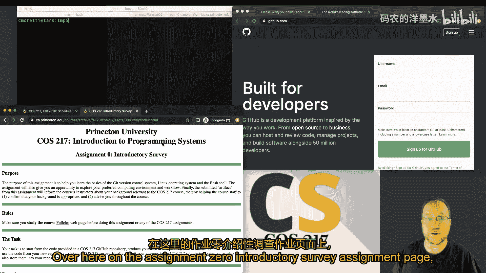

Step two says to create a proper GitHub setup， so that's what we're going to start with。In step 2。

 we referenced the Git and GitHub primer document from the first precept， so let's go find that。

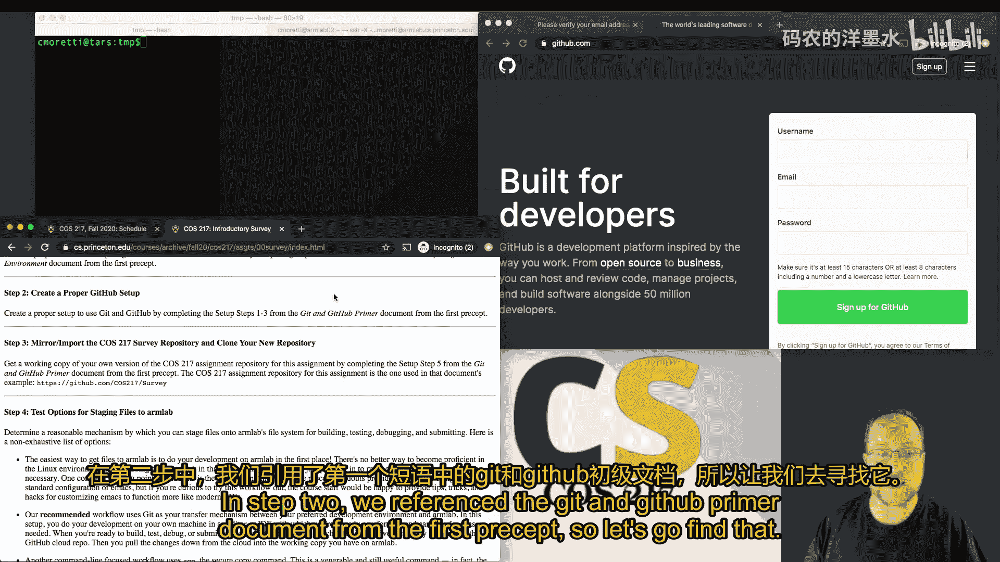

On the schedule page， under the first precept， we have the Git and GitHub primer。

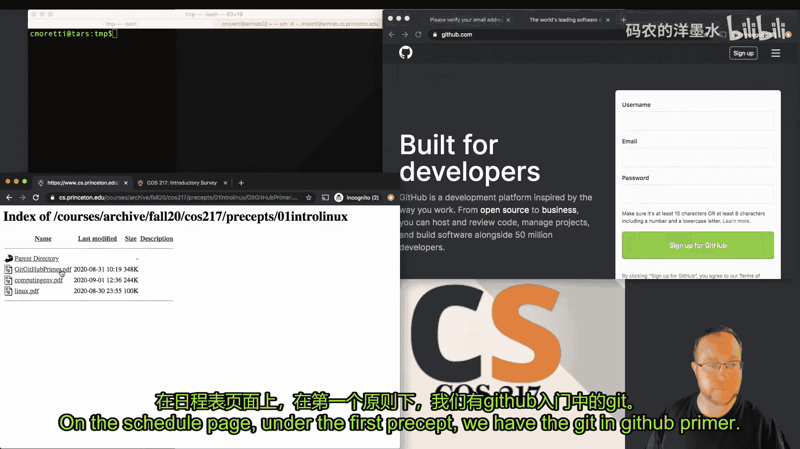

Initially， we just have some introduction about what Gi is， why we would use it。

 and some information about how it's used in the class。Step 1 describes installing git。

 and it says to check， I'm on a Mac。 So to check， run a git command and see if it's there。Mine is。

 so everything's good for me， I don't need to install it if I did need to install it。

 the instructions are shown。

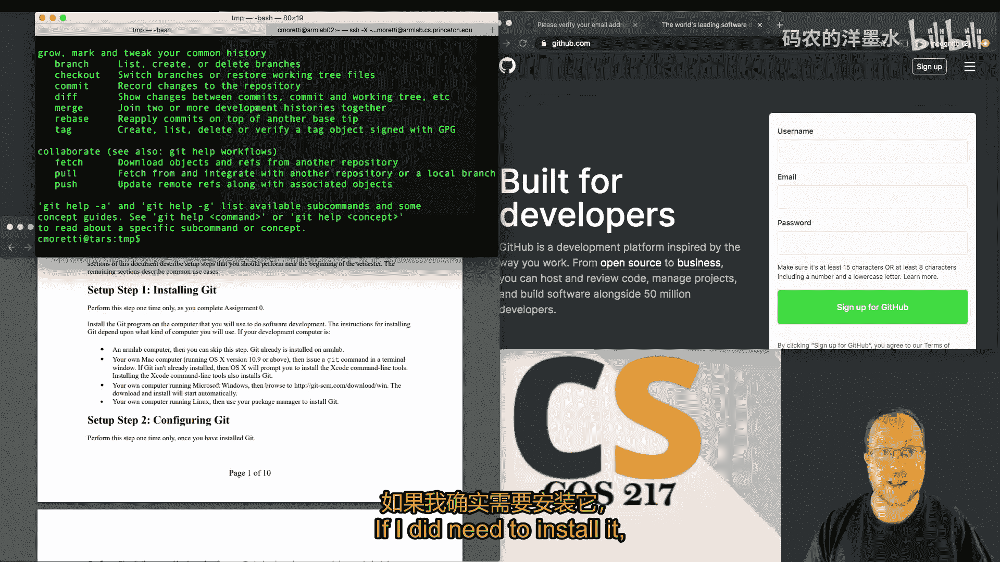

Step 2 asks us to configure Git， and we only have to do this once。

 but it's a way to let Git know what our configuration is in terms of what metadata should be applied to each commit that we do throughout the semester。

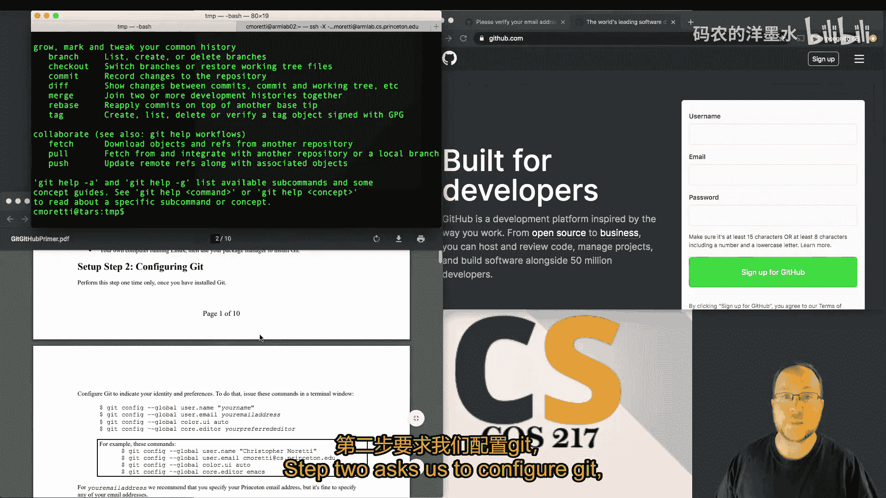

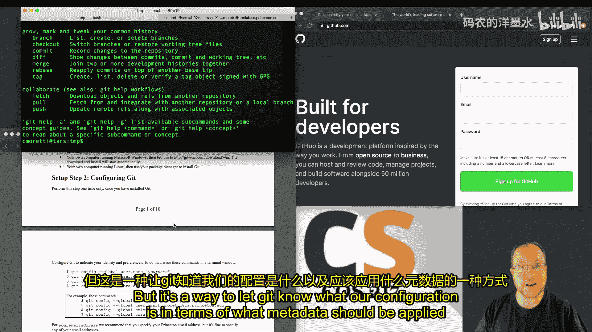

So let's go ahead and follow these commands。

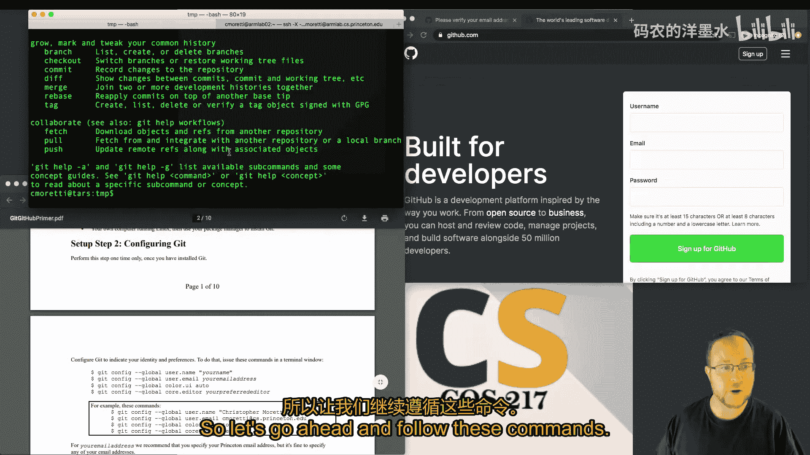

The first one is just what name should we associate with a commit or other action done？

Through this get command on this machine。The minus minus global says apply this to all of the repositories that you'll use on this machine。

We can set it on a per repository basis with minus minus local， if we wanted to。The user email。

 just like the user name associates a name， the user email associates an email。

 I'm using a plus alias。 Many email servers provide this that say a plus sign and whatever text you'd like to give。

 which allows you to in this case， use the same email that I already have a Git account for。

 but on Github， but also it's a way that you can track who's spamming you for instance。

The color says what color information should get output as part of its output。

 Auto says that if it's writing to the terminal， it will output color metadata。

 color codes is part of its output， and if it's writing to a file。

 it will not because in a file you probably don't want to see the color markup。

Various Gitthub command sorry Git commands will require using an editor。 For instance。

 if you want to commit， you have to have a message that goes with that commit。

 you could do a minus M on the command line， but sometimes you'll forget。

 and it will pop up an editor Similarlyly， merges and and conflict resolution will require some editing。

 And so they require an editor。 I'm going to use emax， but you can use your choice。

Once we've done these four commands， we can see what we did。With git Config minus L for list。

And it sets the four things that we did plus the credential helper that just says。

 how am I authenticating and that's set by my operating system？What this really did， though。

 was it created a file in my home directory called Git Config with this information。

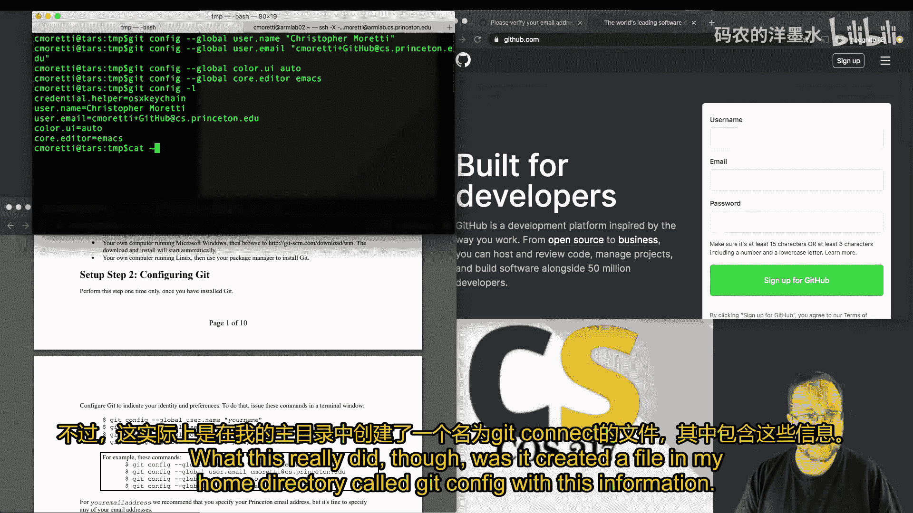

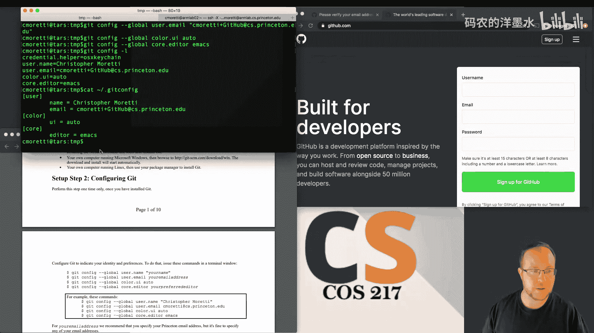

So that's the end of step two。Step three asks us to go and configure a GitHub account by actually creating an account with GitHub。

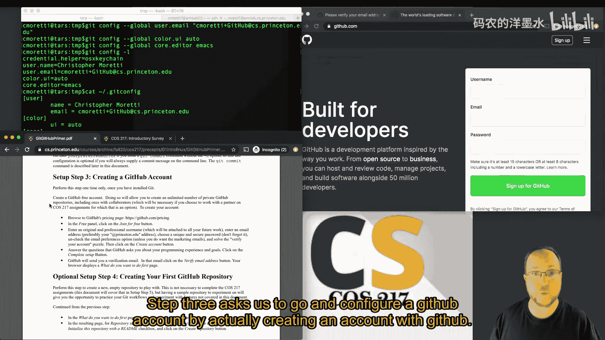

The provider， this is a web service that manages Git repositories。And so right here on Github。 com。

 if you browse there， you'll see the modal comes up on the very front page that allows you to start a new account。

So let's go ahead and do so。It will tell you if it's not available。 for instance。

 I know that my account， my real account is actually there。

 So I'll use another one for demo purposes。 I'll use the same email that I just used。

And I'll configure a password。I click sign up。

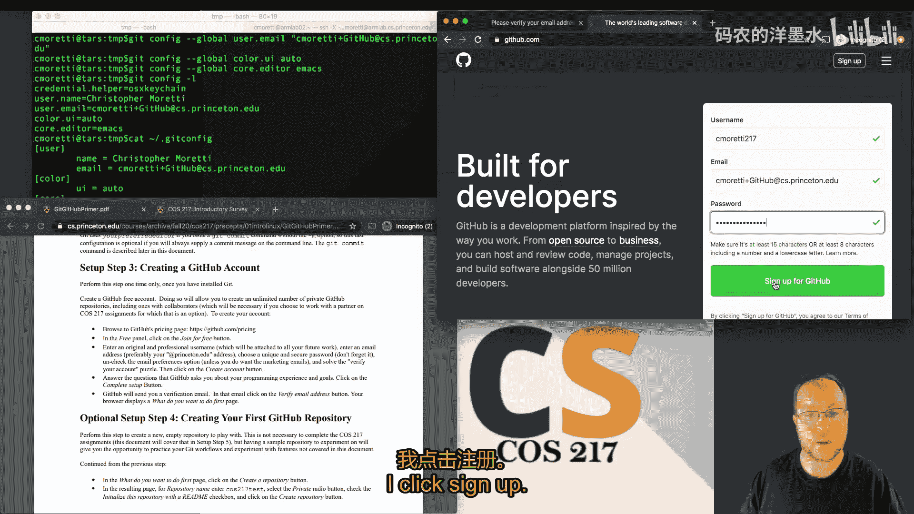

And instead of having a capture or something like that， it has this quirky puzzle verification。

 So it ask me to pick the spiral galaxy。 I was not an astro major。

 I don't actually know what that means， but that looks like a nice spiral。 So I'll choose that one。

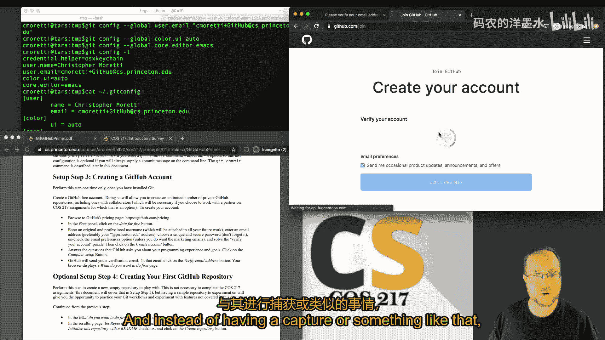

And it seems to be happy with that。I have no desire for them to spend me。

 and so now I will click joinin a free plan。It then asks for some biographical information， I。

Happily， we'll skip all of that and just click completele setup and it will let me do so。

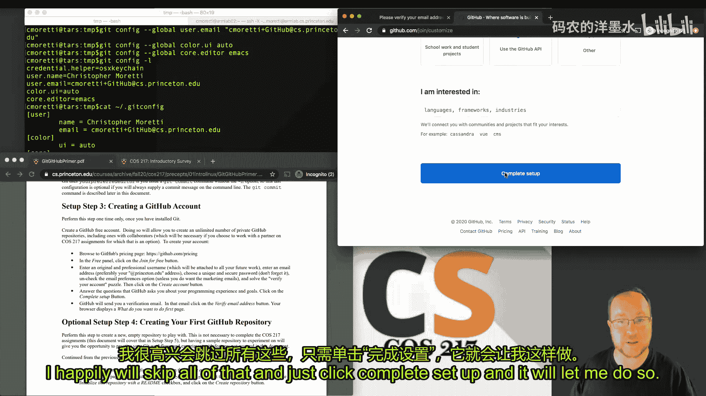

At this point， it says verify your email address so I will go over and do that。

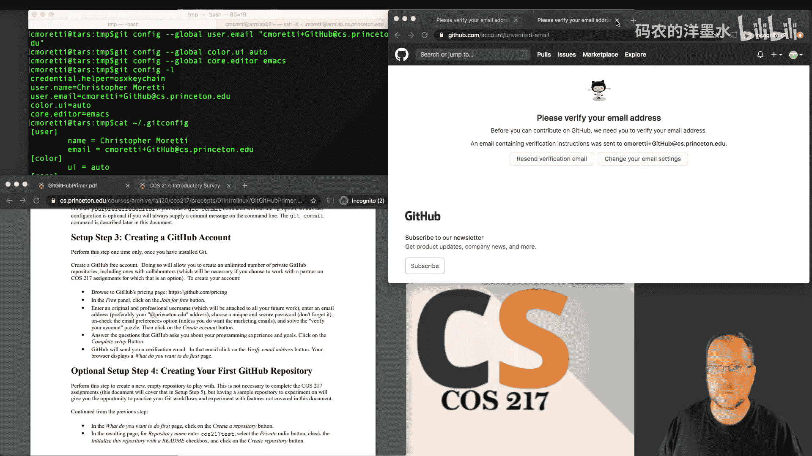

All right。 So now I'm sitting here。 My email was verified， and now I can look and see my account。

On the step3 here， it says what you want to do first， and it gives you the。

The the options and then step4 says how do you actually create a repository from there。

 So I could do that。 I'm actually going to go through and use the instructions for the later the later repositories instead of just this first one where it's completely through this what you want to do first。

 I'll create a new repository using the plus icon up here。So let's create a new repository。

I can choose the name of my choosing the name has to be unique to my account。

 but certainly many people in the world can have a repository called test or something like that。

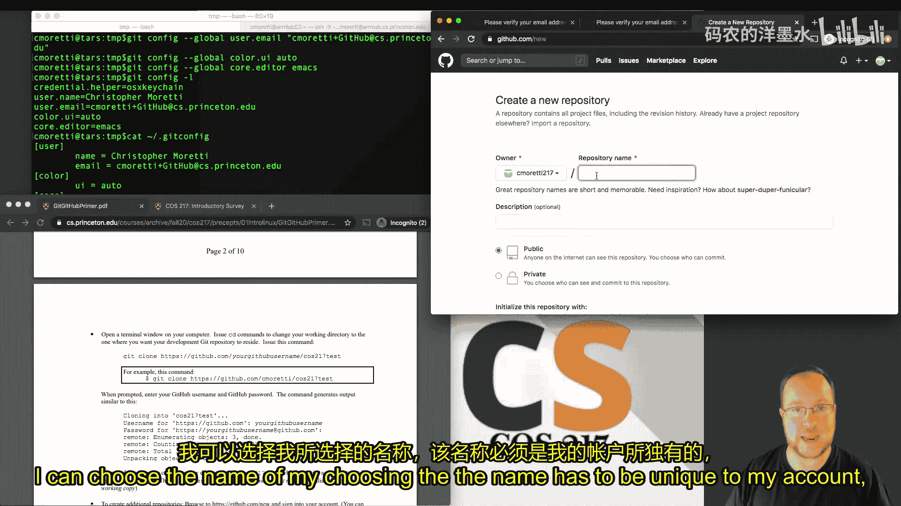

So this is our step four test， I'm going to choose private。

 all of the repositories in this course are going to be private。For something like this。

 it doesn't really matter， but we want to get into the discipline of all of our repositories being private。

 because when it comes time to to have your account repositories。

 certainly those must be private to avoid revealing your solution to the world。I have some options。

 It will automatically configure me with a readme file for my repository。

 It will let me choose what file names or file patterns to ignore and never add to a git repository。

 This is useful for things like never putting the Tilde files that are emax backup files。

 And I can choose a license。 But for now， let's skip all of that。

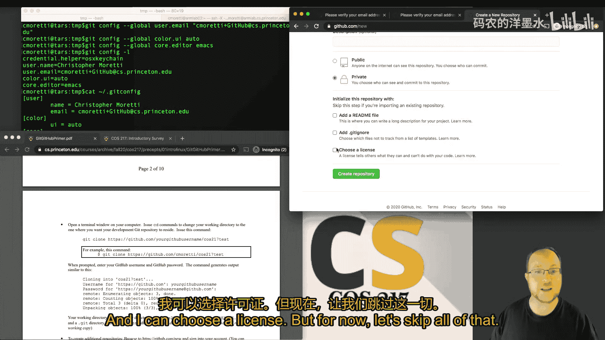

We create the repository and nicely enough， when you create a new repository。

 it tells you exactly what to do。

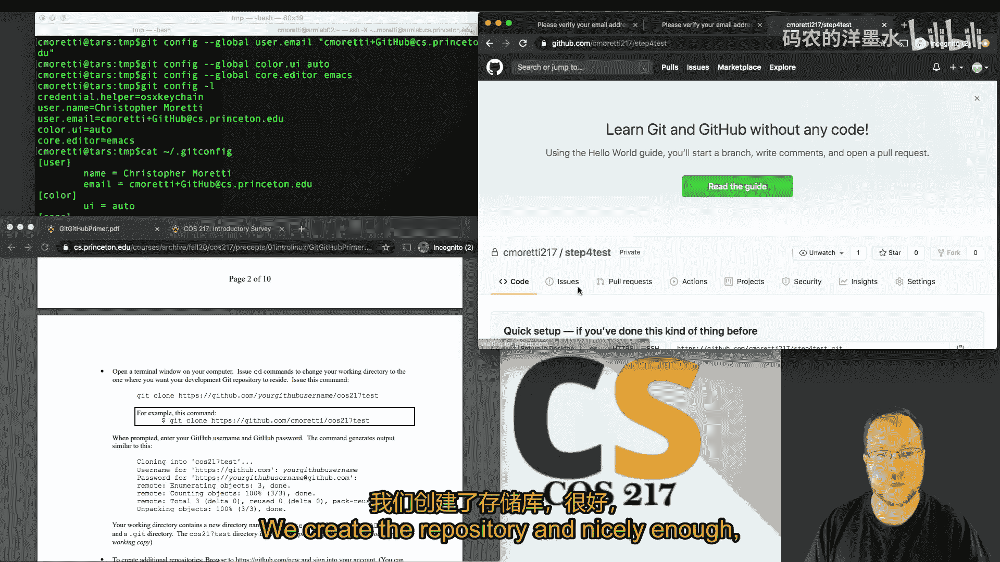

Two things here first it gives you the link which is the name of your repository。

 technically the stat git is the metadata associated with your repository。

And so this will come in handy for us later， but first。

 let's go ahead and follow the instructions to create a new repository from the command line。

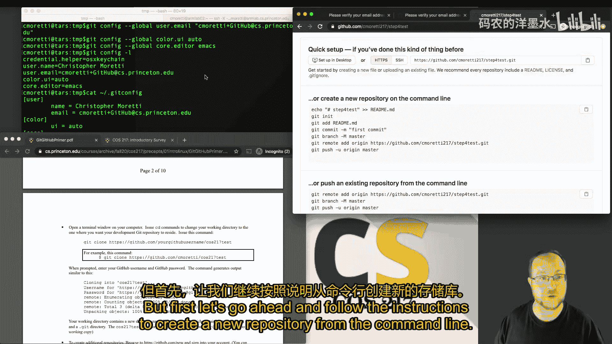

So over here， let's create a directory that this will be our working copy of the repository。

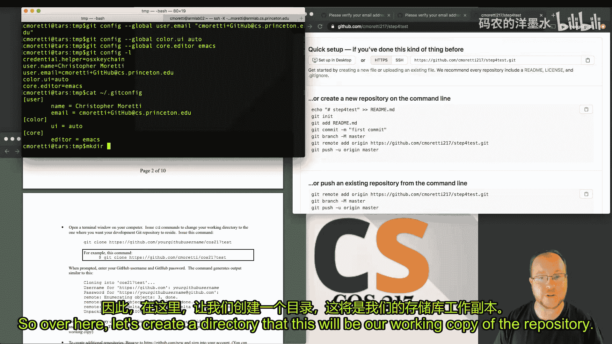

So we're going to create step four test。Doesn't actually have to be named the same thing。

 but it's convenient that it is。 And the first thing it says to is create a read me file。

 This is useful because on the repository page， it will show you this read me。

It's not strictly required， however， but let's go ahead and do so anyway。This is in mark down。

 which is a mark up language cleverly named， I suppose。 Mark down Mark up。

 The So the the hashtag here， the pound sign will just make it big and bold。Alright。

The key ingredient here is git in it。 What this does is it actually says， make this a git repository。

So if you see what the message said it made this directory， if I do minus L。

 it will tell me that I now haveada that metadata directory for all of the metadata about my repository。

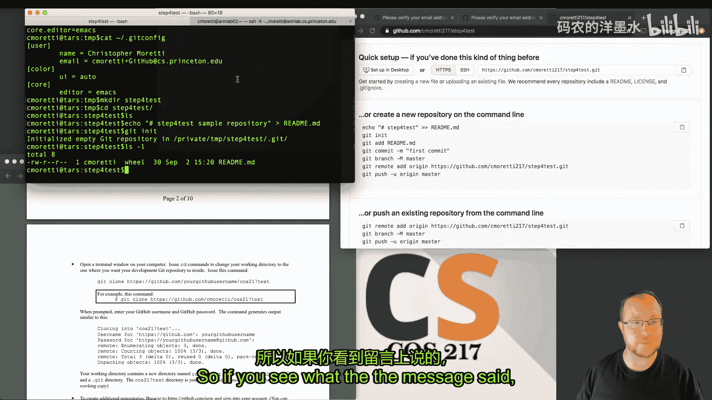

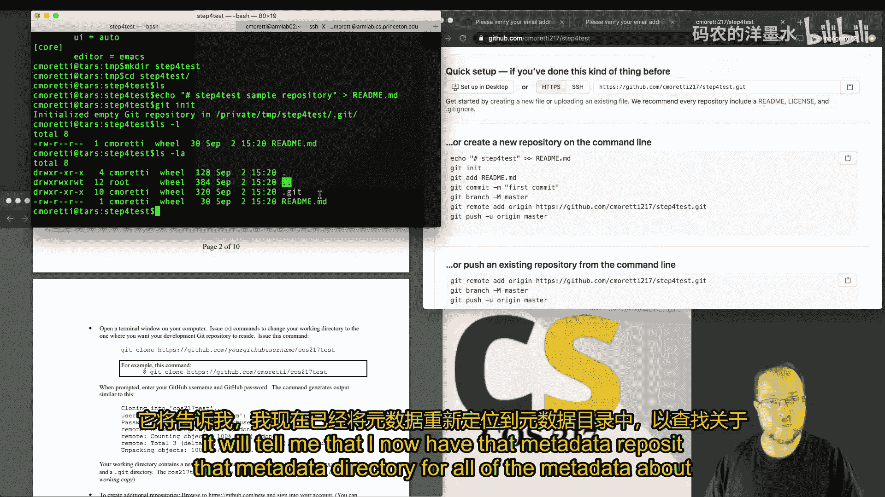

The next step here is I need to do a commit。 What a commit is， is it says I've done some work。

 and I want to bunch it together and say， I'm done with it。 I'm checking it in to say I'm done。

 Please save it for me right here on my local version。

 So this isn't interacting with the cloud on Gitthub dot com。

 This is just in my repository here on my machine。So get commit。Again。

 we can give the minus M command on the the command line。 But the reason why we configure the。

The the text editor is that if we omit that。It will actually pop up and say that everything is good。

Now， right now， it actually says there's nothing to commit because I missed one step here。

 I need to get to add。 So right now， if I do a gi status。

 Sta just says what's the status of the of the repository， It tells me that I have no commits yet。

 but I have an untracked file， and it tells me the information that it says I need to add that file to start tracking it。

 So gi add。

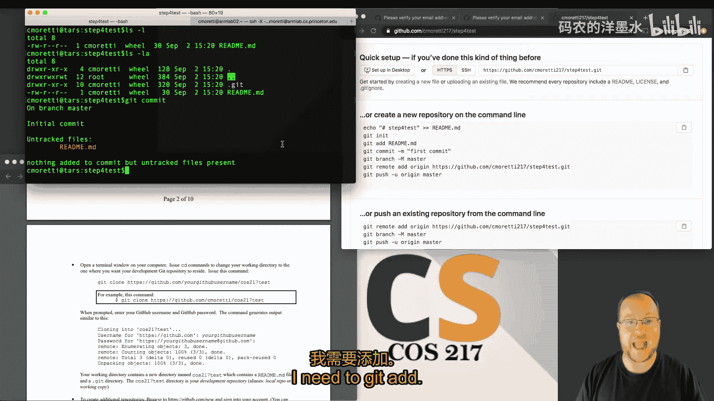

Read me。All right， so my previous commit didn't do anythingca there was nothing to commit。

 Let's try again。

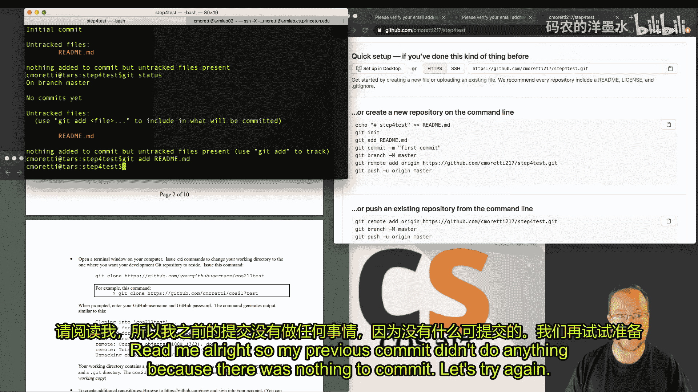

Again， I don't have a minus M。 So it pops up Eax for me。 And now I can type in a message。 So this is。

Checking in the resume。

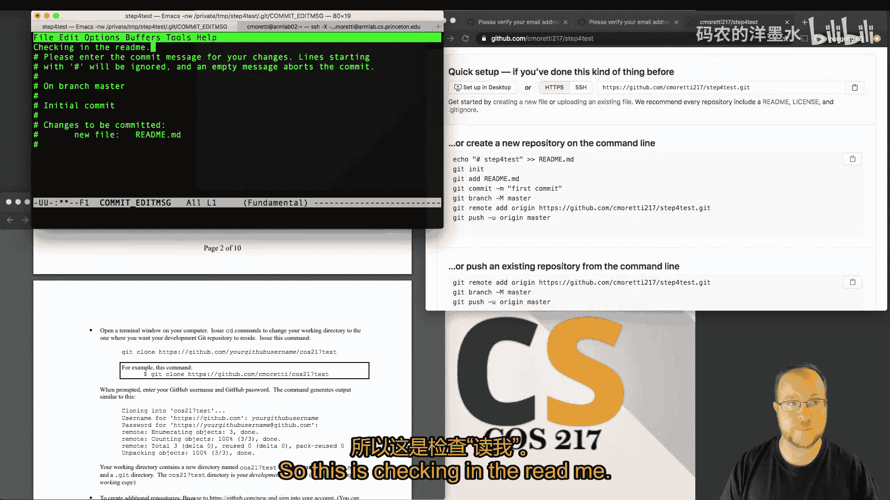

If I do a gi status， it tells me that。That everything is clean。

That means that there are no files there that are not tracked， but are appearing in this directory。

So the next thing I want to do is I want to say I'm creating a branch。

 if you look in this later in this Git and GitHub Primeer document， you'll learn about branches。

 but for now you can just think of this as a track of work to do。By default。

 master or main are the two standard names for branches。嗯。

And now the next command is gett remote ad Or bh。This looks confusing。

 but all this is saying is I have a local working version right here。 I want to hook it up。

 I want to say。This is the local working version of that thing I created in the browser。So。

Get remote， add origin。

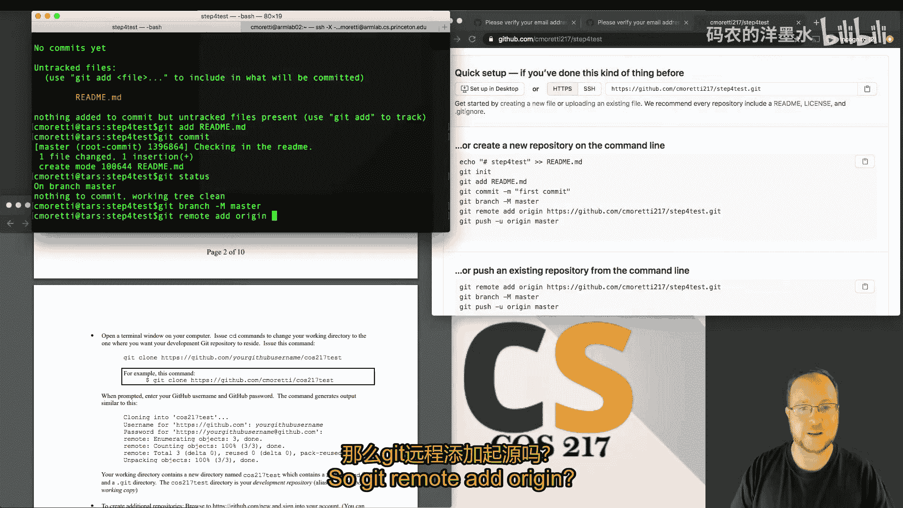

And then this URL up here， or you can copy it from the entire command there， Take your pic。

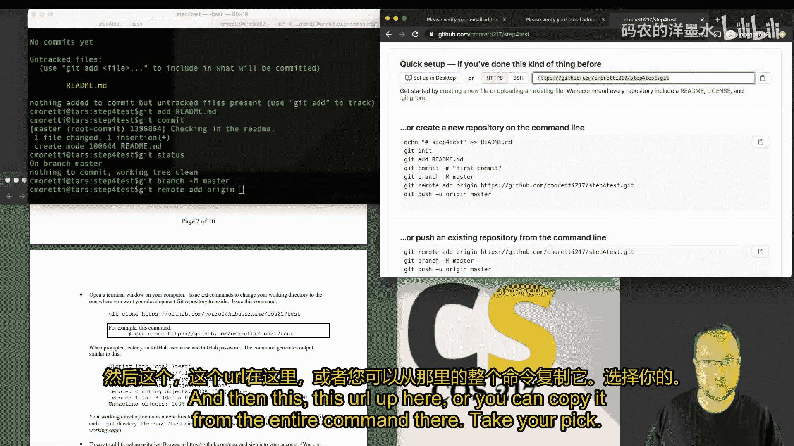

And the last thing we do is。

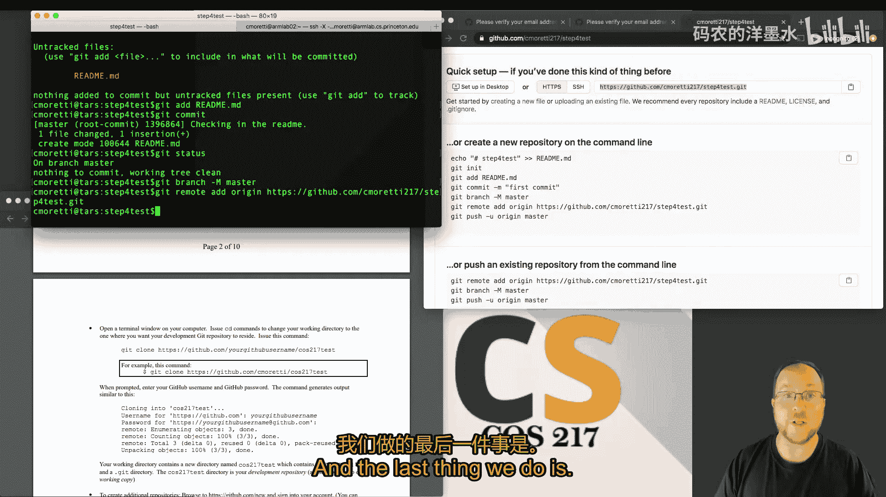

We said that we had a commit locally。 sorry I naturally just type Git status constantly to see my status。

 We said that we had a commit locally。 We have not yet pushed it up into the cloud。

 So Gitpush will actually say take this local commit and put it up onto Github do co into the cloud。

 and here it's visible by all users of this repository。 Right now， it's just me。

 but we'll see why this is useful in a moment。So let's complete that Gi push minus you or ain。Master。

 depending on your configuration， you might be able to just do git push。

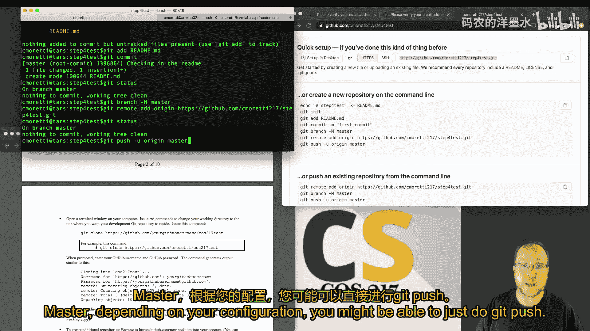

And it will prompt for your Github name， the one that I just created。

And it will prompt for your password。It thinks about it。 It says， hey， let's go ahead and upload it。

 It gives us the information。 And now， if we come back over to our repository out here in the cloud on the Web。

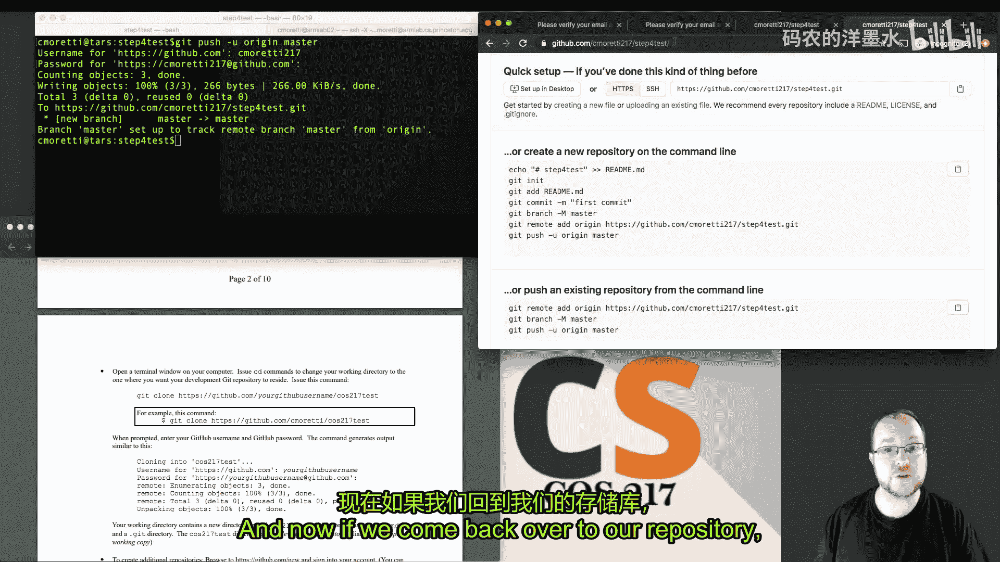

It actually has the information that that we edited in our browser。 sorry， in our terminal。

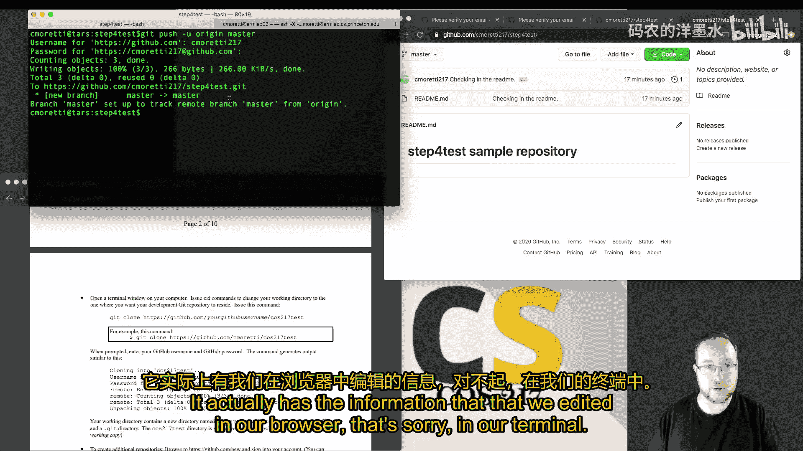

So that was how we could use this。 The， the next step over on。

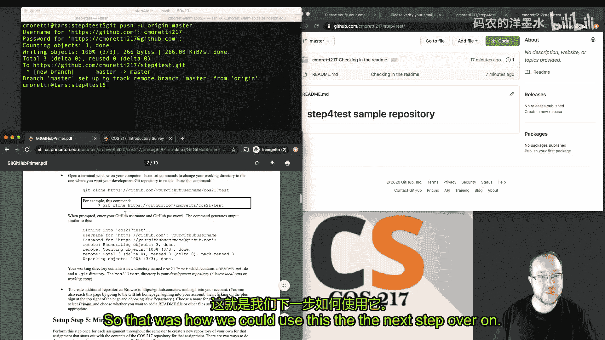

The survey assignment。Was figuring out how we're going to get things onto arm lab。

So we said that our recommended workflow uses Git as our transfer。 So let's see how we would do that。

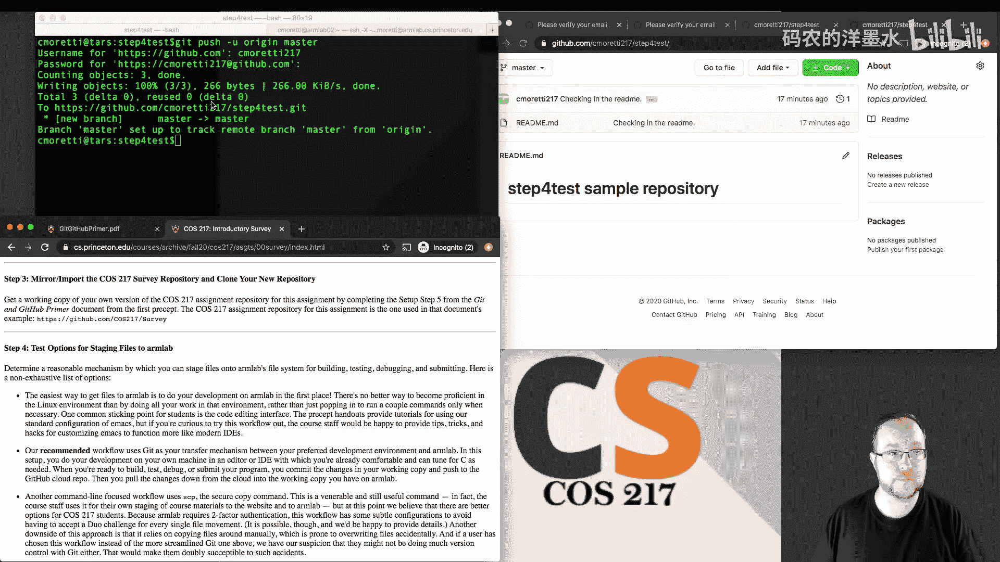

First， I'm just going to grab that information because it's going to be useful。

So over here on our lab I've already logged in， what I can do is I can do a git clone。

 Cl says create for me copy， a new working copy of the repository。

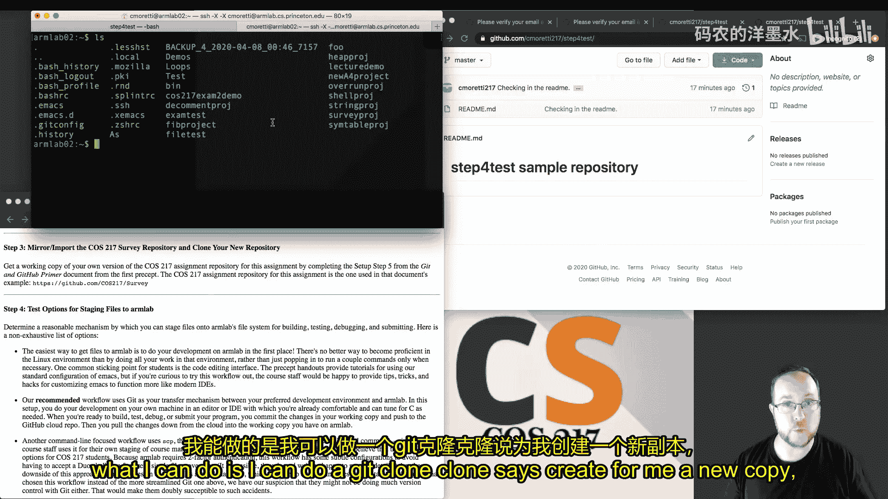

So what repository do I want to clone， I want to do a clone of this one。

I again need to enter my information。And here， if I look at this。I see that I now have a step4 test。

It has all of the information here。So I have now staged my files on to armlab just via git on my local machine。

 I was able to upload them to the cloud， and then on armla I'm able to download them from the cloud。

 This can go the other way as well。 Let's say that we want to make a change。

 So here I'm going to do some editing and。😊，I'm going to produce a new file。If I do a git status。

 it tells me that I have an un tracked file so I can again do a Git addd。Ed says。

 start tracking this file。Git status will tell me that now I have a new file。

 it needs to be committed。And now that I have done a gi commit， I can do。

 I can do get status again to show what happens。 It says。

 I am now a head of origin master by one commit。 that means that I have new information。

That has been committed on my current local working version。

That doesn't exist over on my actual machine。 So how to get it back over there。 Well。

 the same thing we just saw， we can push to the cloud。We do that。 It succeeds。

 If we look over here on the Web version， we can see that now we successfully did do that。Now。

 over here on my， my own machine， How do I get that back， Well。

 I could clone an entire new repository， but that seems silly。

 We don't want to do that every single time。 Instead， the pull command will say。

 go to the cloud and say， what updates are there。When I do that， it says it downloads some objects。

 It does what's called a fast forward to go to the newest version。

 and it says that one file was changed。 there were no insertions， no deletions。

 that's because I haven't changed any of the existing files。 Instead。

 there is just a new file there that was in the create mode。 That means I created a new file。

I now have that new file here on Armlab。 I can now go back and forth and do that as much as I want with creating new files。

 removing files， editing files， and that will work perfectly in terms of a reasonable way to transfer files from。

 from your working environment， your own machine where you're doing your development onto arm labb for building and testing and submitting。

So that was step 4 of assignment0， step 5 of assignment 0。

 then is going to talk about how to do the assignments when we give you some code to start。

So let's come back over to the Git and Gitthub primer。

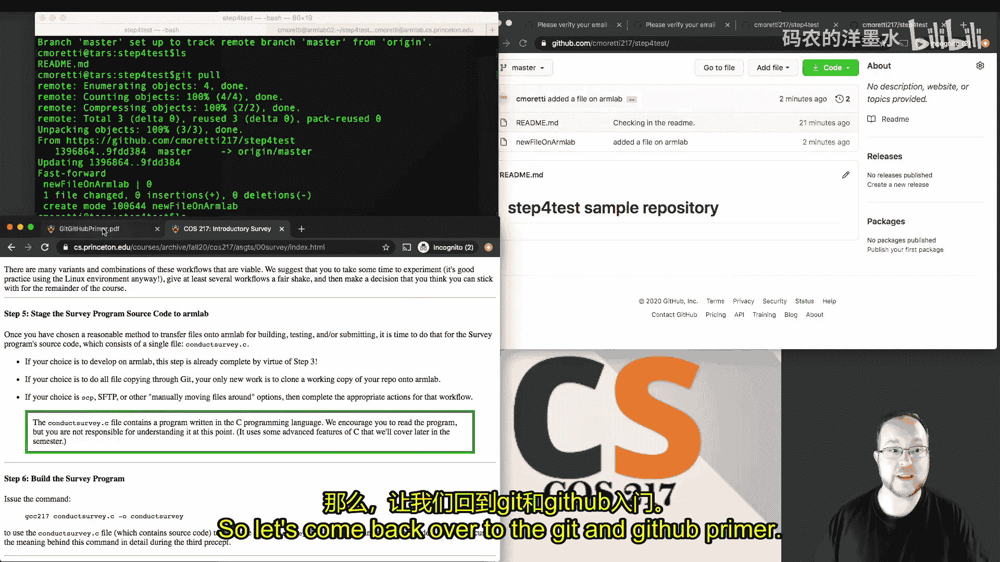

Step 5 says mirroring or importing a github repository。 So mirroring or importing。

 depending on which term you use really just means I want my own version of some other repository that already exists。

 I don't want to clone it。 I don't want a working copy of their repository。

 I want my own repository that comes prepopulated with all of that repository stuff。

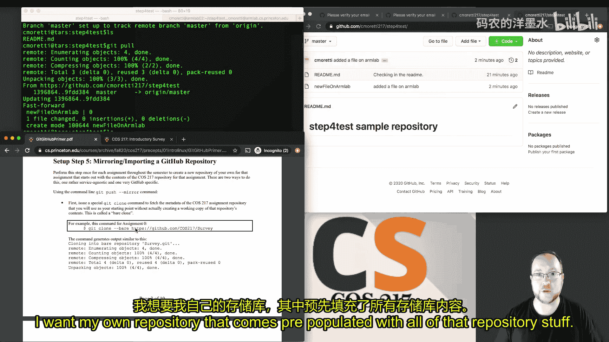

So let's see how to do that。 I'll come over here and start on my own machine again。

 I'll back out of this directory because I don't actually want to do it in step four test。

 I want a a new repository。

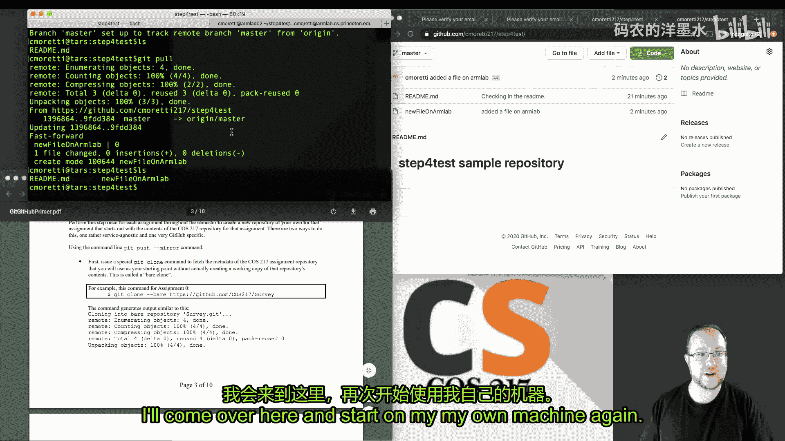

So there is a web tool for this， it's very straightforward， you're welcome to use it。

 but it's very much GitHub specific， it's only going to work for you in GitHub。

 there is a more general way to mirror repository in the way that we're talking about。

Using Git command line tools。 So let's look at that。

So the first thing that we do is we do a git clone that says check out a new working working copy of a repository。

 But in this case， it's not one of my own repositories。 It's a repository that Co 217 has created。

But we don't want the entire repository。 We just want the metadata because that's all we need to create our own version。

So we are going to do this git clone minus minus bear command。

 A bear bear clone just takes the metadata， not all of the full file data。

This is the repository for for assignment0， but each one of the Co 217 assignments will have its own。

Repository。With all of the starter code that we give used code and tools and data。

 So we're going to do this。

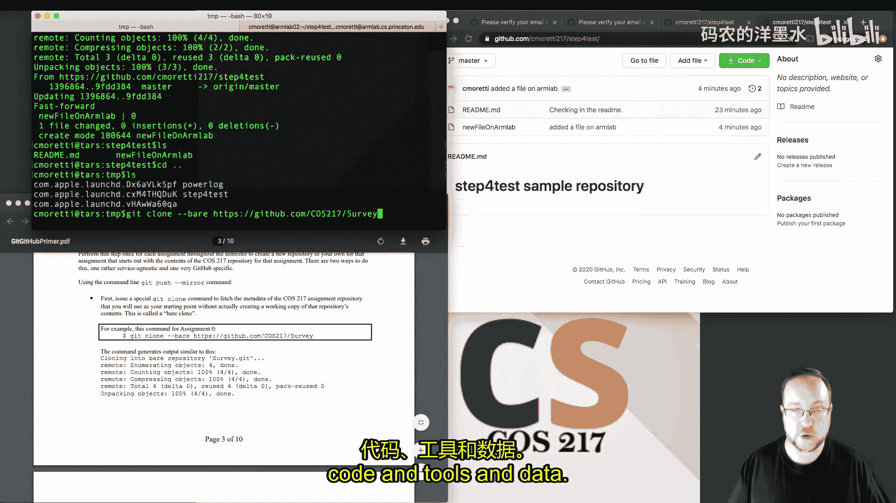

It succeeds。 What does it do， It says cloning into bare repository survey get。

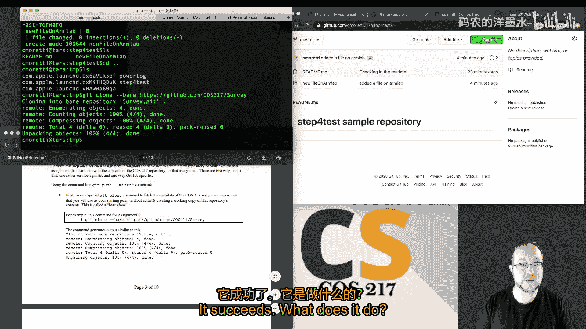

So just like when we saw in step 4 test， we had a dotgit directory with all of our metadata， survey。

tgit is all of the metadata from the survey repository。

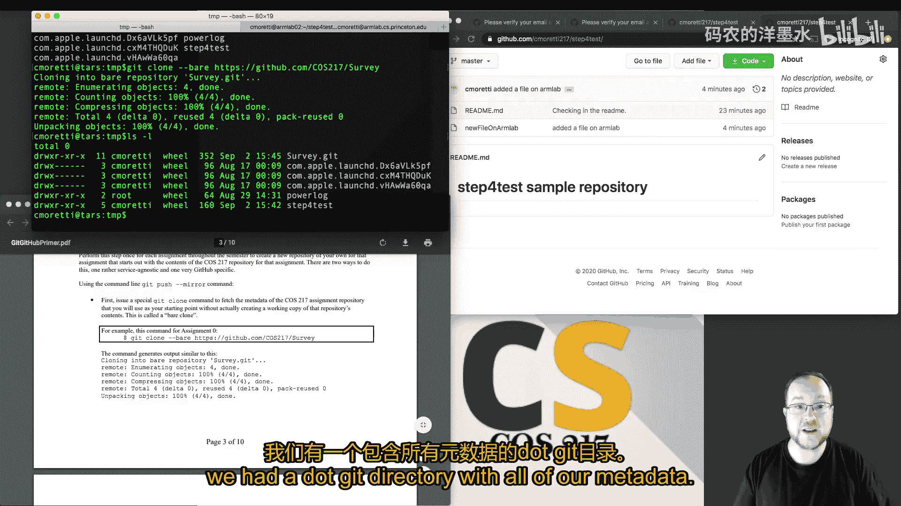

So let's take a look。 It has a bunch of stuff。 What does it mean， Well， we can look， branches。

 We said that branches were were different lines of work and versions of the code。

 So it makes sense that they're stored somewhere。 Info and objects。 objects is the actual code。

 Probably Lots of stuff there。 The good thing is， you don't have to care about any of this。

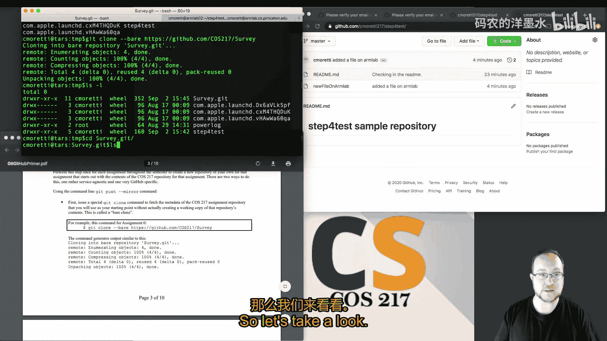

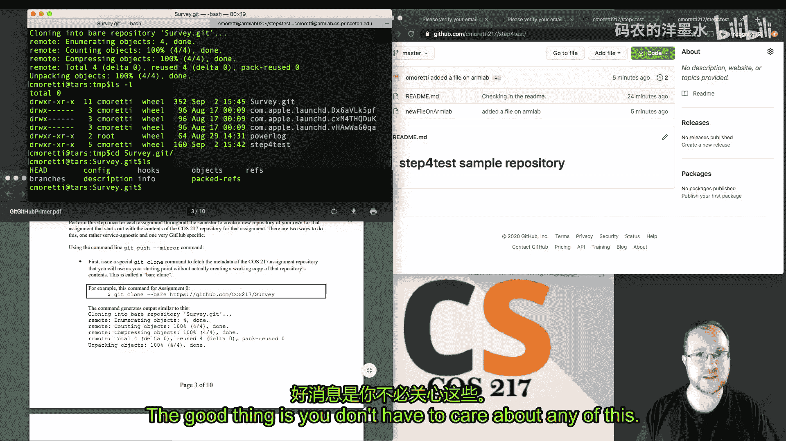

We'll go to the next step。 The next step says， hey， we need a new repository of our own。

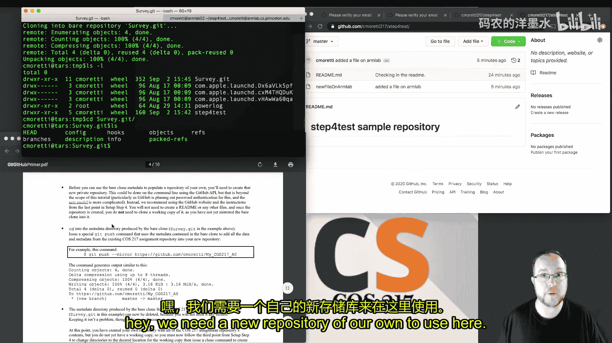

To use here。 So let's go ahead and do that。 We'll come back up here and in our account。

 give me a new new repository。We will do my survey or the equivalent of my Co 217 A0。

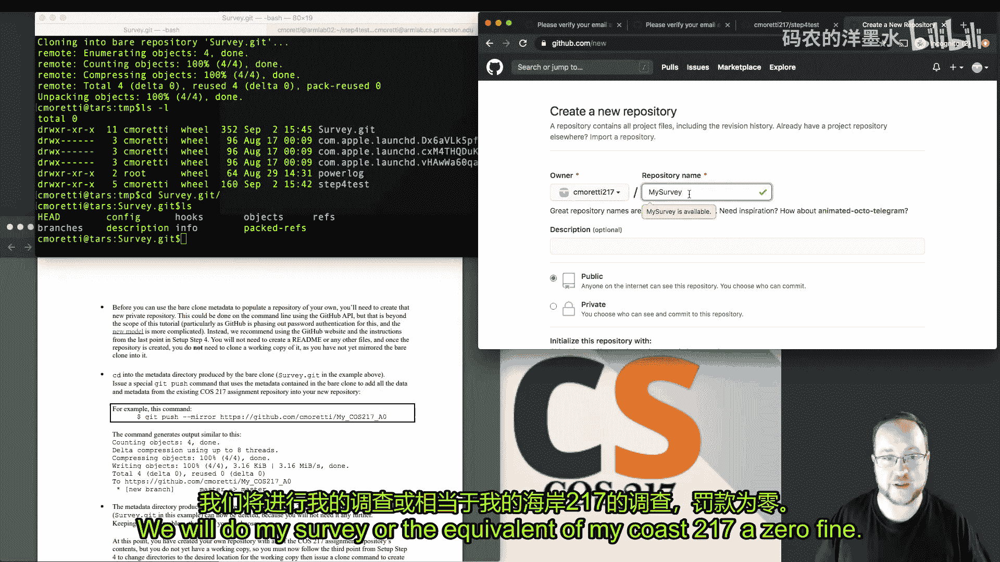

Fine again， it should be private， especially now it's an assignment repository。

 I don't need any of this because anything I put here。

I'm not going to actually use all I want to do is have a landing spot to copy the existing Coast 217 repository into。

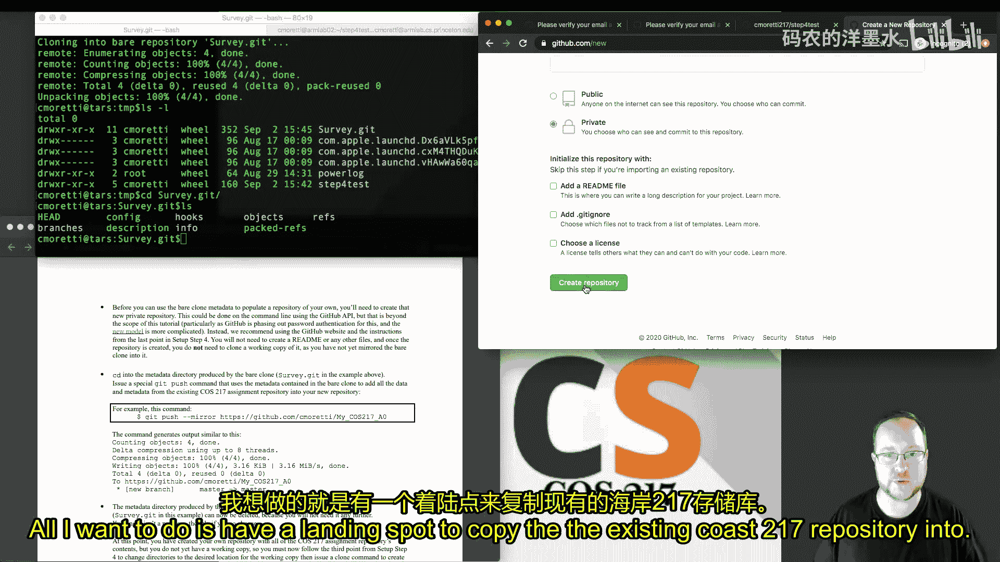

So I'll create the repository。

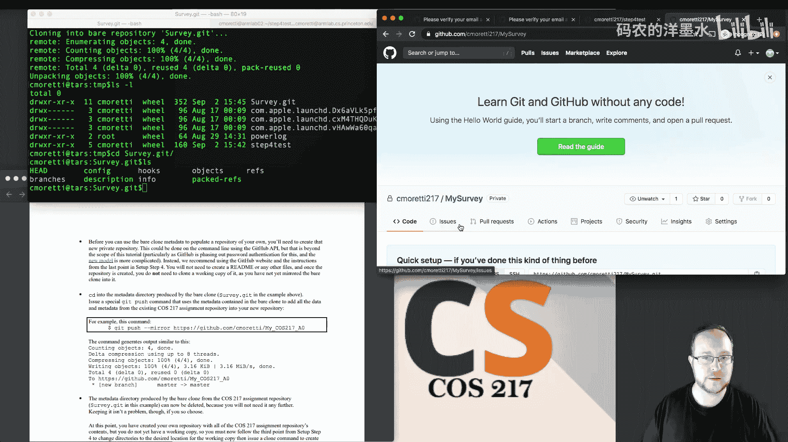

And now I have the name of it that I need。I can do my survey dot git that would be fine。

 The duck git means it's a bare repository， the not dot git means that it's the full repository。

 so it's just a matter of am I talking about only the metadata or the full repository if you don't put the dot git and you need it。

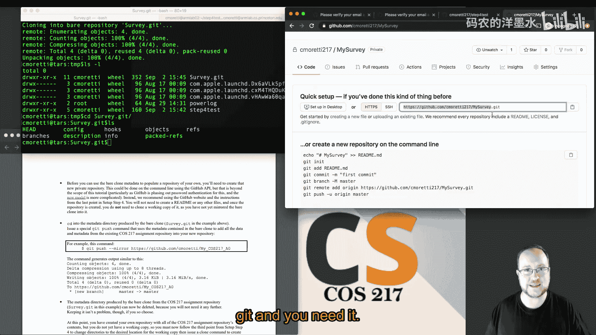

The get command line client will fill it in for you。 It will be fine。

So let's go ahead and do this now that we've created the repository。

 I'm going to take the metadata that I've produced。This know survey do git。

 and I'm going to I'm in the directory here。 like it says。

 it should see the into the meta directory I am。I'm in survey dot git。

 and now I will do this git push command。 That is the mirror command。Turn the。Metadata。

 the bare clone that I've cloned out of the 217 repository， turn it into my new repository。All right。

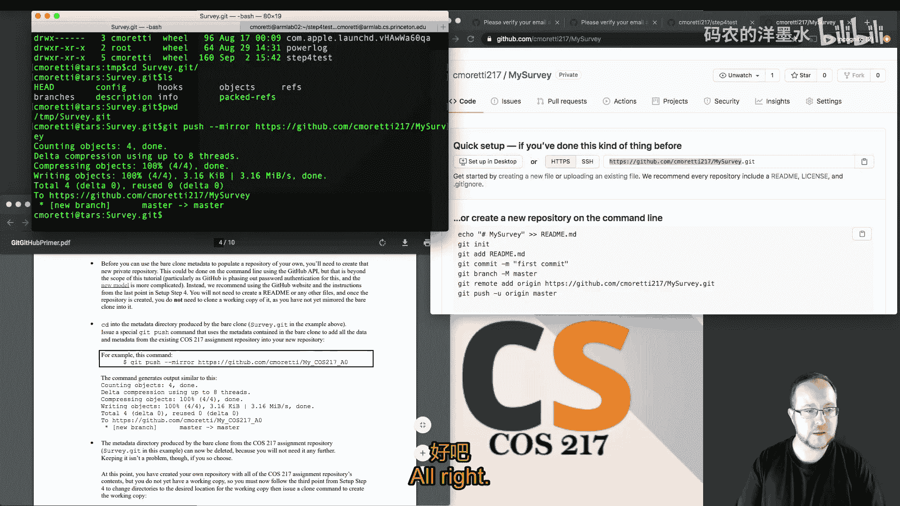

Once we've done so， we can check over here。Indeed， this has some information。

 It has a readme and conduct surveyed at C， which is the the core C file for assignment0。

We're not quite done yet， though， because right now we don't actually have a working copy。We have。

The one that we the Bear clone， the metadata that we downloaded from 217。

 but we don't have our own working copy of our new My survey， so let's go ahead and get one。

We get one with a gi clone。Of。My own。And my own new repository。And now I have a working copy。

That's all there is to it。 Now I can go through and do the exact same thing that I did before。

 where I will。Edit my files here。 I can then commit them and push them， come back over to Arlab。

Pull them。Edit edit them on either side。 eventually build them and run them on armlet。

I hope this was helpful， and the step through the process made it a little bit clearer than just the documents。

 Good luck。

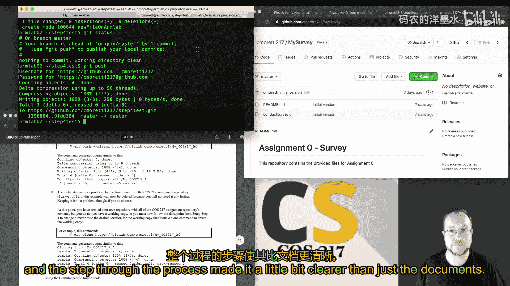