# 【全集 秋季版】普林斯顿大学 C语言系统编程 中英字幕 p05 Lecture 5 - C导论 -BV1u1feBoEsK_p5-

Welcome back to Cot 217 lectureture。 I hope everyone's made good use of the time up until now to get acclimed to our environment in Linux and bash on Ar Lab。

 and I've been able to complete assignment 0 making use of Git。

Now we're ready to jump into the C programming language and with that assignment1。After this lecture。

 you'll have everything you need to get going on that assignment。To start。

 we'll be talking about the history of C， its original design goals and their implication on how the language turned out。

This will be a continuing theme of the lecture content in the coming weeks。

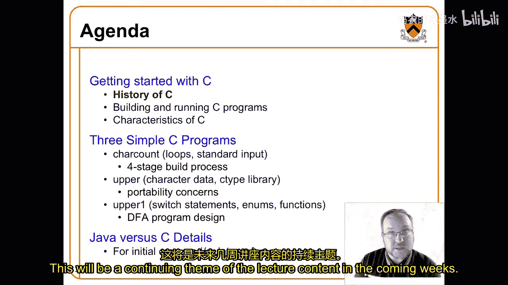

S came about here in New Jersey at Bell Labs， the research arm of AT&T and the predecessor of Luccent technologies。

 which is now absorbed into Nokia。It was primarily a vehicle to build utilities in UniuchX。

 and eventually it served as the language for reimplementing UniX， the kernel itself。

 replacing an assembly language version。This was the first step towards a portable UniX environment。

Dennis Ritchie was the inventor of sea and in his own words in his book。

 The development of the Sea Language。He had a retrospective that really fits well with the course's use of the language in terms of。

It's mainstream success， its low level access， albeit at the expense of portability。

 and it's invitation for programmers to express themselves concisely。

So his quotations are C has always been a language that never attempts to tie a programmer down。

It is always appealed to systems programmers who like the terse concise manner in which powerful expressions can be coded。

It'll allowed programmers to， while sacrificing portability have direct access to many machine level features。

That would otherwise require the use of assembly language。And finally， his。

 his takeaway famous quote， isC is quirky， flawed， and an enormous success。

 While accidents of history surely helped， it evidently satisfied a need for a systems implementation language efficient enough to displace assembly。

 yet sufficiently abstract and fluent to describe algorithms and interactions in a wide variety of environments。

😊，This really does sum up how we want to use it in 2017。

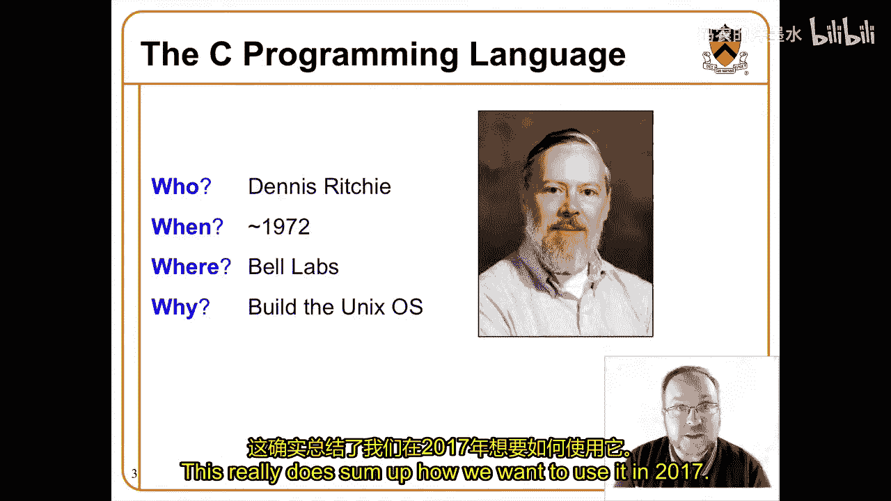

So C is a relatively old language coming about in the early 1970s and having been unofficially standardized by the late 70s and officially standardized in the late 80s。

 There have been various additional language expansions and new standards since then。

 up through a couple of years ago， and there's a new one in the works。

 but they've tended to either either be completely cosmetic， for example， how comment certified。

 or focused on concurrent programming， for example， reenttrant safety and threading efficiency。

We intentionally choose to keep our class using the older version to avoid many of the complexities of the newer standards。

 they added some cognitive overhead in the sense that there are many more valid options to consider。

Um， and yet they didn't really add much in the way of the core language that we care about for our purposes in this course。

So most students entering 217 know Java， and so for the rest of this part of the lecture。

 let's focus on comparing C's design and fundamentals with Java。

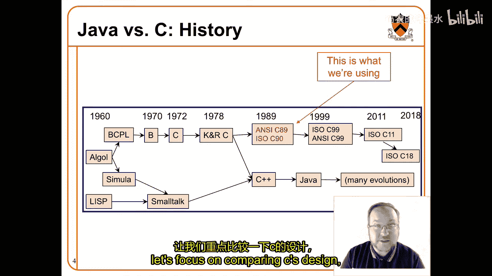

Historically C and Java were designed for very different purposes。

 C was used as a systems programming language for building a operating system and its tools。

 whereas Java was originally thought of as the next great language for the web。

 although that didn't turn out to be so great。The the。

Takeaways eventually from that is that C was designed without much of a care for safety。

 It was used by experts in creating these tools that were replacing tools that themselves were unsafe because they were in assembly language。

 Similarlyly for portability。 They were replacing tools that were completely unportable。 Java。

 on the other hand， was thinking at least somewhat about portability and about safety because of its web desires。

So a continuing conflict is going to be the safety and portability versus low level access and speed with Java largely representing the former and C largely representing the letter。

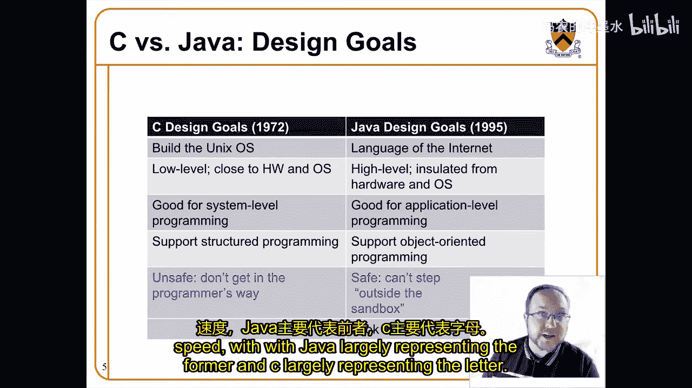

In that vein， let's talk about the characteristics of C programs。

 starting with how we go from source code to runnable programs in the first place。

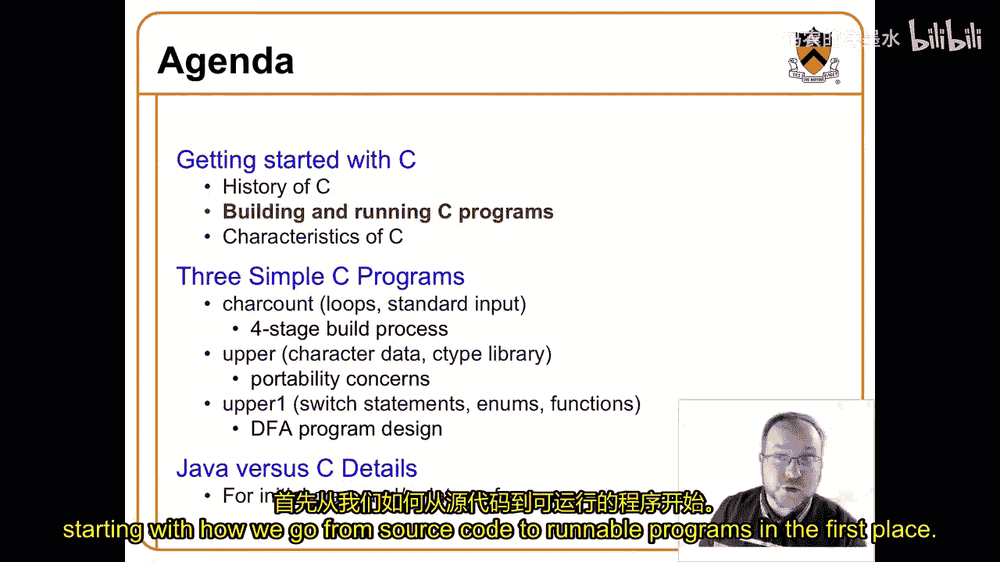

Before we get into the details of C， let's step back。

 remember what we know about Java and how the programs in Java are built and run。

So if we have a program， myproug。 Javava。We're going to issue the command Javac Mypug。Java。

 that invokes JavaC， the Java compiler， and it produces Btecode that's a machine independent representation of the program。

Then Java C itself is a machine language code program。

 it's specific to a specific hardware and operating system。In our case， it's specific to ArmL。

 it will read mypug。Java's input and write mypug。 class the Btecode as output。

Then when we go to run it， we're going to issue the command Java MyPgue that invokes Java the Java interpreter again。

 this is a machine language code program that's specific to our machine。

 but it reads in a class file that is portable。So in 126。

 you may have used Doctor Java or Intelligj to issue those two commands instead of doing so explicitly。

 or you might have run those commands dash intro CSs again。

 we'll actually run those commands indirectly。Let's contrast with C C executables or executables made out of C programs。

Are built with the CB tools colloquially called the compiler， but this term is not really true。

 it's really a syntic key as we'll discuss in a bit。They produce machine language code， not Bte code。

So what's the difference， let's see how they're run。

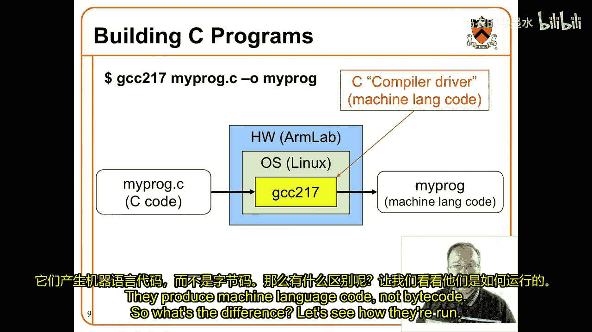

Unlike with Java， where we had to run Java and our class file， here。

 the machine code can be directly executed by the CPU。

Whereas in Java we had Btecode as in an immediate step， that Bte code wasn't runnable itself。

It got executed on a virtual machine， and that was one extra layer of indirection。

The extra indirect of the JVM adds complexity and potentially inefficiency。

 albeit with the benefit of standardization and portability。

 So we're coming to these same ideas over again in terms of the two very different ideals of these two languages that at first glance seem pretty similar。

As the building and execution process shed some light on the differences。

 let's look at a little bit more of the tradeoffs between the two and the characteristics of C in the context of Java's equivalent of those characteristics。

Note that the very end of this set of lecture slides has a detailed side by side breakdown of language features。

 though we won't cover them in point by point this lecture itself， they're there as reference。

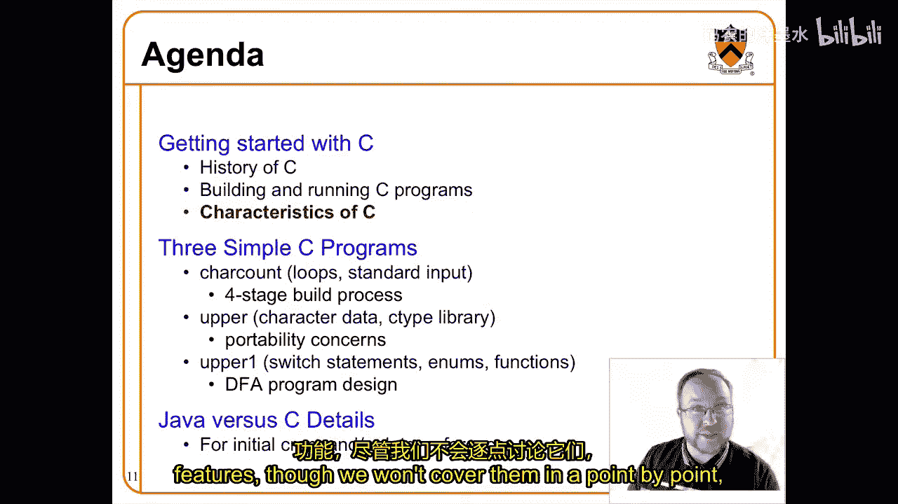

All right。 So we said portability， let's talk about it。At the source code level。

 Java is theoretically completely affordable。 C is mostly portable， but less so。

 and will soon see some obstacles to portability。Below the source code level。

 Javabyte code is again theoretically completely portable。

The Java interpreter's interface is consistent across all platforms。

 even when the implementation differs， insulating the Bte code from the underlying hardware。

The Ma language program My Prague， though， is not portable at all。

The machine language code is specific to a particular hardware platform and operating system。

So in conclusion， Java programs are much more portable than C programs at both the source code level and especially below。

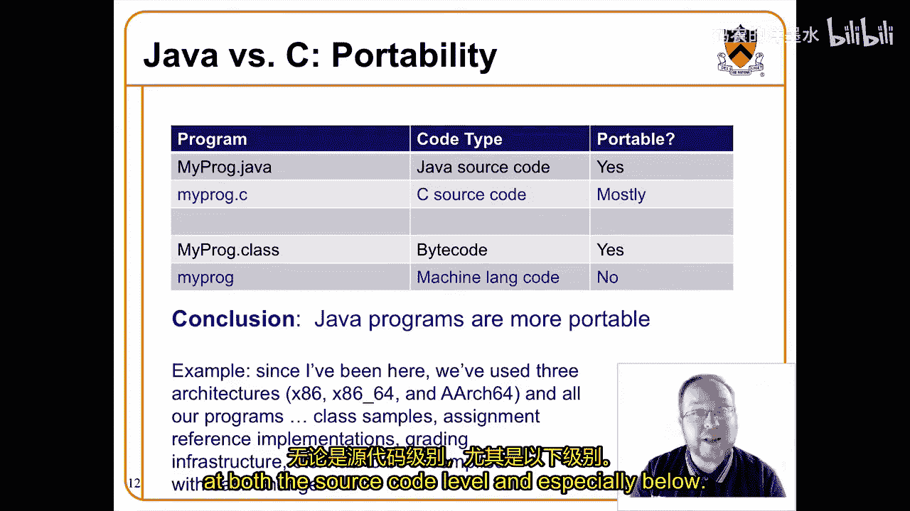

The other characteristic we mentioned was safety and efficiency。

 so portability was a clear win for Java， and we'll see the same for safety and convenience like bounds checks and garbage collection。

There are a lot of nice features in Java， but they do come at a cost， speed and predictability。

Think about Java as a language for embedded systems。

You're driving your awesome high tech car with its adaptive braking system。

 And just at the moment when you slam on the brakes。

 your brake controller decides that's a great time to go clean out all the memory that it can figure out it will never use again。

😊，Of course， the counterpoint to this one in C is that C might be super fast。

 but if you never free any of your memory， it will eventually run out and you'll crash in this case。

 perhaps literally。So these are both design decisions。

 there's not necessarily one right way or one wrong way。

 but they must be taken into account in terms of the uses of the language。So here the C equivalent。

 we have manual bounds checking and manual memory management。

Note that we' list no point of checking in both of these。But in both cases。

 the check results in just a crash， so it checks it for you， but if it doesn't like what it sees。

 the program crashes。Contrast this with bounds checking where Java crashes。

 but see does something even worse， it doesn't check and it just keeps running。

 probably in an incorrect state。So again， safety， probably a win for Java。Efficiency though。

 all of these have a cost and all of these checks， all of these system state verifications and system state processes like garbage collection where it does it for you。

 well that has a research cost typically we can assume that C is going to be faster than job。

So they are nicely complementary and they're both good choices to learn in some of your first few programming courses。

 so thinking about their differences， take this analogy。

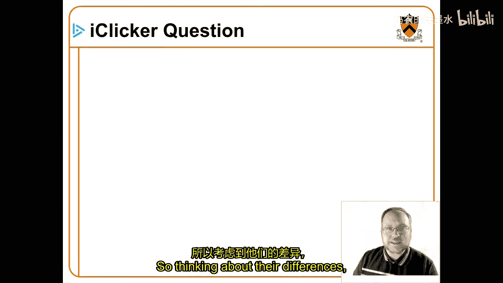

Which car might you consider to be C as opposed to Java， take a moment to make your choice。

 pause the video， say it out loud or write it down for accountability。

So a number of people are likely prone to put A， the old rusty truck， and yes。

 C is old and it's not particularly modern and it's definitely not portable。

 which that truck certainly isn't as well， so it's not a bad answer。

 but C does still run and is widely used， which that truck certainly isn't。

The Volvo also isn't the red analogy，  Volvos are traditionally the safe car。

 they pioneered three point seatbels in the late 50s and they're sometimes thought of as boring that the mom wagon here certainly fits that personally I love mya 60 but that's neither who nor there so if anything this is Java not C。

嗯。So that that leaves be， the soupped up car， it's a little faster at the trade off of being a little riskier。

This is C， at least compared to Java or similar languages。

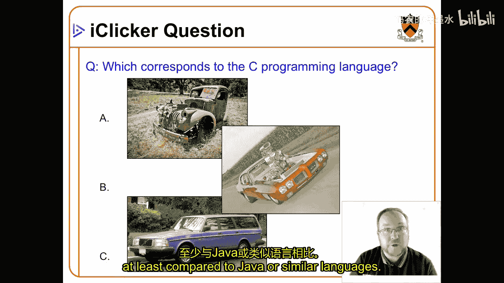

And so if C is your hot rod， let's get programming。

As a warning the rest of this lectures quite fast pace， brace yourself。

 it's throwing everything at the wall that you need for assignment 1 and hoping enough of it sticks。

 but as reassurance there will be more systematic coverage of C to follow both in lectures and in precepts。

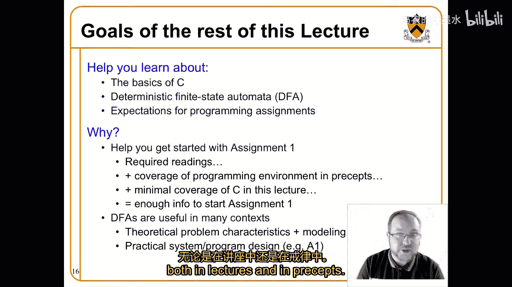

So the remainder of this lecture will be based around three little C programs that serve as our initial examples of the language and again will set you up to make progress on assignment1。

Our first program is Char count， it's equivalent to the WC program that you saw in the Linux and batchsh overview when invoked with the minus C argument to count characters。

 you'll see a larger version of this program again later in the course when you implement it yourself in assembly language。

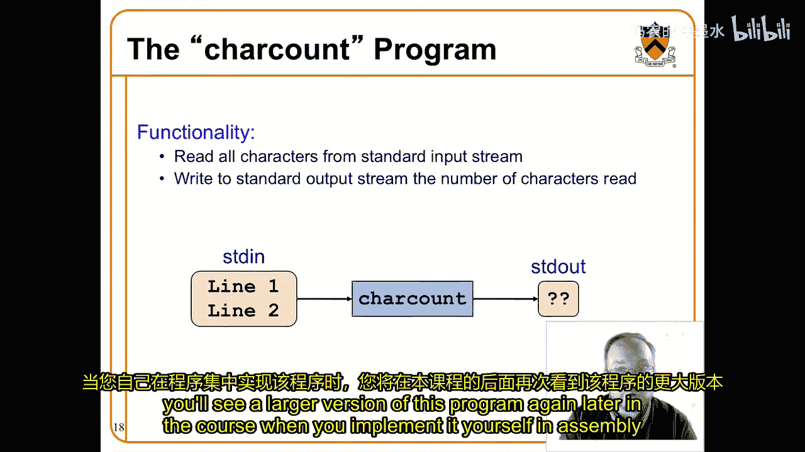

So what's the output of Char count on this input we run it and we type into standard input line one。

 the return key， line two， the return key。And then we send it the signal to say。

 I'm done with standard input。Take a moment， pause the video， make your vote and say。

 what is the answer here？Well， on line one， we have L I N E space 1 and then the new line character。

 So when we you hit return， it's actually inserting a character called new line into the the stream。

 So that's 7 line 2 has L I N E， the space， the two and the new line character again 7。EOF。

 the signal you send to say'm done with input isn't itself a character。

 so that means that we have 7 and 7 makes 14， and as promised this jives with WC minus C。

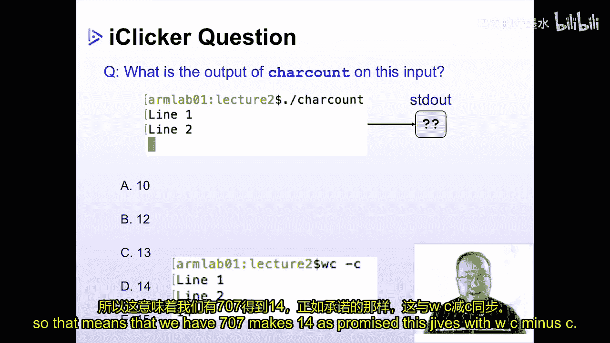

So here's the program code， take a quick look at it。

 some lines will look very familiar to your Java Attuned eyes， others might look quite foreign。

But it's okay， we'll break it down almost line by line。

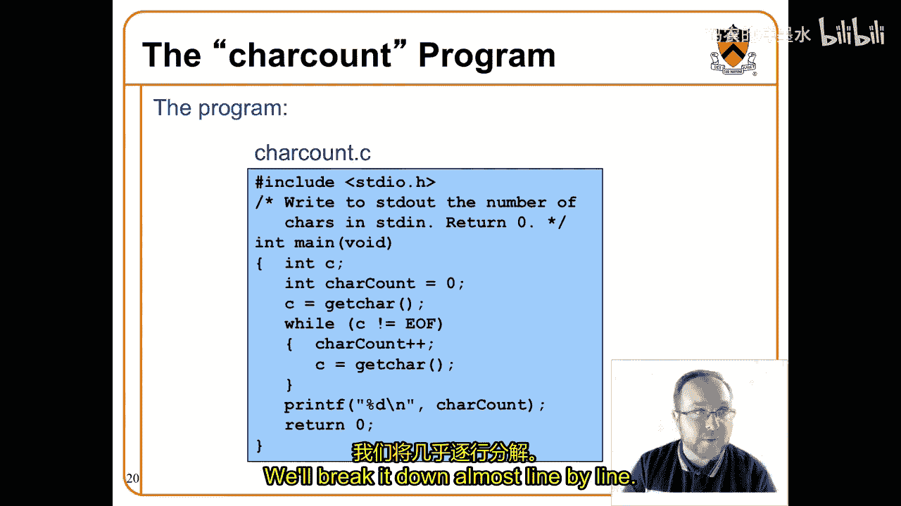

When you ask the shell to run in executable， it loads the machine code generated by the build system。

 which conventionally starts with a runtime system that has some basic starter code that we call underscore start。

UnderSse start， then its primary job is to call Maine， so for the code we're writing。

 execution starts at Maine。This is just like in Java in that sense。

But note that whereas in Java you had public static void main string brackets as and see it's a lot ter。

 We'll learn how to replicate some of that Java verbiage later in the course。 but for now。

 we've just got a simple main method that takes no arguments and returns an int int main void。

So coming into Maine， this looks like the variable definitions that we would expect from Java。

 except C is an int， not a char。That's a weird thing to look at int C when C means char。

But the reason here is that our our function that we're going to fill C with。Get cha returns an int。

 not a cha。You might naturally ask a follow up， okay， then why that then？

The reason here is that we want to be able to identify any valid character。

While also identifying whether we fail to read a character at all。

 that means we need more space than just a char。 if any valid char could be returned。

We fill up all of our possible values of char and still don't have a way to indicate that we failed to read a chartrle。

Thus we should assign the value return by getchar to an int because it returns an int。

 because it needs that one extra value to say， I'm not giving you back a cha， I couldn't do it。

If you assign the return value into a cha， that can cause trouble because it's not necessarily clear whether you've read in the value associated with。

I couldn't read a chart。Cast into a jar or that character itself。We'll see this in more detail later。

So GetcharR is a function from one of the standard libraries。

 our program knows about its existence because we've pound included a header file。

We'll talk again more about this in just a minute。As mentioned on the leading example。

 there's no such thing as the EOF character， EOF is just a number defined in a header。

 it is that value that says I could not write a cha。

Perhaps there's a better way to think of this than EOF， which stands for end of file。

 you might call this read failure or end of input or something like that。

On our system EOF is defined to be minus1， it's in that STVIO header file。

 but we don't actually need to know or care about this we just use EOF as the semantically meaningful constant。

At this point， we get to the loop of the core of our function。

 and we use the result of the priming rig just before and compare if we read a valid character or got that non characteracter status back from Getchar。

If we read a character， then we increment the count to match。After doing that increment。

 we're going to call getchar again to replicate the priming read and set back up for the loop sustaining condition。

Eventually we will run out of standard input and getchar will fail； that is it will return EOF。

That should end the loop。And so after the loop， we print our result using printntf。

 which is not unlike the system do out do printntf or a standard out dot printntf that you're familiar with from 126。

Finally， we return， returns work the same way they do in Java。

 they return to the spot where this function was called from。

 sending back a value if the function isn't specified as a void return。Main's calling function。

 as we mentioned before， is underscore start， which means that when we return to it。

 we're going back to underscore start and really all it does is just cleans up any state that it set up for Maine and then immediately exits with the same exit status that Maine returned。

We talked about exit status in the Linux and Bash lecture。

 the C standard says that a program that succeeds must finish with the exit status zero that accords to what we talked about in Linux and Bash。

 the C standard says that any program that fails should finish with the exit status exit failure。

But that value exit failure is system dependent on our system， it's one。

The values exit success and exit failure are defined in STDlib。h。

 so here we return zero just the literal， but we could have found included STDlib。

h if we wanted to use exit success as a semanically meaningful constant for zero。

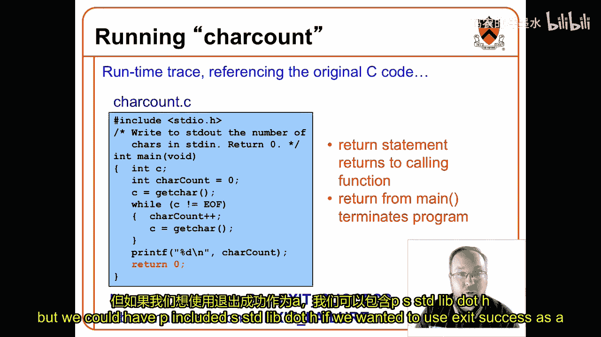

All right， so that's the program we saw earlier at the high level the difference between seeing Java building their program files。

But that discussion earlier was focused on the fact that GCC creates an executable， not by code。Now。

 having a program to use in as an example， we're ready to dig in and build a C program in a little bit more detail。

 and we'll see why calling GCC the compiler is not quite the whole truth。

On this slide you can see the shortcut command， which is the default。

 it completes all stages of the build process starting from the source code and ending up in the executable all in one invocation。

With the minus O option， the next argument is the executable name and without the minus O option。

 the execution， the executable will be named A。 out for quirky historical reasons。

Note that in Linux as mentioned in a previous lecture。

 file extensions are only for human readability and aren't typically given to executables。

 we could call it Char count。exX and that would have no greater meaning than Char count。

out or Char count alone or Char count。 any string up to the total file name limit。

 which is 256 or 4096 depending on things。So we actually run the Char count Executable by invoking its name。

Recall from the last lectures that dot/lash saysFind the program here in this directory。

So Char count reads the characters from Standard in until it reaches EOF。

The story for how to get EOF is just what you're used to from Java in 126， by default。

 standard N is bound to the keyboard and so we can indicate EOF by control D。Again。

 noting that EOF was badly named， so if it's bound to a file。

 we don't actually have to send it control D。EOF will be reached when the file is done。

A few more brief reminders of some things from 126 in the earlier lectures。

We can redirect standard input reading from some file instead of typing at the program。

And we can redirect standard output。Having the program write to a file instead of writing to the terminal。

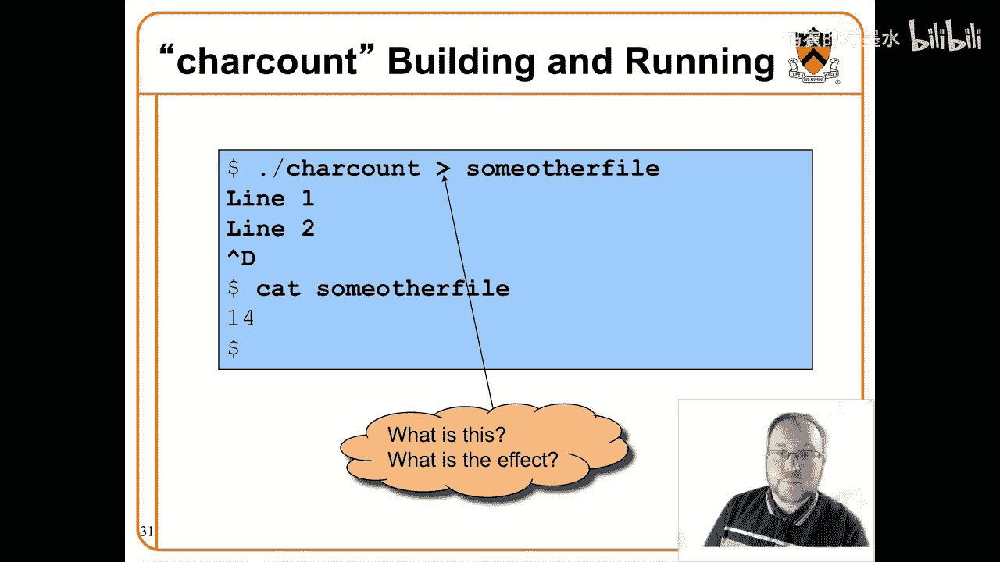

So for illustration now let's perform each step individually。

 we said that the build process was more complicated and there was this shortcut that would perform all the steps。

 let's look at each step one by one。Note this is as required for assignment one。

 and I'm moving quickly here， but you'll get an overview of these stages。

 but you'll also see them in more detail in precept。The second precept this week。

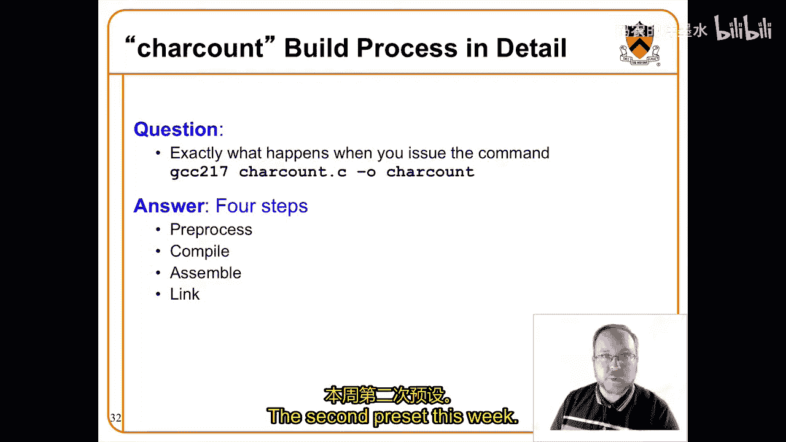

All right， so we start with the initial program we saw before written in C there's no indication whatsoever of what get Char and printfR The grammar makes it so we know their functions。

 that's literally all we know。We don't know if they're used correctly。 We don't know what they do。

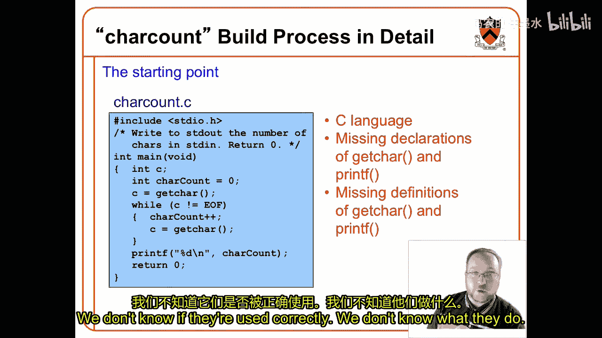

So the first stage of our four stages of building is the preprocesor。

 It's in vote with minus capital E， which nobody ever remembers。

 but I like to think of as E for extra stuff。That's because the pre processorcessor puts some extra stuff into your source code。

And by convention， it produces a file with a dot I subject and dot I suffix。

 so you can remember that as having done the pound includess。Because what it does。

 it removes some comments and it handles the preprocessor directs these in the RKS pound includess。

Let's look at that。The preprocessor first removes comments from the source。

 they're of no use to the compiler only to a human reader， and so they can be discarded。Insantly。

 if you haven't looked yet， this job is the crux of assignment 1。Next。

 the preprocessor handles preprocessor directives， these are lines beginning with the pound sign。

We'll see several of these throughout the term， but again， here's our first pound include。

 which indicates an interface that the program relies on。

The way the pound include gets handled by the preprocessor is to replace that one line with the entire contents of the file STDo。

h， plus some metadata markup。Note that this new content is really an information dumped to the compiler。

 telling it the details of a whole bunch of symbols like functions and constants that are available in some other interface。

After the pound include additions， the preprocessor next does a scan to replace all the macros。

 which here are used for symbolic constants。With the values。

 they replace it with the values they represent so EOF here is actually a macro defined in SDDIo。

h and it gets replaced to be minus1。All right， so this is what we have in the dotI file。

 it's still the C language， approximately there's some markup there。

And we can also see another use of why we're using an int is get chas return。

 There's no character -1 on our system chas are unsigned and the smallest value then is 0。

 If we were to give -1， it would overflow， it would go from0 back to the highest possible char value。

 and thus it wouldn't be unambiguous， if we put a char there， we would say， well。

 do we mean the highest value cha or do we mean negative one， it wouldn't be clear。

That's why we use an int。We can also see how the pound include worked out。

 these line at the top are declarations， their messages to the compiler about the existence somewhere of a symbol。

Think of this asHey compiler， get CR as a function， it takes no as and returns an int。

This allows the compiler to then eventually type check and make sure that it's used correctly。

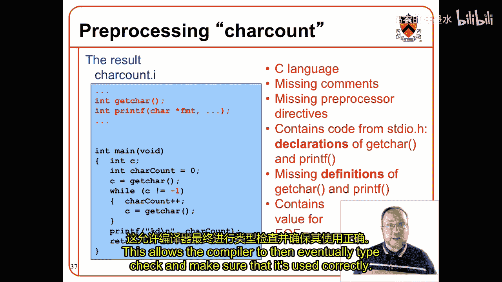

So we said the compiler that's the second step in the build process。

 compilation compilation is a translation from C to assembly language。

The invocation is with minus S and my mnemonic for that is primarily just the fact that we actually will write assembly language in this course and put a dot S suffix for it。

 but you can also think of S as syncing to a lower level language。

 it's our first lower level descent。

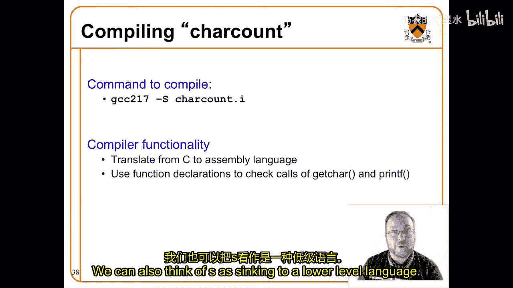

So these three declarations。Sorry， these two declarations are remember the love notes from the preprocessor to the compiler telling it that get Char and printf for a thing。

And that means the compiler can verify that any calls to them type check correctly。

The compiler then translates progressively。It starts off and says， can I generate assembly code？

Indicating the definition of me。Inside the block， a here compound statement。

 the compiler will generate assembly language code to allocate space for variables。

 and then instructions for completing the rest of the block。Note that unlike in Java in C89。

 declarations must appear at the top of a block， not within the body of the block after some other code。

This is also where the compiler uses the declarations to complete the type checks because it sees a call to get CharR and it sees a call to printf。

 and so it can check and make sure that the calls have the same type it was expecting from the declaration。

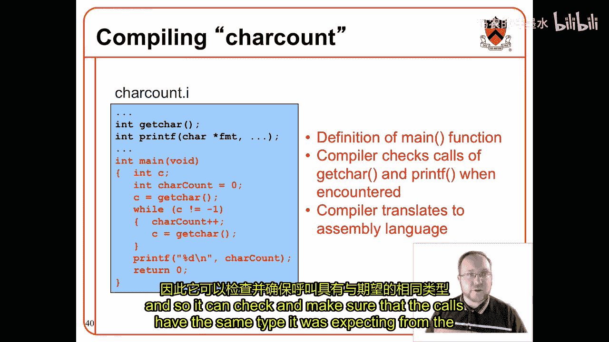

All right， so the compiler is just a type checker and a syntax checker of C code that then translates from C to assembly。

Note that at this point， the get Charharm printf are still just symbols that we've been told are functions。

 but we still don't have their actual code。

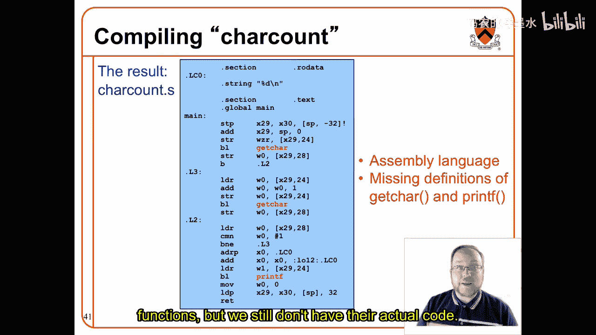

After the compiler comes the asmbler， the assembler is just another translator。

 this time to translate from assembly language to machine language。

 note that it's a common terminology trip up to think the assemblymbler must generate assembly。

 but that's not the case， the assembler takes assembly and generates machine code。

If you've been enjoying as opposed to groaning at my weird mnemonics for the GCC options。

 this time I like minus C for can't read that anymore。

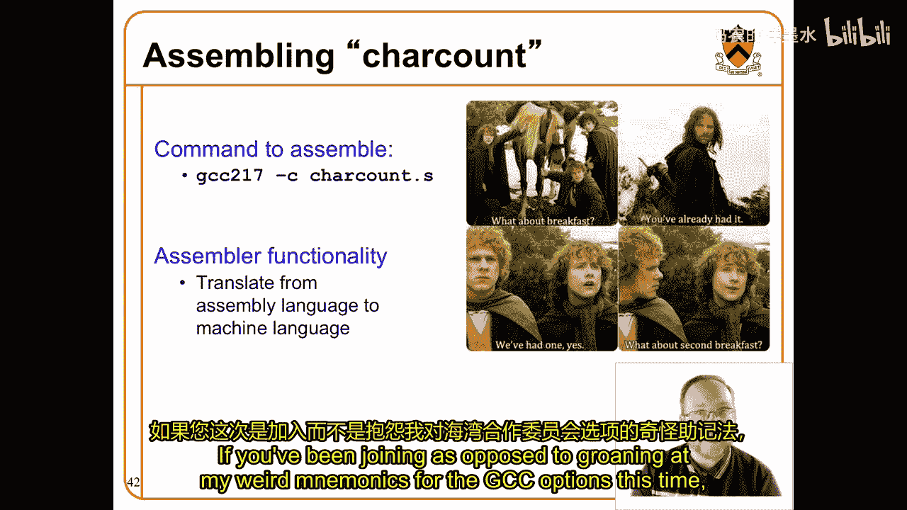

Because indeed at this point we have machine language which is just a bunch of binary。

 we can't read it anymore， although stay tuned by the end of the course we will in fact learn to interpret some small set of machine language and their instructions bit by bit。

嗯。And so here we have just a bunch of binary and yet still at this point。

 we still have no idea where getcharhar and printntf are。

 we just have the machine language code to call them， we don't have their code itself。

We better find them soon because this was step three of the four step build process。So finally。

 the fourth tool in the build process is the linker， the linker's job is again， finally。

 to go and find the as of yet unresolved machine code referenced in the program。In this case。

 both Getcha and printntf exist in the standard I standard library。

 which on our system is shoved with all the other standard libraries into an archive file living in slash user/Li。

So it will go and find the correct code from that library archive and slur it into the final program。

After the linker runs， we have everything we need， we have a complete executable program。

That's the build process and for the first several assignments we're going to ask that you complete each one of these steps separately so that you get a sense of what all is going on under the hood when you just magically type GCC27。

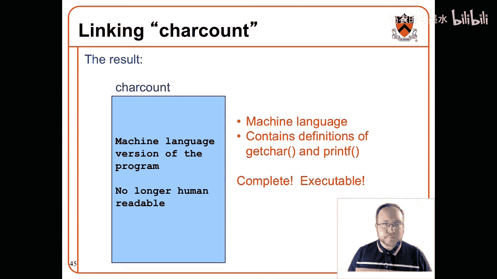

Before we move on to the second of our small programs。

 pause the video and take a moment to consider if there's a better way to structure the body of our chart count program Note that D here is the existing code just with weird pagination so I can fit my face in the corner。

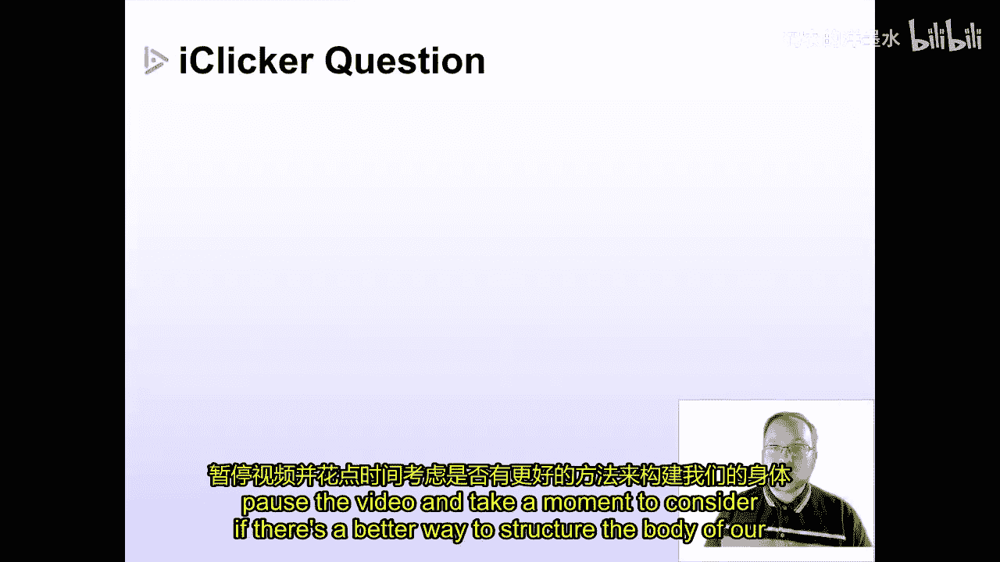

Pause the video， see if you like one over the others。

So this is a judgment call looking at each of the options A and D have get in two different places that's a little bit weird C has an infinite loop and a break statement。

 some teachers， especially high school teachers go crazy of no you must never use break there are better ways to structure a program and B has this cryptic assignment statement inside a loop condition。

B is in fact， the most idiomatic C。Albeit， some people might say it's most idiosyncratic C or the most unreadable C。

I do tend to like be best Next I would choose D just because I tend to dislike four loops where you don't have a mathematical expression for how many times the loop will execute。

 but really all of this is judgment and personal style。

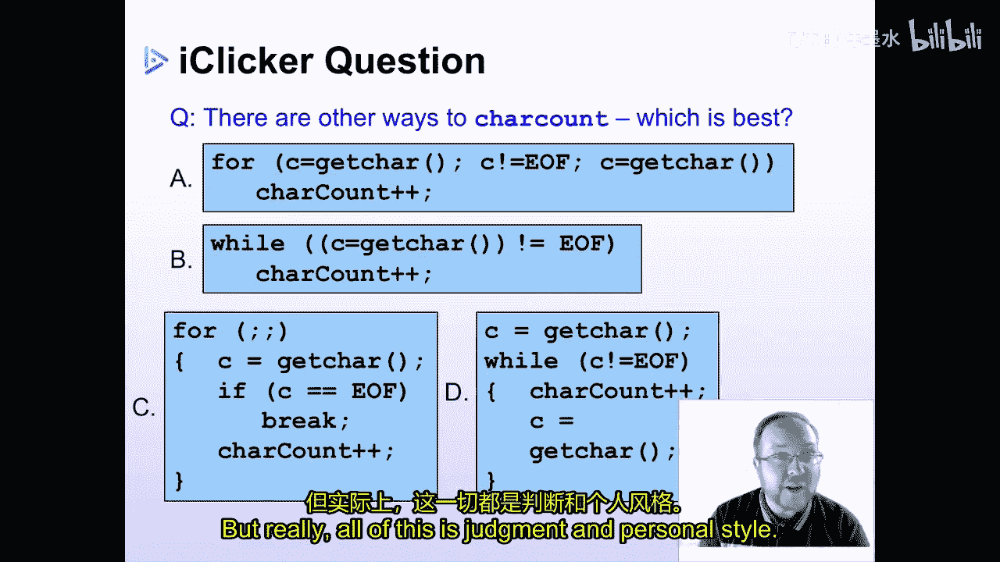

All right， our second program is going to be one that uppercase all of its input。

 maybe we could call this Shoify。

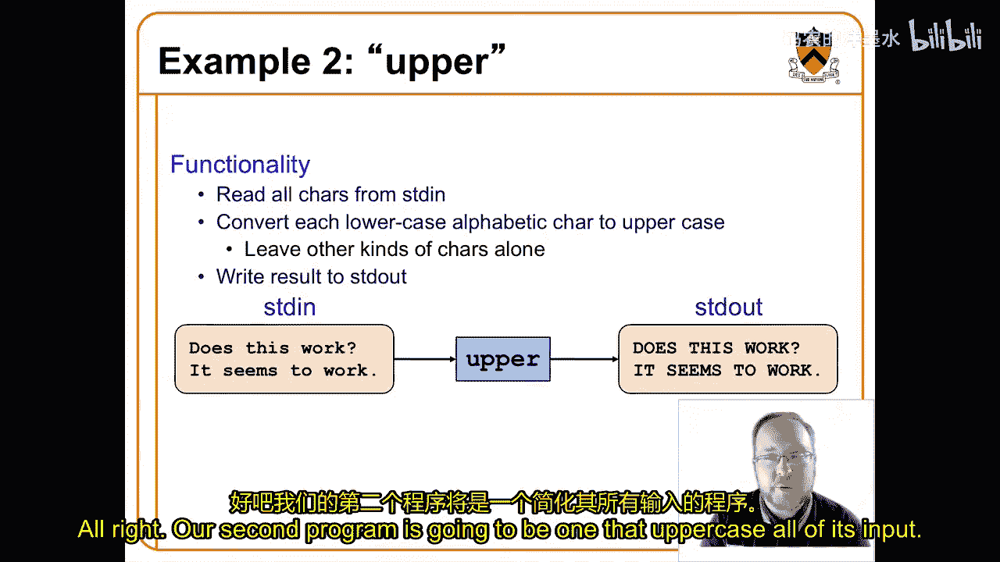

To compose the program， you must know how to identify lower case characters。

That motivates a discussion of how characters are stored Each character is stored actually is an integer。

 just a really small integer， and the computer system character code maps each character to a unique integer。

Our system uses ASCI for Onebyte characters， which is generally a good assumption on most modern computers。

 but is in fact not the only option。So take a look at this first version of the program。

We declare our in to C again an int because we're storing the result of getchar into it。

 we have the cryptic。Idiiosyncratic， idiomatic， take your favorite word for it。

 while loop with the assignment statement。And then we have an if statement with 97 and 122 and 32 all built in。

Something should jump off the page from from 126 what you've learned。

 And that is that magic numbers are hard to read and interpret Worse。

 these magic numbers are ASci codes。 So not only are they hard to read and interpret。

 they also present a problem for portability。 Askci is pervasive， but it's not ubiquitous。

This wouldn't work， for example， on a system that uses another encoding， Epssic。

 or other things like that because the values are hard coded。

The algorithm itself wouldn't work for any encoding where the lower and upper cases aren't 32 characters apart。

 and there's no reason they necessarily need to be。

 so that's a pretty strong assumption by the algorithm。

So we can get around these magic numbers by using character literals。

 which like in Java are indicated in single quotes with some special characters indicated by escape sequences starting with backslash。

So here's our second version， it uses character literals。

 and it's better than the previous version because it doesn't assume EI。It does， however。

 do this weird thing where it does arithmetic and chas。In C。

 I said a char literal is identical to a char variable， it's just a number， a very small int。

So on ASI， a lowercase A is identical to 97， thus we can subtract things from it。

 we can do greater than or equal to with it and that's totally okay。

Instantly on on the other system I mentioned， Eodic， the luricus A is 129， again。

 showing that we can't just assume the values themselves。

 but we do get around in both of these by using the charrard literals。

So arithmetic on charge is totally okay。But what's wrong now？Well。

 it still has the other problem I mentioned， it assumes that the numeric codes of uppercase letters are at some constant offset relative to numeric codes of the lowercase。

Okay， it doesn't have to be 32 here。 That's better。

 But what's to say that they're a constant offset at all。It assumes that they're contiguous。

 which isn't true for Eodic， and it's really getting complicated fast if we wanted to make a general purpose here。

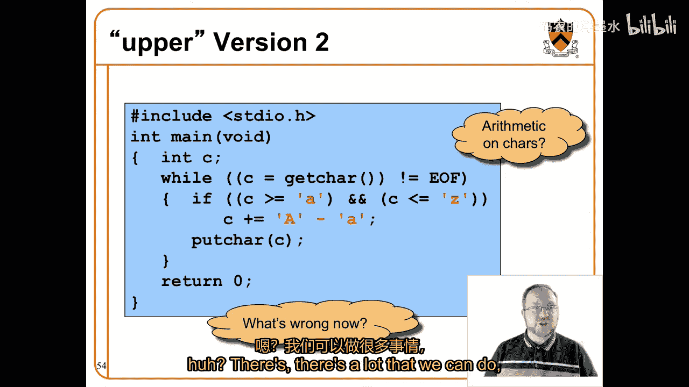

， there's a lot that we can do， there's got to be a better way。And there is a better way。

 he look aend page。There's a library for that the library here is C type。

h and the advantage is that you know the standard library has been configured for the machine you're running up。

Along with the is functions that were on the previous slide to identify whether a character is a member of a class。

 we have the two functions to perform a transformation on the character。

So if we're trying to shoutify， the natural thing we want to do here would be to pair is lower with two upper。

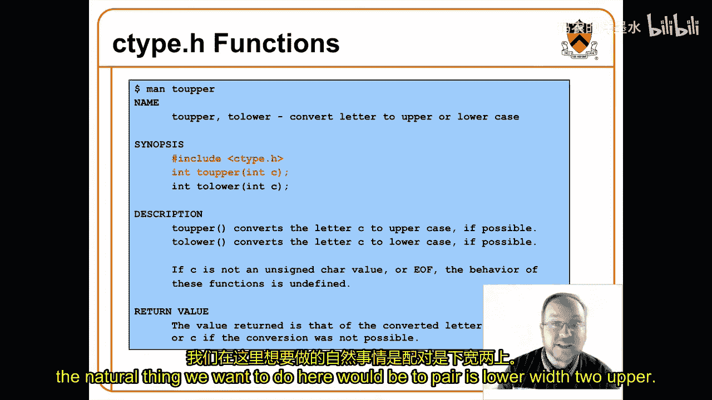

So here's what that turns out to be。A quick refresher of the previous program。

 what would happen if we emitted the pound include of C type dotage？Pause the video， answer it。

 say it out loud， commit yourself， and then restart。If we omit the pound include of C typed at H。

The compiler will generate a warning when it encounters the call of is lowerer and2 upper because it says。

 I've never been told these things exist， so I can't type check them。

It's not going to generate an error， though， because they might actually be findable by the linker。

 In this case， they're from a standard library， the linker can go and find them。

 and so the build will succeed without error。But we do want to have this pound include so that the compiler can if find earlier if we've made a typing mistake and also because generally printing out lots of warnings seems unseemly。

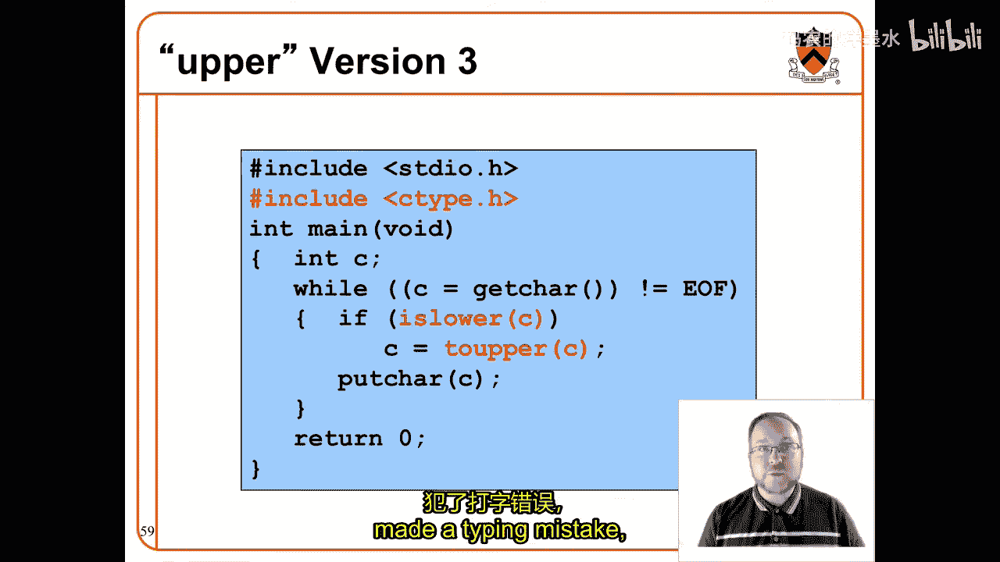

All right， one more brain teaser for this code， but I'll spoil it immediately。

 so is the if statement really necessary？The correct answer to this question is I don't know。

 let me go look up the Men page。

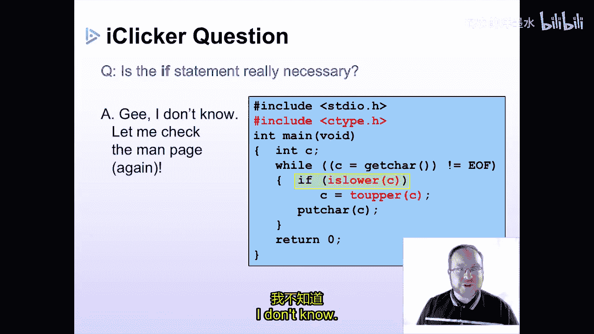

So over here on the man page for to upper， the return values section says that two upper doesn't change a character that isn't lowercase。

 so now let's come back to the full question。

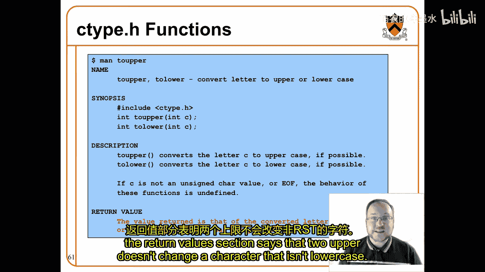

Is the if statement really necessary？Pause the video and decide for yourself whether this is necessary for correctness。

 not necessary， but you'd leave it or not necessary and you'd get rid。So from the man page。

 it's not A， it's not necessary because if it's not a lowercase character。

 too upper isn't going to do anything to it anyway。So A is not the correct answer。 B versus C。

 as we're seeing， is a trend here， is a judgment call。 B is arguably less mysterious。

 C is potentially faster since there's one fewer function call and one fewer conditional branch per loop。

But really up to you， I'd probably choose B just because just to upperring everything now you're relying on someone reading your code to go and read the man page and as much as I'm pushing read the man page。

 read the man page， read the man page， I know you're not going to read the man page so we can put it in the code at the cost of just a few cycles。

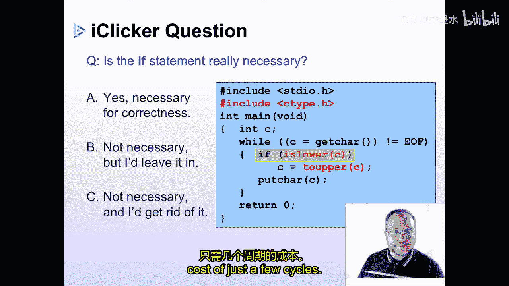

Allright， finally， let's look at a third program， which will give you a sample of pretty much every C language component that you'll need for assignment1 and even better the overarching design of your program。

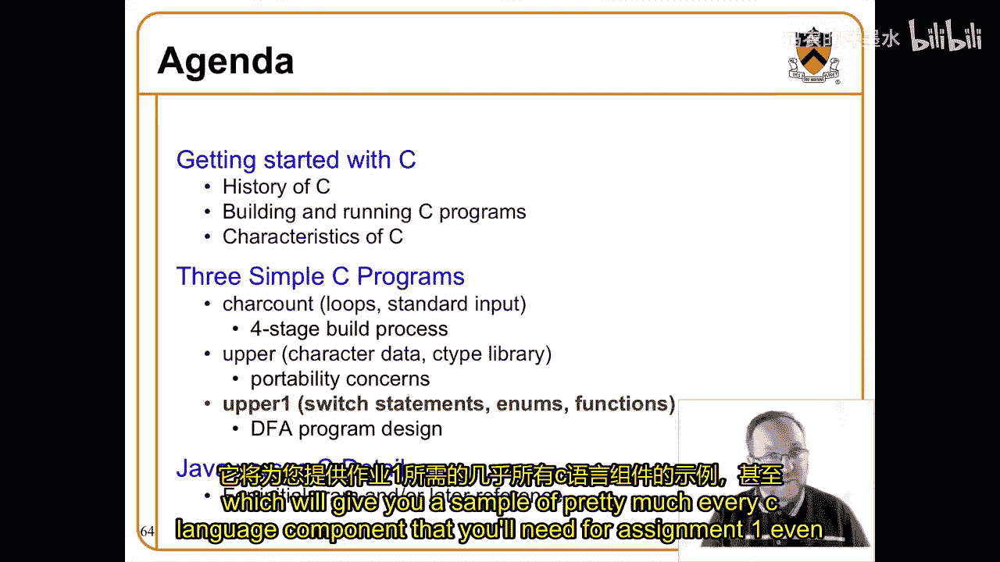

Our third program will be to capitalize each word rather than each letter。

 let's define a word for simplicity as a series of characters delimited by white space that's a fuzzy approximation of English language usage without no pun intendedtended language lawyering about what exactly is a word versus not。

All right， so to design this program， we're going to need to decide for each letter。

 whether we should capitalize it or not， choosing to do so only when it's at the beginning of each work。

This sounds like a Co 126 exam problem to figure out a regular expression for what letters need to be capitalized。

But if it's a regular expression， then well， we can build a DFA。 Thanks， Stephen Kleney。

 class of 34 Gr。

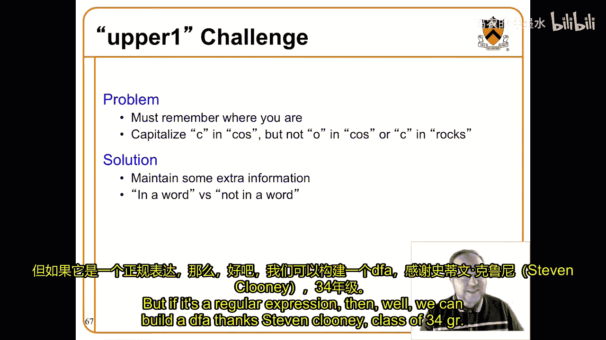

All right， a quick refresher from 126， a deterministic finite automaton is a computational machine that processes a string in order。

 only considering each letter in the string once by transitioning between states with each subsequent letter of the string。

In 126 and in assignment 1， each state will have a status that indicates whether it's an accept or success state or a reject or failure state。

And that that applies only if the machine halts in that state。

 it's not that when you reach and accept state once， hey， it's successful， no。

 every state will be either accept or reject and it only matters when the machine halts。All right。

 so for this problem though we don't really have a success or failure criterion we're just completing the action for each character。

 so we won't label any of the states as either accept or reject。Allright。

 so thinking about an algorithm using this DFA， we start over there in normal so long as it isn't an alphabetic character。

 we haven't started a word so we're just going to print it out once we hit an alphabetic character that's the beginning of a word。

 so now we need to uppercase it， but from now on we're inside a word so we should transition to the other state and in that state each character that's an alphabetic character we're just going to print it unmodified。

Eventually in that other state we're going to read in a non alphabebetic character in which case we say。

 aha， that's the end of a word， so let's transition back over into the normal state。

 we'll print out the non alphabetic character， and now we're in the normal state waiting for our next word to begin。

So we continue this until the we run out of input。 That's the general algorithm。

 Let's see how this shakes out in code。

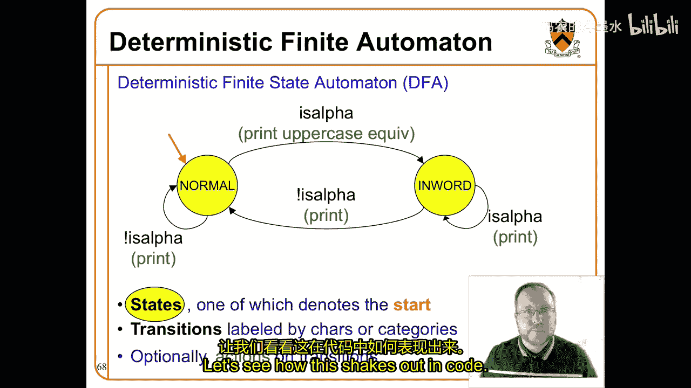

Here's the first crack at a coded up version of the DFA using an int to represent the state。

Because of this design choice， I see a whole bunch of zeros and ones and no real sense of which either means。

 I mean， I know I used to have normal and in word。 Well， which is which。

I could go back and look and say okay， which was the default state， the default。

 the start state was normal， so zero is the default here of the initial value of state。

 so zero must be normal。But really， there's a better way。 We can do better。

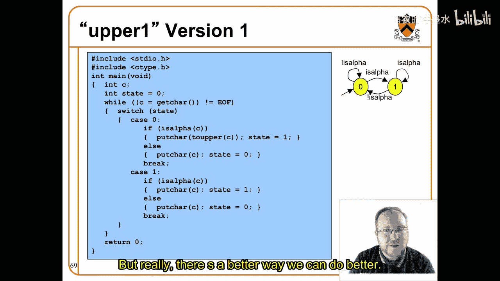

We should aim to fit the program to the well specified and clear original DFA。

 which did use those semanically meaningful names like inward。

And we can do so in C with an enumeration type。An enumeration type or just an enum allows you to specify your own named integer constantsts。

 either explicitly or since we don't actually care what the values are here。

 873 and 4126 are just as good as0 and1 for our purposes。We could do it implicitly。

On this slide we actually have it implicit， but actually conveniently enough。

 when not defined explicitly C will start at zero and advance by one more than the previous a new member each time。

 so this code will give us0 and one， just like the hard coded version did。

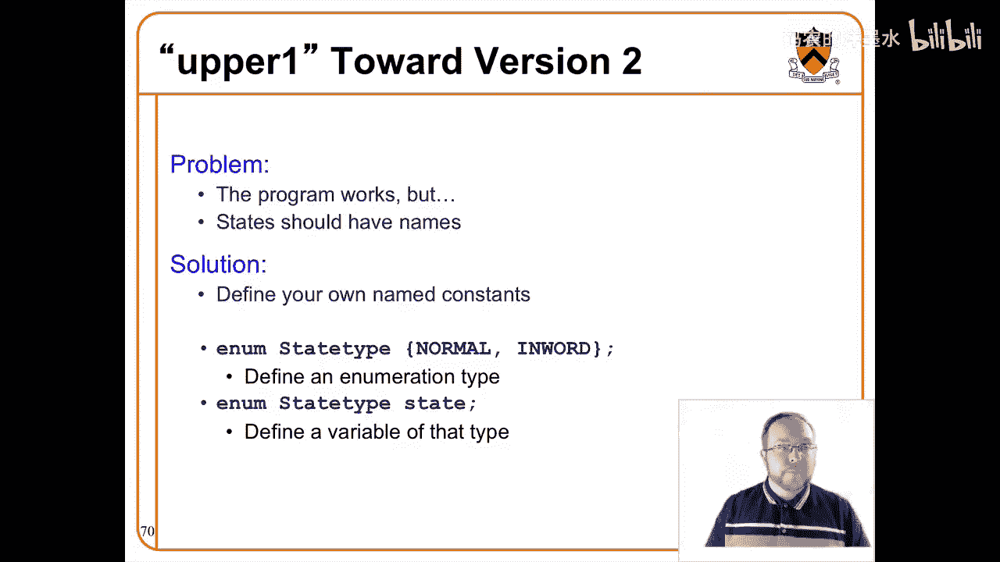

All right， so here's our program in nuummified to remove the magic numbers。It's better。

But there's still a problem here。What's wrong？Feel free to pause the video and see if you can identify something that's not so great about。

About this code？So this is getting pretty deeply nested。

 we're going farther and farther over to the right side。

Perhaps it's not the end of the world for this two state case where each state only has a single if else。

 but what if there were more complicated logic to handle in each case and what if the number of cases exploded。

The cases here represent the different states than the DFA。

That switch would get awful really fast since there's no modularity。

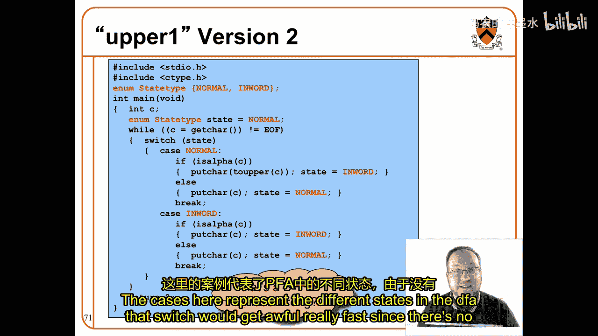

The solution to no modularity is， and I know this will shock you， modularity。In this case。

 if we're concerned that sufficiently complex logic to handle any one state will become a problem。

 we can push all that actual logic into one function per state and make the switch statement just a minimal framework。

 it just says which function should I call， call it。

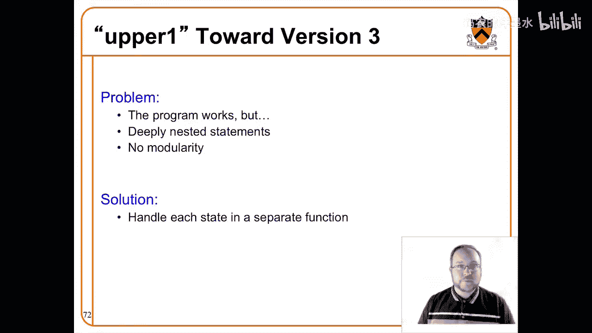

Let's take a take a look at what that looks like Our code is getting longer here as we the modularity has some overhead of extra functions to define。

 but that's okay Line of code do not mean that the program is worse。

Our main now has that minimal code in each switch case。

 a call to the function that does the actions associated with the current state and the input character。

And then it takes the function return and sets the new state and then a break that isolates the cases。

This is pretty good。But if I handed it to you on an exam。

 how long would it take for you to figure out what it does。

 I'm sure it'll read better if it had comments describing the different pieces。

So let's call this the a minus admittedmitly this is nitpic since we've been omitting comments this entire time from our examples just to fit it on the slides。

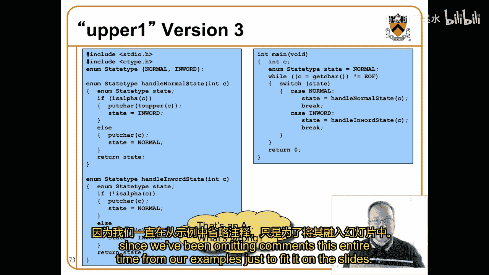

But it won't be nitpicking on your assignment code， I promise。All right， oversold or not。

 this does serve as a convenient segue to talk about our internal documentation requirements。

 that is， what comment should you put in your code？

So function comments should describe the behavior of the code from the caller's perspective。

What does a color pass it， what does the function do， and what does it give back to the color？

These comments are the ones that would be appropriate for an API and thus shouldn't reveal the function's implementation details。

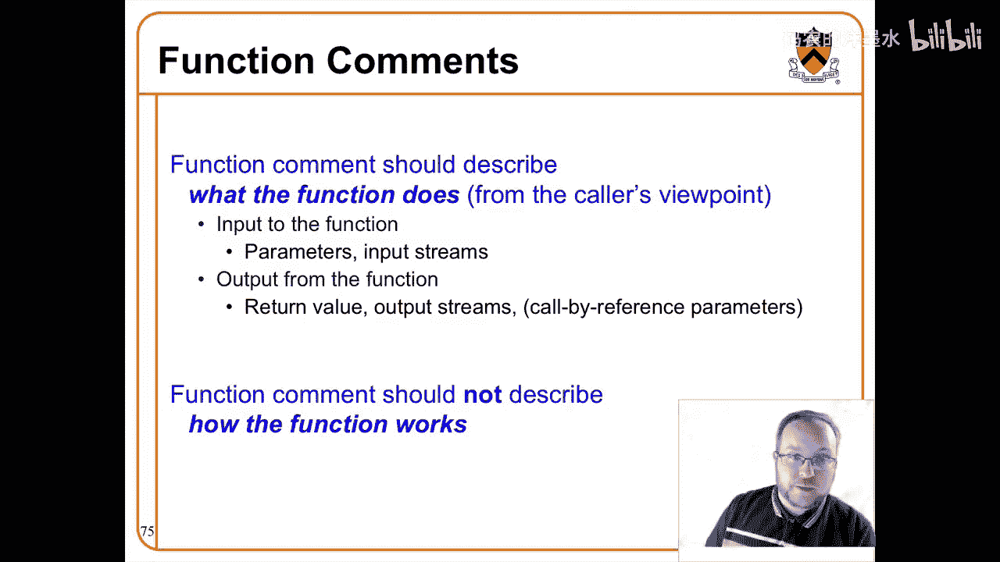

Here's an example for you to chew on for a second， feel free again to pause the video so you can read the two comments in fall。

The first gets too far into the weeds about interaction with the other functions that the color doesn't even need know about。

 as well as the internal design of that function。 It's barely one step short of saying this function uses a while loop。

The latter， on the other hand， lists only the pertinent information。

 what global state the function affects the standard input and output streams。

 what the function commute computes from its parameters and input， and what value it returns。

 This is exactly what a color of the function needs to know。

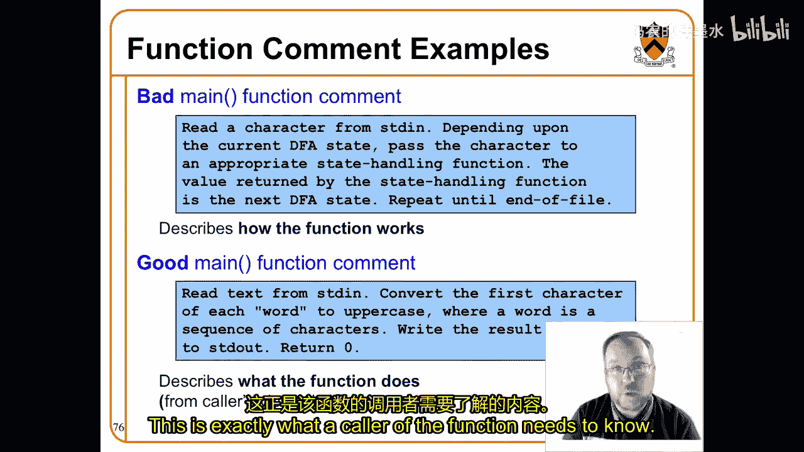

The next four slides are a complete version of the program having fixed the suite of issues from previous versions Once you've written your DFA for assignment1。

 you can use this code as a great jumping off point for implementing the DFA structure in C code。

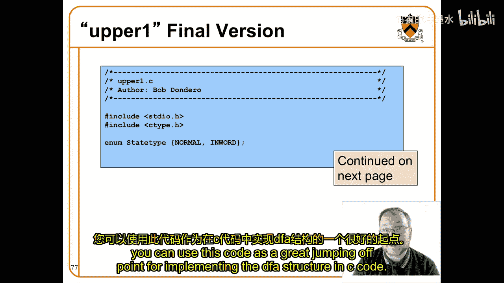

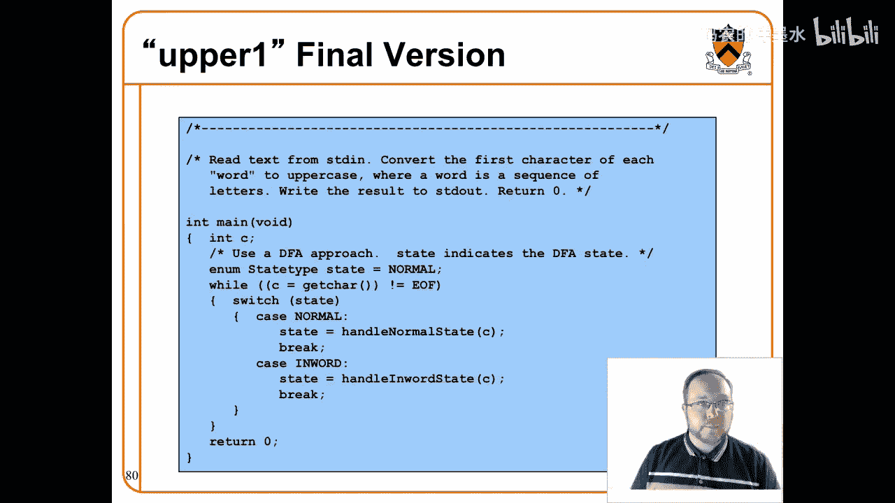

All right， so I promise that you'll get a long way in A1 by designing your program to mimic the final version of upper one。

 just expanding it for a more complicated DFA that you'll need in assignment one。

So I leave you by encouraging you start assignment one soon。

 it's due Thursday the 17th that's a week and a half away。

 but you now have everything you need in order to complete that assignment。

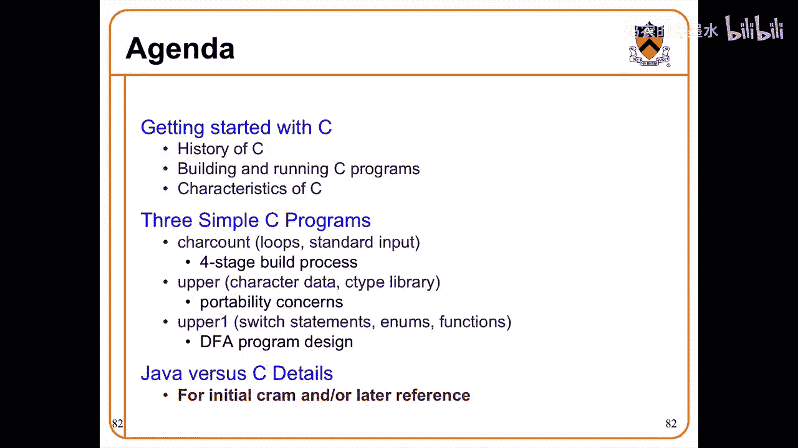