# 【全集 秋季版】普林斯顿大学 C语言系统编程 中英字幕 p06 Lecture 6 - C速成课 -BV1u1feBoEsK_p6-

Welcome back to the Co 217 lecture。 This is the first in a series of lectures that when put together。

 make up a sort of crash course in the sea language。

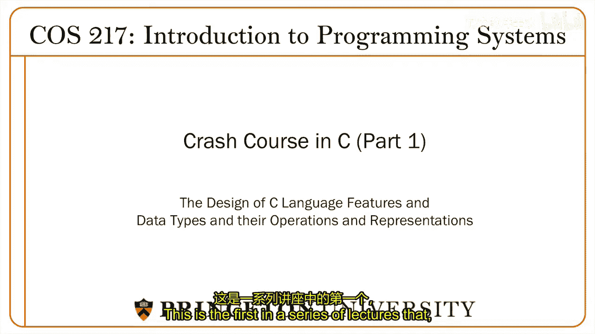

This set of lectures is intended to give you a deeper coverage of the C programming language than just the series of tables contrasting which Java that you saw before。

Some of this will， by necessity， be just a litany of language details。

 but I also want to come at this from at least a little bit of a conceptual point of view about the design decisions that the language designers made。

And the implications those decisions had on the language， as it turned out。

The corresponding precepts to these lectures will match the goal of giving a thorough coverage of the C language。

 but will tend to take on a more code driven point of view。

 how do you write programs in the language？Let's talk about the features of the core of the C language。

 declarations assignments control statements， IO and basic types。

 and their operators and representations。All of these things are what you might think of as a crash course to be able to cope in a language that you're coming to deal with。

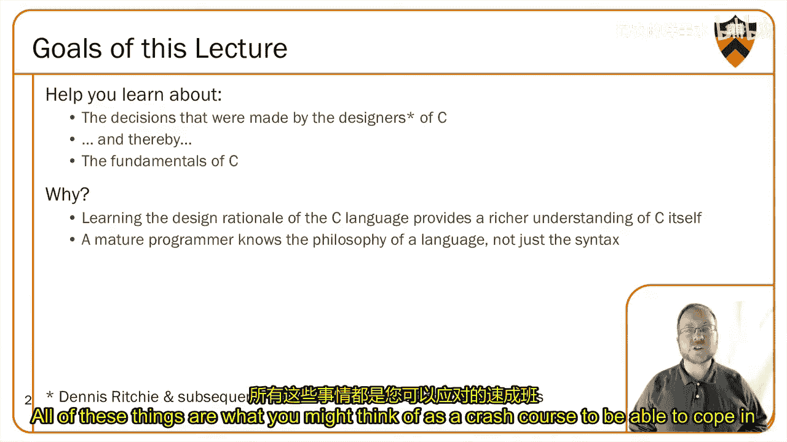

So recall from last lecture that the iconic quotation from the language's inventor about C's success and also some of the core ideas about the design of C。

Designers wanted to support systems programming， but also application programming。

 and to some extent these goals are conflicting。The designers wanted C to be low level to take advantage of the hardware and work closely with the assembly of machine language。

 but also be portable to a very large extent， these goals are conflict。

Designers wanted C to be easy for people to handle， but also easy for computers to handle。

These goals share the premise of being small and simple， but in production， these goals are， in fact。

 conflicting。 Often code that is easy for a computer to parse is difficult for a person to understand and vice versa。

The designers of sea faced conflicting goals on multiple dimensions。

 They had to make compromises and tough choices。 So in light of those goals。

 let's consider what designs did the， the inventors of the language have to make and what decisions did they make。

For each large language design issue， I'll editorialize a little bit on the process and or the results of what ended up in the language or not。

But please don't think that this is really a critique of the designers。

 I'm not half the computer scientist that Dennis Ritchie was， On the other hand。

 I do have K years' experience with the language， which Dennis Ritchie， by definition had none。

 So theres some learned experience from other experts in the language and from my own troubles with the language。

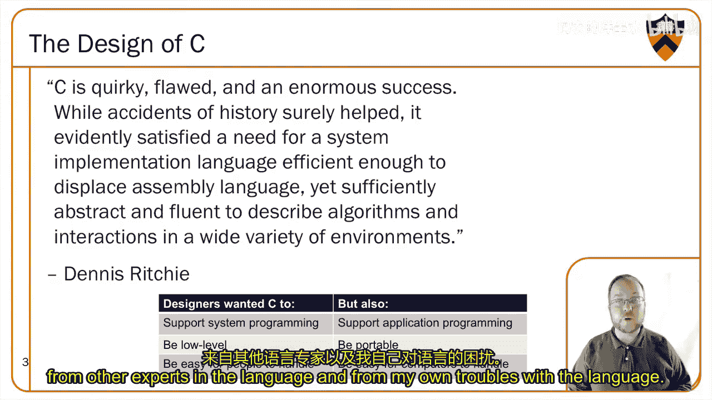

So let's kick things off by talking about a pretty fundamental concept in the language， variables。

There are languages in which you needn't declare your variables before using them。In A and Bsh。

 for example， a program can reference the value of a variable that's never been seen before without generating an error。

In both cases， the value is the empty string， although OC has this weird feature where the same variable can be either a string or a number depending on its context。

 so it can also have the value0。That aside， the downside to to declaring a variable is pretty obvious。

 You have to remember to declare it before using it and failing to do so results in an error。

Furthermore， if a language decides that you must decide your variables type at declaration time。

 this puts an additional burden on the programmer to think ahead not just that the variable will exist。

 but how it will be used。And perhaps ignoringly， the compiler will actually hold them to this。

On the other hand， there are distinct benefits as well。

When the existence and type of a variable must be made explicit in the code。

 it makes the compiler's job easier。 It can catch typos。

 observe type mismatches between the declaration and the initialization or operations or on that variable。

And it can potentially plan the allocation of memory for variables more efficiently at compile time than an interpreter or runtime system would be able to do as the program is executing。

So C does in fact， require variables to be declared before use。

 and it requires types to be designated for the variables at the time they are declared。

C provides a statement called the declarationlaration to do this。

 and beyond just a simple declaration， it also allows multiple declarations in the same statement and initialization at the time of declaration。

😊，This seems obvious， particularly for the majority of you who are coming from Java as your first language。

 but this is actually a design decision that had to be made。

 and again it's not the case for all languages。One thing to note about declarations of local variables in C。

 if not given an initialization explicitly， using the variable before assigning it a value is legal。

 but the value is undefined。Contrast this with Java where use before assignment generates a compile time error。

 it doesn't in。So I tend to avoid declaring multiple variables on the same statement for broadly three justifications。

 Number one ease of documentation。 If I want to write comments about what I'm going to do with each of these variables。

 having multiple ones on the same line makes the comment sort of tricky to write numberumb two ease of change。

 it's easy to kill off an entire line or to move it around。

 it's harder to do more precise surgery on part of， but not the entirety of a line。

And the third is perhaps the most inside baseball of it。

 there's a potential for ambiguity in pointer types。

 and we'll discuss this when we get to covering pointers later。

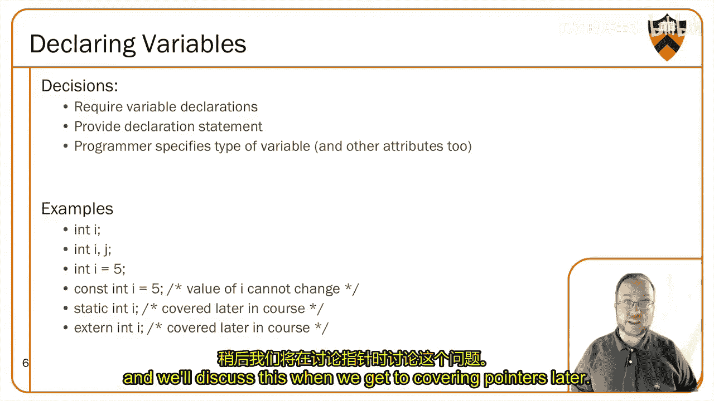

So another decision is that， unlike in Java。In C90。

 we have to declare all of our variables up at the top of any given block before any other statements in the compound statement。

 the block。So at one time this made it easier for compilers to make code more efficient at runtime。

 memory allocation of local variables deals with stack pointers under the hood。

 we'll see this at the end of the course， and several in a row can be bunched together in a fewer number of instructions to do all of the data manipulation at once。

It's also perhaps useful for seeing all of the variables you're going to use as a reader of your code。

But frankly， there's no absolute logical reason to require this。

 C++ Java and even just the next version of C99 all eliminate this constraint。

It may make the code less efficient at runtime if we have paths where some variables are not used。

 a compiler might choose to allocate them only within the paths that they are used。

 whereas if we declare them all at the top of the block。

 they're there whether they are used on a path or not。Also， for a user， it's sometimes inconvenient。

 particularly for larger blocks of code to go back and find it。

 although IDE features can help a bit here。So this is。An annoyance， perhaps。

 but I don't think it's a killer one。

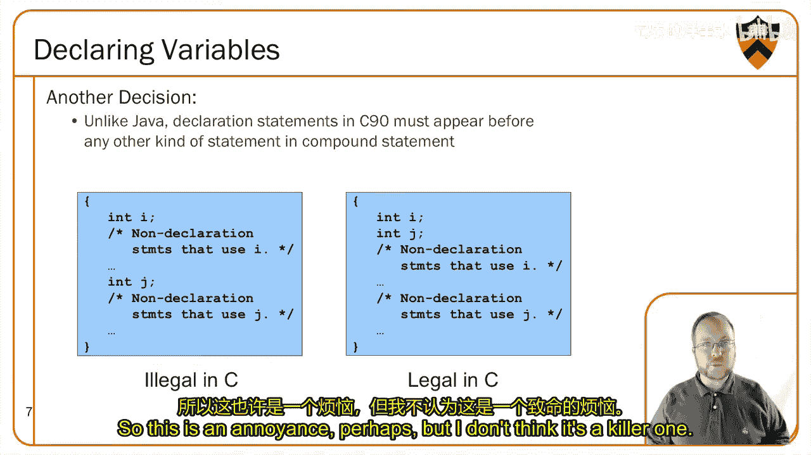

So what about assignment？Once variables are declared。

 we need to give them rules sorry we need to give them values。

One way to do this is with an initialization at Declaration time， as we saw a couple of slides ago。

But more generally， we needed the language feature for variable assignment。Also。

 it could be more than just a statement， it could be an operator。

 that is it could emit a value after it completes the assignment。Not all languages do this in Python。

 for example， assignment is not an operator。For an operator， then， if it does emit a value。

 there are two obvious choices for what value it should emit The previous value。

 This would allow us to swap in a single line with something like I gets J gets I。

J gets I would set J and emit the old value of J。 And then I would get that。

 And then the new value would allow us to do chain assignment。

 something like W gets X gets Y gets Z gets1。C chose to use equal for assignment。

 essentially because its predecessor did the same， though oddly its predecessor， B， B's predecessor。

 BPL did not。 It used colon equal， which is the other common option among many languages today。

So C chose to use equalqu and this is potentially problematic of the question of assignment versus equality。

 which is a routine question across any programming language design。

C also chose to have the variable on the left side of the equal and the value expression on the right。

 this is the overwhelming convention across languages， but there are some exceptions。

 those of you who programmed your graph and calculator in high school used either TI basicic or Cassio basicsic both of which do expression arrow value so the expression is on the left in the values on the right the variables on the right。

But yes， C chose to do it， the more conventional way of the variables on the left。

 the value that's being assigned into that variable is on the right。And then finally。

 C chose to make assignment an operator emitttting the new value of the variable， not the old。

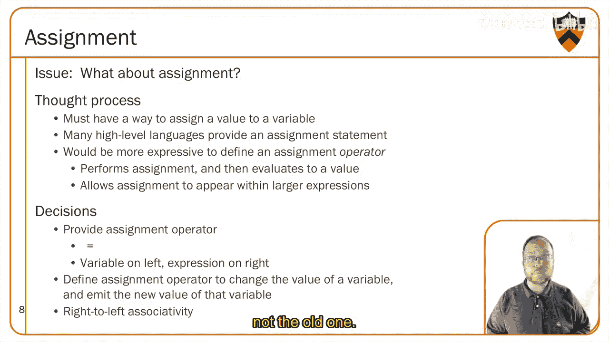

So here are three examples the first one。Because the。This looks exactly like Java。

 this will look similar to you， it will look familiar。

 but it actually makes me think about this in a way that I hadn't before operators jobs are to return or evaluate their results。

So this question of oting a value now that it was decided in the affirmative is indeed the Snequ nonan of assignment。

The actual change of a value in memory is just a side effect that that towards turns the idea of assignment on its head from how I normally think of it。

So because the operator emits a value and because it's a right to left associative。

 we can do the second example here， we can do chained assignment， I becomes zero and zero is emitted。

 J becomes that emitted value zero， and zero is emitted again。

 but this time it's just emitted into the ether unused。

And then the third one is the example we saw in the last lecture of doing both an assignment and the check of the new value after the assignment。

 and technically we now know it's a check of not so much the new value。

 but rather the value emitted by the assignment。So I have mixed feelings on this for C novices。

 the succinctness of using a value that was just assigned to a variable is probably an adverse effect on the code clarity。

But for experts who are familiar with this code pattern， it actually makes it more clear。

 it's fewer lines of code， it's very obvious that the value you're using is in fact the one that was assigned and not some change that has happened in the meantime。

 this particularly comes about when you talk start talking about advanced systems with threading and things like that where。

Once a value is set， there's no guarantee that it won't change。All right。

We'll see a few more assignment operators， the augmented assignment operators when we get to the types that they apply to。

 these are things like I++， so stay tuned for the next lecture because the implications of assignment as an operator become even weirder in that case。

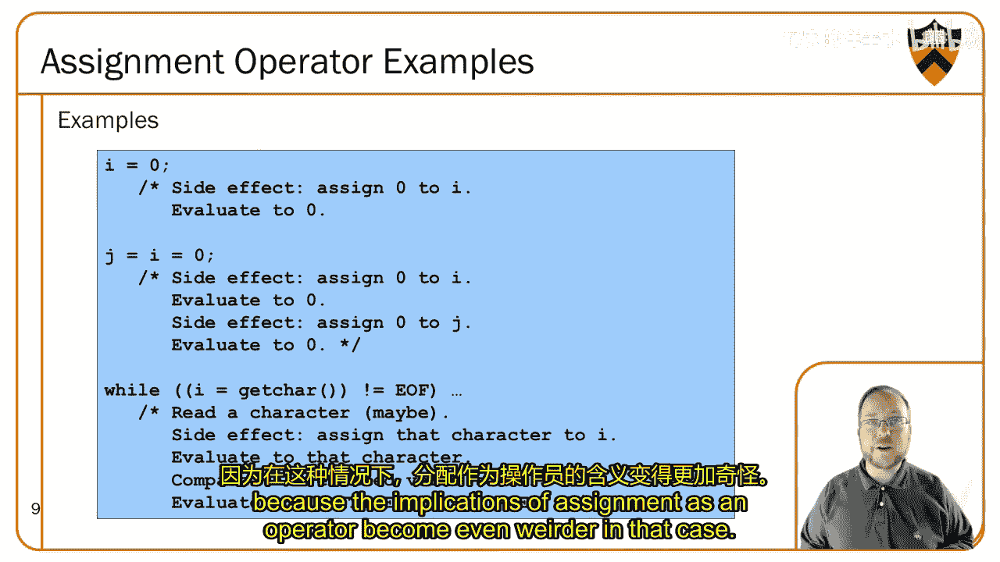

Al right， so now we have variables as our language feature facilitating data。 Now。

 let's look at some language features facilitating algorithms。

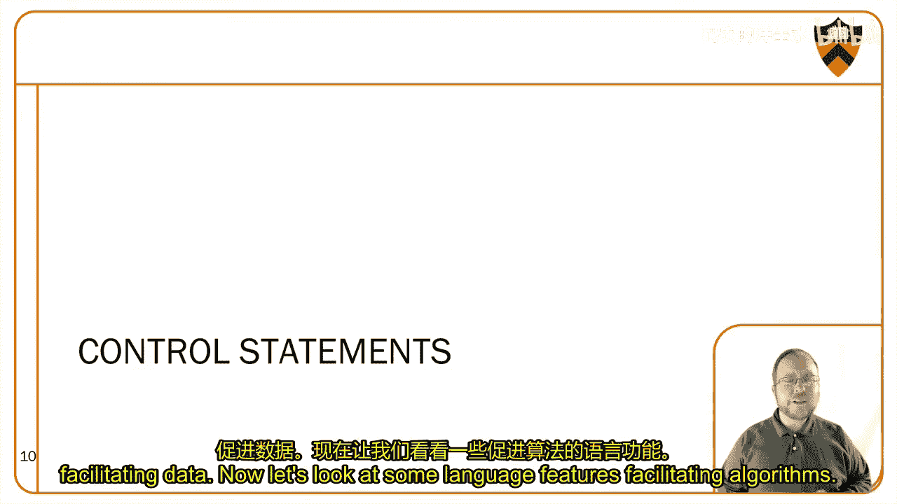

In machine language and associated assembly languages， there are instructions for control statements。

 things like conditionals and branches。 The code on the left is an assembly language like pseudocode for an algorithm to sum the numbers from one to n。

It should look familiar to you for those who took 126 it's very similar to toy。

Early high level languages really weren't much higher level than this。

 they were still exemplified by jumping around within your code very explicitly as the only way to do program control。

So here we had a loop， and it's just a label。 We had to do a go to。 We had to jump there。

 no different than the go to or the branch in the assembly language。

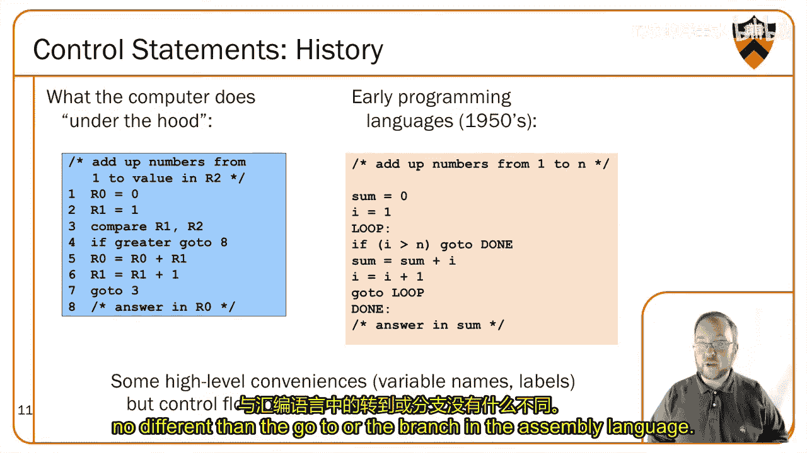

But then in the next decade， languages started to take on a truer sense of being high level。 Algal。

 for instance， had constructs that look very similar to us to this day， If then else。

 while loops and forlos， for example。嗯。Crado Brm and Gie Yakiinni proved that there's a very small set of building blocks。

 which is sufficient for any algorithm。And that small set is ordering sequential operations。

 conditional selection of operations， and conditional repetition of operations。

So the BM and Jokiinni proof in 1966 was revolutionary， it wasn't at all practical。

 we couldn't do program transformation， we couldn't do automated expansion。

 there was nothing about it that was immediately evident that would changed programming languages。

 but the result itself was groundbreaking enough to open up an entire new area and inspire a generation of programming languages research。

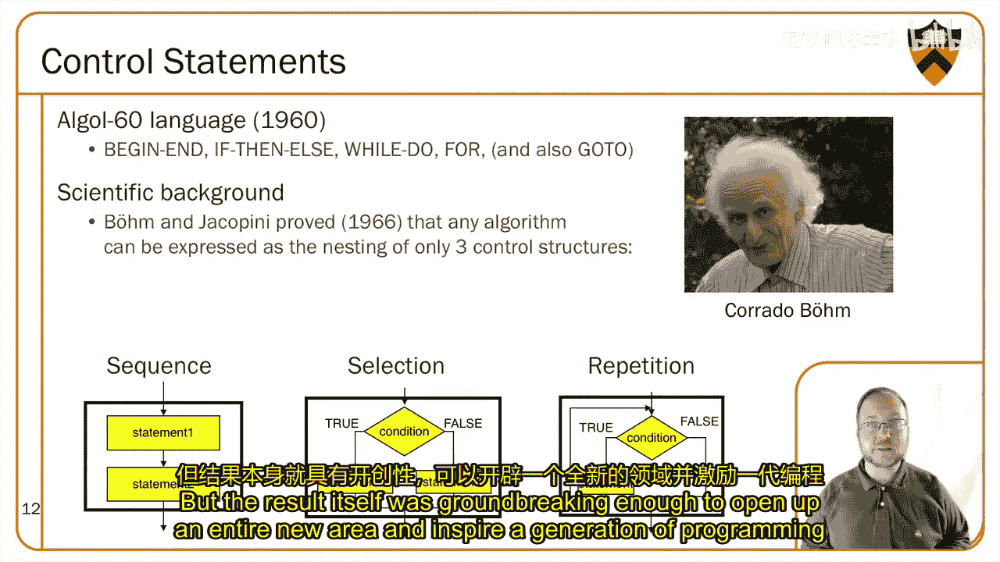

So another famous computer scientist that perhaps you know， from 126 or 226。

 Exger Dextro wanted an even higher level of abstraction， in particular。

 taking aim at the lower level idea of jumping around within your code explicitly。

 he advocated that you should use only those control structures that are the building blocks from the proof。

 not just， oh， you could use these， but no you should only use these。Incidentally。

 this paper was also spurred dozens of other papers with snow clone titles riffing on considered harmful。

 including an opposite take go to considered harmful， considered harmful。

So C does basically what Al had on the previous slide with just a bit of trim down syntax。

 basically curly braces instead of words such as begin and end and then in the beginning of the consequent and do in a while loop for example。

 and also C actually doesn't follow Dextrous advice， there is a go to statement in C。

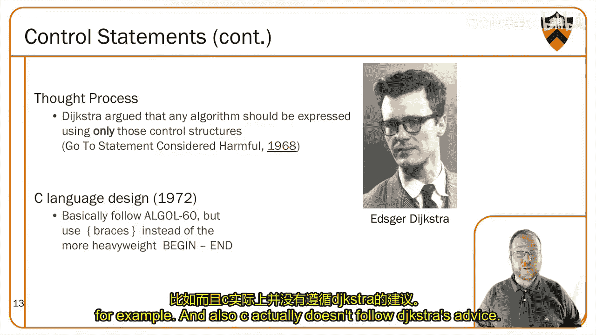

So let's look at C。C's language feature corresponding to the sequence building block is the compound statement。

 Aka， the block。It's adopted by C from Algal。In Algo， it was a major advance。

 which seems super weird now。But by the time of C was already a mainstream programming language feature。

 and the trim down syntax， as mentioned on the last slide， makes it look more familiar to us。

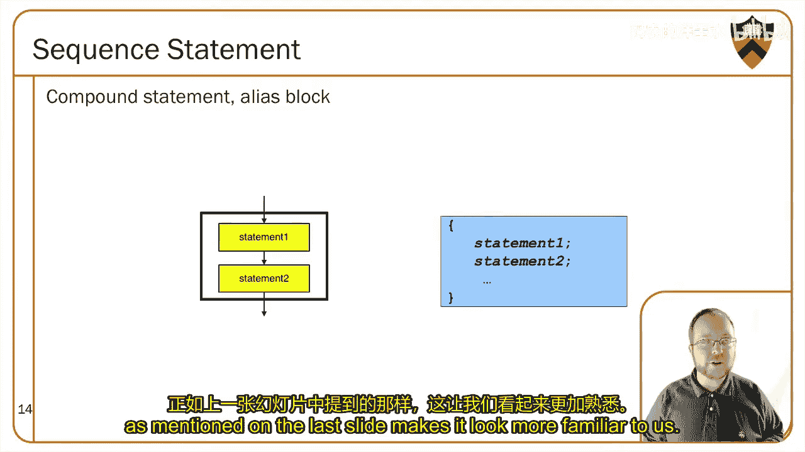

Corresponding to the selection building block is the conditional statement that if and if F statements in C。

Note that each of statement one in statement 2 can itself be a compound statement that is a block enclosed in curly braces。

 Some programmers find it good practice to always put the brackets。

 even for a single noncompund statement as the consequent or the alternative。

 Others find this to be too verse。 I don't have a strong opinion on it one way or the other。

 And frankly， this is the more genteel of the disagreements in the space。

 I'm not even going to touch whether the。Curly Brace。

 should go on the same line as the if or the else or on the next line， that's an absolute holy。

So C's design's choice here is that the condition is an arbitrary expression。This is unlike Java。

 Java requires that it be a Boolean expression， it must evaluate to a Boolean type。

And we'll see examples in the next couple of lectures of some bugaboos resulting from this design。

 so keep this in mind that the expression here is an arbitrary expression in the conditional。

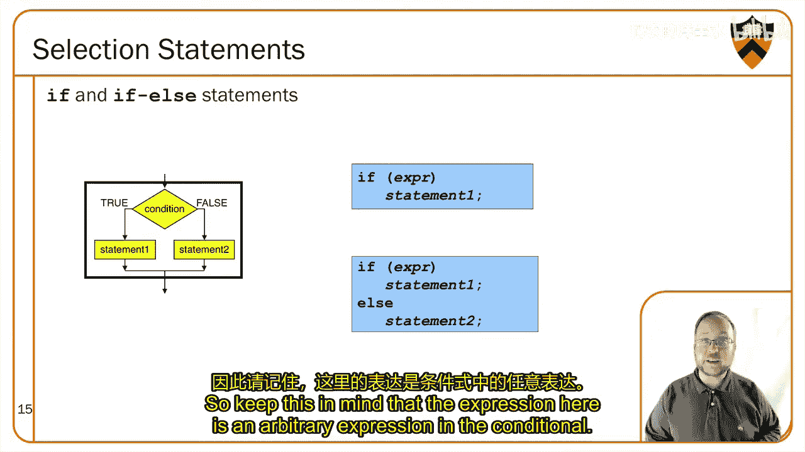

C actually offers another construct for implementing the selection building block switch statements are totally equivalent to a chain of if El's。

 but perhaps are easier to see at the top level what the discrete set of possible values that it contains。

嗯。This is again， very similar to Java， but I'm not sure that 126 uses a switch statement at all。

 so here is an example of a switch statement。Note that the break here is not obligatory。

 you can leave it out， but it changes the meaning of the program。🤢，If you forget a break statement。

 control flows from the selected case clause into the subsequent case clauses。

 this is called fall through。Until eventually a break statement occurs or the end of the switch statement is encountered。

So。The design of the brake statement within this switch， was it good or bad？It provides flexibility。

 you can take advantage of that fall through。But you can also avoid it with the brake。

 So it does maximize flexibility， but it is super error prone。

 I absolutely promise that you'll get this wrong at some point in this course。

 either forgetting to write one or assuming one is there when it's not。

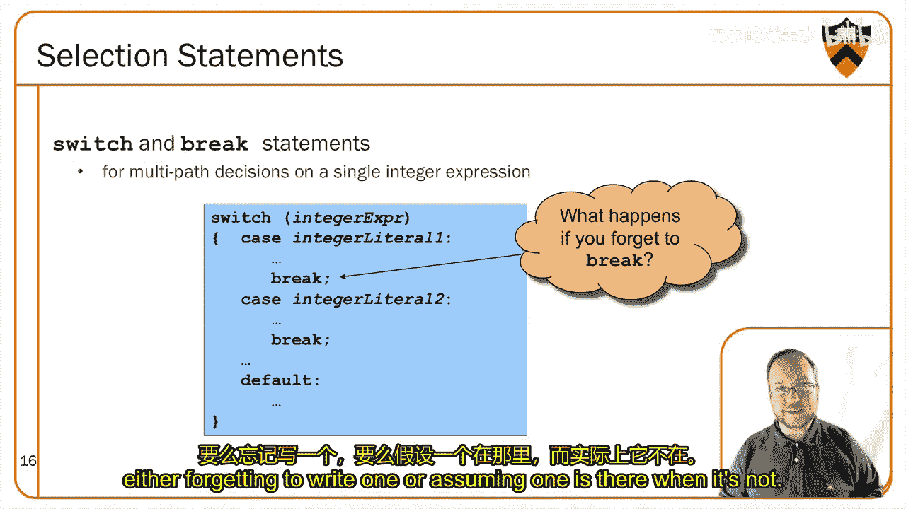

So be on the lookout for that。Repetition statements are the last building block here and C has several looping constructs there are a few variations these are likely all familiar to you because Java uses the exact same set and syntax Java has one additional one for each loop that does not exist in C。

So a for loop， it isn't necessary， a while loop would be sufficient， but it is handy。

 especially for counting loops， and I normally use it for this。

 I normally do while loops when we're going until a condition is satisfied。

 unknown how many times versus a for loop when I have an algebraic expression for how many times we will go through the loop。

 even if we don't know a priori how many times that actually will be。The while loop。

 I don't have a whole lot to say about that。 It is the the。

C expression is pretty much just the building luck exactly。The do while is， again。

 it's not necessary we could do everything with a while loop。Personally。

 I think a lot of times it's hard for humans to parse， it's sometimes difficult to set up correctly。

 and it has a syntactic gotcha and it has to have the trailing semicolon。

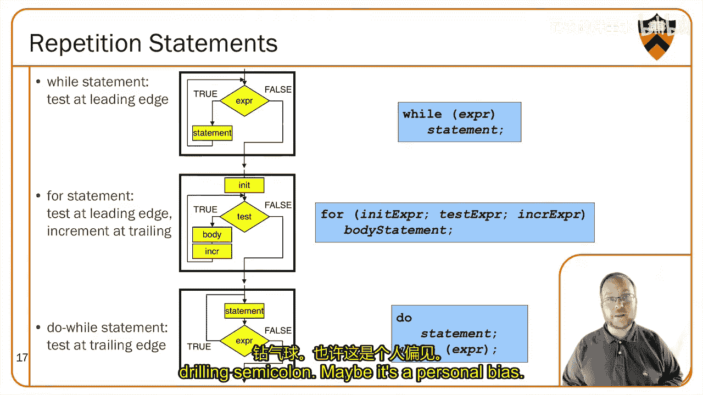

Maybe it's a personal bias。 i tend to avoid it。All right。

 So now that we've seen a few design decisions， we start to see them cascading into each other。

 In this case， that rule about declarations being at the top of a block impacts the syntactically valid variance of a loop。

We can't have a for loop that has the idiom4 in equals0 iLS than dot dot dot。

That's not legal because。The for loop， the for loop signature line。Is not itself a block。

 And so the int eye doesn't belong there。 We can't declare it because it's not at the top of a block。

This constraint does make the language more pure， but it's one that often frustrates new C89 programmers even more so than the general illegality of declaring variables mid block。

 and I think it is because of this nature to treat for anti equal zero， blah， blah， blah as an idiom。

Maybe it's my bias perspective because see I think of as my native language or maybe it's Stockholm syndrome that's totally a possibility。

 but I'd call this a minor inconvenience， I don't think it's worth going to the Mad over and I think we can all deal with having four loops not declare their looping variables inside。

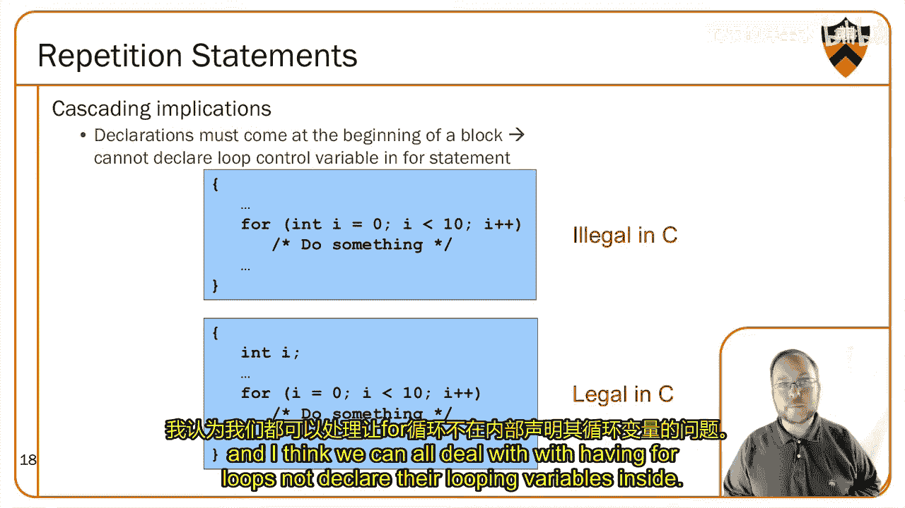

Al right， so three C does provide three more control statements， two that are shared with Java。

 but one that's absent with Java。So the brake statement。

 for whatever reason many intro programming teachers are particularly didactic when it comes to break and think that it should be used approximately never outside of a switch statement。

 personally I think it's a fine loop structure， it can make loops simpler and in a particular special case in the body can be more elaborate and better documented than the same check sitting in the middle of the conditional the loopis thin and conditional at the top of the loop。

Note that unlike in Java there's no label break， frankly this only really comes in handy when you're trying to break out of multiplely nested loops so I think we can live without it I use a break routinely so didactic intro programming teachers can take their brief to me。

嗯。But perhaps I'm logically inconsistent because the next structure that continue I do tend to dislike in the same way that others dislike break。

I often see continue use and it jumps off the page at how the code could be refactored to avoid it。

 for example， into subordinate functions or with a slightly different twist in logic。

I also think it can be difficult to understand it's effectively different between whileL and for loops because of where the update step in the loop is。

 and it's one more set of details of minutia to remember， do I go back and do the update。

 do I go back and check the loop conditional again？I don't use it enough that those stay in my head。

 And so it's just one more bit of of of。Detail to look up that doesn't really solve me anything or gain me anything in programming。

So I do， I use it infrequently， but it's perfectly okay I'm not saying you can't use it in this course if you draw your bright line differently than I draw mine。

Again， like the break statement， unlike in Java， there's no such thing as a labeled continuenu。

 which again， it's probably okay， that's a niche feature even for continue being a relatively niche feature。

Finally， the third of the control statements is the goTo Dextra's opinion has carried the day historically。

 it is anathema in almost all cases for modern programming。But it does exist in C as far as 217 goes。

 you absolutely shouldn't use it in your code in this course。

 except for the one time when we make you to do that when you're translating to assembly language via a flatten C intermediary。

 but yeah， please don't use Go2s。

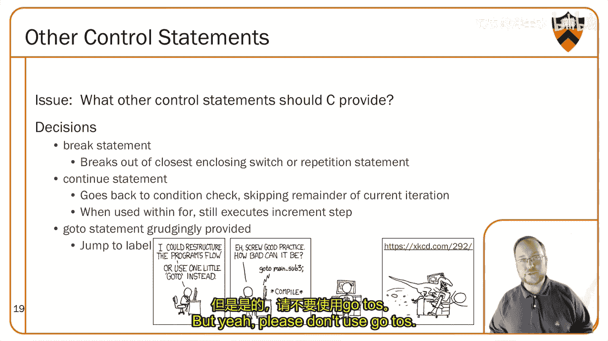

The last language feature that we'll discuss in this lecture is input output and the interface to that。

Really this isn't a language feature in C at all， the design decision made for the language is that C doesn't have IO inherent to the language。

 instead all IO is handled via library interfaces。There are low level mechanisms for writing to devices and files。

 these are handled through system calls using the standard PosX interface。

And then the expected behavior for programs is to do IO using the higher level standard input output library。

 which we've actually already seen in a previous lecture， it's the one with the interface file STDo。

h。So STDIioh defines EOF， it makes visible three default Io streams， standard input。

 standard output and standard error， these are similar to Java systemem system。in and system。

 erroror。And all three of them are by default bound to the terminal。

 so you type at standard input and standard output and standard error print to the screen。

The standard library also provides an interface for file IO。So thinking about it。

 what functions should an IO library provide， what interface should it export？Well。

 to read data into a program at the lowest level， it's really just about reading bytes。

 what those bitetes represent is irrelevant。But at the library level。

 it's important to be able to associate those bytes read in by the lower level operations with these high level language types。

 because it matters。 The number 217 is not the character 2。 Then the character 1。

 then the character 7， typed into the terminal。 But in fact。

 when you type 2 and then one and then 7 into the terminal。

 that may be an attempt to type the number 217。 So the Iio library has to recognize the relationship between the characters and interpret this this input is an integer and not three separate characters。

It could do this with a specialty function for every type。I want to get a short。

 I want to get an int。 I want to get it long。 I want to get a char。Or more scalably。

 it could provide one function that takes in a specification for what type it's looking for。

As a perimeter。C standard Library in fact， opted for the letter， it uses ScF。

 which takes as its first argument， a string that has a special format that indicates what type so number and type of variables are to be read。

We'll skip the details of this for now for two reasons number one。

 the format string is of Byzantine design I have to consult a man page literally half the time when I try to use it there's no reason to spend time on it here and number two。

 ScF makes use of pointers which we haven't covered yet so we'll put off discussing this until the third of the three crash course lectures。

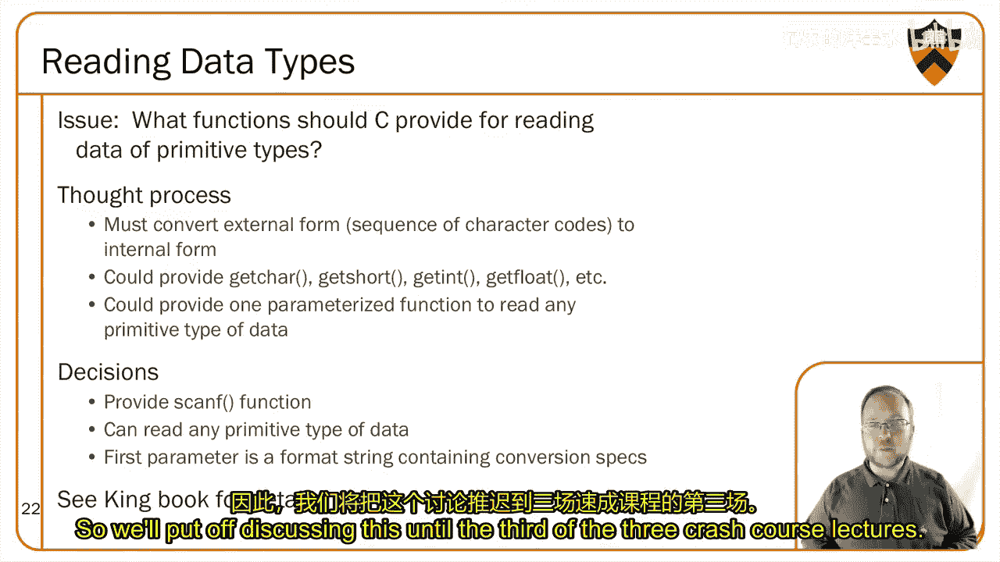

So that was arbitrary input instead of special case functions for every type。

 but characters are kind of special though， in that they're the smallest addressable amount of memory。

 they're one byte。It would seem that if we're going to make a special case for any type。

 characters would be the one。 And indeed， as you've already seen in the last lecture。

 that's what C's Standard Iio Library does。 Get your our reads in a character from standard input and returns that value。

 promoted to an int。 If it succeeds， otherwise， it returns negative1。

And just to drill it home one more time， because this concept is tricky and prone to cause errors in assignment 1。

 there is no such thing as the EOF character。 EO is a special non character value。

 negative one on our system that get our returns to indicate failure to read a character。

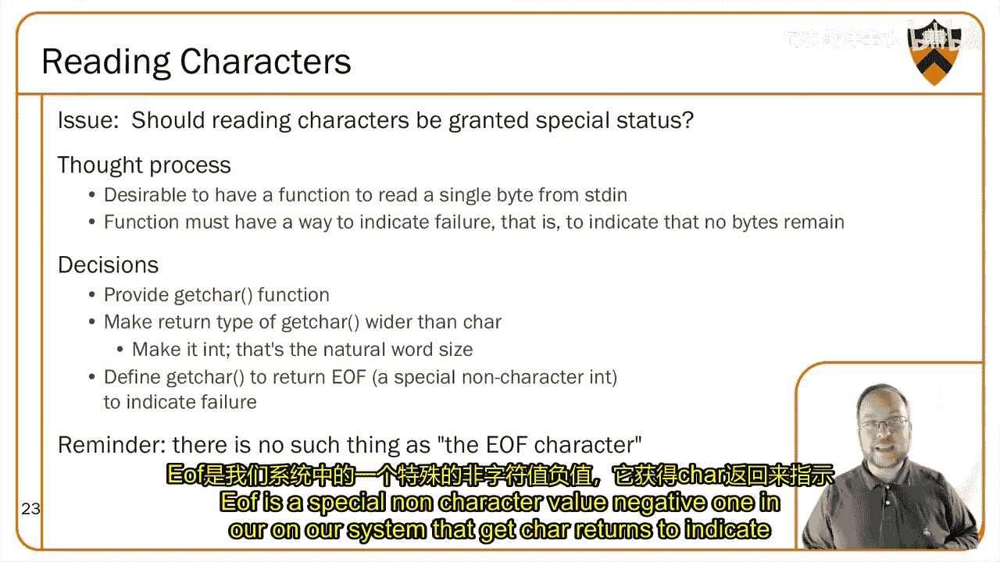

For writing， essentially the same thing that we've said about standard input can be said for standard output。

 the options are to provide one function per type or to provide a printing function that takes a specification for how the function should print its argument。

C standard Library opted for the letter using printntf。

 which again has this format string that is the same as in SkinF。And similarly to getchar。

 there's also a special case for writing one by of output to standard output， namely putchar。

 One oddity of putchar is that it takes an int as its argument。

 but this is really only for symmetry with gettchar。 gettchar we needed to return an int for putchar。

 The parameter value will be coerced into an unsigned cha， a byte for writing。

 And so we'll end up outputting some nonprinting character for EofF anyway。

So the library does provide lots more， it provides opening， closing。

 writing to and reading from files， most notably arbitrary file streams。

 and you'll use one of these F print F in assignment1。

 because you're required to write an error message to standard error if you detect an unterminated comment。

For help on any of these， you can look them up in the Kingbook or as always use the men pages。

So that's a big chunk of the syntax of the language。

 variable declaration and assignment and control flow statements。

 the other big chunk that we'll need to cover is data types and their associated operations。

But as we do that we'll also be looking at their representation in your programs memory。

 so before we dive into those we'll have a quick refresher about number systems。

 so stay tuned for that。

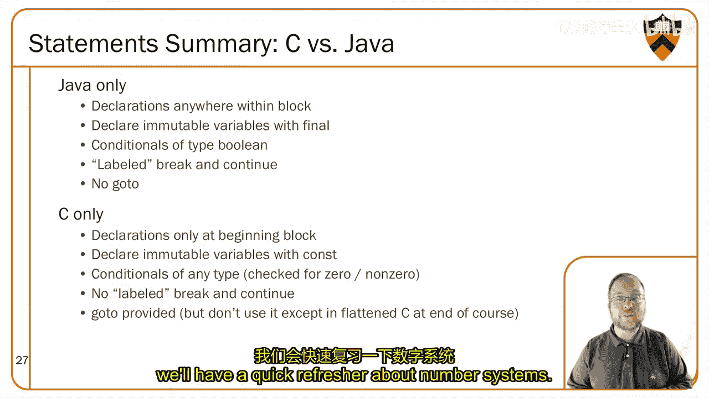