# C语言系统编程：第6讲：C语言速成课

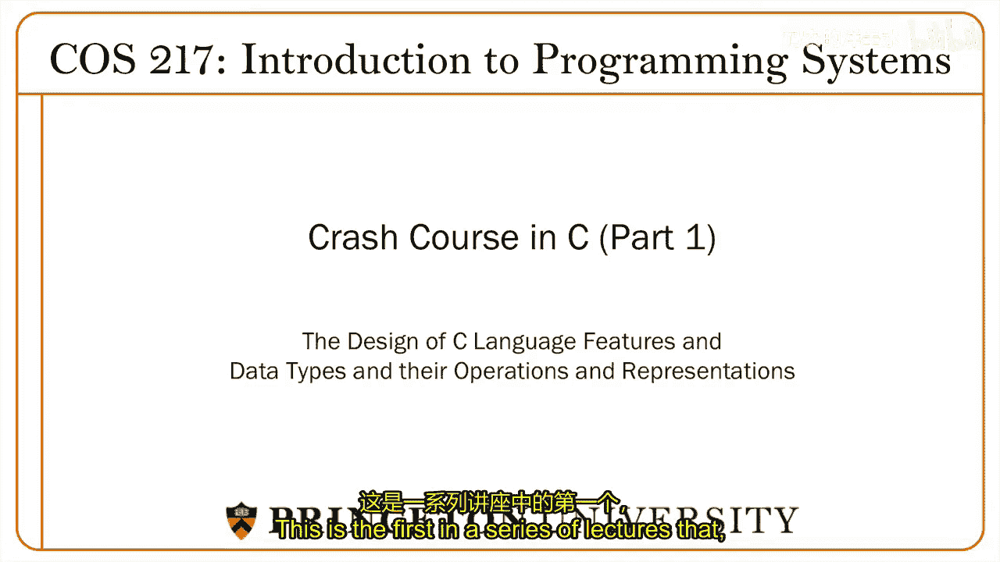

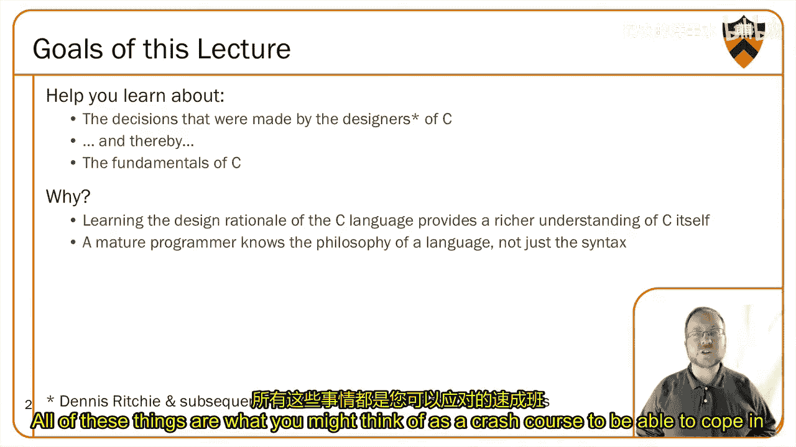

在本节课中，我们将深入学习C语言的核心概念，包括变量声明、赋值、控制语句以及输入输出。我们将探讨语言设计背后的决策，并理解这些决策如何影响C语言的特性。

## 变量声明

上一节我们介绍了课程概述，本节中我们来看看C语言中一个非常基础的概念：变量。

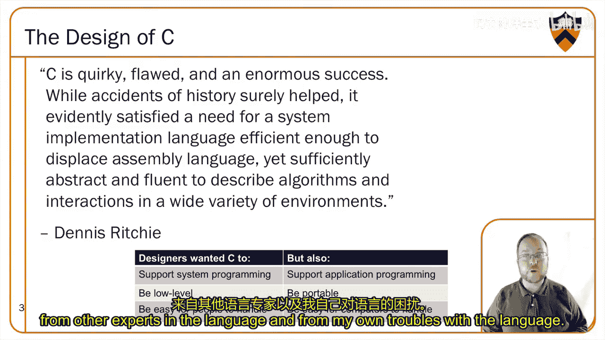

在C语言中，变量在使用前必须声明，并且必须在声明时指定其类型。这与某些语言（如Bash）不同，后者允许使用未声明的变量。C语言使用声明语句来完成这一任务，并且允许在同一语句中声明多个变量，或在声明时进行初始化。

以下是声明变量的基本语法：
```c
int i; // 声明一个整数变量
int j = 0; // 声明并初始化一个整数变量
int a, b, c; // 在同一语句中声明多个变量
```

C语言要求局部变量在复合语句（即代码块）的开头，在任何其他语句之前声明。这一规定源于早期编译器优化的需要，但现代标准（如C99）已放宽此限制。

## 赋值操作

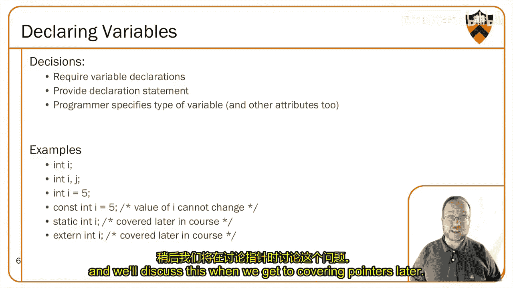

在声明变量后，我们需要为它们赋值。C语言中的赋值使用等号（`=`）操作符。与某些语言不同，C语言中的赋值是一个操作符，它会返回被赋值变量的新值，而不是旧值。

以下是赋值操作的几个例子：
```c
i = 5; // 简单赋值
j = i = 0; // 链式赋值，i和j都被赋值为0
while ((c = getchar()) != EOF) { // 在条件检查中进行赋值
    // 循环体
}
```

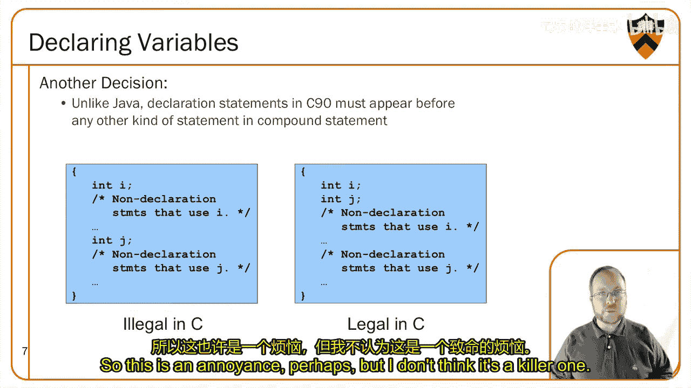

赋值操作符的返回值特性使得链式赋值和条件检查中的赋值成为可能，但这有时会影响代码的清晰度。

## 控制语句

现在我们已经了解了处理数据的语言特性，接下来让我们看看处理算法的语言特性。

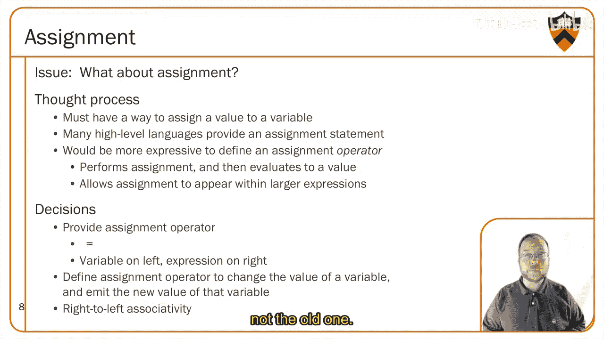

控制语句是编程语言中实现算法逻辑的基础。C语言提供了多种控制结构，包括条件语句和循环语句。

### 复合语句

复合语句，也称为代码块，是C语言中实现顺序操作的基本结构。它由一对花括号（`{}`）包围，可以包含多条语句。

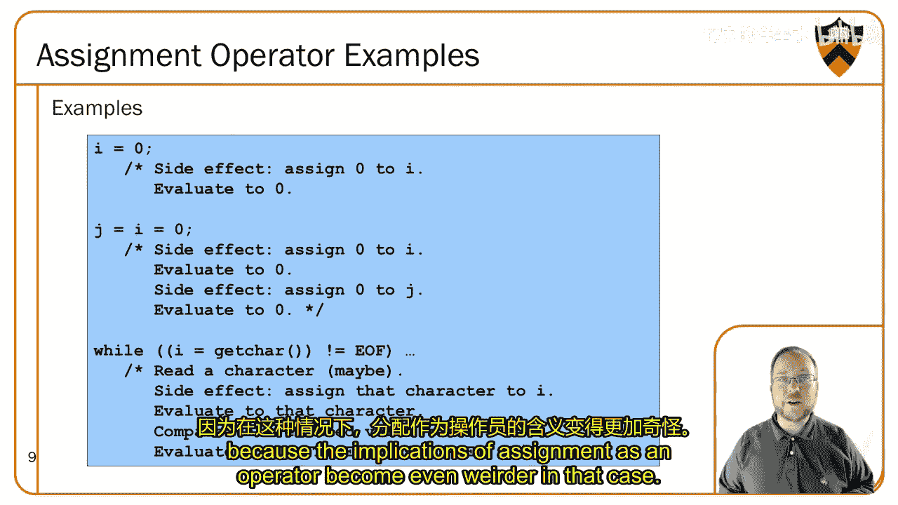

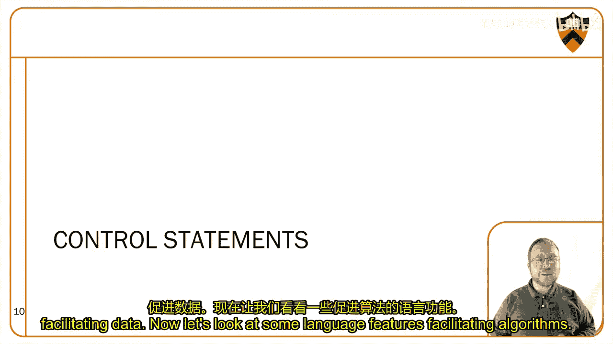

### 条件语句

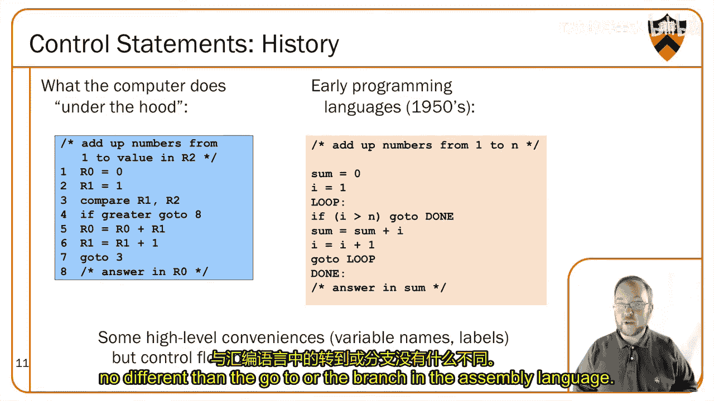

C语言使用`if`和`if-else`语句来实现条件选择。与Java不同，C语言中的条件可以是任意表达式，而不仅仅是布尔表达式。

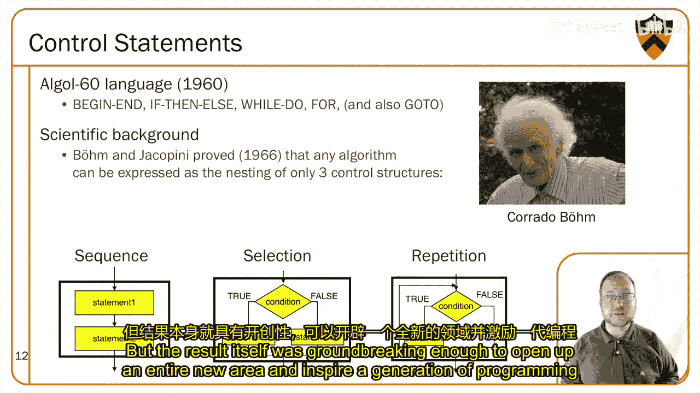

以下是条件语句的示例：
```c
if (condition) {
    // 语句1
} else {
    // 语句2
}
```

### Switch语句

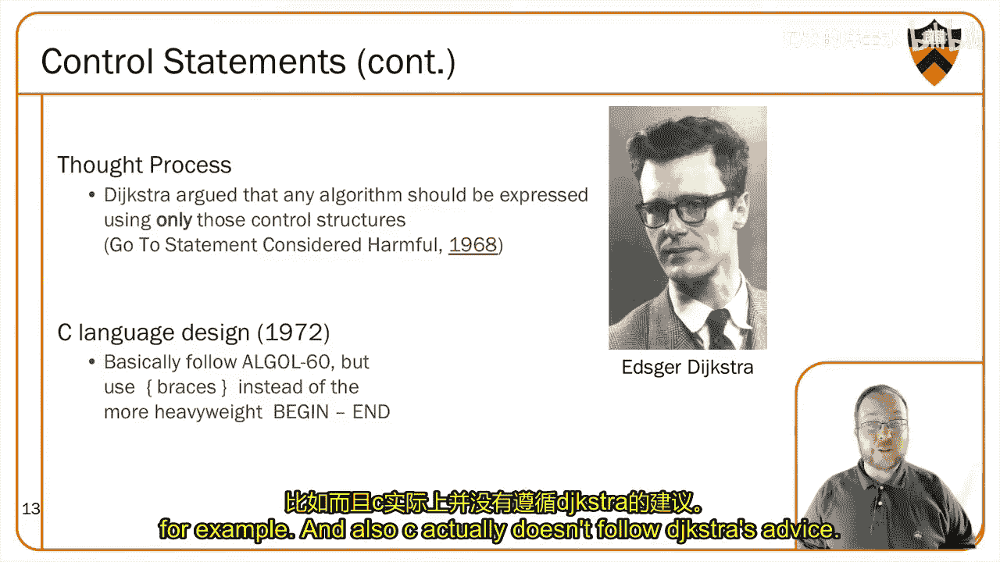

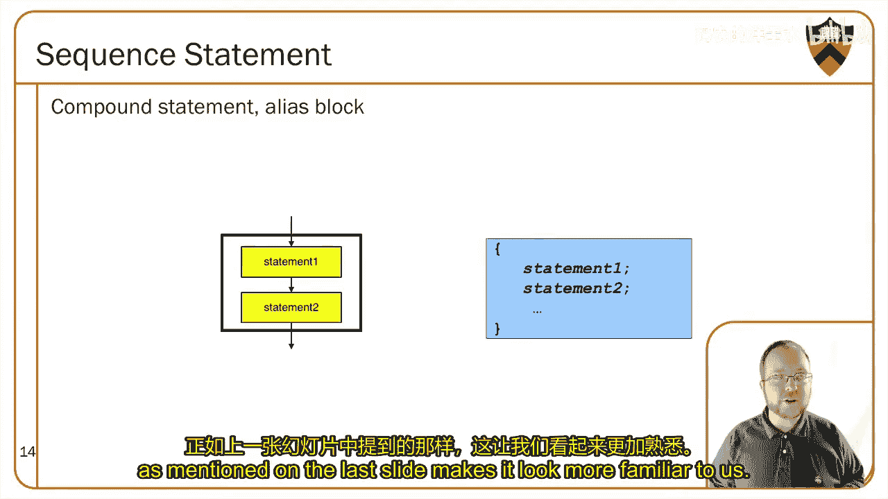

除了`if-else`语句，C语言还提供了`switch`语句，用于处理多个离散值的情况。需要注意的是，`switch`语句中的`break`语句不是必需的，但省略它会导致“贯穿”行为，即控制流会进入后续的`case`子句。

以下是`switch`语句的示例：
```c
switch (value) {
    case 1:
        // 代码块1
        break;
    case 2:
        // 代码块2
        break;
    default:
        // 默认代码块
}
```

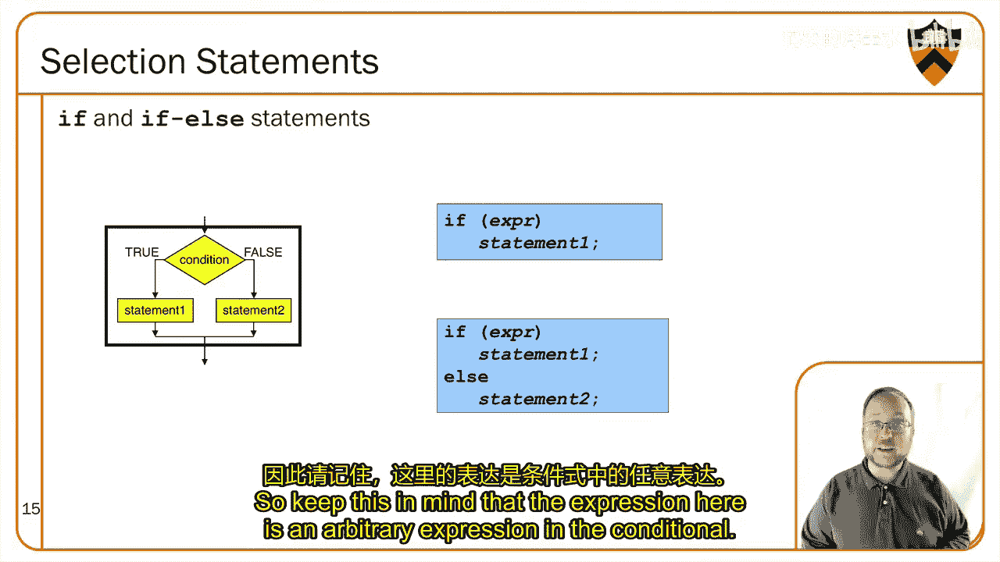

### 循环语句

C语言提供了多种循环结构，包括`for`循环、`while`循环和`do-while`循环。这些结构允许我们重复执行代码块，直到满足特定条件。

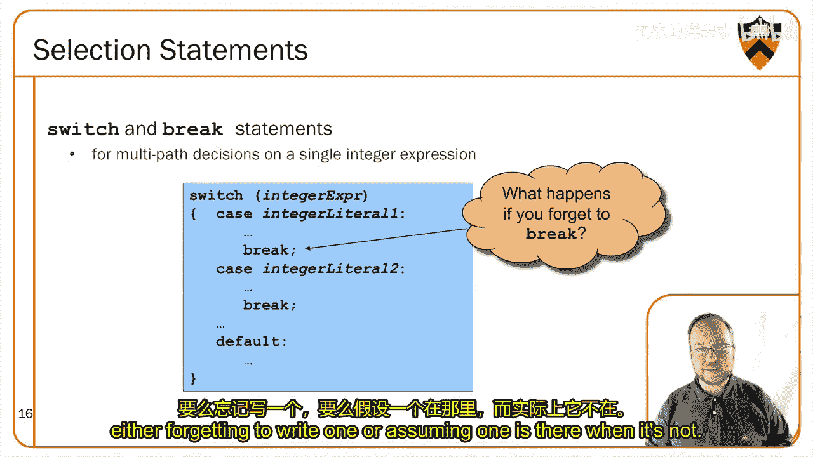

以下是循环语句的示例：
```c
for (int i = 0; i < n; i++) {
    // 循环体
}

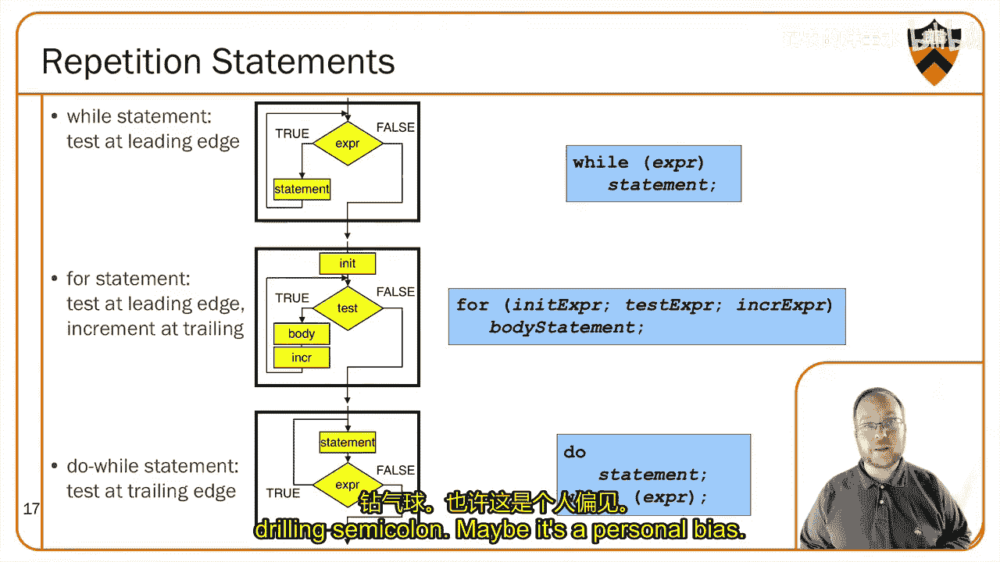

while (condition) {
    // 循环体
}

do {
    // 循环体
} while (condition);
```

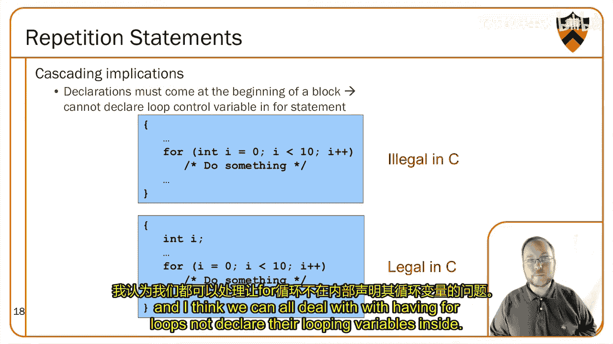

### 其他控制语句

C语言还提供了`break`、`continue`和`goto`语句。`break`用于跳出循环或`switch`语句，`continue`用于跳过当前循环的剩余部分，而`goto`则允许无条件跳转到代码中的标签处。尽管`goto`语句存在，但在现代编程中应尽量避免使用。

## 输入输出

C语言本身没有内置的输入输出功能，而是通过标准库（如`stdio.h`）提供的函数来实现。标准库定义了三个默认的I/O流：标准输入（`stdin`）、标准输出（`stdout`）和标准错误（`stderr`）。

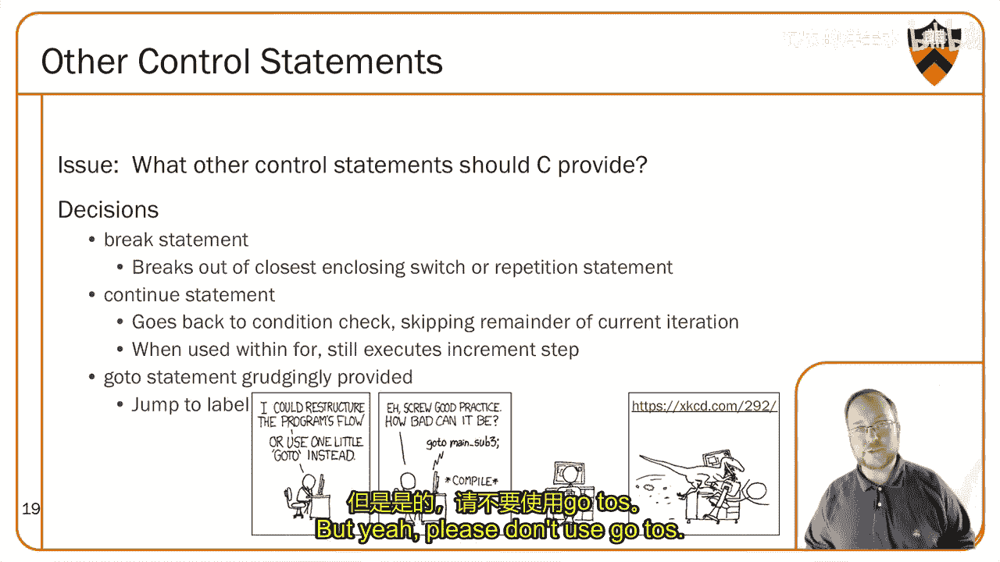

### 字符输入输出

对于字符级别的输入输出，C标准库提供了`getchar()`和`putchar()`函数。`getchar()`从标准输入读取一个字符并返回其整数值，如果失败则返回`EOF`。`putchar()`将一个字符写入标准输出。

以下是字符输入输出的示例：
```c
int c;
c = getchar(); // 读取一个字符
putchar(c); // 输出一个字符
```

### 格式化输入输出

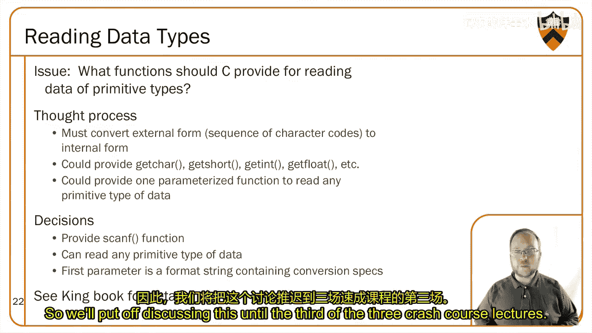

对于更复杂的输入输出，C标准库提供了`scanf()`和`printf()`函数。这些函数使用格式字符串来指定输入或输出的数据类型和格式。

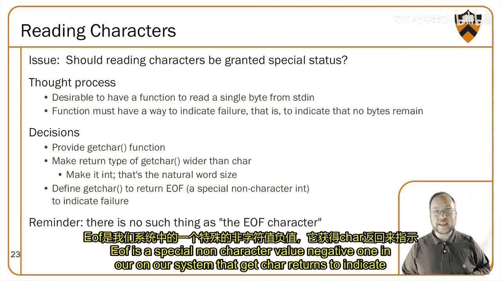

以下是格式化输入输出的示例：
```c
int num;
scanf("%d", &num); // 读取一个整数
printf("The number is %d\n", num); // 输出一个整数
```

## 总结

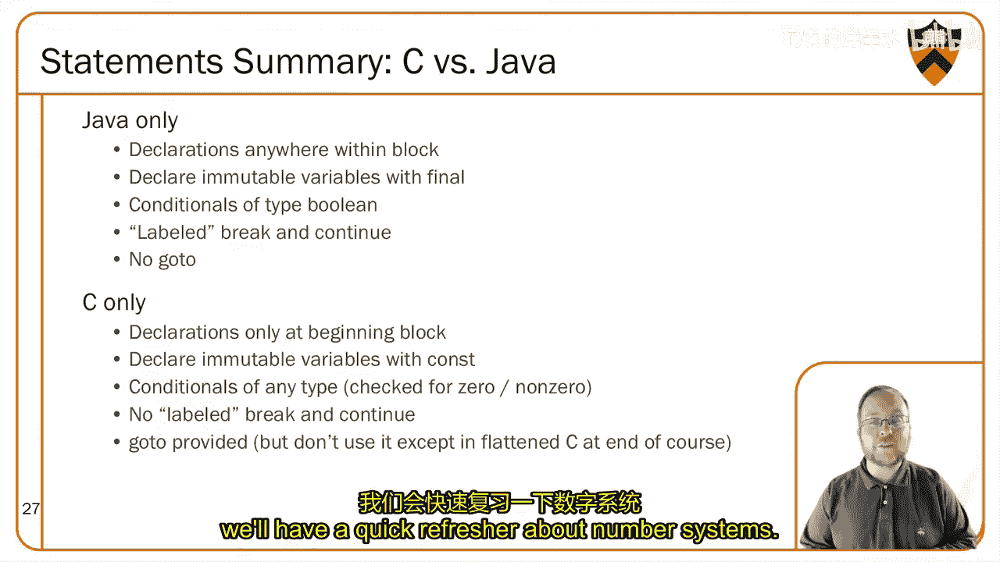

本节课中我们一起学习了C语言的核心语法，包括变量声明、赋值操作、控制语句以及输入输出。我们探讨了语言设计中的一些关键决策，并理解了这些决策如何影响C语言的特性。在接下来的课程中，我们将深入探讨C语言的数据类型及其在内存中的表示。