# 【全集 秋季版】普林斯顿大学 C语言系统编程 中英字幕 p07 Lecture 7 - 数字系统 -BV1u1feBoEsK_p7-

As we talk about data types in C， in addition to their values and operators。

 we'll also talk about their representations， but in order to understand that material。

 you'll need a good understanding of number systems in previous semesters， many。

 but not all students in this class have seen much of this before， whether in 126， perhaps in A PCA。

 perhaps in middle school or high school math classes， even。

 but I want to make sure that everyone's refreshed on the topic and on an even footing for this class moving forward。

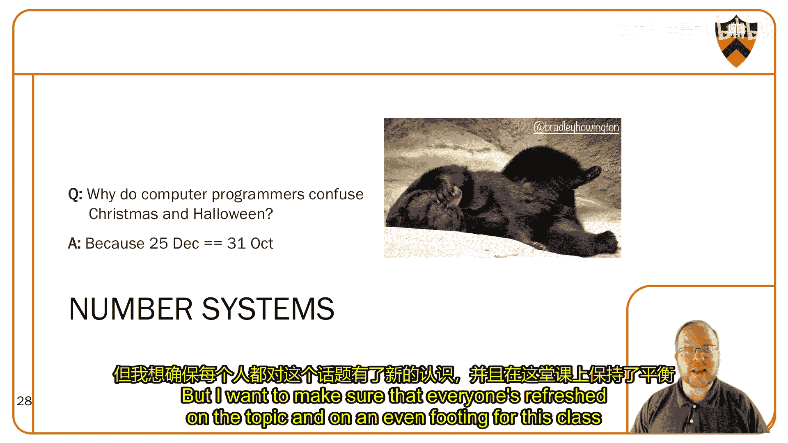

I say without exaggeration that every one here knows the decimal number system and has since first grade。

 if not before。The vast majority of human civilizations have used the decimal number system。

 presumably out of without being ableist biological convenience。Note。

 I have the word 10 an annoying number of times on this slide。 Every single time I say 10， I mean。

 the number 1，0 in decimal。As the comic on the slide observes， if we call 1010 more generally。

 communication breaks down。So in the decimal number system， there is a set of 10 symbols。

A number consists of the sum of the diits multiplied by their respective right to left。

 starting at zero powers of 10。Which is just a fancy way of saying that what you learned in elementary school about the one's place and the Ten's place and the hundreds place。

That's what we're doing。So there are other bases besides decimal。

 And the good news is that everything you know about decimal works for them， too。

 They have the same characteristics， except that they have a different number of symbols in their character set。

 and the powers that we're multiplying by are powers of their base， not 10。😊，As an aside。

 I keep saying symbols instead of digits because the root of the word digit is that same biological counting convenience。

 just spoken Latin in Latin。

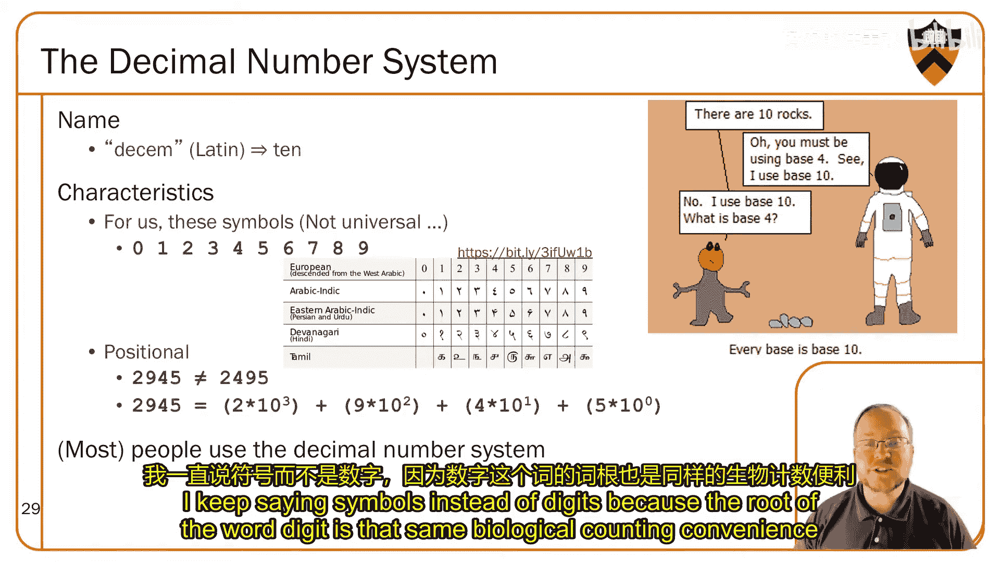

So let's talk about other bases。There is unary coming from the Latin unus for one and the airy suffix by analogy to binary trinary。

 et cetera。 In this system， there is one symbol by convention 1。

 and the number is formed by just repeating that digit as many times as necessary to achieve the number。

This sounds silly， but we actually use this with Kelly marks， so as long as we don't cross our fives。

 we've already used unary。But unary does break the idea of a sum of products of power。

 so let's really begin with binary。The same rules we talked about with decimal applied to binary。

 two symbols， 0 and1， positional systems of different permutations of the same symbols are not the same number。

 and the same sum of products of power's number formation。

It's natural to use binary for computers because digital computers are built using digital circuits。

 each of which has only two states on and off。 If we think of one as on or hot or high voltage or connected circuit and zero is off or cold or low voltage or disconnected circuit。

 then in that sense， digital computers use the binary number system， in their very essence。

So a little bit of terminology here， a single symbol in binary is a bit。

 that's a compression of binary digit， which based on digits etymology is a misnomer。

The byte which is a term that dates to the mid-50s is a coherent organization of some number of bits in everything we're going to see it's always eight bits and possibly my favorite vocabulary of the entire course。

 a nibble is just half a byte， so four bits。And to avoid the10 issue from my previous slide。

 I'll pronounce these numbers as ones and zeros， or for example，1000 not。嗯。1000， not 1，000 or 1100。

 not 1100。嗯。Eymological aside， the numbers 11 and 12 are from one and 2 left over。

 meaning on top of 10， and 00 also perhaps surprisingly perhaps not is from the proto Indo Europeanurop route for 10。

 So all of these would be bad numbers to use when counting in some base other than decimal。All right。

 that's probably enough linguistics for a coast lecture。

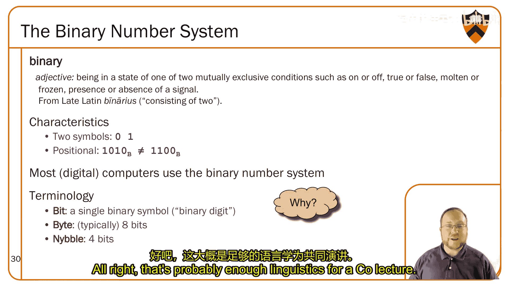

Here's a table of binary values 0 through 31 I personally found it useful to memorize 0 through 15。

 but at least know these heuristics， one and then all zeros is a power of two。

 it's namely two to the number of zeros， all ones is one less than the next power of two。

10 is 1010 this mnemonic is worth being the only time I'll break my rule about bits don't say 10 1。

 100， etc ceter， so 10 is 10，10。

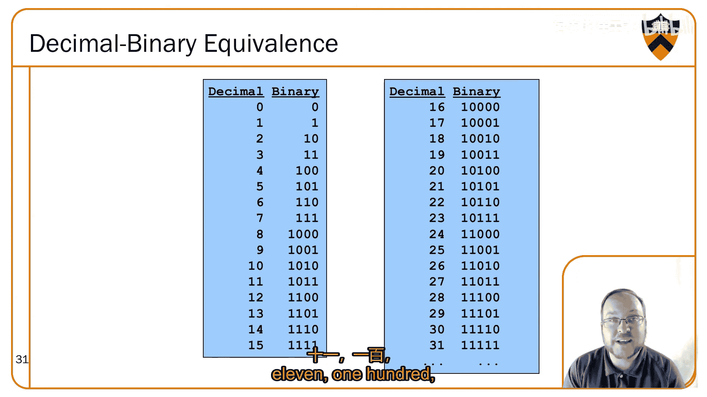

So to convert from binary to decimal， you simply have to expand the positional notation and compute the sum of products of powers。

 think of this as computing the polynomial。Note the notation。

 I'll use a Subscript B after a binary number to indicate that it is indeed binary absence of a subscript indicates decimal。

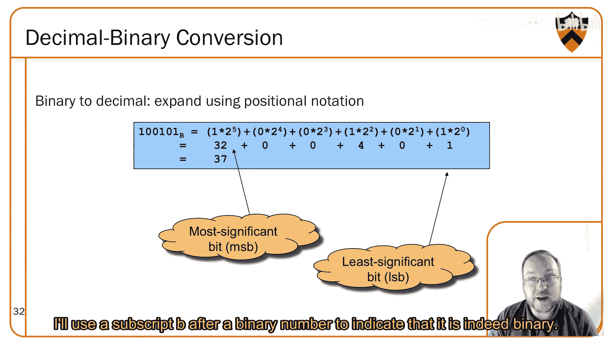

So to convert the other way from some integer in this case represented in decimal for convenience。

 we have to find the appropriate positional notation。One way to do this is the subtraction method。

 find the largest power of two that is less than the target number， subtracted off。

 put a one as the coefficient of that position in the polynomial。

If the largest power of two is less than a subsequent power of two or the largest remaining power of two is less than a subsequent power of two。

 put a0 in the coefficient of the positional polynomial to skip that charm。 So for instance。

 here we have a one in the 32s place but then what's left is5 so we don't have 16 and we don't have an8。

 so we put zeros in those locations。

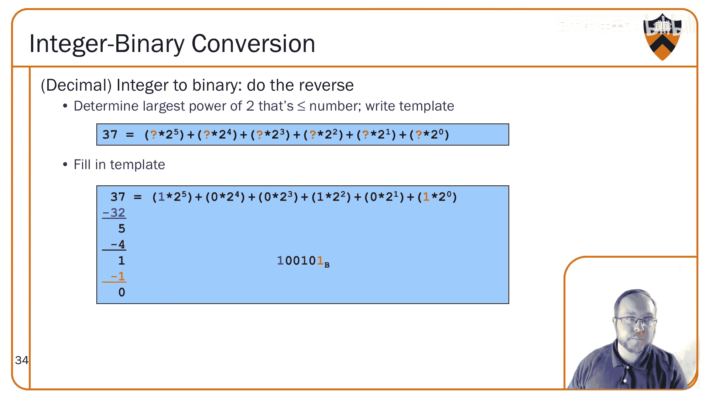

Another way is to repeatedly divide and then read the remainders bottom to top。

 no surprise these are equivalent as division is repeated subtraction。

 but keep this in mind because this applies a little bit nicer or easier for other bases。

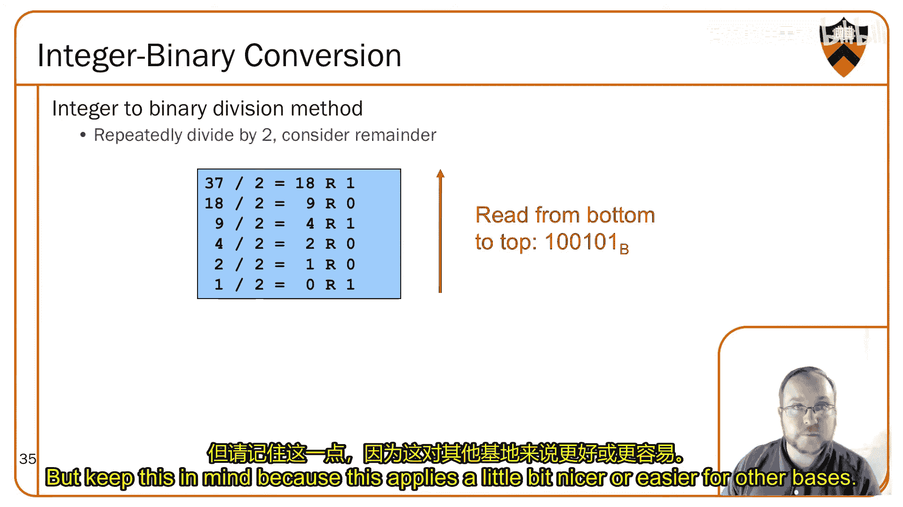

So more people seem to know about binary than hexadeadecimal。

 so when you first see hexadeadecimal or hex it looks complicated。

 but all the same rules you know about counting from decimal apply， so hexadeadecimal is base 16。

Unfortunately， being that we actually use a base 10 is base 10 for us。The we write out of symbols。

 we have0 through nine and then what do we do so by convention it's a through F can be either a capital or a lower case。

In C， we have a prefix for a number that's represented in hexadecimal， and that's the number 0 x。

Followed by the hex number。And so why is hex so common as a number system in computer programming。

 well it's a handy abbreviation for binary， because 16 is two to the four， each hexit。

 hexet SMal digit is a nibble is four bits？

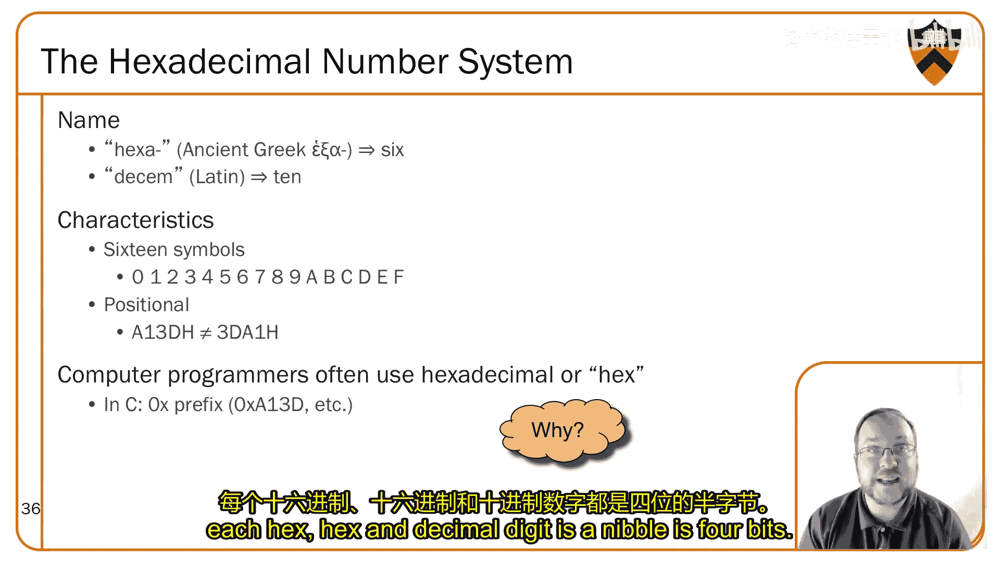

So again， you definitely should memorize A through F for 10 through 15。

 it's probably useful to memorize each niBbble4 bit string2。

 but maybe not absolutely critical if you've done one memorization and you do the other memorization。

 it's just a look up to。

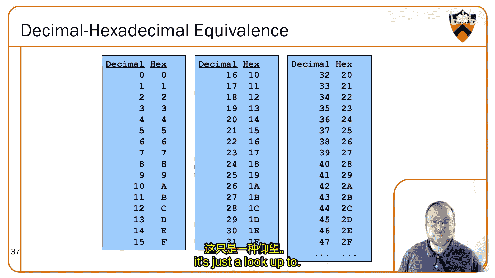

So hex to decimal integer， we're going to just expand the positional notation and add。

 so here we have2，5 hex is going to be2 times 16 to the 1， 5 times 16 to 0， 32 plus 5 is 37。

For going the other way， decimal to hex， we can use the division mechanism that we've showed in binary。

 but instead of dividing by 2， we're going to divide by 16， so 37 div 16 is2 remainder 5。嗯。

Then we've got two Dave 16 and zero remainder two。We read bottom to top， and we end up with2，5。

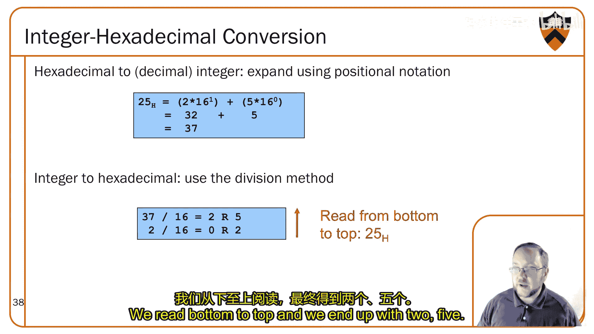

Binary to hex conversions are even easier， working off the observation that each hexet is a nibble。

 all we have to do is substitute in one direction or the other。So when we see 1010。

 we know that's an A， and when we see an A， we know that's 1010。If there aren't enough bits。

 we can add bits to the left side， because just like in decimal that we're used to， the number 0，0，0。

0，0，0，2，1，7 is 217。 All the leading zeros didn't matter。

 so we can freely add those extra zeros to the left side to get enough bits to form a full full hex。

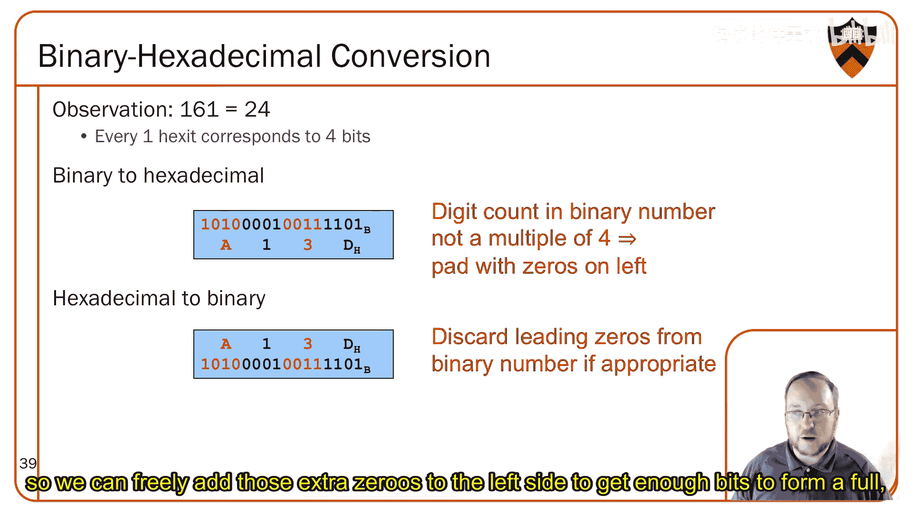

So here's a quick quiz， go ahead and pause the video at this point and do the conversion。

 see what you come up with。So the correct answer here is that it's 42 in decimal。

 it's 2 plus 8 plus 32 we could also have done this like the slide said convert to hex first when we convert to hex first what we do is we split it up into Hex it so we have the right hex it is10 the right four bits are 1010 that is the hexet a and then on the left we have 10。

 we can pad with zeros so that00，10 is a2。Once we've done that， we have 2a and hex。

 we could just compute that as 2 times 16 plus 10， that's 42 also。

 so there's a number of different ways to do this conversion。

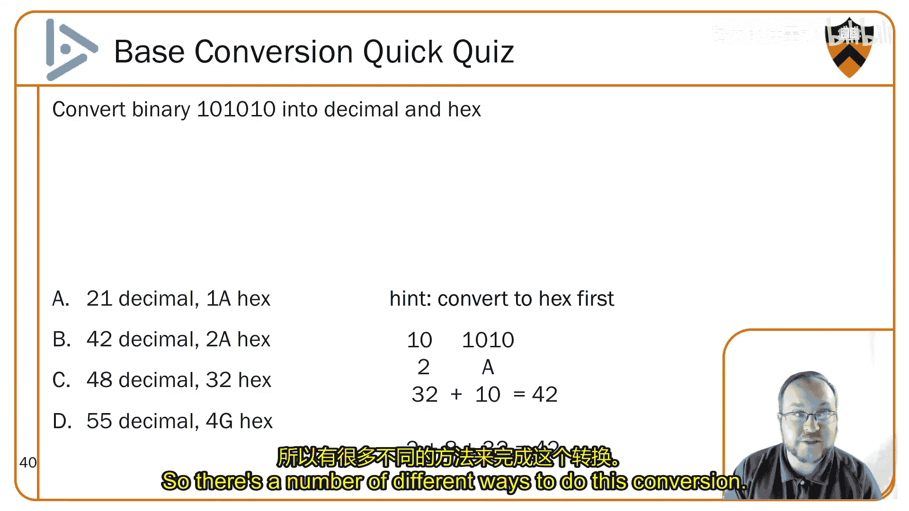

So the octal number system is the last number system we're going to talk about。 again， it's the same。

 It's a different subset of symbols， but the same rules。

octal's another handy abbreviation for binary， just like 16 was2 to the4。 So every hegget was 4 Bs。

 Every digit in an ocal number represents 3 B since8 is 2 to the 3，2 to the third。

You'll actually see this in Linux where file permissions are read write and execute for a file and the CH modD command that you saw just very briefly in the intro to Linux and Bsh lecture takes ocal numbers as a representation of that。

 so six is read and write but not execute because it's 1107 is read and write and execute because it's 111 etc。

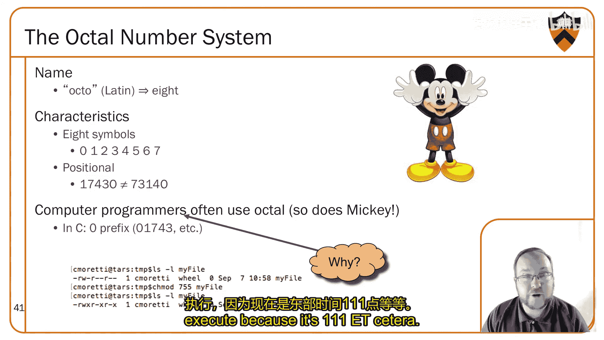

So next lecture we'll be jumping into part  two of the crash course dealing with numeric data types。

 and then in part 3， we'll tackle arrays， strings and where the rubber meets the road in C pointers。

 until then we're card on assignment 1， which is due Thursday， the 17th。

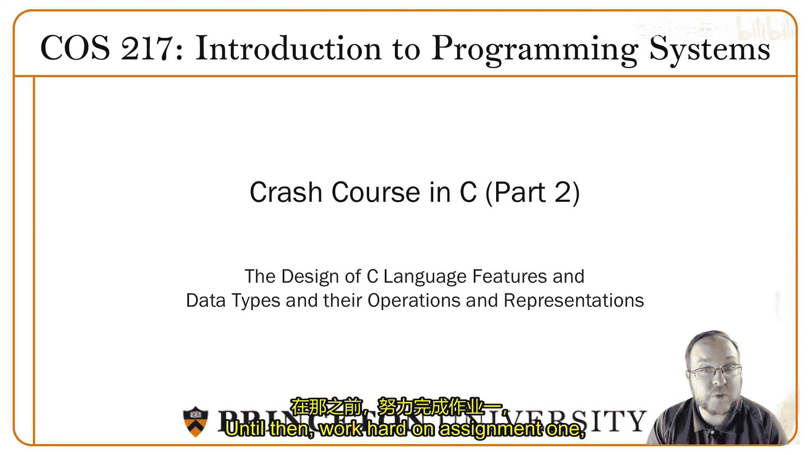