# C语言系统编程：第7讲：数字系统 📚

在本节课中，我们将学习数字系统的基础知识。理解数字系统对于后续学习C语言中数据类型的表示至关重要。我们将从熟悉的十进制系统开始，逐步介绍二进制、十六进制和八进制系统，并学习它们之间的转换方法。

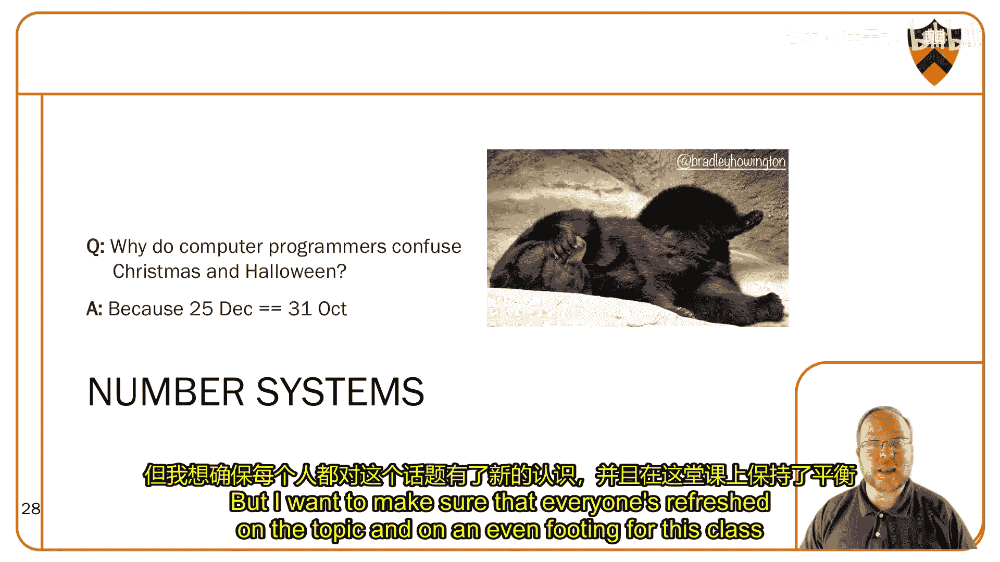

---

## 十进制系统 🔢

我们自小学起就熟悉的数字系统是十进制系统。绝大多数人类文明都使用十进制，这主要是出于生物上的便利性（我们有十个手指）。在十进制系统中，有十个符号：0, 1, 2, 3, 4, 5, 6, 7, 8, 9。

一个数字是由其各位数字乘以相应的10的幂次（从右向左，从0次幂开始）的和构成的。这本质上就是我们小学学习的“个位”、“十位”、“百位”的概念。

**公式**：一个十进制数 `d_n d_{n-1} ... d_1 d_0` 的值可以表示为：
`值 = d_n * 10^n + d_{n-1} * 10^{n-1} + ... + d_1 * 10^1 + d_0 * 10^0`

---

## 其他进制系统

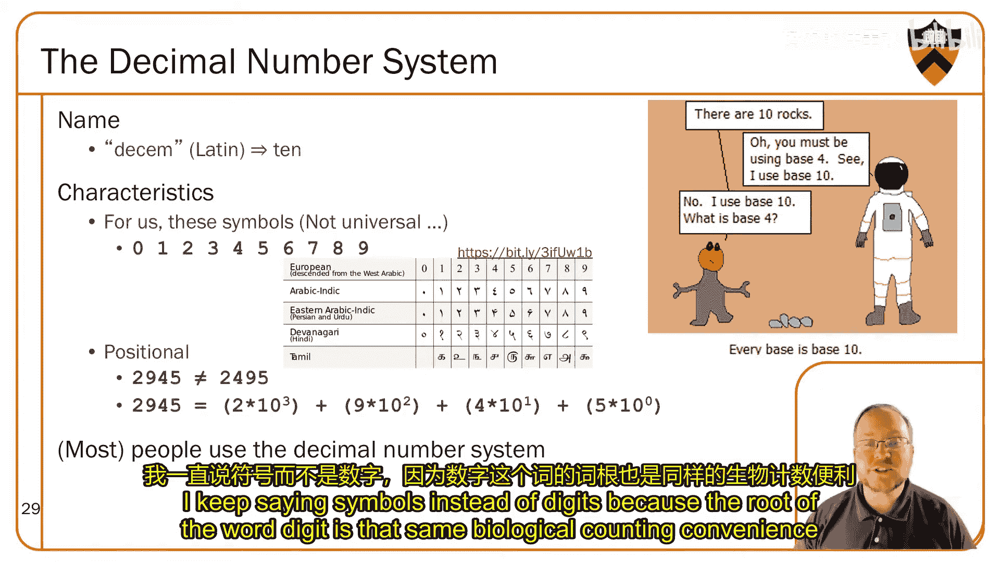

除了十进制，还有其他进制的数字系统。好消息是，十进制系统的所有规则同样适用于它们。它们具有相同的特性，只是使用的符号集数量不同，并且我们乘的是其基数的幂，而不是10的幂。

上一节我们介绍了十进制，本节中我们来看看其他几种在计算机科学中至关重要的进制系统。

### 二进制系统 💻

二进制系统遵循与十进制相同的规则，但它只有两个符号：0和1。数字由这些符号的不同排列组合构成，每个位置代表2的幂次。

数字计算机天然使用二进制，因为它们由数字电路构建，每个电路只有两种状态：开（on）和关（off）。我们可以将1视为开、高电压或电路连通，将0视为关、低电压或电路断开。

以下是二进制系统中的一些术语：
*   **比特（Bit）**：二进制数字（Binary digit）的缩写，是单个二进制符号。
*   **字节（Byte）**：一组连贯的比特。在我们所见的所有情况下，一个字节都是8比特。
*   **半字节（Nibble）**：半个字节，即4比特。

为了清晰，在阅读二进制数时，我们将其读作“一零一零”，而不是“一千零一十”。

以下是一些有用的二进制数值启发式规则：
*   一个1后面跟着全是0的序列是2的幂。具体是2的（0的个数）次幂。
*   全是1的序列比下一个2的幂小1。
*   二进制数 `1010` 对应的十进制数是10。这个助记符是唯一一次我会打破“比特不说十”的规则。

**代码示例**：在C语言中，二进制字面量没有直接的前缀，但我们可以通过其他方式理解其值。

### 十六进制系统 🔟➡️🅰️

十六进制（常简称为“hex”）是基数为16的系统。它看起来复杂，但所有你从十进制学到的计数规则都适用。

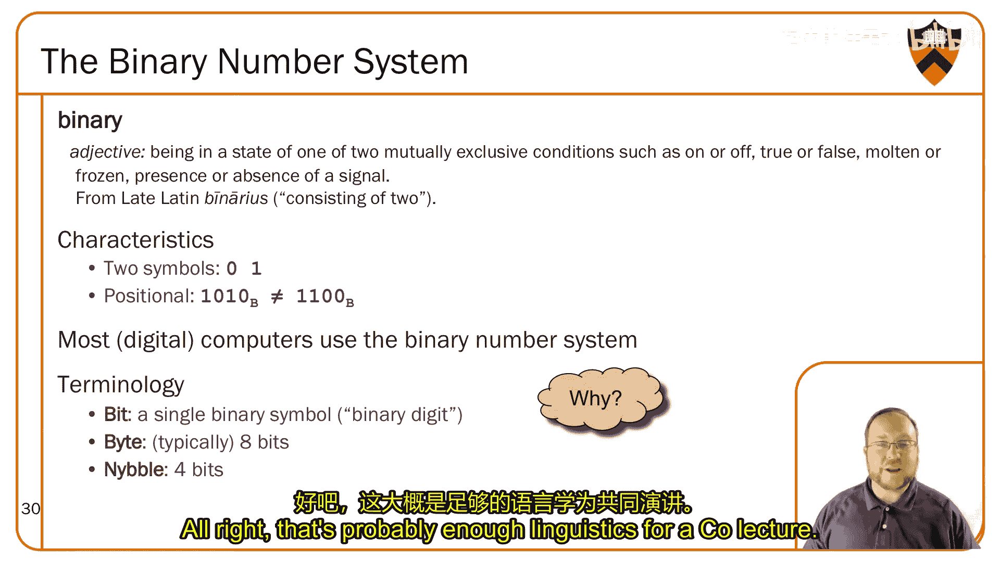

十六进制使用16个符号：0-9，然后使用字母A-F（大小写均可）代表10-15。在C语言中，我们使用前缀 `0x` 来表示一个十六进制数。

十六进制在计算机编程中如此常见，是因为它是二进制的便捷缩写。由于16是2的4次方，每个十六进制数字（hex digit，或称“hexit”）正好对应一个4比特的“半字节”（nibble）。

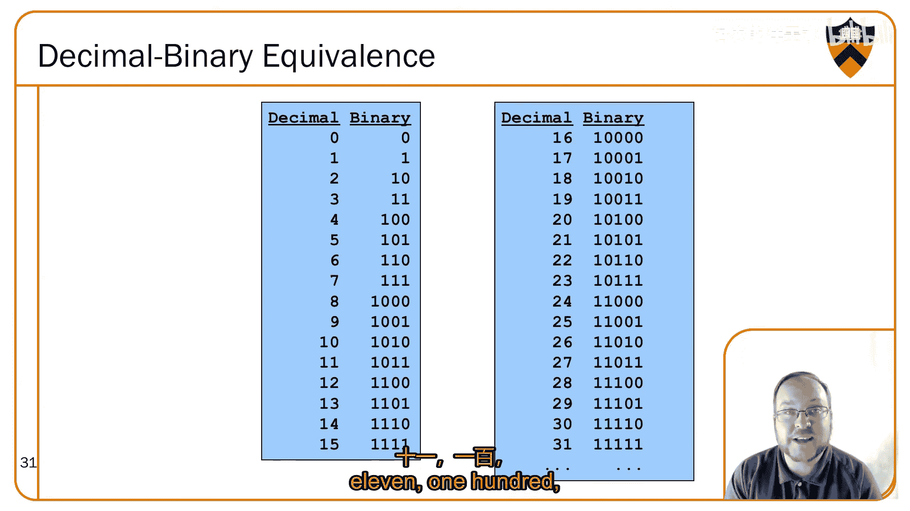

**代码示例**：在C语言中表示十六进制数：`int hexValue = 0x2A;` // 这等于十进制的42

### 八进制系统 🛑

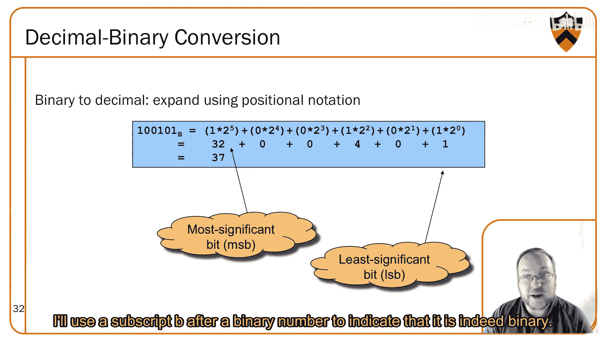

八进制是基数为8的系统。它遵循相同的规则，只是符号集不同（0-7）。

八进制也是二进制的一种便捷缩写，因为8是2的3次方。因此，八进制数的每一位数字代表3个比特。你会在Linux中看到它的应用，例如 `chmod` 命令使用八进制数来表示文件权限（例如，6代表读写，7代表读写执行）。

**代码示例**：在C语言中，八进制数以前缀 `0` 开头：`int octalValue = 052;` // 这等于十进制的42

---

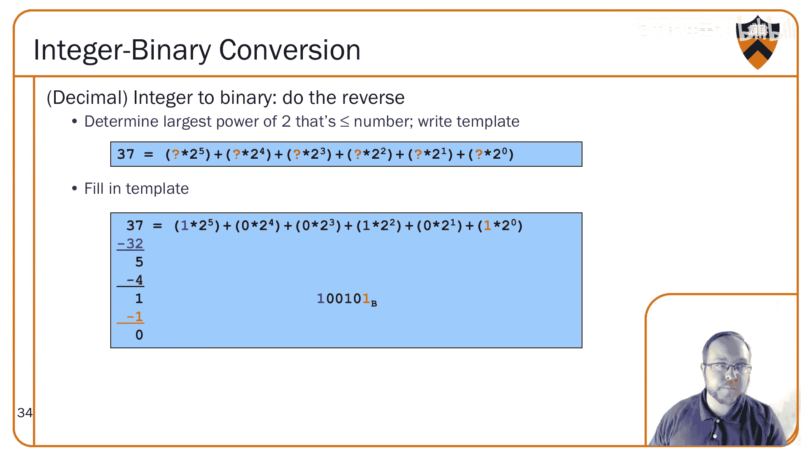

## 进制转换方法

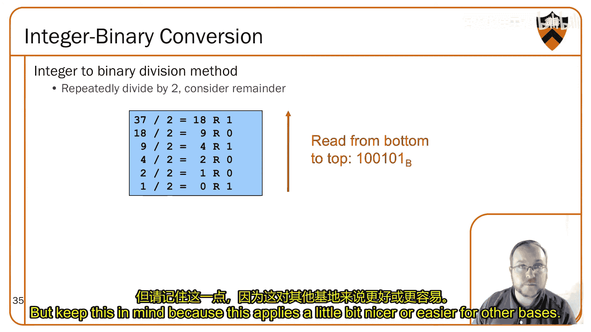

理解了不同进制系统后，我们来看看如何在它们之间进行转换。

### 二进制转十进制

要将二进制数转换为十进制，只需展开其位置记数法，并计算幂的乘积之和。可以将其视为计算一个多项式。

**公式**：二进制数 `b_n b_{n-1} ... b_1 b_0` 的十进制值为：
`值 = b_n * 2^n + b_{n-1} * 2^{n-1} + ... + b_1 * 2^1 + b_0 * 2^0`

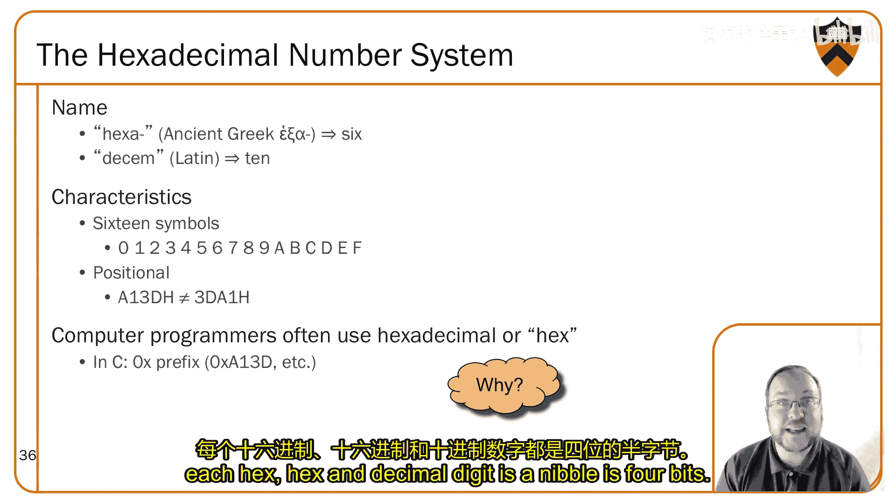

**示例**：`1010₂ = 1*2³ + 0*2² + 1*2¹ + 0*2⁰ = 8 + 0 + 2 + 0 = 10`

### 十进制转二进制

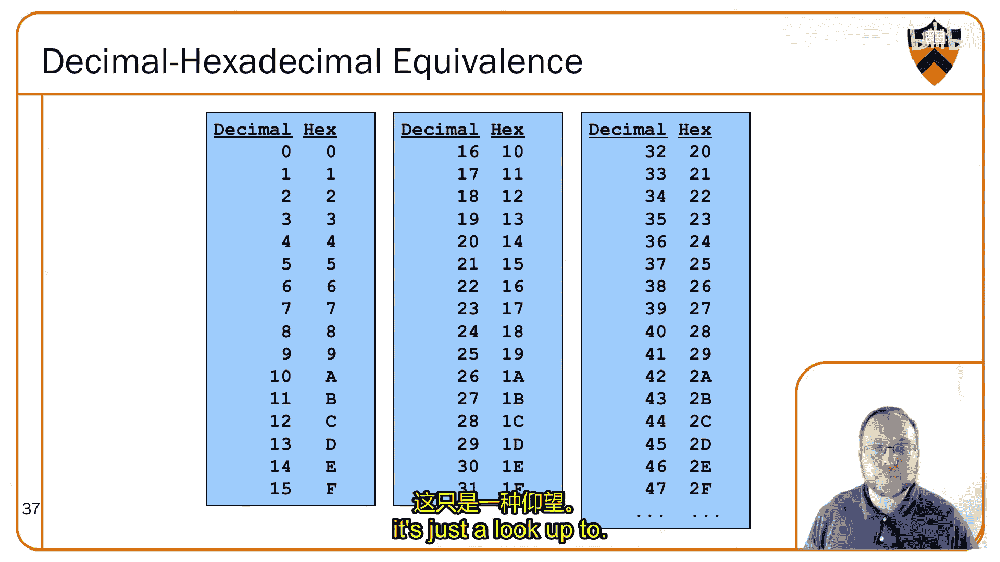

将十进制整数转换为二进制，需要找到合适的位置记数法。以下是两种常用方法：

1.  **减法法**：找到小于目标数的最大2的幂，将其减去，并在该幂次的位置上置1。如果剩余的数小于下一个2的幂，则在该位置置0。重复此过程。
2.  **除法取余法**：反复将十进制数除以2，并记录余数。最后，将余数从下到上（即最后一次除法的余数在最高位）读取，即得到二进制数。这本质上是重复减法的另一种形式。

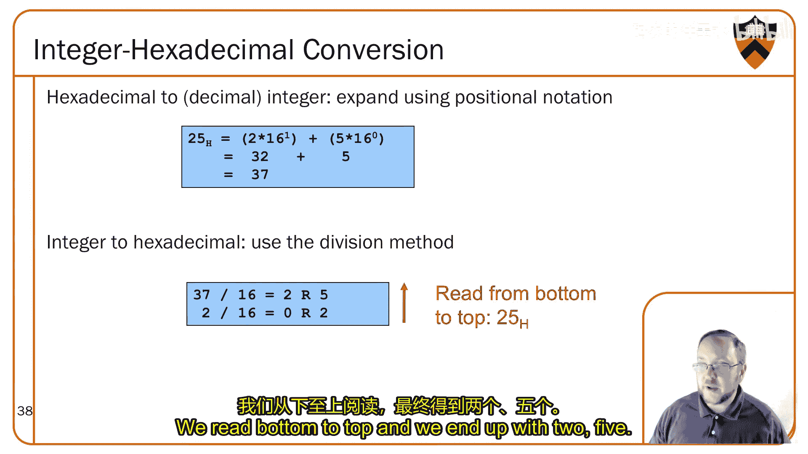

**示例（除法法）**：将十进制数37转换为二进制。
```
37 / 2 = 18 余 1
18 / 2 = 9  余 0
9  / 2 = 4  余 1
4  / 2 = 2  余 0
2  / 2 = 1  余 0
1  / 2 = 0  余 1
```
从下往上读余数：`100101`，所以 `37 = 100101₂`。

### 十六进制与十进制互转

十六进制与十进制之间的转换，原理与二进制类似，只是基数换成了16。

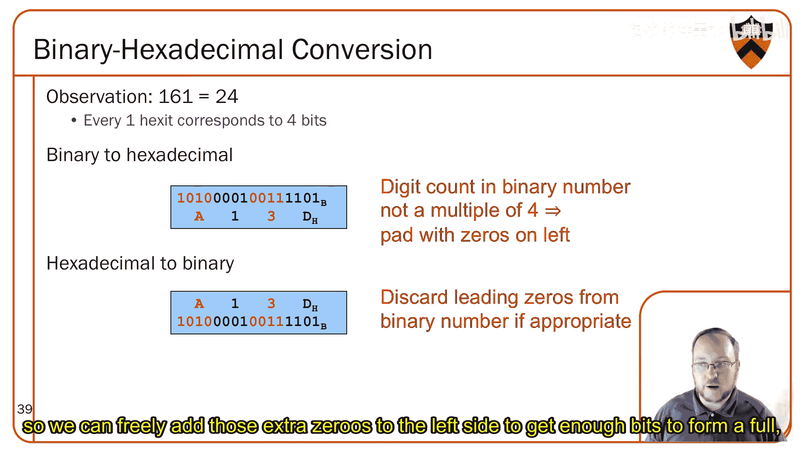

*   **十六进制转十进制**：展开位置记数法并求和。
    **示例**：`0x2A = 2 * 16¹ + A * 16⁰ = 2 * 16 + 10 * 1 = 32 + 10 = 42`
*   **十进制转十六进制**：使用除法取余法，但除以16。
    **示例**：将十进制数42转换为十六进制。
    ```
    42 / 16 = 2 余 10 (A)
    2  / 16 = 0 余 2
    ```
    从下往上读余数：`2A`，所以 `42 = 0x2A`。

### 二进制与十六进制互转

由于每个十六进制数字对应4个比特，因此二进制与十六进制之间的转换非常直接。

*   **二进制转十六进制**：从右向左，将二进制数每4位分成一组（最左边不足4位可补0）。然后将每组转换为对应的十六进制数字。
    **示例**：`0010 1010₂` -> `2 A` -> `0x2A`
*   **十六进制转二进制**：将每个十六进制数字展开为对应的4位二进制数。
    **示例**：`0x2A` -> `2` -> `0010`, `A` -> `1010` -> `00101010₂` (可省略前导零为 `101010₂`)

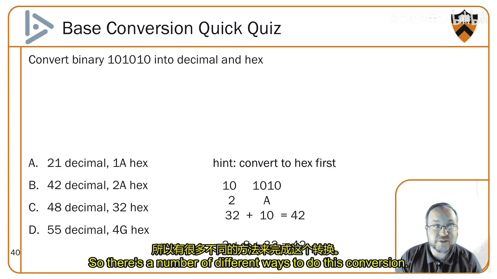

### 快速测验

尝试将二进制数 `101010₂` 转换为十进制和十六进制。
*   **转换为十进制**：`1*2⁵ + 0*2⁴ + 1*2³ + 0*2² + 1*2¹ + 0*2⁰ = 32 + 0 + 8 + 0 + 2 + 0 = 42`
*   **转换为十六进制**：先分组 `0010 1010` -> `2 A` -> `0x2A`，然后 `0x2A = 2*16 + 10 = 42`

---

## 总结

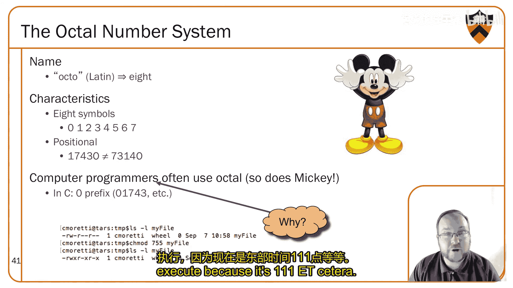

本节课中我们一起学习了数字系统的基础知识。我们从最熟悉的十进制系统出发，理解了其基于位置和幂次的核心原理。随后，我们将这一原理应用到计算机科学中最关键的二进制、十六进制和八进制系统中，并掌握了它们之间相互转换的方法，特别是利用了十六进制与二进制位组的便捷对应关系。

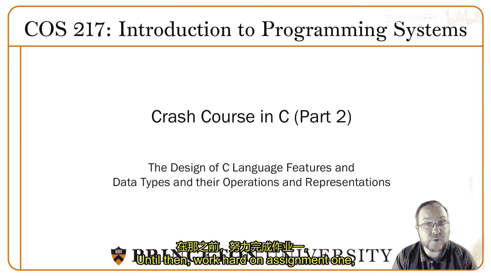

理解这些数字系统是后续学习C语言中各种数据类型（如整数、字符）在内存中如何表示的基础。下一讲，我们将进入速成课程的第二部分，深入探讨数值数据类型。