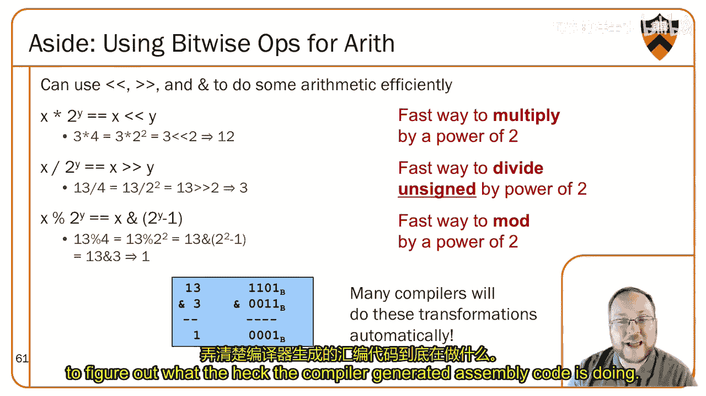
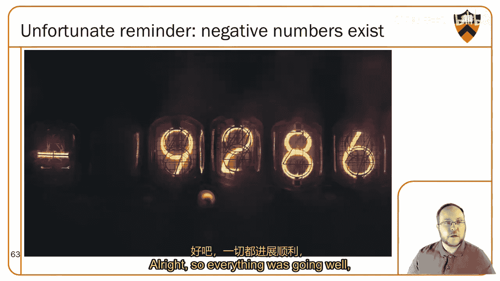
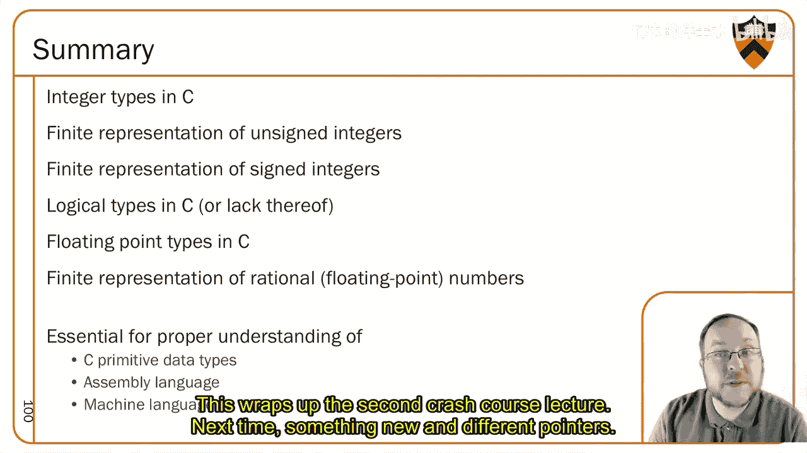

# 【全集 秋季版】普林斯顿大学 C语言系统编程 中英字幕 p08 Lecture 8 - 数字类型 -BV1u1feBoEsK_p8-

Welcome back to the Co 217 lecture This is the second in a series of lectures that when put together。

 make up a sort of crash course in the sea language。In the first lecture。

 we saw variable declarations and assignment， sea control flow structures。

 and a brief tour of the interface of C's Standard Io Library。In this lecture。

 we're going to look at numeric types provided in C。

 their operations and their internal representation。Let's start with Who numbers。

Diving right into it， here are the types provided in C 89。 There are two variants of each of char。

 short， int and lock。Chars are one by， the others are not specified exactly。

 but instead relative to each other。Ins are seen as the default and are typically but not necessarily matched the machine's natural word size。

 corresponding to the register size or other architectural constants。

Java made a different design decision。It explicitly specified all of the sizes。For one。

 there was no concept of a natural word size because the underlying hardware doesn't matter to Java。

 We're always working in the environment of the JBM。Additionally。

 Java change from char is the base type with one byte to byte as the base type with one byte。

 with char actually being two bytes。So by not setting absolute sizes， C forgoes portability。

 which seems actually a reasonable choice considering that C was written as a systems programming language。

But it also seems that there would have been very little cost to supporting both systems and application programming with a greater variety of types。

 For example， we could provide types that self specify their size。

 something like int 8 in 16 in 32 in 64。 And then also the system dependent int。Java also。

 I think gets it right with bitete instead of char for two reasons。Number one。

 bys aren't necessarily characters。 They might just be small ints。 And number two。

 characters aren't necessarily one by entities， as we'll see， soon。

But now that we have the types defined in the language。

 we need to know how to indicate literal values for them in code。

A numeric literal that looks like an injuger implicitly has type int。

 And as seen in the last lecture， we can specify an int literal in another base by putting a prefix to it。

0 for octyl or 0 x for hex。 careful， though， because the0 prefix for ocal is prone to confusion。

 simply because it breaks our sense of mathematics with leading zero is being superfluous。😊。

Some other languages chose to do zero lowercase O for ocal prefix。

 and I think this is a little bit less confusing， but that said plenty of languages do follow with C with just a zero。

So continuing to analyze with the benefit of the passage of time and experience seeing what industrial code in the language does and doesn't do。

 it seems like it would have been logical to use an S suffix to indicate a short literal。

 and it's curious that the designers decided against this notation or any notation at all。

 It's not clear why they made that choice。The same for the lack of a suffix for a bite size literal。

 although there it could be because they're thinking of these as characters。

 and so there are other ways to specify character literals that we'll see later。

But in case you think I'm begging on C， I'll note that Java inherited both of these eccentricities。

 So either it's the case that even newer languages fail to correct these perceived faults in older languages。

 or maybe they weren't such faults at all， and we should just live with them。

 even if they're not perfectly parallel or perfectly consistent。All right， before you tune out。

 let's go to something completely unlike anything in Java。

 we can specify that a type represents only non negative integers。

This is a design choice that I think made sense because of the differences between the two languages。

C is an older language， and thus， its design assumes more memory constraints than the younger Java in Java。

 if were an int stores negative 2 billion， approximately to positive 2 billion。

 If you want to hold 3 billion， the simple answers will then use a along in C。

 the designers let you double the maximum value of any given type by shifting its range from approximately negative x through x to 0 through 2 x。

C is a lower level language also， which deals with quite a bit of bitwaacking， for example。

 bit masking where we use the values of each bit in an integer as separate flags。

 and thus we have to isolate them via bitwise operations。

When we treat these values as bit strings rather than actual integers。

 it doesn't make much sense to think about the integer value as signed。

And thus it's convenient to have a type that doesn't have sign information built into this representation at all。

The literals here are like the s types we saw before。

 including limitations of having to cast a short， but with you indicating their unsigned nature。

So last before we move on to representation is the char data type Chars are in this section of integer data types because that's really what they are。

 they're just really small ints。Even though their name betrays that their designed intent was for working with ASky characters。

 they're just 8 B ins。As discussed， perhaps they should have been called byte or int8 or something similar。

 in particular the naming becomes tricky now that we know about sinedness。

The concept of a s cha is tough to wrap your head around， what exactly is negative A？

For actual ASI characters， the difference between signed and unsigned values doesn't really matter；

 the highest ASI character is 127， so either signed or unsigned will be fine。

If you want to one byte type for a calculation， though。

 you might maybe even should use an unsigned char though。

 because as much as negative A doesn't make sense， the positive or negative nature of arbitrary data makes even less sense。

An example of using chars for arbitrary data would be for a basease 64 conversion。

 which is an algorithm that has to account for not just ASI but arbitrary data and uses the entirety of the eight bits in a byte。

 not just the  seven bits used by ASI from 0 to 127。

Although we're continuing to think about chas as really small ants。

 the language designers did provide literal values that indicate they're coming you to the usage as text characters。

I'll take this opportunity to point out something for assignment1。 Each of these values is one byte。

 Yes， some of them have multiple characters inside the single quotes。

 but those are just how we represent the literal。 Consider backslash in。

 If we wanted to type a literal new line as hitting， enter or return， our code would be a mess。 Open。

 return， close quote。Iick。Instead， the language's designers gave us a way to identify this character uniquely using the backslashes an escape character。

 An escape indicator says the next character isn't necessarily what you think it is。

 And since each character lital refers to a single character。

 there's no ambiguity here versus the character， backslash， and then the character N。

Similarly to represent a quote character， we have to do something special because we can't use three single quotes。

 The second would close the first， and then the third would be opening some new quote that wouldn't ever end。

Instead， we use the back slash to say the next character doesn't mean what you think it does。

 So the second quote in sequence doesn't close the character literal。 and thus the third one does。

Taking it one step further， the character literal for a back slash then needs to have a backlash to escape the backlash character。

 which would otherwise be interpreted as escaping the closing quote。 Who， that got a bit meta。

All right， so another important point brought about by these examples is that there's a big difference between the character literal 1 and the integer value one。

The character literal 1 is a way to indicate the char with ASi value 49。

 which is the ASI value of the character 1。This is different from the integer one。

 which corresponds to a nonprinting character with ASI value1。Similarly。

 the character literal 0 is ASI value 48， which is not0。 The value 0。

 a k of the nubyte is represented by the character literal with the escape character backslash0。

One more note， oddly cha literals are really of type end。 We never think of them as such。

 But in reality， under the hood， they're ints。Not just they are an integer type， but they are ints。

So C gets tick A tick works only because C supports automatic demotion。 That's a weird choice。

 You would think that literals that are pretty explicitly tied towards chas would be chars。

 but they're not their're ints。That said， when you consider that we have seen that you can do arithmetic on characters。

 there had to be a choice。 The language designers chose to have implicit demotiontion on assignment instead of implicit promotion with arithmetic。

This doesn't really impact us as programmers in any way， as far as I can tell at least。

 but it is an interesting design quirk that to me at least speaks to the appreciation we have to have for language designers in making decisions in situations where there's no obvious right answer。

All right， so those of you with diritics in your name are already painfully aware of this。

 but ASCI is a rather limited set of characters。Unicode has the expressive power far of for far。

 far more characters。 How many you might ask， well， whenever I need an answer to a question。

 I ask Raandelmanre。Uicode has 140，000 characters defined in the capacity for more than a million standard ASI characters use one byte。

 most Latin based alphabets use two bytes， Chinese， Japanese， Korean characters use three bytes。

 and some historic scripts， mathematical symbols， and yes emojis use four bytes。

So Java might criticize C for having too small a char with its one byte cha， but as N ends up。

 so does Java with its two byte cha， in fact， so in any language with a character size set by the language。

This comes back to this idea about language design。

 We should build languages with fundamental types in computing。

 and perhaps those will be adapted in different ways to different applications。

If we design for applications， we're doomed to fail as applications evolve。But now。

 since we can't change the size of a cha in C， how does C implement variable length and coatdings like Unicode？

It's not in the language itself， instead it's in libraries。 And in this case。

 most of the libraries use bite strings。All right， so these are all of the integer types in C。

 here's a handy summary slide。And now having seen all of them。

 we get to talk about how they're represented under the hood。

We'll start with unsigned integers because they're actually easier than sine ones。

 The natural numbers range is， of course， unbounded。But in the finite universe， and in particular。

 finite digital computers， we don't really play well with infinity， so any given integers type range。

 any given integer types range is constrained by the number of bits in its representation。

For our computers at 32 or 64 bits， this is far too large to get really a sense of the processes involved。

 so let's imagine a dinky little computer for that purpose。We'll use a four bit machine。

 figure out the right characteristics and algorithms。

 and since we can wrap our minds around that 16 possible values and then hope and and in fact it will。

Generalized to larger machines like arm labb。So let's start out on our four bit computer。

We'll try to assign each of the 16 values a unique representation in those four Bs。 Start at 0。 Well。

 for 0， we could use all zeros。 Next comes 1， mightight as well start with 0，0，0，1。

 This looks familiar。 Oh right。 It's just4 bit binary。Great， we know all about this。

 So now let's see how it shakes out for the operations we want to do on these integers。

If we're just using binaries or representation， the binary arithmetic is how we'll do due addition。

 Simple， right，3 plus 10 is 13 in binary， we can add using the exact same right to left carrying algorithm that we know from elementary school in decimal。

But there's a problem。 What happens when we exceed the maximum value we can store in4 Bs。

It's overflow in math， we can carry arbitrarily to the left。

 But here we have a limited set of columns。Overflow is when we're carrying and run out of columns。

 The result is that we wrap back around， starting at 0。

The effect here is that all results are mod to the four because we have four bits。

This means that if we do our addition without considering the number of bits， but then afterwards。

 take Mod 16， we'll see the result。The example here is 7 plus 10 is 17。

 we mud that by 16 and get one。So pause the video for a second and think how would you detect overflow programmatically？

If the sum is less than one or both of the adds， then there's overflow。

We can't add two unsigned numbers and get a smaller number。Without there being overflow。

So subtraction in binaries again， just like you learn subtraction in elementary school。

 right to left B is necessary。How would you detect overflow programmatically？

The intuition here is that we want something that would result in a negative。

 which we can't do in unsigned land， and so that is if the first opera end is less than the second upper end。

 that will result in overflow。The last operators that we want to look at for unign integers are the Biwise operations。

Let's start off with shifts。 This just moves every bit down in the specified direction。 So 10，1，0，1。

0， right shifted 1 B。We move the zero in the one's place right。

 where it falls off the end of the number and disappears。

Then the one in the two's place fills into the one's place。

 The 0 in the for's place fills into the two's place。

 The one in the eighths place fills into the fourth's place。

 and that leaves nothing in the eighths place。 So we just fill in with 0。If we write shift by 2。

 we'd do the same process again。 So starting from the result there， 0，1，0，1。

 the one in the one's place goes away。 the0 and the two's place ends up in the ones。

 the one in the fours ends up in the twos， the0 and the8 ends up in the fours。

 and we fill in again with 0。0，0，1，0。Left shifting works the same way。

 except that it's moving left from the eighths place。

 so we fall into the great bit chasm in the numeric ether that direction instead。

And when we reach the rightmost bit that has been vacated， we have to fill in with 0 on that side。

So to pause the slide， make sure that you get the algorithm to reproduce these calculations and think about what are the arithmetic effects of each。

So what are our answers， This isn't magic。 You've known this since elementary school， In fact。

 just regular decimal counting。 What happens when you remove the last end digits Well you're dividing by powers of 10。

 for example，12。😊，When we remove the last digit， we get one， and that's integer division by 10。

The same thing here， right shifting by n bits is division by 2 to the n。And for left shifting。

 the same logic goes， adding zeros to the right side of a number in decimal is multiplying by the base。

 multiplying by10 each time。 So adding n zeros to the right side is multiplying by2 to the n。Note。

 though that in elementary school， you never had to deal with overflow， which we do in this case。

 here's one last example for that。When we start with the 11，0，0 from 3 left shifted by two。

And we left shift one more。 The one falls off the left side。 That's overflow。But like with addition。

 if we do the calculation without overflow， then mod by 16， we get the appropriate answer 1，1，0，0。

0 is 24。 modd 16 is 8。All right， that was the longest of the bitwise operations。

 let's run through the remaining four quickly。It was not that his bit inversion literally just flips every bit。

But warning， remember， we have to flip the leading zeros too。

 It's easy to remember this in4 bit arithmetic， but it's sometimes hard to remember it in 64 bit arithmetic。

This is probably the most common mistake on the midterm or the final exam， questions on this topic。

So Biwise N looks at each column in isolation。And for each pair of bit values。

 it computes the n between them， where one is true and 0 is false。So two ones make a1。

 anything else makes a zero。The examples here show some common usage。

 and with one less than a power of two masks out the higher order bits to zero。

 leaving only the suffix of the bits。And with the ca power of two isolates the caith bit。

 leaving alone while making all the other bit0。Bwise， or again， looks at each column in isolation。

 and for each pair of bits， this time computes the or between them。 Thus 0 or 0 makes 0。

 Anything else makes a one。In the example， we have the sort of opposite of the power of two with n。

 This turns the case bit。On to one， leaving everything else unaffected。And finally。

 bitwise exclusive or。 where for each bit， if they're the same， it produces a0。

 and if they're different， it produces a1。 This has several usage。 Xor with one flips the value。

 X or with the self with with itself sets of value to 0。

 And we'll see that reasonably often in assembly language。

 We could also do Xor with 0 to keep the value the same。 But this is somewhat unusual。

 except maybe for individual bits in a bit mask， And even then we normally use and with one instead of X or 0。

All right， so here's a sort of tricky problem using Biwise operations， please pause the video。

 take the time to actually figure this one out。And when you're ready， start again。All right。

 so a here zero left shifted by k times is still zero， so ending it。

Ending you with it still gets zero。Shifting one left K times gives M。

 which is the total number of bits and minus k。Zeros and then a1 and then the rest of the K zeros。

So when you or that， it makes the case bit one and keeps all the other bits the same。

But we didn't want the KF bit to be one， we wanted it to be zero。See。

We're going to left shift by one by k that gives again， a whole bunch of0 is a1 and a0。

 We not that that gives a whole bunch of ones， a0 and a1。 When we ore that。

 it makes the n bit whatever it already was oring by0 doesn't change anything。And further。

 it will change other bits if they were zeroes since they're getting ordered with a1。

 but we're really close here。 So， in fact， D is the right answer。 When we left shift by K，1 by K。

 it gives a whole bunch of zeros，1 zeros。Nodding that gives a whole bunch of ones，0， ones。

Anding makes the n bit 0 because x for whatever value of x is ended with 0 is 0。

 and it keeps all the other bits the same because anything ended with one is itself。

So we can use these operations to do some arithmetic parlor tricks， if you will。Code can use them。

 however， to improve speed because Bitwise operations are fast and multiplication and especially division are slow。

That being said。Faster is not always better。 This sacrifices a lot in terms of code readability。

 but luckily， compilers also know these silly parlor tricks。

 so we won't have to write them in a high level language typically。

 but you should be aware of them because it can save you an hour of your life trying to figure out what the heck the compiler generated assembly code is doing。

All right， so everything was going well， but now I have to remind you， unfortunately。

 that negative numbers are a thing。 so signed integer types will have to represent them。

Since we are working with bits now， can't we just make bit a negative sign？Actually， can we。

Maybe we can make a bit represent a negative sign in sine magnitude representation。

 the leftmost bit is now the s bit and one is effectively a negative sign。Things look good so far。

 looking at this just at a glance。It even has this nice property where computing the negative is trivial。

 just flip the higher order bit， except wait a second， I didn't know this before。

But the heck is negative0。And if there are two zeros。

 that's going to be a problem for our standard math operations that we saw with unignments， consider。

Negative 5 plus 5 is well，0，0，1，0 is2。So that's neither of the zeroes。

And negative0 plus1 is negative one。 Yeah， this will be requiring entirely different algorithms。

 there's got to be a better way。So instead of using the leftmost bit just as a negative sign。

 what about if we made a negative transform every bit？

One's compliment negation is just flipping every single bit。So if 5 is 0101， negative 5 is 1010。

This still has really easy negation。 Just flip all the bits。

It has a little bit better time with simple operations。 Neative 7 plus 6 is 1，1，1，0。

 which is negative 1。 That's great。 Neative 5 plus 5 is 1，1，1，1， which is a0 value。

 It's negative zeros。 That's not great because that means we still have negative zeroes。

 but it works。😊，Alas， though， all addition isn't fixed。Overflow can be a problem。

 Consider negative 4 plus 6，1，0，1，1 plus 0，1，1，0 gets 0，0，0，1， which is one not2。

So we can still hope for something better。That last one had promised， though。

 if we could eliminate the double 0， we'd be in business。

And we can eliminate the double zero by having one more negative or one more positive number than the opposite。

Once we do that， the addition problems should go away also。To solve this。

 we're going to use overflow as our friend rather than our enemy。

We take the idea of negating all the bits from one's complement。

 but to rid ourselves of the concern about two zeros。We add a one after negating all the bits。

This means that 0000 flips to 1111， and then adding one gets you back to 0000。Even better。

 this is a function that's symmetric and self reversing。

So consider five and negative 5 0101 becomes 1011， that's negative5， great。And 1，0，1，1 becomes 0，1，0。

1。 That's 5。 So it goes the other way， awesome。The only quirk left here is our extra value 1，0，0，0。

 What's its twos complement。 Well we flip all the bits，0，1，1，1， add 1 back to 1，0，0，0 itself。

And since this is the one extra value that we got by taking away the negative zero， this makes sense。

It also makes sense intellectually in terms of how we think about overflow as resetting from the highest to the lowest with unsign that meant rolling back over to 0。

 But now it means rolling over from plus 7 to -8。Negative-8 would be positive 8。

 which overflows back to negative 8。This could work。In fact。

 To's complement is not just a viable system， almost all computers today use two's complement to represent sign integers。

 it has nice properties and its pros， and the con listed here really isn't a con at all。

 It's a bonus number that still fits within the arithmetic and our intuitive idea of overflow。

One big thing to note， though， is that we do have to know how many bits are in a number。 otherwise。

 we have no idea how many leading zeroes have to be flipped when we flip all the bits and then add one。

This， again is a common cause of incorrect answers on exams。All right。

 so the other great thing here is that there is still the exact same algorithm for unsigned in。

 which is our intuitive base 10 counting algorithm， except with a limited number of columns。

 In this case， though， the limited number of columns make the algorithm work。

 as in the positive plus negative and negative plus negative examples on the slide。😊，It does， though。

 still pose the question of overflow， pause the video and consider how you would detect overflow programmatically。

So our answer here for how to detect overflow programmatically is if the signs of the adds are the same and the sign of the result is different。

 So if you add a positive and a positive and you get a negative， for example。That's overflow。

For subtraction， it's similar， we have two options we can perform our customary subtraction algorithm with borrowing。

 or we can transform the second upper end to its choose's complement value and add。

Since subtracting a positive is the same as adding a negative and subtracting a negative is the same as adding a positive。

So anyone can follow the algorithm of fliplip all the bits and add one or flip all the bits to the left of the rightmost one。

 but your analytic faculties might be tingling right now going， but why does it work？Well first。

 we can prove that it does in factect work for each operation。

The first algebraic derivation on the slide shows that negating a number and then twos complementing the number are equivalent mod2 to the four。

 which is fundamental to the other derivations， and then the second one shows， for example。

 that subtracting sign in works modular2 to the four。

We could do a similar derivation for each operation。 It may not be apparent at first glance。

 but if we do a series of operations that will prove equivalent without overflowing。 For example。

 X plus 3 then x plus 2 then x times 2。Versus x times 2， and then x plus 10。

They will also prove equivalent in the presence of overflow as well。

And like in the simpler case we saw before， the resulting values will after overflow be exactly what the values without overflow would be。

 if moded。By the， the two to the bits power。We could prove again this by derivations。

 like in the previous slide， or we can just rely on well defined mathematical properties and not bother deriving。

 such as that modular arithmetic is a ring and there's a nice property。All right， so moving on。

 let's see how our Biwise operations go for sine integers。

The left shift is identical and indeed the arithmetic effect is the same multiplication by2 to the n。

Again， we have to take into account overflow， shifting negative 3 left by  two should yield negative 12。

 but that overflows， and thus we're left with negative 12 mod 16 is positive 4。The right shift。

 however， is not so simple。Before we filled in on the left with zeros。

 this continues to work just fine for for non negative numbers， but for negative numbers。

 it flips the sign。Additionally， because the numbers are counting backwards。

 that is all ones as negative one and one with the rest zeros is the largest negative power of two。

 the arithmetic effect isn't so obvious。An alternative would be to fill in on the left side with just the sign bit。

This has the nice property of dividing by2 to Linne， just like with unsigned integers。In Java。

 there are， in fact separate operators for these two algorithms。Greater， greater， greater。

 The triple shift shifts 0 into the leftmost position， while the the double shift just greater。

 greater， shifts into the leftmost bit。Maintaining the sign。In C， though。

 the standard doesn't actually specify between these two options。 Most machines， including arm labb。

 implement arithmetic shifts， but because it's not the standard。

 It's a non portable element of the language and thus should be avoided。

But wise not and or and exor have no such complication。 Their behavior is the same as for unscience。

The slide has best to avoid with s integers， but I'd probably rephrase that actually and twist it around。

 If you want to do bit twidling like this， you're almost always not using integers for their integer values themselves。

 And so you're going to want to make it an unsign integer to start with。

There's no sense in in doing arithmetic operations。

As though it has a negative potential for a negative sign when you're really just looking at the bits in isolation or a combination of bits。

All right， so as noted before， Java doesn't support unsigned data types natively。

 which is probably reflective of a slightly higher level of abstraction。

 and you're not expected to be doing nearly as much bitwidling in Java as programmers traditionally have done in C。

So closing the book on signeded versus unsigned types。

 it also has the nice benefit for Java of not having to worry about conversion between signed and unsigned integers。

 where converting a large unsigned integer effectively produces overflow resulting in a negative integer。

 That said， I personally like these inclusion of both signed and unsigned numbers。

 even with the complications that mixed type expressions have。

 it certainly fits these freewilling ethos if nothing else。And if I had to quibble it all。

 I might have said that for mixed sign expressions， I might have required explicit casts。

 but that's a pretty nitpicky point to complain about， I think overall。

 even if Java has some nice thing nice reasons for why it doesn't have unsign types。

 I've got to go see on this one。So we'll finish our discussion of integer types with a few more language features relating to these。

Cs designers chose to add special purpose assignment operators to use a variable as an operaand and then store back the result of the operation into that same variable。

Java inherited this from C through C++， so this is all you've ever known。

 but even without that experiential bias， it does seem this was a good design decision。Number one。

 it's a very common algebraic idiom。 The added feature is likely to be commonly used rather than rarely one can perhaps pubble with some of the extensions。

 know how often do you write， shift and then equal。

 but once it's in the grammar for one numeric operator， the others come effectively for free。

 even if they get much less use。Number two， it's a win for conciseness。

 i++ is much more concise than I gets i+1。And it's a win for explicitness。

 I+ plus is most certainly an indication of what the programmer intends。I gets I plus1。

 either of the variables I or the increment amount could， in fact， be a typo。

 I plus plus there's no ambiguity。That said， the existence of a pre and post increment and decrement is perhaps more confusing than it' worth。

 and it invites cryptic idioms where programmers will pack too many of the operations all into one line。

 relying on side effects from them， makes code difficult to read。

 even for experts and utterly bewildering for novices。Speaking of which， let's see some of other。

Again， pause the video， see if you can figure out what exactly this code results in having INJ after the third execution。

So initially I gets5， so I is 5 and J is an undetermined value。J gets I plus plus。

 so I plus plus says I'm going to increment I， so I become6， but then it emits the old value of I。

So J is 5。Now， J plus equal plus plus I， Let's read from right to left。

 plus plus I increments I again。 So I becomes 7 and emits the new value of I。

 So now J is plus equaling 7， So 5 plus 7 is 12。 So J is 12， and I is 7。This was a D。So again。

 take a minute。The answer is here。But take a minute and figure out why the answer is E。If you。

 when you traced， pick B， congratulations。You just got bit by the switch fall through that I guaranteed everyone would miss at least once。

 Hopefully this was your one time。But walking through this。Inside the switch。We increment I to2。

 but it's a post increment operation， so it evaluates the old value。So we switch on the value1。

 not the new value2。But because we switched on the value 1， we execute case 1。 We increment I。

 So it's now 3， and the pre increment operation evaluate style's new value。

 That's what's passed into the printf call。 So we print 3。😊，There's no break。

 so we fall through into case2。Again。This is an easy thing to miss。

 it will bite you if you got it here， still be on the lookout。So here we increment so I is now four。

 but it's supposed to increment， so we evaluate to I's old value and we pass3 to print f。

 thus we print 3，3， I is now4， the answer here is E。Similarly， almost the same problem。

If you were to look at this even with fresh eyes， you probably wouldn't fail on the fall through again。

 but what about this weird conventional assignment combined with a special purpose assignment？

Take a minute， look at it， see how you would have thought this would have worked if the answer weren't here。

So this increments I to 2， and then the post increment evaluates to its old value。

 So the right hand side of the side of the assignment， we as we assign to be one。Yep。

 we immediately overwrite the incremented value。Now we switch on one， we entercase one。

 we increment I， this is the pre increment so it looks at the new value and so we pass it two to printf。

 we do the fall through again。But now it's the post increment and so we print 22 and the correct answer is D。

So as you've been working on assignment one， you might have been getting frustrated with GCC 217 with all of its warnings and how strict it is。

However， GCC 217 here does something super sensible。

 it correctly reports that the behavior of assigning a variable to an incrementalcrement expression might be implementation dependent。

 or at least might not be what you really want to do。

Unless you think that C is being unreasonable here， note that Java has the exact same behavior。

 and in Java's case it's strictly defined that in the language specification that this is what should happen。

But fine bugs and spot bugs will point out such cases with a similar warning to what the GCC 217 compiler tuning has done。

 so in both cases it's weird， but at least your compiler can save you。

The last item for integer types actually applies to all types。

 but since the sizes of integer types aren't at all specified by C standard beyond chaR。

 it's particularly relevant here。Within a program， we often want to know how much memory a variable requires The typical case is for dynamic memory allocation。

 which we'll dive into in lectures 8 and precepts 8 and 9。

Providing this feature allows us to write code that is a bit more portable than because we can parameterize our code by the local value rather than hard coding and assumed value in for the size of variables。

So the size of operator， and yes it looks like a function。

 but it's technically a compile time operator that takes an expression as an argument。

 that's kind of weird to take an expression that can be variables。

 but it can also be types themselves。and size of is it will return to us the number of bytes that an expression or a type or what have you will take in memory。

So one last little tricky bit。What's the value of the size of expression for armla？

So here we promote the and I to a long because we're adding it to a long literal and so we have。呃呃。

A long and a along that result in a long。The size of a long then。Is 8。 So even though the value is 3。

 size of of the long is 8。All right， so the next variety of numeric type we should talk about is logical types。

 and I know you might be saying， wait， if it's a logical type， how is it a numeric type？Well， in C。

 there are no built in bulloleing types。 Instead， we represent logical data using other types。

 When operators produce logical results， the specific values they emit are the int0 for false and the int 1 for true。

 And when we want to represent logical values， typically， we do the same。 using ints or chars。

 where they will be interpreted with 0 is false and non0 is true。This is fine， though not ideal。

 It's a bit confusing that， for example， both the cha T and the cha F are both true since F's ASI value is non0。

 and it's actually worse than that because it's not just integer types。

 We could just as easily do something like pound defined true to be 6。

02 E23 where pound defined true to be 0 dot over 0 dot because Nan isn't 0 after all。

It also means that there are some gotchas for programmers accustomed to languages with proper logical types。

 like Java， for example。So the lack of logical types means that common idioms from other languages such as if I or if not I are commonly applied here。

 but involve weird casting。It's not actually considered good in C because it's not beneficial to the computer。

 a reasonable compiler will generate the same code for either I or I not equals zero。

And arguably it harms readability of code if someone is still tracking that eye is an int。

So it's sort of a dubious value， except to those already tuned to expect Boolean idioms。

Alller your problem， though， is the temptation to mix logical and numeric meanings within the same variables。

 Consider the second example here， where I ends up as the counter of the number of true clauses。

It's weird and also hard to read。 People accustomed to bulloles will balk at the plus and C programmers would have to consult a manual probably to check。

 Wait， do relational operators return one and 0 or just some non0 value in 0。

Better not to risk either fate of misunderstanding or adding extra work to your code reader。

Beyond allowing dubiously to sign code though， the positiveative types also makes the compiler's job harder。

 consider this snippet。Imagine it sea code。What does it do？Now mentions Java code。

 what's the difference？The problem here is that the conditional should be i equal equal 5。

 not I gets5。Since Java has a true logical data type。

 bullying that's distinct from integer data types， Java detects that if I gets five。

It emits an int and thus is erroneous， but C doesn't。

 and so C code C considers this to be perfectly valid。

It's a true it's a true conditional because I gets five and its the five， which is non zero。

So the effect here is that the value of I is changed to five， probably unintended。

 and statement 1 is always executed， perhaps unintended。All right， so finally。

 because logical types are just into， we get。Weird overloading of logical versus bitwise operations that can cause confusion。

If you apply logical and to two and one， then the result is one that's true and true is true。

But if you apply Biwise and to two and one， then the result is true and true is false。Because two。

 bitwise ended with one is zero。So and and and single end are quite different。

 there are other and the same goes for other logical and bitwise pairs。

 using one when you mean the other can be a very hard bug to track down， be careful with those。

So that's the end of our tour of integer types， their operators and their representations。

 but that's not the end of numeric types In this lecture we've seen integer types in C and sort of logical types。

But there's a world out there be beyond integers。 And that's up next。 Again。

 we begin with an unbounded mathematical concept that doesn't really work in the finite confines of a physical digital machine。

And so， again， the fields of computer science and computer engineering must design to get as close as possible to the mathematical ideal within these constraints。

 In this case， the concept is floating point numbers。

Floating point numbers draw in the idea that by breaking down very large or very small numbers into expressions that fit a given pattern。

 we can use most of our information on details that change。

 not the pieces in the pattern that are the same。In this case。

 it's a multiplier times the expd common base。The powers are inherently reasonably small because of the fast growth of exponentiation。

 and the base is constant。 So we're left with the majority of our data to store the multiplier。

 which is the most variable portion。We started here with the integer types we might as well do the parallel take on floating point types。

 C provides three of these float， double and long double。The sizes， like with integers。

 are unspecified， but constrained into an order。Floating point literals have a decimal point。

 an E or both， by default， they're doubles， but they can be suffix with L to make them long。

 double or F to make them floats。So reflecting again on the design decisions here。

 I think that the double type provides the range of precision required for most applications。

 so that makes sense， it makes sense that double should be the default floating point value。

It also fits with int as the default integer value in that there's a middle ground for the default and we can go higher or lower。

 larger or smaller。Interestingly， though， for floats。

 there is a suffix defined for the shorter version of the literal， unlike with integers with shorts。

The names are a bit wonky too， because there's a historical artifact more so than anything else。

 at the very least， they could have been consistent with the integer types and been short float。

 float and long float。Or better still again， what we talked about with integers。

 something like Float 32， Flo 64 and Float 96。嗯。But either way。

 C++ and then Java inherited these same eccentric type names， so it seems we're stuck with them。

 whether we like them or not。So now let's look at the representation of floating point numbers in greater detail than just a fuzzy sense that we need to keep A mana and an exponent。

In 1976， Intel began planning to produce a floating point coprocessor， and William Kahan。

 who would eventually win the '89 Turing Award for his contributions to numerical analysis and digital representations。

 was the lead consultant。A draft standard was put forth in 1977。

 the 1980 processor 8087 was the first chip to implement it。

And the standard was officially adopted by 1985。So the Aropee standard is basically the only way of representing floating point in modern systems。

 theres one bit for the sign， a third or less of the bits constitute the exponent。

 and the rest go towards a binary fraction that sums to the mantia。So IAE 754 standardized it。

 but really the concept isn't new。The term itself is over 100 years older than IEE 754。

 and the idea of keeping a variable amount of precision depending on the values dates to way before that even。

Here's a concrete example of the bits in the representation of a floating point number。

 in this case a float。Fear not， we won't ask you to compute this。

 but we can just see here that we've got one bit set aside for the sign where one here means it's negative。

 there's 8 bits for the exponent， which is relative to 127， we have 23 bits for the mantia。

 which is just a sum of exponent， so sort of a binary fraction in that sense。

 and when we put it all together， we can get to a final representation。So a few things to note here。

 because these are all just numeric approximations of real numbers。

 there are some different rules to play by that we can't just make assumptions about exactness。

 you probably learned in 126 not to compare floating point numbers for equality because you could end up asking if something like 0。

999998 is equal to 1。00002 when those two numbers might well have been the result of computations that should algebraically be equivalent。

The proper way to do this is with various expressions using the minimum value differentiating 1。

0 from another floating point number called the machine epsilon， but the details。

 though are beyond the scope of this course because the difference between x and the next floating point value above x varies according to x。

 so the machine epsilon is specific to the number1。

 It doesn't work for differentiating between0 and the next floating point number above 0。

 for instance。There are some decent approximations about these approximations， however。

 and so you can use the rules of thumb on the slide if you want to get a general sense of how precise the float or the double is。

So really the strong takeaway you need to know beyond the available types in the language and a vague sense of how they're represented are these implications of how they're represented。

 as noted before equality comparisons are fraught and additionally you might have learned in 126。

 there's potential for catastrophic cancellation， and similar issues where one or more operations substantially increase the relative error in the approximations。

 and so the calculation can be wildly inaccurate due to only the compounding of small errors。In。

 in real systems， oftentimes， it's worth using scaled integers instead of floating point numbers when possible。

So what does the following code print？Take a moment， see what you can come up with。

So this is actually hard to say， because we have two different things going on that unless you actually try it out or unless you know very deeply the standard。

 you can't really predict。 We have a loop that's checking for equality or rather inequality with 10。

0。 And then we have a sum checking for equality with 1。0。As it ends up。

 the loop does terminate because we can represent 10。0 exactly by adding 1。0 at a time。

But some isn't 1。0 because we can't represent 1。0 exactly by adding 0。1 at a time。 Again。

 these are details that you don't need to know the specifics of。

 but these are considerations that you should know about and be able to at least discuss in terms of what you need to consider。

All right， so in summary from this lecture， which I apologize is a bit long。

 we've seen integer types in C， we've seen their representations both signed and unsigned。

 we've seen logical types in C for whatever that's worth and then floating point types in C and their representation。

This wraps up the second crash course lecture。 next time， something new and different pointers。

