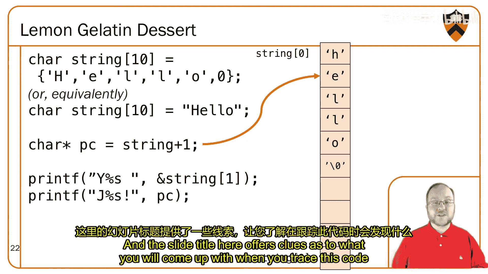
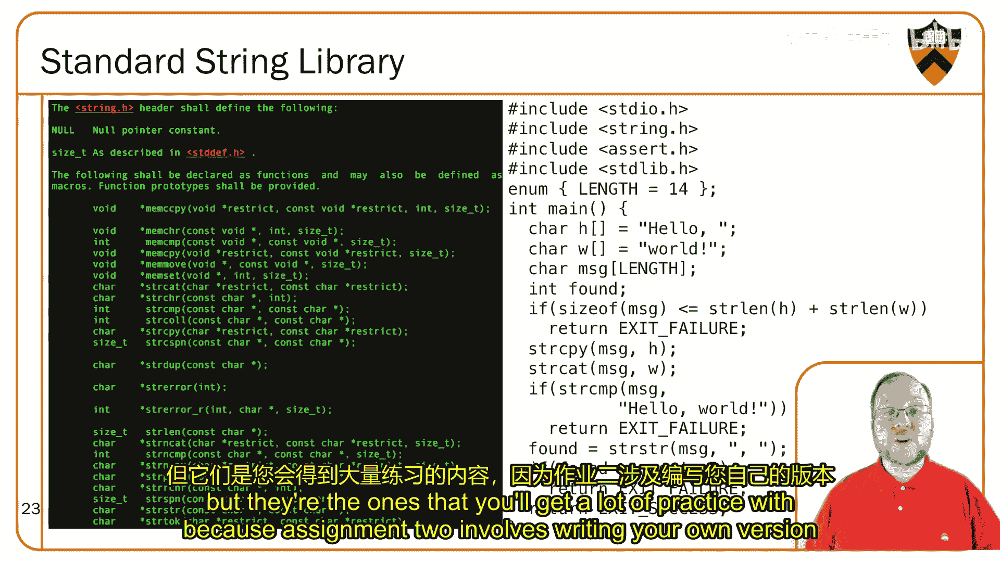
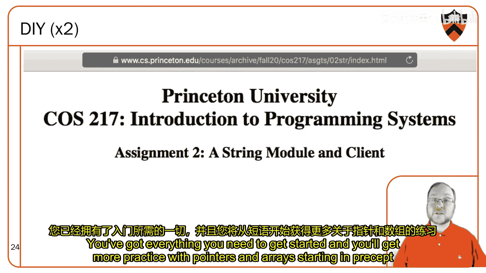

# 【全集 秋季版】普林斯顿大学 C语言系统编程 中英字幕 p09 Lecture 9 - 指针、数组与字符串 -BV1u1feBoEsK_p9-

Welcome back to Co 217 lecture。 This is the third of the Crash courseur lectures in the sea language。

This time we have something truly new versus what you've already seen in Java， pointers。

And then later， we'll cover arrays and strings， both of which Java has， but seas are way different。

Pointers are fundamental to the sea language。 Every now and again， I run into people who say。

 oh yeah。 I learn sea once， but I never really got the hang of pointers。And to me。

 it kind of sounds like saying， oh， yeah。 I speak a foreign language。

 but I don't really know anything about the verbs in it。

But it is a surprisingly useful language feature to have the ability for one variable to reference another。

Either in another variable or another location of memory。 you've seen this in Java。

 where after dynamically allocating some memory using new。

 you'll often want to hang on to it to use it for a while。

 So you assign it to a variable that can be your named handle on that object。

And once you have that handle， it's convenient to pass it around to functions。

 rather than requiring every function to make its own deep copy of the object。

It's also nice that you can have multiple different references all referencing the same underlying object。

That way， if the object changes， the change is reflected in all the observers。

If a language wants this feature where a variable can serve as a reference to another variable or another location of memory。

 there are decisions to be made。Can the reference point to anything or only something of a specific type。

And what operations should we be able to do with that reference， Obviously。

 we have to make it able to assign it to point at something。

 and we have to be able to get from the reference back to the data it references。

 but might there be more。And finally， how do we represent this type in memory anyway？

C provides this feature with a category of types called pointers， which， as the name suggests。

 point at other data。A pointer's type is made up of two elements。

 an asterisk indicating it to be a pointer and the name of the type at which it points。

So a pointer to an integer like PI in this code is different from a pointer to a double like PD in this code。

One is int star and the other is double star， and these are different types。

The underlying representation of a pointer in C is just the memory address of the data that it references。

Because different architectures have different size addresses。

 That means that the size of a pointer is architecture dependent。On armla。

 addresses are 8 bys and the sewer pointers。 And it doesn't actually matter what the pointer references。

 The pointer size will always be 8 Bs because because whether it's pointing to a 1 B cha or a 16 B long double。

The size of the address will always be8 bytes。We can figure out the address of a variable using the address of operator。

 the imp percent。So in this example， if cyclic is stored in memory at address K in orange。

Then when P I gets assigned to be the address of cyclic， P's contents and memory become K。

Before that， PI's contents were zero because it was initialized to null。

 that's a value that indicates the pointer doesn't point anywhere， or it points at nothing。

On our system and most systems， null is 0。 And we're guaranteed that that's not to be an accessible address。

 except by the O S。 So here we have some safety that if we try to dereence a pointer that is null。

 we will crash。 This seems like a bad thing。 but it's actually a good thing。

 It stops us from going off and accessing memory that we have no right to access。

The other key operator here is to dereference the pointer that is get at the actual data that is pointing at。

 and that's the asterisk operator this is distinct from the asterisk used as multiplication for numeric types。

We can use the dereference operator in order to either read from the reference memory。

 such as we do with star PD here， or to write to the reference memory like with star PI here。

See also provides a few more logical and traver pointer operations that we'll see in later examples。

So let's take a drive through a second example here we have two ints， life and Jackie。

 both initialized to 42。Then we have three pointers， Adams pointing at life， Brooklyn。

 pointing at Jackie and a pointer to an intpointer pointing at Adams。 And， yes， I know。

 Naming a pointer to a pointer Meta is trending a bit too hard towards the dead jokes territory。

 I'll work on it。On the slide， you can see the memory layout of these variables。

 The exact order between them doesn't matter。 So let's just assume that they're in memory in the order that we declared them starting at address K。

 again， just an arbitrary address。In the two prints。

 there are seven comparisons using a mix of dereencing and address of。

 each of which will evaluate either one， true or0 false。

Pause the video here and work through the seven comparisons。

Adams is not equal to Brooklyn because they point different places。

 but star Adams is equal to star Brooklyn， because the two different places they point both happen to have the same value。

Meta does equal。The address of Adams， because its contents are Adam's address。

 that is to say it points to Adams。Meta is not equal to the address of Brooklyn because it points at Adams。

 not Brooklyn， its contents are K+ 8， not K+ 16。Star metata equals atoms because we followed the arrow and arrive at atoms。

 So we compare Adam's contents K with themselves， K and get true。

Star metata is not equal to Brooklyn because we follow the arrow and compare Adam's contents K with Brooklyn's contents K plus 4 that gets false。

Finally， though， starstar Meta does equal star Brooklyn because it's the same as our second comparison。

 star star metata is the same as star atoms， so it's 42。

 the same as star Brooklyn is 42 just in a different location。All right。

 so now imagine that we assign ats to point the same thing Brooklyn points to。

Adam's contents become K+4。Now pause the video again and work through the same seven comparisons。

All right， so now ats equals Brooklyn because they both have the contents K+ 4。

 so our first comparison is now one where it was zero before。In the second row。

 the second comparison， metata still doesn't equal the address of Brooklyn because metata still has contents。

 K plus 8， not K plus 4。But in the penultimate one。

 star metata now does equal Brooklyn because Brooklyn's contents are now K plus 4。

 and so are star metata， which is to say atoms。This might have fri your brain， if so。

 take a deep breath， take a step back， work through these examples again。

 and I really encourage you to draw out the diagrams。 I know they're on the screen。

 but if you don't fully understand what's in memory at every location at every given time。

 you're really going to be fighting upstream to understand what's going on in the program。

So dry out the memory schematic yourself。Allright， so we'll come back to more pointtry goodness soon。

 but first let's take a quick primer on array。Pointers may have been completely new to you。

 but hopefully arrays are a little bit more familiar。

 even though that they are quite a bit different than they are in Java。

Arays are a common feature across many languages， and it makes sense it's natural to be able to group elements of the same type that usually have some sort of semantic relationship。

And it would be nice if we could group them by name。

 so we don't need a separate variable name for each member of the group。

 And even better if we can reference each individually by some sort of。

Algebraic or programmatic method， which is normally how we're going to use indexing。

That means that we can iterate through or loop through in other ways to access each of the elements by name。

 but without having to have separate different names。Also。

 we figure that it's common that if we access one element of the group。

 it's quite likely we'll access the next element soon。 So in that case。

 it would be efficient if we stored them together in memory。

So let's return to our standard comparison language。

We'll examine how as work in Java just as a refresher。In Java。

 arrays are always dynamically allocated in the heap。

 even when the values in the array are known at compile time， such as with an initializer list。

 there's still a dynamic allocation that's happening at runtime under the hood。

Araser implemented as objects， and so we have a handle to the array object in the heap via a variable called the reference。

Under the hood， this stores the address in the heap of the actual array object。But in Java。

 we have no real way to access the address itself。Everything goes through this handle。

And the only thing we can do with this handle is assign it。

 copy its value as part of another assignment or function call。

 or dereence it using the dot operator to access a field or the bracket operator to access an index。

When we pass the array to a function， we're really just making a new copy of the reference for use as the function parameter。

 The parameter will just reference the same underlying object in the heap。

Same goes for assign signing an array with another。This just says point R3 to the same thing R1。2。

 it's an alias， it's not really a copy。So C also has a arrays， which like in Java are contiguous。

 values in memory， all of the same type。And like in Java。

 they can be accessed using bracket syntax to syntax。To index into the array。And like in Java。

 it's indexed from zero。Also， like in Java， we can initialize the array elements one at a time or upon declaration with an initializer list。

But that relatively nice list aside， that's pretty much where the similarities end。In C。

 while arrays can be dynamically allocated in the heap。

 which we'll talk about starting next week and continuing into the following week。

 there's also an option for arrays to be stored along with the other local variables in the stack。

The restriction on creating the latter type of array is that the length of the array must be known at compile time。

We'll call these fixed length arrays or compile time to find arrays。

 they're also called statically allocated arrays， but static has another meaning in the C language。

 in fact， two more meaning in the C language， both of which are different from the Java meaning of static。

 so let's not have a fourth definition。All right， so let's jump。

 jump in with a few syntactic differences that stand out to us。So number one， the brackets moved。

Whereas in Java， it's customary to put the brackets as part of the type name in C。

 it's required that the brackets go after the variable name。And whereas in Java。

 it's illegal to specify the size of an array upon declaration by putting the size in the brackets as part of the type and C。

 that's actually exactly how you specify the size of a fixed size array。

The only way we can avoid doing this is when we give it an initializer list。

 in which case the size of the array will be the number of items in the list。

We can actually also combine these two in which case the specified values are initialized by the initializer list and the rest of the elements are up to the size are value zero。

Though note that ISOC enforced by the Panantic flag does forbid you from having an empty initializer list。

 so you have to specify at least the first element。Next， there's no field length。

 There's no field for the length of an array。 And， of course， there isn't。

 There's no field anything for arrays because C arrays aren't objects like they are in Java。

We'll see this as a recurring problem once we start passing arrays to functions and especially with dynamically allocated arrays。

 where it would be nice to be able to have some function to look up the size or some field to look up the size。

But within the function where they're defined， a fixed length array can get its size。

It uses size of and size of will give it back the total number of bytes just like we software for the primitive types。

That means that if we get the total number of bytes and we divide by the total number of bytes in each element。

 we can get the length of the array。That being said， this is somewhat awkward。

So going back to the idea that arrays aren't objects。

 so they're not themselves references or addresses， but instead the data itself。

 we also can't alias arrays like we could in Java。However。

 we can get close by using pointers instead of just pure arrays。

 and that'll also serve as a great leading example for additional important pointer topics。

So let's go with that。 You might have heard people say that arrays and C are really just pointers。

 but that's not true。 We just saw a perfect example of how it's not true。

 that arrays are fully fledged data types， such as that size of thing。

 where the size of operator evaluates to the total number of bytes across all the array elements。

But there is a kernel of truth here。So let's explore that。

Note that technically the code on this slide is below the other code that had a loop。

 so it would result in the compiler complaining about mixed declarations in code。

 but imagine that it comes immediately after R1's definition。All right。

 So when we reference an array's name by itself without indexing into it。

 this is treated like a pointer， and it's a pointer to the first bite of the array。

 Think of this as the address of the zeroth element in the array。But again。

 it's treated like a pointer， it isn't actually a pointer。

R isn't a location in memory that stores an address。嗯。

And and so we can't go and assign R one to point to something else。Additionally。

 if we have a pointer that points to an array， we can use the array indexing operator to access elements of the array。

Just as though it was an array type in the first place。

Dereferencing the pointer will get to the underlying array element or one in this case。

 for either reading or for writing。So this does effectively replace Java array aliasing。

 whereas in Java we could have multiple separate references pointing to the same underlying object in C。

 we automatically get one implicit pointer to the actual array and we can have additional separate pointers by pointing as many pointers as we want to that same underlying data。

Continuing with the idea that there's a grain of truth about the interconnected arrays and pointers。

 we find that the reason pointers can index into arrays with the bracket operator is actually that the bracket operator itself under the hood is a pointer operation。

To understand why， though， we need to learn a little bit about the pointer operation that we pushed off in our initial discussion。

 pointer arithmetic。So when we add to a pointer， the intent is to advance the pointer off of its current target。

But if it's a pointer to a multibyte type， so anything other than a char star。

This will require moving multiple bytes after all， when we say move off the target。

 we don't mean move into the middle of the target。So adding to a pointer has to have multiplication built into it。

 For example， if we have an ink pointer and we add one to it。

That's actually changing the pointer to 0。4 bytes later in memory， same with subtraction。

 just moving earlier in memory。Instdentantally， this is why when we declare a pointer。

 we have to indicate the type of the data at which it points。

Because we have to know what this implicit multiplication， what we're multiplying by。And again。

 there is a way to declare that a pointer references arbitrarily sized data。

 but we won't see this in any detail until we start approaching the assignment3 material after fall break。

All right。 So now understanding that pointer arithmetic advances by the size of the element that's being referenced。

 not by just one bite。It starts to make more sense how we could use this to traverse an array。

The address of an int。Let's an interray。 let's say its third element is 4 Bs beyond the address of its second element。

 We know this because arrays are contiguous in memory。

So this would just be adding one to the pointer。And to get the value itself from the address。

 we just need to de referenceence。So the big takeaway here is that we have an equivalence for any array。

 R R of I is the exact same thing as the dereference of R plus I。All right。

 So finishing off the idea of the interplay between arrays and pointers。

 there's one case in which it is absolutely。Equivalent， they are absolutely the same thing。

 And that's in the context of a function parameter。When you pass an array to a function。

 C doesn't make the function parameter an entirely new copy of the array。 Instead。

 the function parameter is a pointer。To the array in the calling function。

A function can have array types as a formal parameter with or without the size。

 if there is a size it's ignored。But when past the function， the entire array isn't coppiied。

 instead， the function parameter is just a pointer to the first element of the array。

 just like you'd get by using the array name alone。So in fact。

 the declarations with either an array or a pointer are completely equivalent。

And you'll see this in assignment too。Another difference here is that。

Because the parameter is actually a pointer， the size of trick doesn't work on the parameter within the function。

 if we call size of on an array parameter， the answer is os8。Why 8， Because it's a pointer， size 8。

 because that's the size of an address on armlap。So we can't use those size T tricks anymore where we have the size T of the array divided by the size T of the element。

That means that this does become a problem in terms of figuring out how long the array is。All right。

 and finally， we talked about passing an array to a function now。

 how do we get one back out of a function？Sedves says you can't have an array type as a return value。

But a function can return a pointer， so we can still return a pointer to the first element。

 which is effectively the same thing as we could get if we had returned an array type variable。

One note of caution here though， if we return something from a function's own stack frame。

We return that value and then the stack frame immediately becomes inactive。

 and so we have no idea what will go on with that value。

 so if we're going to reference that value after the stack frame is inactive。

 we have no idea what will be there。A classic example here is that if we call one function。

 return a value that is just an address in its stack frame， as soon as we call another function。

 it's very likely going to use the exact same memory and then blow away the values that we were referencing。

All right， so our last topic today is strings， which again， are very different from Java。

Almost any programming language has a string concept。

 and it's natural to think of it as a series of characters all in a row。

 And now that we know about as to be a contiguous set of the same type。😊。

That seems a sensible data type in which to implement strings。

And that actually is also what Java does under the hood。 It's just wrapped up in an object or view。

Also， because Java arrays have a length field， it gets the string length more or less for free。

But C doesn't。 This whole idea of not being able to tell how long an array is coming back to bite us almost immediately。

So C's decision here is that。Strings are just an array of characters。 and weirdly。

 they're not even named string。 They're just char stars。

They make no bones about this isn't really a special thing。It's just a pointer to a character。

And there are pretty much no other language features that are built for them。

And in the sense that C was said to have a design goal that the language should be small。

 perhaps a good decision。But strings are so fundamental to many programs and indeed to UniX itself。

 that it's also a problematic one。So for the string length consideration where we can't use the underlying size of the array because we don't know what it is。

嗯。There are a few options。We could pack the size into a prefix of the string。

 So start off the string array with the size， and that would allow us to find the length in constant time。

 But the size is going to be more than one character long。

 So that means that we're going to have a number split over multiple different boxes， if you will。

 multiple elements of a char array。 So this is weird and sort of breaks the idea of a char array。

Also， even if we do that， it's taking up elements， and so that means that our cha array at index0 doesn't have the first letter in the string。

This seems potentially bad if we're not going to provide some sort of interface to hide this to abstract this away。

 if we're going to treat strings as just character arrays。

 the first character in the array darnwell better be at index 0。

So an alternative is a trailing sententinel。 It says when you see this character stop。

 this is the end of the string。The bad thing about this is that it's no longer a constant time look up for the string length。

 It's linear。 We have to go all the way through the string until we find the， the location。

But this is what C chose。 And given the prominence of addresses in C， I think the rationale was that。

Using this the the memory address of the string is the address of the first character in the string。

 so we have this， you know index 0 and the addresses match。

 even though were we're inefficient in what is likely a relatively common operation。

String literals in C are just like in Java they're indicated with double quotes。

 but note that the trailing sententinel is not shown the trailing sententinel is the nullbte back slash zero is the character the character literal。

And we don't see that in the double quote string literal， so you have to remember it's there。

 and particularly when you think about the number of bytes that a string will take up。

 it's easy to forget that one。So here's a quick example that ties together pointers and strings。

 There are two different quick initializer methods for strings。

 the first is just the standard array initializer list and the second is a special case initializerizer list that allows initialization of a cha array from a string literal。

These are equivalent except for sort of quirky behavior differences when you have the initializer that is longer than the allocated amount of space。

 which you shouldn't be doing anyway。Just like any other array。

 we can point a pointer at an element of that array。

 and we can also access the array using the array index dereference operation。

And the slide title here offers clues as to what you will come up with when you trace this code and look at the two prints。

So the designers of C chose to have an absolutely minimal string data type。

And they instead pushed all of the string handling and processing into libraries。

The main one is the C standard string library with interface in string。h。

 which is the one that we'll be using in this class。

On the left here is the man page that comes up if you do man string that H， and on the right。

 let's look at some of the major functions from this interface。

So Stirland returns the number of characters in the string， not counting the nobite at the end。Again。

 this is the number of actual characters， not not the null Sentinel。

Stirop copies the contents of the second argument up until the first Nobite into the first argument。

The ordering here is consistent within the library。

 but takes a little bit of getting used to that you tend to have the destination as the first argument。

Stircat concatenates the contents of the second argument up until the first Nobite on to the end of the first argument。

So starting at the location of the existing nullbyte in the first argument。

 which will get overwritten。Stir compump compares two strings returning a value less than1。

0 or greater than one to indicate their lexxiographical relationship。And finally。

 Stster searches for the first occurrence of the second argument。

 the needle as a substring of the first argument， the haystack。

These are just some of the most common methods in the standard library。

 but they're the ones that you'll get a lot of practice with because。

Assignment2 involves writing your own version of these string handling functions， In fact。

 it requires writing two versions for each because you have to write one using primarily pointer notation and the other using primarily array notation。

The assignments available now and is due in two weeks with this lecture。

 you've got everything you need to get started and you'll get more practice with pointers and arrays starting in precept6 next week。

 So good luck。

