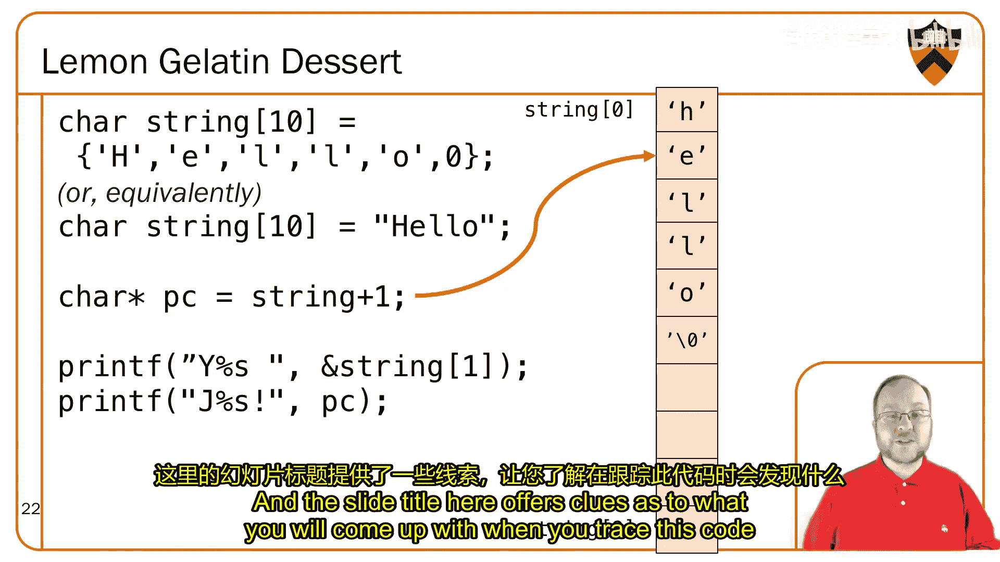
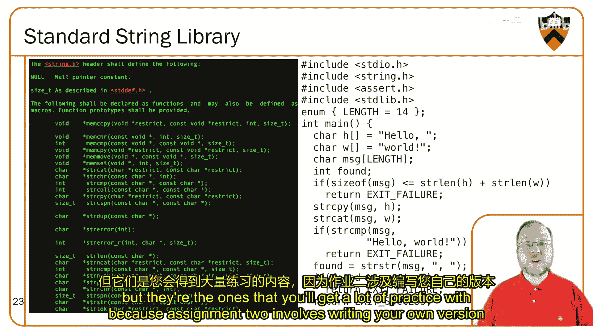
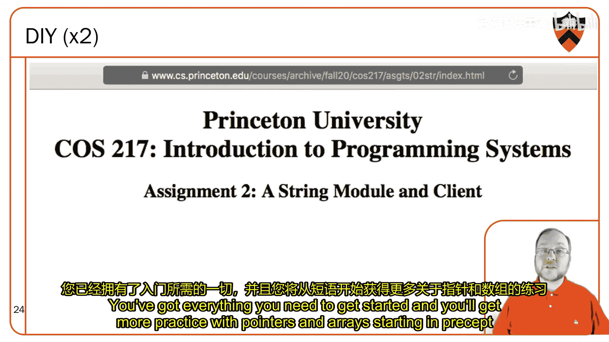

# C语言系统编程：09：指针、数组与字符串 🧭📚

在本节课中，我们将学习C语言中三个核心且相互关联的概念：指针、数组和字符串。我们将从全新的指针概念开始，然后探讨C语言中数组和字符串与Java的显著差异，并理解它们如何通过指针紧密联系。

## 指针基础

上一节我们回顾了课程背景，本节中我们来看看C语言中一个全新的特性：指针。指针是C语言的基础，它允许一个变量引用另一个变量或内存中的某个位置。这与Java中的对象引用有相似之处，但更为底层和灵活。

### 指针是什么？

指针是一种变量类型，其值是另一个值的内存地址。指针的类型由两部分组成：一个星号（`*`）表示这是一个指针，以及它所指向的数据类型。

**代码示例：**
```c
int *pi;      // 指向整数的指针
double *pd;   // 指向双精度浮点数的指针
```
`int *` 和 `double *` 是不同的类型。

### 指针的表示与大小

在C语言中，指针的底层表示就是它所指向数据的内存地址。指针的大小取决于计算机架构的地址总线宽度。在ARM架构上，地址是8字节，因此指针的大小总是8字节，无论它指向的是1字节的`char`还是16字节的`long double`。

### 关键操作符

以下是两个处理指针的核心操作符：

1.  **取地址操作符 (`&`)**：获取变量的内存地址。
    ```c
    int cyclic = 42;
    int *pi = &cyclic; // pi 现在存储了cyclic的地址
    ```

2.  **解引用操作符 (`*`)**：通过指针访问或修改它所指向的数据。
    ```c
    *pi = 100; // 将cyclic的值改为100
    int value = *pi; // 读取cyclic的值
    ```

### 空指针

指针可以被初始化为`NULL`，这是一个表示“不指向任何地方”的特殊值。尝试解引用一个空指针会导致程序崩溃，这实际上是一种安全机制，防止访问非法内存。

## 指针深入示例

为了加深理解，让我们分析一个更复杂的例子，其中涉及指针的比较和赋值。

假设我们有以下变量和内存布局（地址为示意）：
```c
int life = 42, jackie = 42;
int *adams = &life;       // adams 指向 life
int *brooklyn = &jackie;  // brooklyn 指向 jackie
int **meta = &adams;      // meta 是一个指向指针的指针，它指向 adams
```

以下是基于初始状态的七次比较及其结果：

1.  `adams != brooklyn` -> **真** (指向不同地址)
2.  `*adams == *brooklyn` -> **真** (指向的值都是42)
3.  `meta == &adams` -> **真** (meta的值就是adams的地址)
4.  `meta == &brooklyn` -> **假** (meta不指向brooklyn)
5.  `*meta == adams` -> **真** (解引用meta得到adams，比较地址)
6.  `*meta == brooklyn` -> **假** (adams的地址不等于brooklyn的地址)
7.  `**meta == *brooklyn` -> **真** (都是42)

现在，如果我们执行 `adams = brooklyn;`，让`adams`也指向`jackie`，那么上述比较的结果会发生变化。例如，第一次比较 `adams == brooklyn` 将变为**真**。

**关键建议**：要彻底理解指针，请务必在纸上画出内存示意图，跟踪每个变量在每一步的地址和值。

## C语言中的数组

理解了指针之后，我们来看看一个更熟悉但实现方式迥异的概念：数组。数组用于将相同类型的元素组合在一起，并通过索引访问。

### 与Java数组的对比

C语言中的数组与Java数组有几个根本区别：

1.  **声明语法**：在C中，括号放在变量名之后，并且可以在声明时指定大小。
    ```c
    int arr[10]; // 正确：声明一个包含10个整数的数组
    // int[10] arr; // 错误：Java语法在C中无效
    ```

2.  **存储位置**：C数组可以存储在栈上（固定长度数组），也可以动态分配在堆上。栈上数组的长度必须在编译时已知。

3.  **长度信息**：C数组不是对象，没有像Java那样的`.length`字段。在定义数组的函数内部，可以使用`sizeof`运算符计算长度：
    ```c
    int length = sizeof(arr) / sizeof(arr[0]);
    ```

4.  **数组名**：当单独使用数组名时（不带索引），它会被视为一个指向数组第一个元素的指针（即`&arr[0]`）。但请注意，数组名本身不是一个存储地址的指针变量，你不能给它重新赋值。

### 数组与指针的等价性

虽然数组不是指针，但它们关系密切：
*   指针可以像数组一样使用下标运算符`[]`来访问元素。
*   函数参数中的数组声明会自动退化为指针。这意味着以下两种函数声明是等价的：
    ```c
    void func(int arr[]);
    void func(int *arr);
    ```
    在函数内部，对这样的参数使用`sizeof`得到的是指针的大小（如8字节），而不是整个数组的大小。

## 指针算术

数组和指针紧密联系的核心在于**指针算术**。

当我们对指针进行加/减运算时，指针移动的字节数取决于它所指向类型的大小。
```c
int *p = ...;
p = p + 1; // p 向前移动 sizeof(int) 个字节（通常是4字节）
```
因此，对于数组`arr`，访问`arr[i]`等价于`*(arr + i)`。下标运算本质上就是指针算术和解引用的组合。

## C语言中的字符串

最后，我们来看C语言中的字符串，它完美体现了数组和指针的结合。

### 字符串的本质

在C语言中，**字符串就是一个以空字符（`'\0'`）结尾的字符数组**。字符串的类型就是`char *`（指向字符的指针）。

**代码示例：**
```c
char str1[] = {'H', 'e', 'l', 'l', 'o', '\0'}; // 字符数组初始化
char str2[] = "Hello"; // 字符串字面量初始化，编译器会自动添加 '\0'
// str1 和 str2 是等价的
```
字符串字面量（如`"Hello"`）在内存中存储时，末尾会自动添加空字符。

### 字符串处理的挑战

由于C字符串只是普通的字符数组，它没有内置长度信息。要获取字符串长度，必须遍历数组直到遇到`'\0'`。这导致许多字符串操作的时间复杂度是O(n)。

### 字符串库函数

为了处理字符串，C标准库提供了`<string.h>`头文件，其中包含一系列函数：



以下是几个最常用的函数：
*   `strlen(const char *s)`：返回字符串的长度（不包括`'\0'`）。
*   `strcpy(char *dest, const char *src)`：将`src`字符串复制到`dest`。
*   `strcat(char *dest, const char *src)`：将`src`字符串拼接到`dest`末尾。
*   `strcmp(const char *s1, const char *s2)`：比较两个字符串。
*   `strstr(const char *haystack, const char *needle)`：在`haystack`中查找`needle`子串。

**注意**：使用这些函数时必须确保目标缓冲区有足够的空间，否则会导致缓冲区溢出，这是常见的安全漏洞来源。

## 总结

本节课中我们一起学习了C语言的三个基石：
1.  **指针**：存储内存地址的变量，通过`&`取址，通过`*`解引用。指针算术是理解数据布局的关键。
2.  **数组**：同类型元素的连续集合。数组名在多数情况下可视为指向其首元素的指针。C数组没有内置长度属性。
3.  **字符串**：以`'\0'`结尾的字符数组。字符串处理依赖于标准库函数，并需要程序员谨慎管理内存。





理解指针、数组和字符串之间的关系——特别是“数组退化为指针”和“字符串即字符数组”——对于掌握C语言编程至关重要。在接下来的作业和实践中，你将有机会深入运用这些概念。