# 【全集 秋季版】普林斯顿大学 C语言系统编程 中英字幕 p10 Lecture 10 - 使用make构建 -BV1u1feBoEsK_p10-

Welcome back to the Co 217 lecture。 Today day， we're going to step back from the details and design decisions of the C programming language and turn to the other key focus of this first half of the semester。

😊，Programming tools and the programming maturity aspect that were looking to develop the ability to be more than just casual hackers and more of structured engineering approaches to software design。

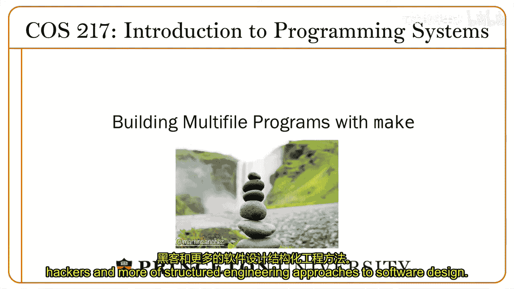

So last week can precept， you worked on a running example of a program to learn about multi file C programs。

This was version 3， just with the comments taken out so we can fit on the slides。

As a quick reminder of the program， we had an interface file in maththth。

That declared GCD and LCM both to be functions that return an int after taking two ink parameters。

The implementation of these functions is in intmth。c where we pound include intmth。

h using quotation marks rather than the angle brackets。

 since this is a local file and not part of the C standard library。

Including it in the implementation allows us to type check the definitions of these functions against the declarations that we declared in the header file。

Testinm。c is the client program。It also PaM includes inMth。

h so that the compiler can check the calls of GCD and LCM versus the interface。

Note that because both of these two C files pound include int math dot H。

 If we change ink math dot H， effectively， we have changed each of the two C files as well。

 This is because the first stage of the build process is going to be the preprocesor pulling the declarations into the C file from the dot H file。

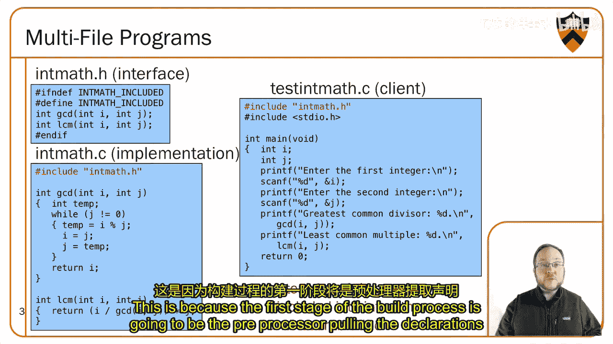

So thinking about this as we build are executable， changing int math that age effectively changes all three of the files。

 so we must recompile both of the dot C files and then reassemble and relink。

But that would actually also be true if we touched any of the three。

 because it's all one command when we do our shortcut GCC217 command all in one。That's okay here。

 It's two very small sea files， but real world projects have quite a few more。

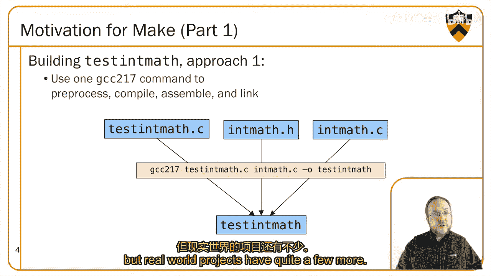

It's not unreasonable for there to be hundreds or thousands of C andt H files on a project。

As of this month， Bash has about 375 such files， and as of 2018。

 the Linux kernel consists of over 25000 C files and over 20000 header files。

The Windows code base as of 2017 is about3 and a half million files of all types。

So with the large number of files and the potentially complicated dependency chains。

 even though this comic is a trope， it's true that there are projects where compilation of everything and linking of everything will take hours。

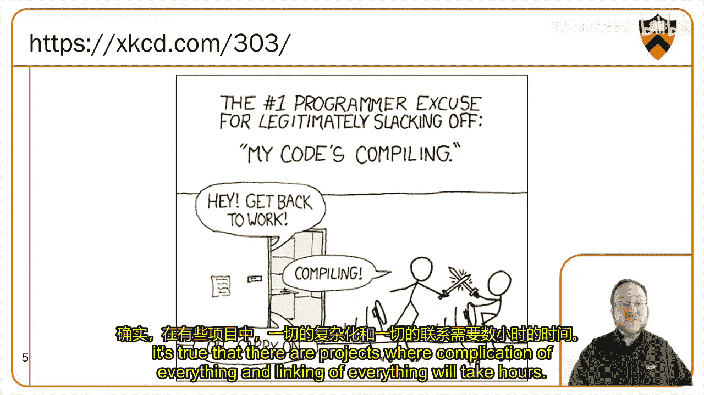

Monolithic build processes that take into the hours would be a very challenging development environment。

 effectively returning the battle days of punch cards。

 where basically everything was a batch job instead of an interactive login session。

So as a first step to avoid this， in the real world。

 the build process is done in two levels rather than with the all in one shortcut。

Step one is to pre processcess， compile and assemble the dot C files to generate dot O files。

And then step 2 is to link the doto files to generate the executable binary。

What benefit does this give， Take a moment to think about it。 And as a hint。

 consider that a key element of this scheme is that we retain the created dot o fileses。

Pause the video and take a minute to think about it。

The key benefit is that if we build each dotto file separately and keep them around。

Then we only have to rebuild things downstream directly from any change。

 So if we change int mathth dot C， that doesn't really， in any way， impact Test int math O。

 So we don't have any new work to do there。We just rebuild int Madato and then relink our old Testint matduto and our new int matdato into the new executable。

As is this saves 50% of the potential dot O files from being rebuilt。

 But if your program is much wider with many dot o files， this could be an even bigger win。

So in this same program， let's go back and look at our original premise， we change in mathth。h。

 which is effectively changing both of the C files。Even partial builds won't save us here。

If interfaces are widely included， which is common。

 then changes to them have dramatic downstream effects。

 That's why we often emphasize thinking hard about your interfaces。

 which are much harder to change versus your module implementations。

 which may not have as many levels of code， depending on them。So this sounds nice in theory。

 but real talk， isn't it just easier to use the shortcut because you don't have to keep track of what has changed versus what hasn't？

Well， it would be nice if there was a tool that used the dependency graphs we showed in the previous slides and automatically figured out which files needed to be rebuilt based on when they were last edited。

 perhaps。At least relative to the other items in the dependency graph。We'd totally use that， right。

 that would be great。😊，Well， that's MI。 It's a tool in which you specify the dependency graph in text。

 actually pretty close to the text format we had you use for the DFA in assignment1。

And it analyzes your files' modification times and figures out which need to be rebuilt and which don't among the components of your program。

I think it's a really great tool that everyone should use but。Frankly， most terms， people say。

 I'll learn about it later， I'm going to just use the other things you've told me about using my history and command R sorry。

 control R and searching through and it'll be fine。

But after a while you find that you do have a of builds， a lot of different build commands。

 and you do have other things that make it so this can be a nice tool。

 I encourage you to give it a chance。So。嗯。As a quick aside， obligatory Princeton content。

 Sew Feldman a class of 68 is the one who wrote the first version of make in the Unix tradition he did it over a weekend because he was frustrated that things weren't working on the project and he kept wasting time due to inefficient and ineffectual builds where things got updated and weren't rebuilt or things weren't updated and yet were completely rebuilt so he did this at Bell Labs really in the nascent days of the Unix project Sew Feldman's an interesting guy you can see some small part of his resume there。

 a prolific career。I now even being board chair of the Center for Minorities and People with Disabilities in IT。

 so a really broad not a traditional engineering approach to this either。

 especially for someone from let's call it the previous generation。

So the tool survives many iterations later in a modern canoeue version。

 The command itself is quite simple。 In the common case。

 you invoke it with make and the name of one or more target files that you want to build。

As an option， you can give the name of the MEC file。But if。

You don't by default the tool will look for files called makeFile or capitalized make fileile and those are the two sort of default names that most people will use I personally like capital makeFile just because the way that the LS command alphabetizes it puts it earlier。

 but your choice in terms of the exact naming except for assignments where we'll tell you exactly what you have to name it。

So there are numerous other options to control， for example。

 what it prints out or what it does when it encounters an error。

Or what environment variables it looks at or doesn't look at。

 but for this class we're mostly concerned just with the basic cases for targets and pseudo targetsrg。

So that's the command。 But the real attention to detail comes in making。

 crafting the make file itself with those targets and pseudo targets。

So the dependency graph in the makeCFile is represented as a series of targets。

 a series of things you might want to build。Each target has zero or more dependencies。

 AK prerequisites， which must exist before the target can be built。

 and then a command that will be run to build the target once the prerequisites are satisfied。

The target will be rebuilt if it is older than some of its prerequisites After all。

 if they've changed， it will probably have to change two。

 so this isn't just a matter of this doesn't exist how to build it。

 but also there is the logic that the tool has of what do I need to rebuild based on what has changed in the system。

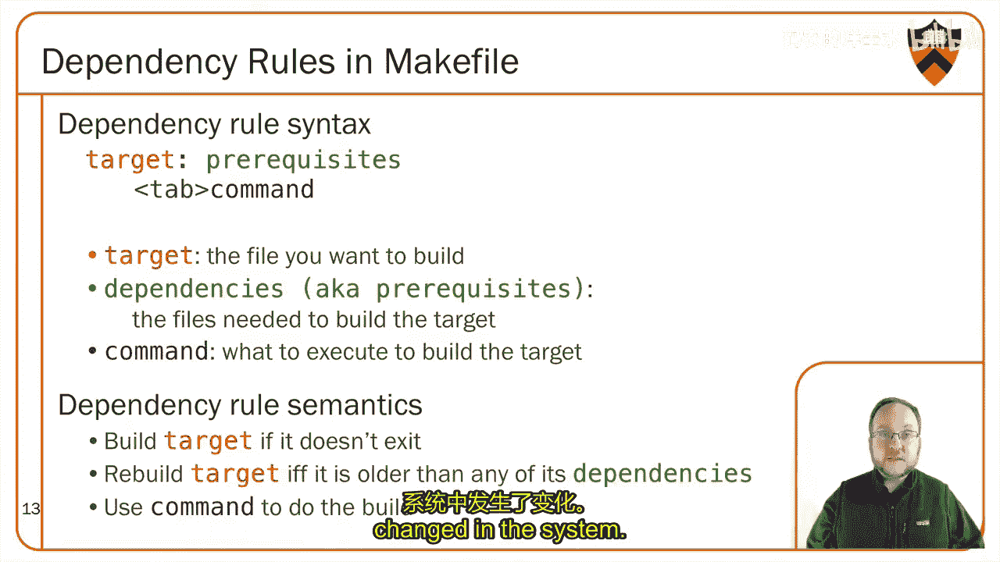

So let's take a look at the make file for our running in math example。

Each of the three partial build steps in the tan boxes is represented as a command in the make file。

So how do we build testant math？It's the bottom GCC command。And where is that in the mic file。

 it's the first target。The command is exactly what we see in the tan box。

 and the dependencies are the exact dependencies we see in the graph， the 2。 files。

But note that dependencies may be more than just the files mentioned in the compilation command。

 For example， for example， we never include the header files in the compile command。

 But our premise in this entire time has been that we have dependencies on them。

 Re if ink math dot H changes。That impacts both of the two do C files in building their dots。

So returning to our new partially built friend Testestant Madato。

 how does it get to that partially built state。It's the tan0 box in the top left。

 which compiles it out of Testestin mathth dot C。But， we know。It also depends on int math that age。

 so we need to make this explicit in the make files prerequisite list。

So let's look at this second rule， we also see something clever the target of this rule is a prerequisite of a previous rule。

We've said that the command gets executed if the prerequisites are met。

 but until now I've sort of alllighted over what happens when the prerequisite is not met。

What happens that it tries to make those prerequisites？

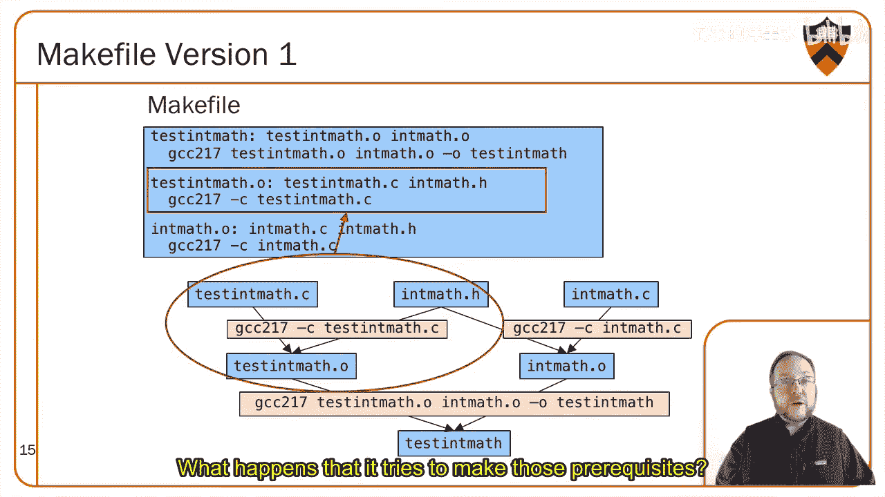

Recursion is at the heart of make。So let's step through this process， we try to make the executable。

 which doesn't exist。So make checks on its prerequisites， the first doesn't exist。

So we recur and make the prerequisite。You can see in the bottom of the window that the first compilation that happens in the command to build Testant math。

The is the first prerequisite TestantMth。c being compiled into Testantmath。o。

So we then checked as in mathth。hex， it does， and now we can do that command。

So having accomplished that， we checked the box that test int mathth do O is done。

 and now we can check on the second prerequisite。 Does int maththdo O exist。Again， it doesn't。

 so we're going to recur。We're going to check is in math。c， does it exist， it does。

We'll check the second prerequisite for intmth。 inmth。h， it also exists。

 and so now we're able to invoke the second command in the bottom box， Gcc217 minus C intmth。

c to build intmth。So we produce in Math。0， and at this point now we've satisfied both of the prerequisites for testant math。

 and we can in fact produce testant math。

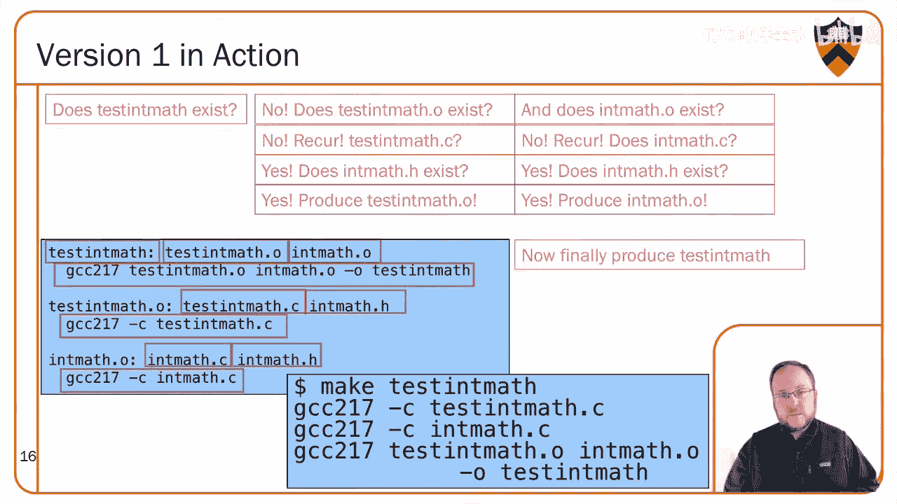

So now let's explore the partial builds in action。 As we just saw initially。

 all three of the GCC commands were executed。But now， after we've produced Testant math。

If we touch int mathth dot C and remake。We only have to rebuild the portion that changed TestestantMth。

0 hasn't changed， so we don't rebuild it。You'll see here that there was no GCC 217 minus C test in mathU C resulting from the second make invocation。

And if we do another make immediately， we'll see that nothing has changed。

 so there's no work to be done。We can also just do make here and this shows that the default target is the first one in the file we'll talk about the conventions of this in a bit。

 but first let's check on your understanding of the targets and dependencies。

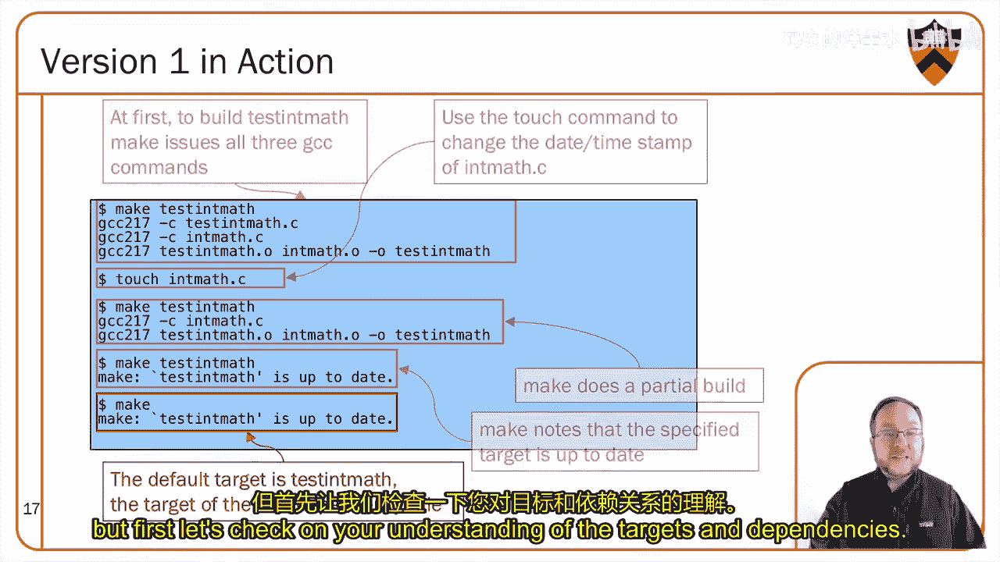

So pause the video here and consider this question about what files should be prerequisites for building8 Auto。

Certainly we need A at C， but A c depends on a H and c H， and c H recursively depends on D H。

 so we need all of them E。More generally， a proper dependency rule for any dot O file is going to include prerequisites for the corresponding C file。

 but also the entire hierarchy of H files included from that C file。Here's another one。 Again。

 pauseuse the video and take a crack at this。 Write down or otherwise give some explicit manifestation of your vote。

 hold yourself accountable so that you can't just say， oh yeah。 I knew that。 because frankly， oh。

 yeah， I knew that when reading the released answer key after bombing an exam is little consolation。

So here， unlike before， we don't have a big chain of prerequisites， the executable lists only the 2。

0 files as prerequisites。The2 Nato files， which will themselves be targets in the make file。

 at least usually。And then the make file， if that's the case。

 will do recursive descent to determine if D do H or C do H or A H or A。 C or B。 C have changed。

But it only relies directly on a0 and b0 for a。So our answer is A。

More generally and executable will depend only on dot O files， not on dot C files or header files。

This maximizes partial builds and maximizes our use of the MakeF's recursive dependency checking and building。

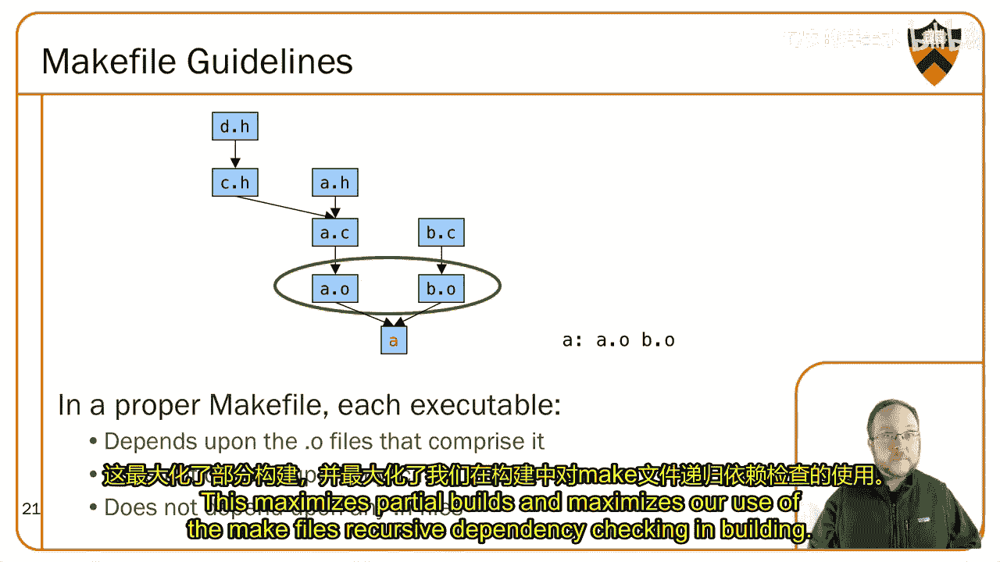

The next makeFile feature that we need to know about is pseudo targetsrgets。

 which are rules whose commands don't actually create a file with the target's name。

That's why they're also called non file targets。These are shortcuts that are idiomatic to trick make fileile and to trick make into doing some work for us。

 Let's see how they work。We'll use the example make all in this version that so make observes that all doesn't exist。

 there's no file called all in the dependency。But it depends on testent math。

 So that might or might not exist。 So make will say， I'm going to recur and go make testent math。

Once Testant math exists and is up to date。All's prerequisites are satisfied。 so make now builds all。

 But what's the command for that？ There isn't one。And that's okay。

 because all of the make file commands have no post condition check。

 There's no check to make sure that the file actually got created。 There's only an exit status check。

 which says， did the command that I run fail。 In this case， it didn't run a command。

 so it didn't fail。And it doesn't matter that the file called All wasn't created。

So there's no file named all， there will never be a file named all。

 and so all will always continually causeM to try to build its prerequisites。

We just saw that the default target to build is the first one in the file。

 and so combining these two ideas， you'll often see that the first target in the file is the pseudo target all。

 and typically its prerequisites will be all of the executables that the makeC file can produce。

But another common alternative for the first target is make help or something like it that will just produce a usage message telling you what targets are available that way。

 just typing make doesn't result in potentially a lengthy set of builds of building a whole lot of different commands。

Other common pseudo targets， along with all are clean and cleverber and note that all clean cleverber help。

 these are just convention， they're typical names， but they aren't special。

 they're not keywords or standards， they're just descriptive。

So looking at this clobber and clean command， pause the video and see if you can predict what cloer does step by step。

So when we do make Clber， make observes that the clubber file doesn't exist。

 and so it has to be built。So make looks at its dependencies and sees that clean is a prerequisite for club。

So make goes and says， well， I'm going to make clean and I observed that the clean file doesn't exist。

The clean file has no dependencies， so make moves immediately on to the command for clean。

It issues the command RM minus F， Testant math， and startup O。

This deletes the executable binary file and all the dot0 files that made it up and it returns success。

It doesn't actually create a file calledC， but again， make doesn't check this。

We pop back up to the initial dependency rule，Clber， and now having satisfied its prerequisite clean。

 we build， supposedly， the clubbbber file by issuing the command RM minus F， star Tilda and hashtag。

 star hashtag。This deletes all of the special files left around by EmX。

 the backup files and the work in progress files。 Again， it doesn't create an actual file name cler。

 make doesn't know or care。So again， here， we're tricking make into doing or bidding there's no file name cler。

 there will never be a file name cler and so we can run makeClaber over and over again to do this cleanup work for us。

So let's add some pseudo targets to our make file and see what it looks like。

We'll make the commonly used all pseudo target to build our executable。

 and we'll put for it as the first rule just so that running make will invoke it。

 We'll add a rule for clean and that will remove the executable and the intermediate dot O files like we saw。

 But note， we might not want to automatically put this dot O file in the make clean unless we aren't going to run make clean very often。

 because remember， partial builds are our friend in this in at this point。

And then one more rule for Klober just to clean up the junk files left over from our editing process like we saw in the previous slide。

 and this is version 2 of our makeC file。So non filele targets are used really heavily。

 particularly to automate or semiaumate repeated commands。

 as an example Make Subm might run the submit command with all of the right required files。

 in this case you could say， okay， I'm going to go to the assignment specification。

 copy down all of the things I have to submit and then put it in the make files so I can just type make submitm rather than trying to remember that set of three or four or 10 commands in a row。

I could do make Splint to run the commands the Splint command on all the appropriate files or make critter to do a critter analysis on all of the appropriate files again。

 this is a nice handy shortcut rather than going back to the specification and trying to find what was that command again Similarlyly I actually use this literally every time I upload a video I do make publish that will push all of the appropriate PDFs to the web and name them the right thing and put them the right folder and give them the right access rights so that they're visible on the course website。

And then after we talk about testing， you'll see that make test is a common thing to run an entire regression suite automatically。

So at this point， we have a nice automated build system that it can clean up after itself。

 and we could expand it to do some naturally nice things that we will often want to do with our source code。

So next we'll explore some advanced features of makeC fileses。

So in the continuing theme of exploring the sea preprocessors's capabilities。

 you remember pound Define。If you don't， you'll get a refresher soon when you tackle replace and write in assignment two。

Make files have a similar feature for creating variables that then get substituted in each time they appear within the rules。

This syntax looks just like a C variable assignment on the left is the variable name。

 on the right is the value assigned in this case， the value that will be replaced textually with an equal sign in between。

So then we can refer to the variables using the variable name in Parends with a dollar sign before it。

And this is a common way using these macros to have two versions of your program， for instance。

 for portability， for debugging， or to switch between a stable and a developmental version of your code。

 though frankly， source control branching is probably better for the letter case。

It's convenient because we can do it so that no matter how many different files in our code base we would have to change to make to say。

 oh， I want to change to the debugging version or the non debugging version。

 we in fact will only have to change a single line in the single file。

 the make file itself to swap between them。So here we have C is GCC217， the pound sign M。

 the pound sign here indicates a comment， so this is just saying hey， this is our GCC217 command。

 but all we have to do is take off this comment and suddenly now it's GCC 217 M。

 which is a version that we'll see later in the course where we're doing some。

Memory tracking as we do dynamic memory。Similarly， Yak and bison are the two standard tools。

 all of the Gnu tools have punny names if there's some other standard tool。

 so bison is a play on Yak， which yak itself was yet another compiler compiler again beyond the scope of what you need to know。

 but these are two tools that are equivalent and just one or the other will appear on any given machine。

 so it's convenient to make a MIIC file in which we can just swap between them depending on which machine we're on and what tool set it has available。

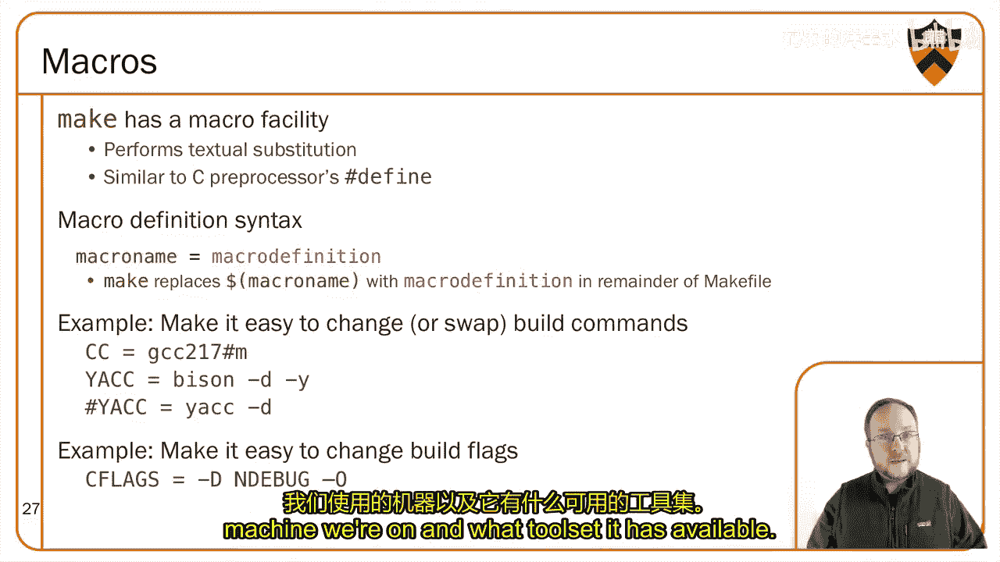

So here's the third version of the code， again， we establish a macro for using GCC 217 or GCC 217M。

 we also have several options for debugging， adding minus G or not so that we can enable debugging GDP。

Minus capital D is how we add an extra definition to the command line。

 so minus D and debu is exactly like we had done pound define NDbu somewhere in our program。

 and we'll see what this actually means next week when we talk about testing strategies。And finally。

 minus o is turning on optimization， and we'll see that in some detail later on in the course once we talk about assembly language。

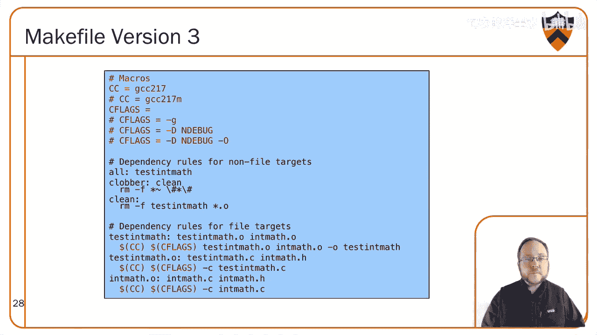

So I mentioned it briefly above， but the commands have to begin with a tab character。

It feels weird and antiquated now， but because all editors these days don't actually use tabs for indenting instead they replace them with spaces。

 but in a make fileile you have to have an actual tab character at the beating of the command second and the second line in each target command So this is weird。

 but editors know about make file so it's okay Eax， for example。

 will' put a tab when there's when it's in make fileile mode and it automatically turns on make file mode if the file name is lowercase or uppercase make fileile。

And if you ever wanted to create a M file， that was not that， you can do escapescapeX makeFile mode。

Other editors can be similarly configured to treat make files as special based on either their name or some runtime configuration。

Some other gotchas about make files。So you have to make make actually do something。

Lots of people will define an all and then think sort of as though it were a switch statement that we can have sort of a fall through。

 and so if all has no prerequisites and no command。

 your make file will forever sit there saying there's nothing to be done for all。And similarly。

 every year， I get somebody in office hours who says， hi。

 I don't understand why my make file isn't doing anything。

 And what happens is that they remembered to write a clean or a coer rule。

 but they put them as the first target。 So typing make just removes all the intermediate files and resets the directory。

 And so they tape make again。 And it's a perfectly clean directory every single time。

So if you're going to write all as your first rule。

 it needs to do something meaningful and all or your actual target should be your first rule。

And finally， make files are awesome because they can automate things。

 but automating things can be scary， so automating deleting files or other operations you can't undo be careful with that commands like RM minus F where minus F says remove the file don't ask me about it and don't tell me if anything went wrong kind of scary to say to have that be the command that you're doing automatically based on a make file that you think is right。

All right， so thus far we've talked about how to write make files from scratch。Frankly， though。

 I'm pretty convinced that。All of the make files in the existence save the very first one were started off by taking one that already existed。

 copying it and editing it。 And that's totally fine as a strategy When we ask you to write your own So long as the one that your you're taking and editing is one that we've given you。

嗯。There are also automatic make file generating tools that examine your source code and produce the dependency graph for you and then produce the make file from that。

 That said these tools are not fair game for this course。

 We do ask that you compose the make files yourself and not generate them automatically。

So the last couple of slides today are dealing with some advanced features just so you've seen them。

 You won't be expected to produce them， but familiarity could be advantageous when trying to read someone else's make file because I'm not sure what it is about make fileses。

 Maybe it's the Terse nature of it， or maybe it's because nobody ever writes their own and they copy and paste other peoples。

 People seem to use some really weird Terse idiomatic stuff and make fileses and indeed。

 make has a whole bunch of variables that allow you to do pattern matching of files within your rules and refer to the targets or dependencies automatically or some subsets thereof。

So in this first example， we had test in Madato and int Madato to the left of the minus O。

 and instead we fill that in automatically with a dollar signed carrot。

Which we can see is all the dependencies。And then in the original command we had test in math to the right。

 but here we fill it in with Dear sign at sign to say fill in the target in this place in the command So this is pretty typical it's nice when you're writing a rule and you say I either don't want to repeat the text or maybe if I start adding that to pattern matching。

 I want to use whatever the pattern was because I don't know what the actual files were So in that sense。

 we can see the second example， we had two separate rules。

 one for testin mathdo and one for int mathdo and we replaced it with a single rule。

That would use the dollar sign less than to say the first dependency of this rule， whatever it was。

So this definitely isn't as readable because we have to figure out what pattern applies rather than looking for the exact target。

 if I go searching through my make fileile for testinMth。0。

 I'm not going to find it except in my as a prerequisite in my build command。

 Similarlyly if I go looking for testin mathth。C， I'm never going to find it in my make fileile。

So again， possibly less readable， possibly more cryptic， but on the other hand。

 possibly more readable for a large program than 1000 different。0 file target definitions。

 so you win some you lose some there's definitely both pluses and minuses here。

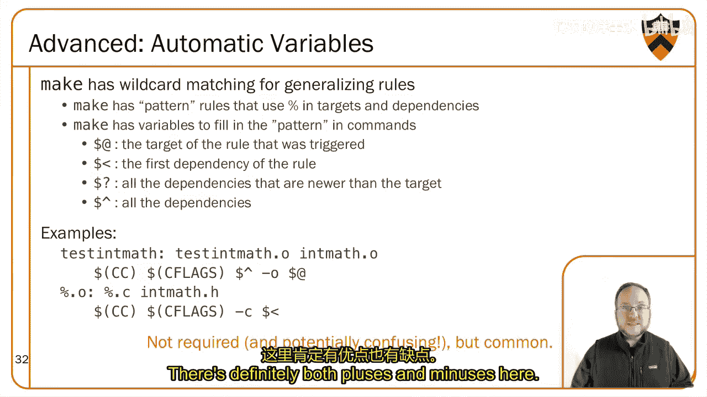

So going one step further than just pattern matching or making slightlyterser commands。

Makeake actually knows how to build C programs in the general case。

 So if you don't give it a command at all， but the target is a dot0 file。

 make will happily use the default Dearinecc variable as your compiler。

 and it will fill in X do C as the source code that it just assumes will make X do O。Similarly。

 it can make executables from dot O fileses and the implicit rules that。

Use the given files for building。It's also cool we'll also use as dependencies for checking modification times。

 so using these implicit rules doesn't actually cost you anything from the other functionality that writing them out explicitly would。

That said， personally， this is where I draw my own line。

 executing commands that aren't written down somewhere。

 at least in a pattern is one step too far for me， and I find this more confusing than it's worth。

 but it is a kind of cool thing to automate and make things sort of minimalist in your build scripts。

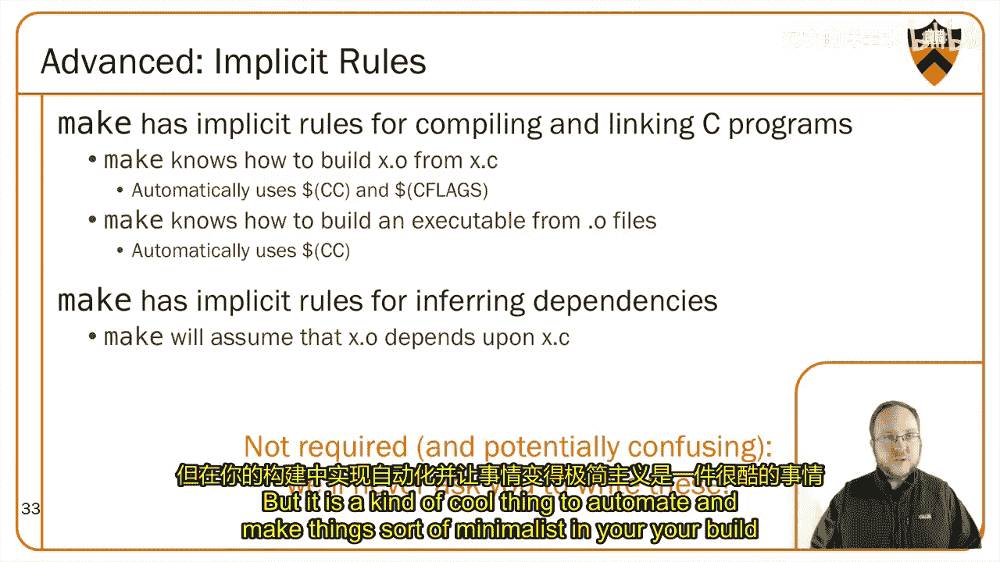

So nevertheless， here is a final look at the extreme limits where we could push our running example。

So our O files lose their commands， their rules lose their commands。And then even furthermore。

 they lose their dot C freerequisites。 So Testin math dot O gets made。

By command we don't see out of just in mathth dot H as far as we can see。

 because the make file knows that testant math。 C would be used to produce Testant math O。

 and it knows that we would use Gcc217 in this case， you the Dear signed C command。

With a minus C to go from a C to an o file。The same thing for in Mathduto。And then for testant math。

 we can see that we give it the two prerequisites of the 2。

O files and it says I can take it from here， if I'm given multiple。0 files。

 I know that I will just put all of them on the line and invoke the linker with my minus O and create the final。

And so this is actually the final version of our makeC file in which we had a whole bunch of lines that are now reduced to three。

We're left with three very terse lines， a partial list of dependencies and that's it。

 and make will happily figure this out， but the poor soul who takes over your code。

 this project from you， will they ever be able to update your make file without having or update your programming in general without having to throw out your make fileile and start from scratch I'm kind of dubious on that。

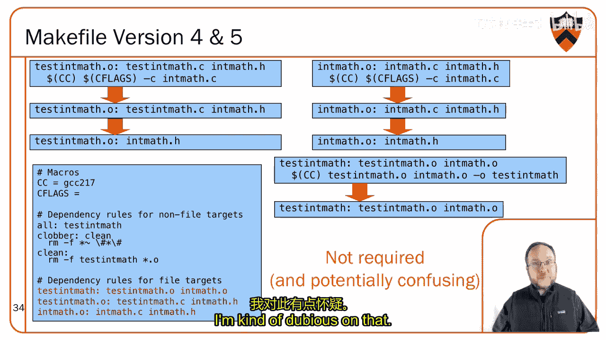

And as long as we're talking about this， the one more final gotcha here。

 in case you were planning to go wild with the implicit rules， again。

 I beg you not to for anything that anyone might read and notably your assignments will ask that you use explicit rules just so that we can be sure you've got the basics down。

 but one last gotcha when you're using the implicit rules is the naming has to match。

CFle the MIIC program can guess a lot on pattern matching， but if none of the names match。

 it doesn't know what to do。All right， so we've still just barely scratched the surface on make。

 The Kingbook has a good section on the tool， and then there's the main pages， of course。

 and if that's still not enough for you， the link here on the screen is the full can new documentation that's about 140 pages It includes tons of examples。

 some common use cases， some frankly bizarre use cases that I don't know why anybody ever thought of much less wrote down and tons more so I do encourage you to to experiment with it。

 I truly hope that you'll become a convert that make is totally the right way to build software as opposed to typing out the build command every single time or even versus typing out the build command once then using control R forever。

So next time we'll come back to new features in the C language。

 including dynamic memory that we've been talking about as leading examples of we'll talk about it soon。

 we'll talk about it soon， we'll talk about it soon。Now is finally the time。 So get hyped。

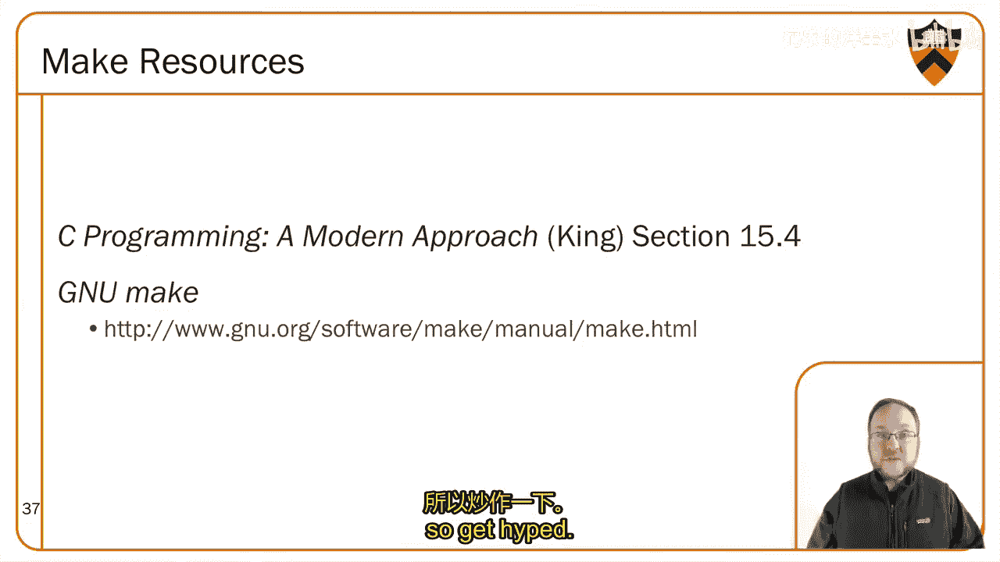