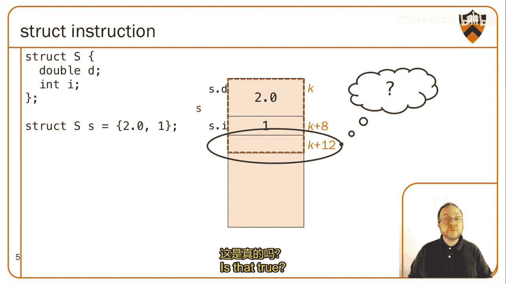
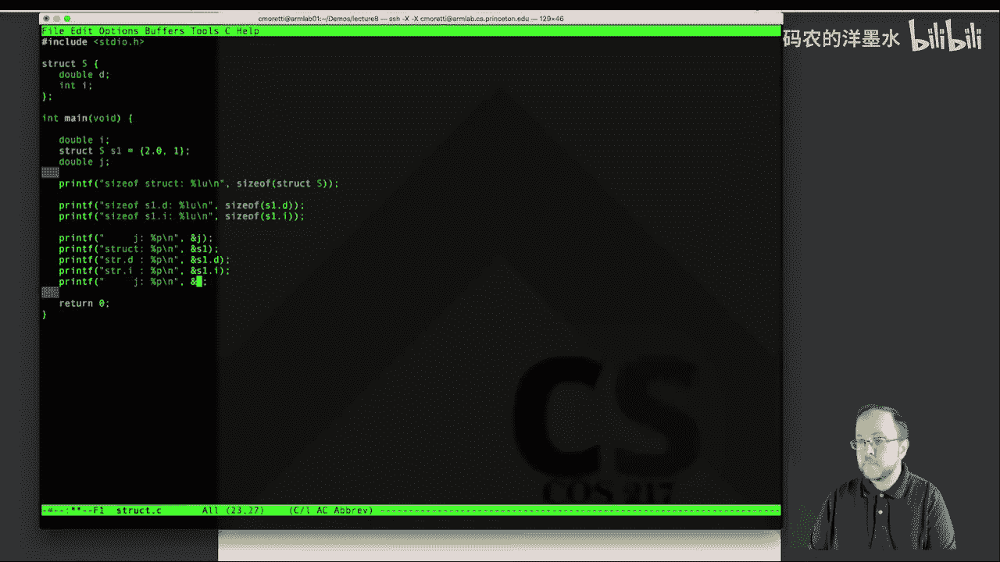
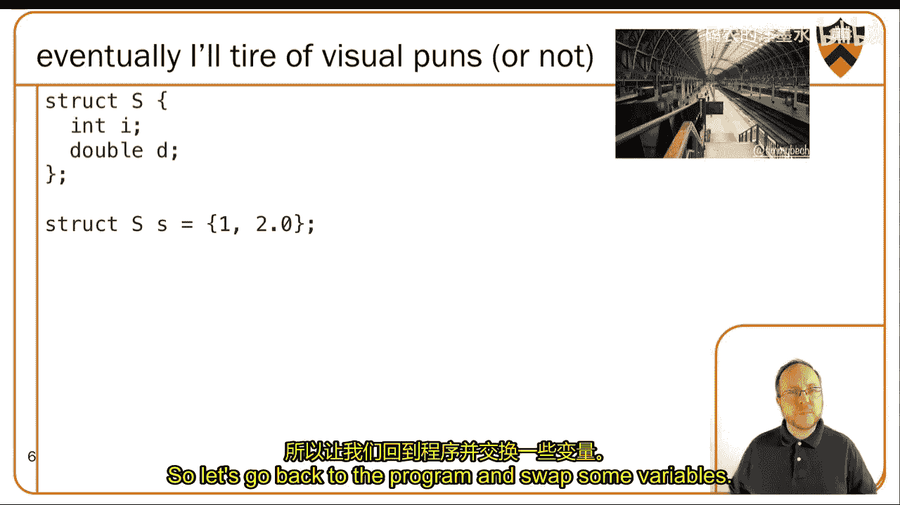
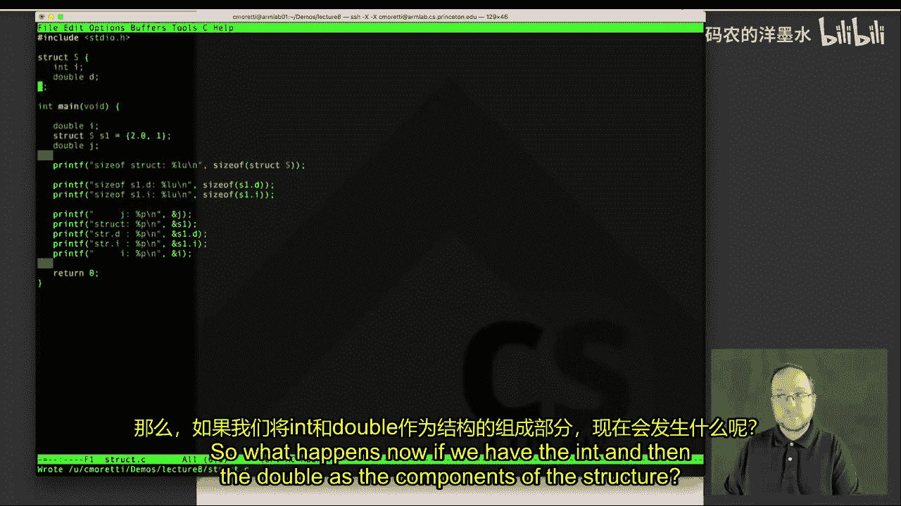
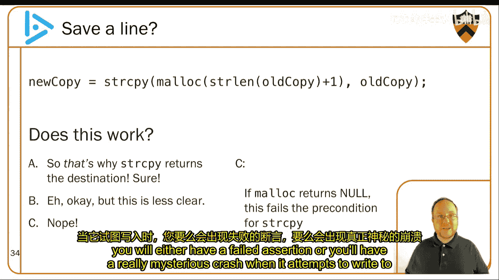

# 【全集 秋季版】普林斯顿大学 C语言系统编程 中英字幕 p11 Lecture 11 - 结构、Argv、动态内存 -BV1u1feBoEsK_p11-

Welcome back to the Co 217 lecture。 In this lecture， we're covering three distinct topics。

 structures， command line arguments and dynamic memory。😊，In a recent lecture。

 we saw arrays as a data type that could hold multiple distinct pieces of data。

 but they all had to be in the same type。 C structures are closer to Java classes。

 though without the instance methods。They can hold multiple distinct pieces of data of differing types。

 just like an object's instance variables。So this would have been useful for assignment1's challenge to return both the new state and the updated line number。

Now we actually know how to do this with pointers or an array of two items。

 but this would be another reasonable approach。So how do we do this in C？

Structure types are declared with the name of a new structure， similar to Eums。

 we have the key word and then the identifier。And then its contents， a list of fields。

One syntactic thing that I always forget is that you have to end it with a semicolon。

 This makes sense。 this is just like any other declaration。

 but the curly braces sort of speak to me as though they were functions or something like it。

 and I always forget the semicolon。Luckily。Most code auto indentors will indent the next line。

 and so you'll look at it and say that looks weird and you'll go back up and find the error。

All right， so we can initialize a structure variable with an initializer list。

 just like we did with a arrays。 We can declare a pointer to a struct。

 just like we can have pointers to anything else that we've seen。And we access the fields in astruct。

 quite like how we access the instance variables in Java。Using the dot field selection operator。

If we have a pointer handle， we would dereence the pointer first and then use the dot operator。

 So the de referenceence recall says follow the arrow to get to what I'm pointing at。

What am I pointing out in this case is astruct and so now I can do a dot。But this is super common。

 so much so that there's actually a more idiomatic way built into the language。

 it's the arrow operator， which is absolutely identical to the dereference and dot pair。

 so the arrow says dereference this pointer and access this particular field。

The arrow operator is going to be perhaps your most use operator outside of assignment and loop control。

 so get familiar with it， make it your friend。You might have noticed that the structure boxes in the previous slide seem to be bigger than the components。

 Is that true， Let's write a program。

All right， so over here， I already have a demo set up， let's。See just what size thesestructs are。

We're going to want to print them out。I'll recreate the。Structure that we saw in the slides。

I will not forget thee。Semicolon。And then what do I want to do here， I'll start off with juststruct。

SS1 is a double。And an int。Let's see what its size is。Recall that with the size of operator。

 you can in fact give a variable or a type， so let's use the type for now。That should work for now。

I haven't used S1， but that's okay。And it tells me that it's 16 B。

 So my graphic was right that there's more than just the size of of a double and just the size of an int。

Let's investigate a little bit closer。Let's take each of the components and see what their sizes are。

So as expected。The double is8 bytes and the int is4 bytes。

 so it's not breaking any of the rules we know about the sizes of the components on armla。

So what's going on here Again， let's investigate just a little bit further still。

Let's go ahead and print out where in memory these are。

 so the stack location and memory will change every time you run the program。

 but the relative offset should be the same。 so let's take a look。All right。

 so now we have all three of these to print out the addresses in memory of this。Let's take a look。

I get some warnings here because technically the percent P requires a void star and these are not void stars。

 this is a struck star， a double star and an intstar。

 but for our purposes right now we're going to ignore the warnings and take a look。

So here we have the addresses， the structure is at this big address with the last two digits and hex being 70。

The double is at the same location， so the double begins right at the very beginning of thestruct。

And then the integer is eight bytes later， so that's exactly what it should be。That to me。

 says that there's something after the integer， and I don't know what exactly is there。

So let's just confirm see if that's true。We can't guarantee exactly how the compiler is going to put local variables on the stack。

 but in this case on ArmLb， we will see that it actually does put them in order， so let's try this。

Let's put it double before and after it。Again， not guaranteed to work in every case。

 but for this program it will。And let's see what the addresses are of those two variables on the stack。

So we're going to get the address of J。And the address of I。

Again， we compile， again， we get even more warnings this time。

 and now we see that J is eight bytes before the beginning of the struct。That makes sense。

 Jay's a double。 It's 8 bys long。And I is eight bytes after the beginning of the eye component in thestruct。

But I should the eye component should be only four bytes。

 So there is patting after the eye component， after the eye field in the struct。

 And this is actually not unusual。 So the compiler knows what the architecture likes and the architecture likes for for performance reasons to have different members of different variables or different data at addresses that are divisible。

 typically by nice numbers， like the natural word size， in this case，8 bytes。 So here we。

 we will see that。Instead of putting the int4 bytes and then starting the next variable immediately thereafter。

 it says， nope， I'm going to go ahead and put four bytes in between。

 I'm going to waste those bytes because it aligns things well。

 And we'll come back to this later in the course about what the compiler does and what the architecture preferences are for alignment and why。

 But for now， you just have to know that in a structure。

 the size of the structure is at least as big as the sum of the fields。

 but it could be bigger because of padding。So let's come back to the PowerPoint。All right。

 so depending on the compiler's choices about patting。

 we might have this extra space in this program on Ar Lab we do。

You might have noticed that the structure is the double and then the int， and I didn't think to ask。

 does ordering matter， So let's go back to the program and swap some variables。

So what happens now if we have the int and then the double as the components of the structure？

At this point now， we have the int has the same address as the struct。

 And then the double has an address that is。8 bys later than that。 I know it looks like two。

 but remember that these are hex。 So2 higher than 8 is not 0。 It's a。 So we go all the way。

8 bys greater than that。 And so again， we have this padding in inside the structure。

 even though it's actually in between fields， not at the end。

So this is what it looks like in the updated case with the int and then the double。

 And this is something that the compiler can't control。

 We said that it could choose how to align data， but the C standard says that it may not reorder the fields within astruct。

And that means that yes， we can have internal padding。All right， so that was our live coding。

 and hopefully it worked。 So now the next thing I want to talk about is arrays ofstructs。

 And so arrays ofstructs are legal。 and there're actually part of the reason why that padding happens。

 because the architecture is particularly concerned about alignment when there are many structures that may be accessed in rapid succession。

And it knows that arrays are typically something that gets iterated over more so than one off variables。

So note here the sort of neat nested and initializer list。

 the outer one is for the array and the inner one is for the struct at the zeroth element of the array。

And here， we can also see something that's different from arrays。 Unlike an arrays。

 we can do a ofstructs with equal。 It doest deep copy。 All of the fields are copied over。

And we see this in the memory where the exact copy gets made in with each field getting copied rather than some sort of reference or not being allowed at all in the syntax as it was for arrays。

So as with arrays， we can pass structures to a function， unlike with arrays。

 we can return structures from a function。Also unlike with a arrays。

 when we pass a structure into a function， they're pass by value， not with a pointer。

Check out this example where we try three different approaches to swap。

The first changes the parameter within the function。But that's a local copy。

It's copied over just like an int would be on the function call。

 and so changing the value of the parameter， the copy that's in the function has no impact whatsoever on thestruct in main。

So this doesn't actually work as swap。The second swap looks to do exactly the same。

 but then the local copy is return， and then we use the return value to overwrite main's copy with the return value。

 And so in this case， the swap succeeds。And then in swap three。

 we can see that we can also do it using pointers the same as we would with individual variables and swapping two ins or something like that。

All right， so。That was sort of a big info dump。What better way to have just a little bit more info dump than to ask a question that you can't possibly know the answer to。

 but that's what I'm going to do here。In this program we have the opposite。

 rather than an array of structures， we have a structure with a field that is an array。

And here we have in Maine， we have the declaration and initialization of S。

 and then we go and initialize S2 to be a copy of S。And then we call print on S2。So how many？

Arays exist in memory at any point。Perhaps say during print S， which would potentially be the most。

So pause the video， think about it， see if you can come up with a convincing explanation for how many arrays are in memory。

So the answer here is D， there are three。S has an array inside of it。😡，When we do a copy。

 when we do an assignment of S into S2， we make a copy， we do a full fieldwise copy of everything。

 including the array， so even though we can't actually make that copy with just an assignment equals with arrays ourselves underneath the hood when assigning structures。

 we can。Furthermore， then when we pass the structure to the function， again。

 we said that they're passed by value， and that's a field wise copy again。

 the parameter will have all of the fields just copied over， they'll have their own copy。

So there are three。😡，Of this array that exists in memory， one inside thestruct S。

 one inside thestruct S2， and one inside the parameter S in the print S stack frame。All right。

 so thus far， we haven't really been given much input into our programs。 We've seen Scf。

 but we haven't really used it much， and we haven't seen command line arguments at all。So。

The next thing we're going to cover now that we've seenstructs is command line arguments。

And that's actually one of the first things that you learned in 126 before you ever saw standard In was how to work with command Line。

In fact， the mystic incantation， public static void main string bracket args didn't actually stay very mystic for very long。

 You started knocking him out pretty quickly with what was Ma。 Oh。

 it's the place where it starts and what was args。 It's the command line arguments。

 What was string bracket。 Well， we haven't talked about a raise yet。 But we'll get there soon。

 And what was string。 It's just a type。 It's almost like an object， but it is an object。

 but it's almost like primitive。 all of this stuff you covered in a remarkably quick uptake in 126。

 especially considering that now we're a third of the way into 217， and we haven't seen it yet。

Let's fix that， how does a program get command line arguments， including the program's own name？

As I said in Java， it was an array of strings， and indeed it's the same in C。

 So now that we've seen arrays and we've seen strings as special cases of arrays。

 the logical next step is to combine them， an array of strings。

This also makes it your first example of a multidimensional structure。

 an array of pointers to characters， we saw the meta example of the double pointer in the pointers lecture。

 but now we're going to get to actually flex it a little bit。

 so an array of pointers to characters that is an array each of whose elements is a character pointer。

Note here that you'll see two different types given for ArgV depending on what program you're looking at。

 and that's simply because the same idea you're working on an assignment to as function parameters。

 pointers and arrays are equivalent， so the next level more pointy that's still the case。

 char star star Argv is the same as cha star ArgV brackets。All right。

 so let's see this program in action。I didn't mention it on the previous slide。

 but along with Arg V is also Args C， the count of arguments。 This comes back to the idea that。

 unlike in Java， where we could just do Args dot length and C。

 we don't know how long the array passed in is unless we provide a count。However。

 here we have a couple of potential off by one quirks that you'll continually have to either look up or memorize by rot to keep straight。

 so Arg v0 is the program name。And that counts as an argument。In terms of the count of Argy。Also。

 we have， along with all of the actual arguments given on the command line。

 so ArgV1 and ArgV2 and AGV3。And Arg C then is the account of the arguments， not the array elements。

 and so it's always one more than the number of arguments。😡。

The number of array elements is always one more than the number of arguments because the array is also guaranteed to end in null。

 so the last array element is always null， so this example we have five elements in the array。

 four arguments and the obligatory null final element。But the Arg C is counting arguments。

 not array indexes， and so it's four。Looking at this with the smaller example here， we have。

Print Arg V that's given no arguments whatsoever。 Well it actually has one argument because Arg v0。

 the program name counts as an argument， so Arg Argc is1 and Arg v of0 is a string and then we reach the null pointer sorry the null pointer at the end of Argv and we exhaust our arguments in Arg。

All right， so having seen that， what's ArgG C for this in？Here the answer is B。

And the reason here is that we have four arguments。

 the quotation marks in bash indicate that this is all one single string。

It's just a string that happens to have spaces in it。

 so the quotation marks allow us to say spaces aren't special。

 they don't demarcate or delineate the spaces between arguments。

 they're just other characters that are within one given argument。So we have RGC is4。

Zero is the name。 One is one。Two is the string， two space space three and four and。ArgueV4 is four。

All right。 So I mentioned I mentioned that the last element in Arg V is always null。

 So that actually means the Arg C is superfluous。 We could just traverse Arg V until we hit that null element。

So here's an equivalent of program expressed as a pointer algorithm using the traveling pointer instead of the index like you're going to be doing in assignment2。

And if you're weirded out at the end here by the subtraction of pointers。

 the subtraction of pointers you might recall from precept is just the span。

 it says how many elements does this combination of pointers encompass？

And then the even more cryptic thing is the last argument of this print f。

 which is a combined dereence and increment。 And I totally agree it's cryptic。

 but it is a common idiom。 I'd still prefer to parenthesize。 And even then。In many cases。

 GCC will throw a warning saying basically are you sure you know what you're doing because I'm not entirely sure that you're doing this right or that it's well defined by the standard of the language however this program does in fact work on ArLb at the very least and it does the exact same thing so we walk through and instead of walking through by index。

 we're walking through checking does star PPC equal null。

So star PPC we're saying that's a pointer to a pointer to a character is PPC。

 so star PCC star PPC sorry is a pointer to a character well that's a pointer。

That means we can check if it's null。 And indeed， in R V。

 the last pointer to a character is going to be null。

So here we can walk through one at a time each time checking。Is PPC pointing at something that is nu？

If so， we're done。If not， we can print out the thing that PPC points to as a string。

 and then increment it， bump it up to the next thing。And eventually we do hit null when we're done。

In our second example here， we hit N null a lot quicker。All right。

 so here's a slightly modified version of the previous code I've added an explicit index for the index instead of pointer subtraction。

 but still when I look at this code， I see pointers to pointers and it would be natural to wonder if that's silly and we could just have one level of indirection。

So think about it for a minute， see if you can trace something out， see if it works。As it ends up。

 we can't what the code on the right does is it steps through the AGV0 one character at a time。

 which is certainly not what we were trying to do。Worse， because PC will never be equal to doll。

 at least not until it overflows the address of 16 Fs and all the way back to 16 zeros and hexs。

 it'll keep going on and on and on and on and never break the loop。

And so eventually getting itself into memory that it doesn't have access to， and that's a Seg fault。

 which you'll become intimately familiar with， and I will soon attempt to convince you that it is your friend even though it is the canonical bane of C programmers。

All right， but yes， this program， if we try and take away you know， one fewer pointer， sadly enough。

 it doesn't actually work。All right。 So this is the last bit on arguments。 Take a look at this legal。

 though， admittedly completely contrived， a program that does the unthinkable。 It recurs on main。

So what does it do？Again， pause the video， trace it out， see what you can come up with。

So in the first iteration of this program， AGC is4。

 and so we're going to recur on the value 3 for AG C and ABC。We bump forward our pointer。

 Rrg V by one。 We don't actually change Rrg V。 We just pass in the argument to this new call to main to be Rrg V plus1。

 And so that's going to give it the array by ABC， as opposed to。Program name， ABC。

So now in our next call to Maine， ArgC is 3， so we recur on 2 BC。When we recur arg c is 2。

 so we recur on1 when we recur a C is 1， we recur on0 null， recall the arg vNs in a null。

At that point， though we hit our base case， ArgC is0。

 so we backtrack from the base case and we print out0 C。

That was the case where Arg C was one and ArgV was just pointing at C and then the null。

 but in this case when we actually print it， we print Argc minus1 to get sort of the right indices。

 so we print out0 C， we return the value back that's actually just the value we got back from the base case which was hardcodeed at zero so this program can't help but succeed so then we print 1 B。

 return that same zero， print 2 a， return that same zero， and then 3 and the program name。

A couple of things to note here。D would actually be right if instead of returning from the base case。

 we did exit zero。 So return， just like in Java， just like in any other function。

 main isn't special in this case， returnturn says return to where I was called from。

Exit on the other hand says terminate the program right here and now with this status。

 So if instead of returning， we did an exit zero， we would in fact only print the very last argument because we'd print only the first print F but doing it backwards。

Okay， now for the main event， dynamic memory。Thus far。

 we've been really limited to only being able to write static programs。

 Sure we can take input from the user， but only if it's changing a value that we already knew about and allocated a compile time。

Surely we'll have to do better than that。 Consider the common case of taking an arbitrary number of inputs。

 If we have to store each of them and we don't know how many there will be until runtime we're out of luck。

So enter dynamic memory。That is memory that's allocated during runtime based on the state of the program at that point。

For this， we'll use an entirely different section of memory than we've seen thus far， the heap。

Just as a quick reminder， we've seen the stack， that's where our function parameters and local variables go。

We've seen the text section。At least sort of we've mentioned the text section is where the program code actually lives。

 the machine code， and then the RO data section we've seen as the place where string literals go。

So the Heap is a new section for us and it's where we're going to put our dynamically allocated data。

 and we'll access the heap based on pointers into the heap。

 into that data from the stack or from other sections we haven't seen yet。

So let's dive into some code。The basic function for a dynamic allocation is meoc。

 it takes as an argument， the number of bytes of memory to allocate。

This immediately presents a problem for portability because if we're trying to allocate in terms of bytes and in see so many of the types aren't well specified by the standard。

 instead they're system specific in terms of their size， we could be in trouble。

But it's okay because we've seen in a previous lecture the size of operator。

 which allows us to tell on a particular machine how big。

 any type or any variable is so we can make use of this。

The program here is what I just described in the last slide。

 we have a pointer to the stack that points at memory dynamically allocated to the heap。

And that dynamically allocated memory we get with the Meloc call。

So notice that Maloc allocates the memory， if we look at the little drawing there。

 we get these three boxes， these three integers in the heap， but it doesn't touch the contents。

 there'll be whatever garbage happen to be in memory at that location and it's completely unreliable what that will be。

So this is the core use of MelOC where we're going to say， go get me some memory。

I'm going to have a handle to it as a pointer on my stack or as a parameter or what have you in some sort of local variable。

Then I can use it by using the arrow operator just like we saw before。

 or by dereferencing and then using。The dot operator， if these are strs。

 if it's just an int in this case， well， in that case。

 I can just say dereence and I get the int itself。So if that garbage data freaks you out a little bit or if you dislike the very explicit allocation of a big chunk of bytes to do with as you please。

 there's another basic function for allocation， it's Kelloc and the difference between Kellooc and Malc is twofold。

 Number one， it zeros out memory when it allocates。

 so it just puts zeros in every single bit of the data that gets allocated。

This means that for these ints， they will in fact have the value zero。

 if you recall from our representation lecture where。All zeros was。

A non negative number because it didn't have a leftmost bit of one。

And then we just interpret the rest of it as binary， and so it is in fact， zero。Number two。

 at least in my view， more clearly Calck more clearly has than a amantic because we see that it asks for the number of items and the size of each item。

Frankly I have to go and look it up a whole lot of times when I start to use Kelloc in terms of which one's which。

 but that's silly because number one， it's the same order I would naturally do the multiplication in MEoc K times the size of an int。

 well K comma the size of an int， and B multiplication is commutative anyway， so who cares？

But this is， in fact the correct ordering for Kellogg。

 it says items are you taking and how many items are you requesting are you trying to allocate and how many bytes for each of them is required。

So our memory schematic is just slightly different。Whereas before we had after the allocation。

 we had three garbage values。Using Kelloc， we have three values that are all zero。

So the third of your new friends here is free in Java you never had to clean up after yourself because Java has automatic garbage collection。

The garbage collector can go through and say， I know that you will never use this variable again。

 so I will clean it up。This could be if you cease to reference it anymore。

 if you point a reference at some other value or just at the point in the program where you deterministically will never access that variable again。

In C， that's not the case， you have to pick up your own messes。

 which is to say you have to give back the memory that's dynamically allocated to you when you're done using it。

And the way to do this is with the free function， which takes a pointer previously returned by one of the allocation functions。

It's important to note that calling free on a pointer that didn't come back from one of the allocation functions is likely a very bad thing。

 it will likely corrupt your he and eventually kill your program。Additionally。

 it's another thing to note is that calling free on a pointer doesn't change the value of the pointer。

 It can't， in fact， since the pointers are passed by value to functions。

 the address is passed as a value。 And so we can't go back and change it unless there's that extra level of indirection like we saw with metata。

But that means that after freeing， you still have a pointer referencing the now freed memory。

This is called a dangling pointer。 And by itself， it's not an error。 If we look at the slide here。

 we can happily have that pointer of some ins pointing into the heap。That's not a problem。

But if we try to access what that pointer points to。

 if we try to dereference it or use it in some way。There there will be problems。

 so stay tuned in a few more slides for that。The last of your new friends is Realck。

 Reelck says I was given a pointer that was previously returned from Malec or Kelloch。

And it's not enough space， so I want to get to change this allocation。

To change this allocation to make it bigger or potentially make it smaller。

So here's an example of making it smaller。We call Reeoc on the pointer we were given and a new size。

 I'm sorry for all of you butding Kello fans。 It's the Maloc syntax of it's just the number of bites。

So also if we reallocate things， we have no guarantees about their value of the new memory beyond the point at which the old memory had already been allocated。

 So a little tricky if you kind of already have fallen in love with Kello。

 you have to know at least a little bit about how what we can and can't do or can and can't assume with Meloc because Reec does the same。

So in this version， we have k minus1 so we're decreasing the number of ints。And this is。

What most typically will happen after that。But it's not guaranteed by the C standard。On armLb。

 I believe the implementation does in fact do exactly this。

 it will not move the allocation when it makes it smaller， it will just say， okay。

 this allocation used to be three ins big， it's now only two ins big， but it leaves it in place。

 but that's not guaranteed by the standard so you shouldn't typically assume that。

Here's perhaps the more common or useful use of Reelic， which is， hey， I don't have enough memory。

 I thought they were only going to even give me three， but in fact， they want four。So in this case。

 we can call Reeick and ask for more K plus1 times size event， and in this case， again。

 typically but not guaranteed， Reeick is going to try to expand the memory in place。

This makes sense from an efficiency standpoint。We won't have to copy over all of the memory values that are in our current allocation to a new location if we just keep it the same。

But clearly we can't always do this， maybe there's something already in memory immediately after our array。

So we can't always do it。 Sometimes it will look like this。

Especially if the expansion is large and you're asking for a lot of memory， well。

 the larger the memory， the more likely that you are to run into something that prevents you from just saying。

 yeah， I'll just expand it and make it longer。So in this case。

 when RealEC has to move the allocation， it will return the pointer to the new location of this memory。

 it will copy all of the values over， note that as I mentioned it won't make any guarantees about what's in the new memory that it's added。

 so just like Meloc， it's not going to initialize it。And it's going to free the old allocation。

 This makes sense because， you know if you're saying， hey， I want you to make this thing bigger。

 well， okay， I made it bigger， I had to move it， so I'll clean up after myself as realc I'm not going make the user do that。

 This means that the user for every single Malik or Calic they do needs to do exactly one free。

 They don't have to sort of count the number of times they've called reec。

 which would get pretty tricky pretty quickly。So this is what the memory looks like。

 but here again we have this dangling pointer， some ints points at the location that it used to point to。

Which is now been， which has now been freed And more ints points at the new the the new allocation。

 So if we were using this program for real， likely some int is the the。

Aray that we are thinking of using throughout。 We would want to check and say， O。

 now that I have more ints。Now I can set that back to be sum ints and we'll see why we use this two variable version in just a moment。

Before we do that， though， let's talk about what can go wrong with Maloc and Kc。

The key thing that can go wrong with either of these is that there could be no memory available。

The system could say， nope， I can't give you that much memory。In that case。Maalak and Kc return no。

 they instead of returning a pointer to the new allocation， they return a pointer to nothing。Itys。

 yeah， I couldn't give you that， so I'm not pointing you at anything。嗯。This is fine。

 I mean it's bad that you can't get your memory， but potentially life could go on typically in this course we're going to say if you can't get the memory。

 there's not a whole lot you can do so。termerminate the program nicely。 But in general。

 it's not automatically an error。 Certainly， there are programs where if they fail to allocate memory。

 the correct answer is。Okay， wait a little bit， see if some memory freezes up。

The problem here is that you have to check for that。 You have to check to say。

 did Malick or Kc return No， Because otherwise， the very next thing you're going to do here is you're going to say。

 oh， I want to use that memory。 And so sum mins of 0， for example， here。 Well。

 recall that that the brackets for an array is the equivalent of dereencing a pointer。

But if summon instance is no and we dereference a null pointer， that is a sig fault。

D referenceference aer says go to the memory and access it。

 and we are guaranteed that you cannot access address 0， so that's a sinkfold。

That will kill your program。How do we avoid that？Check， we should say if summon mins is null。

 we need to do something， whether that's wait around and see if it gets better or whether it's terminate the program in some nice way that says。

 I'm sorry， user， I could not allocate the memory Have a good day as opposed to Sig Seg V program aborted crash。

 the former probably a little bit nicer。So that was Malic and Kic。

 Free has some more things going on in terms of what can go wrong。

 I mentioned dangling pointers that they aren't inherently dangerous until you access them until you de referenceence them。

 And for whatever reason it is， dangling pointers are inexplicably。Tempting to access。

 So if we use a pointer after free。Something like this， we go and we say， yes。

 set some ins of zero to be x。That's a problem because we don't actually own that memory anymore。

In the best case， we're just overr some memory that's no longer in use。

 and we will hopefully cannot continue to use it。 And so we'll probably never read that value。

 In the worst case， sometime in between the free and that sum of 0 gets x。

There's been another mallc or another Kc somewhere， and that memory has now been allocated。

To some other data structure， and now when we put X in that memory。

 we are corrupting that data structure or overriding that data structure。That seems。Bad。🤢。

The other problem here is that。We go and we free this pointer again。A double free。

 depending on the implementation of malic could be harmless or could be catastrophic。On Armleb。

 it's the letter。On Arm labb， it corrupts the heap and the reason why is that free add adds the pointer that it's passed to a data structure that basically tracks what memory is free when we call free again。

Free adds it again to the data structures， now it exists twice in the data structure。

 so if that memory later gets malled， it's in this weird state of being both free and malloced。Also。

 if we do some other fancier things that we coalesce or split up our memory location so that we can basically allow for larger allocations。

Well now we're going to go through and find one of them and the other existing block is still going to be sitting there in that data structure。

 so now the middle of some larger block of data is itself an alias。

 it's bad because now we can again return that from MEEC and without doing anything further wrong in dynamic memory management。

 corrupt the heap。Bad things all around if at least on arm labb， if you do a double free。

My personal advice here cut off dangling pointers by setting freed pointers to know as a matter of habit。

 as soon as you call free， immediately turn around and set that pointer to point it null。

This isn't a panacea。If you do these things of access after free， it's still a bug。

But it's a bug that you'll be able to find， because when you access that pointer and after the free and you。

 you do some ins of 0， when it's no， Oh， that's a crash。 It's a seg fault。 Yes， that's bad。

 We just said the， you know， it terminates your program。 But when your program gets terminated。

You can use GDP to go and find exactly where it happened， and it's relatively quick to figure out。

Atas usually on the other hand， when you're just randomly writing to data that isn't part of your of your active structure that you've already freed。

 you're corrupting something else， now you start to get weird logic errors where you're like how did that value change I have no idea So I think that this is typically a better solution is to immediately set it to null as soon as you're done using it。

 you do the free， you set it to null and now you don't have this temptation to use dangling pointer or rather if you do have this temptation you get shut down pretty quickly Also。

The double free problem goes away because free doesn't actually do anything if the argument is null。

 if you pass null to free， it's a no op， and so we don't have this heap corruption with the double free either。

All right， so now let's come back to Realc。Programr mistakes using RealEC， using the same pointer。

So looking here， everything looks fine。If Ree， so Kelloch points up there and now if Reec moves。That。

 you know， could be fine because we track it if Reelic doesn't move， we reassign it and find it。

 you know， we overwrite the same value。The singular case here that is a problem is when Reech fails。

 when Reech returns no。We now have。Overwritten our pointer。 we have some ins points at。 No。

 but some ins was the only thing we knew of how to get to this memory in the heap。

So now we have no way to get to the memory that was allocated。 When Reeck returns null。

 it doesn't move it。 It just leaves everything the same。 It doesn't move it。 It doesn't free it。

 It says， I couldn't give you a new allocation。 but here's your old one that still exists。

 And I'm telling you this via null。And so if we then overwrite the pointer here。

We no longer have access to the old one， and that's bad。It gets worse。

 though we could do even worse rather than overr the same pointer。

We could forget to save the value of Reelic at all。It might be fine。

If it was expanded or contracted in place， everything's great。

 the existing sum Ins pointer points at the right location。But if not。But if not。

 we will have a memory leak because our new data。Has nothing pointing to it。

We still have a dangling pointer that's there pointing at the frid data， which， again， would be fine。

 except。We're good programmers， we're totally going to do the right thing later on。

 and we're going to free it。But now it's already been freed by Reeck。 So now it's a double free。

So we get a memory leak， an access dangling pointer。

 and a double free all from one bug of forgetting to save the value return from Reelic。Again。

 the correct way to do this is with two pointers that way you can save the value return from realloc。

 you can then check and see whether it was no， in which case the first pointer is still valid。

 otherwise you can。Overwrite or reset the old pointer with the new pointer。

So that's the troubles with Realc。All right， so finishing up this lecture。

 let's take a look at two quick concept questions for dynamic memory。Here's the first one。

Take a look。We have new copy is the result or is pointed at the result of calling Meloc on Stirlin of old copy。

And then we stir copy old copy into new copy， so we're allocating space and then doing a copy of the string。

 Does it work？Well， it says catch the most common bugs。 So the answer here is clearly no。

 And the bug here is that you forgot the space for the nullbite。

 recall that Stirland returns the number of characters in a string， not including the nubite。

 but when we make a copy of the string， we need to have enough space for the nullbite。

So the correct answer here would be to do a malloc of St Laovol copy plus one。And finally。

 here's a sort of tricky thing。This looks like it would save a line of code admittedly at the cost of some clarity by using a call to Meloc as the first argument to stir copy。

 rather than doing a meoc， saving the pointer and then using that pointer as the first argument to stir copy。

Does it work？Take a moment to think about it。The answer is， yes， it works。

 The vast majority of the time。 However， if Maloc fails。

That means it returns null and now we are passing null as one of the parameters to stir copy which violates its preconditions in your version of from assignment2。

 you would have a failed assertion depending on exactly which implementation of the ST copy library。

 you will either have a failed assertion， or you'll have a really mysterious crash when it attempts to write to a null pointer。

So that's all I have for dynamic memory and for this lecture。

 good luck working on assignment 2 due next week， I will look forward to seeing everyone in office hours。

