# 【全集 秋季版】普林斯顿大学 C语言系统编程 中英字幕 p12 Lecture 12 - 测试 -BV1u1feBoEsK_p12-

Welcome back to Co 217 lecturec。 Let's continue our discussion of the skills and techniques of programming in the large that go hand in hand with the details of any given language that we use as a part of writing software。

In the second precept this week and in next week's first lecture， we'll be talking about debugging。

But you can't even know what you need to debug unless you know that there's something wrong in the first place。

 and getting to that point then requires knowing something about testing。

But for sufficiently complicated programs， it's hard to know if what you're doing is right in the first place。

For our decocomment program and assignment1， there were plenty of corner cases。

 and that was with a nice， clean eight state DFA。You can imagine for something like a shell。

 there are many more corner cases， and for an operating system， it's almost unfathomable。Furthermore。

 even if you know that an algorithm is correct， that's quite different from guaranteeing that a specific implementation of that algorithm is correct。

Dcanu's famous quotation from his notes on the Van Em de Boas Pri decks is apt here。And beyond that。

 in the general case， you can't even compose a program checker that makes sure any given program terminates。

 much less that actually does what you want it to。That's Turing's halting problem that you learn about in 126。

But despite the undecidability of the halting problem。

 we do know how to do some verification of programs。

 there's actually a rich research area of formal logic and programming languages。

 building and applying proof assistance for program specification。Frankly， though。

 most software engineers aren't out using proof assistance in their code。

 and it's certainly beyond the scope of this course as an introductory programming course for systems。

That said， if this is something that interests you。

 I certainly encourage you to go take Co 326 where you'll learn about functional languages and one of the key principles of functional languages is that the absence of mutable state makes it easier to reason about programs。

 and then after 326， they're two grad courses， both of which are reasonably accessible to undergrads。

 and they deal with programming language theory and automated reasoning about software。All right。

 on the other hand， though， with testing， we don't have a proof。

We have some evidence of at least partial correctness。

 we might even feel reasonably confident about our correctness。But for a sufficiently large program。

 it's hard to convince yourself that you're doing the right thing for every possible permutation of inputs。

Lest you think， though， that testing provides no guarantees at all。 If you do have a failing test。

 there is one absolute certainty。 There is a bug。But it's not that certain exactly where it is。

 The bug could be in your program or it could be in the test itself。

So we want to be attentive to testing in our software design process。

 and we want to take a structured approach to getting there with building a testing infrastructure and exploring the specification space to design test cases。

That's why testing is important， but whose job is it？While software engineers。

 software designers do a lot of their own testing， this is good。

 They have the most direct experience with the code。

 and they know all of the corners of the specification as they implemented it。

What the tricky parts were where they did something sort of unusual。

But it's also bad because nobody tries to write bugs。

 And that means that something got overlooked if there is one。

There might be hidden assumptions about the specification。

 there might be hidden assumptions about the input that get leaked into the code。

 and then if the same person who wrote the code is writing the test。

 it might also leak into the test。QAAs， on the other hand， get a fresh look at the implementation。

 so they're unbiased as to the assumptions that went into developing it。

They aren't biased by implementation preferences， either what was easiest to implement or what was the latest or was some personal preference。

But correspondingly， they also don't have a full sense of the code。 Also。

 because developers and Qs tend to work in the same team， the same organization。

 they also tend to be beholden to the same specification for any of its flaws。

So that brings us finely to the customer they aren't beholden to the same spec。

 Customs tend to use programs in very creative ways。

 but it's also hard for customers to be the backbone of a testing infrastructure because it's hard to have systemic or systematic coverage via only bug reports。

And further， if too many bugs make it out into the field， that will certainly alienate the customers。

That said， especially in web programming these days。

 it is becoming more common to have field testing as a core component of the testing strategy。

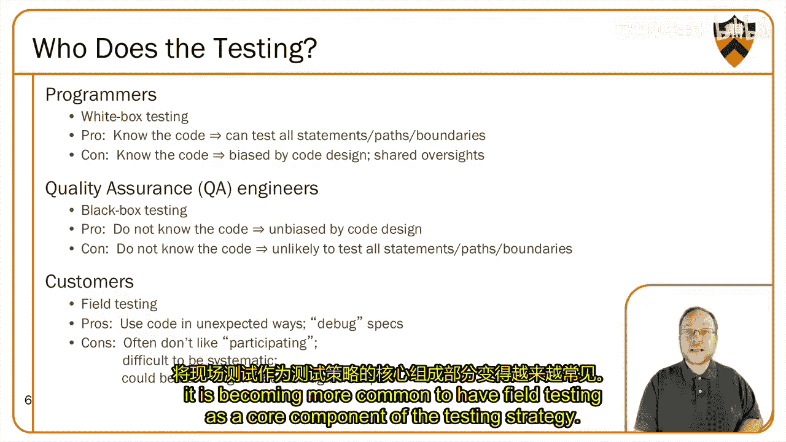

For your programs in our class though， the customer is the grading script so you definitely don't want to rely on field testing。

 let's instead look at how you can approach structuring your testing as a developer。

 We'll start with external testing， and that is testing that occurs outside the program itself。

 but later on we'll move into internal testing within the program。

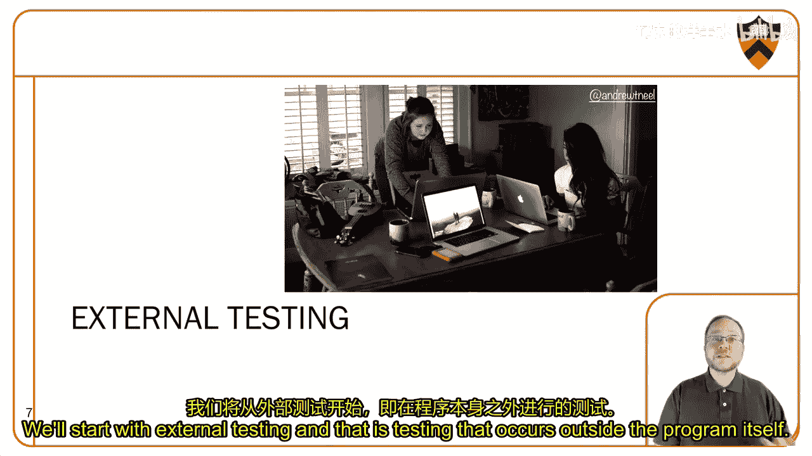

So I already know that this is the most common way that people have tested thus far in their brief programming careers。

But frankly， I'm kind of surprised your hands haven't fallen off。

My hypothesis born out of evidence on the order of1 thousand hours at Princeton is that your hands don't fall off。

 primarily because you don't bother going back and making sure that everything that used to work still does after you fix a bug or add a new feature。

So let's see how we can make it easier to do that rather than having to choose between a reasonable testing discipline or not getting carpal tunnel。

A first cut is to put all your tests into files。Both the input and the correct output。

Now we can have them over and over and over again without retyping them。

And with some good use of history or command line shortcuts， you can do this reasonably efficiently。

But what if there are many tests， far more than you even would want to run one at a time？Well。

 this is where Shell scripting comes in。Frankly this should be a part of the curriculum and it's kind of not it's one of those things that some instructors in 333 teach as the catch all course for stuff you're expected to know as a mature computer scientist。

 but you never get taught anywhere， so we might as well put it here。But in brief。

 shell scripts are just a series of shell commands that get run as though they were being executed at the command line。

So we can pack a bunch of things that we would have typed out at the bash prompt all into a single command。

 so to speak。And we can be even more sophisticated and systematic about this than we are here。

As you saw briefly in the Linux lecture at the beginning of the term。

 She scripting can include variables and loops and all sorts of good things。

 And perhaps you didn't know it。 but you've actually already used some of these。

The test de comment program that you used in assignment 1， it's a shell script。 The first line。

 a hashb bin baash says use the bash shell to interpret this。

 So each line is executed as though it were typed in at the bash prompt。

The crux of this program comes to where it iterates over all the files in the current directory that match a pattern。

 Anything ending in dot TXT。And what does it do to each of those each of those files， Well。

 it runs the command test diff。And testee come diiff， you guessed it， it's another batch script。

So it's tempting to think I write awesome testing scripts forever and I'll never have any bugs。

 but first of all， it's nontrivis write automation software。 and secondly。

 how do you know there aren't bugs in the script？Certainly one option is to say recur。

 and then you write a test script for your test script。Hoof。Though in all honesty。

 that's actually what we do as part of preparing to scale up assignments and courses like this for hundreds of people is that we say okay。

 we have a script now how do we test it well we're going to test it in exactly this set of operations but in general。

 you know testing only goes so far。

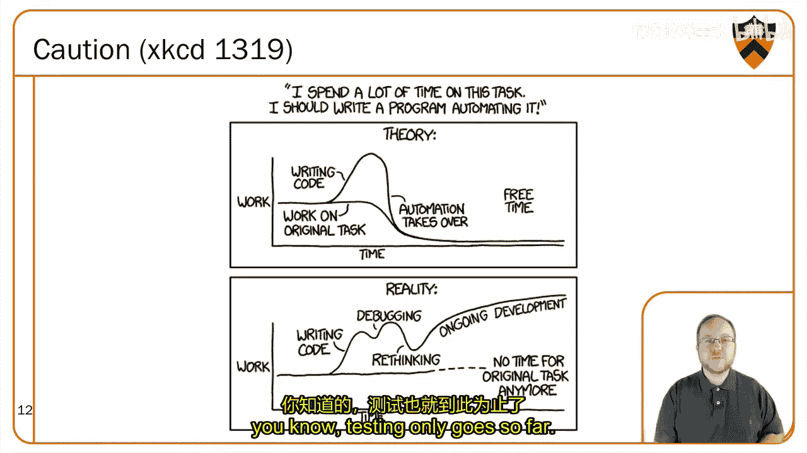

A common workflow is to write a script like that， which automatically iterates over a bunch of tests。

 And this is the general ideas of regression testing。

 So this acts towards the goal of when I write new code。The thing that used to work still does。

When I find a bug， I need to add a test so that I can test that in the future。

 the bug I fixed is still fixed。And when I fix that bug。

 if I have both the new test and the old test， it now works and the thing that used to work work。

 and I can test them forever from now until any future development。

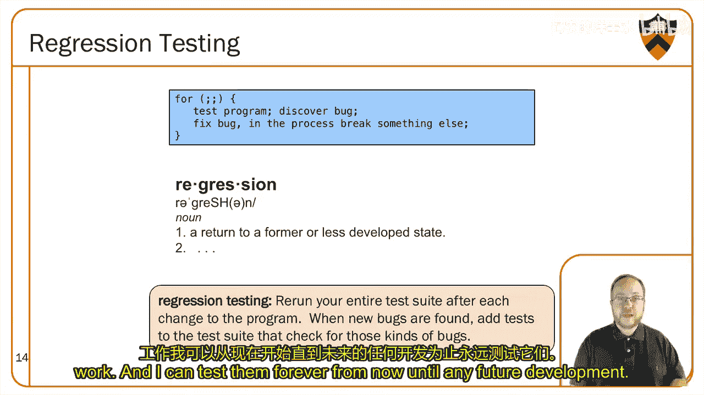

Otherwise， you end up in the situation related by this meme。

Or if you think I'm old and shouldn't put memes on slides I'll just default back to XKCD like I typically do so here regression testing is important to make sure you're not inadvertently making things worse by making a fix。

In large code bases， regression testing might be constantly running in the background to make sure that the live version of the code and the repository still passes。

 and in some cases， actually， regression testing is even built in to the check in procedure so that a pushed the repository doesn't actually happen。

 it isn't accepted unless the automated regression testing passes。

But regression testing can only test what we've already know to look for。How do we add new tests？

One way is to find bugs organically， Someone notices something's wrong， files a bug report。

 QA or developers add a new test case that reproduces the bug。

This is bug driven development or bug driven testing， and it's described。I's rather reactive。

There is though a proactive version， it's called fault injection。

 and it makes a lot of sense in principle， it's useful for testing the testing itself。

But is an aid to the development process？It has a little bit less apparent utility。

 it's hard to anticipate what errors some programmer might make in the future。

 and thus it's hard to have prewritten tests for those bugs based on fault injection。

That said applied to this course in assignments one and two。

 we've sort of taken this approach over the years， the various faculty and staff who've worked on this course have designed data files in a very reactive mode。

 the graders manually inspect the code， they find a bug that's not caught by one of the existing test files。

We refined the test files at it， and in future years we'll be able to test for all of the future students the same case that was previously missed。

In that sense， taking this course as a mature course that has been around for a while is of some disadvantage to you because grading is I guess a bit harder。

 but on the other hand， hopefully we've gotten a lot better at lots of other things。All right。

 but I would encourage you to look forward to assignment4。

 which has a proactive mode for students we will we will give you buggy versions of some program and。

Then we'll eventually test your design for catching bugs。All right。 a different。

 interesting form of this proactive design is test test driven development or T D。

 It's basically from the ground up。 you write a test that fails。 You write code。

 so it no longer fails。 And then you ref your code。 So here， this entire step of。

 I'm going to write the code， and I'm going to write the tests is intertwined。

Sort of an interesting idea， and I like it in principle。

 this idea that the test should be a first class citizen that gets integrated early。

 but it's perhaps a little bit too extreme to say you may never implement a new feature without first writing a test that will fail until it works。

All right， so all of this though has been focused on on end to end entire program testing for something like upper one。

 that's easy。But for many programs， there's no clear solution。

 Maybe the answer overall is unknown or it's a really big problem that we can't do testing on an N10 basis because we just take too long。

 or maybe the specification itself isn't clear。The answer as it always is in this course is modularity。

 and we've used the keyword modularity frequently already in 2017 and the frequency won't be decreasing over time。

 I promise。It's one of our big ideas。 And so if one of the big ideas is that we should decompose large systems into smaller。

 simpler， E to understand more atomic components， it only makes sense that the same should apply to testing them。

 as well as building。So returning to the idea of who does the testing。

 thus far all the tests we've talked about can be done by any of the three parties on the slide。

But now with the goal of decomposing the program into more easily digestible parts。

 we're going to dive into the program。And so the programmer is the one who knows about the modules。

 the boundaries， the structure， and thus can engineer the testing to take maximal advantage of this knowledge of the structure。

Though before moving on， I should note that interfaces and edges between modules are perhaps the most common locus of misunderstanding and thus the most common error point。

 so we do still need some end1 end testing。

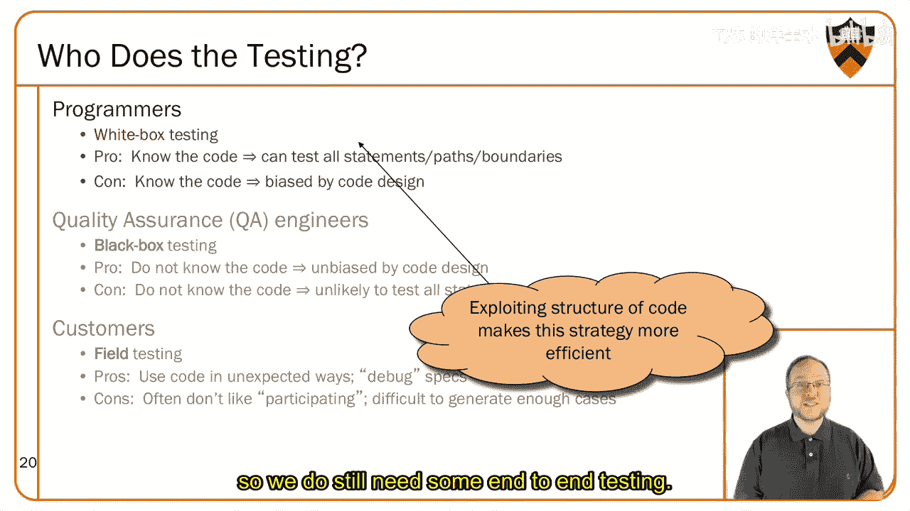

Alright， so let's talk about internal testing we'll start off with internal testing with assertions in C there's a library called Asert that allows programmers to write testing into their code。

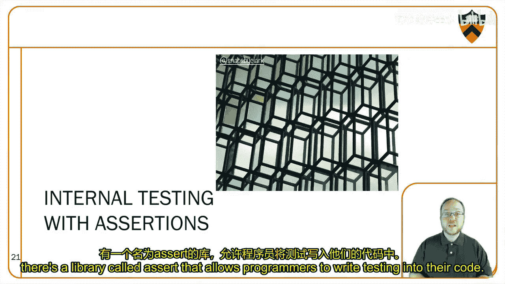

The library defines a macro assert that will treat like a function call。 This macro。

 if the parameter expression evaluates to true， it does nothing。

But if the parameter expression evaluates to false， it kills your program。And you might think， wait。

This is a good thing。 Why would I want my program to die， That's pretty hardcore test result。

 isn't it。But it's better， at least in general， to die with a cogent message about which assert failed where than to crash arbitrarily at some other point under unknown circumstances。

Furthermore， it's much better to die with a cogent message about which at failed where than to run to completion with the wrong answer。

So typically， the programmer chooses to abort with a failed assertion when the problem isn't our fault as the programmer of this particular module。

 and there's nothing we can do about it。Or when it is our fault and it's something we should catch and fix Asap。

More generally， we're going to talk about using aert for programming bugs either from the author or from the call and not user bugs with the input。

 but let's see some examples。So we can use asserts to validate our parameters。

 you've already seen this in assignment2。We don't allow bad data to get in the door。

There's a principle called garbage in garbage out and this is sort of。The opposite of that。

 this is garbage in dye。It's particularly important when writing modular code。

 You wrote the function， but you may not be the one who writes the function that calls it。 In fact。

 for a sufficiently large program， you almost certainly won't be。So one reasonable question might be。

 why should you die， Why shouldn't you return an error state？The problem here， though。

 isn't our fault。I wrote a perfectly good GCV function。

 but somebody called it without respecting my contract from the comment in the header。

So there's nothing I can do in GCD to fix that。If the color passed us bad data。

 why would we think the color would look at our informative error return anyway and do something sensible with that。

 But further， error returns can be kind of hard to keep up with。

 recall the complexity and confusion and misunderstandings from getchar returning an int。

That becomes pervasive if almost every function starts to return either some valid value or some error state。

So in the absence of something like exceptions， which C doesn't have， one option is。Just say nope。

 I was you did not respect my contract， I'm not going to do anything。

 in fact I'm going to terminate the program。The next step then is if we say that we don't let bad input in the door。

 we also don't let bad output out the door。You know what your function was supposed to do。

 Did it do it。And maybe we don't know exactly what the correct answer should have been。

 but we can figure out some post conditions in this example。

 the GCD clearly must be less than or equal to each and greater than zero。Again， why assert。

 why not return an a state？In this case。We had good input。 That's why we didn't already die。

 If we're returning something bad， that means that the error is our fault。

 and we want to notice it Asapap and fix it， hopefully， before we ship。If we have asserts here。

 then if we do any testing at all， either we， as the developer or the Q A who's running it with a search turned on。

 willll notice that our program dies and we'll say， hey， go fix this。

 And that gives us an opportunity not to be embarrassed by shipping bedco。

So the third thing we can test some assumptions or invariance about the program that in C's case。

 maybe we don't get for free in Java the language bounds checks array access and will' kill your program with an array index out of bounds exception if it's violated。

In C， there is no such protection。But you might reasonably write your own。

It's easy with the lower bound。 And it's okay， in this case， with。The array size being known。

 but it's harder as a taking a parameter because as we've seen。

 it's hard to know exactly how it's impossible to know exactly how long an array parameter passed in is unless we get some signal as another parameter or something like that。

So again， we ask in this case， why assertt？Well， here it's our fault。 If we've gone out of bounds。

 it's our fault， and we have to notice it and fix it。So while we're checking the validity of values。

 we should also make sure that any external functions we call behave correctly and leave us with a post condition that we know how to handle。

 For example， when we read from standard input， we better check that we're actually able to read what we wanted。

So again， here， we're going to check this， but now we are going to check。

Using something other than an assert， because this isn't a programming bug。

 This code would work fine if we were only given valid input。Thus。

 if it doesn't return to to from scanf， that means we weren't given input that we were expecting。

 This is a bug with input， a user error。In this case， we can do our best to get new input。

 print and error message。Do various other ways of trying to get the user to cooperate with us because the bug might be fixable。

Unlike where it's a programming bug built in where either the call or our program itself is broken。

 at which case at runtime， there's nothing we can do。

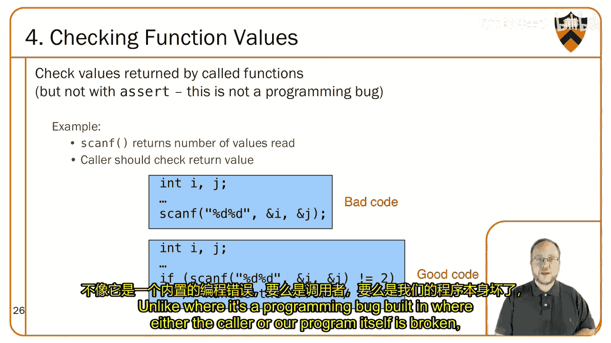

All right， So sort of in the same vein， But， but getting a little bit deeper。

 we have representation in variance。 This is the internal state of my program。 And the question。

 is it in a valid state for what I know it's supposed to be。

This is particularly useful for data structures， we'll get into data structures and see next week。

 but you already know the gist of them from 126。So these are abstractions。

 data structures are abstractions， and thus they have a different validity than the underlying primitive types that they're made up of。

For example， if an object represents a 217 assignment grade by just using an int。

The invariant might be that it's non negative。Even though Cs can， of course， be negative。 And， yes。

 I know。 in this case， we should just use a unsigned it。As another example。

 if it represented a student， the representation andvari might be that the name of the student was non null and not an empty string。

So how do we use representation and variance？Well， a function that creates a data structure。

Might make sure that the data structure is okay before proceeding。

And so if it's passed in a data structure it says well did you give me something that's valid。

 otherwise there's not much I can do about it and a function that creates or modifies the data structure might make sure that the data structure is still okay before returning so if I'm creating something from scratch。

 we better start off with being valid and if I'm taking in something changing it and moving on then again I should check to say that it is still valid after I've done whatever modification the function does to it。

As a note， this could be expensive if we're checking the entire state of a data structure。

 you might imagine the data structure is a tree or a very long list。

And so a common technique here is to wrap the checking code in asserts。

 and we'll see why this is a flexible solution in a moment。

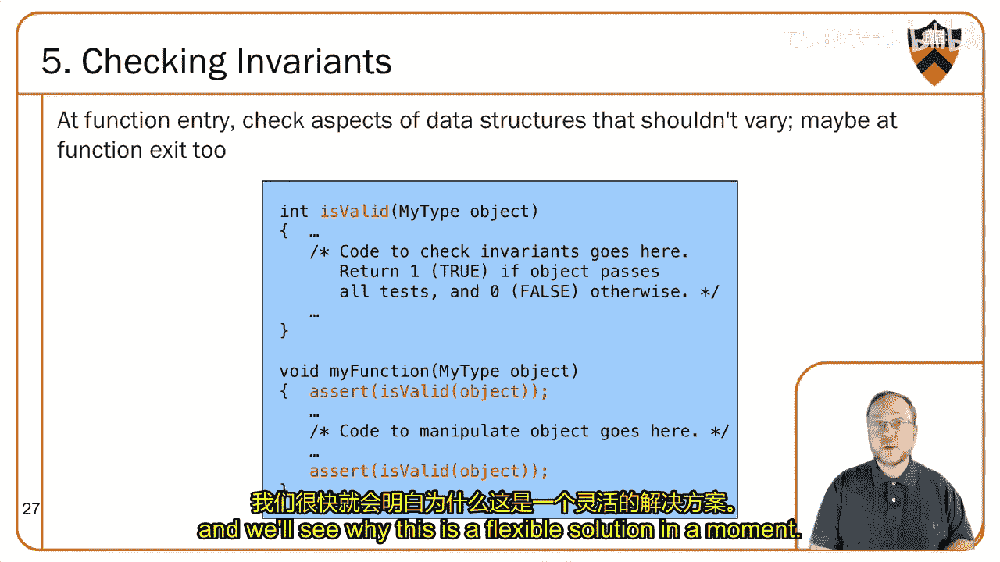

All right， so once we have some internal tests， we need a structured way to proceed。

 Unit testing is testing pieces in isolation from other pieces。Consider a module， assignment two。

 for instance。You start with an interface the specification of the contract between the implementation and its clients。

You build the implementation， attempting to match the interfaces contract。

And then you or someone else writes a client program， again。

 attempting to match the interfaces contract。But if we run end to end tests。

And find that the program gets the wrong answer。 We know there exists a bug。

 but we have no hints as to its location or how to fix it。For example， if replace doesn't work。

 well maybe the bugs in replacing right。But also， maybe it's in stir copy。

If we have a fundamental problem with these lower level functions。

 we'd be better off having found it earlier rather than now when it's impacting client code。

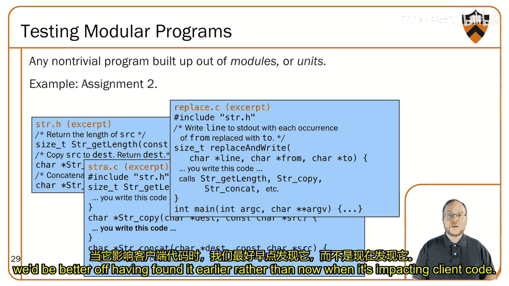

It's tricky， though， to test each bit， because we need to be able to call them in isolation。

But the pieces are by construction， no pun intended， interconnected。

Testing incrementally often involves creating scaffolds and stubs。

Scafffolds are a temporary or incomplete function or program even that calls the function being tested。

Some languages like Python allow any function to be called interactively and thus they eliminate a lot of the need for scaffolding。

But in C， to test a function， for example， function 2 here。

 you will likely have to read a scaffold that calls it。 You know， something that has a main。

Stubbs are on the other side of the function we care about。

 It's a temporary or dummy or incomplete function that the function we actually are testing is calling。

To test function 2， we might need to write a minimal version of the function that it calls there are a couple of ways to do this。

 We could fill in hard code the value that's supposed to come back from it。

 We could do a wizard of Oz solution， the human behind the curtain as it were。

 that instead of getting a value back from the function computation instead we read from standard input or read from a file。

 something like that。 This is sort of similar to hard coding。

 but it's data as opposed to in the program itself。

 And then there's another option that might be we can generate the correct answer， but slowly。

 let's say brute forcing something that we haven't written the the clever fast algorithm for yet。

And we've italicized a temporary in these boxes because there's a tendency for it not to be。

 Ellen Cooper wrote a really influential paper， the perils of prototyping in the mid90s that said。

 when you write really good scaffolds and really good stubs， you say， wow， this was really good。

 I don't want to throw away this this thing that've worked really hard on that it came out really well。

 So you're tempted to keep some of your code around by expanding it to become the fuller version even if really。

 you should be building the fuller version from scratch rather than sort of adding on extra pieces that weren't really designed to be built around that stub。

 So it's a little bit tricky here。 We want to write really good stubs。

 We want to write really good scaffolds。 But you don't want to to succumb to the temptation to let those stubs and those scaffolds be the prototype for something that should be designed in a structured way from scratch。

So here's an example of a unit testing harness。 It isolates one function and tests on a variety of parameters。

 but the harness itself is sort of a scaffold。 It isn't the real client code， certainly。

 but it acts as a minimal enough client to get access to the module we're interested in。

Our second to last topic today is test coverage。 What different properties should the tests we write have individually and collectively？

First is statement testing。Collectively， all of this。

 the tests should exercise each statement in the program at least once。

 This makes sense if you have no test that causes a piece of your code to run。

 how can you possibly know whether that code is working or not。So here's an example。

 a piece of pseudocode。Statement testing should make sure that all four statements are executed in at least one test in the suite。

There do exist tools， both open source and commercial， to measure statement testing。

 to measure coverage of a test suite on a given piece of code。That way。

 when your code is considerably more complex than something that we've seen here。

 especially just this two serial if else's， you don't have to rack your brain too hard trying to manually figure out how much of your code has been covered。

That said， for simple examples， it is perfectly legitimate to reason it out yourself。

 so have a try at the same code from the previous slide。The answer here is B。

 The given pseudocode requires two passes through the code for a minimal statement testing。

 One example of a minimal two pass would be condition1 is true in condition 2 is true。

 that will execute statement 1 in statement 3， Then in another tests。

 we have condition1 is false in condition 2 is false， that would execute statements 2 and 4。

 It can't be done in one pass because statement 1 and 2 are mutually exclusive。

 As our statement 3 and 4。The next type of code coverage for after after statement testing is path testing。

Path testing is like statement testing but permed， instead of every statement appearing in a test。

 now every possible sequence of statements must appear in a test。As you might imagine。

 this is immensely more intensive than statement testing。Related to this course。

 it's frankly too much we haven't attempted to do path testing for your assignments and we won't ask you to do path testing for your assignments。

But again， in simple cases it's feasible， so take a look at this code again， give it a shot。

The correct answer here is D。Path testing of the given code requires four passes through the code。

 condition 1 is true and condition 2 is true。 condition 1 is true and condition 2 is false。

 condition 1 is false and condition 2 is true。 condition 1 is false and condition 2 is false。

So the third criteria for testing is boundary testing。

 that is corner cases around which a program's behavior changes in some way。

Almost all bugs occur at boundary conditions。 If your program works solely for the boundary conditions。

 it likely works for all the others。 If your program works for all the boundary conditions and at least one non boundary condition。

 it very likely works for everything else。Note that there might be multiple axes on which to measure boundaries and thus multiple axes on which to test。

So consider the following function declaration， what are the boundary tests you should consider？

Again， treat this like an eye clicker question and take a moment to write down what corner cases or phase transitions jump out at you。

So we certainly should check when we find and it becomes the back is the first item in the array。

 that's our lower boundary。Also， our upper boundary。

 when we find and it comes back that it's the last item in the array。But also。

 we should check on the other side of the boundary。

 We should check when it's one beyond in either direction。 So we have a test that says， oh。

 it's one beyond the start of the array。 And we have a check where it's one1 beyond the end of the array。

 And the reason we would want to test this is not that we want to check arbitrary memory locations outside of what we've declared。

 but rather to test for bounds for bounds off by one errors。

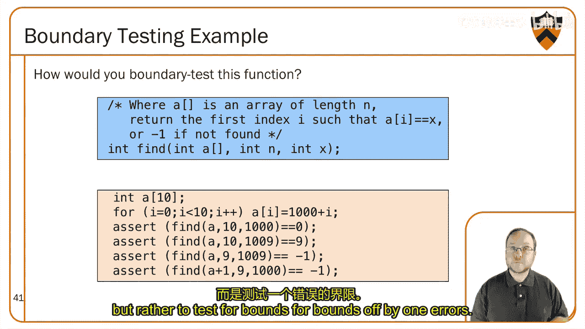

So in addition to statement path and boundary tests， we should also consider stress tests。

This is when things get to their most extreme in quantity or variety or other factors。

These tests might not look like your typical input， but that's a good thing。

Developers tend to focus on the typical input and may have large swaths of your input space that are completely overlooked。

Systematicically plain sweeping over the input space or uniformly randomly selecting from it are reasonable ways to get test data that a developer or QA might not think to write themselves。

So here's a plausible stress test， We choose 10 strings of length 10000 each。

 and we fill the strings with random data。 Let's assume that that's what this random string does。

Then as far as the test itself， we compare with a reference solution。

And that might get your hackles up as bogus in some way。 If we have the function already。

 Why are we writing a new one， But I maintain this is actually quite plausible。

 We might be changing the algorithm where we have the old version that's slow or uses too much memory or what have you。

 We might be reimplementing the algorithm in a new environment where we have it working in the old environment or we might be internalizing a standard tool。

 For example， there might be a Linux command， but we don't want to have to go and ask the operating system or the shell to do it all the time。

 So we're going to write our own in a function of our program。😊，That said， of course。

 there are times when。DoYou have a reference when you don't have a reference implementation？

So testing does involve checking reasonable output properties。

 even when the exact answer isn't available， we saw an example of this with the GCD example。

 So here's another example。 again， pause the slide。

 think about what properties might we be able to check here。 Take a minute or two to brainstorm。

So the result has to be non negative。The result has to be less than the maximum string size based on our assumed interface with random string。

And no character up through the string length can be the nobite。 Otherwise。

 that would have ended the string， at least as far as a string length is concerned。

And the character at the index must be the Nolbite。 again。

 that's how we've defined the end of the string。So I truly believe that testing is something that people should be using to get started。

 I advocate writing tests， at least the basic one， which is based off the interface。 Yes。

 even before the implementation itself and certainly before your external clients。In fact。

 when things aren't quite as inviolably standardized as in assignments two and three。

 I even advocate writing tests as a sanity check of the interface itself。And then of course。

 as practicalile matters of this course and many coast courses， in general。

 we have more tests in our grading system than we give you in the repository or show you on ti file or what have you。

It's your own job to test your code。 but at least now。

 you know some structured approaches to doing so。

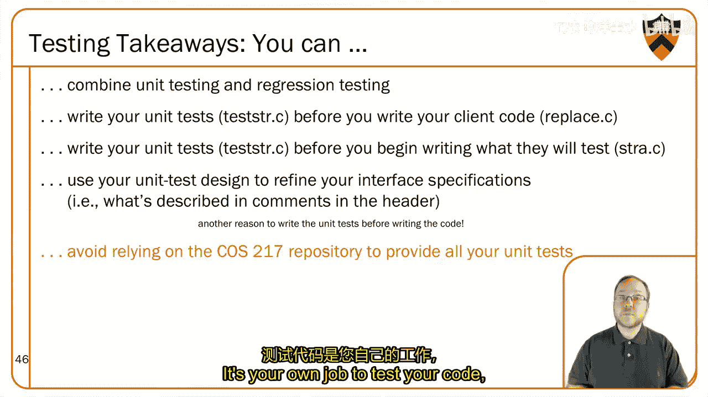

Al right， so now you've iteratively written your tests， written your software， run your tests。

 debugged， written more tests， etc cea。 Now you're ready to ship your code。 So now what。

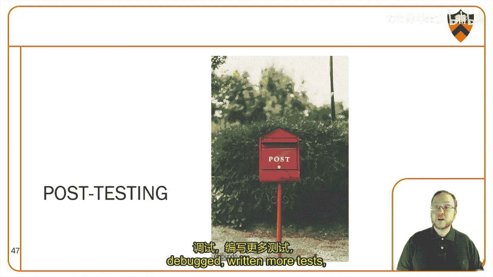

Don't throw away your unit test harnesses。Remembering the concern about prototyping and it hangs around for longer than it should。

 this doesn't mean that your unit test hardnesses should have become your actual shipping code。

But it doesn't mean you should toss it away either。 Don't throw away your asserts。

 Don't throw away your representation and variance。 You put time and effort into making them。

 And furthermore， even though you might be shipping the code。

 that's not the end of the software life cycle。 In some ways， it's just the beginning。

 For most projects， we certainly hope that the useful life is far longer than the development stage。

 And thus， the maintenance stage is much longer as well。Now that you've shipped。

 you're going to start getting bug reports or new feature requests。

 and the whole idea of regression testing needs the existing infrastructure to still be there。

But just because you shouldn't throw away everything doesn't mean it still has to be running in the clothes that is shipped。

Thhorough testing infrastructure can be expensive， Test of internal representation and variants might iterate through large data structures or long lists。

Precondition and post conditionition checks in every single function get very expensive if we're calling those functions often。

So we need a way to disable the testing code without dispensing with it。

But before we learn what that is， do note there's a difference between don't remove testing code and don't remove debugging code。

Good structured testing infrastructure is valuable。 Prif saying， I got here and X has value D here。

 less valuable。Those should be removed entirely unless they're particularly well structured and can be disabled in a similar way to the testing code。

 which is unusual bordering on unheard of。

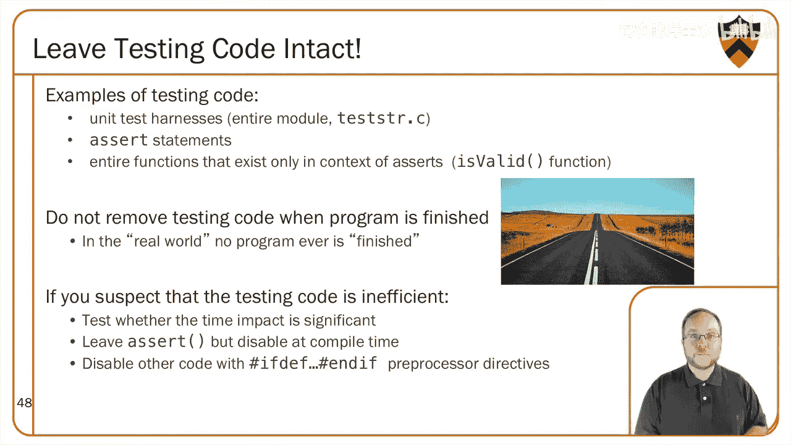

All right， now， let's talk about disabling the the testing code。 If asserts are expensive。

 we can turn them off in the program。We could either do this by changing the code。

 The macro end debu is used by the Asert library as conditional to check whether we should treat a searchert as a function like macro that does the statement and then either continues or dies or whether we should treat it as a complete no op that doesn't do anything。

 it doesn't even evaluate the statement。Even better。

 we can trigger this behavior in the assert without changing the code itself。 only the build command。

 Gcc accepts a build build option minus D。 That's the equivalent of a pound define at the top of our program。

So applied to this course。You'll often want to say I have to write my asserts。

 but maybe I'm testing something that is intensive， in assignment4， for instance。

 you'll be writing your own is valid representation and variant checks。

 and so in your final version you'll build it so that they're disabled so that the program is fast。

 but while you're developing it or while you're using it to test out our buggy versions that we give you。

 you'll want to have them turned on so that you get the full benefit of the test。

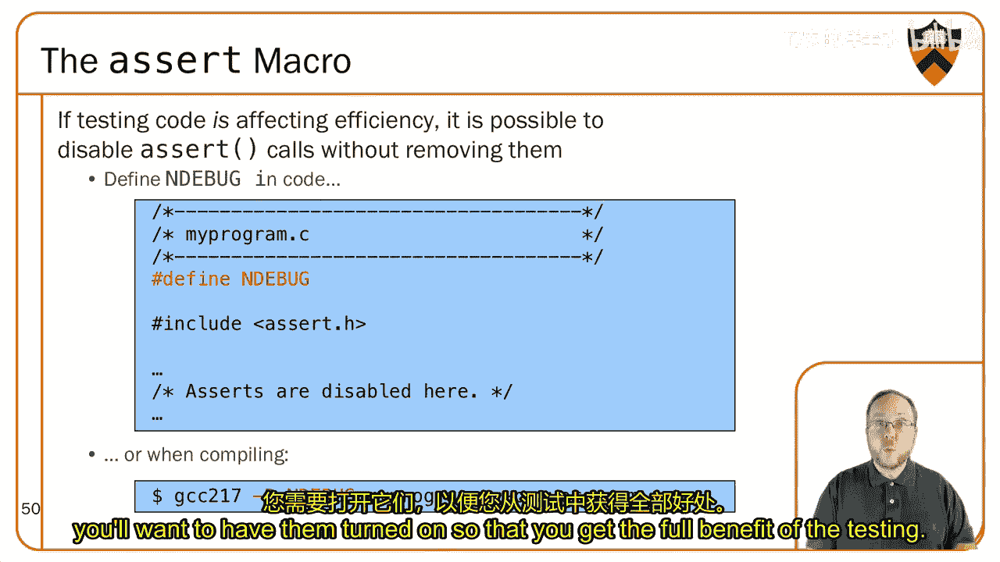

Note that we can set up the same thing that the Ast library does for ourselves。

 we've seen the if and de and if pairing for preventing multiple inclusion。

 we can use the positive version of this， the pound if de。

To test if a pound defined was given in order to enable or testing feature。

 so this is exactly what the assertt library does with the end above。In fact。

 we could do exactly what As does and just use end debug itself。

 but this would mean that you couldn't decouple your custom feature testing from the other asserts in your program。

 So the previous slide is more general。

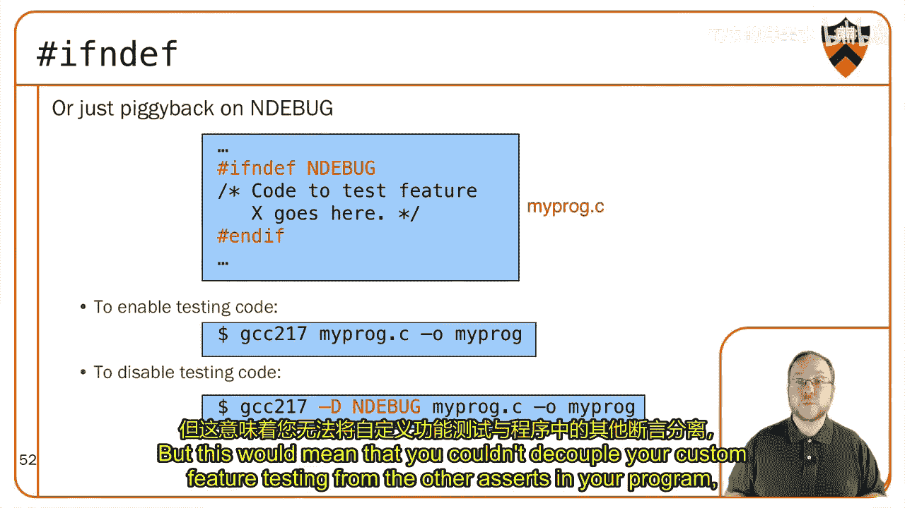

So that wraps up testing。 It's easy to focus on development。

 It's natural to see debugging as some sort of ultimate problem solving logic puzzle challenge。

But I do hope that you'll consider the value of a thorough testing suite。 And in particular。

 however much time you spend on testing may well save you that much time or more versus the seeming wackam mole of one off bugs that you just can't seem to make go away。

Next time we'll be talking about data structures， and then next week's first and only lecture will'll tackle debuging again。

 much like with testing today， aiming to give you a structured approach to use in place of the common inefficient techniques that novice programmers use。

And then next Thursday begins the midterm exam period， C Ed for details。

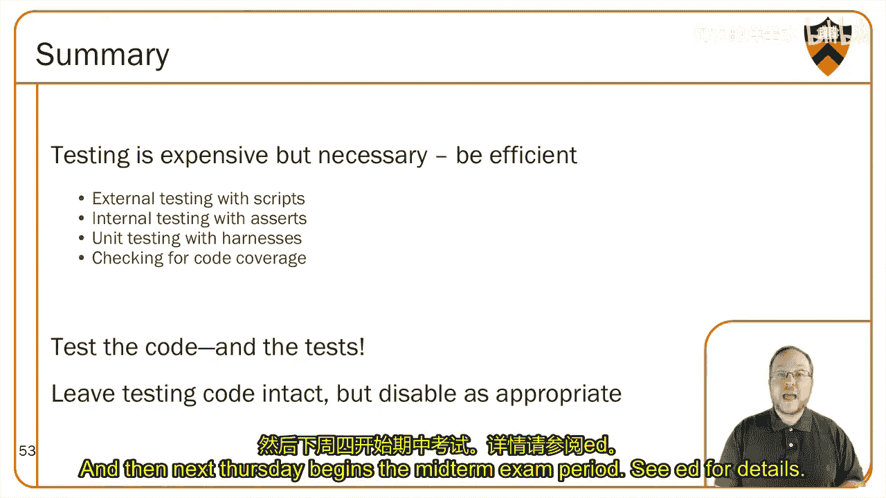