# 【全集 秋季版】普林斯顿大学 C语言系统编程 中英字幕 p13 Lecture 13 - 数据结构 -BV1u1feBoEsK_p13-

Welcome back to the Co 2，17 lecture。 And indeed， this is still Co 217， not Co 2，26。

Even though you see today's topic is data structuress。

The reason here is that when it comes down to it，217 is all about abstractions。

 and data structures are really just that abstractions。

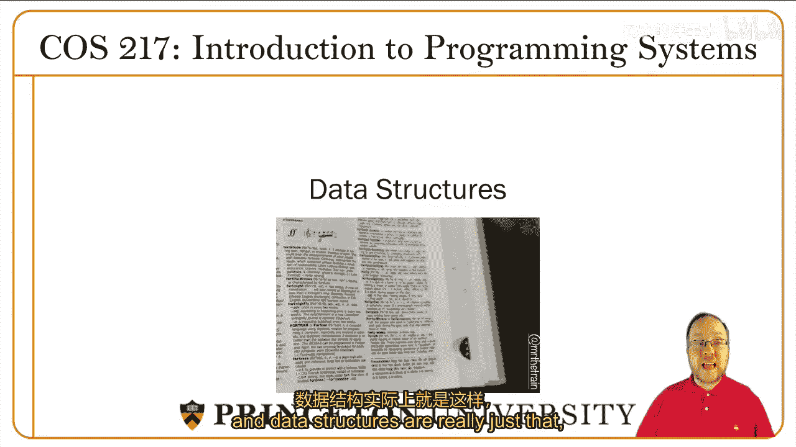

Think back to Co 126。 When you start out， you're doing things。 A loop does things。

 A static function does things。But then we get deeper into object oriented programming。

 and you start to learn about objects。 and objects are things。 They represent things。

 It's less action in more being or essence。And when 126 talks about data structures generally。

 it's a set of data and operations you could do on that data。So put together。

 you can think of data structures as representing the essence or being of a common set of data and their operations。

From there then we can use these as building blocks to help us accomplish other things。

They are something that helps us do something else。We don't build a link list， just to say。Golly。

 look at this great linked list。 We build a linked list to help us solve a problem。

And the same with other data structures。 This is the essence of this abstraction。

 We're abstracting away the gory details underneath the hood， and we're saying。

 what's the highest level interface we can think of to help us solve this problem。

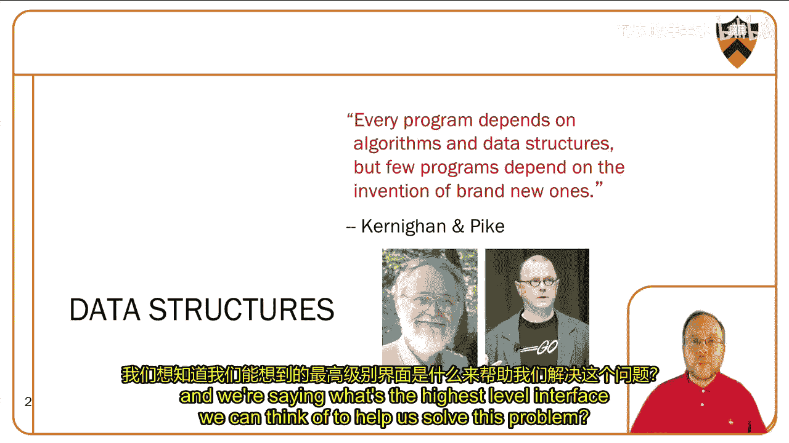

So why this lecture in this class at this point， Well， in plain words， assignment 3。

Linkked lists are tricky， and more exposure is better to them。And in C。

 they're a good second level introduction to dynamic memory， where it's not just toy examples。

 but rather， there's a real purpose to our dynamic memory allocation。

And we've seen the dynamic memory and C is quite different than it is in Javab。

Once we know about link lists， we can move on to other more interesting link structures。

And for assignment 3， you'll need to know about both link lists and hash tables。 But some Co 2。

17 students might not know very much about link lists。

 and many Co 217 students won't know much if anything about hash tables。 So thus， here's an overview。

By the way， I mention assignment  three， it has been released。

But there's absolutely no expectation that you start working on it right now。

Please go rock your midterms and then go take as great a fall break as you can cram into four days。

 Admittedly， it's shorter than you're used to。 but hopefully you can make the most of it and get some rest and come back ready to ready to really hit the ground running in the second half of the course。

 So if you don't do anything on assignment 3 until after fall break。 That's totally okay。

 You'll still have one day short of two full weeks to complete it。 And indeed。

 precepts 101213 and even a little bit of 14。 We'll be talking about material that's germane to the assignment。

 You shouldn't wait until all of those are done。 But you can certainly wait to start working on it until we get into that material。

 Rather than trying to start it now and just being confused because we've covered so little of it。😊。

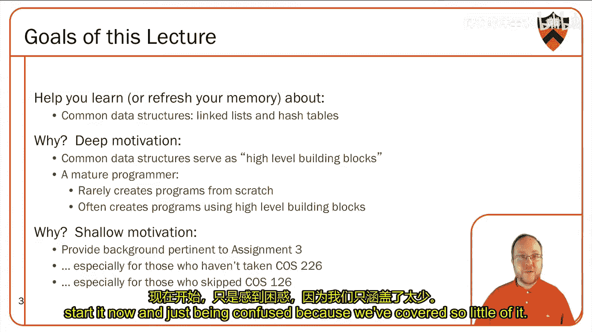

So assignment 3 asks you to implement a symbol table in two different ways。

But before we can dive into that， we should figure out what a symbol table is in the first place。

You might have seen it in in another programming language。

 might be called a dictionary or an Associ array or a Kv store。 But if you haven't。

 that's not a problem。 You're familiar with the concept。 It's a set of key value pairs。

 a look up table， a dictionary in the very real physical book sense。For now。

 let's make a concrete and imagine that the keys are strings and the values are integers。

Here are some examples。It might be a name in their class year。 Sorry， this is Princeton。

 their great class of year。And it could also be a baseball player and their j number， or Jermaine。

 as this is to the course of starting to learn how to program for systems。

 it could be an implementation inside a compiler where we say here's a lookup table from the variable to its initial value。

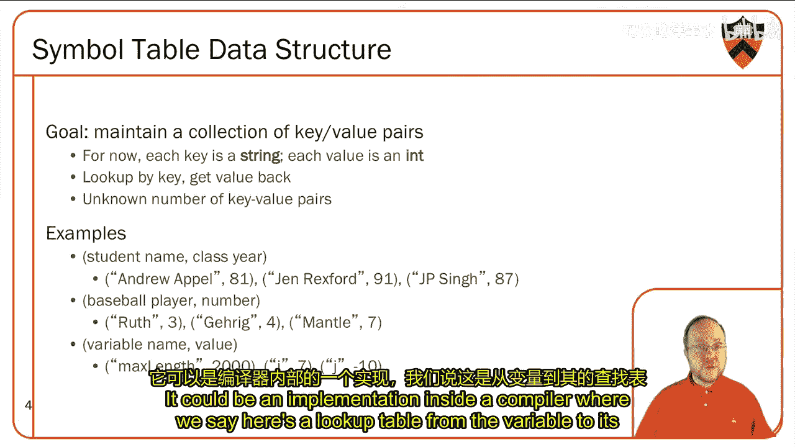

We'll look at two different ways to implement these sets of key value pairs。

 Link lists will be relatively straightforward， but rather inefficient。

 Then we'll look at hash tables as a more extensible and efficient solution。

 but one that comes at the cost of additional complexity to understand and to implement。And finally。

 we'll talk about one concern that will be common across all implementations of these sets of key value pairs。

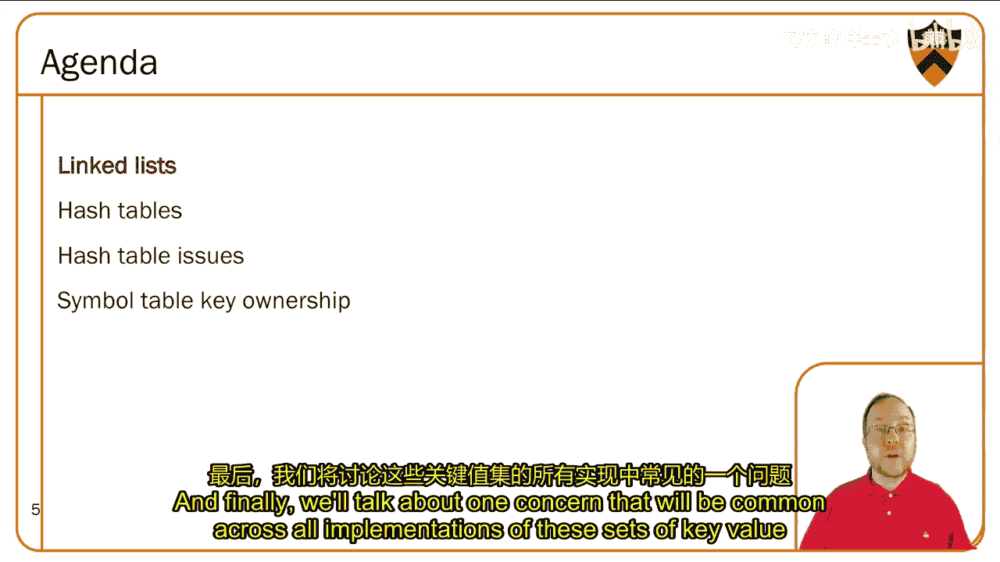

Perhaps it comes as no surprise that data structures are typically represented as well structures。

These are the structure type definitions that you might use in C to implement a linked list。

Precepts show such data structures in the context of a complete program， a stack ADT。

 which is implemented as a linked list， but for now let's just look at the linked list in isolation。

Astruct for a node consists of the fields for a key， its value。

 and a pointer to the next node in the list。For our example， the key is a constant cha star。

 It's a string， and a nodes key can't be changed。 We're working with the assumption now that the values will be int。

 So that explains that field。And the pointer is a pointer to another node。At first glance。

 this looks weird。 It seems like the data type is going to have itself as a field。

 and that would be problematic， but it's not。 A node can have a pointer to another node without it being a problem。

 The compiler knows how to deal with this and knows how to allocate enough space because， well。

 it's a pointer。 The compiler knows that all pointers are 8 bys。 So this isn't a problem。

To save space all'll draw out each node so that it contains its key completely inside the structure because the key is a string in reality。

 so it's really a memory address and thus it points somewhere else as shown on the previous slide。

 but to keep as few crossing over lines and all of that on the slides。

 let's just imagine that it's sitting there in thestruct itself。So the structure for the list。

Contains a single field。We call it first。 that's just the head pointer。

 it just points to the first node in the list。Such a structure。

 one with a single field that's just a reference to another type。

Is sometimes called a manager or a wrapper structure。

 And we'll see this is going to be really important in order to encapsulate our data structure。

 So no client will be able to muck around inside instead of using the API。 and， in fact。

 no client will be able to even tell what our implementation is。

 because all they can see is a pointer to this structure that is。Just the manager。

 it's not the actual gray details of the implementation。

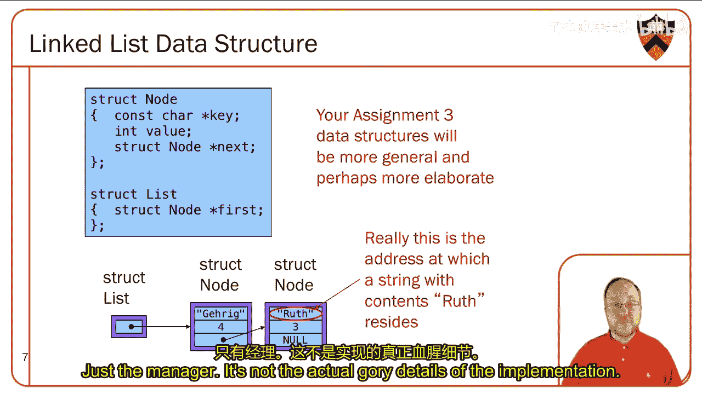

Before moving on， just a quick reminder of some topics from recent lectures on structures， pointers。

 and dynamic memory。We can allocate space on the heap with Kelloc， which zeros out the memory。

 That means that the pointers each will have the value 0， which means they point at the address 0。

 We call these null pointers。We can access the fields ofstruct using dot notation。

We can use the address of operator to get the address of a variable in memory。

And it's very common to have only a pointer to access the struct。

 not the struct itself as a variable。This is natural because we're often going to dynamically allocate a structure。

 and thus all we have to represent it is a pointer。

We could dereference the pointer and then use the dot notation。

But it's also common instead to use the arrow notation to do this directly。

 and this is much more idiomatic。

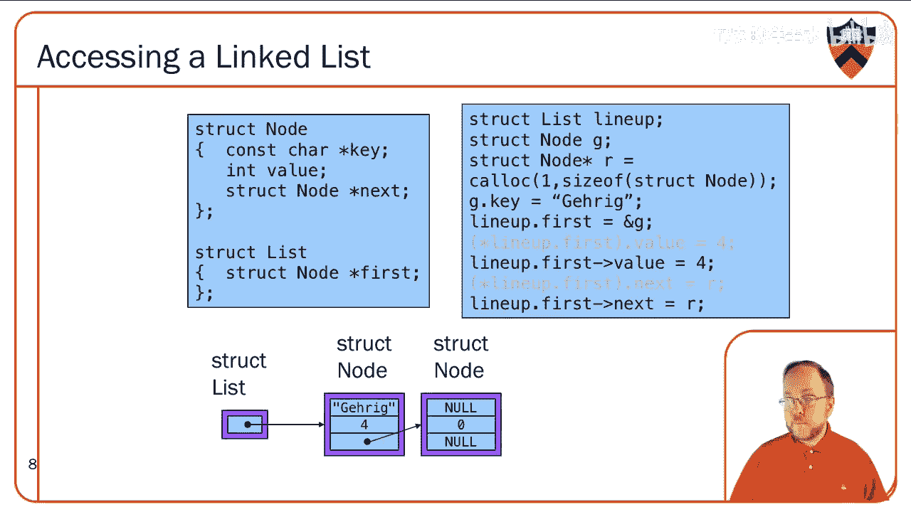

So we're using a linked list to implement a symbol table。

We've given you the symbol table API in assignment 3。

 but we haven't given you an API for the linked list。

 but we do certainly encourage you to design your linked list to have good functional modularity。

 And so let's think about what might be a reasonable API for the linked list。 That is。

 what operations might we want to define for a linked list。Well， we need to create one。

Creating a linked list is just allocating the list structure and initializing it to be an empty list。

 that is， the head pointer should point it nu。This is a fast operation。

 it's an allocation in a single pointer assignment。Adding a node to a linked list。 Well。

 this gets to be a little bit more complicated。 Now， if we can have duplicates， it's easy。

 Just allocate a new nodes。 stickick it at the front of the list。But if we can't have duplicates。

 now we have to traverse the entire list to make sure that there's no duplicate。

 We might traverse the entire list and then stick a new one at the front。

 or we might maintain an ordering such that we only have to check part way until weve found where the node would fit in order。

 But in either event， that's a linear operation。We also need to be able to perform a search for the existence of a key。

So what's the performance of this operation？Take a moment， think about it。

 what is the order of growth for searching for a key and a linked list？

So the answer here is actually that it isn't very well specified， it depends on the workload。

 it depends on the insertion algorithm。As an example。

 if our workload is that we typically do a whole lot of searches for our most recently added things。

And we chose to put the most recently added item at the front of the list。On average， this is fast。

But if we insert at the front and do random item look up， well， on average， we're slow。

 If we insert in order and look up random items， we're still on average slow。

 but maybe we're a little bit better depending on exactly how it comes out because we only have to search part way to look for a duplicate in in our insertion And our search will come out as you know order n one way or the other。

 So yeah， this is order N。It's either B or D， unless we have some really strong notion that work our workload is not arbitrary。

 it's not random。Another operation we should consider is having a method task with removing from a linked list。

 This would also be slow。 Reing itself is just a couple of pointer operations。

 But finding where to do those operations is order N。 Again。

 we have to traverse the list to find the thing we're going to remove。And， of course。

 if we want to remove and free everything to destroy the link list， we have to remove n items。

 There's no search here。 So it's order one times n， but that's still order in。

So a link list then is profiled with a whole lot of linear operations。

If we have a symbol table that will store lots and lots of different key value pairs。

 it'll become quite slow。So let's explore a more complex data structure and hope that the added complexity actually means less computational complexity。

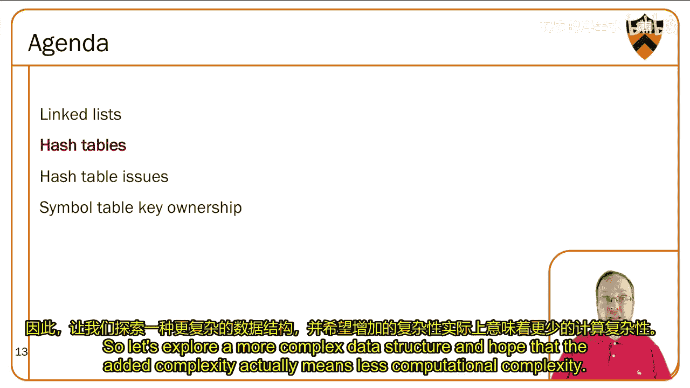

A hash table is a list of sets of key value pairs， such that we hope each set is small。

 One way to implement a hash table is an array of linked lists。

 We hope that each list is of length 0， or1， or maybe 2。In that case。

 our linear operations on the link list aren't a concern。

 That's still a really small amount of work to traverse。To do so， though。

 we'll need an array that's large enough to make this plausible and a way to split data into different lists that's effective at doing so so that we get roughly even distribution across all of the elements of the array。

These are the structure type definitions that you might use in C to implement a hash table。

 Yours will be better。 The value won't just be an int and the size of the buckets might be able to change。

A binding here consists of a key of value and the address of the next binding in the list。

 We say this it's a binding because it binds a key to its value。

 But you could also call this a mapping or a K V pair， or even just a node。

 because it's fundamentally the same thing we had as a node in the linked list。

Our manager structure here consists of an array named buckets。 It has。Bucket count elements。

 and each element is a type binding star。 That is each element points to a binding。

The bindings are exactly the same as the nodes worth the linked list structure。 Now。

 we just have a whole bunch of linked lists instead of just one。

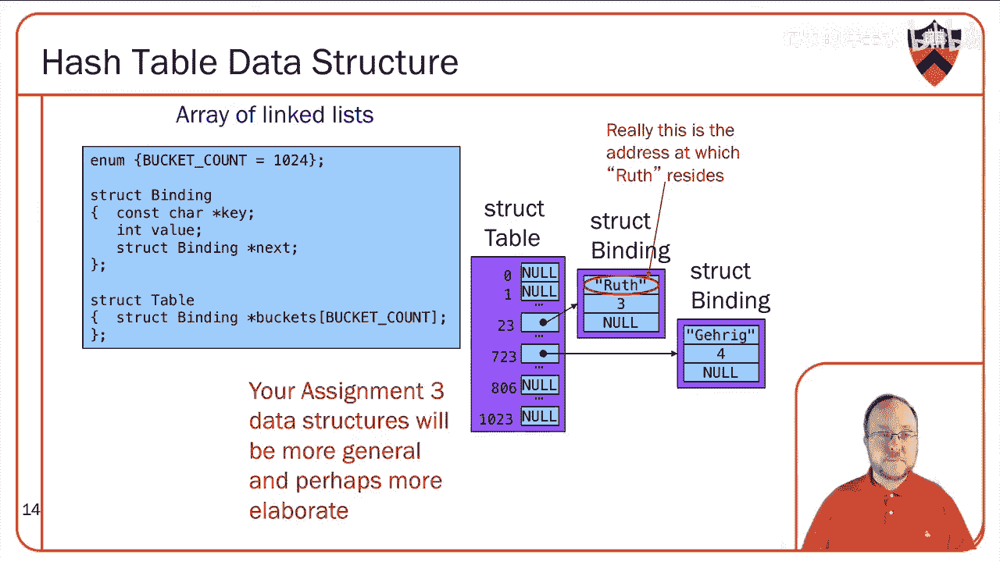

So zooming in on the data structure， just to recap。

 a binding is a structure that binds a key to its value and also points to another binding or not。

The bucket is a linked list of bindings。Each element of the bucket。Is。

Each element of the bucket array points to a bucket。

And in order to figure out which bucket of binding goes in， we use a hash function。 We hash a string。

 the key， and it maps it into an integer。That's the index into the array。

We'll have to mo this integer by the bucket count to determine what the the bucket is that's appropriate for the key。

 because most hash functions aren't going to give us a number that will just automatically be within our range。

 Furthermore， it can't。 if it wants to be general。 So we'll do the hash and then eventually mad by the number of elements in the bucket array。

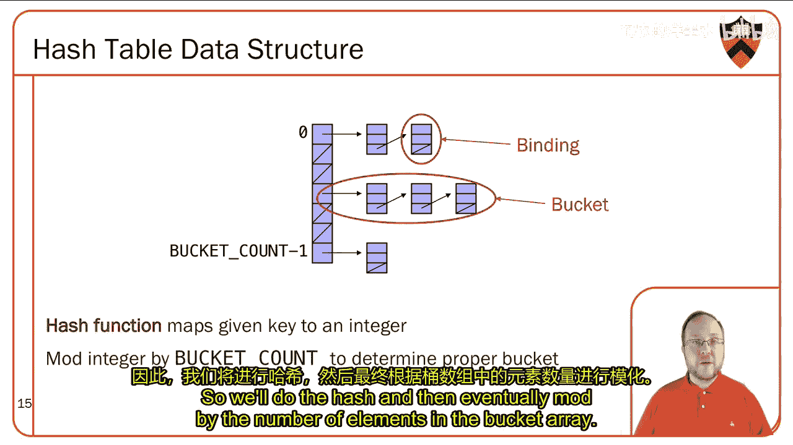

Let's look at a concrete example。Here we'll use a smaller array size， seven。

And let's depart from baseball players and take a suussian turn for our key theme。

We'll talk in a moment about what properties we want the hash function to have。

 I sort of mentioned deterministic but uniform across our table。

 typicallyy we'll pick an algorithm with some general number theoretic properties and then constrain it by the mod。

 as mentioned。But again， we'll talk in a minute about what exactly goes into this for now。

 let's just imagine that we have a function， it comes up with the numbers that we see on the slide。

So we start out with an array in which every bucket is the null pointer。

 that is none of the buckets have any binding。So here we hash the and get a huge number。

 We mo by 7 to get a valid array index 0 through 6， and we come up with one。

We look in the list with buckets of one as its head and find nothing。 Bucks of one is no。

 So that key can't be in the table already。 If it were， it would be in that bucket。

 So we must insert a new binding with that key。We add the binding the we didn't specify what the values were here because they don't matter for describing the hash table fundamentals。

 So I'll just ignore that field。 But it would be 0 if the binding were Kelloced and undetermined junk if it were malloced until we gave it a value explicitly。

In the real implementation， you're going to set the value to be whatever is passed in in the put function as the value parameter。

The pointer to the next binding is going to be no because there's only one binding in this bucket。

The next key we want to add is cat， so we hash it and get back at two。

We check buckets of two and find it to be empty， so we insert。

Now we have the data structure with a single binding in bucket 1 and a single binding in bucket 2。

The next key we want to add is in。 We hash it and get back a five。We check buckets of five。

 find it to be empty and insert。Now we have the data structure with a single binding in bucket 1。

 a single binding in bucket 2， and a single binding in bucket 5。

Let's make things more interesting now。The next key we want to add is the we hasht and get backca1。

 We check buckets1， and it's not empty。 So we traverse until we either find a a binding with the key。

 the or we reach no。We do find the， so that means that the is a duplicate in assignment 3。

 putting a duplicate key into the symbol table should fail without changing the table。

So we'll make no change here。The next key we want to add is hat。

We hash it and we hash it and get back at two。We check buckets of two and again it's not empty。

So we traverse this list until either we find the desired key in some binding or we get to know in bucket 2。

 we see a binding with cat， which isn't hat。 And the next points to know。 So hat isn't there。

 We can insert。When inserting， where should we insert the front to the back， frankly。

 it doesn't really matter。 recall that we'll have to search through the entire list anyway。

 So it's order n sorted versus not。 We might as well add it to the front because it's easier in the general case。

 On the other hand， depending on how you've done your traversal。

 maybe are still left with the pointer to the last item， in which case。

 we could certainly in front insert certain in the back just as easily。Further。

 the whole point here is that we have a big table with a good hash function。

 These collisions should be rare。 Each cliff should be very short。

 And so it doesn't really matter whether we put it the front， the back， the middle。

 And it's all the more reason to go with an easier solution。 So whatever is most convenient。 Overall。

 we're looking pretty good。 Lots of length 0 and1， one unlucky bucket of length 2。

So with that example in the book， let's return to our complexity analysis。

Creation now is constant work。 It's independent of the number of items in the table。

 although it is a heavier weight operation， because we have to allocate the array of buckets。

Adding an item to the table requires a hash。If our key is big， hash might be a nontrivial operation。

We have to mod to get the bucket fine， And we have to make sure there's no duplicate by traversing the entire list of the bucket。

 then doing the insertion。 So what's the complexity here。Take a look at these options。

Pause the video， make a decision， and then restart when you're ready。

I think B is a reasonable answer， because if there are far more keys than buckets。

 even a good hashing algorithm that spreads them perfectly will still yield buckets with many bindings。

 But I think C is the best answer。 because even if the bucket list is by far big enough。

 there's still a linear worse case。 If all the keys hash to the same bucket。

 that's just a single linked list。 So we darn will better pick a good hash function。😊，Again。

 more on this later， and don't worry for this assignment。

 we will give you a function that has these good properties。All right， so the hash table。

 we hash function， we have a hash function to find a bucket。

 and then it's just the same old length list， but that linked list should be some small。

 constant length。We've mentioned though， two other issues in passing。

One is the bucket array might be too small。 That means that even if perfectly distributed。

 all lists will be long or the hash function might be bad。 So if keys aren't perfectly distributed。

 some lists will be disproportionately long。So how many buckets should we choose？Well， on one hand。

 we say we want to choose many of them because too few buckets is a problem。But not too many。

 because this is a gigantic upfront cost in memory。

 and we would waste memory if we allocate too many。

 Our general goal is that we want to have lists of， you know。

 zeros and ones and twos in our final table。 So we'd like to be able to have a sense of what our total number of bindings that we're going to add is。

This isn't always possible， and that's why if you take a quick peek at the assignment 3 challenge portion。

 you'll find that it is expanding the hash table， so you start out where you have a given number of buckets and then eventually as it becomes too full。

 you say I'm going to create a new bigger array that will distribute better。

 you do this up until a reasonable number of times at which point if you have some very large number of bindings。

 there's really nothing you can do。

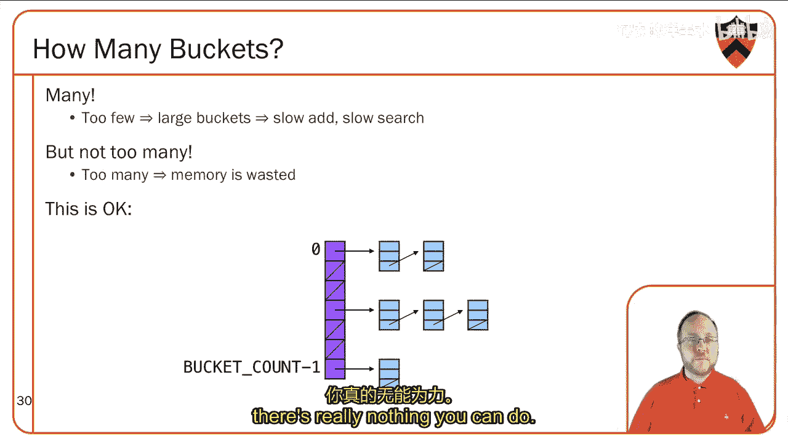

In terms of the hash function， well， we mentioned that the worst hash function possible would generate the same hash code for every element。

That would degrade to a， to a linked list。 But this doesn't have to be quite so much of a straw man。

Consider string length。This won't。Give you the same hash code for every for every possible key。

 And it actually sounds decent， at first。But for names， this isn't random at all。

 Most people have names that are call it 1 to 20 characters long。

 and it's similar for almost any natural language key。

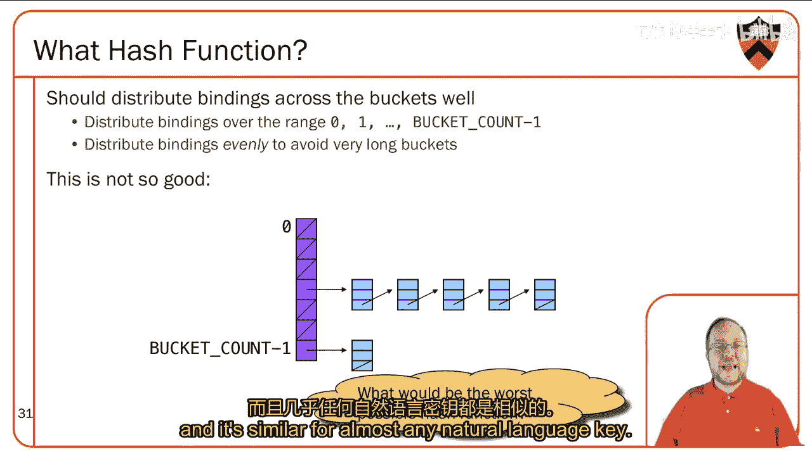

So what generally constitutes a good hash function。

 This is actually an open problem in numerical analysis， but we do have some ideas。

 We already just saw that string length isn't a good one。 And actually。

 the sum of their ASI values is similarly compressed because it depends so heavily on the length。

If we start to really differentiate the different positions in the string， though。

Then when combined with the ASI value， we can get some display in practice。

 it works best if our weighting factor is co prime with the bucket count。

 Two integers are relatively prime or co prime。 If there's no integer greater than one that divides them both。

 That is their GD is one。 So， for example，12 and 13 are relatively prime， but 12 and 14 or not。😊。

So this is actually a pretty good， simple heuristic to calculate， it's an easy calculation。

 and it works pretty well in practice。

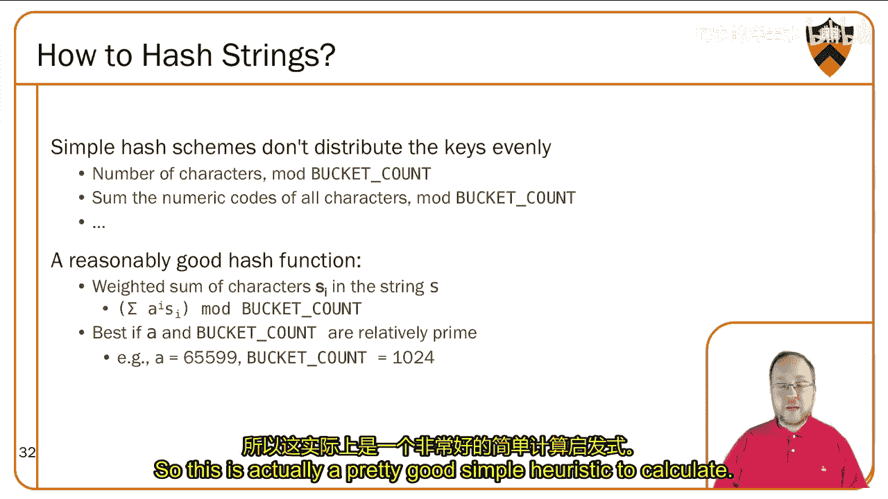

Here's that hashing algorithm converted into code。 Note that this is actually doing the weighting of the weighted sum in the opposite order of the characters。

 but that still has the same properties， and it's more efficient to compute than the summation on the previous slide on the previous slide we had A of I times S S subbi。

But here we just have an additional multiplicative factor of A each time instead of computing A of I for each I。

 so we save a bunch of multiplications here by just having one extra multiplication per time rather than the computation of a product。

The other thing you might look at this， even though we have a size T here， as you may be saying。

 this will overflow eventually， we're taking big powers here。 We're doing multiplication。

 If we've got a sufficiently long string， this is going to overflow。 And you're absolutely right。

 But recall from our earlier lecture when we learned about overflow。

 operations in the presence of overflow are the same values as they would have been without overflow just mod 2 to the K where K is the number of bits。

😊，So numerical properties are largely retained。Further。

 doing the mod at the end to get the bucket array index throws away everything in the top bunch of bits of the number。

 we're looking at only the bottom bits of the number when we do a modullo。

So because the numbers are the same mod2 to decay k。

 and we're modding by a value less than2 to the k， which we almost certainly are because otherwise that would be a gigantic array。

Our calculation yields the same bucket index， whether we overflow or not。

 so this is a pretty great algorithm in terms of having some nice properties and not being concerned about the artifacts of how we represent integers on our system。

This is more or less the function that we're going to give you as part of assignment three。

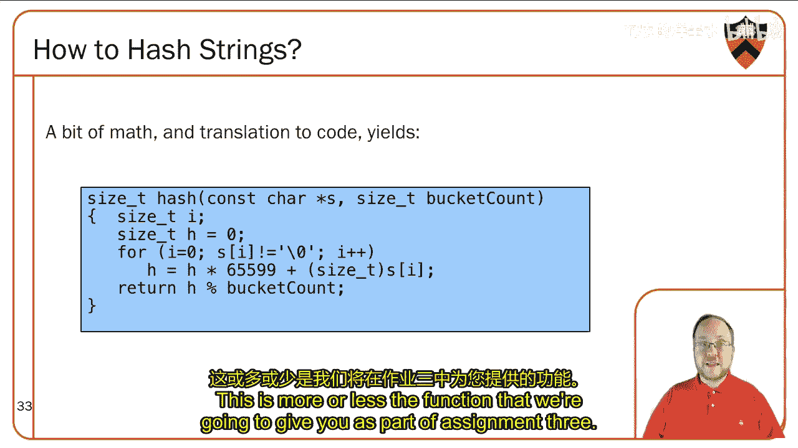

So finally， let's talk about in a symbol table。Whether linked list or hash table implementation。

 let's talk about our keys。

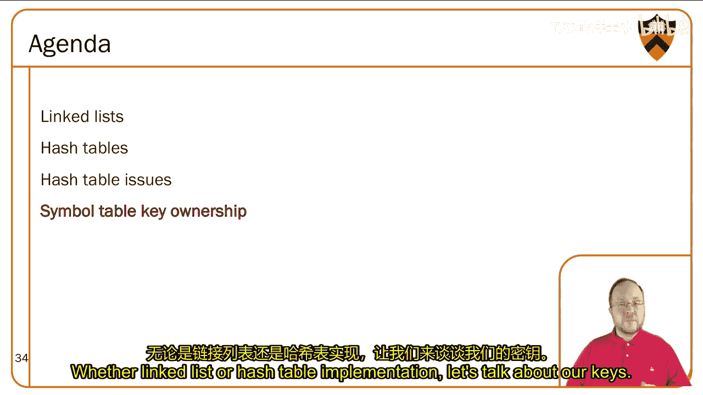

To keep on track with the same implementation we've been looking at。

 let's continue looking at the hash table。Consider this add method for an arbitrary hash table。

Arbitrary symbol table。The function creates a new binding and assigns a key。

 a memory address into that binding's key field。 That seems reasonable。

We want to take in the key and make it the key of our new binding， so let's continue。

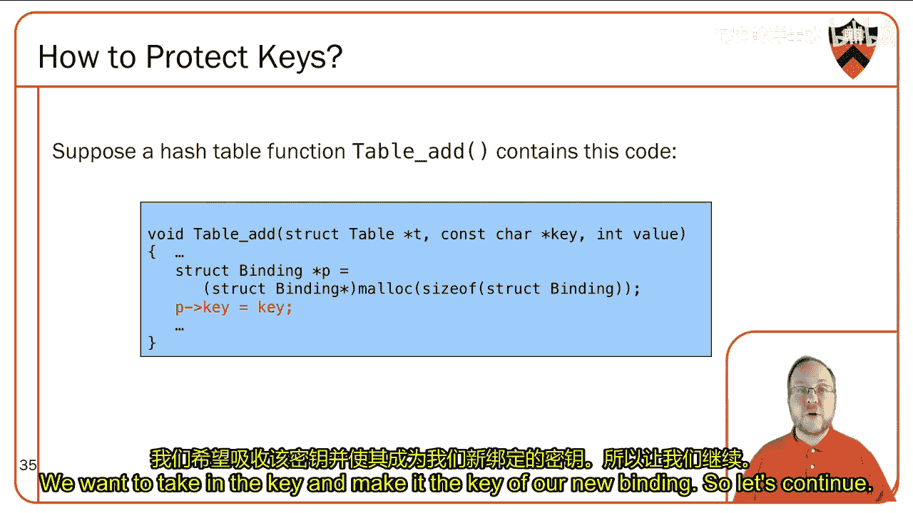

Here's the client code that calls our a function。It passes K the table into the table add function。

And the table add function creates a new binding and assign assign K to it。

Everything seems okay right now。But wait。K is the address of K of 0。 It's an address。  specifically。

 it's an address the client owns。 It allocated the variable K。 And thus。

 the client can do whatever it wants with this address。The client has every right to say， O。

 now I want this to be another string， Garig， not Ruth。This will cause trouble in the hash table。

The existing notes key has been changed from Ruth to Gerick。This corrupts the hash table。

If we search for Ruth， it will fail。 The key Ruth no longer exists anywhere in memory。

And if we search for Garig， well also probably fail， at least in a hash table implementation。

 because Garig is going to be in the wrong bucket with all probability。Again， in the linked list。

 this might not be the same， but it's still a problem because Ruth doesn't exist when we did an insert for Ruth and Garrick does exist when we never did an insert for Garrick。

 So it's a problem in either implementation。 It's just all the more stark with the hasht。

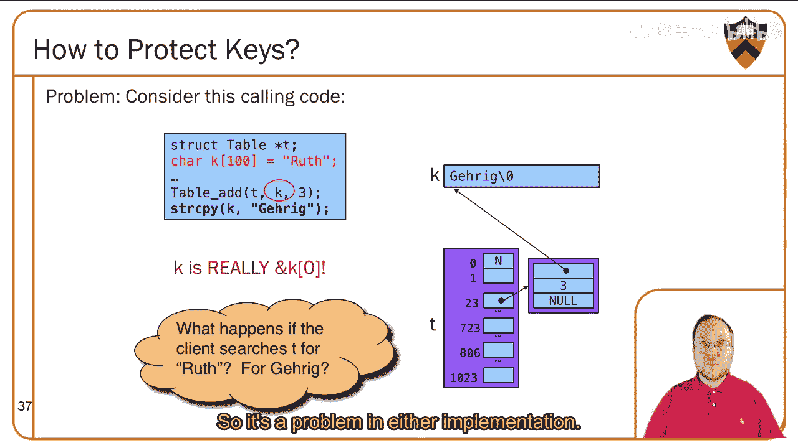

So how can we do， how can we avoid this disaster， We can't stop the client from using its own memory。

 So we have to make our own symbol table。Copy of the key。

 We have to make our symbol table not reference the client's copy in the client's memory。

Put another way。 We'll make sure the our table owns its own keys。So inside or insert function。

It will allocate enough space for the table's own copy of the key。

 remember to add the plus1 to Sterling's result in order to account for the null terminating by。Now。

 the function assigns the address of the new memory into the binding。

So the binding doesn't point at the client's memory， it points at the implementation's memory。

And finally， the function copies the given key's characters into the newly allocated memory。

So what's missing here？On the slide， everything's good。

But recall from last week's lecture that before we do the stir copy。

 we really should make sure that PRO key doesn't point at null。

 That is that the allocation succeeded。 Otherwise， our program will crash in an ungraceful manner by dereferencing an old pointer and Segfolding。

Instead， we should handle it in another way with a conditional between the assignment and the stir copy。

 notably， if you look in your assignment 3 symbol table API。

 you'll find that put returns an int that indicates success or failure。

 So unlike in this this simple code where we have a void and there's not much we can do other than maybe throw an assert。

In your assignment code， you'll be able to do something reasonable。

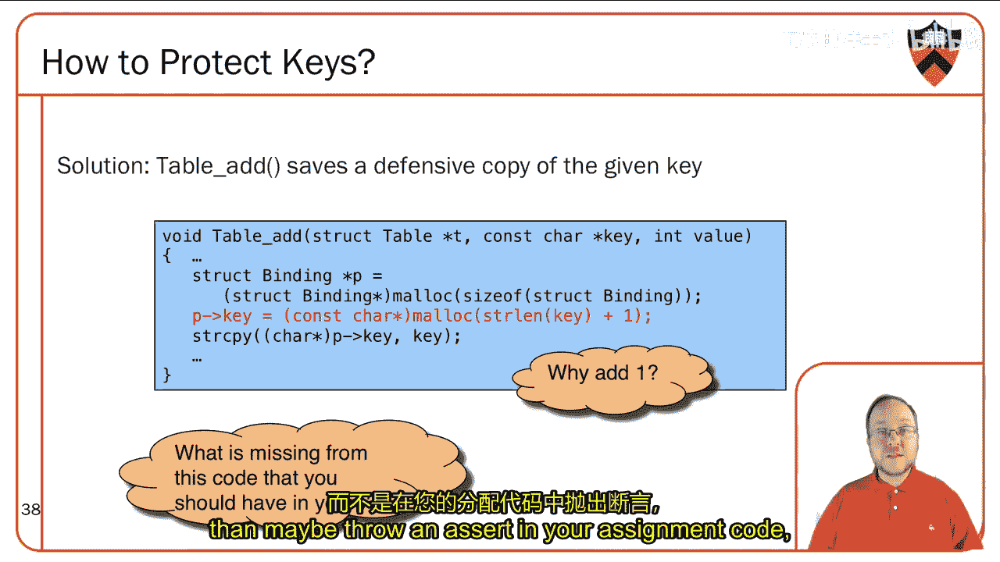

So let's return to our example with the client that changes its own K after having passed K into the add function。

This is what our memory layout looked like before。But now with the defensive copy。

 we don't point at the K variable from within our key。

Which means that our implementation doesn't reference the client's memory。

 instead it references its own memory with its own copy of the string r。Owned by the data structure。

So when the client overwrites Ruth and Kay with Geig， our hash table is not impacted。

Without going all John Sterling on you considering the data theme， that's a win。

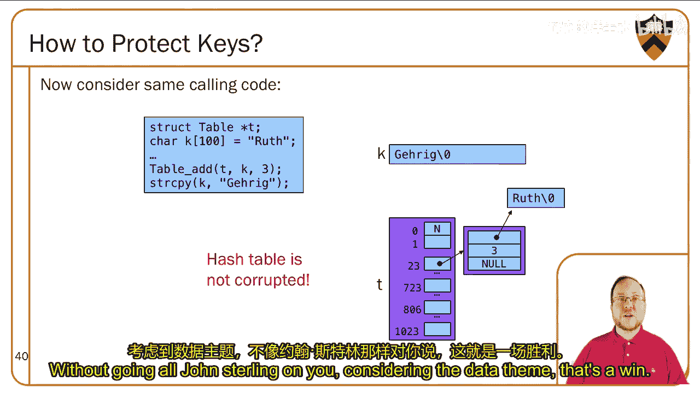

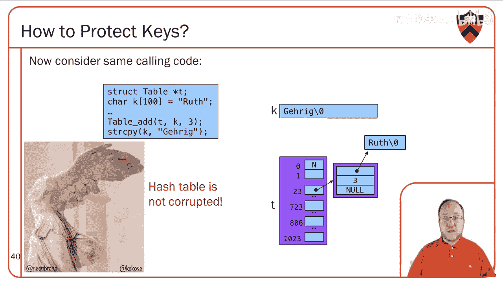

A victory for protecting the table's keys。So now that the the table owns its own keys。

 that means it's responsible for freeing them as well。 When a binding is destroyed。

 we've always thought， okay， if I'm， I've already allocated memory for the binding。

I'll have to free that。 But now， inside that binding is the memory all is a reference to a string that was also allocated in the implementation。

 So we'll have to free that as well。So that's that for this lecture。

 relatively short lecture today because I don't want to overwhelm you with assignment three。

 knowing that you probably won't be starting for about two weeks。Next time we'll be talking about。

Debugging in general and in particular， about dynamic memory bugs， which are very tricky and again。

 are very pertinent to assignment 3。Then after that we have on Thursday。

 no lecture because you will be starting at 9 a on Thursday in Eastern time， your midterm period。

 which will extend for 48 hours， and then you get fall break much anticipated。

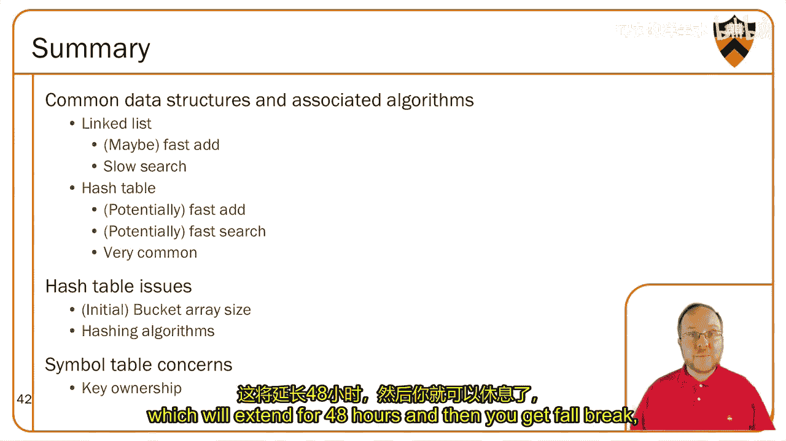