# COS 217：第13讲：数据结构 📚

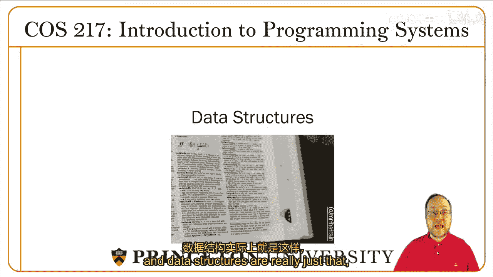

在本节课中，我们将学习数据结构，特别是链表和哈希表。我们将探讨它们如何作为抽象概念，帮助我们更高效地组织和操作数据。课程内容将直接关联到即将到来的作业3。

## 概述

数据结构是关于数据的抽象。它们不仅仅是执行操作，更是代表了一组数据及其操作的“本质”。在COS 126中，我们学习了面向对象编程和对象。数据结构就是一组数据以及可以对这些数据执行的操作的集合。我们可以将它们视为构建模块，帮助我们解决其他问题。我们构建链表不是为了链表本身，而是为了用它来解决问题。这就是抽象的本质：隐藏底层的复杂细节，提供最高级别的接口来帮助我们解决问题。

## 为什么现在学习数据结构？

现在学习数据结构有几个原因。首先，这与作业3直接相关。链表可能有些棘手，更多的接触对理解它们有好处。其次，在C语言中，链表是动态内存的一个很好的中级介绍，它不仅仅是玩具示例，而是有实际用途的动态内存分配。我们已经看到，C语言中的动态内存与Java中的非常不同。一旦我们了解了链表，我们就可以继续学习其他更有趣的链表结构。对于作业3，你需要了解链表和哈希表。有些COS 217的学生可能对链表了解不多，许多COS 217的学生对哈希表了解甚少。因此，这里提供一个概述。

顺便提一下，作业3已经发布。但绝对不期望你现在就开始做。请先专注于期中考试，然后尽可能享受为期四天的秋假。如果你在秋假后才开始做作业3，那完全没问题。你仍然有将近两周的时间来完成它。事实上，第10、12、13次甚至第14次的部分课前辅导课都会讨论与作业相关的材料。你不必等到所有这些都完成，但当然可以等到我们开始涉及这些材料时再开始做作业，而不是现在就开始做，结果因为我们对相关内容了解太少而感到困惑。

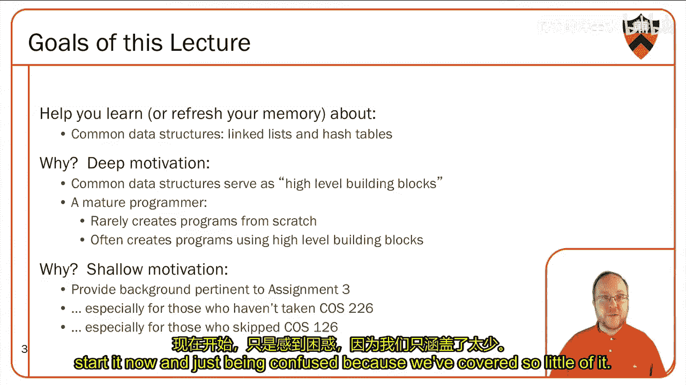

## 作业3：符号表

作业3要求你用两种不同的方式实现一个符号表。但在深入探讨之前，我们首先应该弄清楚什么是符号表。你可能在另一种编程语言中见过它，可能被称为字典、关联数组或键值存储。但如果你没见过，那也没问题。你熟悉这个概念。它是一组键值对，一个查找表，就像一本真实的实体书字典。现在，让我们具体化，假设键是字符串，值是整数。

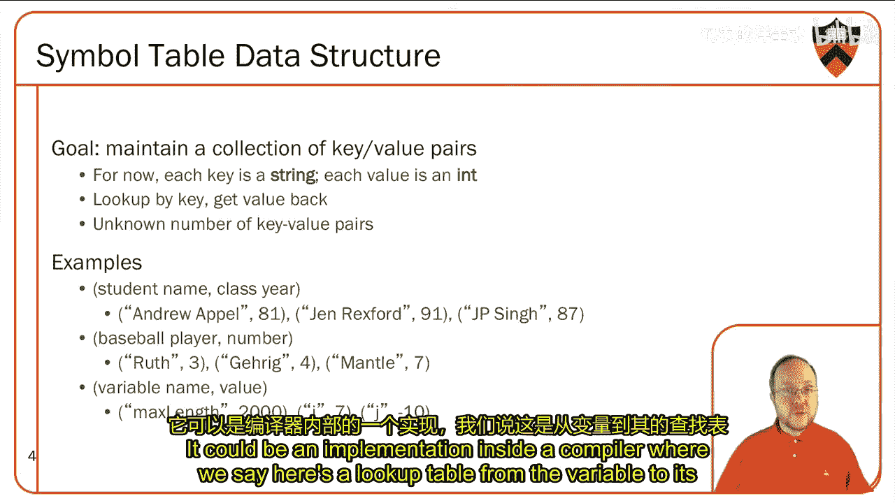

以下是一些例子：
*   它可能是一个名字和他们的毕业年份。
*   它也可能是一个棒球运动员和他们的球衣号码。
*   由于本课程开始学习系统编程，它可能是编译器内部的一个实现，其中我们有一个从变量到其初始值的查找表。

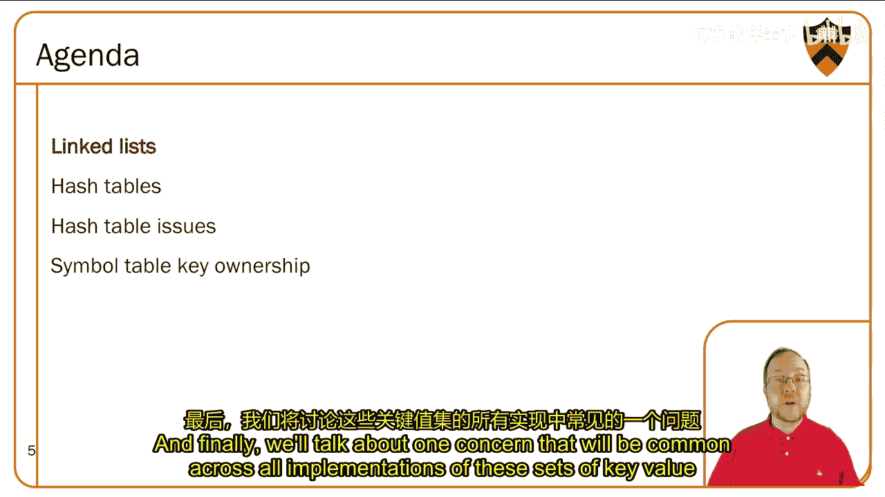

我们将研究两种不同的方式来实现这些键值对集合。链表实现相对简单，但效率较低。然后，我们将研究哈希表作为一种更可扩展和高效的解决方案，但代价是理解和实现起来更复杂。最后，我们将讨论在所有键值对集合的实现中都会遇到的一个共同问题。

## 链表实现 🔗

也许不足为奇，数据结构通常用结构体来表示。这些是你在C语言中可能用来实现链表的结构类型定义。课前辅导课在完整程序（一个栈ADT）的上下文中展示了这样的数据结构，该栈是用链表实现的。但现在，让我们单独看看链表。

一个节点的结构体包含键、值以及指向链表中下一个节点的指针的字段。在我们的示例中，键是一个常量字符指针（字符串），节点的键不能被更改。我们目前假设值是整数类型。指针是指向另一个节点的指针。乍一看，这看起来很奇怪。似乎数据类型将自身作为一个字段，这会有问题，但事实并非如此。一个节点可以有一个指向另一个节点的指针，这没有问题。编译器知道如何处理这个问题，并且知道如何分配足够的空间，因为，嗯，它是一个指针。编译器知道所有指针都是8字节。所以这不是问题。

为了节省空间，我们将每个节点画出来，使其键完全包含在结构体内部，因为键实际上是一个字符串，所以它实际上是一个内存地址，因此它指向其他地方，如上一张幻灯片所示。但为了在幻灯片上减少交叉线等，我们假设它就在结构体本身中。

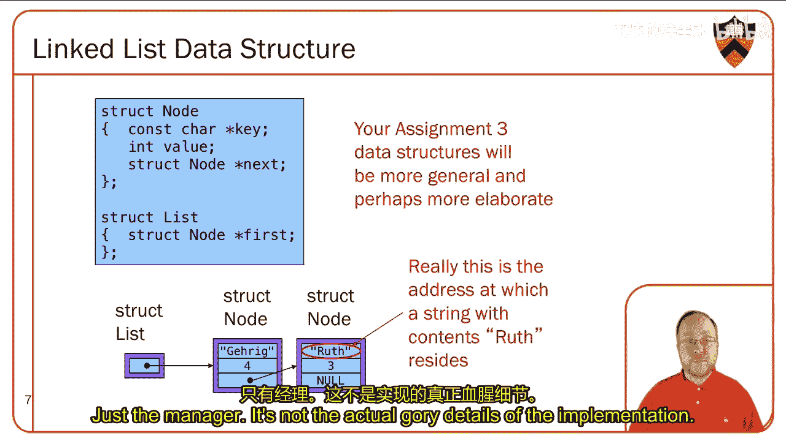

列表的结构体包含一个字段。我们称之为`first`，它只是头指针，指向列表中的第一个节点。这样的结构体，只有一个字段且该字段只是对另一种类型的引用，有时被称为管理器或包装器结构体。我们将看到，为了封装我们的数据结构，这非常重要。这样，没有客户端能够在不使用API的情况下乱动内部结构。事实上，没有客户端甚至能够知道我们的实现是什么，因为他们只能看到一个指向这个结构体的指针，也就是管理器，而不是实现的实际复杂细节。

## 回顾：结构体、指针和动态内存

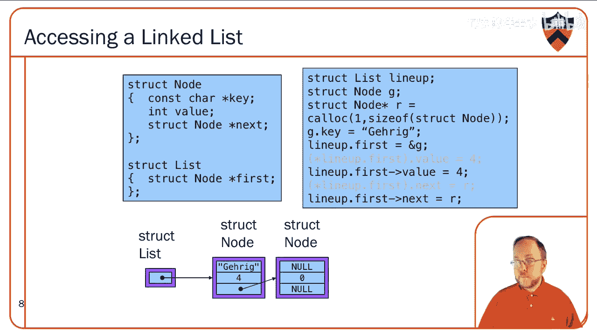

在继续之前，快速回顾一下最近关于结构体、指针和动态内存的讲座内容。我们可以使用`calloc`在堆上分配空间，它会将内存清零。这意味着每个指针的值都是0，这意味着它们指向地址0。我们称这些为空指针。我们可以使用点符号访问结构体的字段。我们可以使用地址运算符获取内存中变量的地址。通常，我们只有一个指针来访问结构体，而不是将结构体本身作为变量。这很自然，因为我们经常动态分配结构体，因此我们只有指针来表示它。我们可以解引用指针，然后使用点符号。但更常见的是使用箭头符号直接进行此操作，这更符合习惯用法。

## 链表API设计

我们使用链表来实现符号表。在作业3中，我们给了你符号表的API，但没有给你链表的API。不过，我们当然鼓励你设计你的链表，使其具有良好的功能模块化。那么，让我们思考一下，什么是合理的链表API？也就是说，我们可能想为链表定义哪些操作。

我们需要创建一个链表。创建链表就是分配列表结构体并将其初始化为空列表，也就是说，头指针应该指向`NULL`。这是一个快速操作，只是一个分配和一个指针赋值。

向链表中添加一个节点。这变得有点复杂。现在，如果我们允许重复，这很容易。只需分配一个新节点，把它放在列表的前面。但如果我们不允许重复，现在我们必须遍历整个列表以确保没有重复。我们可能遍历整个列表，然后在前面添加一个新节点；或者我们可能维护一个顺序，这样我们只需要检查一部分，直到找到节点应该插入的位置。但无论哪种情况，这都是一个线性操作。

我们还需要能够执行搜索以检查键是否存在。那么这个操作的性能如何？花点时间想一想，在链表中搜索一个键的增长阶是什么？实际上，这里的答案并不是很明确，它取决于工作负载，取决于插入算法。例如，如果我们的工作负载是我们通常对我们最近添加的东西进行大量搜索，并且我们选择将最近添加的项放在列表的前面。平均来说，这很快。但如果我们插入在前面并随机查找项目，那么平均来说，我们很慢。如果我们按顺序插入并随机查找项目，平均来说仍然很慢，但也许根据具体情况我们稍微好一点，因为我们只需要搜索一部分来查找重复项。我们的搜索结果将是O(n)。所以，是的，这是O(n)。除非我们对工作负载有非常强的假设，认为它不是任意的，不是随机的，否则它就是O(n)。

我们应该考虑的另一个操作是有一个从链表中删除的方法。这也会很慢。删除本身只是几个指针操作。但找到执行这些操作的位置是O(n)。同样，我们必须遍历列表以找到要删除的东西。当然，如果我们想删除并释放所有内容以销毁链表，我们必须删除n个项目。这里没有搜索。所以是O(1)乘以n，但那仍然是O(n)。

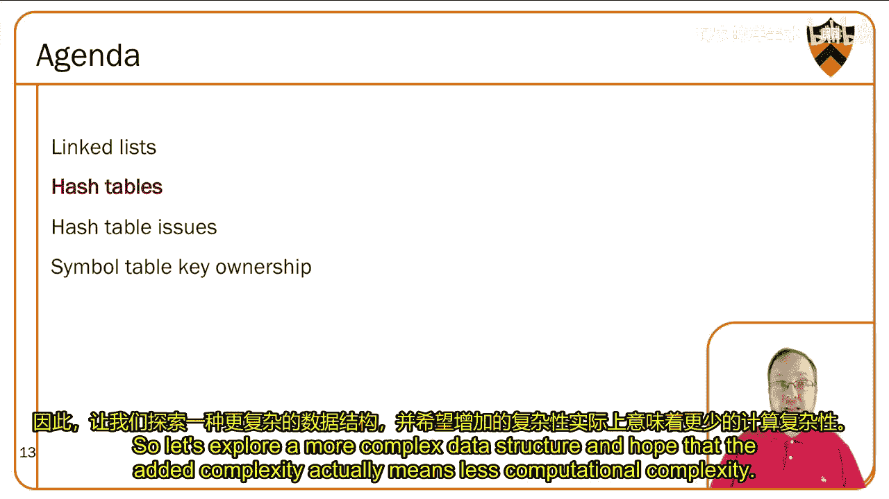

因此，链表的特点是大量线性操作。如果我们有一个存储大量不同键值对的符号表，它会变得相当慢。所以让我们探索一个更复杂的数据结构，并希望增加的复杂性实际上意味着更少的计算复杂性。

## 哈希表实现 🗂️

哈希表是一组键值对的列表，我们希望每个集合都很小。实现哈希表的一种方式是使用链表数组。我们希望每个列表的长度为0、1或2。在这种情况下，我们对链表的线性操作就不是问题了。遍历仍然是非常少量的工作。但要做到这一点，我们需要一个足够大的数组来使这成为可能，以及一种将数据拆分到不同列表的有效方法，以便我们在数组的所有元素中获得大致均匀的分布。

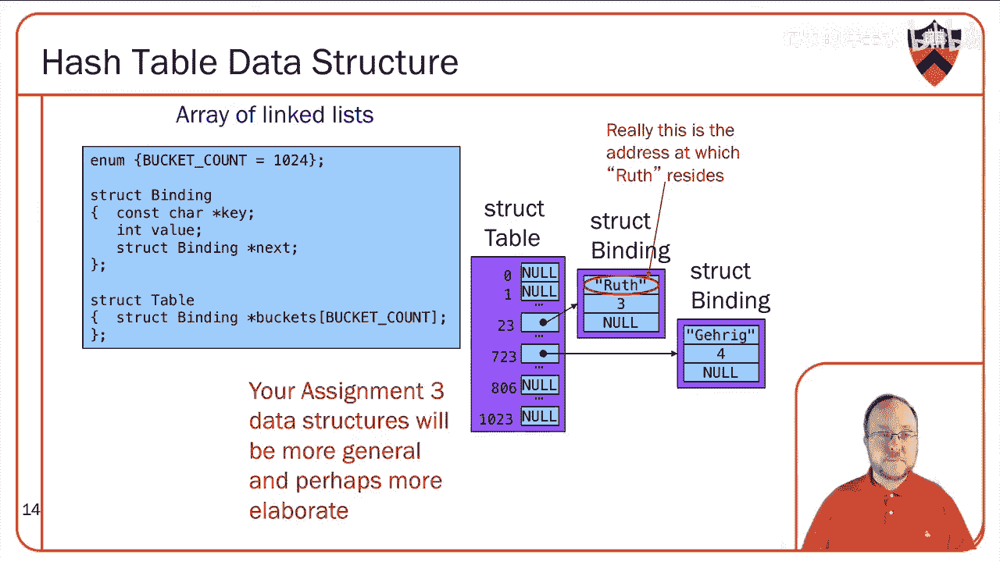

这些是你在C语言中可能用来实现哈希表的结构类型定义。你的会更好。值不会只是`int`，桶的大小可能能够改变。这里的绑定包含一个键、一个值以及指向列表中下一个绑定的地址。我们称之为绑定，因为它将一个键绑定到它的值。但你也可以称之为映射、键值对，甚至只是一个节点，因为它基本上与我们在链表中作为节点的东西相同。

我们的管理器结构体在这里包含一个名为`buckets`的数组。它有`bucket_count`个元素，每个元素的类型是`binding*`，即每个元素指向一个绑定。绑定与链表结构中的节点完全相同。现在，我们只是有一大堆链表，而不是只有一个。

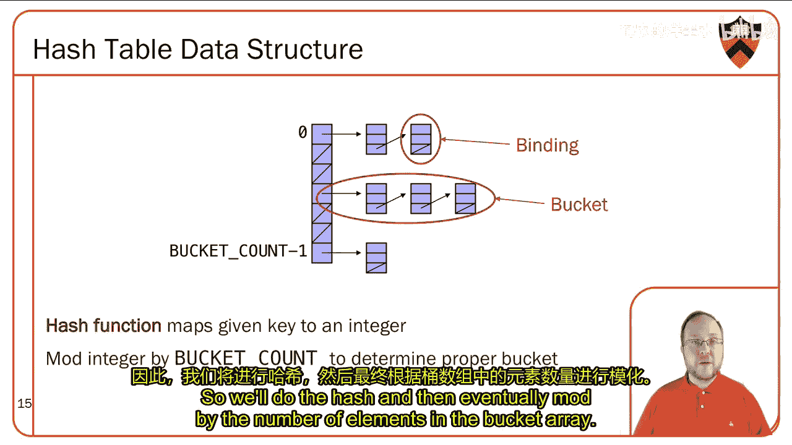

## 哈希表示例

让我们看一个具体的例子。这里我们将使用一个较小的数组大小，7。让我们离开棒球运动员的主题，为我们的键主题转向俄罗斯风格。稍后我们将讨论我们希望哈希函数具有哪些属性。我提到过确定性，但在整个表中要均匀。通常，我们会选择一个具有一些一般数论性质的算法，然后通过取模来约束它，如前所述。但现在，让我们假设我们有一个函数，它会产生我们在幻灯片上看到的数字。

我们从一个数组开始，其中每个桶都是空指针，也就是说，没有一个桶有任何绑定。我们哈希“the”并得到一个巨大的数字。我们对7取模得到一个有效的数组索引0到6，结果是1。我们查看以`buckets[1]`为头的列表，发现什么都没有。`buckets[1]`是`NULL`。所以那个键不可能已经在表中。如果它在，它就会在那个桶里。所以我们必须插入一个具有该键的新绑定。我们添加绑定“the”。我们没有指定这里的值是什么，因为它们对于描述哈希表的基本原理并不重要。所以我将忽略那个字段。但如果绑定是`calloc`分配的，它将是0；如果是`malloc`分配的，它将是未确定的垃圾，直到我们显式地给它赋值。在实际实现中，你将把值设置为`put`函数中作为`value`参数传递的任何值。指向下一个绑定的指针将是`NULL`，因为在这个桶中只有一个绑定。

下一个我们要添加的键是“cat”，所以我们哈希它并得到2。我们检查`buckets[2]`，发现它是空的，于是插入。现在我们有了一个数据结构，在桶1中有一个绑定，在桶2中有一个绑定。下一个我们要添加的键是“in”。我们哈希它并得到5。我们检查`buckets[5]`，发现它是空的并插入。现在我们有了一个数据结构，在桶1中有一个绑定，在桶2中有一个绑定，在桶5中有一个绑定。

现在让我们让事情变得更有趣。下一个我们要添加的键是“the”。我们哈希它并得到1。我们检查`buckets[1]`，它不是空的。所以我们遍历，直到要么找到一个键为“the”的绑定，要么到达`NULL`。我们确实找到了“the”，这意味着“the”是一个重复项。在作业3中，将重复键放入符号表应该失败，而不改变表。所以我们在这里不做任何更改。

下一个我们要添加的键是“hat”。我们哈希它并得到2。我们检查`buckets[2]`，它又不是空的。所以我们遍历这个列表，直到要么找到所需的键“hat”，要么到达`NULL`。在桶2中，我们看到一个带有“cat”的绑定，这不是“hat”。而`next`指向`NULL`。所以“hat”不在那里。我们可以插入。插入时，我们应该插入前面还是后面？坦率地说，这并不重要。回想一下，无论如何我们都必须搜索整个列表。所以是O(n)，排序与否。我们不妨把它加在前面，因为在一般情况下更容易。另一方面，根据你如何进行遍历，你可能仍然留有指向最后一项的指针，在这种情况下，我们当然可以同样容易地在前面或后面插入。此外，这里的重点是，我们有一个具有良好哈希函数的大表。这些冲突应该很少见。每个列表应该非常短。所以把它放在前面、后面还是中间并不重要。这更有理由选择更容易的解决方案。所以，什么最方便就选什么。总的来说，我们看起来很不错。很多长度为0和1的列表，只有一个不幸的桶长度为2。

## 哈希表复杂度分析

有了这个例子，让我们回到我们的复杂度分析。现在创建是常数时间工作。它独立于表中的项目数量，尽管它是一个更重量级的操作，因为我们必须分配桶数组。向表中添加一个项目需要一个哈希操作。如果我们的键很大，哈希可能是一个不小的操作。我们必须取模以找到桶，并且我们必须通过遍历整个桶列表来确保没有重复，然后进行插入。那么这里的复杂度是多少？看看这些选项。暂停视频，做一个决定，然后准备好时重新开始。

我认为B是一个合理的答案，因为如果键的数量远远多于桶的数量，即使是一个完美分布键的哈希算法仍然会产生许多绑定的桶。但我认为C是最好的答案。因为即使桶列表足够大，仍然存在线性最坏情况。如果所有键都哈希到同一个桶，那就只是一个单链表。所以我们最好选择一个好的哈希函数。同样，稍后再详细讨论，对于这个作业不用担心，我们会给你一个具有这些良好属性的函数。

## 哈希表设计考虑

哈希表，我们有哈希函数来找到一个桶，然后它只是同样长度的列表，但那个链表应该是一个小的常数长度。不过，我们顺便提到了另外两个问题。一个是桶数组可能太小。这意味着即使完美分布，所有列表都会很长；或者哈希函数可能不好。所以如果键没有完美分布，一些列表会不成比例地长。

那么我们应该选择多少个桶？一方面，我们说我们想选择很多桶，因为桶太少是个问题。但不要太多，因为这在内存上是一个巨大的前期成本，如果我们分配太多，就会浪费内存。我们的总体目标是，我们希望在我们的最终表中，列表的长度是0、1或2。所以我们希望能够对我们将要添加的绑定总数有一个概念。这并不总是可能的，这就是为什么如果你快速浏览一下作业3的挑战部分，你会发现它扩展了哈希表。所以你开始时有一定数量的桶，然后最终当它变得太满时，你说我要创建一个新的更大的数组，以便更好地分布，你这样做直到一个合理的次数，在这一点上，如果你有非常大量的绑定，你真的无能为力。

## 哈希函数设计

在哈希函数方面，我们提到最差的哈希函数会为每个元素生成相同的哈希码。那将退化为一个链表。但这不必是一个稻草人论点。考虑字符串长度。这不会为每个可能的键生成相同的哈希码。起初听起来还不错。但对于名字来说，这根本不是随机的。大多数人的名字长度在1到20个字符之间，对于几乎任何自然语言键来说都是类似的。

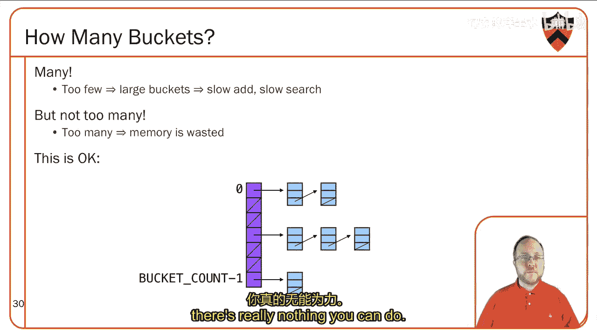

那么，什么通常构成一个好的哈希函数？这实际上是数值分析中的一个开放问题，但我们确实有一些想法。我们刚刚看到字符串长度不是一个好的哈希函数。实际上，它们的ASCII值之和同样被压缩，因为它严重依赖于长度。然而，如果我们开始真正区分字符串中的不同位置，那么结合ASCII值，我们可以得到一些分布。在实践中，如果我们的加权因子与桶计数互质，效果最好。如果两个整数没有大于1的公因数，则它们是互质的。也就是说，它们的最大公约数是1。例如，12和13是互质的，但12和14不是。

所以这实际上是一个相当好的、简单的启发式方法，计算起来很容易，在实践中效果很好。

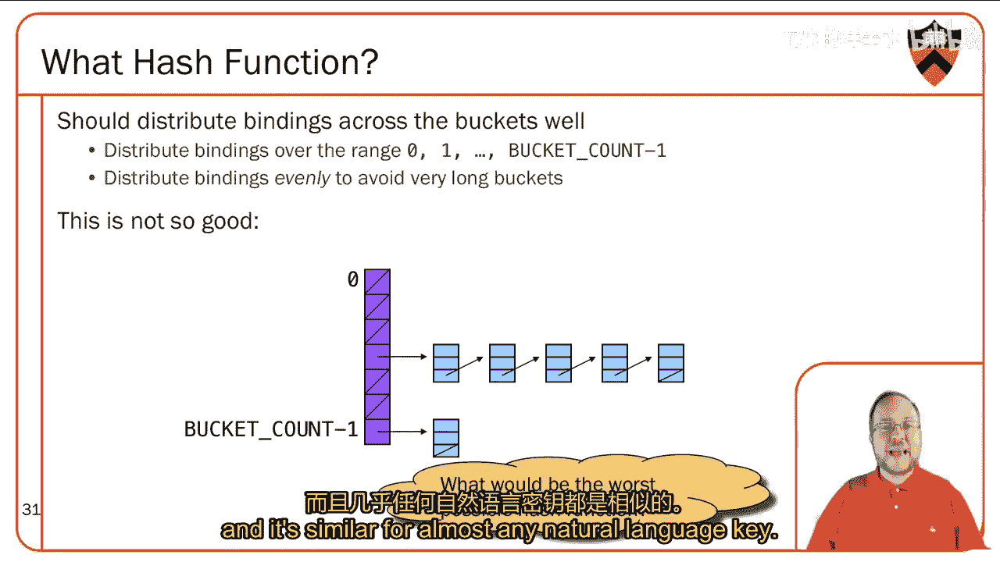

## 哈希函数代码实现

这是该哈希算法转换为代码的形式。请注意，这实际上是以与字符相反的顺序进行加权和的加权，但它仍然具有相同的属性，并且比上一张幻灯片上的求和计算效率更高。在上一张幻灯片上，我们有`a^i * s[i]`。但在这里，我们每次只有一个额外的乘法因子`a`，而不是为每个`i`计算`a^i`，所以我们通过每次只进行一次额外的乘法而不是计算乘积来节省大量乘法。

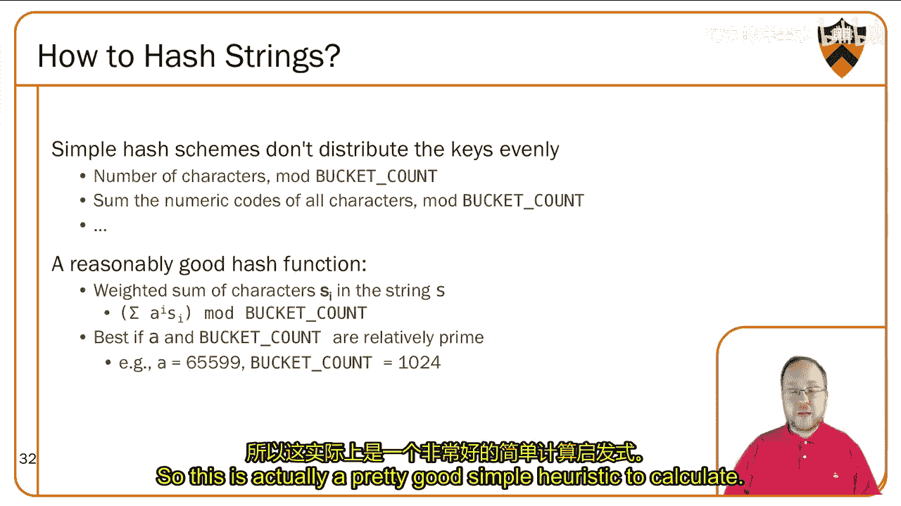

你可能还会看这个，即使我们这里有一个`size_t`，你可能会说，这最终会溢出，我们在这里做大幂运算。我们做乘法。如果我们有一个足够长的字符串，这将会溢出。你完全正确。但回想一下我们之前关于溢出的讲座，在存在溢出的情况下，操作的值与没有溢出时的值相同，只是模`2^k`，其中`k`是位数。所以数值属性在很大程度上得以保留。此外，在最后进行取模以获得桶数组索引时，会丢弃数字高位的大部分内容。当我们进行取模运算时，我们只查看数字的低位。因为数字模`2^k`是相同的，并且我们取模的值小于`2^k`（我们几乎肯定是这样，否则那将是一个巨大的数组），所以无论我们是否溢出，我们的计算都会产生相同的桶索引。因此，这是一个相当不错的算法，具有一些良好的属性，并且不关心我们如何在系统上表示整数的细节。

这或多或少是我们在作业3中将要给你的函数。

## 符号表中的键管理 🔑

最后，让我们讨论一下符号表。无论是链表还是哈希表实现，让我们谈谈我们的键。

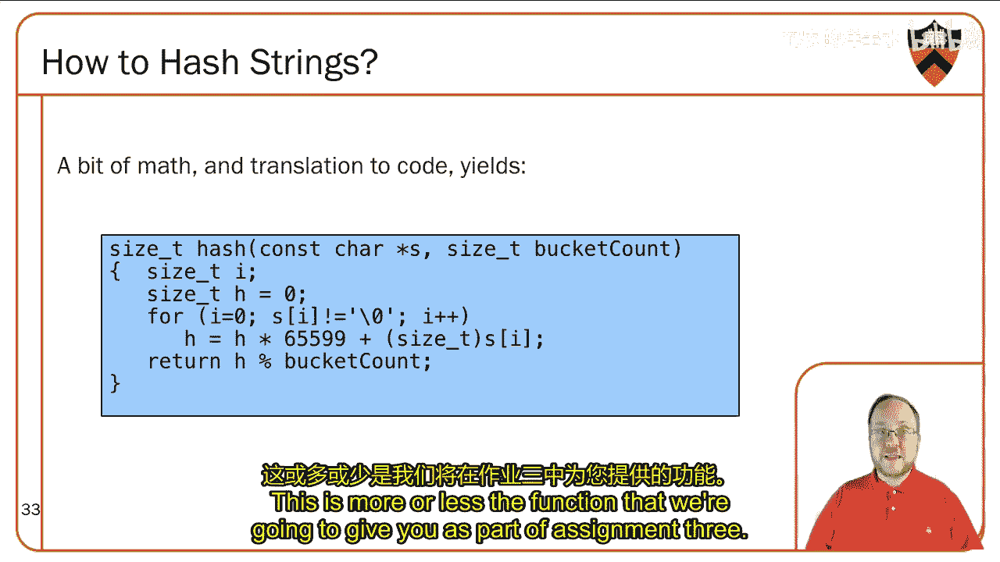

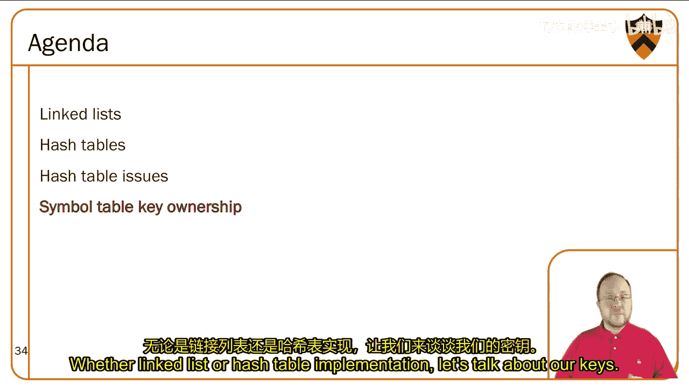

为了与我们一直在看的相同实现保持一致，让我们继续看哈希表。考虑这个用于任意哈希表（任意符号表）的`add`方法。该函数创建一个新绑定，并将一个键（一个内存地址）分配给该绑定的`key`字段。这似乎很合理。我们想接收键并将其作为我们新绑定的键，所以让我们继续。

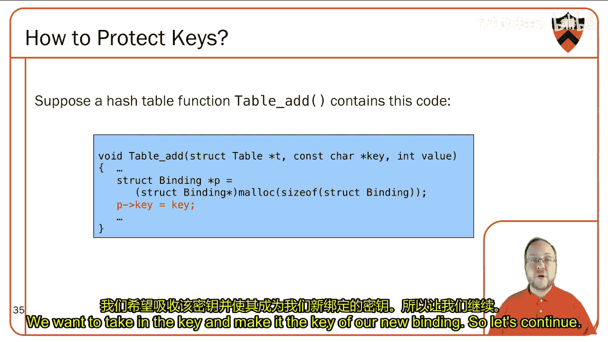

这是调用我们`add`函数的客户端代码。它将`k`和表传递给`table_add`函数。`table_add`函数创建一个新绑定并将`k`分配给它。现在一切似乎都还好。但是等等。`k`是`k[0]`的地址。它是一个地址。具体来说，它是客户端拥有的一个地址。客户端分配了变量`k`。因此，客户端可以对这个地址做任何它想做的事情。客户端完全有权利说，哦，现在我想让这是另一个字符串，“Gerig”，而不是“Ruth”。这将在哈希表中引起麻烦。现有节点的键已从“Ruth”更改为“Gerig”。这破坏了哈希表。如果我们搜索“Ruth”，它将失败。键“Ruth”不再存在于内存中的任何地方。如果我们搜索“Gerig”，很可能也会失败，至少在哈希表实现中是这样，因为“Gerig”很可能在错误的桶中。同样，在链表中，这可能不一样，但它仍然是一个问题，因为当我们为“Ruth”插入时，“Ruth”不存在，而当我们从未为“Gerig”插入时，“Gerig”却存在。所以在任何一种实现中这都是一个问题。只是在哈希表中更加明显。

## 解决方案：防御性复制

那么我们该怎么办？我们如何避免这场灾难？我们不能阻止客户端使用它自己的内存。所以我们必须制作我们自己的符号表键的副本。我们必须确保我们的符号表不引用客户端内存中的副本。换句话说，我们将确保我们的表拥有自己的键。

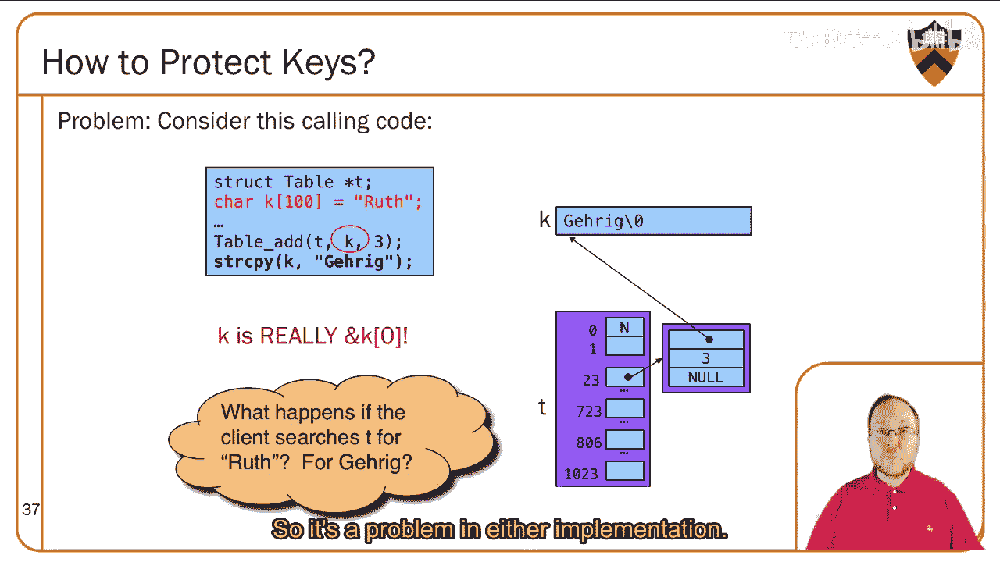

所以在我们的插入函数内部，它将为表的键副本分配足够的空间。记住在`strlen`的结果上加1，以考虑空终止字节。现在，该函数将新内存的地址分配给绑定。所以绑定不指向客户端的内存，它指向实现的内存。最后，该函数将给定键的字符复制到新分配的内存中。

那么这里缺少什么？在幻灯片上，一切都很好。但回想一下上周的讲座，在我们进行`strcpy`之前，我们真的应该确保`new_key`不指向`NULL`。也就是说，分配成功了。否则，我们的程序将通过解引用空指针和段错误以一种不优雅的方式崩溃。相反，我们应该以另一种方式处理它，在赋值和`strcpy`之间使用条件语句。值得注意的是，如果你查看作业3的符号表API，你会发现`put`返回一个表示成功或失败的`int`。所以不像在这个简单代码中我们有一个`void`，除了可能抛出断言外，我们做不了什么。在你的作业代码中，你将能够做一些合理的事情。

## 防御性复制示例

让我们回到我们的例子，客户端在将`k`传递给`add`函数后更改了自己的`k`。这是我们进行防御性复制之前的内存布局。但现在有了防御性副本，我们的`key`不指向来自我们内部的`k`变量。这意味着我们的实现不引用客户端的内存，而是引用它自己的内存，其中包含字符串“Ruth”的自己的副本。该副本由数据结构拥有。因此，当客户端用“Gerig”覆盖`k`中的“Ruth”时，我们的哈希表不会受到影响。这是一个胜利。

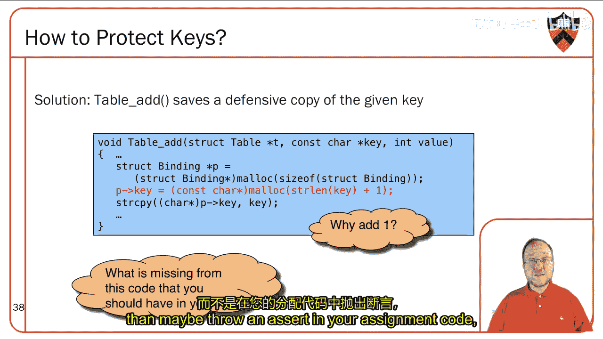

## 内存管理责任

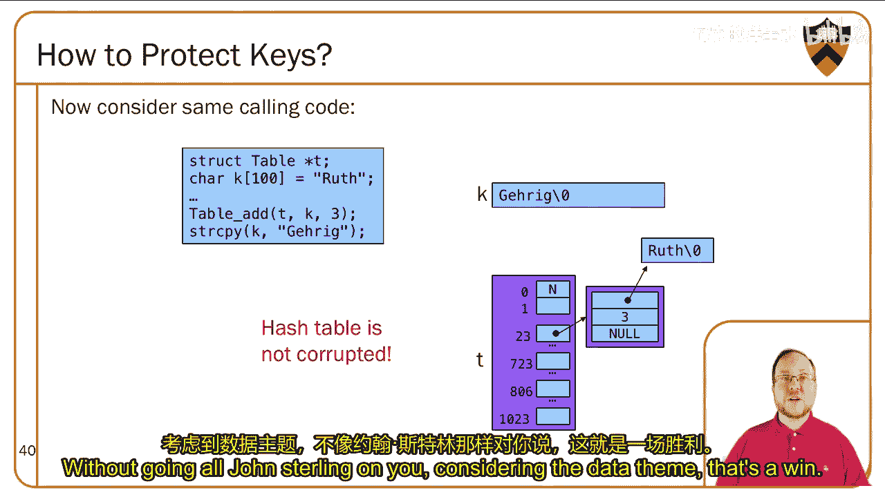

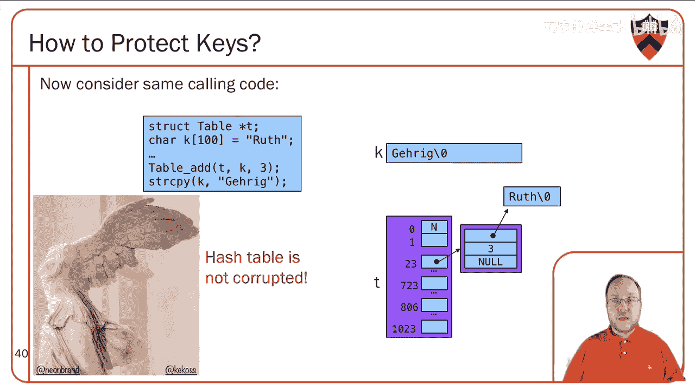

保护表的键的胜利。现在，既然表拥有自己的键，那也意味着它负责释放它们。当一个绑定被销毁时，我们总是想，好吧，如果我已经为绑定分配了内存，我将不得不释放它。但现在，在那个绑定内部是内存，它是对一个字符串的引用，这个字符串也是在实现中分配的。所以我们也必须释放它。

## 总结

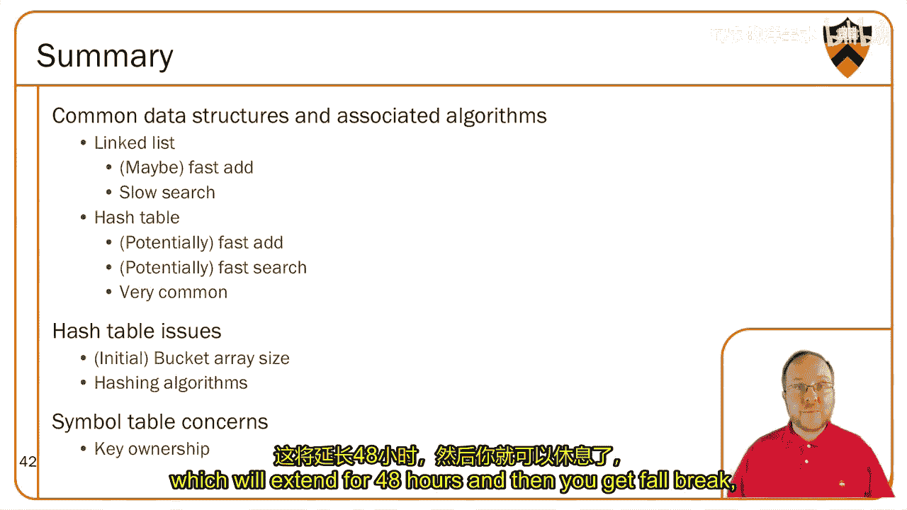

本节课到此结束。今天的讲座相对较短，因为我不想用作业3让你不知所措，知道你可能大约两周后才会开始。下次我们将讨论调试，特别是动态内存错误，这些错误非常棘手，并且再次与作业3密切相关。然后在周四之后，没有讲座，因为你将在美国东部时间周四上午9点开始期中考试，考试将持续48小时，然后你将迎来期待已久的秋假。