# 【全集 秋季版】普林斯顿大学 C语言系统编程 中英字幕 p14 Lecture 14 - Debugging -BV1u1feBoEsK_p14-

Welcome back to Co 217 Lecture。We talked about testing last week。

 and when you design a testing suite， you might try to anticipate the ways in which a program can break。

So you write some tests， and then you find that your code does fail on one of them。 Great。

 that means if you did a thorough job in test design。

 you know exactly the situation that you are trying to catch。

 And so you have some head start on finding the bug。😊。

But even when you experience a failure that was not planned for。

 debugging requires a similar intuition of trying to root out the underlying causes of these failures。

So now let's take a look at some structured approaches to finding the bugs that cause those failures and also some heuristics when we don't have a perfectly good structure。

So as programs get larger， there's more that can go wrong in a number of different ways。

There's a larger code base that means simply more lines of codes and more chances of a typo or conflating to variables or anything like that。

A larger code base also likely means that there's more interconnected pieces and more complicated interfaces。

 so there are more places for a contract to be broken or a handoff to be botched。

As you begin to work with larger programs， then you'll need more advanced skills in debugging to fix the problems that crop up as you deal with larger software systems。

That said， debugging is at least as much art as science。

 and there's a fair bit of experience in building the intuition that goes into effective debugging。

So in this lecture， I hope to give you some heuristics and simple approaches to employ that by their very use。

 you'll be able to gain some of the experience。

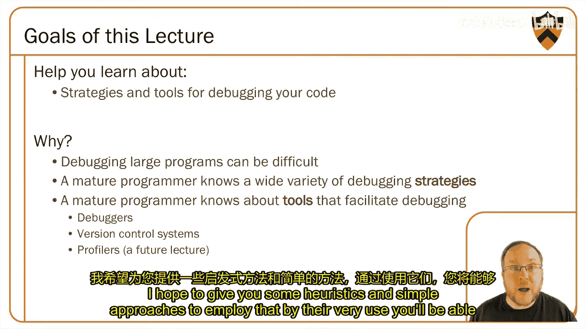

This lecture may appear quite short at first， and indeed。

 it's only a little more than a dozen relatively high level suggestions here。

 But there are a bunch of examples of buggy functions and programs on this slide。

 And so while it would be easy to just look quickly at the code。

 ignorere the pause icon and then listen to my discussion。

 I frankly don't think you'd get all that much out of it。

 This isn't a lecture to be watched passively。Instead。

 I suggest that you pause the video each time the pause icon shares up in place of my face and figure out what the problem is and announce your answer in four parts。

😊，What is the problematic piece of code？In which。Cases does the problem present itself。

 since most bugs aren't always wrong， just under some conditions。

What is the effect of that situation that's erroneous， How does the bug manifest， how can you see it？

And finally， how could you fix the book。So don't be misled by the video runtime if you really engage in the slides。

 it will take considerably more time to get through。So with that warning proclaimed， let's get to it。

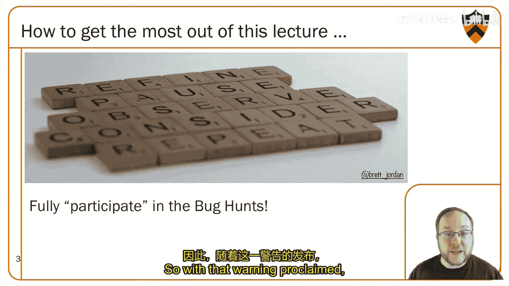

The first technique seems obvious at first when you get an error message， you should understand it。

 but some error messages can be rather opaque， and some can be even completely spurious。

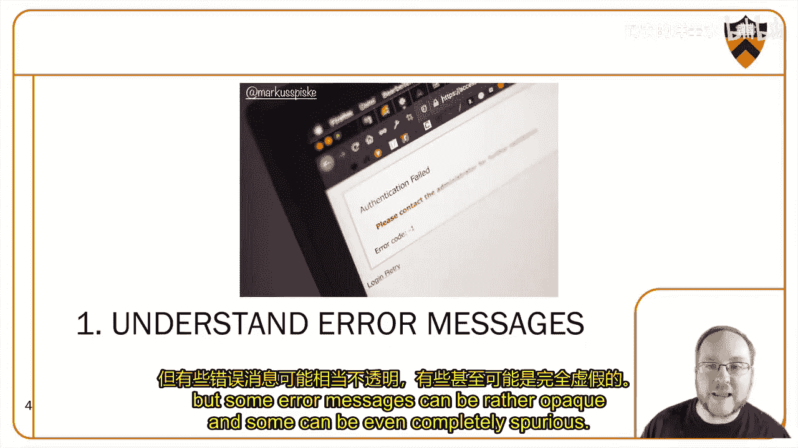

Before we can even run a program and fail a test， we have to be able to build the program。

But that's the first place that we can get evidence of an error in our program。

If the build process results in errors or warnings。

 the error might indicate that it's not a valid C program or a warning indicating that。

They suspect we might have a problem， but can't guarantee it。Here's our first bug hunt。

 take a look at what errors you might find in this program。

 then we'll see what GCC 217 has to say and if we can understand what it's telling us。

GCC 217 reports that there is a fatal error that crashed the build process。

What does the error mean and which stage of the build process triggered it？

The preprocessor reported the error that a certain file we tried to pound include doesn't exist。

We correct the typo and try again， here's the fix。With the comma in standard IO replaced with the required period。

But what does GCC 217 say now？G C C 2，17 reports on an error near and dear to your heart at this point。

 from assignment 1， we know that the preprocessor is responsible for decommenting。

 and it will report an unterinated comment if it discovers one。

So we add the star slash to terminate the comment， and what does GCC 217 say now？

GCC 217 reports two issues Ner one， in error on line6 that there should be a semicolon before the return statement。

And number 2， a warning that control reaches the end of a function that should be returning a type。

So take all that in。What stage of the build process is reporting these errors？What's wrong on line 6？

 And why does control reach the end of the function on line 7 without a return when return is sitting right there on line 6。

Here， the compiler reports the issue with the missing semicolon， and it's right about the problem。

 but it reports it in a way that can cause confusion and delay in debugging。

The line number is off by one because the compiler only notices the issue when seeing the return keyword。

 not at the new line， since we can stretch lines of C code over multiple lines。

And the warning is actually a red herring entirely。 We do return。

 It's just that the prior error corrupts that return by confusing the compiler that this was one long line。

Fixing the semicolon makes both of these go away。Let's reset and see the program again with all those errors fixed。

 but a new one injected。Take a look at the program and try to spot the error。

 then we'll see what GCC 217 says， and if we can understand what it's telling us。

GCC reports a warning and an error。What stage of the build process is reporting these and what do they mean？

The bug is that we've misspelled printf。The compiler reports a warning。 It's cryptic at first。

 but it does give the required information If we learn that implicit declaration means you didn't give a declaration of this。

 nor did any header file you included。 But that doesn't mean it doesn't exist。

 So I'm just going to tell you that you might be off on the wrong track。 But who knows。

 Maybe the linker will find something。And it is nice enough to point us directly to the identifier that's the problem。

 so we can read it again for ourselves if it is， in fact， an issue。The error comes from the linker。

 the linker responds to this warning from the compiler and says， no。

 it doesn't actually exist anywhere I could find， I give up， your build is dead。And again。

 it tells us the exact identifier that it can't find。

Let's reset the program one more time with that error fixed。

 but a new particularly tricky one injected。Do you see the error， We've again misspelled printf。

 but this time， instead of oting the eye， we've replaced it with a dotless eye as found in various Turkic alphabets。

This one wasn't quite fair because while GCC using Kang on my MacBook does result in the exact same error as the other misspelled printf on ArmLb GCC throws off errors for stray bytes because the program tries to parse the printf identifier that contains a UniIcodeode character。

But let that just serve as a reminder that C source code isn't portable。Allright。

 one last build time bug， see if you can find the issue。All right， let's see what Gcc 2，17 sets。

The compiler catches the error， but doesn't really provide you much help in fixing it。

 What does the error even mean， While， in this case， it's a common bugaboo with enums。

 We have to close them with a semicolon。Sometimes the error messages tell you nothing more than the general area where the error resides。

 but there is a useful tip for the inscrutable errors about what the program was expecting。

Oftentimes， this is indicative of just you have a syntax error as the compiler can't figure out what you're trying to do。

 So if you see something was expected， that's normally a syntax error。

 and it'll point you in the right direction。 But again， not necessarily very clearly。

So it is definitely worth while to become familiar with common error messages。

 but it's not impossible to know them all。 And unfortunately。

 sometimes error messages aren't helpful。 Perversely。

 the error messages for obvious things are often better than the error messages for tricky things。

Two more quick tips here， you should use your editor's auto indent， for example。

 Control XP in our EMAC setup， this can catch missing punctuation that causes syntax errors。

 which are we just saw confusing error messages because it will look wrong， the code will look wrong。

 it will miss indent because of the syntax error。The second thing as we saw above is we should fix one error at a time。

 some later errors may go away because they were figments of a previous one。

The second tip in debugging is to think before writing new code or changing existing code to fix a bug。

This seems obvious， and yet many times students get stuck and start changing their code in undisciplined ways。

And frankly，1 26 somewhat exacerbates this。 make a random change。

 See if more or fewer tiger file tests fail。 Those of you who have taken 2。

26 will remember how hard a habit this was to break。Unfortunately。

 many times this haphazard changing of code takes you much further from the correct solution rather than even more so than the original was。

So think before changing your code。 It's often helpful to explain your code or even read it line by line out loud。

This can be to yourself or to some one else。 And the listener doesn't even have to be able to help you。

 A younger sibling， your human'ities roommate or a stuffed animal will work just fine。

 It's really just about hearing the code and noticing the error that your eyes have glazed over so many times。

If it doesn't jump out at you， it's reasonable and proper to experiment with changing the code。

 but make sure your experiments are disciplined。 Think， develop a theory。

 change your code to test the theory。 Don't just change your code to see if it works。

If you find yourself diving into undisciplined changes， stop and seek help。

 Doing so is a sign of a deeper lack of understanding。

That you're not able to formulate a correct theory as to what could be wrong。In number one。

 there were some common error messages that you might want to learn to remember their association with the bug。

A more general case of this is knowing what bugs are common in the first place and seeing if you've fallen into one of the traps set by them。

Let's take a look at some of these office hours frequent flyers。Again。

 pause the video and assess what is the error， How does it manifest and when and how would you fix it。

So super common errors in this class include accidental fall through for switch statements from one case the next when there's no break。

Missing the Empersand， the address of operator when making a pointer out of a different type。

 especially in functions like ScNF。Declaring too small a variable for the function's return type。

 this is especially problematic with getchar where an EOF is an integer value。

Feeling like you're too cool for parentheses or that they make your code ugly in some way and then falling into an incorrect precedence or asciivity issue。

Mixing up assignments and logical equals， especially in a conditional where it wouldn't compile in Java。

 but doesn't see。And similarly， mixing up logical and bitwise operators in a conditional。

 this wouldn't compile in Java， but does in C。And again， similarly in that it's illegal in Java。

 but legal in C， the inequality chains。 These almost certainly don't do what you think they do。

 In this case，5 is less than I is less than 10。 computeutes either true or false。

1 or 0 for 5 is less than  I， and then compares to 10。But both true， one and false。

  zero are less than 10， so this will always result in true。

Do note that the compiler will generate warnings for some of these bugs when given the minus wall option。

 so in some cases the compiler can help us out， but again。

 it is definitely a more permissive language than Java and this can lead you down some dangerous routes。

All right， so each of these nested loops also has an issue。 Pause the video and find them。

The error in the first example is that the inner loop increments I not J， and in the second example。

 the inner loop increments J rather than decrementing it。

These are holistic errors where the brain sees the parts as inextricable from the whole。

But the brain is frighteningly good at seeing patterns and ignoring details。

 So it thinks it recognizes the whole， even when it's wrong。

Experienced programmers might even be more prone to this than novices because their brains are more tuned to these patterns。

 so they're more likely to overlook these simple bugs。

Note that these books come about most often when copying and pasting code， so be careful about that。

One last common error that is particularly prone to trip up Java programmers。

 pause the video and see if you can find it。In Java， this is an error。

 Java C will explain that I is already defined in this function main。

C though is permissive with respect to block scoping， so in C one local variable can shadow another。

 just like in Java how a local variable can shadow a instance variable。Thus， in this case。

 the printf will print 5， not 6。 You'll see more about scope， duration and visibility in precept 14。

Your fourth technique is divideiv and conquer， which certainly doesn't mean just hand off your program to somebody else to help you with it。

It doesn't make sense to keep banging your head against a huge example that fails。

 It's almost always worth the effort to come up with a simpler example。

 A smaller example that also fails。 It's easier to wrap your own head around it from my manual inspection。

 It's easier to step through it with a debugger， and it's easier for a lab Tier or preceptor to get up to speed when trying to help you。

We'll always be happier to help you in office hours if you can show us a few character input that causes a bug rather than a gigabyte of randomly generated goop。

If you're already failing a case， try cutting it down。 The end of that case might not be the issue。

 If you cut it down more and more， you'll eventually come to a point where that where the input ceases to fail。

 And that last change is the problem point。 You can examine the contents of that last bit to see what parts of your code they exercise。

 That can give you a direction to chase off for on your bug hunt。Similarly。

 you might start with a very simple test case that succeeds and keep adding to it until it fails Again。

 the last bit added is your problem spot。You can take the same approach to the code itself。

If you have a big hairy test client that's failing。

 you might have no idea where the bug is in your module。

But if you comment out calls to various functions， eventually you'll find that your bug disappears。

 The thing that you just commented out is likely the source of your problem。 That is。

 you've isolated where to go search for your bug。Do though be sure to keep the code that you removed。

 that's why you know you should comment it out or somehow inactivate it。

 maybe with an if zero you do still want this code。

 you just want to figure out what you're doing wrong with it。And going the other way。

 you might want to start with a minuscule， trivial little test client and build up with more and more test content until a problem reveals itself。

 This is perhaps more natural while doing the the initial development where your writing functions one at a time。

 whereas the remove process is more common once you have a mostly working program and you've started to expand out to real world tests or larger test clients。

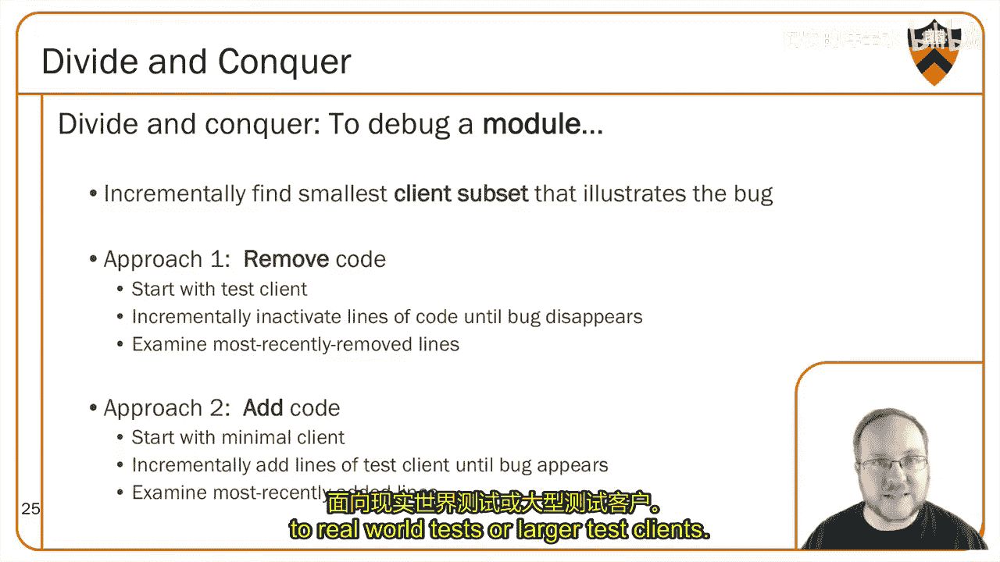

We can extend the idea of divide and conquer， but rather than changes to the input。

 we can take the same tack for changes to the program's code itself。

Focus on recent code has two meaning。 First， it means focus your effort on recent changes。

 Test and debug as you go。And second， focus your bug hunt on recent changes。 If something's broken。

 look first at the last thing you did。This is the principle of regression testing。

 but it's only effective and feasible if you follow number one。

 because otherwise you have no assurance that it worked before。

It's also tempting to think my current version isn't really what I want。

 it's not working right now or isn't what we need， and so there's no point backing it up before I start off and making changes that are needed。

It's also tempting to think， I'm going to make this change and everything will work fine。

Both of these mindsets risk losing code that you know at status quo。

Maybe it doesn't have all the features you need， maybe it has a known bug。

 but you know what's what with it， and that's valuable。

Losing it and then progressing on and getting into a situation where you're not sure what's in your code now。

 what's changed and what hasn't， et cetera。 just makes for extra debugging and more second guessing。

As frustrating as it might be to check in code that you know isn't right。

 and you know that it's going to get changed imminently， it's valuable to do so。

 at least in a developmental or feature branch， maybe not into Maine。

Because if you walk into a maze of new changes and can't figure out up from down or how to get yourself back out。

 you can always time travel back to before you've made these changes and start anew。

Or more reasonably， instead of completely starting over。

 you get to at least cross reference your current status with the previously well known state to get a clear sense of what has or hasn't changed。

We used to suggest in this class that every time you started a new section of a project。

 you copy your project directory over into a new directory whose naming included a timestamp。

This is now decidedly not what we recommend。 Instead， you should be using your Git repository。

 which does all that and more and does it better。 I was thrilled to see an assignment to office hours that a lot of people have really great setups where their Ide E automatically checks in and pushes changes for them。

 or others had the manual edit commit， push pull sequencing down to a science。 This is great。

 and you should keep it up。 I heard a couple of people saying that the lab Ts were。

 were harassing them， saying， oh， come on， just transfer the files。 You don't need to check in。

 You're doing the right thing。 You can ignore them in this case。 Even though they give good。

 good debugging advice。 They're not necessarily great software engineers。😊，All right。

 number six is a quick one， if you're failing test cases。

 sometimes the answer is actually to add more tests。As we saw in the testing lecture。

 internal tests can help you to find bugs， and so if we create more and more of them。

 we might be able to zoom in on exactly where that bug is occurring。

 rather than just a higher level test telling us that a problem exists in general。

And in addition to actively isolating where bugs may be。

 internal testing can also passively eliminate entire sections of our code from having to search in the first place。

 because if the bug was there， it would have tripped up our internal invariant testing or parameter validation。

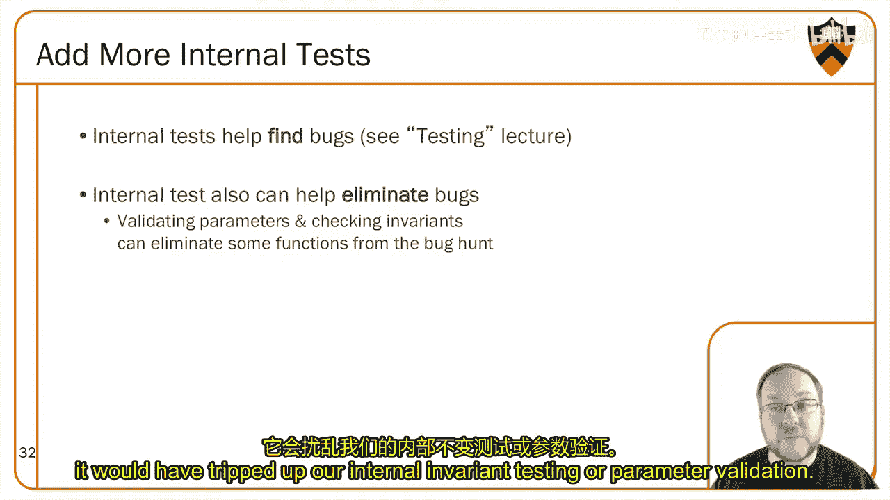

All right， I hesitate to go here because it's the status quo for many beginning debugggers。

 and I'd like to be moving away from it， but nevertheless。

 there is indeed great deductive power in a small set of precision targeted prints。

It's a very 126 way of doing things， but it is valid for small cases to determine where the problem first manifests。

 or if it's already apparent where it is， what exactly is happening to one particular value？Note。

 though， that there are some tricky bits with print F debugging。And that is one of them is buffering。

Standard out stream buffers。 That is， it doesn't immediately print to the terminal what you call printf on It'll keep it in a buffer in memory for a little bit so it can print it all at once in bigger chunks to be more efficient。

This means that if something has been print at， but is sitting in a buffer and the program crashes。

 the program could crash before the output appears。

This doesn't do you very much good if you've been doing printf statements likeI got here， I am here。

 got to this line。We can flush the buffer when printing to the terminal by just putting a new line character into the stream。

 but this doesn't help if we're redirecting to a file。

The better way to print a standard out and enforce determinism about whether we have actually printed out in reality or if it's still sitting in a buffer。

 is to do F flush， which explicitly flushes the stream。

Another option is to use standard error instead of standard out。

 This is advantageous because our programs tend to print a standard output。

 And so if we do our debugging output on standard error， we can separate it from standard out。

 So it's not all mixed together。 Even better。 standard error is unbffered。

We could also print to a file explicitly instead of just printing to one of the standard streams and redirecting。

The log file approach is actually used frequently， especially by long running programs。

 because it's helpful to find bugs that don't appear until after for instance。

 a loop is executed for a lot of times， it also provides a persistent record of a bug so you don't have to catch it live。

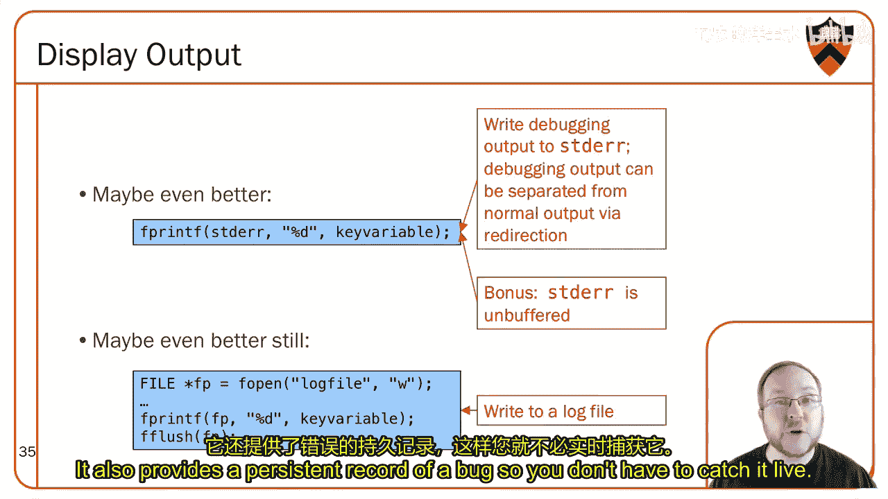

As an alternative to displaying output to the terminal or to a file， you can use a debugger。

 This gives you a more targeted interaction with your program state。

 you can see exactly what's in memory， when， and where。

 and what transitions happen in each statement of the program。

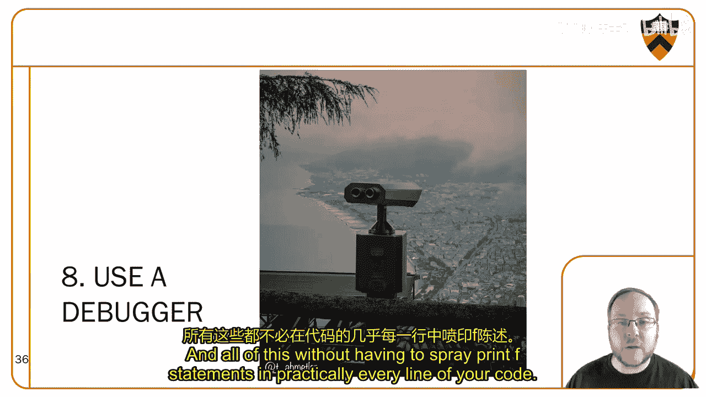

And all of this without having a spray print of statements in practically every line of your code。

I'm always happy to get on my soapbox about this， but perhaps instead。

 I should pitch this as a desperate plea to you。 Please take 15 to 30 minutes to go through the tutorial from precept again。

 and then maybe another half hour to replicate the tutorial with another program。

 maybe a slightly more complex one。😊，The hour you take legitimately will save you tens of hours in this term on debugging alone。

 and that's before even considering the time spent waiting in office hours or lab TQs on a bug that you could have found yourself。

Again， that's not to say that you shouldn't come seek help。 You absolutely should do that。

 but you can also make the most of that help by being prepared with the tools that well want you to use to get to the bottom of it。

 And if you're prepared to use them with us， you likely can solve a lot of your problems by using them independently。

The second set of debugging suggestions for this lecture pertain specifically to dynamic memory。

 Two weeks ago in precept 9， you worked on debugging dynamic memory。

 but since assignment 3 is coming up and that will be your first foray into actually writing code that that dynamic allocates memory。

 It's worth your time to cover this in both precept and lecture。

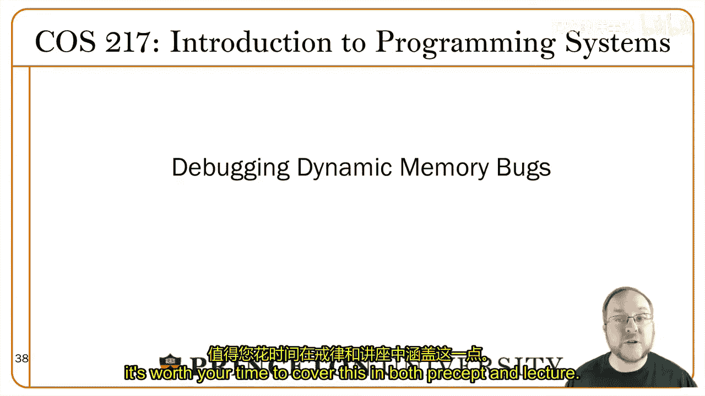

With dynamic memory， a large number of bugs come back to a relatively small number of core ideas and their variants。

This follows from the small number of primitives， or I like to think of them as ingredients that we know about in dynamic memory and an even smaller number of categories or recipes to extend the analogy of errors within them。

You can refer back to precept8 for the ingredients， maliccallic， reelic and free。

 or the pointer dereence also sort of fits in here it' another ingredient。

And that's just about everything that can go wrong， those functions， pointer de references。

 that's about it。And then you can refer back to precept 9 for the recipes。

 that is how things go wrong， dereencing a dangling pointer， accessing memory out of bounds。

 creating a memory leak or double freeing。

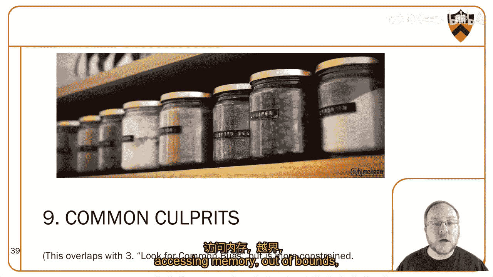

So here are three common bugs we might find in code that uses dynamic memory。

 Take a moment to go on another bug hunt。 Again， it's much better than just hand waving at a line and saying。

 yeah， that's the part that's wrong to be thorough as though you were collecting evidence。

 So what's the ingredient that's misused， What's the recipe of how it's misused and then the three other items that we were already talking about。

 When does the bug manifest。 What's the effect of the bug and how could we fix it。For number one。

 the ingredient is a dereence。 The recipe is a dereence of a dangling pointer， specifically。

 The pointer value is never initialized， So even worse than pointing at something that used to be allocated。

 Instead， it points to just an arbitrary location and memory based on whatever value happen to be in memory at the location the pointer is now。

So the result is either an inadvertent change to your program's data or a Seg fault if it happens to point somewhere that you can't access。

Number two is similar。It's more subtle because we don't see an asterisk to do an explicit dereence。

 but we call a function that will dereence our pointer。

So it's still the dereference of a dangling pointer and still has that inadvertent change to your program's data or a se fault。

For number3， now we have a few more ingredients in play。The mallik looks good。

Allocating enough room for exactly one end。And the dereference itself looks good。

 we're sticking five into the new allocation。But what happens if the allocation failed？

We don't ever check if Melck succeeded， and so if it failed。

 we're dereferencing a null pointer and we set fault。The free looks good。

But then weve dereferenced a dangling pointer that's still pointing to the memory that we just freed。

This is again， likely an inadvertent change， but there's some chance that the memory is no longer accessible to our program。

Again， a problem either way。Here are two more again， pause to ascertain the ingredients， the recipe。

 the manifestation， and the fix。The first meoc looks great。 The pointer de reference seems fine。

 but the second malloc is the problem。 Pointing P at a new allocation without having first freed the old one is a memory leak。

 We've created garbage。 That is， we don't have any way to reference the。

 the memory return from the first malloc。😊，And in the second， the malick again， seems fine。

 The pointer to reference looks good。 And the first free is perfect。

 But the fact I just said first free means there's a second。

 and we can't re freeee a pointer that's already been freed。 Double freeze corrupt the heap。

 making all subsequent dynamic memory operations potentially incorrect。 and in many cases。

 eventually crashing the program when the runtime system realizes there's a problem and aborts the program。

😊。

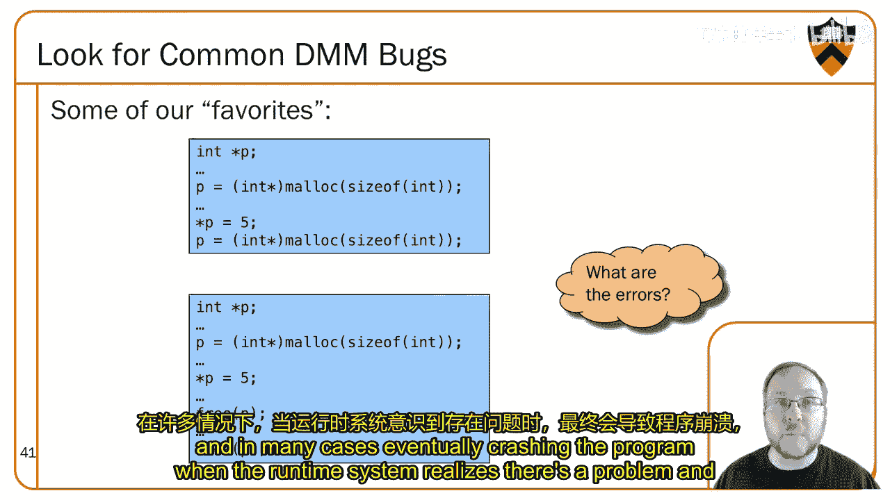

When students of C first get into pointers and particularly dynamic memory。

 they're prone to make mistakes that lead to segmentation violations or se faults。

This is where we dereference a pointer that's pointing at memory that the program doesn't have access to。

It's natural toce Seg faults as some sort of disaster。 it's an error that terminates the program。

 Oh no。But I promise you that Seg faults are a good thing。

Both because they give you a really straightforward way to debug the underlying issue。

 But also because it absolutely beats the alternative where the program just goes about reading and writing to the wrong places and memories silently。

 digging further and further down into its own grave until either it crashes for another reason or returns the wrong output。

 In both cases， it leaves the developer absolutely no clue as to where to begin to debug。

With a Seg fault， on the other hand， you know exactly where to begin。

In office hours and assignment，2， probably the second most common issue I help people with with Seg faults。

 And it seems that many have missed the message that Seg faults can help you see exactly where your problem is。

 So let me evangelize to the world。 G D B can pinpoint the exact point in your programme where the Seg faults occurred and give you an entire stack trace of function calls that got you up to that point。

Simply compile your program with the minus G flag in in Gcc。 Open GB。

 run the program using the run command and allow the Seg fault to occur。 Yeah， that's right。

 Let your program crash。After your program has died its ignominious death。

 issue the Warer Command WHR to see the location and trajectory of how it got there。

While the line it dies on probably isn't where the error is。

The line where it dies will show you the pointer that was in play。And thus。

 the pointer that is the problem。Now you can play detective and walk back how that pointer's value got to be what it is。

The back trace that's given back from the wear command is helpful with this of figuring out how it got there。

You can find then in that stack trace， in that walking back of where that pointer has been used。

What happened to it What is the problematic code I it a bad assignment to the pointer is it a loop sustaining condition that was incorrect allowing us to walk off the end of an array。

 is it a bad allocation that didn't allocate the right amount of memory， etc？

So speaking of bad malics that don't allocate enough space。

 let's see a few ways we can diagnose these problems。 The first is by manual inspection。

Use your ID search tool or the standard Linux tool to gr and find all instances of Malek Calc reec in your program。

 and then go look at them。 make sure they're allocating the right amount of memory that your program is later on going to assume that they've allocated。

Of course， if this is the issue， then you just wrote the bug in the first place。

 so it's possible that either through misunderstanding or lack of attention。

 you'll reenact that same mistake of writing the bug in your double checking。Nevertheless。

 it is oftentimes just a new readover with fresh eyes that will catch these bugs。

A very common error for some calls of Maloc is to request too few bytes of memory。

 Here are four such maloc errors， so pause the video and see if you can identify what exactly the bug is in each and how they should be fixed。

The first allocates one too few bytes because it misses the space required for the nullbte that's not accounted for in the return from Sterlin。

 I know we've seen this on the slides before， but it's such a common error that I'm going to continue reinforcing it。

The second doesn't allocate enough memory because size of S1 is always8。

 that's two few bytes for the string Hello world which consumes 13 bytes。In the third。

 size of long double star is8 because all pointers are of size8 on arm web。

But a long double consumes 16 B on armla。 This is a common error in assignment 3。

 and it's the first thing I always look at in office hours。

 The type of the pointer should be one more pointy。

 It should have one more star than the type and the size of in the allocation。

The fourth is actually exactly the same as the third。

 just with a variable of the type long double star instead of the type name。 Note， though。

 that star P would be fine since the type that long double star points to is a long double。

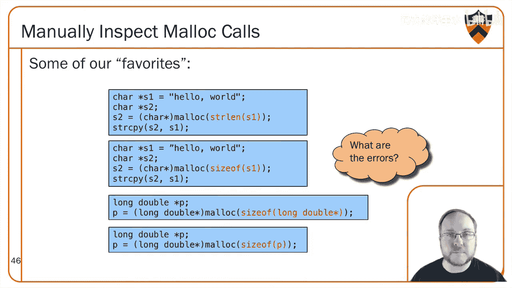

If you've gone back over and over and over and stared at your Malex and you're convinced they're right。

 but your bug persists， another option is to change each allocation to allocate a hard coded amount of memory。

 rather than the program specific value you've initially written。

If you change every Malic to request some large number of bytes larger than any reasonable amount your program would ever actually request。

 now it's likely that you've changed whatever malic it was that was requesting too few bytes。

So when you run the program。😊，If that was the case， your error will have disappeared。

 You're no longer malicking too few bites。 Now， you just have to restore them one by one。

Until the error resurfaces， at which point you know， which is your problem， child。

This is time consuming because it's manually editing potentially many lines of code。

When I say editing a line of code， you probably shouldn't edit the lines themselves。

 you should comment them out and put in a fresh meoc below them that has the hard coded value。

 otherwise restoring it back to what it used to be is tricky because you don't necessarily remember what your original code said。

But although this is time consuming， it is often effective。

 particularly when you have something subtle that manual inspection misses over and over。

 here you can go and pinpoint which one it is。The danger， though， is if this wasn't your bug。

 you've just wasted sort of a lot of time in changing everything to meck way too much space and then having to go back and put it all back that was actually not your bug。

A similar technique can be applied to free。If your program is crashing with a double free。

 a good technique is to take out all your calls to free After all。

 you can't have a double free if you don't free at all。

The same applies if you suspect your error is due to accessing a dangling pointer。

 so you're accessing memory that's already been freed。

 if you take out your freeze it hasn't been freed and so that's not an issue。

The idea is the same as it was with Melick， you comment out all the phrase。

 see if the bug disappears， if it does， then incrementally restore each until you find the one that reintroduces the book。

Again， this is time consuming， but when manual inspection doesn't cut it。

 it's useful and manual inspection is harder with free。

 since it's common for all of the free calls to be detached in both execution time and code location from the malloc calls。

 We don't often mall something use it for two lines and then immediately free it。

 they might be in different different functions and might be you know the entire runtime of the program separated from each other。

Finally， the last technique that I'll mention just briefly is to use a memory profiling tool like MeMfo or Valgrrant。

These tools intercept your program's memory allocation calls and keep track of what they did and where。

This information can then be used to see if， for instance。

 the program allocated memory and then never did a free on that memory that it allocated。

M Minfo was written by a Princeton faculty member Bob Danero and RJ Lillstrom class of '08。

 specifically for 217。Valdnd， on the other hand， is free。

 both in the sense of freeze speech and freeze beer。

 it's a free tool that is widely used in both research and industry。As you might suspect from that。

 that means Valornd is more powerful， but is also more complex and not really targeted at novicty programmers。

 whereas me info is simpler and more tuned into this class。

In your assignments will require that you demonstrate a clean MI info report so that shows that you have no memory leaks and you didn't corrupt the heap。

 but I do encourage you when you get something that appears to be a memory management error to try out vgrind while you're trying to track down the bug it has some fantastically detailed memory error detection that actually runs as your program is running。

 it's not a post hooc tool。It also looks at not just memory leaks and heat corruption。

 but also for multiple freezes and for dereferences of dangling pointers。

So that's it for this lecture， I trust though you'll make good use of these techniques in assignment three。

 but before then I hope that you have a productive time studying for your midterm in this class and of course your midterms in your other courses。

And after that， I wish you good luck on the exams themselves。And after that。

 I wish you a relaxing and rejuvenating full break。 I'll see you after that。

