# 【全集 秋季版】普林斯顿大学 C语言系统编程 中英字幕 p15 Lecture 15 - 模块化与接口 -BV1u1feBoEsK_p15-

Welcome back to Co 217 lecture。 Today， we strike a balance between C details and software engineering fundamentals。

 We'll talk about some details of the sea language that facilitate modular design。

 encapsulation and data hiding， and also clean interface design。😊。

But we'll also talk about the design process and how to decide what constitutes a clean interface in the first place and how to balance trade offs between different characteristics of a good modular design。

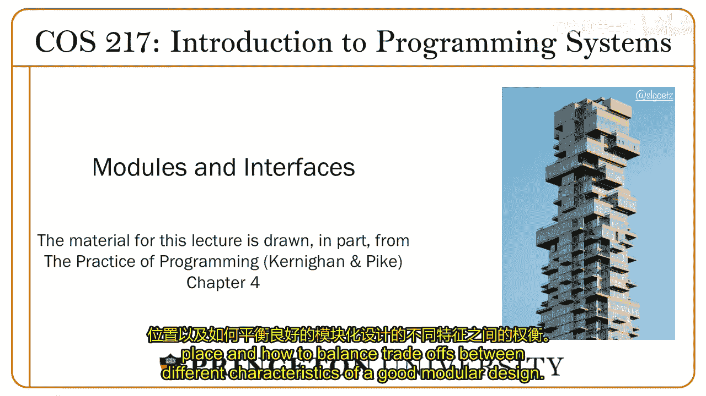

As always in this course， it comes back to abstraction。Moularity is the manifestation of abstraction。

 We abstract away the details of an implementation behind an interface。

 whether a stateless module like your string module and AD0T。

 like you saw in precept 10 and now in assignment 3 or an abstract object that you'll see in a future precept when we get to assignment 4。

😊，In creating these abstractions， we constrain what a client can do with a module。

 which at first blush sounds like a bad thing， but ends up as a powerful guarantee to the programmer implementing a module that their contractually protected from having to deal with unreasonable client actions and following from that that they can be sure that in the absence of their own error。

 The internal state of the object will remain consistent without the client's meddling。

In creating these abstractions， we do constrain what a client can do with a module。

 but we also have the opportunity to convey to the client what they can and should do with the module。

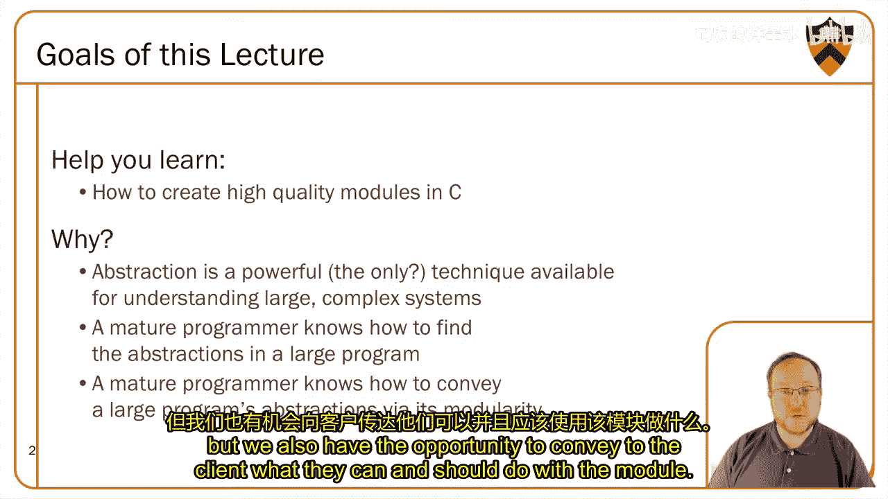

So through this lecture we're going to discuss these eight characteristics of a well designed module。

 we'll start with the one that you're already familiar with from your object oriented introduction in 126。

 and that is encapsulation and information hiding。

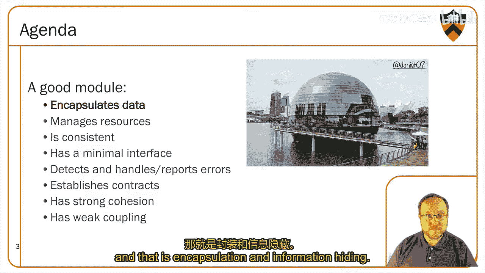

Information hiding is a restriction against the client directly accessing and manipulating the state of a module。

 encapsulation is the tying together of a module's state and its functionality。

 which both facilitates information hiding and also provides the ability for the client to access the internal state in a constrained manner。

These are important goals for several reasons。 Clearly。

 there's a security aspect in that if a client can reach into the module and change the internal data。

 then the module's developer has no way to protect the state of the module and no way to provide any assurance about its behaviour or correctness。

But even in the absence of the client changing a module's data。

A client that can see into the module's data is very likely to rely on being able to do so。

 This means that any change， the underlying representation is going to break that client's code。

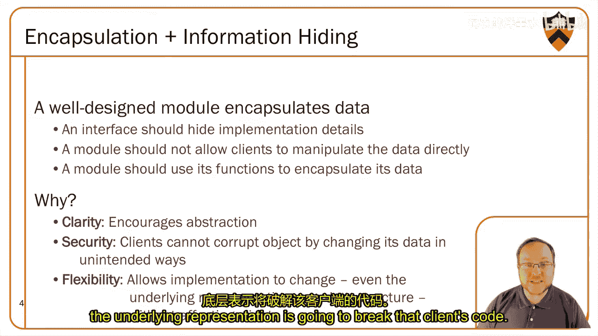

Barbara Liskov， who won the Turing award back in 2008。

 was a pioneer in this area of data abstraction。 She wrote a foundational paper on the topic back in the mid 70s that really laid out exactly what we want an ADT to be defined by only its operations。

 The client doesn't need to know or care what the underlying representation is。

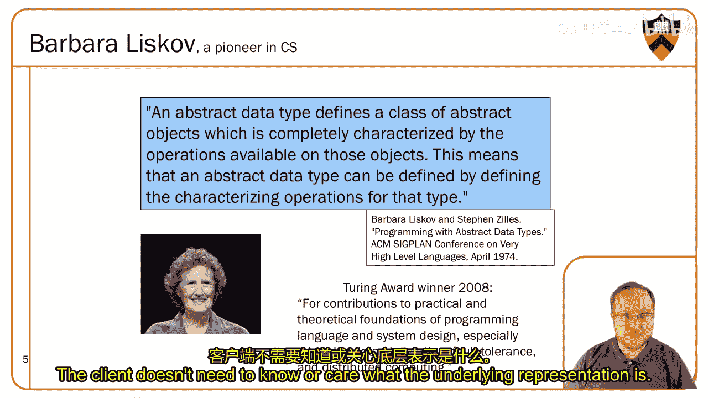

So let's look at a concrete example of this that we've already seen a little bit of in preparing for assignment 3。

 the list ADT。Here's a reasonable implementation of a list data type。

 The list is a structure with a pointer to its first node。

 the node consists of a payload for simplicity here just an int and a pointer to the next node in the chain。

We have some natural operations that we'd like to do。

 such as creating a new list or inserting an item into a list。

And we have some design decisions that we make along the way。

Maybe we'll find that they're ill advised， but we'll get to them later For now。

 we'll say that this is a reasonable start of a list。So what should the entire interface look like？

The functions that the functions that we see here， they interact with the underlying representation of the data。

 And that's fine。 At first glance。 The type itself， though， needs to be hidden from the client。

And if the functions take parameters of the type and return values of the type。

 this presents a conflict because we have to at the very least。

 reveal how much memory these structures require instead。If we use only pointers in the interface。

 the size is well defined since all pointers are of the same size。

And the client just has to know that the struct exists。

Let's explore this last idea that the client only has to know the existence of thestruct。

 not the details of it。Let's use some examples。

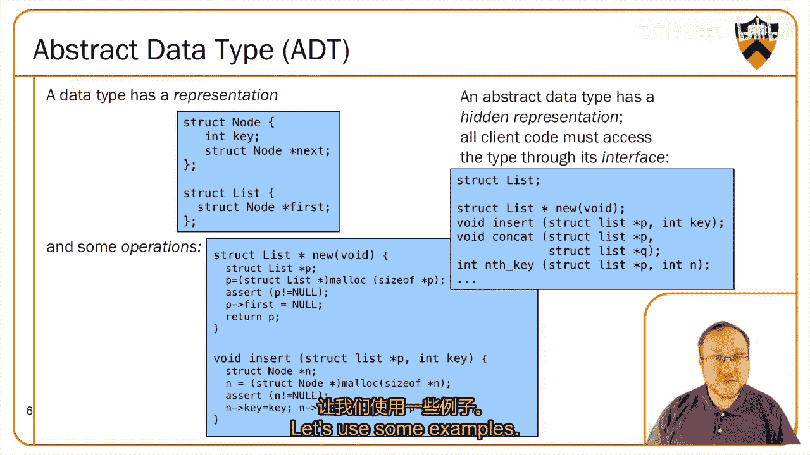

Take a look at this interface。What's bad about it？In this interface。

 we have the full definition of thestruct。That means the clients know the underlying representation。

The client doesn't do anything with that knowledge。

 but there's nothing to stop to stop them from using that knowledge of the internal state in its own code。

Or worse， fiddling with the internal state itself。Even if all seeing code in the client isn't malicious。

 it does mean that if we change the implementation， the client code will break。Furthermore。

 even if the client code doesn't use the internal representation at all。

 let's return to our well behaved client that interacts only via the interface。

 That client still has to rebuild their dodo files， in addition to their executable。

 because any change in the representation will change the dot H file upon which the client code depends。

If it were only our dot C file that changed， not the dot H。

 they'd only have to relink against our new dot O and build a new executable。

 They wouldn't have to recompile their own code。Thus。

 the interface file should provide a declaration， not a definition of the state structure。

This line says，Hey， compiler。Struck list is a thing。 But nope， I can't tell you anything about it。

The client programmer does not see the implementation。

 the client will not be tempted then to directly manipulate the fields of the list object。

Even better， the compiler does not see the implementation when compiling the client。 Thus。

 the compiler would not allow a client to directly manipulate the fields of the list object。

 It's not just a discipline。 It's actually a prohibition。

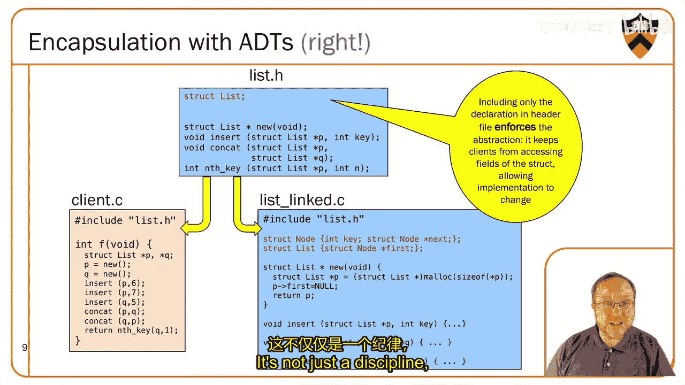

But then if a client can't see the internals， how is it supposed to know what to do？

The interface can act as a specification to the module。

And we'll talk a little bit more later about details of how to communicate this specification to the client。

 but you already know the basics， function comments in the interface。

 just like you've been doing in assignments。But how could we formally specify our interface。First。

 note that we need to specify something about the type itself。

So here it's a list and that list is just a sequence of integers。For our insert function。

 the specification makes the behavior clear， but maybe namingly of something to be desired。

As we go to develop the speck， it should give us pause as to whether we've chosen the right names。

Perhaps we should have called this prepen to make clear that it's inserted at the front。

 On the other hand， we've yet to see anything that actually indicates it's ordered。

 so maybe prepen would go too far。As it ends up， we'll see in a moment that ordering does matter。

 so perhaps prepen would be better。Insert， though is general。

 So it might be more realistic to either have a client understand what this means。

 or it might just be more general。 And so it can jive better with existing interfaces or be more。

More less susceptible to being incorrect if we change the underlying implementation。

So next up is concat， and this shows us that sometimes the specification is as much about what a function doesn't do as to what it does。

Again， here， we see the the opportunity for better naming Without the specification。

 there's no telling which of P and Q is the source and which is the dust。

 And so we really should have named the parameters to match。

Nth key again gives us parts when we write the specification。

What do we do if n is beyond the length of the list。

It' would be nice if C had option types for exactly this reason。If it exists， return it。

 otherwise return none。Pusibly one could change n key to return an int star that points to in null as an option。

 this is sort of the Java idea of we'd return a reference that either is null or a reference to a object。

And perhaps there are even yet still better options。 we'll talk about them later。

You're justified in thinking that this specification is ridiculous， though。 Hey。

 if I return an arbitrary int， this has all sorts of bad side effects。 Notably。

 I can't tell if it's the nth value or if there is no anth value at all。Totally you right。

 But I'll offer up some small support。The client shouldn't be requesting an invalid item。Furthermore。

 this isn't completely foreign。 This is basically what C already does for a raises。

 and we tolerate that。

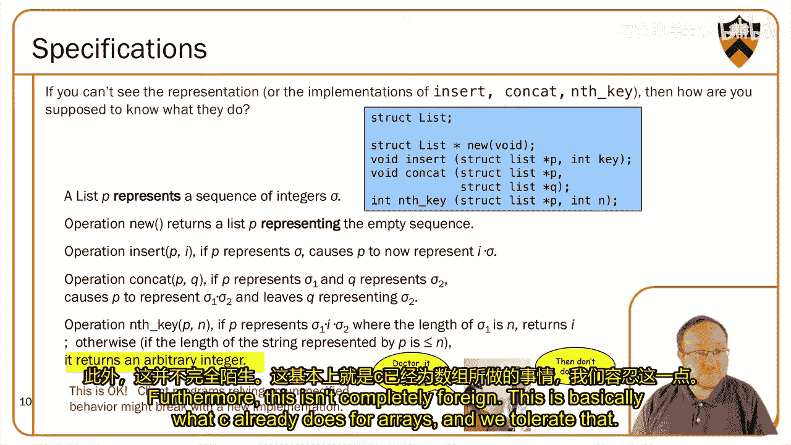

Right？So specifications are important because they allow reasoning about the effects of code without getting to run them。

 For example， here， without remembering anything at all about the specification of list。

 was in an array， a linked list， some more advanced structure。

 Who knows who cares If we have the specification， we can trace out the behaviour of the client code。

Also， it a practical software engineering matter， this is critical。

 it is not at all unusual for multiple teams to be designing multiple portions of a project。

 and each one team relies on something being built by each other team。That isn't done yet。😡。

It would be disastrous if we had to somehow serialize the entire development so that team1 had to finish before team two had to finish before team3 could even start。

 and that's before even getting into circular dependencies。It would be a disaster。

 So this idea of a formal specification an interface with some guarantees of a contract is a really powerful idea that not only is practical。

 but sorry it iss not only theoretically nice， but also practical in that it facilitates real world software engineering。

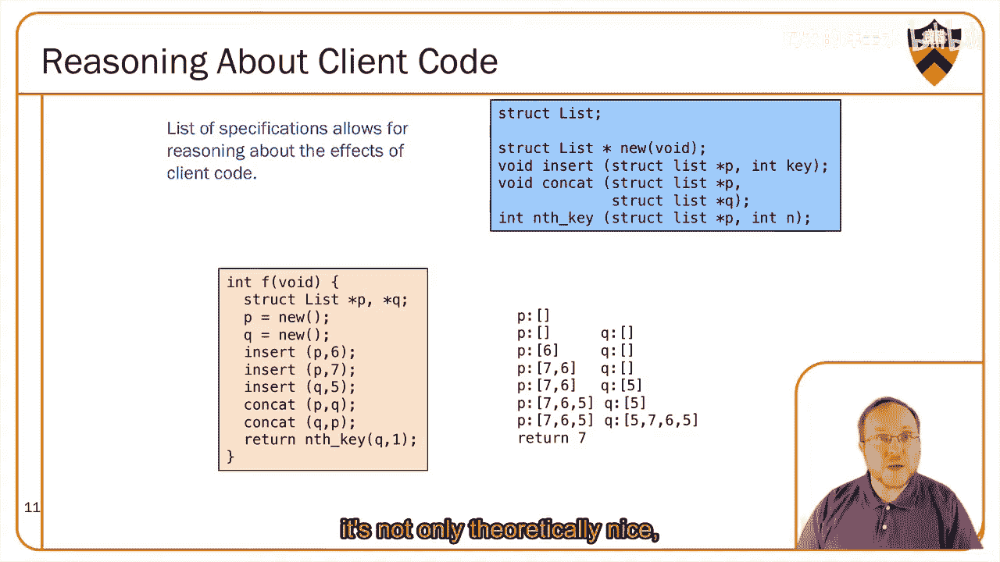

It is common in idiomatic C to go up one step further than the previous interface even。

The type de keyword in C creates a new alias for a type。

 It's common to use it to give the name to the pointer to a structure where that structure is， again。

 given as just the declaration， not the definition， just like we've seen。

This doesn't have any capabilities to our module or change the encapsulation or information hiding properties。

 but giving a name for the handle we use to pass around the instances of an ADT makes it feel maybe a little bit more like an object and consequently then we can sort of encourage the encapsulation towards object oriented thinking。

Also practically， for whatever reason， seeing the mysterious underscore T types makes programmers less likely to try to do things that they know they otherwise can try to do on strs or pointers2 Strs with the dot operator or the arrow operator。

If we've designed our module correctly and we only have the declaration。

 not the definition in the interface， they won't be able to do this。 The compiler won't let them。

 but it's such a temptation that it wastes their time。

 and they are furthermore going to be confused by。By errors that talk about incomplete types because that's not a natural term that we use all the time。

 but that's what you end up with if you try to do a dot operator or an arrow operator onto something that you only have the declaration。

 not the definition so we can sort of avoid this entire mess by saying， nope you。

Get to ignore that it's a struct underneath the hood。

 just think of it as a list tea or a stack tea or a Sim table tea。Think of it as an object。

 pretend it's Java just for this moment moment。

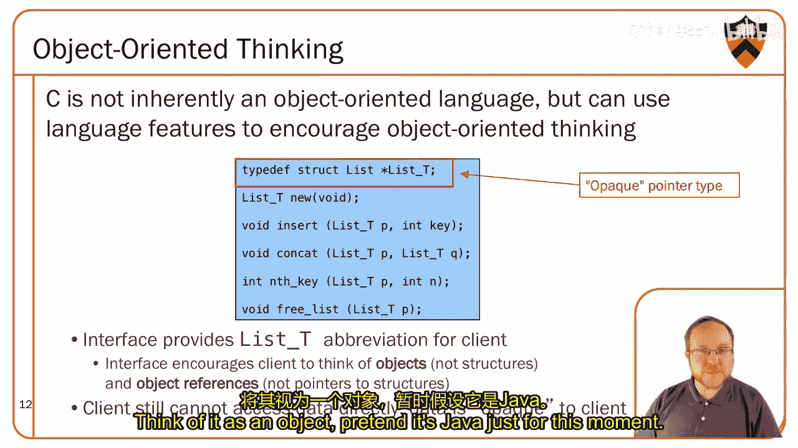

So now that you've been to precept about ADTs and we've taken a deeper dive into ADTs thus far this lecture。

 take a crack at this question。The correct answer here is D。

 We know that strings are implemented as an array of characters terminated by a null White。

 and clients can manipulate them directly。 They don't have to go through the interface。

 Contrast that with Sim table where a client has to use the interface for everything。

 having only an opaque pointer to serve as a handle to this instance of the AD DT。

Note that some people might have said E， and I think that's the second best answer here。

 but in the context of string。 H， we have a set of operations on strings and the underlying sets of values。

 and so this is sort of the same idea as a data type that we've defined it。

 operations and underlying set of values， data type。

 I think it's unreasonable to say that string is absolutely not a data type here。

 even if it is really just an array with a nob at the end。

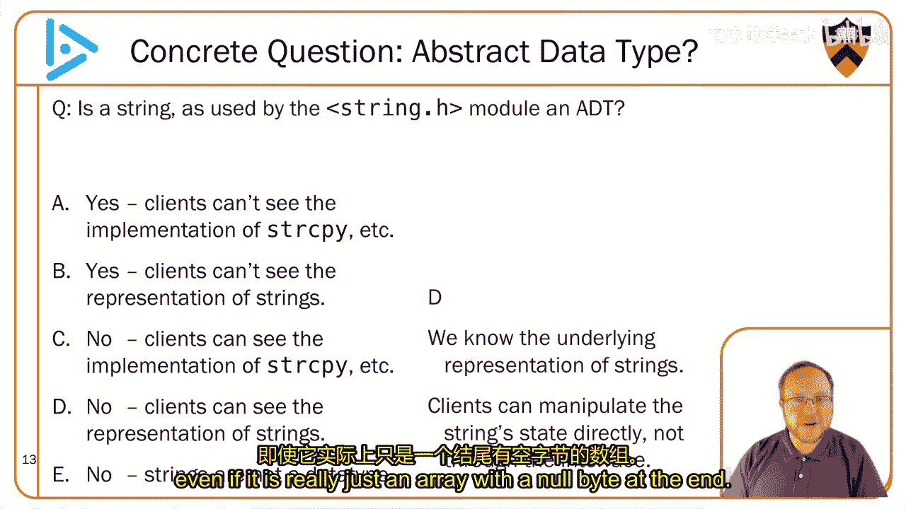

So the next characteristic of a cogent module is that it should manage memory and other resources in a structured and consistent way。

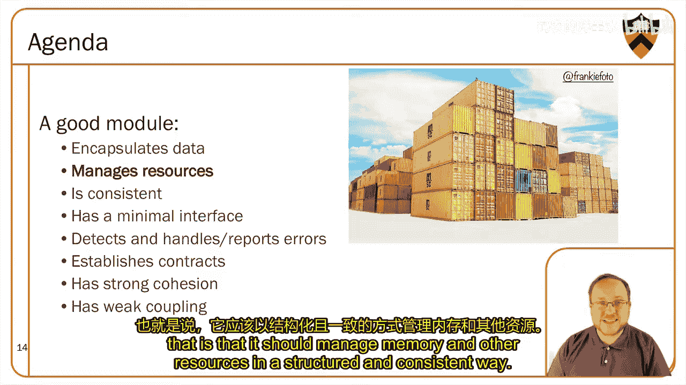

Concretely， we expect the module that allocates memory should default， should by default。

 be the one that frees it。 And the same goes for other persistent state， like open files。

The rationale here is quite simple。 the module that allocates a resource is the one that knows it has been allocated。

No module or client should be held responsible for predicting the underlying allocation behavior of some other module。

And even if we did expect that， it's problematic for debugging。

 If a module allocates memory with the expectation that a client will free it。

 and then the client doesn't。We'll hold the module at fault。 Meminfo or Valaldron will。

 will claim as， as such pinpointing the location at which the memory was allocated within the module and then saying。

 hey， it was never freed。 We have nothing to look at except that module to say。

 you didn't free the memory， but it's not the module's fault。 It's the client。

To some extent this is already the case if the client never calls the free function。

 but this breaking of the status quo where we would say that the client has to explicitly free using the free function call on the pointer that would make it even worse。

Let's take a look at the design decisions made in assignment 3 F each binding。

 there's a key and a value。The characteristic of good modules that we're talking about right now says that if SIimT allocates it。

 SIimT should free it。But that's fine。 It still doesn't answer。

 Should Sim table allocate it or should the client。Let's look at the key first。 If Sim table does it。

 it's added complexity to the module。 Rather than just setting a reference。

 we have to allocate memory， copy data into that memory。 Remember to free it when we're done。

But on the other hand， if the client does it， we run into the issue from a previous lecture in which the client could corrupt the internals of the data structure just by changing its own memory。

 which it should be allowed to do。So we chose in assignment 3 to have S table make a protective copy。

But what about the value？In this case， the risk that the client allocates the keys is gone。

 The value is the result of a search in the table。 It's not the search target。

 So if the client changes the value that the table references， this does change the binding。

 but not the operation of the table itself， such as its search integrity。

 searching for a key that's been put into the table。

Will will succeed the value that it returns might be different， but the search will succeed。

 similarly searching for a key that has not been inserted into the table will fail。

So if the SIim table own the value in each binding。Furthermore。

 it would have to know how big each value is， requiring an interface change。

Also then it would be responsible for allocation， copying and eventual freeing of the values。

 So again， adding complexity to the module。嗯。And so the client ownership really has the Sim table doing less work。

 But without this big risk factor， that was the decisive element in our choice for the keys。

 That sounds like a win to me。 And indeed， the bottom of the section of Sim table interface in A3 in the specs indicates that Sim table object must not own its values。

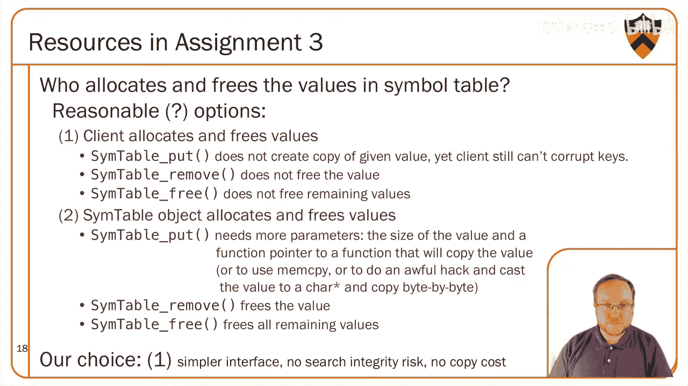

One final note on resource management。There are some that it does make sense for a function to allocate memory and then pass it back to the client to be forevermore owned by said client。

The string module has such a function。 Sturduop is a function that allocates memory for a duplicate of a given string。

 copies the given strings contents into the newly allocated memory and returns the string to the collar with the full understanding that the collar is now responsible for it。

😊，There is， after all， no such function as stir free。When we have situations like this。

 since they are relatively rare exceptions， the specification。

 as contracted through the comments in the modules interface face。

 must explicitly note that the memory is now the responsibility of the collar。 Here's an example。😊。

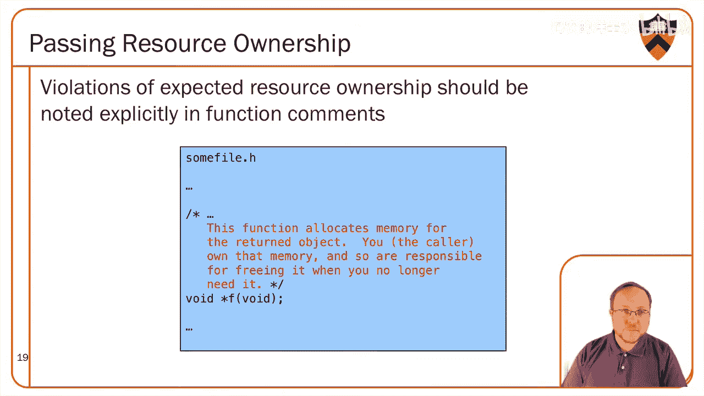

Our third characteristic of a coachient or coherent module is that it should be consistent。

This can be in behavior， for instance， having all its functions make the same resource management decision or having all its functions be thread safe。

 but we should also aim for consistency in style and composition。

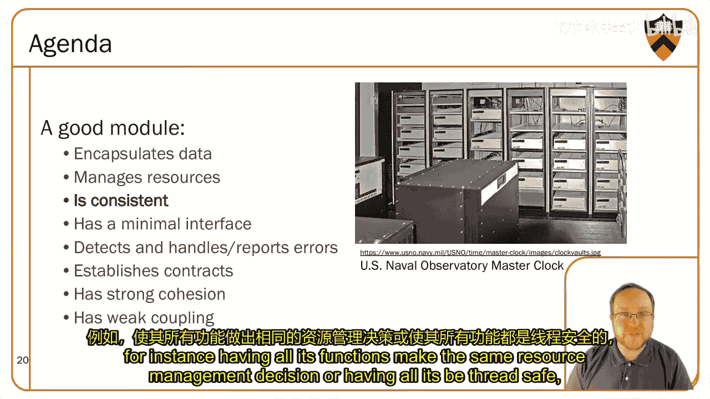

For example， each function in a module should follow a naming convention。

 it' would be weird if the functions were stir land but copy string。Typically。

 we choose to have the module name as a prefix for non static functions。

 that is ones that might be called from outside the module itself。

This reduces the chance of a name namespace collision。

 Consider how approximately every single ADT is going to have a new and a free method and how many different inserts and compares there must be across all of the modules just in the standard libraries。

And since C doesn't allow function overloading， there can be at most one per program。

 We get around this with a naming convention， again。

 typically prefixing the the name of the module onto the function name。

The string library does essentially this admittedly it does STR and it doesn't have an。

Underscore anything to set off the prefix from the function name， but it's a reasonable first cut。

Additionally， doing this makes it easier to find locations in the module sorry in the code base where the module is used。

If you can gr across all your files for a unique prefix。

 you can find all the places where the functions get called much more quickly than if you have to search for each inconsistently named function individually。

Another element of style and API design is that function should use consistent parameter order。

 conventions or semantics in the simplest example， wouldn't you hate to use an ADT module in which some of the functions put the ADT instance as the first parameter and others put it as the last。

 you would be forever checking back to the API saying which one is at this time。

Or if a function took a pointer and a size of the object that the void star pointer would point to。

 which comes first， the pointer or the size。But it's not just about making the compiler happy and getting the exact order right。

 It can also be about understanding what the function does。 For example。

 if a function takes two arguments of the same type， does the first act on the second or vice versa。

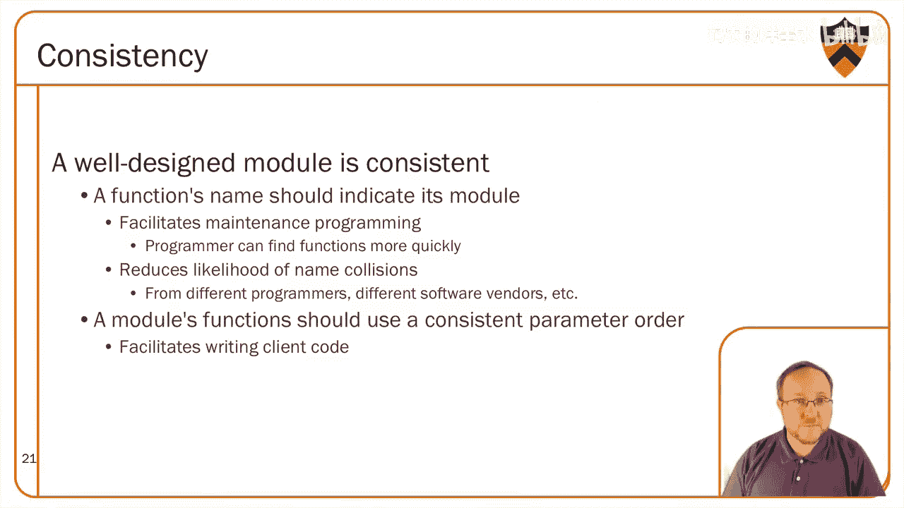

So let's look at our string module。Are function names consistent。 Well， most do begin with S R。

 Some have names to begin with mem， though， Are they misnamed or is this the hint they should be in a different module altogether。

Well， they're not misnamed because they don't， in fact， work on strings。

So perhaps they should be separate。 But on the other hand， they sort of fit here。

 Memcomp andm and mem copy do a bite by by， bite by bite comparison or copying of arrays。

 just like in stirir comp and stirir copy。So we don't have to be perfect here。

 but we have a good start。In terms of parameter order。

 this is actually absolutely consistent destination string parameter comes before the source string parameter throughout both the string functions with stirir copy and stirir and cat。

 but also the me functions。One can quibble， of course， whether this is the right order。

 And certainly it's something that the first time that you see the the string at age interface。

 it might take some getting used to。 Wait， the source comes second and the destination comes first。

 Don't we read left to write in， in at least my native language。But it does mimic assignment。

 we say that x gets y， and it also mimics assembly language upper and order。

 so it's at least justifiable and again， for our purposes here on this characteristic。

 it is certainly consistent。Looking at Sim table， all functions do begin with Sim table underscore。

 So that's a good consistency。 On a minus side， it does make it somewhat verbose。

 As our module names get more and more intricate， we end up looking something like Java with our。

 you know， buffered input reader dot， you know， all of these big long class names。

 But for consistency again， that's what we're focusing on here。 It's a plus。

Also with the parameter order and semantics， it's always the OSIM table is comes first and then the key and then the value and the destination string parameter comes before the source string parameter it's the same thing as with。

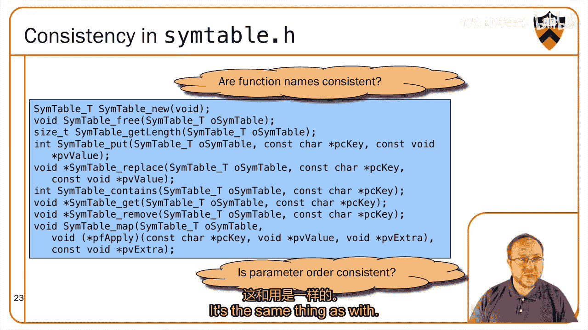

With the string module， we have this consistency。So at least we're eating our own dog food here of the module that we've written for this course fits the suggestions that we have。

So coming back to our list ADT。We definitely weren't doing prefixes with lists。

 so that's something we should change。But now albeit in a tiny little interface， things seem good。

 consistent prefixes， consistent argument ordering。

 I think we're ready to move on and say that we're good on consistency。

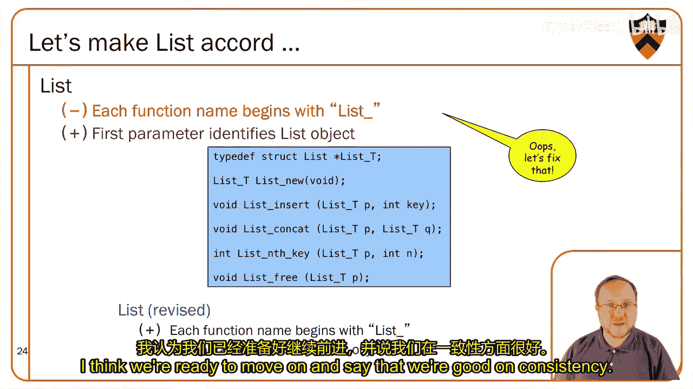

So the fourth of our characteristics is a good module is minimalism。A module is easy to learn。

 easy to use and easy to maintain if its interface is as small as it can be。

 functions that do one thing， only one thing and do it well functions with distinct jobs that don't overlap。

And only functions that are actually needed by the client。

Hopefully this results in few functions overall， but at least crystal clear differentiability among them。

This is what makes it easier to use because easier to learn because you just don't have to remember as many functions。

 easier to use because you don't end up swapping one for another and using the wrong one that than you intended and easier to maintain because they are differentiable but they are。

Atomic they do one thing。 They do it Well。 There's not this overlap where you say if I change what one does。

 does it change something else or if I change what one does。

 do I have to make a change to something else for it to still be consistent。

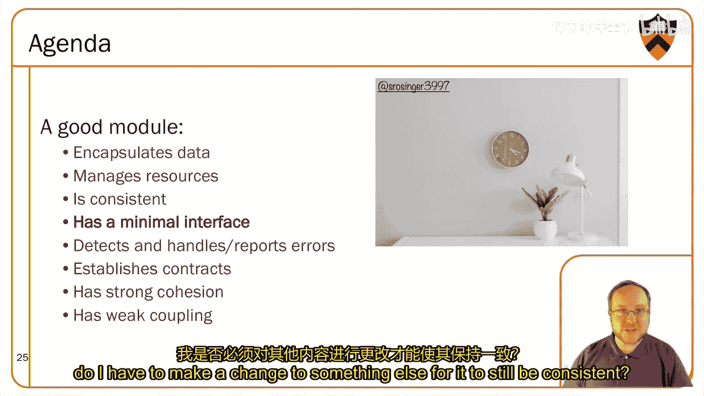

So again， this isn't just a matter of having fewer functions overall。

 though that can be a part of it， but because it also is related to encapsulation actually。

 Scott Meers is one of the leading C++ experts， provides a handy way of thinking about how encapsulated a module is by how many functions what I have to change if we change the underlying data representation。

This makes sense， we talk about encapsulation as and information hiding as oh。

 this means that you could change it， well， this is a measure of that。

 how much would you have to change if you changed it？In the case with no encapsulation at all。

 I suppose that would look like astruct defined in an interface file with no methods at all。

 This number is unbounded。 Literally， any function from any client will have to change if we change the underlying representation。

Because any code that any client writes might end up accessing the fields of thestruct。In fact。

 we'd have to if there are no methods。In a reasonably encapsulated module。

 we can constrain this to only the functions that are members of the module。

 the API and the static helper methods。This definition supports the idea of minimizing your interface because if we're going to say that it is more encapsulated by how fewer methods will have to change。

 that means that the fewer methods in the module itself， the more encapsulated it is。

 and that's one of our primary objectives。So Sim table contains。

Is it necessary or is it a redundancy？Take a moment to think about it。So if SIim table contains。

Is necessary here， because if S table get returns null。

 it could be the case that either a binding with a specified key does not exist or a binding does exist。

 but the value happens to be null。 S S table contains， allows us to differentiate these two cases。

 The former will return false and the latter true， whereasas S table get returns null in both cases。

So again， another quick question just to assess understanding and try to make you think about what we've just been talking about。

Pause the video and see if you can hatch this one out， pun totally intended。All right。

 here the answer is C。 There's no reason the client should be aware of the hash function。

 The hash function is only ever used internally to the module。 The client never needs to see it。

The hash function could change。 and furthermore， the implementation could change。

 It might be a linked list where there's no hash table and so no hash function in the first place。

So it should be internal。 It should not be part of the interface， and C has a visibility mechanism。

 in this case， static， which specifies that a function should not be visible outside of a file。

 Think of this a bit like private in Java。You'll talk about visibility and duration during the second precept next week。

 but I will just mention again， I think I've mentioned before static is fraught。

 it's perhaps the most confusing keyword in the language because it means a different thing for a function or a global variable versus a local variable and both of those two things mean different things than it means in Java soof。

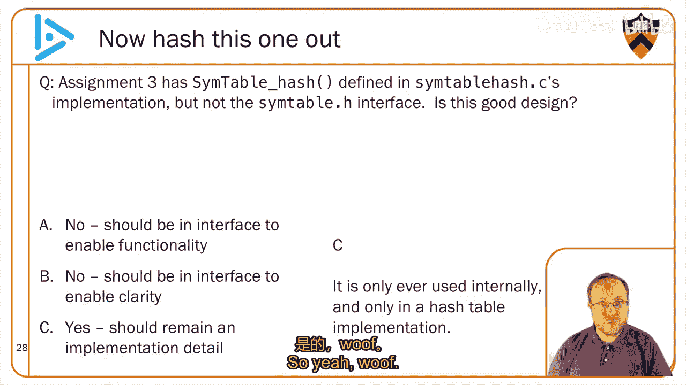

All right， so now to turn to what's unfortunately one of my least favorite things to talk about just because there's a lot of good questions。

 but precious few good answers in C， and that's error handling。

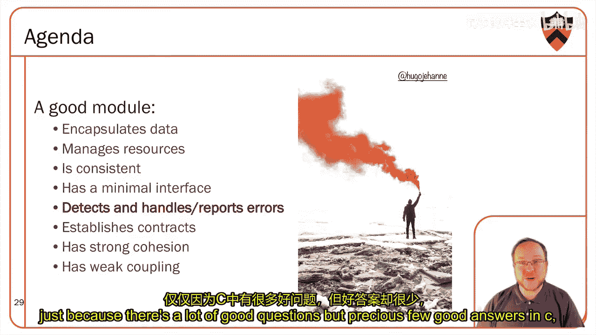

It won't be surprising to see that a module should detect errors that occur within its functions。

 and the function should handle these errors if it can and report errors back to the calling clients。

But typically it's not all that clear what the right thing to do is。

 and the language provides a paucity of features for handling and reporting errors。

We've seen how to detect errors。 You've written conditionals with the assert macro。

 Perhaps you remember the As macro。 If you dug into the assignment to test client and the latter two are pretty effective。

 but they're really just if statements with a fancy response in the consequent built in。

 either crashing the program or printing an error message。Furthermore。

 we know that the asserts can be turned off altogether， so they might be no ops。

 not actual detection checks。 And yet， nevertheless。

 perhaps this is at least to start a reasonable set of options for detection。

But surely we're going to need to be able to do better than crash the program or print out a single message in terms of handling the errors we find。

 right？And indeed， in just printing a message is often not sufficient。

Many programs run automatically and their output or error streams aren't routinely monitored or discarded altogether。

 some embedded devices may not have output in error streams at all。So printing message。

 nice in some cases。But not， not relevant in others。So in some cases。

 perhaps we can try to recover either invoking an alternate procedure or trying again immediately or waiting a bit and trying again。

 but again， certainly this won't fit all situations。A more drastic option。

 always available but rarely desirable is just to say， yeah。

 I will always terminate the program if I see an error。This is a pretty short bench of options。

 so how else might we pass the buck back to the caller to do what it thinks is right rather than having to decide within the module itself？

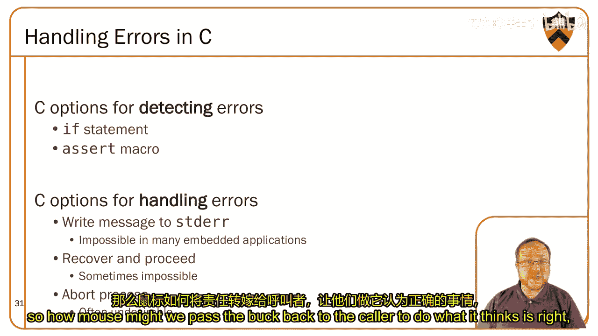

The natural way to propagate notification of the error back to the collar is via the return value。

 That is， after all， the primary interface of a function to send data back to its collar。

 We've seen examples of this， such as getchar， which return the special EofF value when it couldn't read a character or scanf。

 which returns the number of variables it was able to fill based on the format specifiers。

 It doesn't actually return the data it reads in at all。

 but this isn't great because functions return values are more typically used for something other than just communicating error status。

😊，So like we've seen Mc Quetchar， it's putting the onus on the caller to really understand the two different modalities of return value if you get back。

 the desired result or a return value indicating some sort of error status。

 and then to interpret them correctly。So since return values are already used for another purpose in many cases。

 another natural idea would be to have a global error variable for a function to set。

ButWe already know that there are downsides associated with global variables in general。

 concurrent execution， for example， and furthermore， this is out of sight， out of mind。

 it's easy for the caller to just fail to check it， just completely forget to check at all。

 at which point some erroneous state persists。But the client thinks that everything's normal。

 potentially getting into bigger and bigger trouble。

Splitting the difference here between return value and global variable would be an out parameter from the function that sets via a pointer a value back in the collar。

 but despite being， again， sort of a compromise doesn't actually fix any of the issues。

 The client still has to check for something other than return value， and furthermore。

 it has the added onus of passing a parameter in the first place。

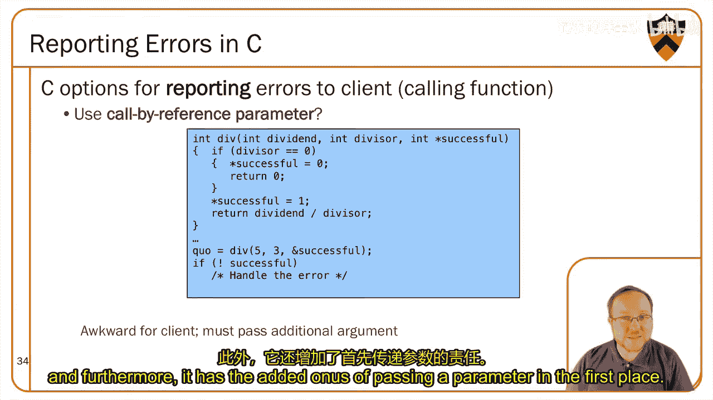

So like I said， to start this section， there aren't really a lot of great solutions here。

 This is something that Java handles pun half intended in a much more sophisticated manner than sea。

Java provides exceptions as a first class object representing a problem that has arisen in the code。

It provides a throw statement to generate such an exception and a tricatch statement to identify and choose how to handle the exception。

But despite the paucity of good options， we can at least offer advice to make the best of a bad situation。

 and it comes down to differentiating between user and programmer errors。

The naming here is is meaningful， but not entirely so。

The naming doesn't necessarily mean errors by the user， though those are typically user errors。

 Instead， we mean errors that are best handled by the user。 Similarlyly。

 programmer errors aren't necessarily errors by the programmer。 though， again。

 errors by the programmer do tend to be programmer errors。

We mean errors that are best handled by the programmer。

 albeit indirectly since the programmer isn't interactively present during program execution。

 but in terms of we'll have to fix a bug in the program whether reported by the client or cotton development。

So user errors are those that when it comes down to it。

 it's something that isn't the programmer's fault。 it might be expected to happen during during runtime。

 either due to that end user doing something wrong or due to a system limitation。

These offer the chance to be as gentle as possible for the end user to recover。For example。

 if there's bad data on standard input or a bad command line argument or being out of memory or disk space or things that can be expected to happen。

 but are still errors。The users should be given the option to fix it。

 whether that's by rerunning the program with better command line arguments or even a correction at runtime。

 such as flushing standard in and then prompting for corrected input。Programr errors。

 on the other hand， are things that fundamentally shouldn't happen and indicate either a problem in the program or previously unconsidered error state that needs to be addressed。

For these， we assume that there is nothing reasonable that a user can choose to do。 And so instead。

 we use a cert to detect and handle it。 This is the most direct way to get the programmer to correct the issue。

So， for example， failing a representation and variant check， entering a function。

 everything was valid， but leaving the function it no longer is。 Well。

 that's an issue with the function。 And only the programmer can dig in and debug it。Similarly。

 if one module violates another module's contract， say by sending a null pointer to a parameter requiring all a non null argument to be passed in。

 theres nothing the user can do here。It requires changing the code to correct this caller colly mismatch and expectation of behavior。

But it's not always so clear cut。 What about contract violations that are due to user input。

 Thoses sound more like user errors。Similarly， if a programme is out of memory or its disc is full。

 those seem like things that the programmer doesn't necessarily know what the right thing to do is。

 and they're not the programmer's fault in the first place。

 So we could report to the user to decide what to do。

It might the user might choose to clean up some resources proactively or wait a bit passively and try again。

 or maybe just to abort， but the user has some reasonable choices that the programmer doesn't。

 So again， we're going to err on the side of things or user errors and not just abort the program and assume the programmer will fix it。

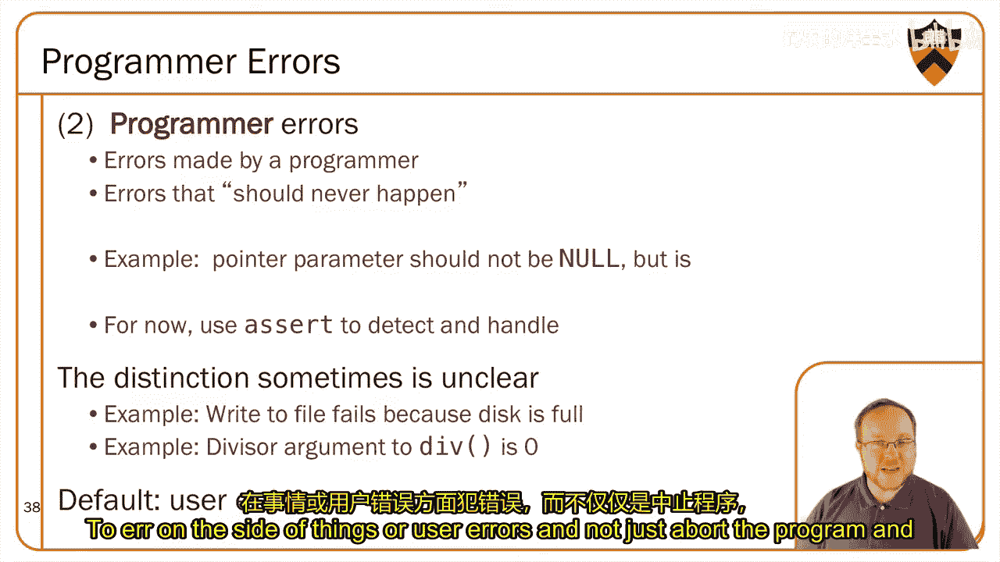

So recall our error handling in list insert。 If the memory allocation failed， we crashed the program。

But we just said that we should error on the side of user error， so how else might we handle it？

There are two possible interface changes that we could use， perhaps an out parameter。

 or since this function doesn't return anything， instead add a return value as a success status。

Similarly， we haven't yet attempted to deal with programmer errors either。

It's old hat for you now to know that we can and should validate inputs that are passed into a function。

 so we won't dwell on that too much。

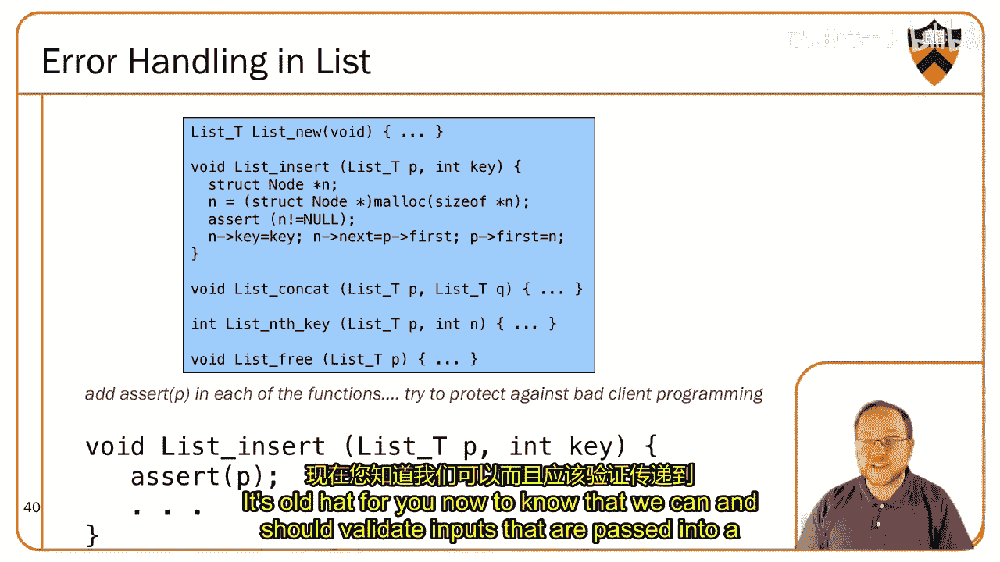

But we will return to this list and key specification。

 which we said was this case of an erroneous parameter namely asking for the n item in a list with fewer than end items。

And what it did in what we were talking about earlier was that it would just return an arbitrary number。

 and that was unsatisfiyed。But now we know of better ways。

 We could use an out parameter to indicate an error state or lack thereof something like if success is is set at one。

 the return value is the n key。 Otherwise， ignore the return value because the operation was impossible。

Or under the good module characteristics premise of consistency。

 we might handle this error in the same way we do other problem parameters。

So we could at the cost of one additional function in the interface because after all。

 each of these characteristics is a balancing act against the others。

 we could have this this one extra interface function that gets the length of a list。

And then we can fairly justifiably under the consistency premise about input validation。

 assert that if the programmer has called the end key without first validating that the key N exists。

We can feel free to fail that assertion， we can crash。

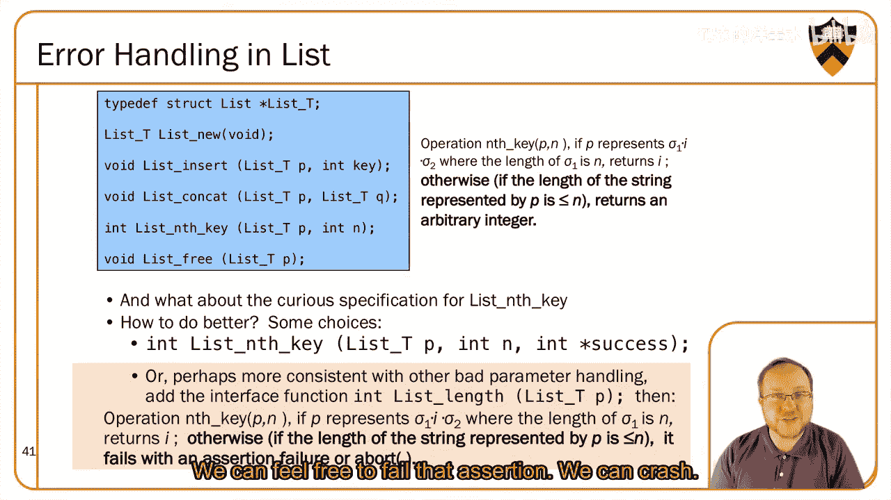

So we discuss function comments in some depth for both assignment1 and assignment 2。

 so you're quite familiar with the idea of an interface comment and the contract with the color。

 but this is certainly a key element of our list of characteristics of clear or cogent modules。

 so let's talk about it just a little bit more。

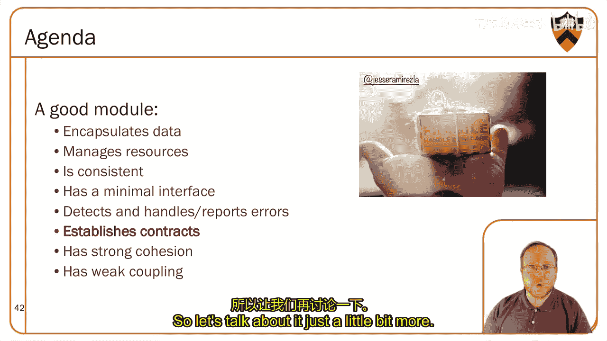

The whole purpose of modules is to facilitate programs bigger than any one programmer can build or understand。

So we need to establish an ability for an expert in one piece of the program to communicate to an expert in the other piece of the program of how his or her program should be used。

Also， not unimportantly， to blame the other one if they used it wrong。

If I've followed a contract and the function does the wrong thing， the buck must be in that code。

 And on the other side， if I've laid out a contract and ful it。

 no client should come to me blaming me for bugs in their programme。But again。

 lest you think that this is just about self preservation or a blame game。

This is actually an important backstop。It is important for minimizing the search space that we have to look through for the bug。

 again， that the very root of all of this， the more of the story is the about facilitating development of bigger programs。

 That means bugs that are harder to find。 The more we can do to limit that search space， the better。

And so this communication is exactly what we've been requiring of you， what the parameters are。

 what the function does， its side effects on persistentence state。

 and what values it might return under which conditions。

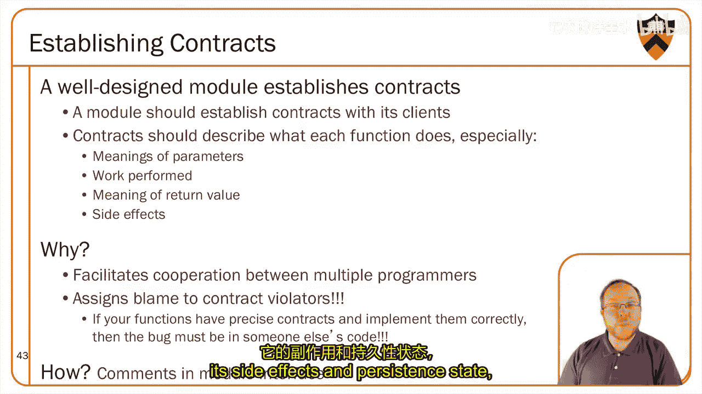

Here's a concrete example with our newly reworked nth key function。

 It lays out among other contract components， the obligation of the call and a promise or fair warning。

 if you will， that the function's behavior will be to terminate the program。

 if not called in a valid way。And here's another example treating the out of range query as a user error rather than a programmer error。

 again， we establish a contract for the behavior of the function depending on the values of its arguments。

 along with the other required contract components。

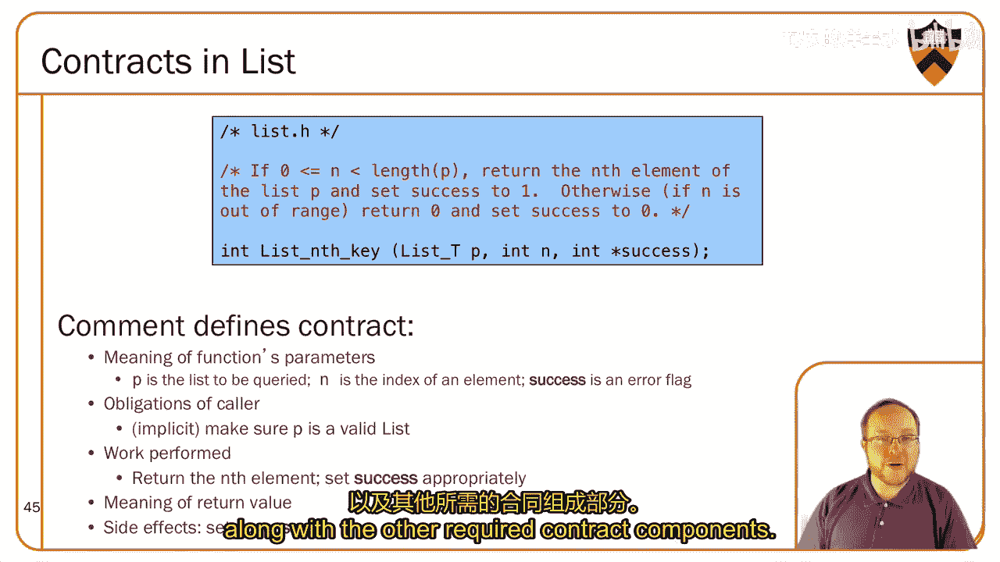

So the last two elements on our list are cohesion and coupling， which are correlated， but different。

 Cohesion is a characteristic of the relationship between the methods and data of a module。

 That is how much or whether at all a module's members belong together。

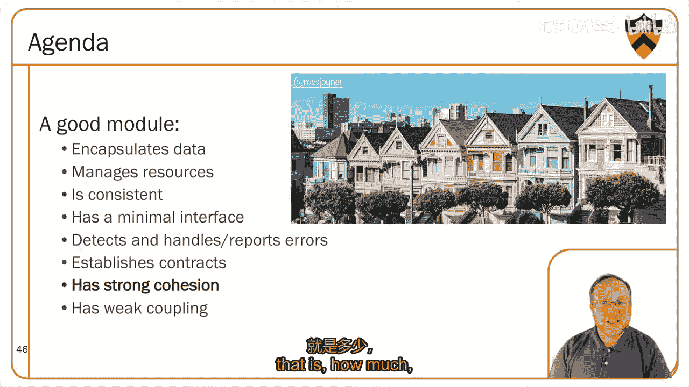

Strong or high cohesion is a meaning that they belong together more。

 This fits our existing principles， since one was minimal interfaces。 And thus。

 if there's not high cohesion， they should be in separate modules。

But why is strong cohesion desirable beyond this idea of minimal interface typically allows for further abstraction。

 and it correlates with some other positive properties， for example， being easier to understand。

The module is not a scattershot array of unrelated functions。

 but instead a cogent set of naturally related ones， this will be easier to understand。

 easier to wrap your mind around What is this module all about anyway。Furthermore。

 it's easier to reuse。Anything that needs just one of the functions may in fact end up needing others。

 whereas it's less likely to be true for lower cohesion modules。

 Imagine a module that was put together just because one client happened to need that particular constellation of unrelated functions。

There is no guarantee that some future client or routinely across all clients will there be the need for these functions to go together？

So it's harder to reuse a module。But cohesion exists on a spectrum from the trivially low。

 this is a module because we put all the functions that weren't in some of their module。

has no relationship to each other。 they just all happen to be in the same module to the unreasonably high these are the complete complete and indivisible set of anything that will ever be performed in doing this task on this object。

Most modules fall somewhere in between。For example。

These data and functions are grouped together because they all share a common properties。

 say they do IO。Even though the functions themselves are not similar and they are subsets that would never be used together。

 they do have this common property， or these functions are grouped together because they all operate on the same data。

 again， they don't do the same thing， they might not do it the same way。

 but they operate on the same data。

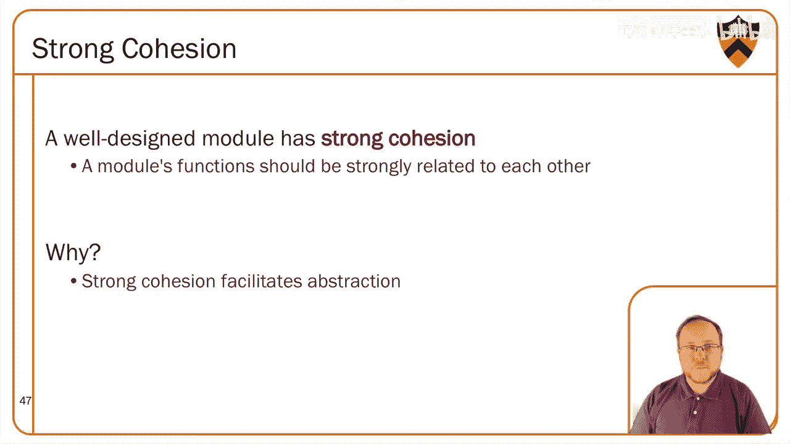

The modules we've been working with in this lecture are all pretty strongly cohesive。

 There are some outliers， for example， the non string functions within the string library。

 But as mentioneds， those do still work bite by bite through an array。

 So it's reasonably fitting the the other cohesive elements。Similarly。

 the string formatting functions in the Io Library don't actually do IO。

 but they're exactly like printf and Scf just for strings。

One could probably argue either way as to whether they belong with the other print eenkinna functions or whether they belong with the string functions from a client's perspective。

Their string functions， they belong there， but from a programmer's perspective。

 they're almost certainly they look exactly like printf and Scf in their other varieties。

 So the the actual string manipulation， the fact that they're putting things into a string at the end rather than printing them out is ancillary。

 And so in that sense， the similarities to the string library are less compelling from a developer's standpoint than they might be from the end users。

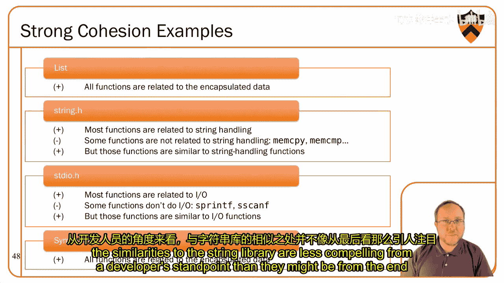

As noted， there's another characteristic that's closely correlated with cohesion。

 and that's coupling。嗯。These two metrics share a history。

 they both were invented in an era of the development of structured design。

 call it the late '60 through mid-70s， and whereas cohesion was a measure of belonging within a module。

 coupling deals with connections between modules。So where a strong or high cohesion was desirable。

 weak or low coupling is， low coupling means that there is less interdependency between modules and less information flow between modules。

This is advantageous for maintenance， because if there aren't interdependencies or if there aren't many data flows between modules。

 we can modify a module without the risk of fracturing connections between them。

It's also useful for reuse if modules aren't tightly tied together。

 they're more likely to be able to be reused independently with other modules。

So let's consider a few examples diverging from our running list of list string and symbol table because I know you're tired of them。

So consider all good object oriented type things come down to vehicles。

 so consider an airplane module and an airplane simulator。

The simulator method move calls a whole bunch of functions from the airplane module。

There is a tight coupling between simulator and airplane， primarily exhibited by this move function。

 So as a potential design change we could consider should move itself be inside the airplane module。

The answer is probably yes， but let's redraw the diagram with it set up that way and see what it looks like now。

Indeed， there is an immediate visceral visual distinction that appears just between the left and right here。

 it's more weak coupled design on the right， it easier it makes it easier to write the client。

 we just call move， it's easier to write the move because just we can use the internal structure。

 we don't have to find some other interface function to call， it's easier to maintain， reuse。

 less buggy for all the same reasons we talked about with cohesion， now applied to coupling。

And perhaps this is too squishy for you， but I also think it's a match ontologically The airplane is something that moves。

 The simulator is not something that moves， so move then should be a function of the airplane。

 not the simulator。 Again， if that's too squishy for you， fine。

 but I think it at least is philosophically consistent。

So now we have a client that in the course of its execution。

 makes many calls to functions from the module。So at runtime， these are strongly coupled。

Should the sort function be part of collection module then， let's look again， redraw the diagram。

 see what changes。The structure on the right here is probably easier to maintain。

 easier to reuse less buggy for again， all the same reasons。 And again。

 if you're willing to go with me ontologically， I think that you can make the case that sorting is something that is inherent to the state of being of a collection。

 It's not inherent to an external action on the collection。

But I'm not sure this is as cut and dried as with the simulator airplane move example。

But in both of these two examples， we see moving functions into the module。

This shows us a trend that weakening coupling is at odds with the minimal interface principle。 Again。

 maybe not surprising that several of our ideal characteristics may be in conflict with each other。

A third example doesn't consider function calls at all， but rather code updates。

 Two modules are strongly coupled at maintenance time or through the maintenance phase。

 If changing one typically means the other has to change as well。

This is a sort of strong coupling that may indicate that X and Y probably belong in the same module。

 whether that's in the client or in the module is irrelevant。

Eith that or that the interface to F3 in this case is flawed in some other way to manifest this very strong interconnection。

 and that would be a flaw because after all encapsulation says that changing the internal representation shouldn't require changing the client or worse changing the client really shouldn't require changing the underlying representation。

So the client on the right here is again we think going to be easier to maintain or reuse and with all of these examples moving to weaker coupling between modules ends up increasing cohesion within at least one of the modules。

 so again those two characteristics are related。We've shown each of these examples as a sort of magic one step fix。

 but in reality this element of design is an iterative process。

 it's refactoring over and over as you get experience with the code and the set of intended clients either you become more familiar with it or indeed it evolves。

So frequent client operations can get pulled into the module。

 module operations that never get used get kicked out from the module。

 maybe to a client that uses them occasionally， maybe to the ether because they're literally never used。

 things that change concurrently get put in the same side of the client module barrier so either pulled in or kicked out respectively。

 and things that are related to each other， but not the rest of the client or module break out to form a new separate module。

One last note is that as software engineering moved beyond the infancy of structured design and the object oriented design paradigm came into being。

 metrics like these continued to evolve， so you might be interested to learn about connaissance。

 which is sort of the next dimension en capsulating cohesion and coupling。

So that's it for this lecture， which almost wraps up our software engineering fundamental topics。

 We'll return one last time in lecture 21 to talk about performance profiling and optimization。

Next week's first lecture is a quick survey down some of the lower level systems topics that used to be covered by this course extensively in the second half。

 so you can think of this as some interesting topics that you're now opened up to be accessible to you with your newfound knowledge of C。

 and you're soon to come knowledge of assembly language。

 or alternately you can think of them as a sort of preview of the types of lower levelvel systems content you'll see in some systems departmentals。

Next week's second lecture is an introduction to the concepts and specifications for assignment4。

But for now， good luck working on assignment 3， precepts next week will continue to cover material relevant to that assignment。

 and we're all back up and running after a fall break。

 So office hours are back up for help with either conceptual understanding of the assignment or debugging on it。

 So please don't hesitate to make use of all of the resources available。

 Don't feel shy or that you're somehow overly reliant on them。 They're there for a reason。😊。

Even further， please try not to feel uncomfortable reaching out if there's any situation that arises in which the existing resources aren't sufficient we do want to do whatever we can to make sure that everyone stays on track to persevere through the adverse situation in which the world remains embroiled。

 so again， stay engaged， stay in touch and good luck。

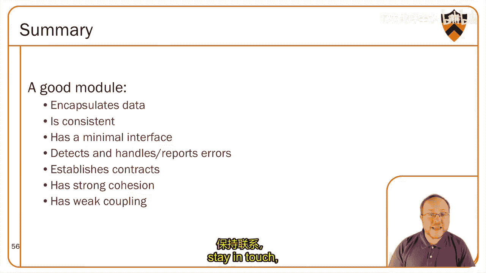