# COS 217 系统编程：15：模块化与接口设计 🧩

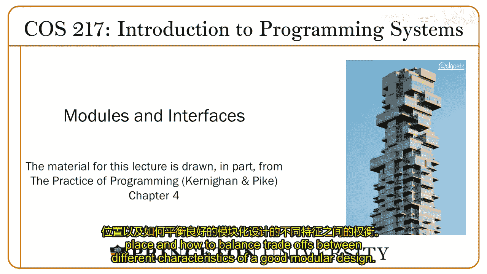

在本节课中，我们将学习模块化设计与接口设计的基本原则。我们将探讨C语言中如何实现信息隐藏和封装，以及如何设计清晰、健壮的模块接口。课程将涵盖良好模块设计的八个关键特征，并通过具体示例进行说明。

---

## 抽象与模块化

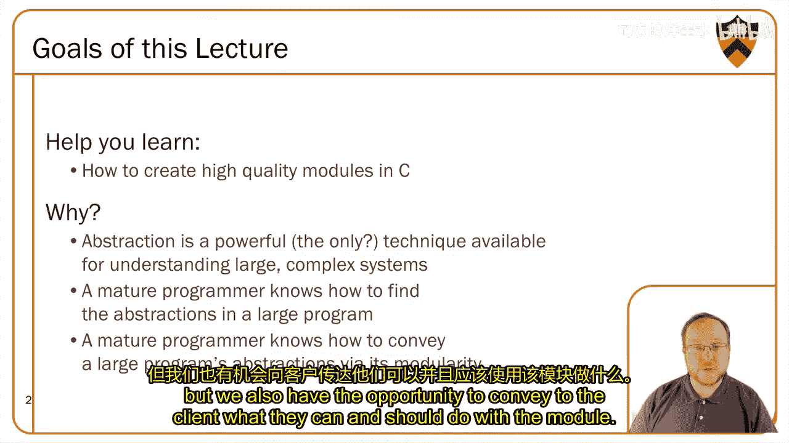

正如本课程一贯强调的，一切最终都回归到**抽象**。模块化是抽象的具体表现。我们将实现的细节隐藏在接口之后，无论是像字符串模块那样的无状态模块，还是像ADT（抽象数据类型）那样的抽象对象。

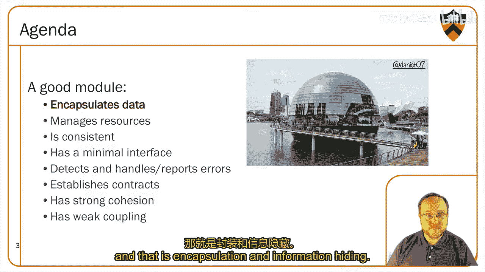

在创建这些抽象时，我们限制了客户端对模块的操作。这乍听起来像是坏事，但最终却为模块的实现者提供了强大的保证：他们受到契约的保护，无需处理不合理的客户端操作。因此，只要自身没有错误，他们可以确信对象的内部状态在没有客户端干预的情况下将保持一致。

在创建这些抽象时，我们确实限制了客户端的操作，但我们也有机会向客户端传达他们可以且应该如何使用该模块。

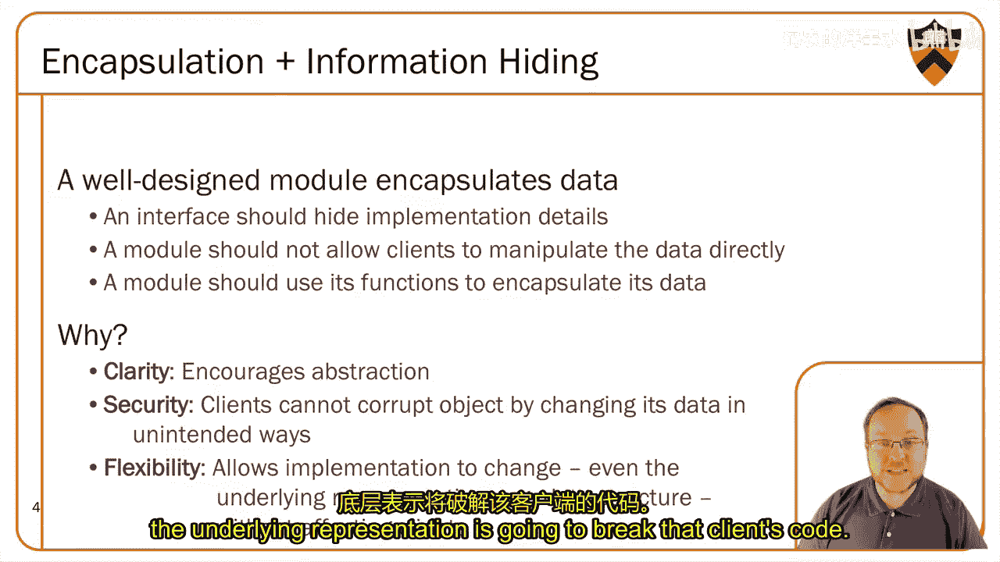

---

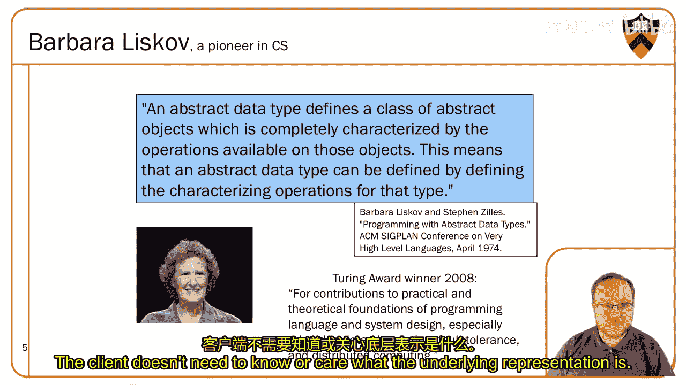

## 良好模块设计的八个特征

在本节中，我们将讨论一个设计良好的模块应具备的八个特征。我们将从你在126课程中已经熟悉的面向对象概念开始，即**封装和信息隐藏**。

### 1. 封装与信息隐藏 🔒

信息隐藏是限制客户端直接访问和操作模块状态的原则。封装则是将模块的状态与其功能绑定在一起，这既促进了信息隐藏，又提供了让客户端以受控方式访问内部状态的能力。

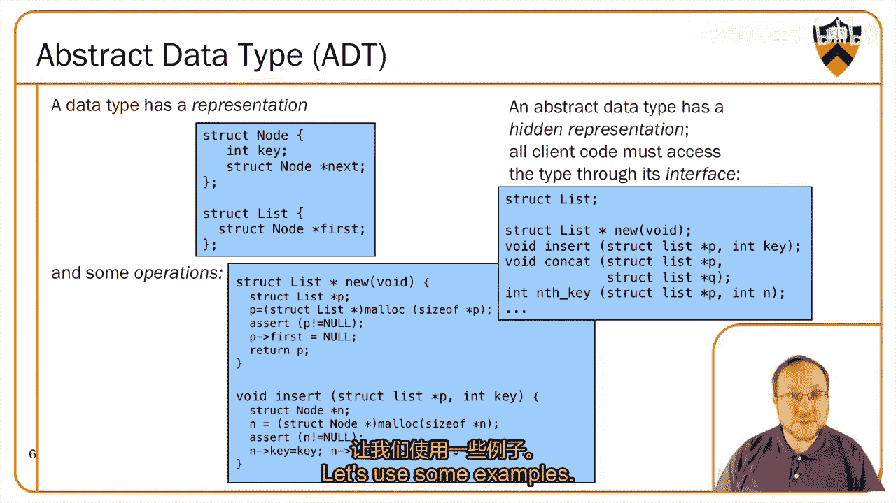

这些目标之所以重要，有几个原因：
*   **安全性**：如果客户端可以侵入模块并更改内部数据，那么模块的开发者就无法保护模块的状态，也无法保证其行为或正确性。
*   **解耦与维护**：即使客户端不更改模块的数据，一个能看到模块内部数据的客户端很可能会依赖于此。这意味着底层表示的任何更改都会破坏该客户端的代码。

2008年图灵奖得主**芭芭拉·利斯科夫**是数据抽象领域的先驱。她在70年代中期撰写了一篇关于该主题的基础性论文，精确地阐述了我们对ADT的期望：**ADT应仅由其操作定义**。客户端无需知道或关心底层表示是什么。

#### 示例：列表ADT

让我们看一个具体的例子，这是我们在准备作业3时已经见过一点的**列表ADT**。以下是一个合理的列表数据类型实现：

```c
struct node {
    int payload;
    struct node *next;
};

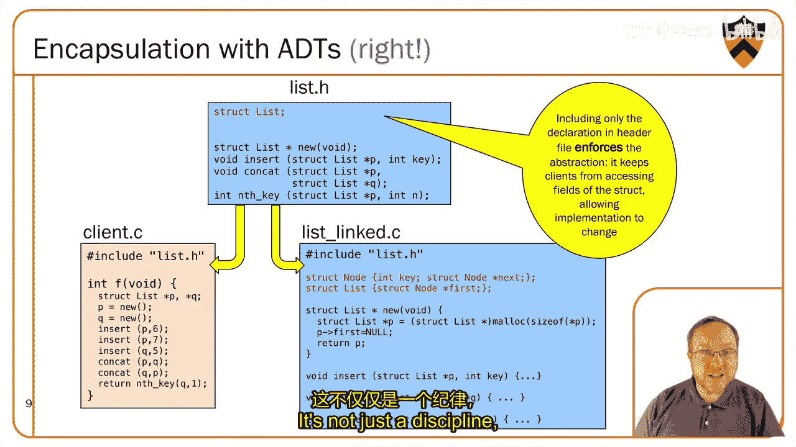

struct list {
    struct node *first;
};
```

列表是一个结构体，包含一个指向其第一个节点的指针。节点包含一个有效载荷（为简单起见，这里只是一个`int`）和一个指向链中下一个节点的指针。

我们有一些想要执行的自然操作，例如创建新列表或将项目插入列表。我们在此过程中做出一些设计决策。也许我们会发现这些决策不明智，但稍后会讨论。目前，我们说这是一个合理的列表起点。

那么，整个接口应该是什么样子？我们在这里看到的函数与数据的底层表示交互。这在一开始看起来没问题。但是，**类型本身需要对客户端隐藏**。如果函数接受该类型的参数并返回该类型的值，这就产生了冲突，因为我们至少需要揭示这些结构需要多少内存。

相反，**如果我们在接口中只使用指针**，大小是明确定义的，因为所有指针的大小都相同。客户端只需要知道`struct`存在即可。

让我们探讨一下“客户端只需要知道结构体存在，而不需要知道其细节”这个想法。请看以下接口：

```c
// list.h
struct node {
    int payload;
    struct node *next;
};

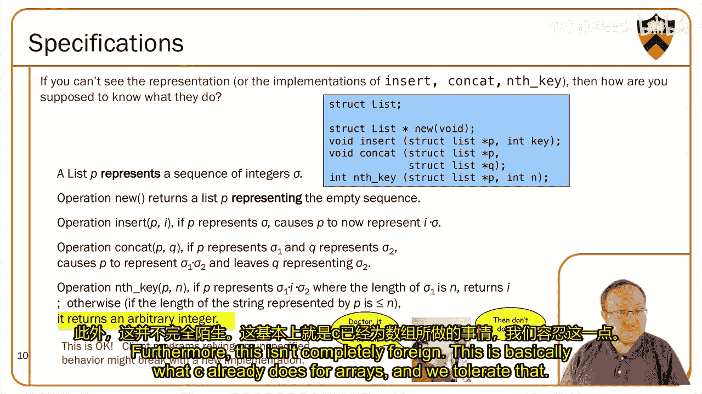

struct list {
    struct node *first;
};

struct list *list_new(void);
void list_insert(struct list *list, int value);
```

这个接口有什么问题？在这个接口中，我们提供了`struct`的完整定义。这意味着客户端知道底层表示。客户端可能不会利用这些知识做任何事情，但没有什么能阻止他们在自己的代码中使用内部状态的知识，或者更糟的是，直接篡改内部状态本身。

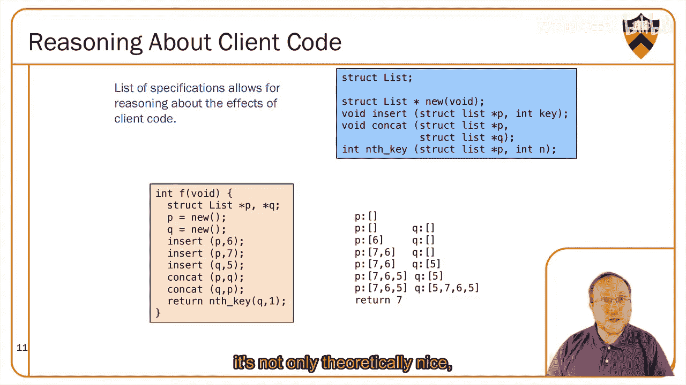

即使所有客户端代码都不是恶意的，这也意味着如果我们更改实现，客户端代码将会崩溃。此外，即使客户端代码根本不使用内部表示，假设我们有一个行为良好的客户端只通过接口交互，该客户端仍然必须重新编译其`.c`文件，因为表示的任何更改都会改变客户端代码所依赖的`.h`文件。

如果只有我们的`.c`文件更改，而不是`.h`文件，他们只需要重新链接新的`.o`文件并构建新的可执行文件，而无需重新编译自己的代码。

因此，接口文件应该提供状态结构的**声明**，而不是**定义**。

```c
// list.h
struct list; // 不透明指针声明

struct list *list_new(void);
void list_insert(struct list *list, int value);
```

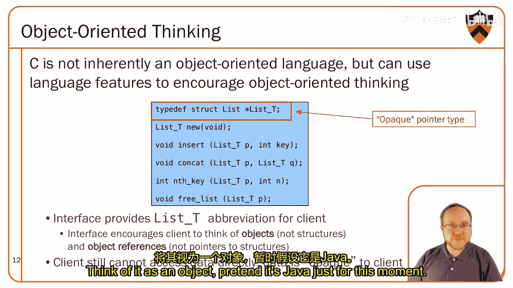

这行代码告诉编译器：“嘿，编译器，`struct list`是一个东西。但是，我不能告诉你关于它的任何信息。” 客户端程序员看不到实现，因此不会被诱惑直接操作列表对象的字段。更好的是，编译器在编译客户端时也看不到实现。因此，编译器实际上会禁止客户端直接操作列表对象的字段。这不仅仅是一种纪律，实际上是一种禁止。

---

### 2. 清晰的规范与契约 📜

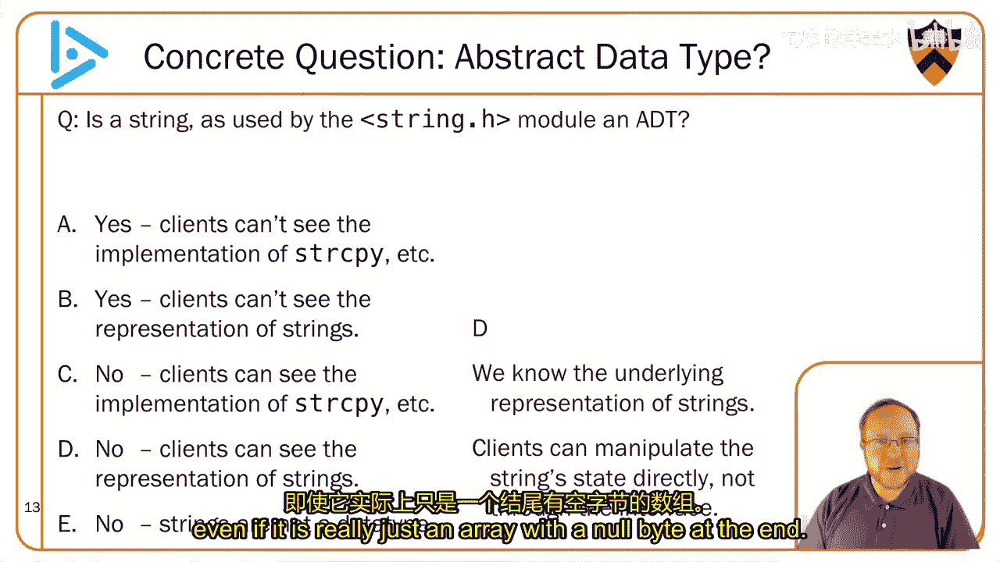

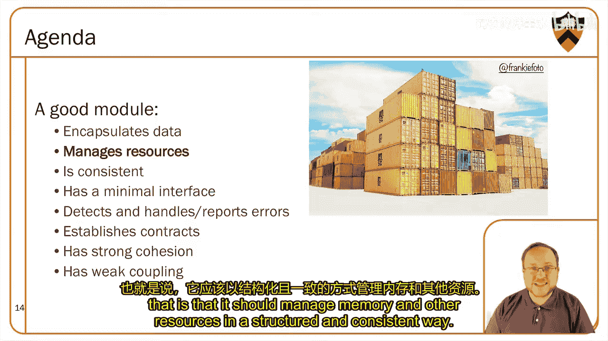

但是，如果客户端看不到内部结构，它怎么知道该做什么呢？接口可以作为模块的**规范**。我们稍后会更多地讨论如何向客户端传达此规范的细节，但你已经知道基础知识：接口中的函数注释，就像你在作业中一直在做的那样。

我们如何正式指定我们的接口？首先，我们需要指定关于类型本身的一些信息。例如，它是一个列表，而该列表只是一个整数序列。

对于我们的插入函数，规范明确了行为，但命名可能还有改进空间。在开发规范时，我们应该停下来思考是否选择了正确的名称。也许我们应该称之为`prepend`，以明确它是在前面插入。另一方面，我们还没有看到任何表明它是有序的东西，所以`prepend`可能走得太远。最终，我们稍后会看到顺序确实很重要，所以也许`prepend`会更好。然而，`insert`是通用的，所以可能更现实的做法是让客户端理解这意味着什么，或者它可能更通用，因此可以更好地与现有接口配合，或者在我们更改底层实现时更不容易出错。

接下来是`concat`，这向我们表明，有时规范既关乎函数做什么，也关乎它**不做什么**。同样，在这里我们看到了更好命名的机会。没有规范，就无法判断`p`和`q`哪个是源，哪个是目标，因此我们真的应该命名参数以匹配。

`nth_key`再次在我们编写规范时给我们带来了问题。如果`n`超出了列表的长度，我们该怎么办？如果C语言有可选类型就好了。如果存在，则返回它；否则返回`None`。也许可以将`nth_key`改为返回一个`int*`指针，指向`NULL`作为一种选项，这有点像Java的想法：我们返回一个引用，该引用要么是`null`，要么是指向对象的引用。也许还有更好的选择，我们稍后会讨论。

你可能会认为这个规范很荒谬。如果我返回一个任意的`int`，这会产生各种不良副作用。特别是，我无法判断它是第n个值还是根本不存在第n个值。你说得完全正确。但我可以提供一些小小的支持：客户端不应该请求无效的项目。此外，这并非完全陌生。这基本上是C语言对数组越界访问的处理方式，而我们容忍了这一点。

规范很重要，因为它们允许在不运行代码的情况下推理代码的效果。例如，在这里，如果不记得关于列表的任何规范（它是在数组中、链表中，还是更高级的结构中？谁知道，谁在乎？），如果我们有规范，我们就可以追踪客户端代码的行为。

此外，在实际的软件工程中，这至关重要。多个团队设计项目的多个部分，每个团队都依赖于其他团队正在构建的东西，而这些东西尚未完成，这种情况并不少见。如果我们必须以某种方式序列化整个开发过程，让团队1必须在团队2完成之前完成，团队3甚至才能开始，那将是灾难性的，这还没有考虑到循环依赖。这将是一场灾难。因此，这种具有契约保证的形式化规范接口的想法是一个非常强大的概念，它不仅理论上很好，而且在实际中促进了现实世界的软件工程。

在惯用的C语言中，通常比之前的接口更进一步。C语言中的`typedef`关键字为类型创建一个新的别名。通常用它来为指向结构体的指针命名，而该结构体再次仅作为声明给出，而不是定义，就像我们见过的那样。

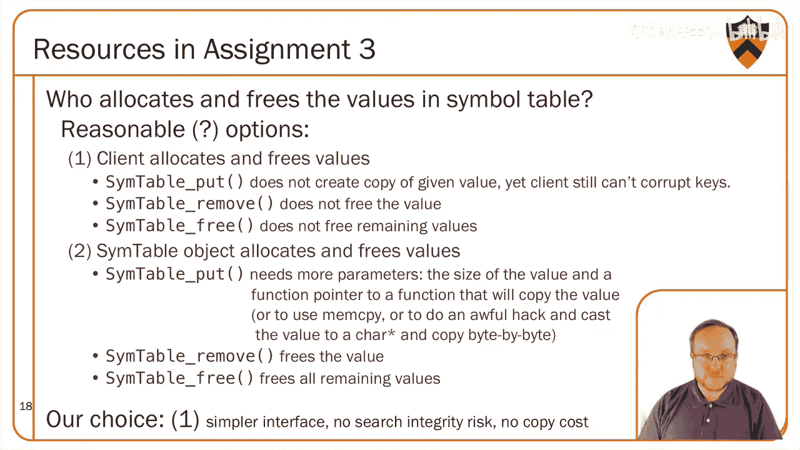

这并没有为我们的模块增加任何功能，也没有改变封装或信息隐藏的属性，但为我们用来传递ADT实例的句柄命名，使其感觉更像一个对象，从而可以鼓励封装向面向对象思维发展。

此外，出于某种原因，看到神秘的`_T`类型会使程序员不太可能尝试去做他们知道在其他情况下可以对`struct`或指向`struct`的指针使用`.`或`->`运算符的事情。如果我们正确设计了模块，并且在接口中只有声明而没有定义，他们将无法这样做。编译器不会允许，但这是一种诱惑，会浪费他们的时间，而且他们还会被关于“不完整类型”的错误所困惑，这不是我们经常使用的自然术语，但如果你尝试对只有声明而没有定义的东西使用`.`或`->`运算符，就会出现这种情况。因此，我们可以通过说“不，你不需要知道它是一个结构体，就把它当作一个`list_t`或`stack_t`或`simtable_t`。把它当作一个对象，就假装它是Java”来避免整个混乱。

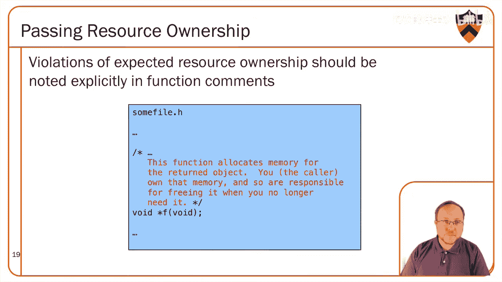

---

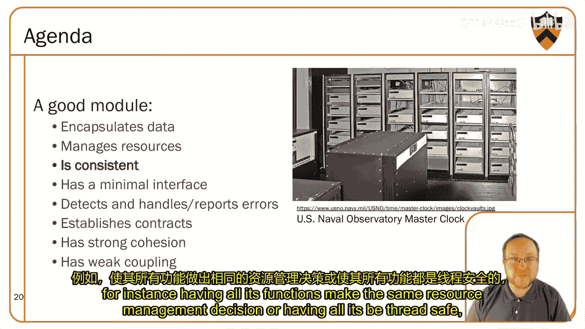

### 3. 一致的内存与资源管理 💾

一个连贯模块的下一个特征是，它应该以结构化和一致的方式管理内存和其他资源。

具体来说，我们期望**分配内存的模块默认也应该是释放它的模块**。对于其他持久状态（如打开的文件）也是如此。

这里的理由很简单：分配资源的模块是知道它已被分配的模块。任何模块或客户端都不应负责预测其他模块的底层分配行为。即使我们期望如此，这对于调试来说也是有问题的。如果一个模块分配了内存，期望客户端会释放它，而客户端没有释放，我们会归咎于该模块。`meminfo`或`Valgrind`会指出在模块内分配内存的位置，然后说“嘿，它从未被释放”。我们除了查看该模块之外别无他法，会说“你没有释放内存”，但这不是模块的错，是客户端的错。

在某种程度上，如果客户端从不调用`free`函数，情况已经如此，但如果我们说客户端必须使用`free`函数调用显式释放指针，那么打破这种现状会使情况更糟。

让我们看看作业3中`simtable`的设计决策。每个绑定都有一个键和一个值。我们现在讨论的良好模块特征说，如果`simtable`分配了它，`simtable`就应该释放它。但这没问题。它仍然没有回答：应该是`simtable`分配还是客户端分配？

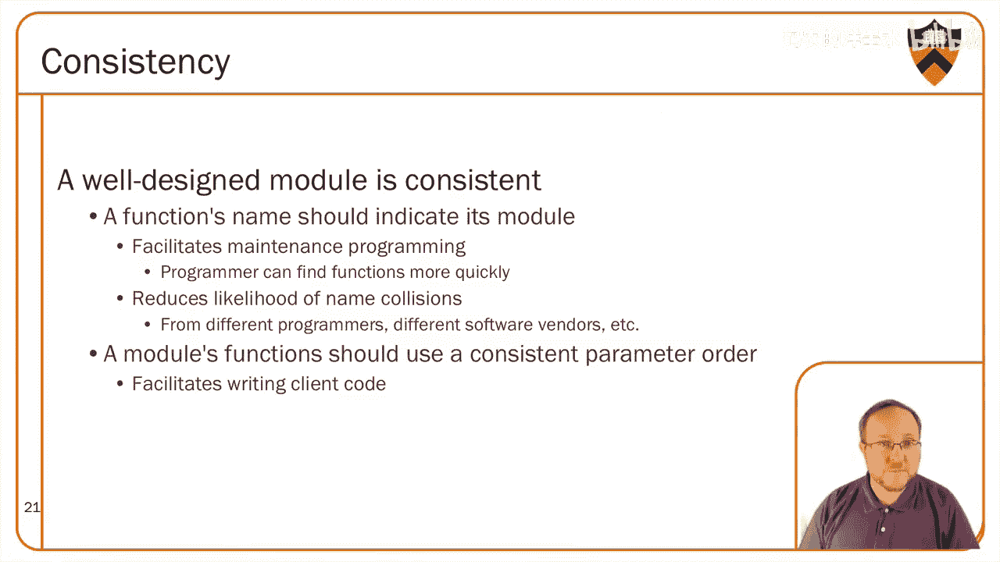

首先看键。如果`simtable`分配，会增加模块的复杂性。我们不仅要设置一个引用，还必须分配内存，将数据复制到该内存中，并记住在完成后释放它。但另一方面，如果客户端分配，我们会遇到之前讲座中提到的问题：客户端可能通过更改自己的内存来破坏数据结构的内部，而这是它应该被允许做的。因此，我们在作业3中选择让`simtable`制作一个保护性副本。

那么值呢？在这种情况下，客户端分配键的风险消失了。值是表中搜索的结果，而不是搜索目标。因此，如果客户端更改了表引用的值，这会更改绑定，但不会更改表本身的操作，例如其搜索完整性。搜索已放入表中的键将会成功，它返回的值可能不同，但搜索会成功。同样，搜索未插入表中的键将会失败。

因此，如果`simtable`拥有每个绑定中的值，它还必须知道每个值有多大，这需要更改接口。此外，它还将负责值的分配、复制和最终释放，这再次增加了模块的复杂性。因此，客户端所有权确实让`simtable`做的工作更少，而且没有我们在选择键时的决定性因素——那个巨大的风险因素。这听起来像是赢家。事实上，作业3规范中`simtable`接口部分的底部指出，`simtable`对象不得拥有其值。

关于资源管理的最后一点说明。有些情况下，函数分配内存然后将其传递回客户端，由该客户端永久拥有，这是有意义的。字符串模块就有这样的函数。`strdup`是一个函数，它为给定字符串的副本分配内存，将给定字符串的内容复制到新分配的内存中，并将字符串返回给调用者，并明确理解调用者现在对其负责。毕竟，没有`str_free`这样的函数。当我们遇到这种情况时，由于它们是相对罕见的例外，通过模块接口中的注释作为契约的规范必须明确指出内存现在是调用者的责任。这是一个例子。

---

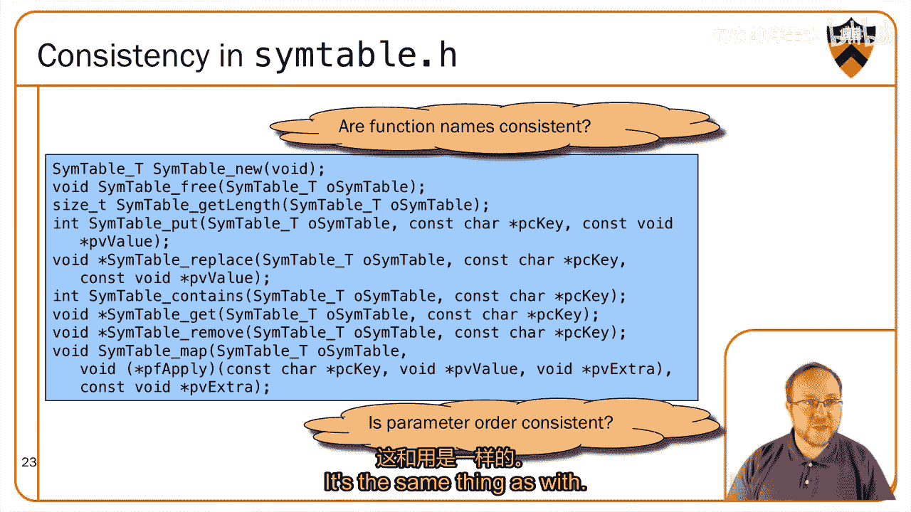

### 4. 一致性 ✨

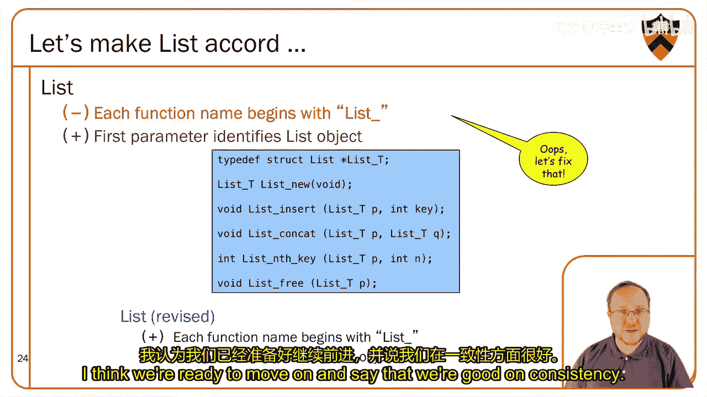

我们连贯模块的第三个特征是它应该具有**一致性**。

这可以体现在行为上，例如，让所有函数做出相同的资源管理决策，或者让所有函数都是线程安全的。但我们也应该追求风格和组成的一致性。

例如，模块中的每个函数都应遵循命名约定。如果函数是`strlen`但`copy_string`，那会很奇怪。通常，我们选择将模块名称作为非静态函数（即可能从模块外部调用的函数）的前缀。这减少了名称空间冲突的机会。考虑一下，大约每个ADT都会有一个`new`和一个`free`方法，以及在整个标准库的所有模块中必须有多少不同的`insert`和`compare`。由于C语言不允许函数重载，每个程序中最多只能有一个。我们通过命名约定来解决这个问题，通常将模块名称作为函数名的前缀。

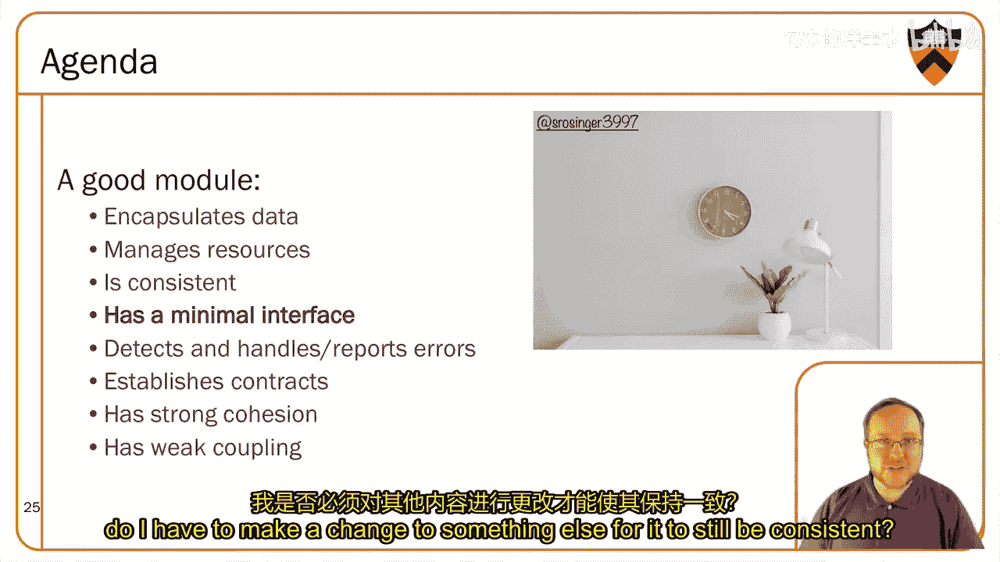

字符串库基本上就是这样做的，诚然它使用`str`，并且没有用下划线将前缀与函数名分开，但这是一个合理的初步尝试。此外，这样做可以更容易地找到代码库中使用模块的位置。如果你可以在所有文件中搜索唯一的前缀，你可以比单独搜索每个命名不一致的函数更快地找到调用函数的所有位置。

API设计的另一个风格元素是函数应使用一致的参数顺序、约定或语义。在最简单的例子中，你难道不讨厌使用一个ADT模块，其中一些函数将ADT实例作为第一个参数，而另一些将其作为最后一个参数吗？你将永远需要回头查看API，说这次是哪一个。或者，如果一个函数接受一个指针和该`void*`指针指向的对象的大小，哪个先出现，指针还是大小？但这不仅仅是让编译器满意和获得正确顺序的问题。它还可以是关于理解函数做什么。例如，如果一个函数接受两个相同类型的参数，是第一个作用于第二个，还是反之亦然？

让我们看看我们的字符串模块。函数名一致吗？嗯，大多数都以`str`开头。不过，有些名称以`mem`开头。它们是命名错误，还是暗示它们应该在一个完全不同的模块中？它们没有命名错误，因为它们实际上并不处理字符串。所以也许它们应该是分开的。但另一方面，它们在这里似乎很合适。`memcmp`和`memcpy`对数组进行逐字节的比较或复制，就像`strcmp`和`strcpy`一样。所以我们不必在这里追求完美，但我们有一个好的开始。

在参数顺序方面，这实际上绝对是一致的：目标字符串参数在整个字符串函数（`strcpy`和`strcat`）以及`mem`函数中都位于源字符串参数之前。当然，有人可能会争论这是否是正确的顺序。当然，第一次看到字符串接口时，可能需要一些时间来适应。等等，源在第二个，目标在第一个？我们不是至少在我的母语中从左到右阅读吗？但它模仿了赋值：我们说`x = y`，它也模仿了汇编语言的顺序，所以至少是合理的，并且再次，就我们在这里讨论的这个特征而言，它肯定是一致的。

看看`simtable`，所有函数都以`simtable_`开头。所以这是一致性的优点。缺点方面，它确实使其有些冗长。随着我们的模块名称变得越来越复杂，我们最终看起来有点像Java，你知道，`BufferedInputStreamReader`等等这些长长的类名。但为了再次强调一致性，这就是我们在这里关注的重点。这是一个优点。

同样，在参数顺序和语义方面，总是`simtable`对象作为第一个参数，然后是键，然后是值，目标字符串参数位于源字符串参数之前，这与字符串模块的情况相同。所以至少我们在这里“吃自己的狗粮”：我们为这门课程编写的模块符合我们提出的建议。

回到我们的列表ADT。我们肯定没有使用`list`前缀，所以这是我们应该改变的地方。但现在，尽管在一个小小的接口中，事情看起来不错：一致的前缀，一致的参数顺序。我认为我们可以继续前进，说我们在一致性方面做得很好。

---

### 5. 极简主义 📦

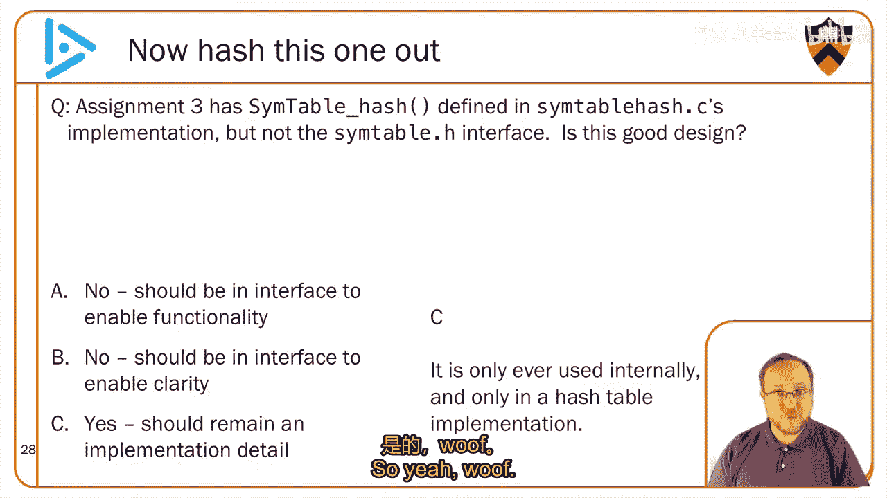

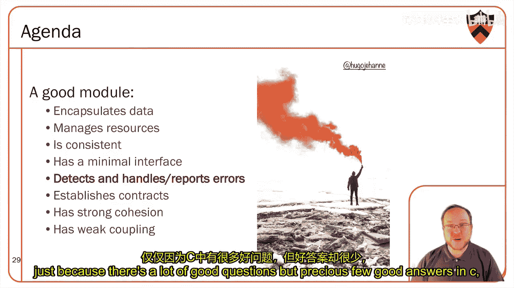

因此，我们特征的第四个是：一个好的模块应该是**极简的**。

如果一个模块的接口尽可能小，那么它就易于学习、易于使用和易于维护。函数应该只做一件事，并且做好；函数应该有明确不同的工作，不重叠；并且只包含客户端实际需要的函数。

希望这能减少整体函数的数量，但至少要在它们之间有清晰的可区分性。这使得它更易于使用，因为更易于学习，因为你只需要记住更少的函数；更易于使用，因为你不会最终交换一个函数而使用了错误的那个；并且更易于维护，因为它们是可区分的，但它们是原子的：它们做一件事，并且做好。没有这种重叠，你说如果我改变一个函数的功能，它是否会改变其他东西，或者如果我改变一个函数的功能，我是否必须对其他东西进行更改以使其仍然保持一致？

因此，这不仅仅是整体函数数量更少的问题，尽管这可能是其中的一部分，而且因为它实际上也与封装有关。斯科特·迈耶斯是领先的C++专家之一，他提供了一种方便的方式来思考模块的封装程度：如果我们更改底层数据表示，有多少函数需要更改。

这很有道理，我们谈论封装和信息隐藏时说“这意味着你可以更改它”，嗯，这就是衡量标准：如果你更改它，你需要更改多少？在完全没有封装的情况下，我想这看起来像是在接口文件中定义了一个没有任何方法的`struct`。这个数字是无限的。如果我们更改底层表示，任何客户端的任何函数都可能需要更改，因为任何客户端编写的任何代码最终都可能访问`struct`的字段。事实上，如果没有方法，我们就必须这样做。

在一个合理封装的模块中，我们可以将其限制为仅属于模块成员的函数：API和静态辅助方法。这个定义支持最小化接口的想法，因为如果我们说通过需要更改的方法更少来衡量封装程度更高，那就意味着模块本身的方法越少，封装程度就越高，而这是我们的主要目标之一。

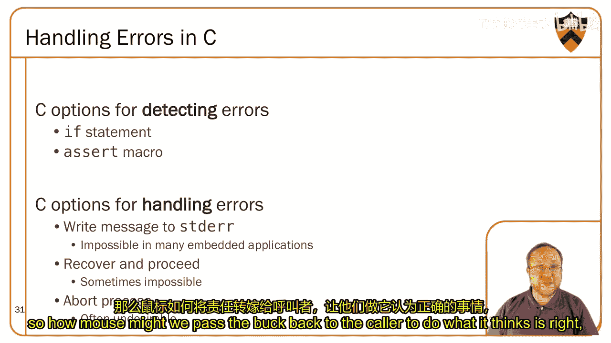

那么`simtable_contains`是必要的还是冗余的？花点时间思考一下。如果`simtable_get`返回`NULL`，可能是因为具有指定键的绑定不存在，或者绑定确实存在，但值恰好是`NULL`。`simtable_contains`允许我们区分这两种情况。前者将返回`false`，后者返回`true`，而`simtable_get`在两种情况下都返回`NULL`。

因此，再次快速提问，只是为了评估理解并让你思考我们刚刚讨论的内容。暂停视频，看看你是否能解决这个问题。好吧，答案是C。客户端没有理由知道哈希函数。哈希函数仅在模块内部使用。客户端永远不需要看到它。哈希函数可能会更改。此外，实现可能会更改。它可能是一个链表，根本没有哈希表，因此首先就没有哈希函数。所以它应该是内部的，不应该是接口的一部分。C语言有一个可见性机制，在这种情况下是`static`，它指定函数在文件外部不可见。可以将其视为类似于Java中的`private`。你将在下周的第二次辅导课中讨论可见性和持续时间，但我只想再次提到，我认为我之前提到过，`static`是令人困惑的，它可能是语言中最令人困惑的关键字，因为对于函数或全局变量与局部变量，它的含义不同，而这两者的含义又与它在Java中的含义不同。

---

### 6. 健壮的错误处理 ⚠️

好了，现在转向不幸的是我最不喜欢谈论的事情之一，只是因为有很多好问题，但在C语言中几乎没有好的答案，那就是**错误处理**。

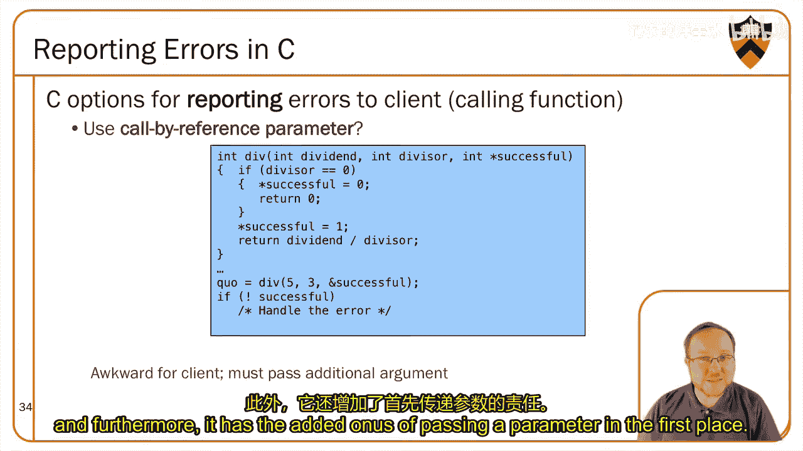

毫不奇怪，一个模块应该检测其函数内发生的错误，并且函数应该尽可能处理这些错误，并将错误报告回调用客户端。

但通常并不清楚什么是正确的做法，而且语言提供的处理和报告错误的功能很少。

我们已经看到了如何检测错误。你写过带有`assert`宏的条件语句。也许你记得`as`宏。如果你深入研究过作业2的测试客户端，后两者相当有效，但它们实际上只是带有花哨响应（要么崩溃程序，要么打印错误消息）的`if`语句。此外，我们知道`assert`可以完全关闭，所以它们可能是无操作，而不是实际的检测检查。然而，尽管如此，也许这至少是检测的合理选项集合的开始。

但当然，在发现错误后，我们需要能够做得比崩溃程序或打印一条消息更好，对吧？确实，仅仅打印一条消息通常是不够的。许多程序自动运行，它们的输出或错误流没有被例行监控或完全丢弃；一些嵌入式设备可能根本没有输出和错误流。所以打印消息在某些情况下很好，但在其他情况下不相关。

因此，在某些情况下，也许我们可以尝试恢复，要么调用替代过程，要么立即重试，或者等待一会儿再重试，但同样，这肯定不适合所有情况。一个更激进的选择，总是可用但很少可取，就是直接说：“是的，如果我看到错误，我总是终止程序。”这是一个相当有限的选择范围，那么我们还能如何将责任推回给调用者，让它做它认为正确的事情，而不是必须在模块本身内决定呢？

将错误通知传播回调用者的自然方式是通过**返回值**。毕竟，这是函数向调用者发送数据的主要接口。我们已经看到过这样的例子，比如`getchar`，当它无法读取字符时返回特殊的`EOF`值；或者`scanf`，它根据格式说明符返回它能够填充的变量数量，它实际上根本不返回读取的数据。

但这并不理想，因为函数的返回值更常用于其他目的，而不仅仅是传达错误状态。就像我们看到的`getchar`，它把责任放在了调用者身上，要求他们真正理解返回值的两种不同模式：如果返回期望的结果，或者返回指示某种错误状态的值，然后正确解释它们。

由于返回值在许多情况下已经用于其他目的，另一个自然的想法是让函数设置一个**全局错误变量**。但我们已经知道全局变量通常存在缺点，例如并发执行。此外，这属于“眼不见，心不烦”：调用者很容易完全忘记检查它，此时一些错误状态持续存在，而客户端认为一切正常，可能会陷入越来越大的麻烦。

介于返回值和全局变量之间的折衷方案是函数的一个**输出参数**，通过指针在调用者中设置一个值。但尽管这又是一种折衷，实际上并没有解决任何问题。客户端仍然需要检查返回值以外的其他东西，而且还有传递参数的首要负担。

因此，就像我开始本节时所说的，这里确实没有很多好的解决方案。这是Java以比C更复杂的方式处理的事情。Java提供了**异常**作为表示代码中出现问题的第一类对象。它提供了`throw`语句来生成此类异常，以及`try-catch`语句来识别和选择如何处理异常。

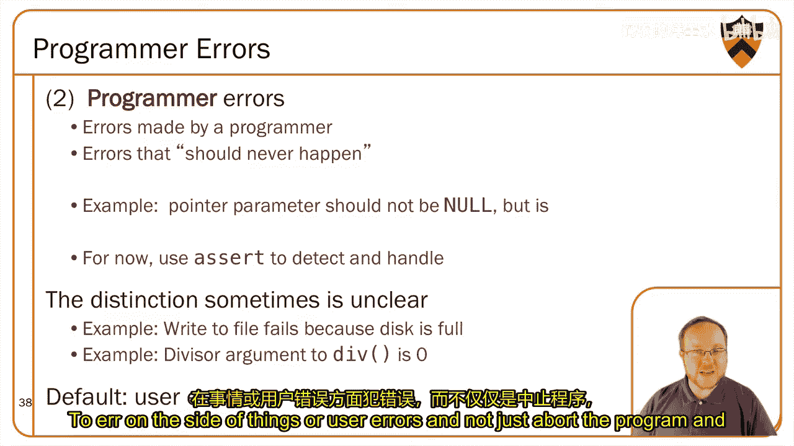

但尽管缺乏好的选择，我们至少可以提供建议，以在不利情况下尽力而为，这归结为区分**用户错误**和**程序员错误**。

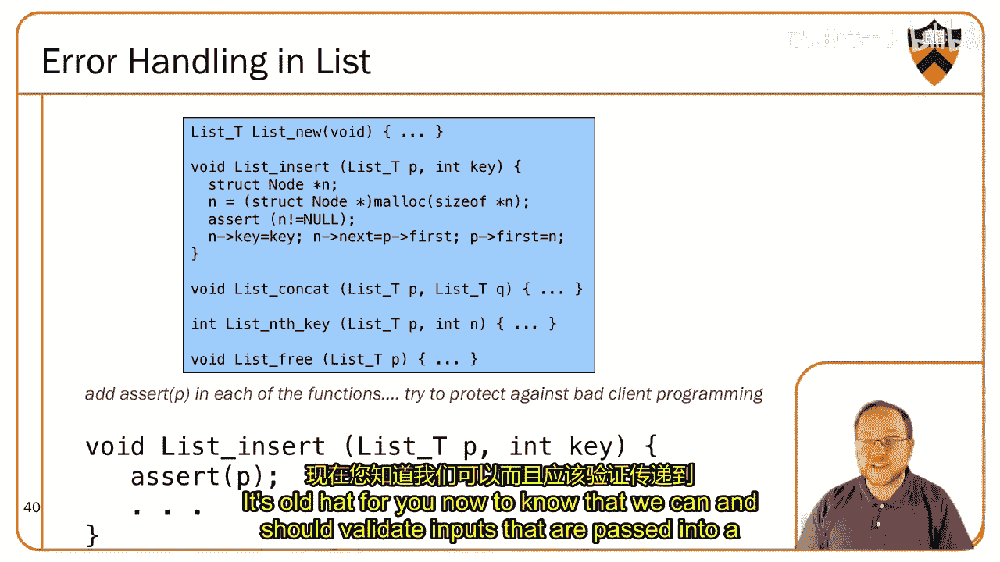

这里的命名有意义，但不完全如此。命名不一定意味着用户的错误，尽管那些通常是用户错误。相反，我们指的是**最好由用户处理的错误**。同样，程序员错误不一定意味着程序员的错误，尽管程序员的错误往往是程序员错误。我们指的是**最好由程序员处理的错误**，尽管是间接的，因为程序员在程序执行期间并不交互式存在，但就我们必须修复程序中的错误而言，无论是客户端报告的还是开发过程中发现的。

**用户错误**是那些归根结底不是程序员过错的事情。它们可能在运行时发生，要么是由于最终用户做错了什么，要么是由于系统限制。这些错误提供了尽可能温和地让最终用户恢复的机会。例如，标准输入上有错误数据、错误的命令行参数、内存或磁盘空间不足等可能预期会发生但仍然是错误的情况。应该给用户修复的机会，无论是通过使用更好的命令行参数重新运行程序，还是在运行时进行纠正，例如刷新标准输入然后提示输入更正。

另一方面，**程序员错误**是那些根本不应该发生的事情，表明程序存在问题或以前未考虑过的错误状态需要解决。对于这些，我们假设用户无法做出任何合理的选择。因此，我们使用`assert`来检测和处理它。这是让程序员纠正问题的最直接方式。

例如，表示不变式检查失败，进入函数时一切有效，但离开函数时不再有效。嗯，这是函数的问题。只有程序员可以深入调试它。同样，如果一个模块违反了另一个模块的契约，例如将空指针发送给需要传递非空参数的参数，用户在这里无能为力。这需要更改代码来纠正调用者与被调用者之间行为期望的不匹配。

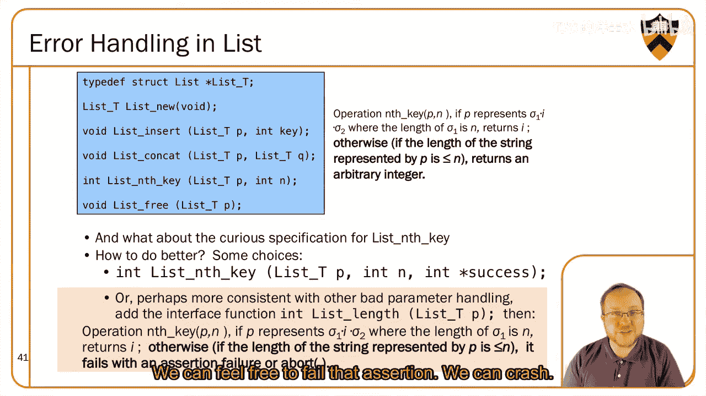

但这并不总是那么明确。由于用户输入导致的契约违规呢？那些听起来更像是用户错误。同样，如果程序内存不足或磁盘已满，那些似乎是程序员不一定知道正确做法的事情，而且首先就不是程序员的错。因此，我们可以报告给用户来决定做什么。用户可能会选择主动清理一些资源，或者被动等待一会儿再试，或者可能只是中止，但用户有一些合理的选择，而程序员没有。因此，我们再次倾向于将这些视为用户错误，而不是直接中止程序并假设程序员会修复它。

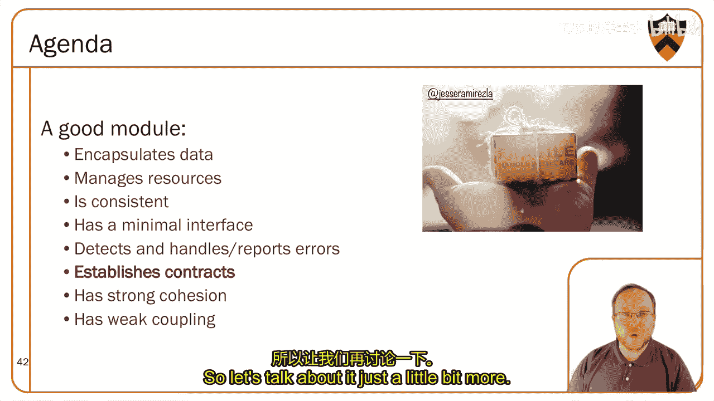

因此，回想一下我们在`list_insert`中的错误处理。如果内存分配失败，我们使程序崩溃。但我们刚刚说过，我们应该倾向于用户错误，那么我们还能如何处理呢？我们可以使用两种可能的接口更改，也许是一个输出参数，或者由于这个函数不返回任何东西，可以添加一个返回值作为成功状态。

同样，我们还没有尝试处理程序员错误。现在对你来说已经是老生常谈了，我们知道可以而且应该验证传递给函数的输入，所以我们不会过多讨论这一点。

但我们将回到这个`list_nth_key`规范，我们之前说过这是一个错误参数的情况，即要求获取列表中少于n个项目的第n项。我们之前讨论的是，它只会返回一个任意数字，这并不令人满意。但现在我们知道了更好的方法。我们可以使用一个输出参数来指示错误状态或缺乏错误状态，例如，如果`success`设置为1，则返回值是第n个键；否则，忽略返回值，因为操作不可能。

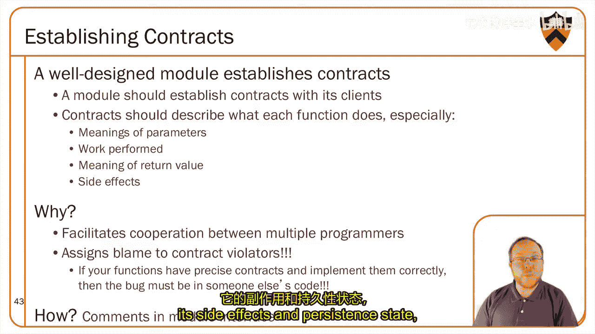

或者，在良好模块特征一致性的前提下，我们可以以处理其他问题参数的相同方式处理此错误。因此，我们可以以在接口中增加一个函数为代价，毕竟每个特征都是与其他特征平衡的结果，我们可以有这个额外的接口函数来获取列表的长度。然后，在输入验证一致性前提下，我们可以合理地断言，如果程序员在没有首先验证键N存在的情况下调用了`nth_key`，我们可以自由地使该断言失败，我们可以使程序崩溃。

---

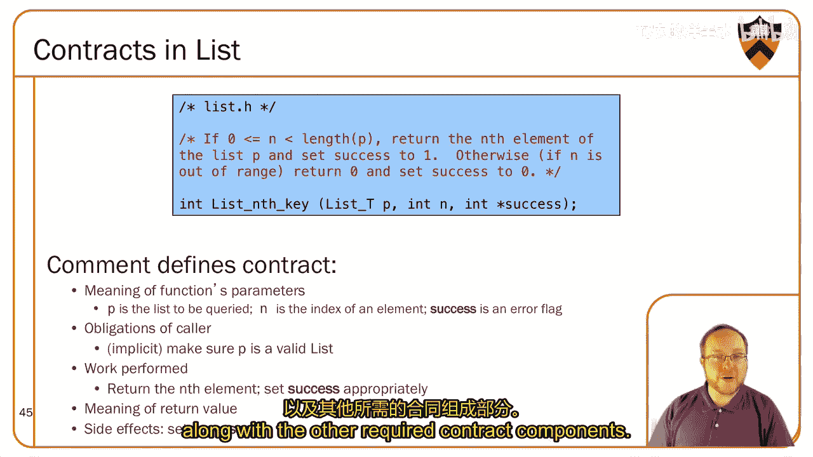

### 7. 清晰的文档与注释 📝


我们在作业1和作业2中深入讨论了函数注释，所以你对接口注释和与调用者的契约的想法非常熟悉，但这无疑是我们清晰或连贯模块特征列表中的一个关键元素，所以让我们再多谈一点。

模块的全部目的是促进比任何一个程序员都能构建或理解的更大的程序。因此，我们需要建立一种能力，让程序某一部分的专家能够与程序另一部分的专家沟通他或她的程序应如何使用。同样重要的是，如果对方使用错误，可以归咎于对方。如果我遵循了契约而函数做了错误的事情，责任必须在那段代码中。另一方面，如果我制定了契约并履行了它，任何客户端都不应该来找我，指责他们的程序有错误。

但再次强调，以免你认为这只是关于自我保护或推卸责任，这实际上是一个重要的后盾。对于最小化我们必须查找错误的搜索空间非常重要，再次强调，所有这一切的根源是关于促进更大程序的开发。这意味着错误更难找到。我们越是能限制搜索空间，就越好。因此，这种沟通正是我们一直要求你做的：参数是什么，函数做什么，它对持久状态的副作用，以及在哪些条件下它可能返回哪些值。

这是一个具体的例子，展示了我们重新设计后的`nth_key`函数。它列出了契约的组成部分，包括调用者的义务，以及如果调用方式无效，函数行为将终止程序的承诺或公平警告。这是另一个例子，将越界查询视为用户错误而非程序员错误。同样，我们根据函数参数的值以及其他必需的契约组成部分，建立了函数行为的契约。

---


### 8. 高内聚与低耦合 🔗

我们列表中的最后两个元素是**内聚**和**耦合**，它们相关但不同。内聚是模块的方法和数据之间关系的特征，即模块成员属于一起的程度。

**强内聚或高内聚**意味着它们更属于一起。这符合我们现有的原则，因为其中之一是最小接口。因此，如果没有高内聚，它们应该放在单独的模块中。

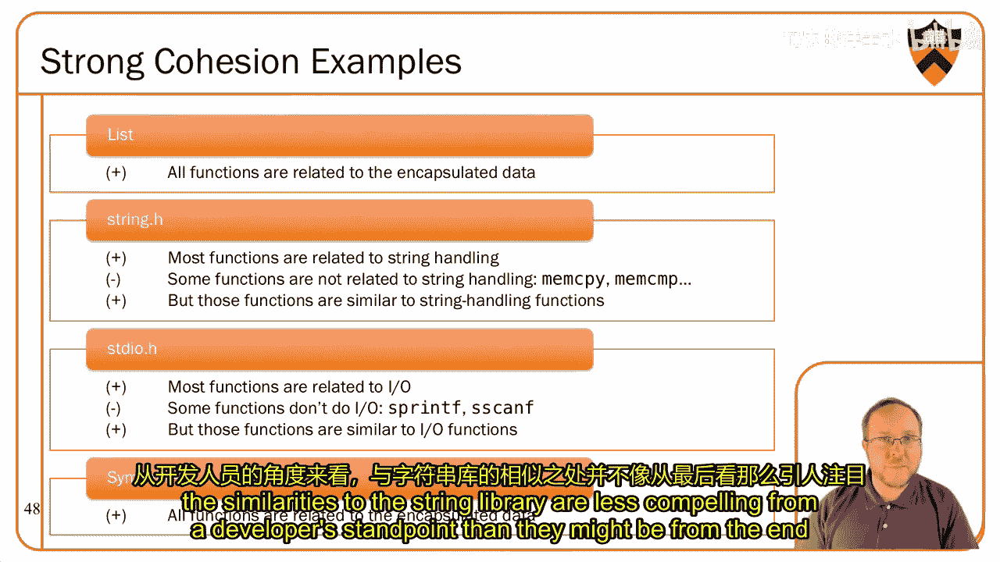

但为什么强内聚是可取的，除了最小接口通常允许进一步抽象这一想法之外？它还与一些其他积极属性相关，例如更易于理解。模块不是无关函数的散乱数组，而是一组自然相关的连贯函数，这将更易于理解，更易于理解这个模块到底是关于什么的。此外，它更易于重用。任何只需要其中一个函数的东西实际上最终可能需要其他函数，而对于内聚性较低的模块来说，这种情况的可能性较小。想象一个模块只是因为一个客户端恰好需要那组无关函数而组合在一起。不能保证未来的某个客户端或所有客户端会需要这些函数组合在一起。因此，重用模块更困难。

但内聚存在于一个谱系中，从微不足道的低内聚（这是一个模块，因为我们把所有不在其他模块中的函数都放了进来，彼此之间没有关系，它们只是碰巧在同一个模块中）到不合理的高内聚（这些是执行此任务对此对象所做的任何事情的完整且不可分割的集合）。大多数模块介于两者之间。例如，这些数据和函数被分组在一起，因为它们都具有共同的属性，比如它们都进行I/O。即使函数本身不相似，并且有永远不会一起使用的子集，它们确实具有这个共同属性。或者，这些函数被分组在一起，因为它们都对相同的数据进行操作。同样，它们不做相同的事情，可能不以相同的方式做，但它们对相同的数据进行操作。

我们在本讲座中一直使用的模块都具有相当强的内聚性。有一些例外，例如字符串库中的非字符串函数。但如前所述，那些确实通过数组逐字节工作，所以它相当符合其他内聚元素。同样，I/O库中的字符串格式化函数实际上并不进行I/O，但它们就像`printf`和`scanf`一样，只是针对字符串。从客户端的角度来看，人们可能会争论它们是否应该与其他打印和扫描函数在一起，或者是否应该与字符串函数在一起。它们是字符串函数，它们属于那里，但从程序员的角度来看，它们几乎肯定看起来就像`printf`和`scanf`的其他变体。因此，最终它们将内容放入字符串而不是打印出来这一事实是次要的。从这个意义上说，从开发人员的角度来看，与字符串库的相似性可能不如最终用户那样有说服力。

如前所述，还有另一个与内聚密切相关的特征，那就是**耦合**。这两个指标有着共同的历史，它们都是在结构化设计发展的时代（大约是60年代末到70年代中期）发明的，而内聚是衡量模块内归属感的指标，耦合则处理模块之间的连接。因此，强内聚或高内聚是可取的，而弱耦合或低耦合是可取的。低耦合意味着模块之间的相互依赖性更少，模块之间的信息流更少。

这对于维护是有利的，因为如果没有相互依赖关系，或者模块之间的数据流不多，我们可以在不破坏它们之间连接风险的情况下修改模块。这对于重用也很有用：如果模块没有紧密绑定在一起，它们更有可能能够与其他模块独立重用。

因此，让我们考虑几个例子，偏离我们一直运行的列表、字符串和符号表，因为我知道你已经厌倦了它们。考虑所有好的面向对象类型的东西都归结为交通工具，所以考虑一个飞机模块和一个飞机模拟器。模拟器方法`move`调用了飞机模块的一大堆函数。模拟器和飞机之间存在紧密耦合，主要体现在这个`move`函数上。因此，作为一个潜在的设计变更，我们可以考虑`move`本身是否应该在飞机模块内部。答案可能是肯定的，但让我们以这种方式重新绘制图表，看看现在是什么样子。确实，左右之间立即出现了视觉上的区别：右侧是耦合更弱的设计。编写客户端更容易，我们只需调用`move`；编写`move`更容易，因为我们可以使用内部结构，我们不需要调用其他接口函数；它更易于维护、重用，由于所有与内聚相同的原因，现在应用于耦合，所以错误更少。也许这对你来说太模糊了，但我也认为这在本体论上是匹配的。飞机是移动的东西。模拟器不是移动的东西，所以`move`应该是飞机的函数，而不是模拟器的函数。再次强调，如果这对你来说太模糊，没关系，但我认为它至少在哲学上是一致的。

现在我们有一个客户端，在其执行过程中多次调用模块中的函数。因此在运行时，它们是强耦合的。排序函数应该是集合模块的一部分吗？让我们再看一下，重新绘制图表，看看有什么变化。这里的右侧结构可能更易于维护，更易于重用，错误更少，同样出于所有相同的原因。再次强调，如果你愿意跟我一起进行本体论思考，我认为你可以论证排序是集合存在状态固有的东西，而不是对集合的外部操作固有的东西。但我不确定这是否像模拟器-飞机-移动例子那样明确。

但在这两个例子中，我们都看到了将函数移入模块的趋势。这向我们展示了一个趋势：**削弱耦合与最小接口原则相冲突**。再次强调，也许并不奇怪，我们几个理想特征可能相互冲突。

第三个例子根本不考虑函数调用，而是考虑代码更新。如果在维护期间或通过维护阶段，更改一个模块通常意味着另一个也必须更改，那么两个模块在维护时是强耦合的。这是一种强耦合，可能表明X和Y可能属于同一个模块，无论是在客户端还是在模块中都无关紧要。或者，在这种情况下，F3的接口在其他方面存在缺陷，以体现这种非常强的互连性，这将是一个缺陷，因为毕竟封装说更改内部表示不应该要求更改客户端，或者更糟的是，更改客户端真的不应该要求更改底层表示。

因此，这里的右侧客户端再次我们认为更易于维护或重用，并且所有这些例子中，模块之间移动到更弱的耦合最终会增加至少一个模块内的内聚，所以这两个特征再次相关。我们将每个例子都展示为一种神奇的一步修复，但实际上设计的这个元素是一个迭代过程，是随着你对代码和预期客户端集的体验（要么你变得更熟悉它，要么它确实在演变）而不断重构的过程。

因此，频繁的客户端操作可以被拉入模块。从未使用过的模块操作可以被踢出模块，也许踢到偶尔使用它们的客户端，或者踢到以太中，因为它们从未被使用过。同时更改的东西被放在客户端-模块屏障的同一侧，因此要么被拉入，要么被踢出。彼此相关但与客户端或模块的其余部分无关的东西分离出来形成一个新的独立模块。

最后一点是，随着软件工程超越结构化设计的初期，面向对象设计范式出现，像这样的指标也在不断发展，所以你可能有兴趣了解**内聚性**，它有点像是封装内聚和耦合的下一维度。

---

## 总结与后续安排 🎯

本节课中，我们一起学习了模块化设计与接口设计的核心原则。我们探讨了良好模块的八个关键特征：**封装与信息隐藏**、**清晰的规范与契约**、**一致的内存与资源管理**、**一致性**、**极简主义**、**健壮的错误处理**、**清晰的文档与注释**以及**高内聚与低耦合**。我们通过列表ADT等具体示例，理解了如何在C语言中应用这些原则来构建更健壮、更易维护的软件。

这几乎结束了我们的软件工程基础主题。我们将在第21讲最后一次回来讨论性能分析和优化。

下周的第一讲是对一些低级系统主题的快速调查，这些主题过去在本课程的后半部分广泛涉及，所以你可以将其视为一些有趣的主题，现在你凭借新获得的C语言知识以及即将学习的汇编语言知识，可以接触到这些主题；或者，你可以将其视为你在一些系统系课程中将看到的低级系统内容类型的预览。

下周的第二讲是作业4的概念和规范介绍。

但现在，祝你在作业3上工作顺利。下周的辅导课将继续涵盖与该作业相关的材料，秋假后我们都将恢复运行。因此，办公时间将重新开放，以帮助理解作业的概念或进行调试。所以请不要犹豫，利用所有可用的资源。不要感到害羞或觉得你过度依赖它们。它们的存在是有原因的。

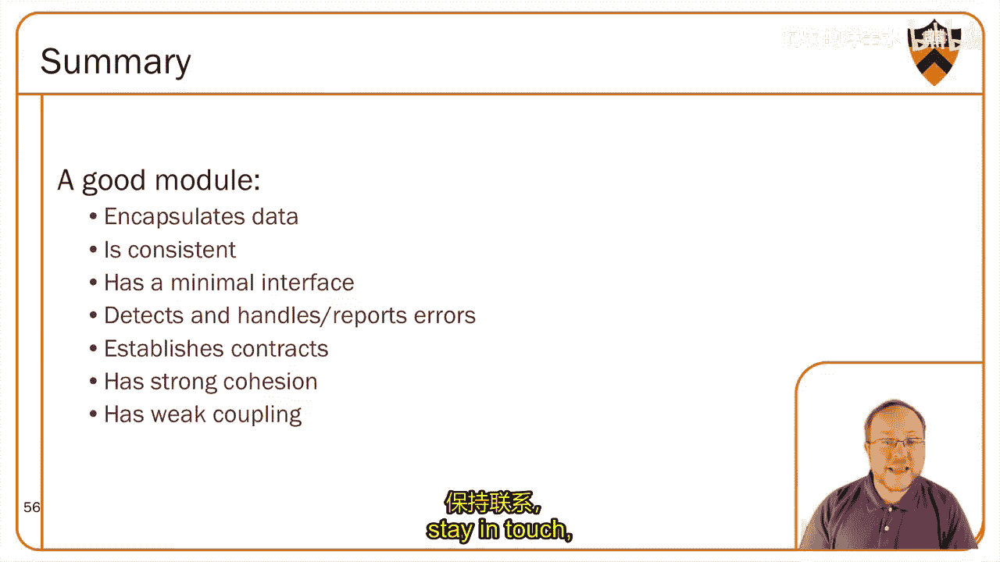

更进一步，如果出现任何现有资源不足的情况，请尽量不要感到不舒服而不敢联系，我们确实希望尽我们所能确保每个人都能保持正轨，在世界仍然陷入困境的不利情况下坚持下去。所以再次强调，保持参与，保持联系，祝你好运。