# 【全集 秋季版】普林斯顿大学 C语言系统编程 中英字幕 p16 Lecture 16 - 流程介绍 -BV1u1feBoEsK_p16-

Welcome back to the Co 217 lecturec。In this lecture。

 we're going to take a quick dive into the process abstraction。Hopefully， from this lecture。

 you'll have a better understanding of what's going on when you run your program。 And also。

 you can treat it as a sort of preview of the style of material and one particularly important topic that you'll encounter in systems departmentals like 3。

16 or 3，18。😊。

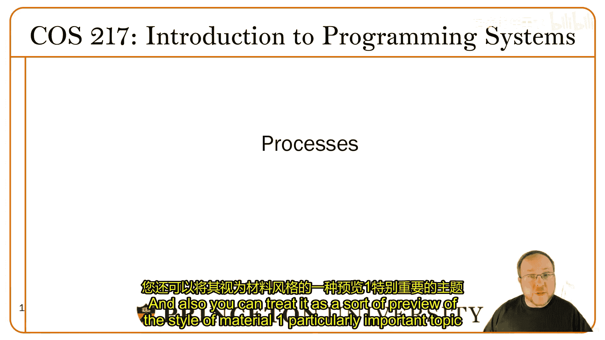

In this lecture series， we're going to start off with the process abstraction around which many of the other lowleve systems concepts revolve。

 and then we're going to take that into not just the process itself。

 but how to write C programs that manage processes and how to control other processes into some limited form of interprocess communication via signals。

So again， we'll start off with the idea of a process。

 but we've used this term for a little while now， so when we've been talking about your program as it's running。

 now we're ready to be explicit with more concrete definitions。

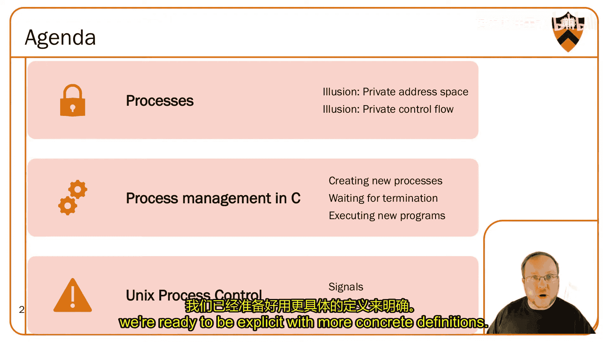

Your program is the result of the build process that we've talked so much about。

When the linker finally builds the executable， this defines your program。

 If you change something and rebuild it， this is now a fundamentally different program。

 even if you give it the same name， it's not really so much an updated version as a completely new program that by its very existence relegates your previously built program to being irrevocably lost。

 assuming that you've used the same name。But perhaps that's too philosophical。

 the point here is that the program is the executable code that you've built that is ready to run。

A process， on the other hand。Is an instance of an actual execution of that program。

Perhaps the nerdy take on this would be the process is your program integrated over time。

 the summation of all the instance of that particular execution of your program。

The state of the registers， the state of the memory。

 the branches that are taken or not taken as we go through conditionals， all of the control flow。

 etc。So when the process is running， it's sharing the computer's resources with many other processes。

For instance， when you're running your process， you possibly have your code up in Es as well。

In any event， you certainly have at least one other process running your shell。

And because all hundred and 70 students in the class are inevitably working on their assignments during the last 48 hours before the due date。

 not only your processes running， but so are all of your peers。

 especially those who had an infinite loop in their debugger and never killed it off。

 like seen in this image。So each one of these processes that's running at the same time has its own identifier。

 the process ID， PID or PID。For example， 10882 or 92684 in the picture above。

When a process begins operation， it gets it paid assigned to it by the operating system。

The pitd must be unique for all processes running at that time。

 but they can be reused if they're no longer in use。Typically。

 they're assigned sequentially until eventually the number overflows back from whatever the maximum process ID is to the small numbers。

And on our system， that's 98304， which is thrice to the 15。

The first several hundred Pds are typically reserved for the OS kernel， and in practice。

 the first several thousand are actually used by it。

 This is because the O invokes a bunch of long running processes before any other programs get a chance to be executed。

This pit is going to be an important property when we start talking about running a program that invokes multiple processes。

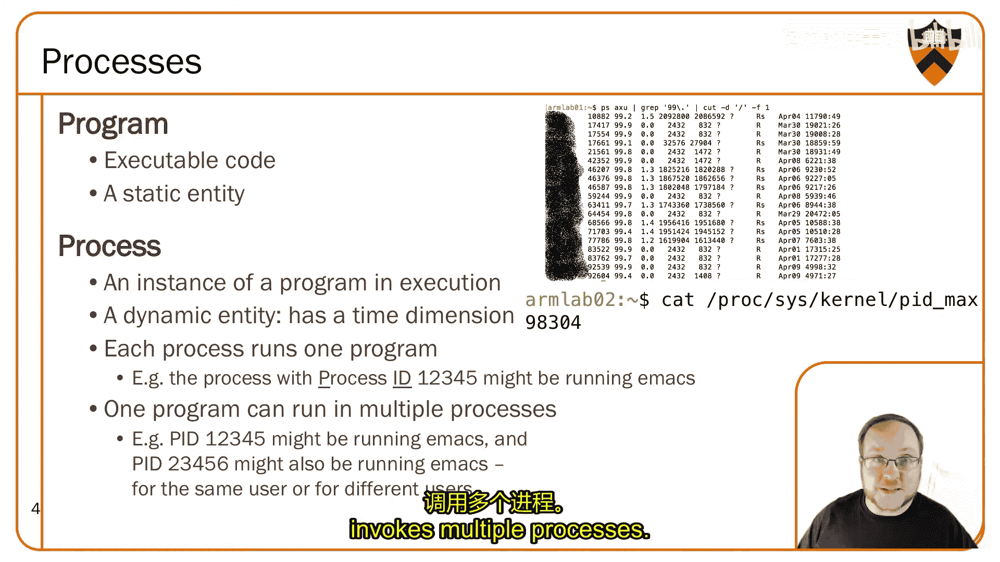

The process abstraction is incredibly powerful， Despite these potentially tens of thousands of processes running。

 Each one of these processes can， if it wish。😊，If it wishes， operate under the illusion， the fiction。

 if you will， that it's the only process on the machine。

 and that it owns the entirety of all possible resources， and in fact。

 more than even the resources that exist。Let's look briefly at two different ways this fiction is realized under the hood。

First， the illusion that they own private address space。

A process feels it gets all the memory on the machine， again。

 actually more memory than exists on the machine that they're running on or any machine possibly could have。

Second， processes can think of themselves as having the processor to themselves at all time。

This is certainly false， but it provides a nice abstraction that pervades all the way down the stack。

 even to the machine language code。 We're about ready to go in the course to our downward language level tour。

 we've started at C， we're next going to see assembly and even machine language。

 And we're going to feel like we're going super low level。 And yet。

 underlying all of this is the fact that we're still working in a virtual world。

 It's an illusion presented by the system to make things easier for our programming environment and for us to reason about。

😊。

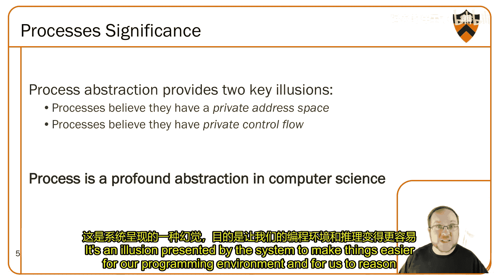

So making a quick overview of the first of these， but really it's only the most cursory aside you can contrast with before the course began becoming revamped this term。

 the next two slides would have been the better part of two lectures in previous term。

So the first illusion here is that the process is the only process using memory and that has all of the memory。

When programming at the application level， you think of memory as simply a huge array of bytes。

 and you think that you're the only one using it for your stack。

 your heap and all your other sections。

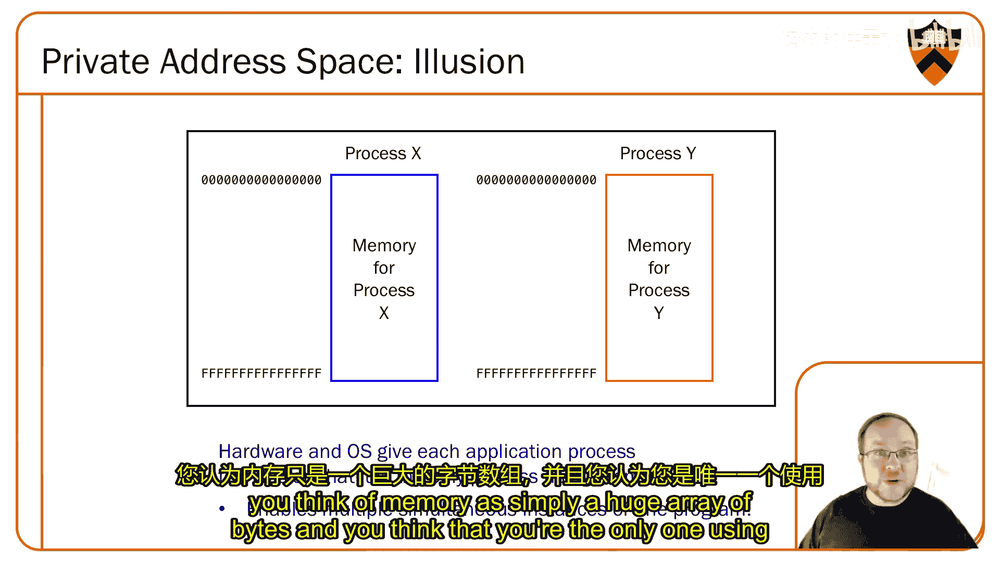

But in reality， the machine may have less memory。 In fact。

 it certainly will have less memory than what we've been thinking about。

 We think of this array as from 0 to F， F， F， F， F 16 F's as addressable bys。

 But the laptop I'm recording this on has 16 gigs of memory， which is， frankly， a ton。

 but two the 64 addressable bys is more than a billion times as much memory。😊，Furthermore。

 only some of this memory that your process is using is actually going to sit in the physical memory。

 the physical processor's memory and the physical RA on the chip and in the hardware。Indeed。

 there will be huge portions of your address space that are not in use at all。 Again。

 you have2 to the 64 addressable bys。 If you have a little program called Hello World that doesn't do a whole lot。

How much are you really going to use， certainly not and2 to the 64 bytes？

And even in memory that you do have in use， it may not be in the physical memory。 For instance。

 you might not have needed it yet。 And so the program hasn't needed to have it put into physical memory。

 or maybe it hasn't been used recently。 Again， there are， in fact。

 many processes running at the same time that are competing for these resources。

So when programming at the application level， the hardware and the operating system completely insulate you from these details。

 you operate under the illusion that your addresses 0 to FF F F F FF are real。

 but they're not They're virtual and they're almost seamlessly translated in hardware with the help of the operating system into the physical memory location。

And furthermore， the location that might not even be in physical memory at all。

 it might be stashed away on a disk somewhere。Furthermore， we think of memory as a huge array。 One。

 in fact， is actually a hierarchy of different memories。 We'll discuss this next week in some detail。

 but briefly， there's a hierarchy of different hardware ranging from blazingly fast。

 but absolutely tiny to practically unlimited size， but glacierly slow。😊。

And a central theme in systems and in memory management in particular is how to make use of all of these separate storage levels in the hierarchy in order to give the illusion of both a big size and a fast speed。

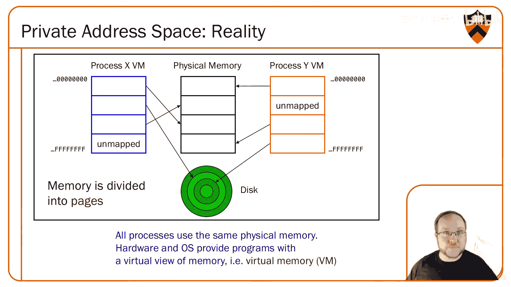

Alright， so I said that would be a quick little aside for the memory bit， and that was it。

 The second illusion provided by the process abstraction is that every process has its own private control flow。

It's a fact that many computers these days have multiple CPUs。

 each arm labb computer for instance has 96 CPUs， but that's still certainly not enough to give every single process the processor all the time。

To keep things simple， we normally think about when reasoning about processes both in isolation and in interaction。

 to assume that there's only one CPU， and many of the takeaways will still generalize to multiple CPUs。

So with that single processor， though， we perceive our process as running all the time。

 but of course that can't be true。In practice， it must timesha in tiny little time slices with all the other processes running on the machine。

So some of process X's instructions will run and then some of process Y。

 sometimes this happens because one process doesn't need the CPU for a bit， for instance。

 if it's waiting for the OS to get back to it because it did a lookup of memory that was sent out to disk or perhaps it made a network connection and is waiting for the actual physical connection to send the bytes from across the world。

Other times it happens because the OS actively comes in and says，Sre， be nice。

 sharing is caring and you should share with the other processes。

Particularly for interactive processes though， each process has to get its share of the CPU regularly in order to maintain this illusion of the private flow of control。

It becomes very evident when you're doing something on a process and now suddenly you're like， wait。

 I'm supposed to be able to type here and it's not taking my input。

 or perhaps it was supposed to give me an answer immediately。 It's a very simple function。

 Why didn't print anything。 Why didn't it print anything。

So this is the idea of we have to have that the time slices be relatively quick in order that we still perceive this。

嗯。We often talk about concurrent execution here， but the English word concurrent doesn't really fit here。

 technically， X and Y aren't running on the CPU at the same time。

 they can't be if there's only one CPU。So X and Y are set to run concurrently in systems if x began during the lifetime of y or y began during the lifetime of X。

 So that's not exactly the same thing as we would normally think of as concurrent。

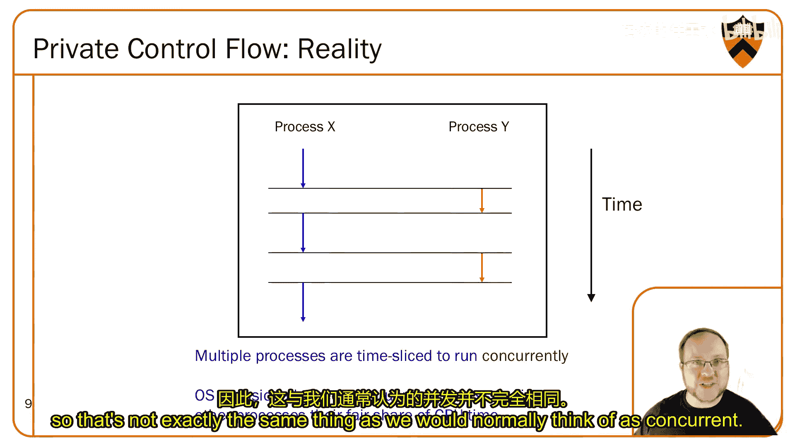

So at any given time， a process may be in one of several states。 it might be running。

 The CPU is actively executing the instructions of this process。It might be ready to run。

The process has instructions that it could be running， but the CPU hasn't chosen to let it run。

 it's sharing with some other process。Or it could be blocked。

 The process is waiting for something else out of its control to happen。 For instance。

 the O S might be doing something for it or something like Iio。

The transitions between these states are actually yet another instance of DFAs popping up in this course。

 so a process becomes ready to run， the only state it can transition into is running because it can't request a blocking operation without being in the running state to actually request that operation。

The O S will eventually determine that the that it is the processs turn。

 and it will transition into the running state。 It will run for a while and then either execute an operation that blocks again。

 something like I O or something that requires intervention of the operating system。

And it will transition to the block state， or the OS will come in and say。

 you've had your fair share， give it up， others need to run。

 and so again it will go back to the ready state。In the block state。

 eventually whatever it's waiting for the operating system， the input output， whatever。

 will have finished， and so now it will be able to run whenever its next pick to do so。

 thus it transitions into the ready state。

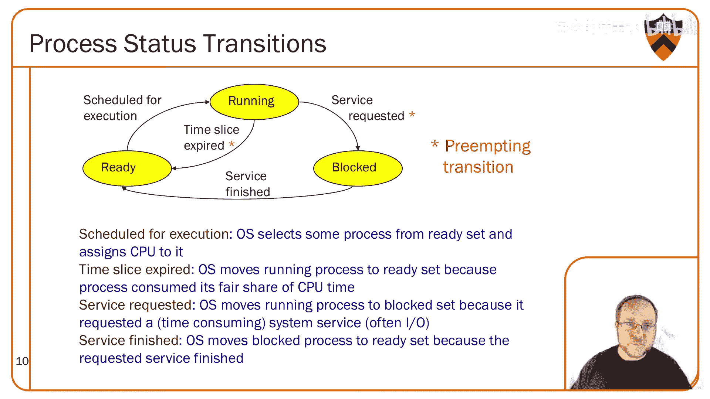

Having described the concept here very briefly of this DFA of process status and seen the state diagram。

 we can look at a more detailed version of the previous diagram that throws in a temporal element。

If this switching between processes is done at a small enough time scale。

 each process can maintain the illusion of being alone on the machine。

 but it is a tricky dance to play with enough processes。

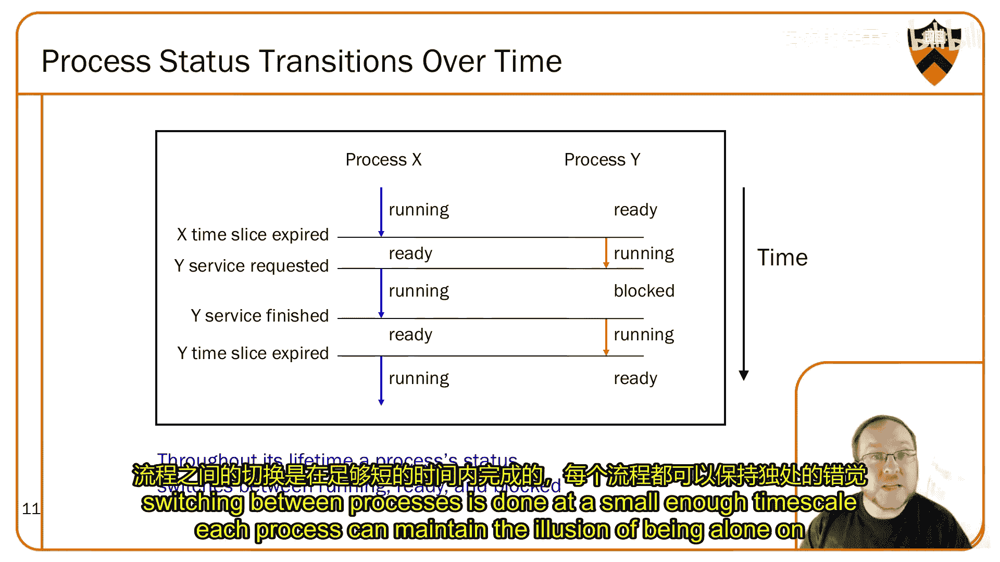

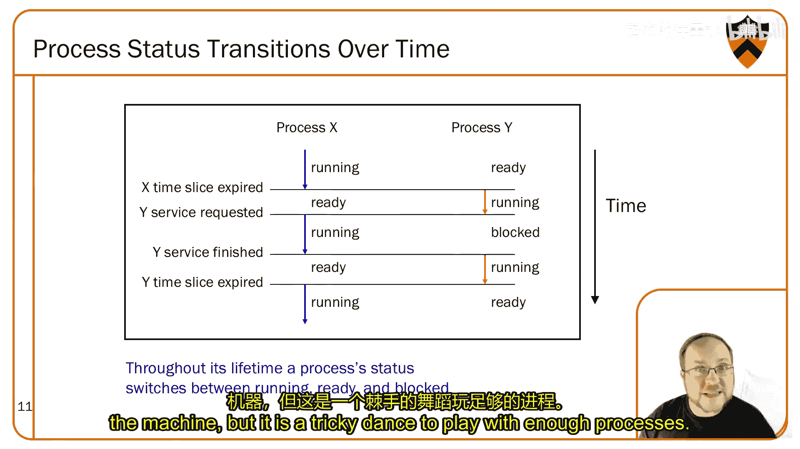

And furthermore， context switching isn't free。 It involves saving the contents of process X。

 And this content or context is what we normally call it for context switching。

 But it's really the content of memory， the content of the processors。

 everything about what's going on in that process at the very time， it got preempted。😊。

It has to be saved。And then the the context of process why at the time when it was preempted has to be loaded back in。

 So if the switching is done too frequently， this sounds like it's a good thing for perceived isolation。

 perceived complete control。But incurs a lot of overhead from the switching itself。In practice。

 context wishes occur anywhere between 50 and several thousand times per second。

 depending on system specifications and load， so this could be quite a lot。

And this is a classic example of how the answer to everything in systems is。 Well， it depends。

 or it's a trade off。 If we give processes large time slices。

 we risk having other processes starve for the processor。

 and it breaks our illusion of a private control flow。 But if we have two small time slices。

 we waste a lot of time saving and restoring context。

 when we could have been doing useful work instead。 And this in this case。

 all of our programs will suffer and performs slower as a result。

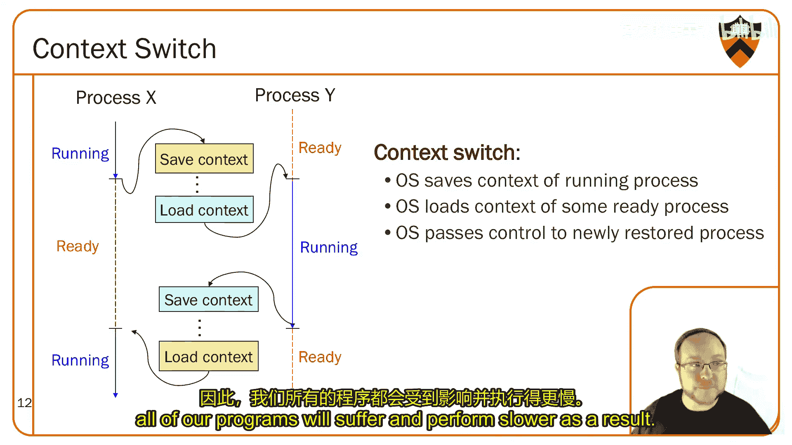

So that was our introduction to processes。 Next up， we're going to talk about process management。

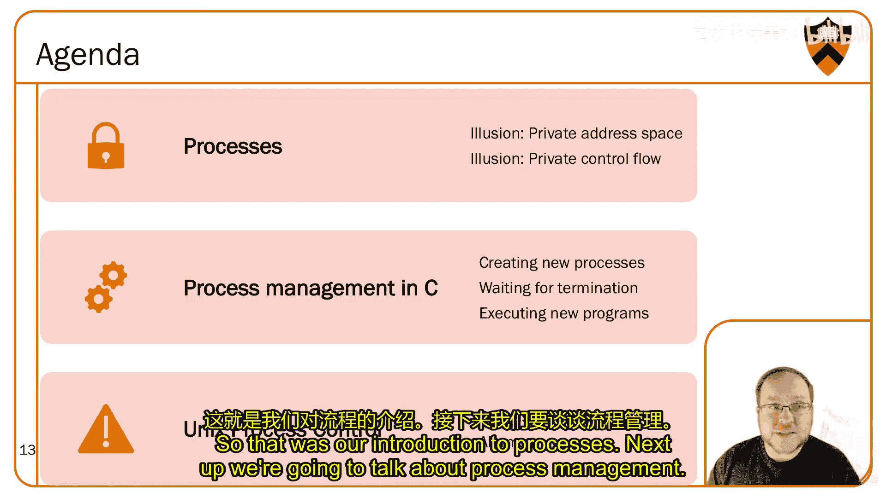