# 【全集 秋季版】普林斯顿大学 C语言系统编程 中英字幕 p17 Lecture 17 - 流程管理 -BV1u1feBoEsK_p17-

Now we'll continue with our dive into the process obion。Next up。

 let's break a paradigm we've been assuming all semester that processes are one process per program。

 That is that programs only consist of a single process。 That's not always true。

 so let's see how we can write programs that interact with additional processes of their own creation。

This is the fundamental idea of the classic Co 217 assignment 7 from before the coursese revamp。

 building your own shell， that is build the program that at the user's request executes other programs。

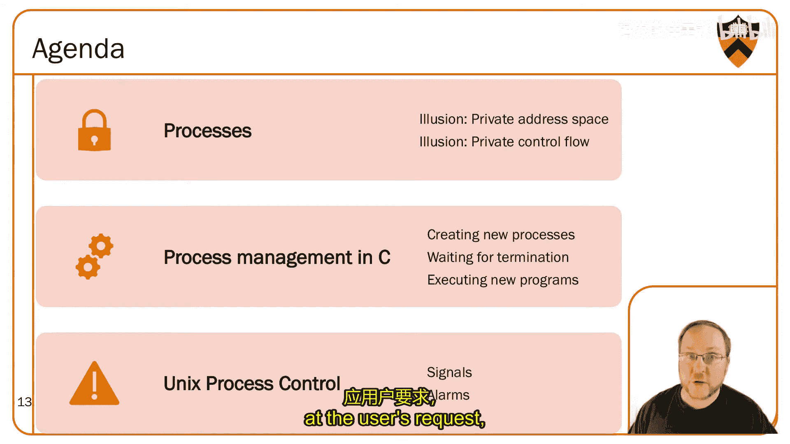

If we think of the Linux OS as a big module， system level functions are the interface into that module。

 There are special functions that go to the Os kernel and do and ask the Os to do work on your behalf。

 where either the user process can't do the work itself because the work requires special permissions or access or has to interface with some sort of hardware。

 such as I O。Much like we had four friends for dynamic memory， maybe phrenems。

 mallic calic reallican free， we also have four friends for process management， fork， the Ex family。

 weight and exit。

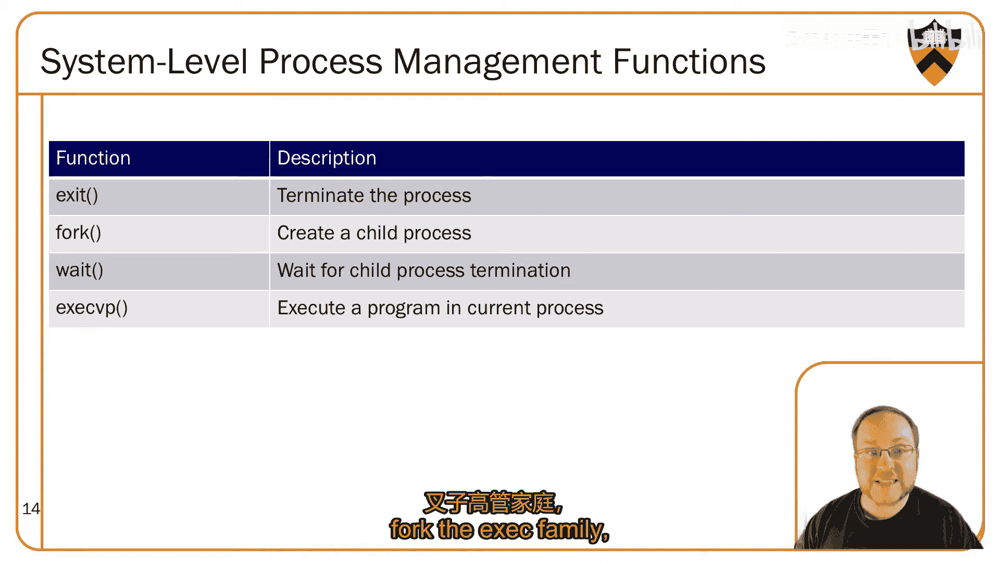

A shell is certainly one example of a program that will have to create processes when the user requests a program to execute the shell。

 which is a program in execution， thus a process， must create a new program。

And that means it has to create a new process for that program to execute in。

 Another example would be a web server that when it receives a request。

 will delegate handling of that request to a new process so that the server can continue listening for additional requests。

So how to achieve this？An abstract idea to abstract away from a particular shell or a particular web server。

 let's use the general hierarchical terms of parent and child。

One might think there's a way to create an empty child process that's not affiliated with any program and then tell it what program to become affiliated with。

Or one might think that there's a way to say， create this child process to serve this program。

But it's actually a bit oddtter than that the mechanism here is perhaps not immediately intuitive。

 the parent creates a new process， one that is in fact an exact duplicate of itself。

The child will then issue a command that says， I no longer wish to be my parent。

I don't want to be that same programme。 Please make me into this other program， instead。

And I suppose this is just really a teenage rebellion in the process family。

So we'll cover each of these steps separately。First， the process creation。

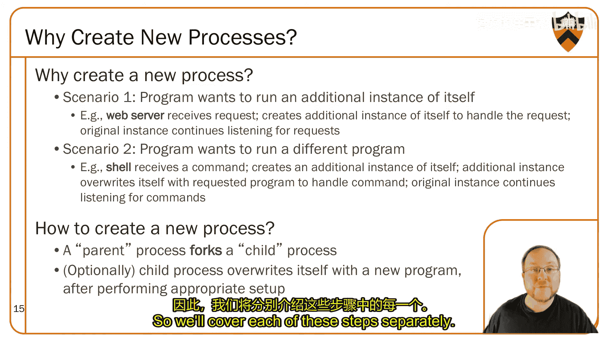

The system level function that creates a new duplicate process is called fork。

 We'll often use that as a verb to fork off a child process。

 Fork creates an exact duplicate of the parent process， including processor state， memory state。

 everything else in the process with one exception that we'll talk about in a moment。

 And that is a duplicate at the exact time of the parent' call to fork。

 That means that bizarrely fork returns twice， because it returns from executing in the calling parent process。

 but it also returns into this new child process， which just starts up midpro with the return from fork。

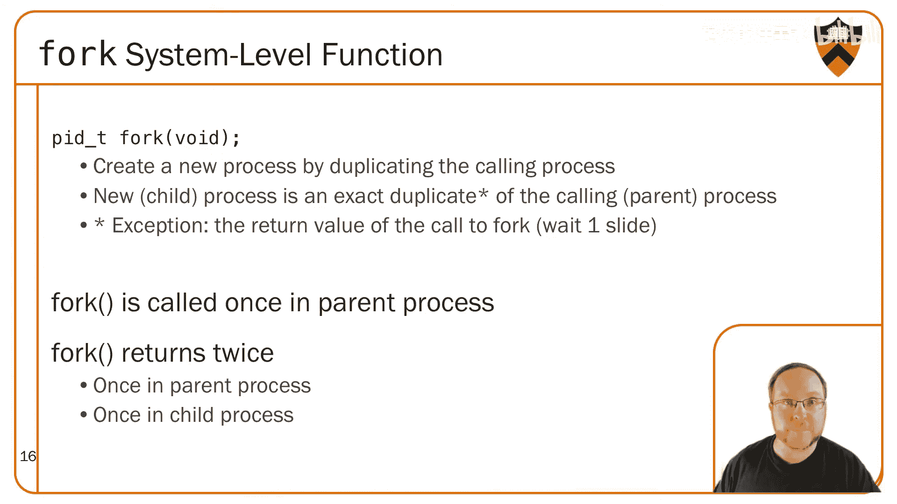

In the previous slide， it says that there is a single solitary difference between the parent and the child process。

 and that's in the return value from fork， because fork is unique and that it's called once but returns twice。

It can have two return values。In this case， this becomes useful， the child gets the value zero。

 and the parent gets the return value of the child's P。

This is a unique identifier since we noted in the first part of this lecture that every process has its unique PID。

 and this is a crucial difference because it allows us to programmatically that is program a condition that is able to differentiate the parent from the child。

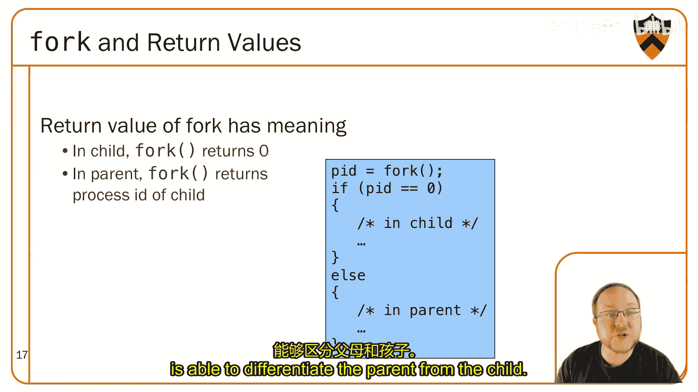

So each process can know which of the two it is programmatically。 But before we get into that。

 let's think just a little bit about what it means to have multiple processes running。

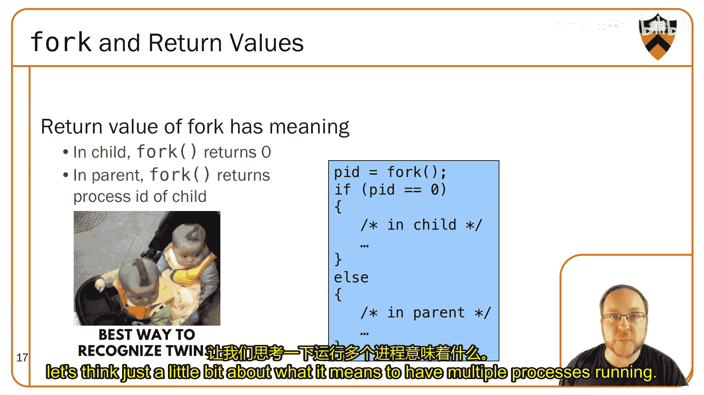

Again， drawing back to the first part of this lecture where we did an overview of an introduction to the process abstraction。

 when there are multiple processes running， the processor will context switch between them frequently enough to give each the illusion of their own private control flow。

And it seems like it's in perfect parallel。And on most modern machines。

 there are multiple processors。 So these processes can， in fact， run in parallel。 But again。

 we'll still only think of it as having a single process because that's with very little loss of generality。

So now we have multiple processes running our program concurrently。

They're competing against each other for resources， in this case。

 most notably being the running state of the processor instead of the ready to run state。

 So let's look through an initial example。

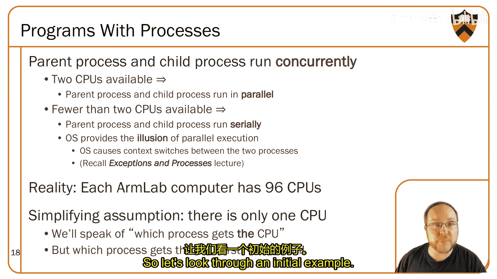

Take a moment to treat this like an eye clickcker question。

 what does this program print to standard out？Let's trace it out to C we're going to start with only a single process and then that process will。

 of course， start executing at the top of main。Before the fort call happens。

 the parent is going to print one， followed by a new line。Then the for happens。

 Now there are two processes each the same， each running at the same spot in the program。

 but we're considering only a single processor here so they can't both really be running。

And like all discussion we've had so far about context switches。

 it is indeterminate as to which one of them will be in the running state。

The processor can arbitrarily choose which it thinks has already exceeded its fair share and which gets to have its turn。

So we have no way to predict who gets to execute the return from ForRC first to continue on with the program。

Let's imagine in this case， it's the child。 Now， the child prints two and a new line。

After doing that， if it wasn't context switched away back to the parent， the child will exit。

With no further contention from the child， the parent can then print two and a newla。

And then the parent can return and exit。

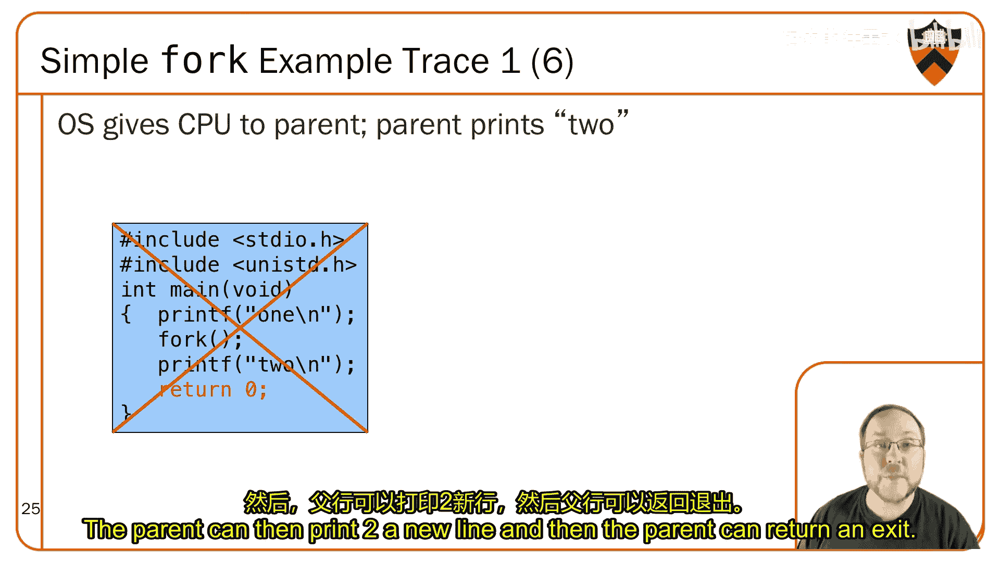

So the answer to our eye clicker question was that one， two，2 is printed as seen here。

But what about if the parent got to run first instead of the child。

 Let's quickly run through that instead。Again， the parent starts off in print before。And again。

 the fork happens。 And now there are two processes executing。 Everything's the same thus far。

In this case， though， let's say the parent gets the processor first and is able to print two。

The parent keeps the processor and returns and exits。

Now the child is alone and can print the second printf。The child returns and exits。

 and so in this case， we have the exact same output。

 except the ordering of the two twos in the output is different。

 but they're indistinguishable so in this program it didn't matter whether the parent or the child got to run first。

But as we saw briefly after the fork， we can have code that is conditional on the return from fork。

So the parent and the child can do different things。

So when the code differentiates the parent from the child。

 we will have to repeat our steps here and reconsider two different branches of execution when predicting the program's behavior。

 whether it's the parent or the child that got to run first。And frankly。

 it's even worse than that because context switches come at almost any time。

 that means in the general case， our space of possible execution orders is every possible interleaving of the two processes instructions。

This seems wild and we'll see if there's a way to prevent that later。

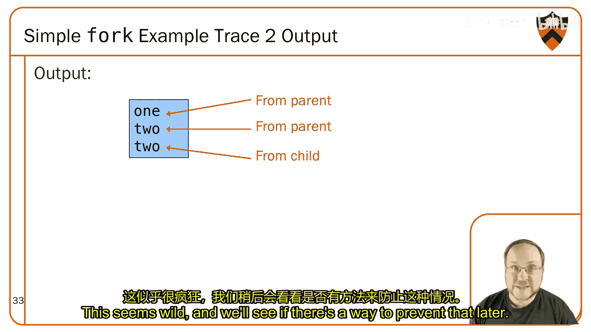

But let's explore just a little bit more with another eyecler Home Ed， if you will。

Pause the video and look at this code， which does include the conditional differentiation that I just mentioned。

And does different operations for each， so what does it print？The answer is E。 It's either A or B。

 but the order is uncertain， but whichever one runs first， will change the value of X。 Copy onrite。

 a process that we haven't talked about， but basically ensures that the child process in the parent process get the exact same data。

 and they only diverge when one or the other changes。

 copypy onrite will ensure that the two processes have distinct copies of the memory。

 and they aren't impacting each other as soon as the four happens。 they are， in fact， distinct。

 even though they happen to be the same memory， at least initially。So the child will decrement。

 get zero， and the parent will increment and thus get two。

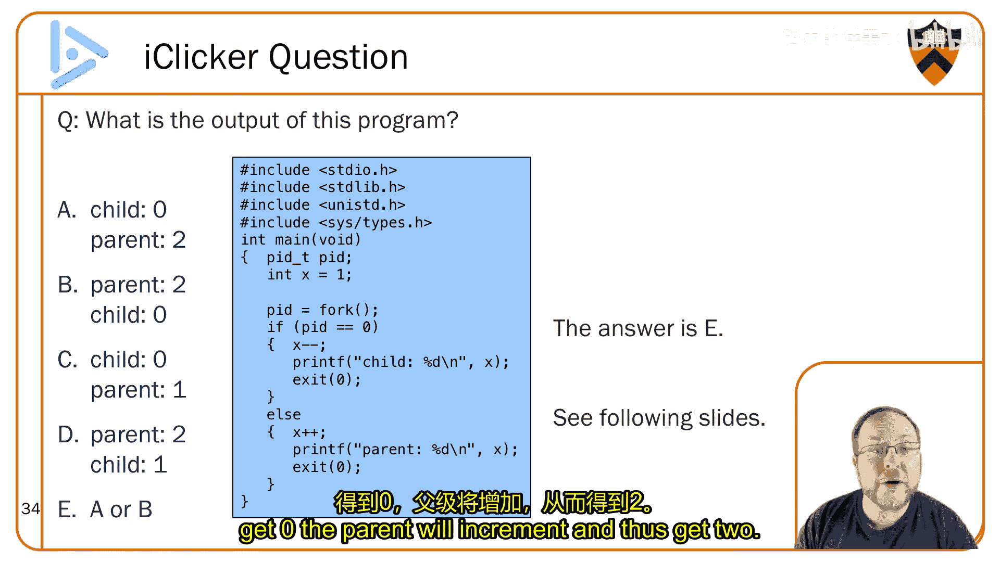

Let's take a closer look。Before the fork， we have x gets1 and pi with some garbage value。

The parent forks， and now there are two processes with distinct state。

 each of which has their own copy of X。Imagine that the child gets the CPU first。

 It will have a return from fork of 0。 So that will be the value of Pid。

 And note that this means that Pid is sort of misleading as a variable name。

 since the child's process I D is not process 0。 In fact， there's never a process 0。

 But in this case， it's， you know， Pi or 0， meaning it's the child。

So the value of the variable P is zero， so we enter the consequent x in the child decrements and we print changing x in the child does not affect the x in the parent。

The child then calls the exit system level function， which exits the process。

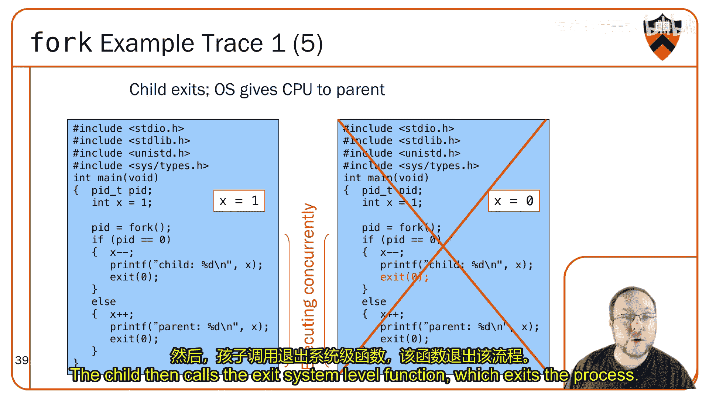

Now， the parent gets to run。 It's still way back at the fork。

 Its Pi variable gets the value of the child's process I D。

 Note that in the sequencing in this example， the child is already run and terminated。

 but the parent will still get the Pi that the child had when it was running。

We'll see why this is important for maintenance purposes later。The parent's paid is non zero。

 so we execute the code in the alternative rather than the consequent。And then the parent will exit。

So now we see the output of this program was the child's print first was zero。

 and then the parents print second with two。But of course we made a choice that the execution and the child would get to go first。

What about if the processor gave execution to the parent first and like in the child in their previous example。

 the parent got to keep it all the way until it was done？

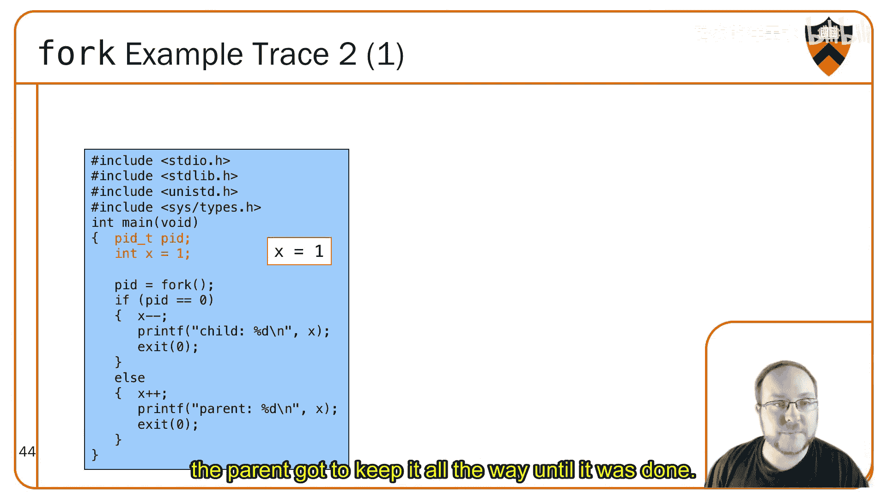

The parent would call fork， the OS would go off and create a duplicate process， same as before。

But now， save the parent runs first， returning from fork and Pi gets the child's P I D。

We execute the alternative and go， and so x becomes2 when we print that changing X in the parent。

 like the other way around， does not change the X in the child。

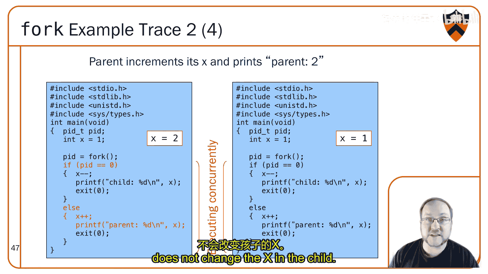

The parent exits freeing up the CPU to let the child run。And then in the child。

 the fork returns zero， this triggers the con where the child will decrement x to0 and print it。

 and then the child will exit。

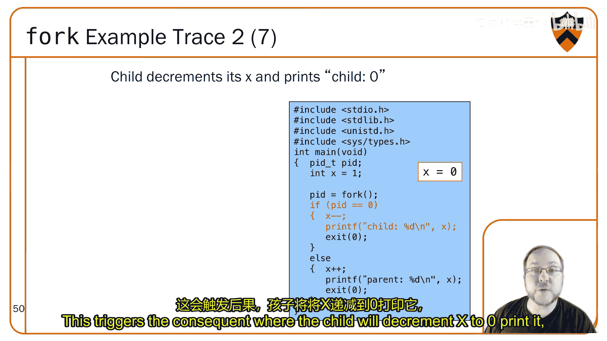

So in this case， the output was parent2 child zero。So back to this I clicker idea。

The answer was E that it could be either childil Ze parentent2 or parentent2 childil Ze。

 we can't know which the CPU will choose。As proof here on the slide。

 I ran an execution of many runs and of this program on Arm labb。

 And while it is overwhelmingly the case， that arm labb chose to have the parent run first。

 it was not absolute。 It could， in fact， pick either。

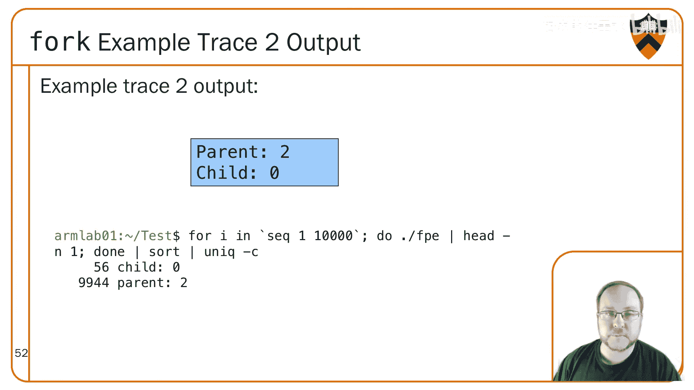

So one last question arising from this code。Instead of returning zero， we exit  zero。 Should we。

 Is it even right？Again， pause the video and think about it for a bit。The answer here is B or C。

This code is correct， but it would have also been correct。 Had we done return 0 here instead。

But think about what would happen if instead of being in Maine。

 we were several functions deep in a cul stack。 In that case。

 returning wouldn't return to underscore start， which would then kill off the process。

 It would just continue running the program and the function that called the function that forked。

This could end up either being really tricky to differentiate which process I am。

 Am I the parent or am I the child， or if the child was never intended to return。

 could cause serious bugs。 Basically， you now have two copies of the programme running when you are only supposed to have one。

So it's a common idiom that the child or the parent or perhaps both should have an exit instead of a return。

 so that two copies of the program do not continue running concurrently forever。

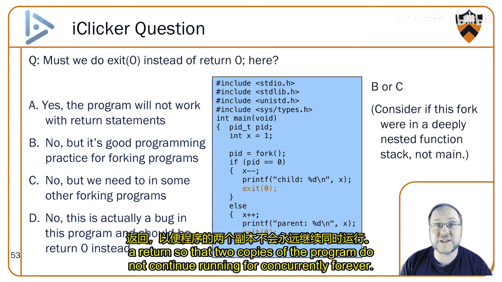

Okay， moving on in the previous example， the ordering of which process ran first mattered to the output。

 That will often be the case。 But if we're beholden to the whims of the O S and the CPU。

 how can we write code that handles a program's requirements about ordering。

The weight system level function suspends a process from running until one of its children terminates。

Once one of its children terminates， the parent will wake up and continue execution。

 This allows us to enforce an order it。 The CPU can let the parent run first， but the parent can say。

 Nah， let my kid run。Note that the return value is the pit of the child process that terminated and it takes an argument that is used to set various status bits。

 but when there's only one child and one parent， this value is not typically needed because there's only going to be a single child and so the pit isn't that useful。

But as parent child relationships get more complicated or the program logic gets more complicated as to what to do depending on which child died and things like this。

 the status can become critical。So when you go to study for your final exam and I know we just finished midterm so you don't want to think about that。

 but when you go to study for your final exam， you'll find lots of old exam questions with really intricate weight examples with many processes where using the PI might be critical。

 but that said since this material is no longer covered in an assignment and frankly isn't even covered in precept。

It wouldn't be fair to test you on that this term。 So go ahead and look at those problems。 You know。

 we've seen them in in lecture here。 I think they're really interesting。 They。

 They're nice brain teasers， if you will。But we won't be asking you something complicated about that on the exam。

So anxiety hopefully isaged， let's go with an example here。

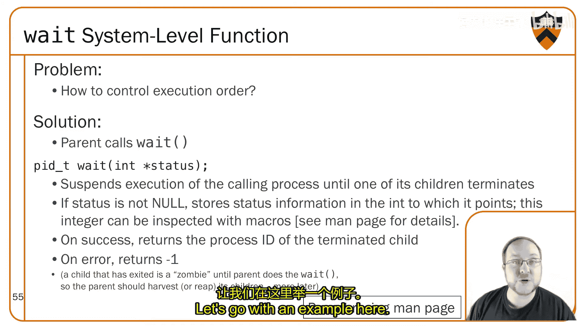

Here's a program that forks as we've been doing， but now it has a wake call as well。

What will it print， pauseuse the video here and see if you can trace it。The answer here is A。

 let's trace。

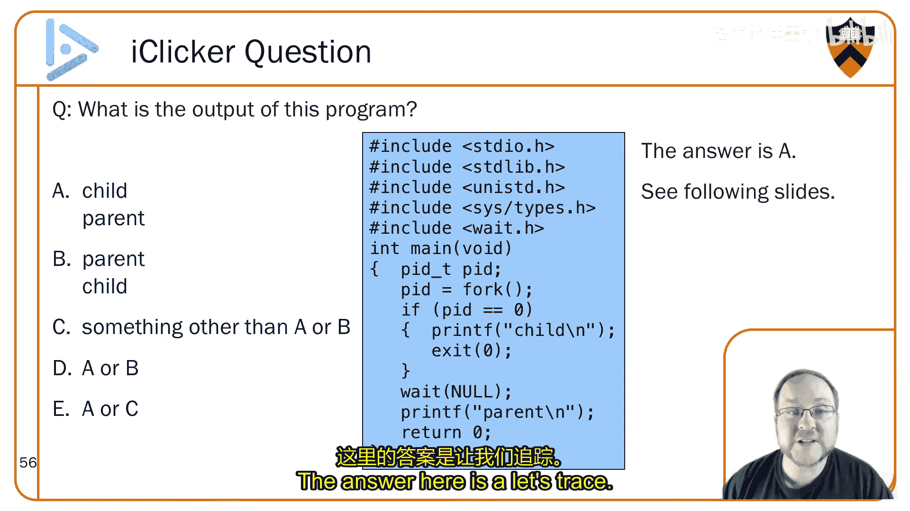

The parent forks and we have two processes running。

Let's first consider that the parent is chosen to run first。

We skip over the consequent and go to the implicit alternative since the consequent exits。

 But the parent doesn't take advantage of being called first。

 And it asks the O S to put it on ice until the child terminates。

So the child starts running back at the return from fork。 it establishes itself as the child。

 it prints， and it exits。

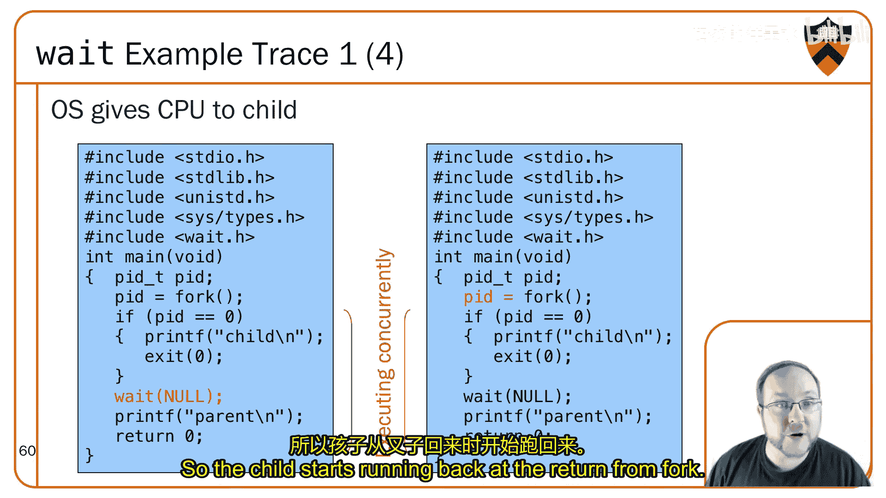

After the child exit， the parent wakes up。 That is the next time that the parent context switches in。

The wait says， I'm ready to run now。

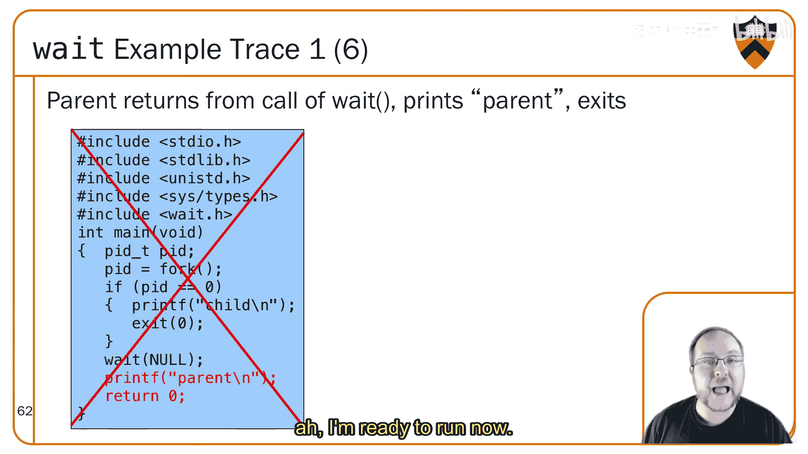

And so the parent will run and it will print。So with the parent first， we got child then parent。

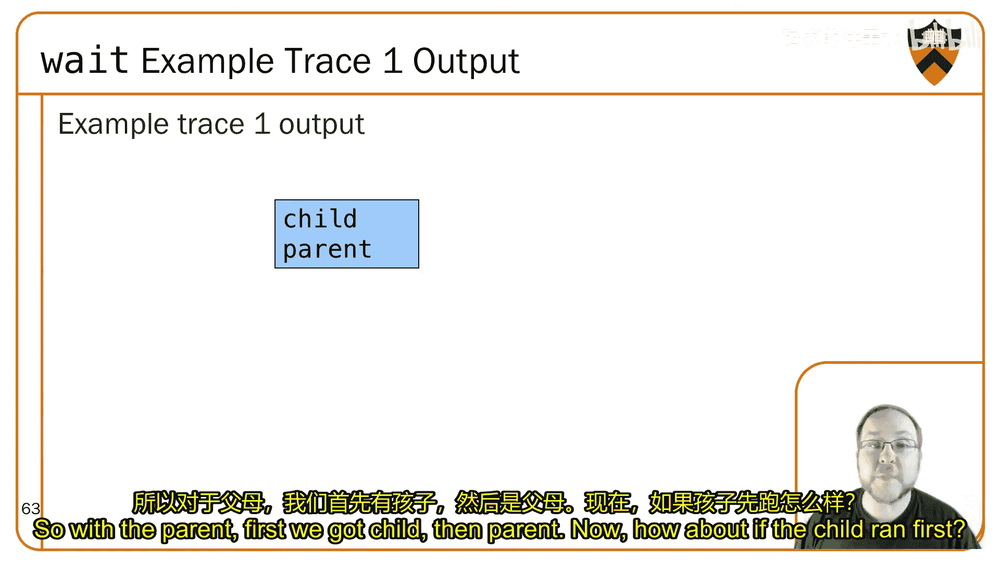

Now， how about if the child ran first。

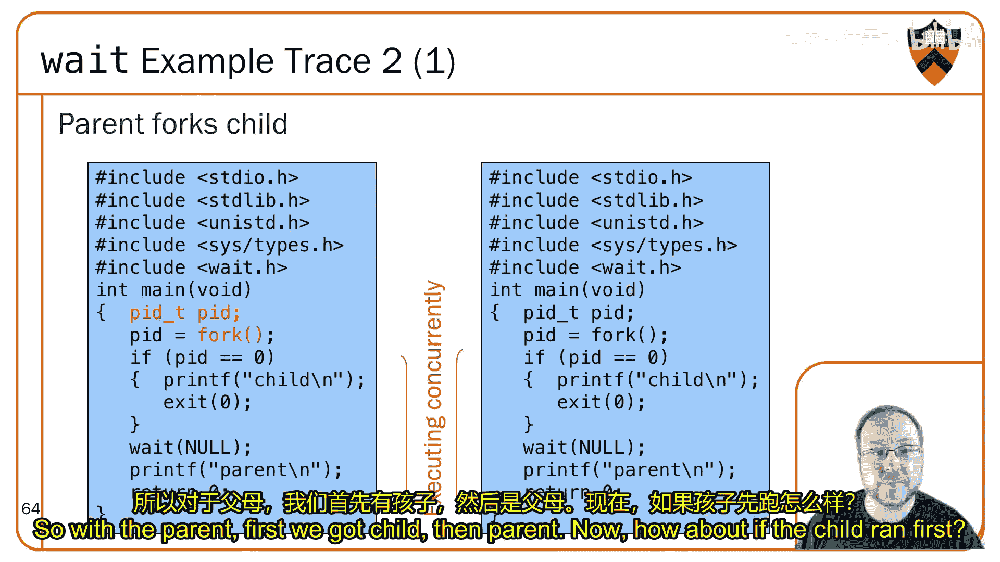

Back to the main， the parent forks。 The child gets the CPU。

 The child answers the consequent prints and exits。

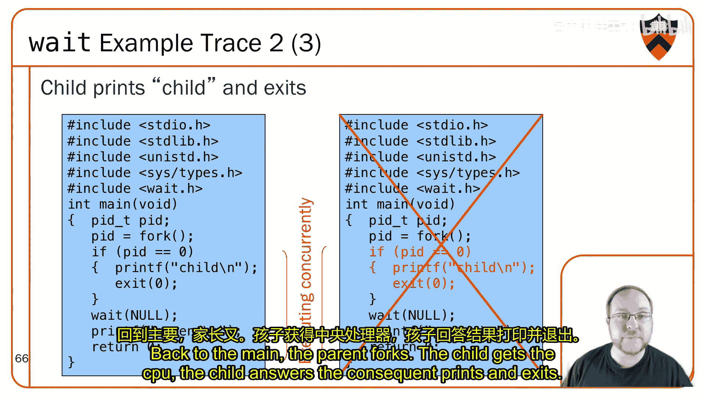

Then the parent gets to run。It calls weight， which returns immediately because the parent has a child that has already terminated and has not yet been waited on。

So the parent can continue to print and finish。

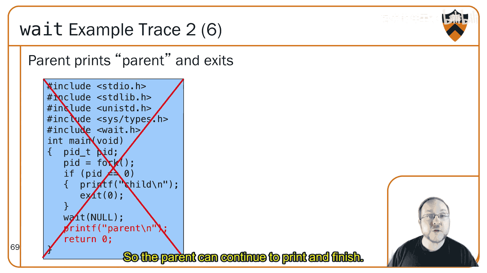

Just like before we have child parent， we have successfully controlled our process execution order via weight。

This isn't changing who the OS let's run first， but rather manipulating the code so that no matter who the OS chooses。

The code can can force one or the other to execute first。

So now we've seen how parents can wait for their children and wait for them to terminate。

 and sometimes we need them to do so in order to get correct ordering of operations。

 but even when we don't need it， it's still considered good practice that a parent should wait for all its children。

If the children will end up in one of two statuses。Each with a very evocative name， orphan or zombie。

 or the combination of the two orphan zombie， though the latter fleeting。

 This is what happens if the parent doesn't wait。 So while that's kind of fun and cool。 And。

 I don't know， genre savvy， given the Halloweens coming up。

 orphan and zombie are not things that we aspire to。😊。

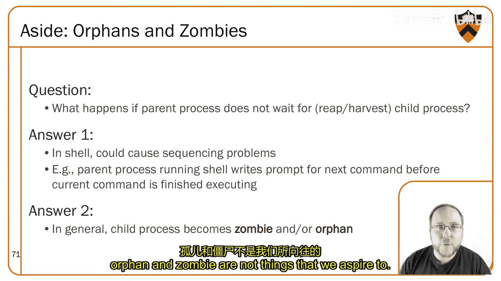

Orphan just means that a process is running whose parent has already terminated。

 It means the parent clearly didn't wait because had it waited and the child is still running。

 it would not have gotten to go it wouldn't have gotten to go it yet。A zombie， on the other hand。

 is a process that has terminated but has not been weighted on。 Maybe the parent eventually will。

 maybe not。These statuses are potentially problematic because zombie processes hang around。

 They're sitting around waiting for the parent to wait on them。 And instantly。

 another word for weight is reap， just in case you really wanted to get in with the essence of zombies。

 So if it is an example， system demon process that's intended to run forever。 fork's children。

 but doesn't wait on it， they'll just start to accumulate more and more and more zombies。

 And this takes up state on the machine。

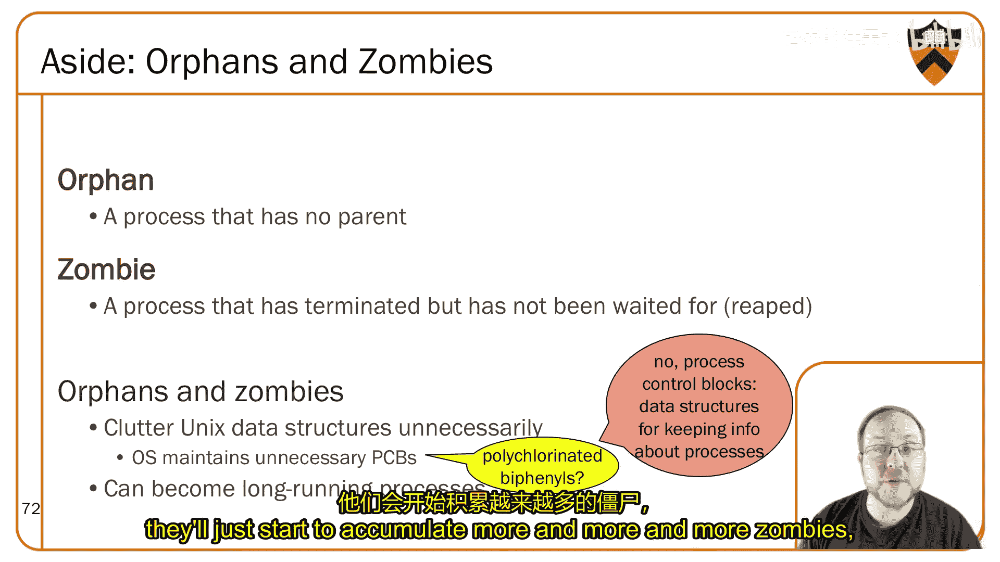

So let's look carefully at these two cases。If the parent terminates first。

 the child becomes an orphan。 This means the parent can never wait for the child since it's already terminated。

 And so to avoid the orphan turning into a permanent zombie。

 we need some process to agree to wait on the orphan eventually。Traditionally。

 that process was the OS's system initialization process called a knitT。

 which has PiId1 and is the ancestor of every process。

 it was said to adopt the orphan process because we had to continue the familial theme in naming。

In more modern versions of Linux， though， any process can state that it's willing to be a so- calledled subreaper that is an ancestor that fulfills this role just farther down the family tree instead of all the way up at the root in a knit。

The way this happens is that when an orphan terminates， it briefly becomes a zombie。

 its nearest living subbriefer， a sub reaper ancestor in it， in the worst case。

 will receive a signal More on that later。 And this signal。

 Sig child indicates that it should wait for the newly terminated orphan。

The other case is if the child terminates first， it now becomes a zombie。

 but its parent is still alive。 So there's some hope that the the parent might wait for it at some point。

If the parent does the right thing， everything's good。 The zombie is reaped。 If it doesn't。

 then when the parent exits， we return to the previous case。

 the now orphan zombie remains So for only an instant before being automatically adopted by a subreaper ancestor process and again。

 init in the worst case。Of course， if the child never exits that hopefully it's a demon or somehow otherwise intended to。

 Otherwise， that's potentially an error of an entirely different making。

 it will still consume lots of resources with runway processes。

 but it would not be either an orphan or a zombie necessarily if。

 if neither the parent or the child finishes， they are neither orphans nor zombies。

If the parent eventually finishes in the child infinite loops， it becomes an orphan forever， but。

It will never finish。 so whether it's been weighted on or not is actually irrelevant。

So there's our little aside into orphans and zombies， a fun nomenclature thing， if nothing else。

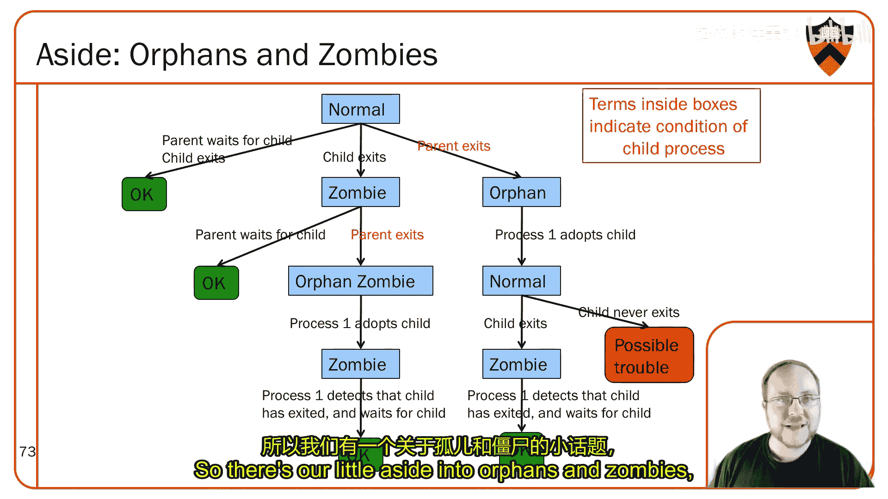

So thus far， we've mentioned a few times that after forking the child process can overwrite itself to become a different program。

 I called this the teenage rebellion of I don't want to be you anymore， mom or dad。

 I'm going to be my own thing。So the way it does is to replace itself with a call to one of the exec family of system calls Exec replaces the process's current program with a different program。

 same process， different program， so it's sort of like a theater quick change。

 quick change of costume， if you will。There are a bunch of varieties of execs that are basically permuting the options of does it search the path for the command name。

 does it take an array of arguments， and does it take an array of environment variables？

In the example on the slide exact VP， the V means it takes an argument vector。

 the P means it searches the path environment variable。

 so it does not take a series of environment variable to value mappings。

The way it's called is just a string for the command name， and then the array of argument strings。

 which by convention should start with the command name。

 that makes AGV0 to be the value that we see it customarily。Similarly。

 what we know about RV0 is that it must be null terminated。

 so the same thing goes here for the argument array。

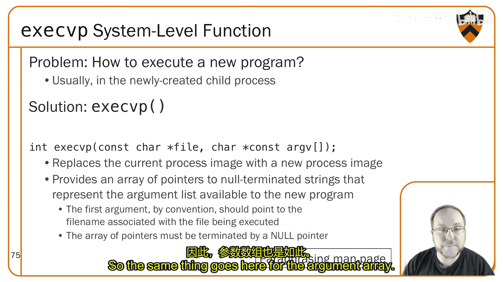

Here's an example。If we wanted to programmatically set up a call to exec。

 we could have the command be just a pointer to a string in the R data section。

The args array we'd need to arrange， for example， here is a block scope variable with each element pointing to our data。

 except for the last one。 That's no。 Then with the command name and the Arg v set up。

 we can call exactly V P to transform this running process into cat。 So here we're not doing fork。

 This is just， in our own process。 We start up and say， you know what。

 I don't want to be me any more。 I'm going to become cat。 That's the entire purpose of the program。

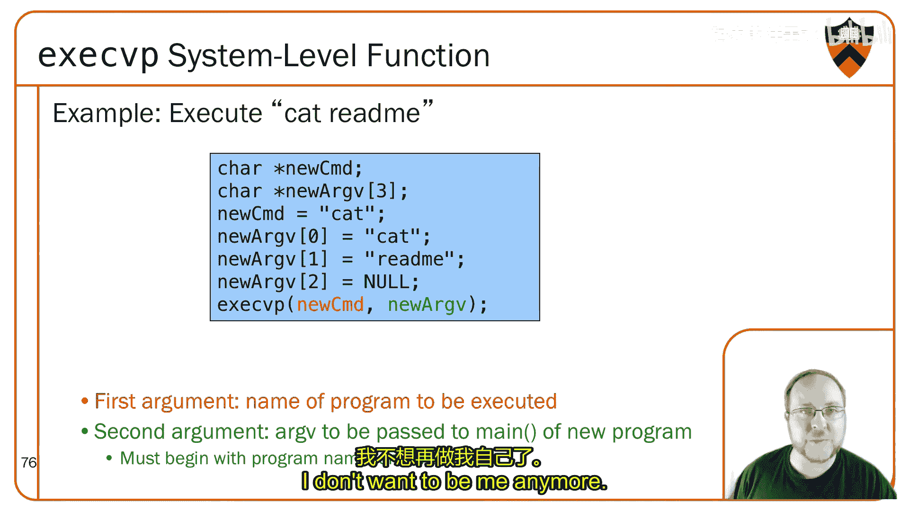

Recall that Fork was unique because if it was successful， it returns twice。

Well Exec is similarly unique or exotic， if you will， because if it's successful。

 it doesn't return at all， it just moves on with its new life to be the new program。

And the new program has a different text section， so whatever your next instruction was after the exec will never get executed。

That is， of course， if exec works， and ideally exec should always work。

 but as we've seen in this class over and over and over again。

 we should always anticipate things going wrong and we should always check our failure states。

Exec VP can fail for several reasons。 The most common of which is that the command given doesn't exist。

 You know， if we misspelled cat is caught， then we'd be out of luck。 So because exec VP could fail。

 and thus it could end up continuing in our code rather than going away and becoming cat。

 You should catch that case， which must be a failure。 This， again。

 is where we talk about exiting rather than returning or making sure that we're in Maine if we're going to return because otherwise。

 we escape back and have multiple versions of our programme running after a fork。In this case。

 if we never did a fork here。If we continued running and just ran off the end of Ma。

 we'd end up term the process anyway， That being said。

 an exit exit failure is a better way to do this。

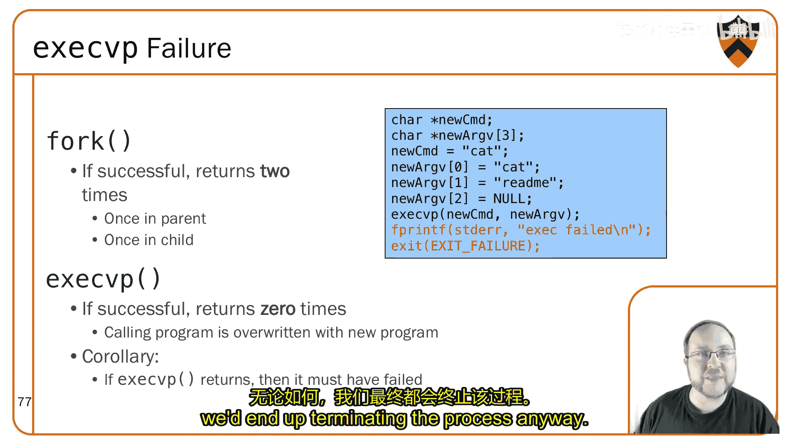

So let's do one more trace to see the details of how we would use execec。 again。

 pauseuse the video and answer。 what would this program print to standard out。

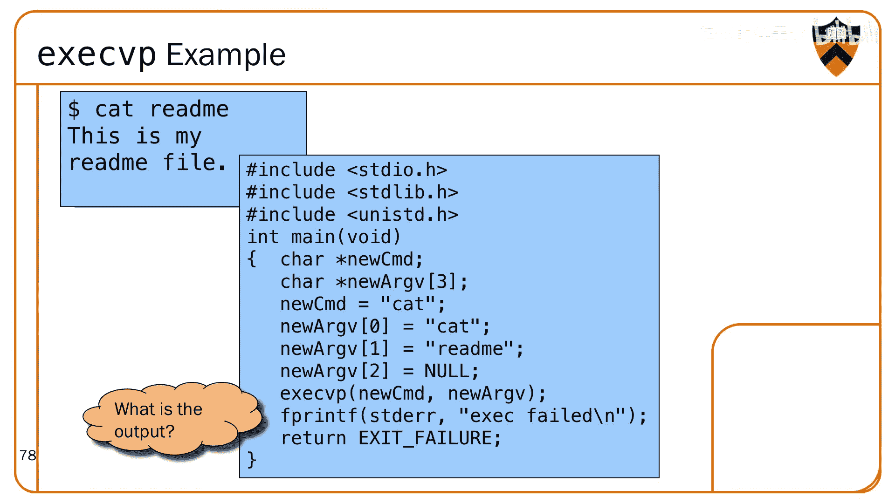

The first thing that Maine does is it builds a command name and an AGV that will be passed into exec to specify the program that we want to transform ourselves into。

Then we call exec。CaAT is a real program on our file system it's found in userr bincat and slash user s bin is in our path。

 so this exec should succeed。

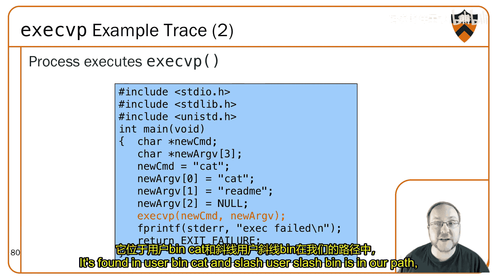

Cat will have RGV0 to be cat and RGV1 to be readme and no additional arguments indicated by reaching the terminating no pointer。

Thus， it writes the contents of the file。 Read me。 This is my new line Readme file。And with that。

 it terminates， we never return to our original program。

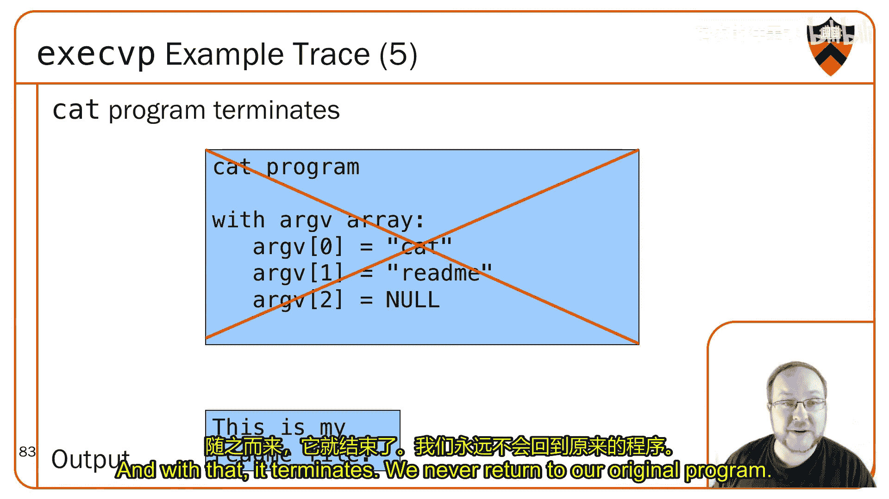

The fork plus child exs parent weights combination is a tremendously common one。

 so much for that there's a shortcut for it。 The system function combines all three in their usual pattern。

 fork child exs parent weights。

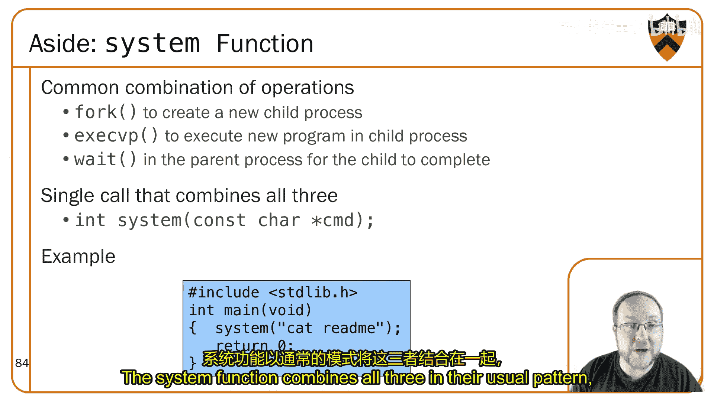

So with these friends， fork exact weight and exit and system built in as， you know。

 a combination thereof， we have a lot of power to build multi process programs。

 Consider our first real program that we ever saw the one that continued we continue to use extensively。

 bash。😊，We learn that a shell is just a program that runs other programs。

 but now we can start to understand its internals。 A shell at its core is really just a big loop。

 Step 1， read and parse the user specification of what program they want to run。 Step 2。

 fork a child process。 Step 3， A in the parent。 wait for the child to finish。3 B in the child。

 Call exec and execute the command。😊，Step four， back in the parent。

 clean up anything that was required after the return from weight， step five。

 go back and start the loop again。It's a really simple idea。

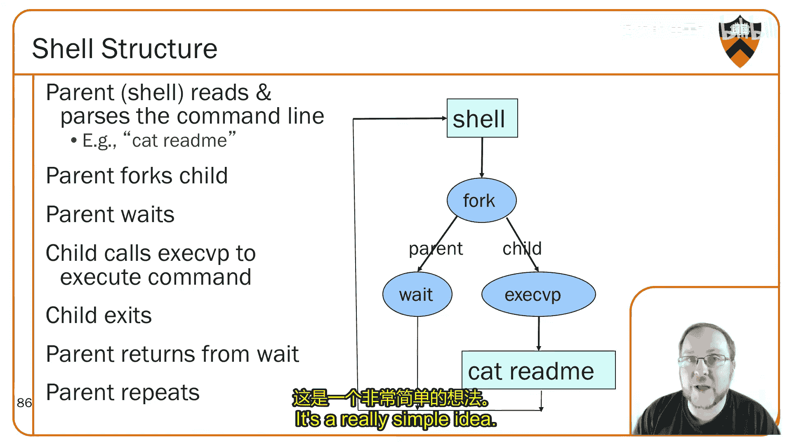

Here's some pseudocode mixed with real C for this structure。We parse the command line。

 we assign values to the arguments we fork。If we're in the child， we exec， if exec failed。

 we exit back in the parent， we wait， and then we repeat。

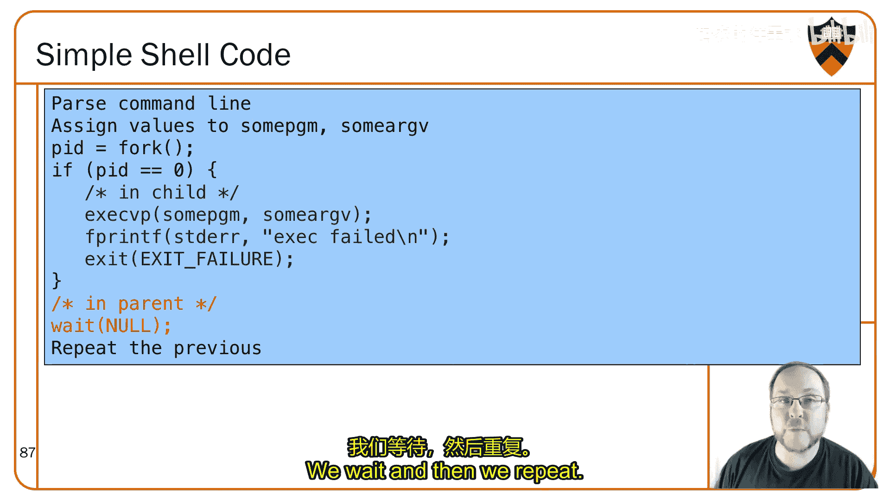

In Scode， we parse our command from the user and we set up the command and arguments to be passed into exec。

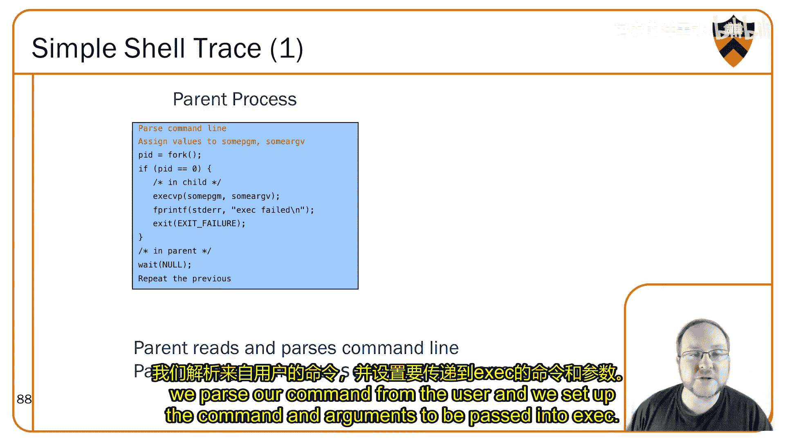

The for here succeeds。So there's a child process， if the fork failed， we'd have to handle that。

But here the fork succeeds， there's a trial process。If the parent ran first， it waits immediately。

 This means the child will run。 This makes sense at a she prompt。

 we say when we start running a command， we're going to wait until it's done。If the child went first。

 it's already running。So in either case， we're in the child where the pit is zero， so we call exec。

If it works， we're no longer here。 If it fails， we clean up。Eventually。

 the child continues running some other program in its process。

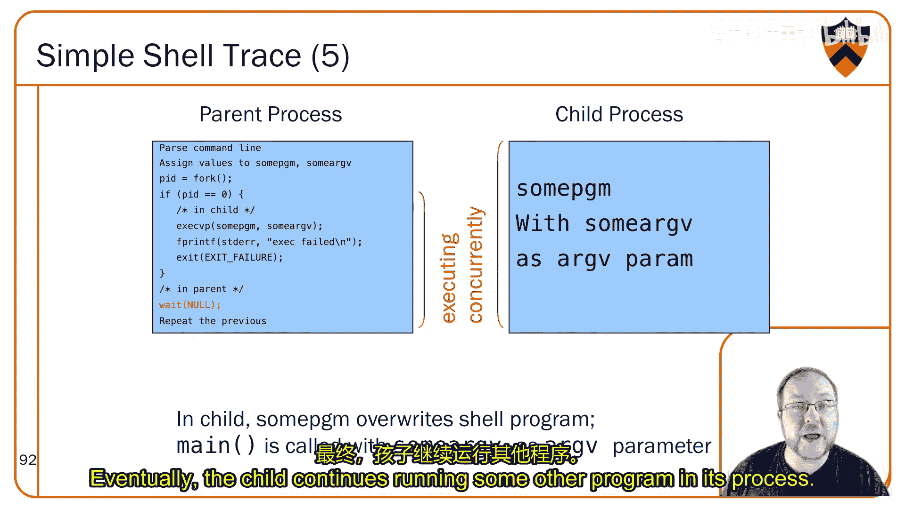

And eventually it finishes。In the parent where we have been waiting for the child， we wake up。

 we're set to go again。

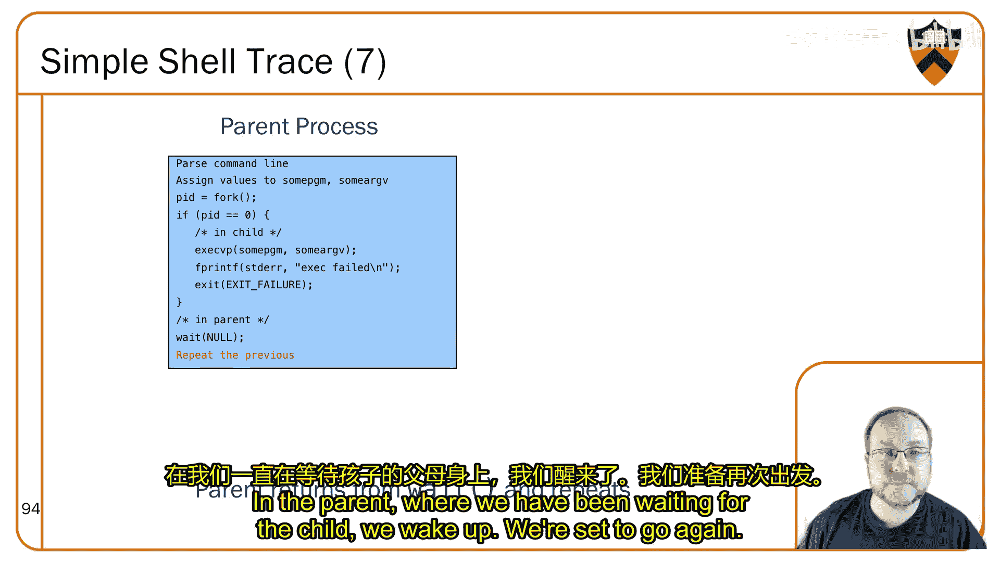

As an aside background processes， you might have seen the Empersand that we put to say。

 run this program in the background。When we don't have that， the commands are blocking。

The shell won't can regain control until the command finishes。But in shells that we've seen。

 that's not always the case， we can choose to put things in the background and get our shell prompt back immediately。

Just from what we've seen so far， we can start to imagine how that might work。

We don't wait in the parent after the fork。 That means we won't be waiting for the child or now children potentially to terminate。

But that means we do have to periodically see if we can wait for them。

 We can use a variant of weight that waits on a specific process。

 So we keep a track of how many different children we have。 And then wed give it。 in this case。

 the W No hangs says don't block。 So wait on it， reap it if you can。 But if it hasn't died yet。 Yeah。

 just go on。The other thing we mentioned was this idea that we could receive a Sig child signal that would let us know that one of our children has terminated and so then as we handle that signal again we'll talk about in a moment。

 we could just do a weight in its handler。So I hope that this is giving you some insight into how the shell you use every day works and a little bit more about the idea of processes。

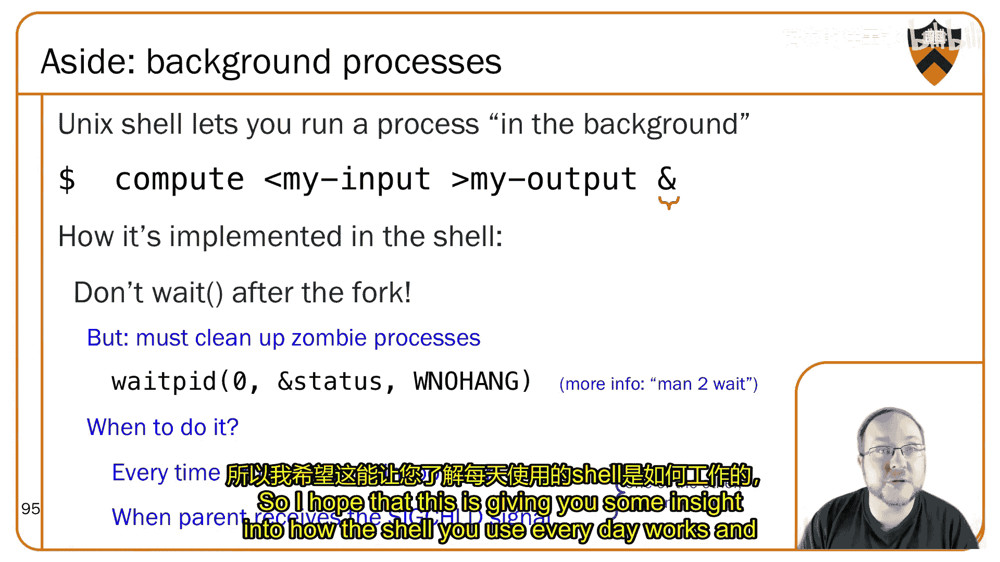

So as promised， the last bit of our sort of three part one big lecture dive into processes is how one might interact with other processes using these signals that you've heard so much about。

 but maybe you don't know what they are yet。

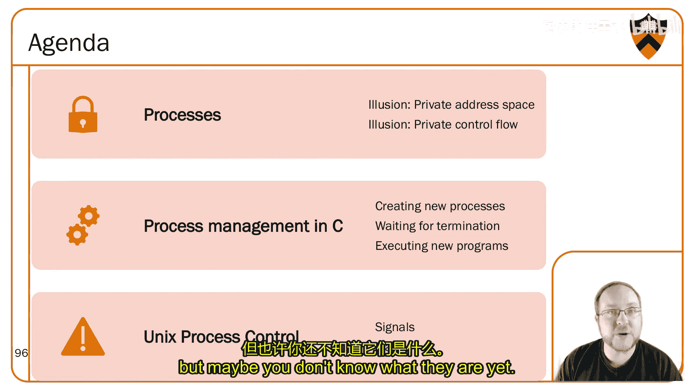