# 【全集 秋季版】普林斯顿大学 C语言系统编程 中英字幕 p18 Lecture 18 - 信号 -BV1u1feBoEsK_p18-

This is the third part of our lecture on processes。

 This last bit of our one lecture dive into processes is a new mechanism for communication with a process。

 We know about Io。 We know about command line arguments。 Now we will learn about signals。😊。

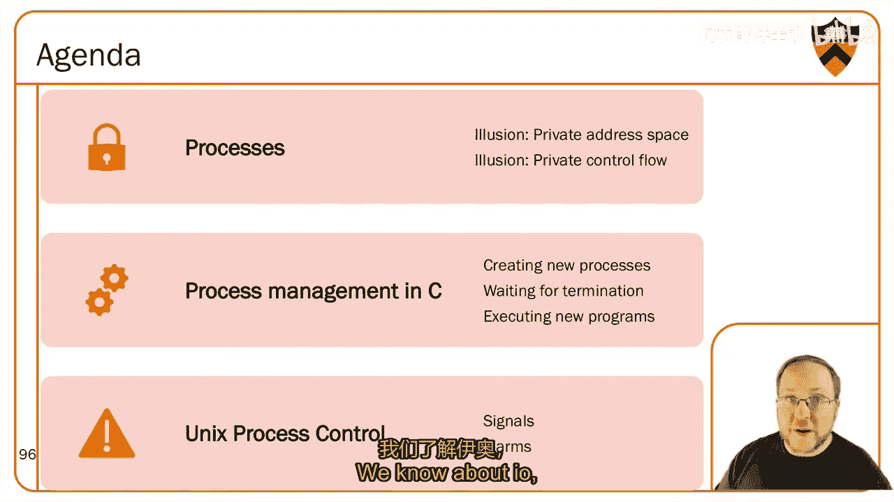

Let's dive into this idea with one more new demystification of something you probably saw very early in Co 126 When you've got an infinite loop。

 press control C to break the loop and quit out of the program。When you press C C。

 the keyboard controller raises an interrupt to the CPU， the OS notices the interrupt and handles it。

 reading the data from the keyboard and determining what to do with that data。Typically。

 this would be handed over to the process that's currently reading from the keyboard。

But in the case of control C， it instead interprets the keyboard input as a request for the O to make an exception to the normal execution of the running process and indicate that that process has some status that needs immediate attention。

This OS injection of the notification into the process's normal execution is a signal。

The process upon receipt of the signal has either the default or custom mechanism for handling each signal In the case of control C。

 the notification is signal number two， Sig int in tears is interrupt。

 But that's sort of a misnomer as any of these signals is' an interrupt。

And the default behavior is to terminate the process， kind of drastic。In the case of control Z。

 which you might have also seen， the notification is signal 20， Sig stop， a terminal stop。

 and the default behavior is to stop the execution of the process， but don't terminate it。

 put it in a suspended state until you receive a sigunt for a continue。

There's a third signal that the user at the terminal can send one that you perhaps haven't seen Sign 3。

 Sig quit， unsurprisingly， given its name， the default handler is also to terminate the process。

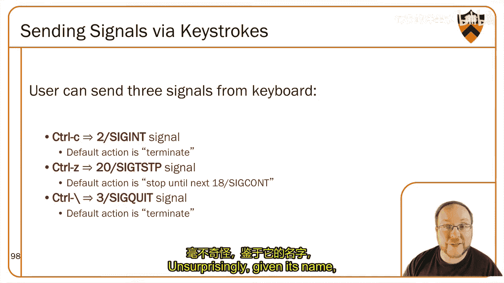

So here are those steps summarized into a nice list。Another example of a signal is her own phrenomy。

 Sig se V。The segmentation fault。Which gets raised when we execute an instruction that makes an illegal memory access。

 Again， O S gets control of the CPU due to the interrupt。 It sends the signal signal 11。

 in this case， to the process， and the process receives the signal。 It handles it。

 The default reaction for signal 11， as we're all well to aware by now， is to terminate the process。

😊。

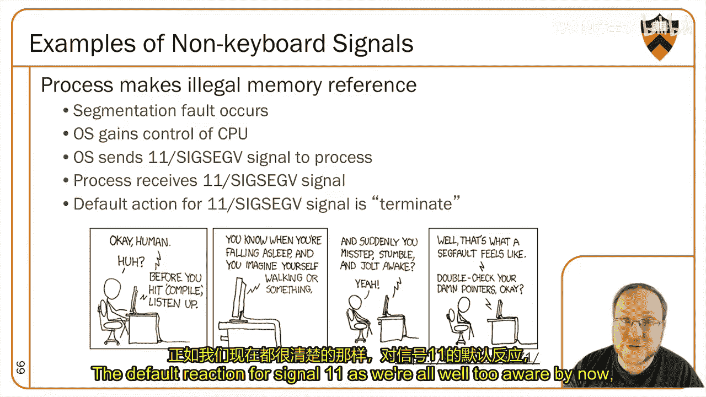

So generalizing a bit， when process P is executing if there's an exception。

 an exceptional occurrence that breaks the standard control flow of the program， again。

 this is different from a Java exception Exles here include keyboard shortcut triggers an interrupt or a memory access trigger to Seg fault or another process traps to the OS to request to send a signal directly we'll see that later When there's this exception at the exception。

 the OS gains control of the CPU to handle the exception。

 and it notifies the target process of the exceptional situation。

The OS sends a signal which is really just setting a bit in the status bits of the process。

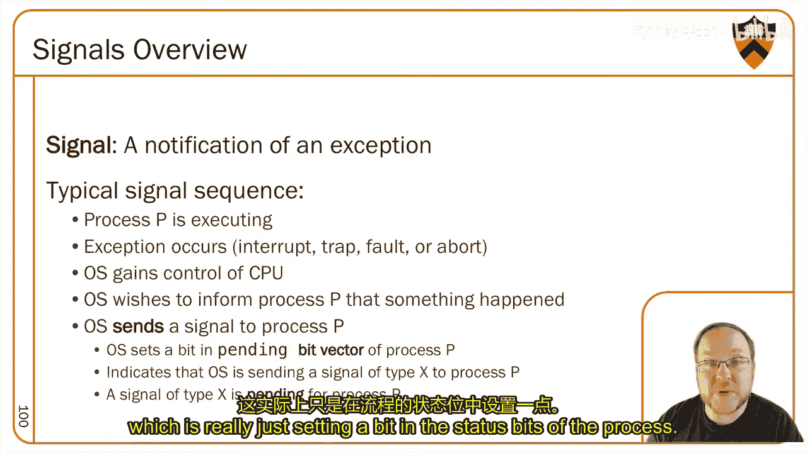

Sometime later， the process resumes， it gets control of the CPU again。

 and oftentimes actually this is immediately as signals are often notifications that should be handled immediately。

 so the OS would have good reason to context switch back into P at this point so it can receive the signal。

 but whatever it is， the OS notes that the status bit for process P。

 it notifies P that the bit was set， and then it clears the bit and triggers P's signal handler。

 whichever that is， whether it's the default one or the custom one。

If there is a custom signal handler for this exception in P， then P will execute that signal handler。

 which might do all sorts of things， including terminating the process。 Otherwise。

 each signal does have a default behavior set by the O。If P survives the signal。

 that is that the either default behavior wasn't to terminate or there was a custom handler that didn't terminate。

P will continue executing as normal after the signal handler completes。

 So this means that you can think of handling the signal in the case where the process doesn't terminate as only a temporary step away from the normal control flow。

 but it is a step away from the control flows nonetheless。

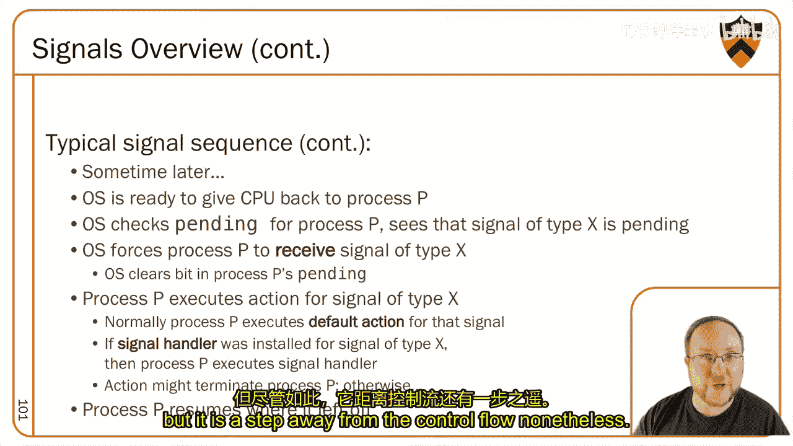

Beyond keyboard shortcuts like control C and control Z and control back slash。

 there are other ways to send signals to a process。

 One other way is the rather severely named kill command in which you specify a signal and process to receive that signal。

Despite the command's name， the signal can be any signal， not just SG kill。

 and the process can be a process ID or a shell job identifier。

Clearly though you must own the process that you're trying to send a signal to or be an administrator。

 for example， oftentimes students leave infinite looping code running on armLb。

 we saw an example of this earlier， and while normally we just send nagging emails to students to kill off their own jobs。

 sometimes an administrator might go ahead and issue kill commands to do so directly。

So how does this command work？

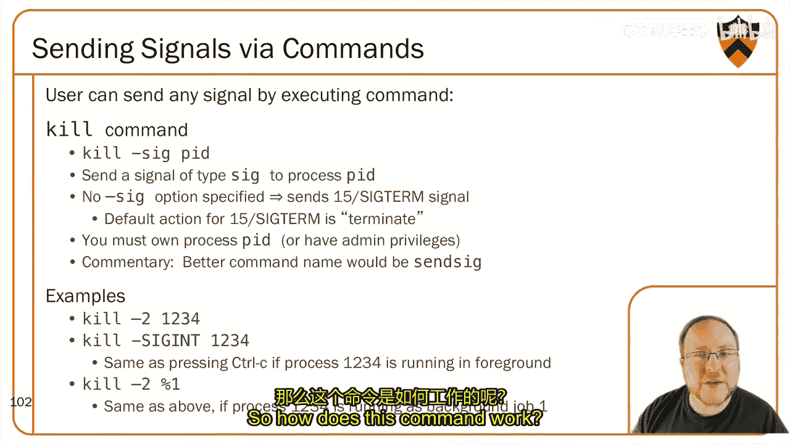

The kill command itself issues a trap to the OS because sending a signal is something that requires elevated permissions。

 so it says OS， I need you to do something on my behalf。Similarly。

 imagine that you began a command that you wanted to run in the background。 One option would be。

 as we saw， kill it and start over again with the Emand after the command。

 And that's the sort of natural way to say， that wasn't what I meant to run。 cancelance。 go away。

 now restart with what I wanted。But killing it seems harsh。

 especially if you don't realize that you didn't run it in the background until maybe a long time it elapsed。

 And so you'd be wasting a lot of work。 So instead， you could send it a sig stop with control Z。

 And then once it's suspended， issue the command B G， which puts the process in the background。

 and then sends a sig cont to the suspended process to continue。 So in this way。

 rather than killing it off and having to start from scratch， we can just sort of pause it。

 put it in the background and then restart。There are of course。

 a lot more than just these few signals you've seen so far。

 and we can see all the signals predefined on a system using the same kill command with minus L option for list。

So the men pages continue to be a fantastic resource as well Men7 signal shows you the disposition that is the default action for each of the signals and it offers additional information about working with signals beyond the scope of this lecture。

So continuing with more options to send a signal we saw from the shell。

 we can see that a program also can send a signal to itself with the raises function call。 Frankly。

 this seems a bit odd。 One might reasonably question， why would you want to send yourself signals。

 particularly ones that so often end up with termination。

One use is to send yourself signals that don't have any default meaning in order to track the logic of your program。

 but to me， this feels like an even worse version of go to in terms of hijacking the natural flow of control in your program。

 but there is one clever use in the manuals， however。

 so you can have a look there essentially it's to have a signal handler to clean up upon receiving the signal。

 but still end up following the default signal behavior。A more natural thing， though。

 would be to send a signal to a different process， much like the kill command in UniX。

 the kill function is a bit overzealously named and overspec named。

 It can be used to send any signal to a process that is owned by the same user as the program calling kill as you might expect。

 I can't send a signal from my process to yours to terminate your process that just wouldn't be fair。

 Same as at the shell level。While this can be used to terminate another process that you are following。

 it can also have a more mundane use， namely， it can serve as a somewhat Spartan form of inter process communication。

what one common example here is to use as an implementation of a heartbeat that indicates to another process that this process has not terminated Oh。

 I received the signal from them they're still alive in order to send me that。

So as we've been talking about signals， I've mentioned the default handler for each of them。

 so we should talk about signal handlers in general。

 which if rays or signal are analogous to Java throw for exceptions。

 signal handlers are analogous to Java corresponding catch for exceptions。

A signal handler is simply the reaction that a program will have upon receiving a signal。

So every signal has a default reaction， and for many of them it's terminating the process。

 so if you do man7 signal again you'll get a table of all of them in their default actions but you can see that you can also ignore the signal。

 stop the process or continue the process if currently stopped。But also。

 the program can install a custom handler， a function that will run upon receipt of the signal in place of the default handler。

 This could be as simple as because it doesn't want to terminate under the condition。

 Then it gets a particular signal， but it could also be a means to clean up the state of the process。

 such as sending a disconnect message to an open network socket or finalizing a database record or closing some files before succumbing to the necessary termination。

So the way that a program can install a signal handler is with the function called signal。

 which further lamenting the use of the term kill before probably should have been the name for that function that sends a signal instead。

 but in fact， it's the function for installing a handler for a signal。Bad naming， aas， moving on。

So signal takes two arguments， the signal that it's installing a handler for and the function that will be the handler on success it returns the old handler。

 This is convenient because it allows you to save that behavior to reuse if you're alternating between opposite signal handling behavior over the course of your program。

And though we can write arbitrary signal handler functions。

 there are two specially predefined SIG handler values that we should know about。

 SIG DFL and SIG IGN。

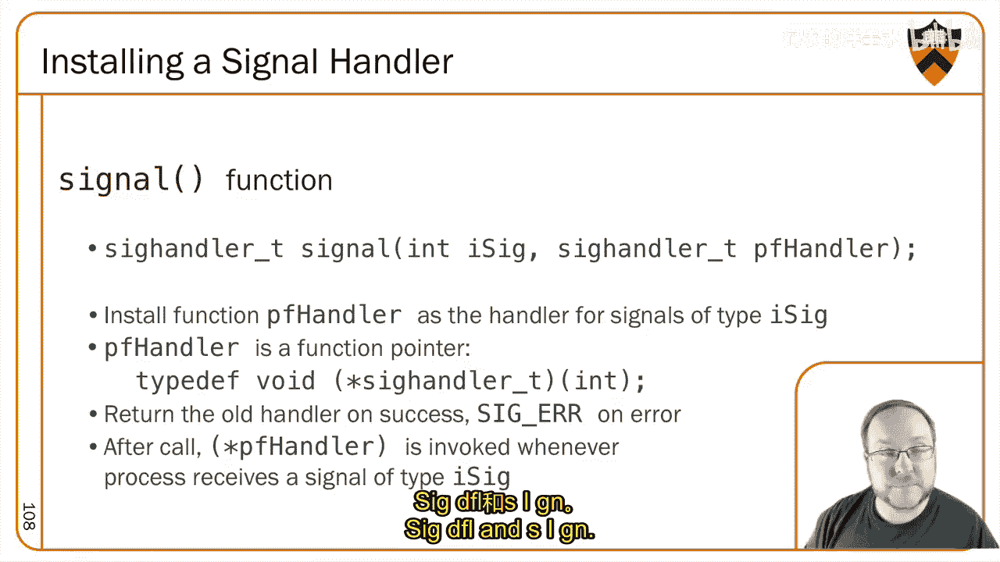

So SiIG DF restores the default handler， think of this as uninstalling the custom handler if there is one。

And Sig IGN ignores the signal altogether， think of this as a shortcut so that you don't have to bother to write out an empty do nothing signal handler。

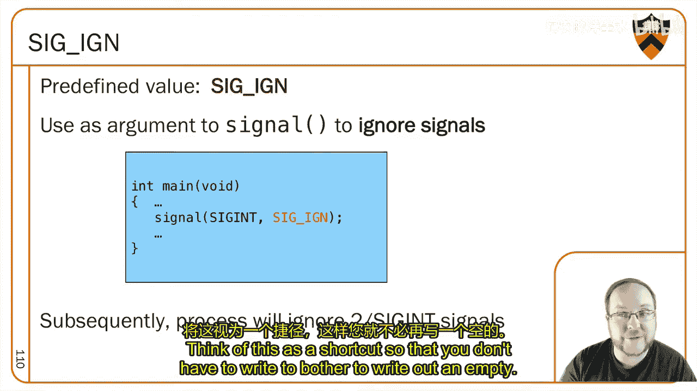

So before we look at an example， I should mention that there are also some signals that the program may not install a handler for。

 and so there is no way to handle it in any different way than the default。 One in Sign 196 stop。

 We saw this was used in conjunction with Sigantant to suspend and resume a process's execution respectively。

The other that cannot be handled is signal 9 Sig kill。

 which is why you'll sometimes hear kill-9 used as a verb since it's a way the shell can kill off a process and be pretty darn sure that process will。

 in fact terminate。 since after all， there's no way for a program to handle that signal。

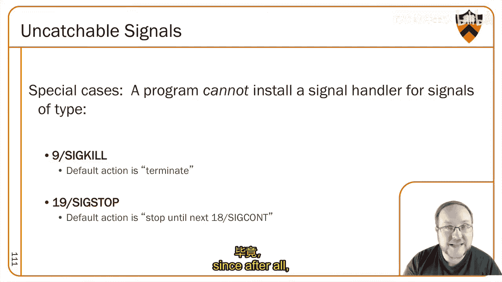

So now we're ready for an example。First things first in order to use the signal function as we see here。

 we have this poundefing canoe source thing so the short version of this story is that there are various versions of different libraries including the C standard library so much for being standard and this macro is telling the preprocessor which versions header files to import into the top of the program so it's really just which version of the standard library。

In this case， the decision impacts signal handling in two ways， first of all。

 it exposes a type type def sig handler underscored T in the interface and a few additional signal related function prototypes。

Additionally， different library versions do different things when a primitive like read or write the lowest level signal calls for system calls or system level functions for IO are interrupted by a signal so the Possic standard Poss is the standard and operating systems is to have the primitive fail immediately it's clear but often inconvenient because it results in many checks for error codes。

 and we all know how easy it is to forget to put one of those in So instead of Posss we have the canoe source which resumes the primitive once the handlers is complete。

 so it's sort of a niche sort of nuance here but just in case you hadn't seen that before it's a macro that tells us which version of the C standard library to use。

All right， with that aside， we can look at the structure of the program in Maine。

 we install a handler for Sint， and the handler is just a function that indicates the signal has been received。

The programme then prints a message， then enters an infinite loop with the signal handler installed。

 control C will not terminate this program， and instead will print the message over and over and over again。

 but other signals are unaffected。Here's another example in this case。

 instead of only handling Sigint， we're going to try and handle every signal。

 Of course we know we can't do that Sig Kale and others can be can't be handled。

 so here we can mash at all the keyboard shortcuts we know about and we won't terminate our program。

I actually had to go to another window here and invokecate kill command on the process in order to kill it off。

Note also that it fails to install 32 and 33 because these are controlled by the Pos thread library in the GlibBC version and are pound defined。

 but again， beyond the scope of what we're talking about here， this is you know again。

 a corner case where this particular version of the standard library does something special with those so you can't change how they're handled。

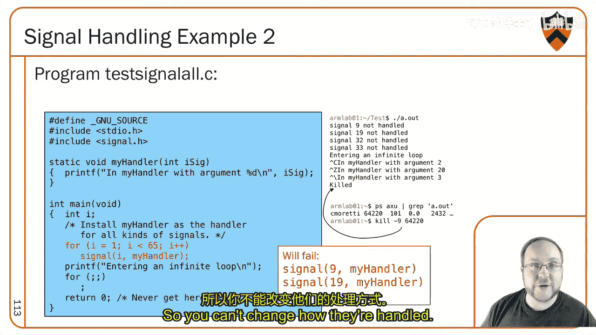

For a third example， let's consider an example that's less artificial。

 One that we might actually use in practice。 This program generates a lot of data and prints it to a temporary log file。

 but it then removes the files before finishing the program that way。

 it doesn't clutter the file system or run into some sort of quota。

So what happens in this log file if the user presses C C？

Pause the video here and take a moment to think about it before moving on to the next slide。

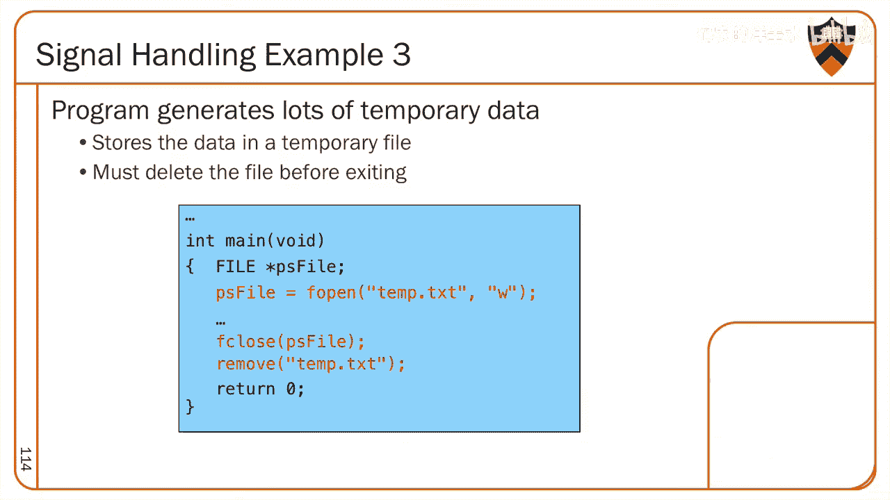

When the user types control C， the OS sends a signint to the process。

 the signin will terminate the process unless thus never get back to the remove call in main。

 so if we want to be sure that the file will be cleaned up upon exit from the program unless someone kill minus9s0。

We should install a signal handler。And in that signal handler。

 we can do the cleanup that we want and then exit it as we otherwise would have with the signal。

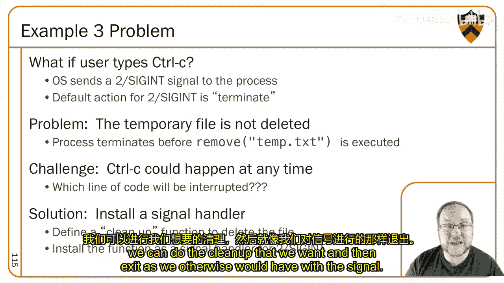

So in this file， we have a function clean up that closes the file descriptor。

 removes the file and exits。 We install that function as the handler for Sigt。 And furthermore。

 to avoid duplicating code， albeit at the cost of slightly less clearer flow of control。

 we could even unconditionally call this function at the end of the program。

 even if we didn't receive a signal。

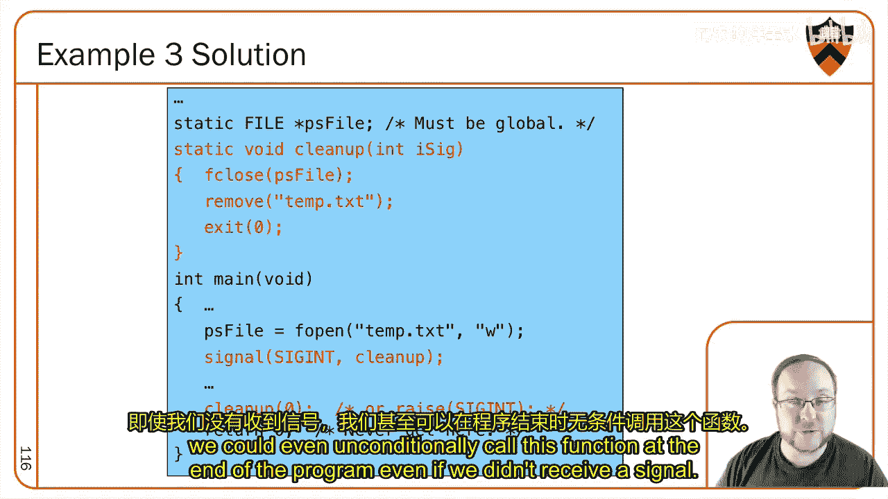

The last system level function we're going to talk about is the special system call that asks the operating system to begin a countdown to send the calling process a signal。

 specifically Sig alarm Sign 14 at the end of that countdown。

This is a pretty useful function because it allows us to implement time Acts。

 we can be sure that no matter what code we're about to start executing。

 we can get back from it in a certain amount of time after all because signals interrupt the normal flow of control。

Typically， this will be combined with installing a handler for Sigal alarm because the default disposition for Sig alarm is to terminate the process。

 so it would be sort of weird to say in 17 seconds， terminate my process no matter what I'm doing。

A better thing would be to say in 17 seconds， call this other function， no matter what I'm doing。

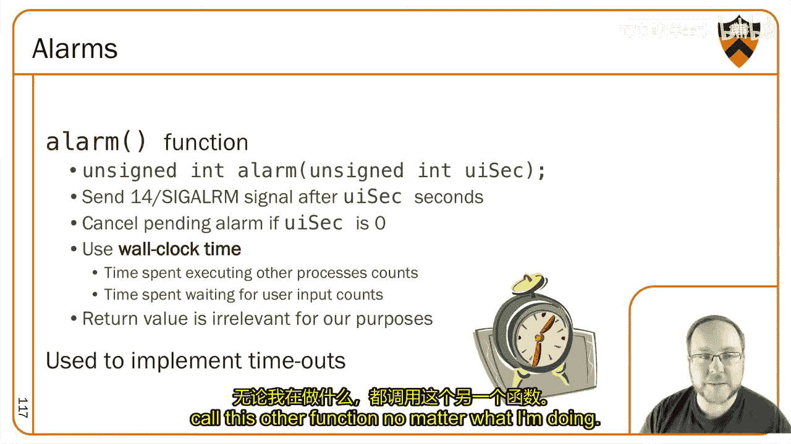

So let's look at an example。Pause the video and take a few moments to reason about what this program will do。

In this program， we set a handler for SIG alarm， then invoked the alarm system call to ask to receive a SIig alarm from the OS in two seconds。

The program then enters an infinite loop， as before。Two seconds into executing that infinite loop。

 the OS will send a signal alarm signal which will be handled by the signal handler。

 printing a message。But then instead of exiting， the handler prints and reinvokes the system call and drops out of the function。

At this point， when we're done with the handler， the program will continue executing exactly where it was when it received the signal。

 sitting in the infinite loop。But in the handler， we reset the alarm。 so two more seconds later。

 the same thing will happen。Handr will get called， it will print。

 it will reinvoke the alarm again and resume where we left off。

This will continue forever until terminated by some other signal。

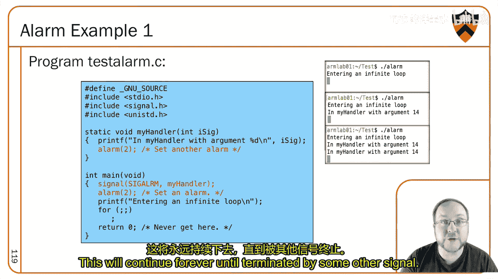

Here's another program， our very last sample program of this Mon lecture。So if your stamina persists。

 now is the time to pause the video and see if you can reason about what this program is going to do。

In this program we set a handler for SIG alarm， then invoke the alarm system call to ask to receive SIG alarm from the OS in five seconds。

This time， instead of an infinite loop， the program attempts to get input from the user。

 it prompts for standard input。After the scanf， if we have indeed received the requested information from the user。

 it cancels the alarm with alarm 0。 Alar 0 says cancel any existing alarm。

 and then it will confirm the input。But that's if the user enters the input quickly。 If。

 on the other hand， the user doesn't respond for 5 seconds， then the alarm is going to trigger。

 and the sorry message will print。This can prevent a program from sitting around wasting resources while the user is out to lunch or gone for the weekend。

And it's pretty nifty because it's something that the application program hadn't up until this point been able to do。

 Sccananf is a blocking call。 So once we call that function。

 we previously had no way to advance beyond that instruction。

 And we were at the mercy of the user waiting to return to our control flow。

 We had to get the input in order for for Sccanf to return to us。 Now， we have a way to preempt it。

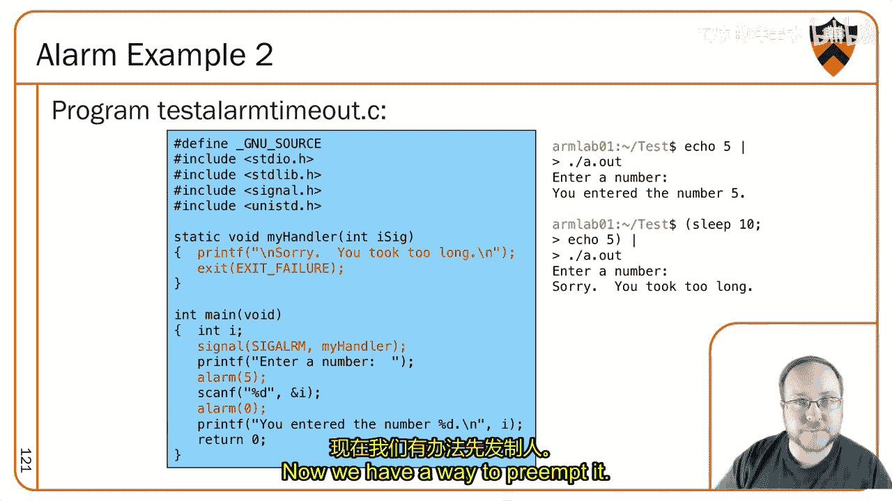

So I hope this lecture series has given you a bit of a better sense about the processes that we've been talking about this entire semester。

 we keep saying the word process with no real definition there。

 so here's been a reasonable dive into what is a process and what are some of the considerations about them when running your programs also about the shell that you've been using to invoke your programs and the types and detail of analysis and topics that you can look forward to in your systems departmentals down the line。

So next time we'll see an overview of your fourth assignment。

 which will then be covered in greater detail in precepts next week。

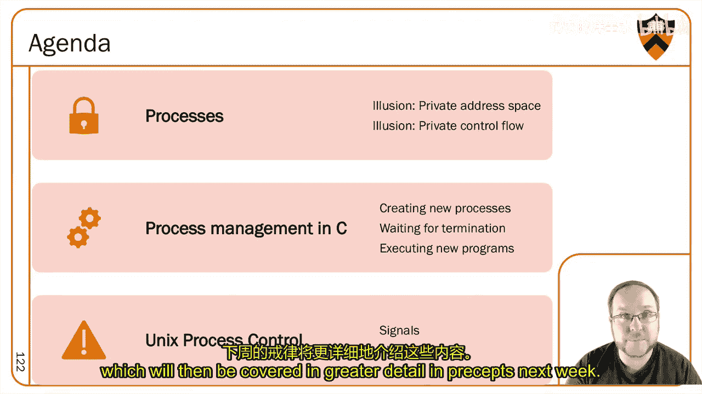