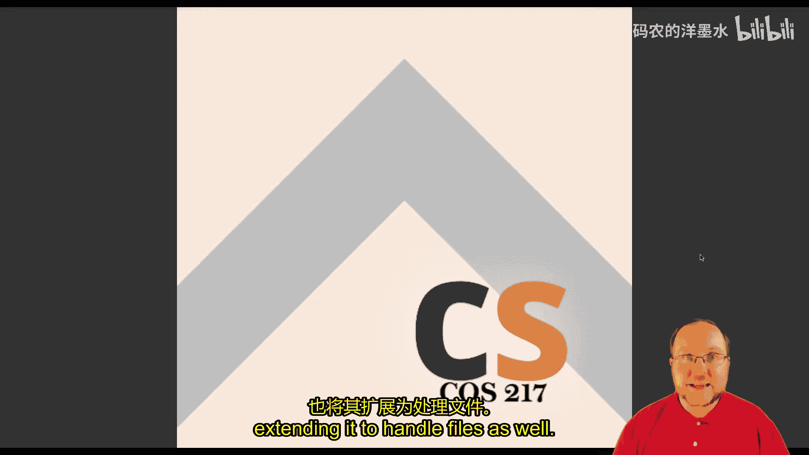
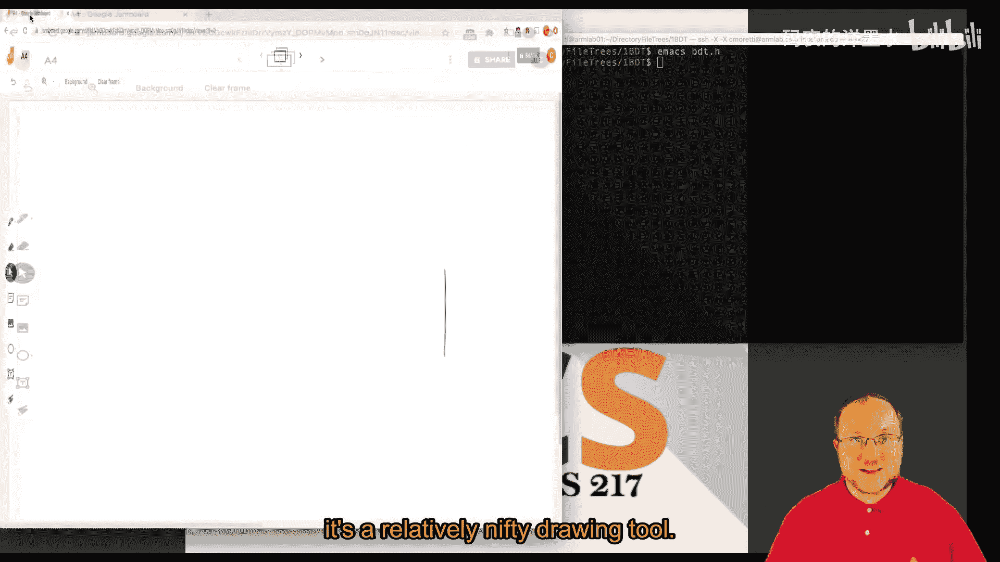
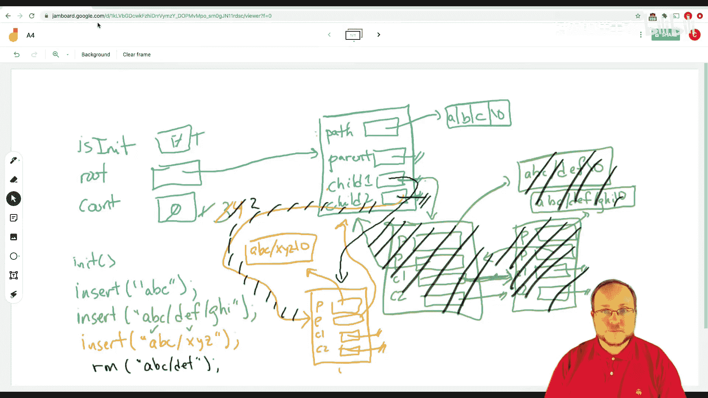
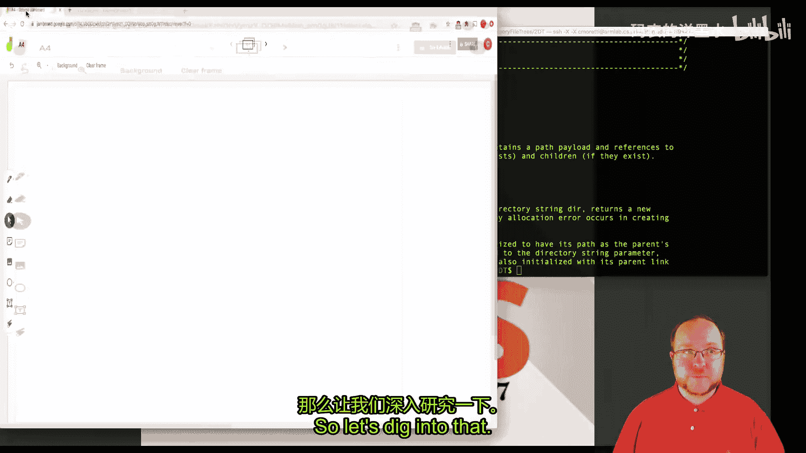
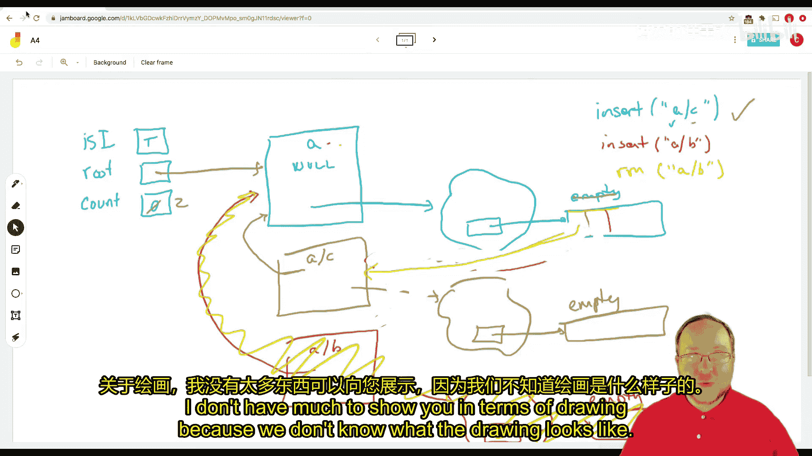
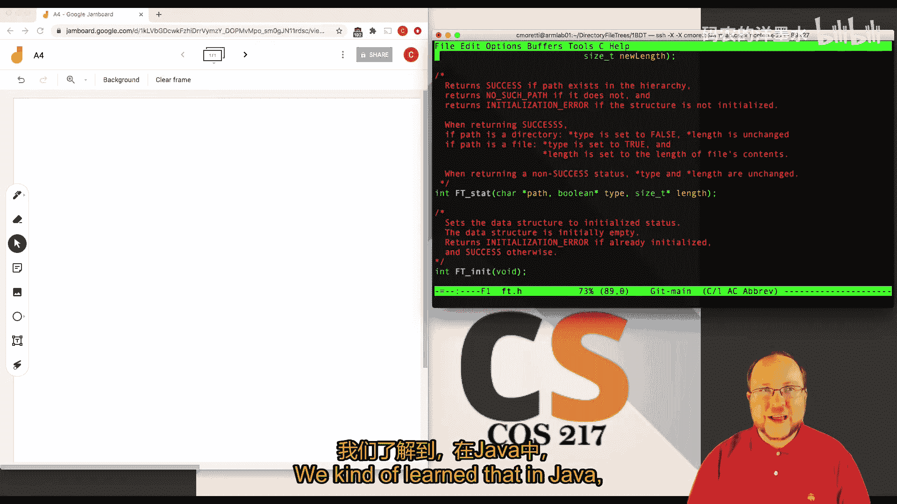

# 【全集 秋季版】普林斯顿大学 C语言系统编程 中英字幕 p19 Lecture 19 - 作业1 -BV1u1feBoEsK_p19-

Welcome back to Co 217 lecture We know that right now all of you are right in the middle of assignment 3 just starting to really dig in to finish it up next week。

 but that means that we are due now to start the topics for assignment 4。

Assignment 4 is brand new this term。 And while we really like the pieces of the assignment。

 we think that it has a lot of really great lessons throughout and really cogent big goals for the assignment。

We are totally cognizant of the warnings from Mka's the Art of War about how no plan of operations can possibly extend beyond the first contact with hostile forces。

And yeah， I know that makes you hostile forces here， but we know you're actually nice。

So bear with us as we get through this assignment again， we think it's going to go great。

 but if there are any little snags， we'll try and fix it as quickly as we can。

So this is the first partner assignment and that despite what you might read on real talk from several semesters ago。

 you can partner with anyone in the class， you can have exactly one partner at most。

 you have you can work alone but we don't recommend it。

 we think that you should work with a partner if at all possible。

 you'll get more out of it and the assignment will go better for you。

 but yeah you can work with anyone in the class， it doesn't have to be just somebody from your precept。

So in terms of how to find a partner， clearly you can't just walk up to somebody after precept。

 but I do hope that you'll be able to perhaps approach somebody after precept if your preceptor can leave the call open for a little bit longer。

 you can come to the watch party either。lecture next week should be a great time to find a partnership to start getting started you can put yourself out there on Ed I think that that would be a totally fine thing I don't think there's any risk of it turning into Coast Tider。

So I do encourage you to find a partner sooner rather than later。All right， so assignment 4。

 it has five big goals。 The first is reading substantial amounts of code that you didn't write。

Thus far in your coach career， you haven't necessarily read much code at all that you didn't write。

 It's normally there's maybe a little bit of of template code or a little bit of scaffolding。

 But pretty much your job has been to write the code。 And that's how。

 how you've gotten better at writing code。But just because you can write code doesn't mean you can read code。

 And this is actually a real world problem。 People every day walk into their first day at at know some large software company。

 whether it's Facebook， Google， wherever and say， all right， I'm ready to hit the ground running。

 What am I writing。 But in fact， it's， we have a billion line code base。

 You need to learn this small part of it before you can do anything useful。

On a much smaller scale in Co 333， when Professor Knahan teaches it。

 there's the O assignment in which， despite the fact that most people come into the course。

 never having written a single line of O and never having seen the internals of a programming language before。

 They're handed the internals of O and and told to go fix a book。

 So this is a real world problem and， you know a slightly more advanced departmental type problem that we'd like to start to to simulate here。

The second big goal is to get more experience with data structures。

 particularly the abstract object paradigm。 So in assignment 3。

 you've seen the abstract data type in which we have。

Object state that's inside of a structure so that we can instantiate basically as many of them as we want and then all of the methods。

 you can think of them as the instance methods， take that instance as one of their arguments。

In the abstract object model。It's more like a Java singleleton。 There's only one ever。

And so in this case the state is just a bunch of static variables， they're visible only to the file。

 but their file scope， and so they exist， but you can't instantiate more than one of them。

 there's no structure that you can mal a new one of。

 there are these several variables at the top and that's it。And because of this， then the methods。

 the equivalent of the instance methods。Instead of taking an instance as one of the arguments。

They don't because， well， there's only one。So this is a different model that's still object oriented but in a slightly different way。

 and we'd like to give you some experience with that。

The third piece is more experience debugging in GDP。

So some of you kicked off with assignment2 as soon as you learned about GDPB， you got right to it。

 many of you are finding that assignment3 is to bug heavy and so you're getting better and better but before we move on to assignments five and6 in assembly language and then machine language and getting really nitty gritty type of analysis in GDP we'd like to just kind of buff up your skills a little bit more and so the first part of this assignment is actually going to be there's no code to write it's going to be just here are some poor implementations。

 use GDP to find where they break down where the bug exists。

The fourth big goal of this assignment is to get more experience with testing。

 so similarly thus far in your career， you've typically had the test suites written for you。

 and that's true in this class as well。And。Moving forward certainly in the next assignment you will be writing your own test suite of external tests。

 and so this assignment assignment4， you will be writing your own suite of internal tests。

 you'll be writing a checker program that tests the representation andvariant to ensure that the internal structure of the data structure is sound at the beginning and end of of each of the instance calls。

 each of the API calls。And finally， the last big idea here is it's your first chance at modularity and program design so again。

 thus far in your career you've typically been told by the specs exactly what you are to do and how you are to do it。

For the first time， we'd like to open it up just a little bit to say。

 here is the interface you must implement。 Here is a client that must work。

 but how you do it completely up to you。So you can use lots of modules， you can use fewer modules。

 you can change the underlying implementation wildly from what we might otherwise expect。

 it's all up to you。And so you really aren't constrained by the specs that much and so that's the last piece is program design and getting to make good decisions that take into account what we learned in the modularity lecture while still giving you this creative outlet for how you think the program should be designed。

So that's the goals of the assignment。 How about the assignment itself。

 What are we doing We're going to explore a systems topic that we've talked a little bit about in the context of learning a little bit about Linux and that's file systems。

 So in the Linux file system as you know we have it's a hierarchy it's a directory tree with files and directories and so we're going to build up to that in part one。

 we're going to do a binary directory tree， so this is like a file system but what we've constrained it in two different ways with a binary and directory So directory means that there are no files here。

 everything is a directory。There's no end file pads。

 and binary hair means that every directory has it most to children。

And this this makes it a relatively easier data structure to set up because we don't have to have some arbitrarily extensible data structure inside our data structure。

 we can have just here's childil one and here's childil two， maybe they're no， maybe they're not。

So that's the data structure idea for the first part of the assignment。

 and again you won't be writing code on this， but you'll be debugging it。

So the second part of the assignment has the directory tray， so we've removed one of the qualifiers。

 it's no longer the binary directory tree， it is a directory tray。

 and so this means that your data structure is going to have to be a bit more complex because it has to be extensible to an arbitrary number of children。

And then finally the third part of the assignment， the first one that you're going to write code to actually implement the data structure itself is the file tree。

 so in this case we recognize not just directories but also files and so。

Diirectories can have children files can't so files are always the leaf nodes in the tree directories might be internal nodes or leaf nodes。

 but files have contents， so files have data that's associated with them whereas directories did not so that's the difference in part3 of the assignment that you'll implement that probably starting out from the part twos directory tree and expanding it extending it to handle files as well。

So now let's dig into the data structure， details， and the interface it implements for the BDT。

 the binary directory tree。The interface found in B D T dot H is straightforward。

 will start from the bottom up。So we start off with the init function that just says。

 I am going to initialize this data structure， I'm going to set initial values for each of the AO fields。

BDT destroy is sort of the opposite of BDT in knit。

 it takes an initialized structure and destroys it completely。

 it recursively removes all of the nodes in the structure。

 and it will leave it in an uninitialized state， then there's BDT2 string that is similar to the two strings you've seen in Java where we are going to have a string representation of the data structure。

So now pulling back up to the core functionality。We， we have a few return statuses。

 a booleing definition， but our core functionality is inserting a path into the binary directory tree。

 checking if particular path exists in the tree and removing a path if it exists。

 So inserting a path is sort of the equivalent of maketer minus P。

 So it will create the parent paths the intermediate directoryies to get to the final path if they are not already in the tree。

And remove path is sort of like R M minus R in that it will remove recursively everything under that directory。

 So it will destroy the the path， the sub rooted at that path and everything below it。All right。

 so that's the interface。Let's talk about the data structures。So this is Google Jamboard。

 if you're not familiar with it， it's a relatively。

Nfty drawing tool。 you can do collaborative drawing。 You can do all kinds of fun stuff with it。

 and it's lightweight。 and it comes with your Princeton account with your Google account。

 So if you haven't done it， try it out。So。I'm going to start off here。

 and we're going to talk about the fields of the objectject object。 So we have。There we go。All right。

 now I can actually write we have a bulloleying to say， is it initialized？

So that's simply have we put it into the initialized state？And initially， this is false。

The next thing we have is a root， so the the root of the tree。

 and we're going to call this a node this is going to be similar to a node in a linked list except we have multiple links here。

So。We have the root。And initially this is no， there are no nodes in the tree。

And then we have the count。 That's the number of nodes in the tree。And initially this is zero。

So I talked about nodes， let's look at what a node looks like。

So I said it was much like in your assignment three， in this case we have four items in the node。

 we have a path。And the path is just a string， it's the fully qualified path。

 starting from the route， going all the way down to whatever directory we're actually in。

 delineated with slashes。And so we have a path， this is actually a string that a pointer to a string somewhere else in memory it's not actually in the node。

 so I'll draw it that way for now， but soon I will probably switch to having it just in the node because it's easier there's going to be too many arrows flying around anyway。

So then there is a parent。Link。So this is a pointer to the node that is this node's parent。

 and then there are two child links， this is the binary directory tree so it can have up to two children。

 let's just have two children and if it doesn't have them， there'll be known。All right。

 so these are this is what our node is going to look like。

 So let's imagine some operations that we might do， some some simplified operations。

 So the first thing after we initialize， so we'll init。

Instantly all of these are BDT underscore this， but just for simplicity， we init。Literally。

 all that does is going to move it so that we are in the initialized state。All right。

 so now we're going to insert a path ABC， we're going to have our root initially be ABC。So。

 we're going to insert。Again， B DT underscore insert path。So this is going to create a new node。

 so it looks and says， do I have a root， no， my root is nu。

 so that means I need to create a new road， new node to be my root。My path here is。A string。

 ABC and the nullbite， we point path at that The parent， there isn't one because。

The root has no parent。 and the children， there isn't one because we don't have children yet。

The last thing we do， we point root at our new node。So that's our first insertion。We can also。

 we said that insert was sort of like a maketer minus P。

 We can insert an entire hierarchy all at once。So， I can insert。Try different color。ABC， D E F GHI。

 so this is going to look and say start at the root。Is my root， does it exist， yes。

I'm going to parse my string and say the first directory in my string my path is ABC。

 The route better be ABC。 Otherwise， I'm trying to insert something that's not under the root。

 and there can be only one root。 So that would be a problem。So we insert ABC， Yep， ABC is the path。

 That's good。 So we're good so far。 Now， we say D E F。 Does ABC have a child， ABC， D E F well。

ABC doesn't have a child one， and we have a an invariant in this data structure that says。

 if I have a child， it will be child one。So if I have only one child， it will be child one。

 so immediately by seeing child one to be no， we can say that ABC DEF should go there。

 so we're going to create a new node。With a path， a parent， a child one and a child，2。

So here is our path， ABC， D， E F， back slash0， each of those are individual characters except the back slash0 is a single character as we know Now we do have a parent。

Our parent is the root。So that's not going to be known， but we don't have any children。

And I know you're saying， but but GHI， but we're not there yet。So。All right。

 so this is what it looks like when we create this new node。 But before we're done。

 we have to link it in。 so we say。Child one now points here。From the root。All right。

 so we've finished this and now we say， okay， we just inserted there。

 we know that we're building a new path at this point we just inserted。

 so we know we're going to continue going， let's do it。New nude。No children。It has a parent。

It's the one that we just made。It has a path， it's ABC， D， E， F， G，HI。No what。

And we have to link it in。This ceases to be the empty， the no pointer。

 and instead see one points there。I should have done this in blue before。 Sorry。

 after we inserted the route， our account was one。Now after our next insert。

 our count is three because we have the root ABC， and then we have DEF and GHI below it。

So we update our account as we go， sorry for having missed that one。

So let's do what we now have a child we know about grandchildren now。

 but we haven't seen a child two yet， so let's insert another node to be a child too。

So now we have ABC XYZ that we'd like to insert， so we start at the root and we say is it ABC， yes。

 everything's good， this is ABC， so we know that we're going to do that。Does it have a child， X， Y。

 Z， We look at child 1， and it says， no， that's D， E F。 That's not X， Y， Z。 Okay。

 so then we look at child 2， and child 2 is no。 So child 2 is no。

 That means that we need to insert it there。So we'll create a new node。ABC， slash X， Y， Z。

 and then Nobite。The parent is the root。We have no children。But now we can link in。

Because we didn't have enough arrows。We can link in from childild to to be this new node。

And we update our account。So that's our inserting。 We can also remove。

 So let's go ahead and remove a path。 And we we said that remove was a recursive thing。

 So let's see what it looks like when we remove multiple things at once。 So we're going to。

 for our next operation。I suppose I'll just note that if we did one more insert here。

 it would fail because if we inserted ABC something else at that top level。

 it would fail because ABC has as many children as it can， we could insert new grandchildren for ABC。

 but no new children。That's， that's the limitation of the binary directory tree。 All right。

 so now let's try and remove。So we remove ABC， DEF。This is going again start at the root and say。

 do we have an ABC， yes。Does it have a child， D， E F， We look at child1。 Yes， yes， it does。

And that is the full path we want to remove。 So this is going to be。A recursive removal。

 It's going to remove its children， as well。And so now this all looks good。

 but we've broken an invariant。 We said before that if a node has a child， it has to be child1。Well。

 this， the root note still has a child， but it's in child， too。So we need to do a swap。

 We need to say。Move child1。To now point at the thing child2 points to。And then。

Make child 2 pointed no。And so now we've， we've restored our invariant that。

That we have a child one and not a child two with only one node as a child。

 and we update our account to be two。We could also do a destroy。

 a destroy would just start at the route and do a destroy all the way down。

 It would be like recursively removing from ABC， in this case。

So for this part there's no code that you actually have to write We give you a bunch of。

0 files that were compiled with minus G and so that means that you can GB them you can build with the client that we give you and you can GB them and look into the code。

 but there's no code that you have to write， you just have to use GB to figure out where the bugs are or tell us something about the bugs depending on which one it is is specified by the readme file。

 where are the bugs in this B implementation。And so in doing that。

 hopefully you'll get a bit of experience of digging into GDP a little bit。Up next， part 2。

So next up is part 2， the directory tree。 This is an identical interface except for the naming。

 So if we take a look at。Dt。 H。It looks very much the same。 we have inserts path contains path。

Remove path in it and destroy and to string。 One thing that I alighted over at the top here is we now have instead of having the the definitions of the return status and the Boolean sitting right here in the interface。

 Now we actually have a new interface file a4 de that's going to be shared between parts 2 and parts 3。

But interface the same except for the module prefixes。 All right so。

The other difference here is that we now have a fleshed out node ADT， so if we now have node。h。

And no do H is an object that contains a path payload and references to those parent if it exists and children if they exist。

 So it's the same as it was before， but we've now hidden it or not much hidden it。

 as it's the same level of hidden， but it is now a separate thing from the， the tree interface。

 from the tree implementation。And the rationale here is that it's getting more complex and we'll see why。

So。The， the decision that not soon， the directory tree is。An AO。

 just like the binary directory tree was。 And in fact。

 it's going to be the exact same set of fields we're still going to have is initialized。

 We're still going to have the root， and we're still going to have a count。But node。

 in addition to being fleshed out to be a full ADT， also gets a more complicated design。

 so let's dig into that。

So a node now recalled before it had a path， a parent and two children。

 Now it actually has fewer fields， but the third field is a doozy。

To our nude at this point has still a path。Still apparent。But now it has a pointer to children。

And the way that this is going to work is it's going to point at a different ADT altogether。

 it's going to point over here。A dino array object， so the type of children is a dino T。

The object itself is within think of as a di array and so inside the di array we've given you the code you can go and look at it。

 the di array is actually implemented as an expanding array。

 so it's an AD0T that's an expanding array underneath the hood does you know some reelX or some Alex and copies and so it has three fields of its own。

 it has a length。It has a capacity。And it has PPV array。So this is a pointer。To a pointer， to avoid。

So that is it's a pointer to an array of void pointers。 All right。

 so that's yet another structure here。 let's draw that out。

So this is what it might look like and in the case here where the dino array is here for children。

 that means that inside each of these clouds that we're saying is it stores a void star or some arbitrary object。

What this really is。There's not so much a cloud here。As exactly one of these nodes。

Because the children are each nodes themselves in the trick， so we have a parent。

 a path and children。And a parent， a path in children。

So that means that if we just flesh out one of these。The children here。Itan it points up at。

 that's right， another di array。Which points over here at？

Yet another array of void stars that could point at additional children。

So this is the general idea here。This expands the complexity considerably， as you might imagine。

But the idea in general is that we want to have an arbitrary number of children。

 The way we do this is that we point at a dynamically expandable array。

 And then the implementation of the dynamically expandable array。

We don't have to worry that much about we're going to interact with the di array purely through its API。

 so that means that really what we see is when we call di array。

 when we call di arrays instance methods， it's API call methods。

We're going to have our children pointer。Is going to say， okay， now。

 get me the Ithe child or get me the number of children and then， you know， pick a number I。

 So we don't have to worry so much about the exact details here。

 That's the advantage of the abstraction。 And so when we say， O， children。 fine， find me the I child。

 And what does that give back to me， It gives me back a node。

 So other than the fact I'm making some API calls with the9 array。

 The drawing doesn't have to be as complex as we might have otherwise imagined。But this is， in fact。

 the true nature of it。So let me clear this， as was just talking about the node。

 let's step back and start talking about the data structure for the directory tree。

 which is going to be a lot of this， I mean after all we said that the directory tree is just like the binary directory tree。

 but it's still worth it to draw it separately。All right。

 so we have the three fields of the binary of the directory tree。Is initialize the route。

And the count。All right， so let's see three， let's assume that we initialize。

 so we have is initialized as true， root is null count is zero。All right。

 so let's do three operations。The first one， we're going to insert a path， AC。So insert。

The call is DT underscore insert path， but for simplicity here， insertt AC。So we do this， we say AC。

 well， the first thing we check。Is there a node A Well， the root is null， so the answer is no。

 so we need a new node。So here's our new node。 I'm going to dispense with the the。

Truth that the strings actually point to some string somewhere else in memory。

 we're going to draw them right in here for simplicity at this point。Here's a string。

Our parent is no。Because it's the root。So we've got a no parent and our children。

 Well now we're going to say， yeah， I need to create a child array， a di array in reality。

 so our children here。Points off2。This dino array that I know， in reality。References summary。

Initially， this array is empty。The array is empty because the root has no children initially when we've just built that route。

So we've inserted A， but now we look and we're parsing this string and we say。

 a there's a slash there。 that means it has a child。So let's come to green and let's handle the sea。

So we need a new node。Its path is a slash C。It does have a parent。And it has children as well。

It also has an empty array of children， but now there's a change because in order to we've linked it one way with the child going back to the parent。

 but we haven't yet linked the parent to the child。So we're going to make this。

 so it is not an empty array。And instead， say it points right there。So now we have inserted this。😡。

This path。Our account is two。And are root points there。That should have been in blue， sorry。Allright。

 so。That was our first insert， let's do one more。Let's insert A B， and this is going to。

Allow us to demonstrate a。An invariant of the data structure。

 And that is that the children are stored lexographically， They are sorted。

 And so when we insert A B， we're going to check and say， start at the root。

 Does the root begin with A， Yes， Yes， it does。 Everything's good。 Now is B in the child list。

 So I come。 And I say， does this diner array contain a B。

And so what I could do is since I know they're sorted， I could binary search。

 and the binary array binary search will tell me either yes or no， and if it tells me no。

 it will also provide for me as an out parameter， the index into its array then I need to insert it if I want to insert this key in order。

 if it says yes， it tells me where it is， so it provides an index either way。

So this will come back and say B is not there， but if you want to insert it。

 you should insert it at array index0。Because C comes after B。Cool， so let's go ahead and do that。

 I'm going to create a new node。That is。AB。It has a parent that is。The root。It has some children。

That are initially empty。And we have to link it in， so we're going to say。Okay。This now goes here。

And that goes there。Sorry。Dr it to the wrong object。Let's try that again。

There we go so now the the roots first child， zeroth child goes to。To A B。

 and its child with index1 goes to AC。If we then the last thing that we might want to do is。

Say go ahead and remove that path that we just put in。So we're going to remove A B。

And what this is going to say is its again， starts and says， well， do we have an A， yes。

 and then check， do we have a B， so search through this array。To say， do we have a bee and yes。

 we find it。So we're going to make the drawing very sloppy and say get rid of this entire red state。

 so all of that goes away。But now in order to do that， we don't know the exact details underlying it。

It's possible that underneath the hood it's doing some fancy array manipulation。

 we could look up and actually look at the implementation if we wanted to。

 but philosophically and our not philosophically， practically in our use of this， we're going to say。

 okay。We know that now AC is the only thing there， so AC。Needs to be back。At index zero。

So now if you'll forgive the sloppiness， let me just do。Make it clear exactly what is it isn't here。

Cause there's lots of crossing lines。Now we have AC still exists。

 it is index zero of the children from A。All right， so so this is。Again， for this version。

 just like the previous one， we don't actually have to write the implementation code for this。

 thankfully， perhaps， but what we will need to do is thoroughly understand this data structure because you have to be able to capture the invariance to write a checker module for it。

Because unlike with part one， where we were nice and gave you a minus G flag on all of our builds。

 this one we don't so you can't run into GDP and look at all of the code。That being said。

 we have given you a checker interface， obviously that just says here's how you write here what the validator functions are。

 but we've also given you a starter。Template for the checker dot C。 most notably among that。

 we've given you a code that does a full tree traversal。 So if you're worrying。

 I'm never going to be able to get this， this traverse all of the children through these weird objects。

 We've written code for you that we give you that does that。 So don't break it， and it'll be good。

You will certainly have to augment it and add extra checks。All right。

 so the last thing that we're going to talk about is part three。And here。

I don't have much to show you in terms of drawing because we don't know what the drawing looks like。

You get to decide that。 However， I can show you the interface。2。Many fewer files at this point。

 we've given you this this shared interface file and then FT。

h and a client so in each one of these BDT， DT and FT we've given you a client and let's take a look at the client quickly for FT just to show you the spirit of what all of them do。

So all of them are built just as a series of asserts and print statements。

 So we know based on the interface what this should do。 So when we haven't initialized it。

 for instance。Doing a insert or remove or destroy should return the status from our shared interface file initialization error。

 so we check that it does。Note that if you looked into the assignment 2 or assignment 3 check scripts you might have seen as sure and we could totally have used that and it would have given us the exact lines at which the the program went wrong。

 but here because this is the idea of building up this data structure where if something breaks probably approximately everything else after it's going to break that's sort of the unfortunate fact about recursion here。

 we've decided let's go ahead and just put asserts。

 this isn't how we would normally program with what we think of as asserts as program errors。

 but this is very much a test client So this is something that if something is broken here。

 it is a programmer problem， it is not a client problem。

 and so we've chosen to use asserts to say hey programmer this is broken， fix it now。

So we have just sorted other asserts， and then you can see we also have calls to two string that print a standard error。

 some of them will will actually do the comparison with the string themselves that we know the correct answer is。

Others， we will print a standard error as in this case， and when we do that。

 it's just a check to say， okay， figure out is that the right answer？And fear not。

 in terms of reasoning about whether it is the right answer。

 we will give you a sample run of what the correct client should do or should print in this client。嗯。

So that's the client。 and now we need to implement an interface that implements this client。

 So let's look at the interface。So this is going to look a lot like the other interfaces。

 but basically just bifurcated to say， oh， whereas we used to just talk about paths。

 now we have to care about whether the path is a file or a directory。So， for instance， here。

 we have insert Dr contains Dr and remove D。 And these are specific to directories。

 So if you look at remove Dr， for example， even if the path exists。

 it might still not be removable by remove Dr， because we can return not a directory。

 This is one of the statuses from the shared a4 interface file。 And that is the path exists。

 but it's not a directory。 So RM Dr shouldn't remove it。If we want to remove it。Well。

 we have insertt file contains fileile and remove file。

 so remove file will be the one that will do for that。

You can see here not a file is the corresponding error here if we give a directory with remove file。

 it will fail to remove it and tell us that's not a file。

So there we can see that we've just seen split everything in two。But there's also some new stuff。

 We said that files were different。 Fies aren't just directories。 they have contents。

And so if we look back up at insertt file， we see that it takes a path as before。

 but it also takes contents in the length of those contents。

Why do we want the length of the contents， Well， it's a void star。

 and so we need to know if we want to ever dereference it or hint it to a client that says I wasn't the one who allocated this。

 but I want to read this file， I need to know how big it is。And so in our client。

 these are all just strings， so it's always just the Ster length plus one。

 but for an arbitrary object where I'm handing you back some file of a binary blob of data。

 you would need to know how big it is in order to know how big。

 how far to go in reading from the pointer that you get back after getting it back out。

So that's when we insert it。That means you need to be able to get it back out so we can get the file contents with get file contents。

 we can also replace the file contents。With new contents and a new link。The other thing we can do。

 you might notice that there's not a。Get file length。 And I just said， well。

 if you're going to get the file contents， you need to know how far to read。

We're implementing a stat call here that's a different interface function。

 and so stat works on either a file or a directory。If you do man stat。

 you'll see that it's actually a Linux system call and there's a bash tight lowlevel function built on top of that system call that will actually look at files and directories on the Linux file system。

 this is a sort of shallow impersonation of that where stat will say okay I'm going to take a path and I will fill two out parameters。

 the type and the length depending on what this is if it's a directory or a file I will fill the type with the appropriate value and if it is a file then it has a length so I will fill the length if it's a directory it doesn't have a length so I won't touch it。

So that's the way we would do it， we would say， does it contain？This file。

 does the file system contain something at this path， Great， now。Is it we're going to stand it。

 is it a file？Great， now we know its length。 Now we can get the contents and read the contents because we know how long they are。

 So this seems like a really involved process， but it's not altogether different than what happens in the actual Linux file system with some optimization in the real file system after decades of research and a lot more allowed complexity than in a simple assignment where we're really wanting to talk about other things and the nice little systems content here goes along just for the ride。

😊，All right。You might be asking， you said that we should use Part two's code to expand on this。

But does that mean we have to write Part two's code？The answer is no。 I initially。

 I didn't tell you about this in part 2， because really。

 you should be able to do most of part 2 with without thinking about how it's actually implemented。

 you will need to know the invariance of it。 You'll need to think hard about what invariance might be。

 But because there are some things that aren't well specked out in terms of the invariance。

We will tell you that， oh， here's an actual working version。

 so we will give you a good version of node for the DTA and a good version of the DT implementation itself。

And then you can use those both in creating your checkers in part two and also to beef up or to branch out from for part three in creating your file。

All right so that's all I've got for this lecture assignment4 specs will be up at the beginning of next week。

 that's also when you'll start covering the material in precept because you might have been asking things like wait you just sort of blew through what an AO was。

 are we going to talk about that and。You talked about this like string parsing thing with the slashes。

 I don't know how to do that。 Are there regular expressions And see， we kind of learn that in Javama。

 but not really。 So we'll talk more about that in precept next week as well。

