# 【全集 秋季版】普林斯顿大学 C语言系统编程 中英字幕 p20 Lecture 20 - 存储层级、缓存与本地性 -BV1u1feBoEsK_p20-

Welcome back to Co 2，17 lecture。Last week in lecture。

 I introduced the idea of virtual memory as a way to give the process the illusion that it has its own memory to hold a full tuless 64 B address space。

😊，In doing so， I continued a few forward references that have been cropping up through the course about different types of storage hardware。

 registers， data caches， main memory and the disk。So now I'd like to fill those， those holes。

 those gaps， particularly as they'll become even more directly relevant soon as we start our lower level language content。

 because these lower level languages have features that are more closely tied to the underlying system。

Once we get a handle on some of the hardware structures。

 I'd also like to discuss caching and locality at a bit higher level。

 since these ideas will be fundamental to our overall goal of achieving the perceived performance of a small。

 fast memory。😊，But with the capacity of a large， slow memory， which is， of course。

 the best of both worlds。Your processor is running at the sub nanosecond level。

If you've seen a processor advertised as something like 3 GHz。

 that means that the processor cycles 3 billion times per second。

 We're cycling here you can think of as just going， clicking go to go to the next step。

As it worked through the lowest level operations。But this means that it needs storage to work at that same speed in order to keep up。

 If storage is slower than the instructions， then the instructions are always waiting for the source or destination to finish reading or writing。

And their artificially slowed then to take more cycles than they otherwise would。

As we'll see in future weeks on the arm processor， most instructions use register opera。

 which allow the instructions to run at full speed。But to accomplish this again。

 nothing that we've seen yet but we'll see starting next time。

 the arm processor has to put registers on the processor chip itself。

This makes them tremendously expensive and tremendously power hungry。 And so as a balancing act。

 they are quite small， and there are very few of them。😊，In fact， they only call it tens of them。

 and their total capacity is maybe 1 thousand00 bytes total。This is typical of the storage hierarchy。

 very small， very fast， very expensive， pyraming out to very large， very slow， very cheap。

But after the registers， most processors have something in between before they get to main memory。

They have several levels of cash。 Often1 L 1 cash per CPU or core。

1 L 2 cash per pair or set of CPUus and 1 L 3 cash stored shared by all of the CPUus。 Again。

 this is still close to the processor。 It's in hardware， very close to the chip。

 but it's not instantaneous， as are the registers。Modern processors have been adding more and more caches。

 and the pyramid pattern remains the same， where L1 caches are smaller and faster than L2 caches。

 which are smaller and faster than L3 caches。Then you do eventually get two main memory Ram。

Beyond Ram is secondary storage， your disks locally on the system and beyond that remote storage in the cloud or wherever else。

The cloud has near infinite storage， but of course you have to transfer over a network at a speed that to a processor that's trying to do 3 billion things a second is glacially slow。

So in a typical storage hierarchy， what do we care about， We care about how much we can store。

We hear about how long does it take to start reading or writing to a storage device。

And we care about how fast we can read or write once we get started。

So that's the difference between latency and bandwidth is that the latency is how long does it start。

 does it take to get started， the bandwidth is， how much can you pump through the pipe once you do get started？

And this difference is the reason why it is often the case in systems that you may want to read something from disk。

 particularly spitting disks or other very slow media， like a network connection is another example。

 You might actually read a lot， maybe even more than you think you're going to need。

 because there's such a high latency that it takes forever to get started。

But once the data is coming in， it comes at a pretty reasonable clip。

 So the cost to read additional data is relatively modest once you've paid the cost of the latency upfront。

The last thing we care about is volatility。 Will the data stick around in a register。

 it could be gone within a matter of instructions。Memory is more persistent。

 but it still won't survive power outages， for example。But files on disk certainly should。 and。

 of course， remote resources should be very persistent and not volatile at。

So let's put some numbers into these factors to consider the various levels of the storage hierarchy。

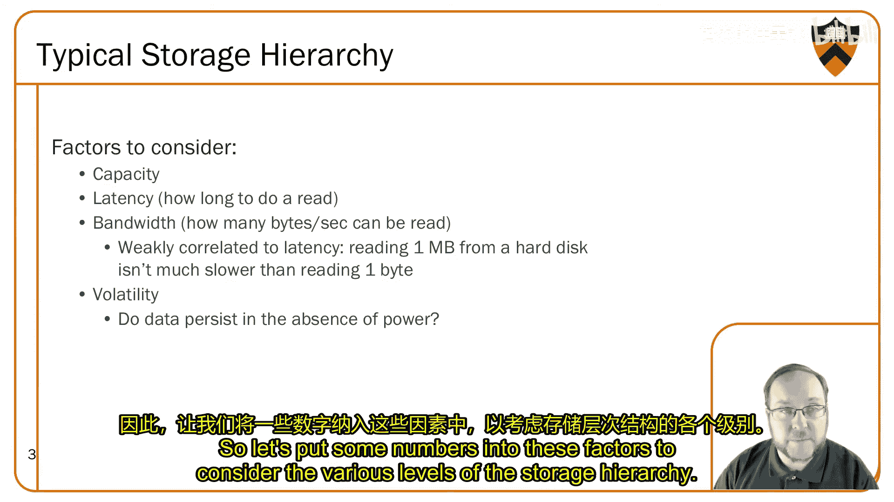

Registers have essentially zero latency。 They are physically on the processor chip。

 and they're pretty much immediately a mill available to the A L U。

 If you don't quite remember the piece of the processor， don't sweat it。

 when 26 might have been a long time ago。 and we'll talk more about architecture next time as we start gearing up for arm。

At this latency with this short distance， bandwidth barely even makes sense to talk about。

 And furthermore， the capacities are so small that it would really be meaningless if we say you can send so much per second。

 But you still only have， some small tens of bys。 Who really cares。Cashs do have some latency。

 and it's particularly noticeable versus registers， but at particularly the first level。

 it's still remarkably fast。 The drop off is considerable as you start adding more and more cashs。

 but their capacity will dwarf the registers。Main memory then。

 is another factor of 2 to 10 times slower in latency versus caches。

 And now factoring in versus registers were at 100 x or more slower than registers。

 And this is important。 I mean， we we start seeing this fan out。 this hierarchy this pyramid。

 But we do have to take this into account。So it's so slow relative to what we've seen already。

 but it can be measured in gigabytes or even terabytes at this point。

And this trade off will become one of the crux of the second part of assignment five。

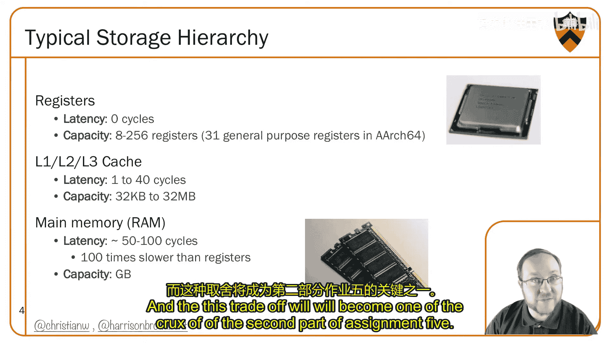

So hard disks then are 10000 times slower approximately than memory in terms of latency。

 And that's even for a solid state drive。 And so spinning disks then are on the order of 100 times slower than solid state drives。

 And so this means that we're now at exponents I can't even figure out how many X we are versus registers。

 But it is absolutely critical to manage that transition between the cache is in memory and then even more so between memory and the disk。

And because the processor finds main memory itself to be very slow。

 Yet the many more orders of magnitude are just increasing to rise from there。 This is truly the。

 the biggest question in low level system storage aspects of。Well， we， we have infinite capacity。

 but it's infinitely slow， at least as perceived by our processor。How can we overcome this。

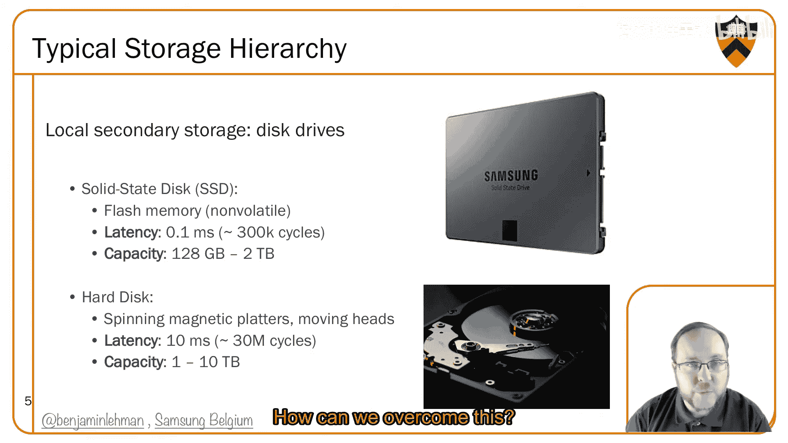

So here's all of that info if you didn't like the just throwing numbers at you and you want a graph form for a few representative processors。

 These are now almost 10 years old。 the blue line represents a processor that came out in 2012。

 the green one in 2013。 but the multiplicative factors is what we're looking about here。

 the latency bass storage levels is still totally a thing。

 even if the raw numbers will continue to decrease bit by bit。

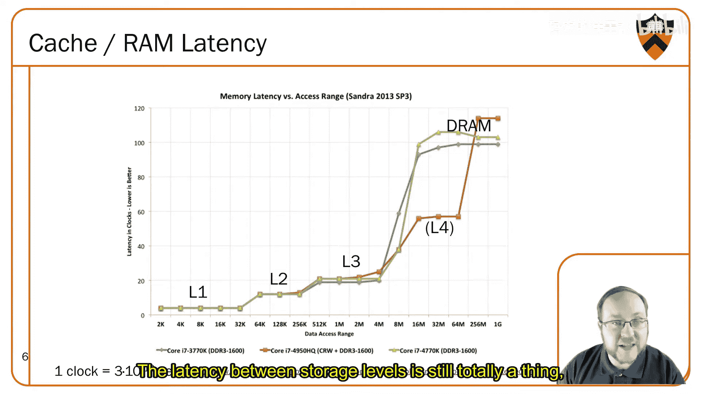

So again， if you like graphs， this1， I think is quite stark。

 That previous slide that looked like it was such a big difference。

 that's the bottom corner of this slide that you can barely even see。

This is why caching is going to become such a big deal。

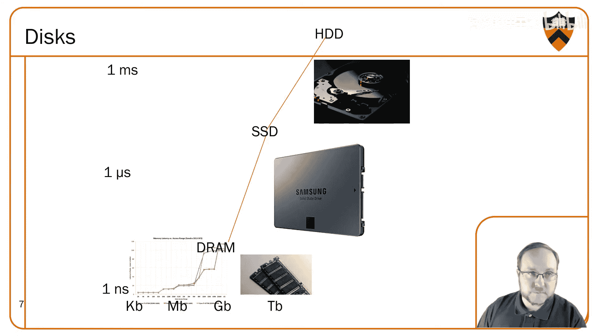

But， of course， if you wanted to add in potentially another order of magnitude。

 you can always go hit up Amazon or Microsoft or Google for cloud storage。

 and here the skys the limit pun totally intended for capacity。 But again， latency is the killer。

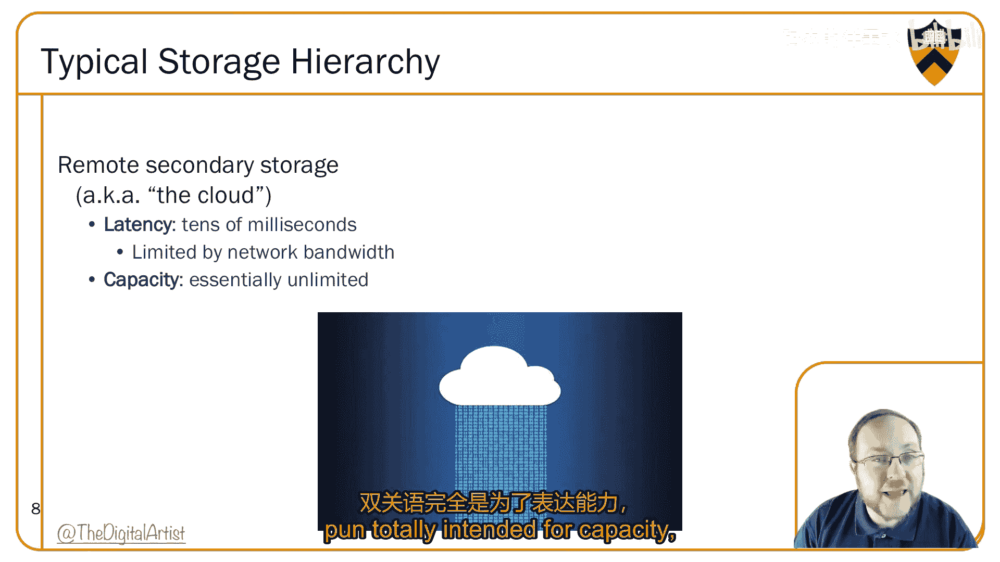

In this environment， again， there is a tiny set of blazingly fast registers then a still tiny。

 still fast L 1 cache， progressively bigger and progressively slightly slower L 2 and L 3 cachees。

 quite slow main memory and tremendously slow disk。😊，But where the workloads。

Are demanding very fast access to increasingly larger amounts of data。

We always talk about you could optimize or you could just wait for the computer to get better。

 but invariably if you have a problem that you want to solve on your computer now。

If you wait for it to get better， I think of it as building a better mousetrap。

 a bigger and better problem will come along that you now want to solve。

So there's increasingly larger amounts of data that would outstrip each successively larger step in the hierarchy。

 And that means that the programme is doomed to fail if it can't overwhelmingly stick with using the first fastest levels。

 the vast majority of the time。So to stay in this optimized hardware zone。

 smart caching that takes advantage of programme locality characteristics can provide the performance required without adding chip complexity or cost or waiting for the next newest hardware to come out。

So let's talk more about that idea of locality。

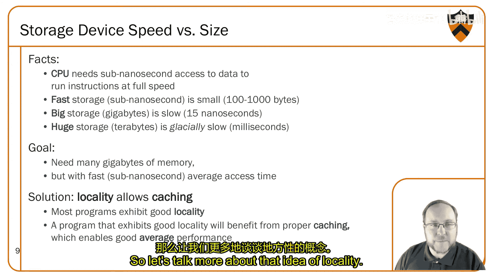

The ominous foreboding requirement of staying in the lowest levels of cash is actually O in practice。

 It actually works because the。At least most programs have a property that they only work with a small amount of data at a time。

 Sure， there are big scientific computations that that do really intense workloads。

 but most of the stuff that we're writing。Really small memory。 not using all that much。And further。

 once you use something， you probably use it again。Quickly and frequently。

So a process can have all the data that it needs imminently available in superfast memory and the rest of the data that it might use again at some point。

 much slower in main memory。This property is locality， and in systems analysis。

 we'll typically talk about locality in two dimensions， temporal and spatial。

So temporal locality from the Latin at prefix temp for time。

 means that if you're accessing some data and remember that again。

 we'll talk more about this next time， but in the 126 old annex of your brain。

 you might recall the Van Neyan architecture says that the instructions themselves are data。

 So if you're accessing some data now，You're likely going to access that exact same date egg again sometime soon。

And maybe repeatedly， for a long time。And by soon， we might mean as quickly as a few instructions from now。

So this happens naturally in loops。 for instance， the increment step in a loop happens over and over and over again。

The instructions are repeated quickly in time and the access to the loop control variable again。

 happens over and over and over again， quickly in time。If we go through the loop once。

 we're probably pretty likely to go through it again。 That's the whole point of loops。

And so this is a benefit， because I pay the cost of keeping around the data。

 the loop control variable， the increment instruction that I just use。

 because I'll use it over again without having to re get it from some slower level in the hierarchy。

So that's temporal locality。 If I'm going to use it now， I'll probably use it again soon。

Spatial locality actually is， is。Still a time issue， but it's dealing with space。

 That's why we call it spatial locality。 It's talking about consecutive locations in memory。

 You can think of it as This would be where you're accessing some data now。

That means that you're likely going to access the next piece of data right next to it。Very soon。

So this is also naturally found in arrays where we traverse through from one element of the array to the next。

 It's also naturally found in instructions， because in the absence of functions or ifs and branches of various types that disrupt the control flow。

We're normally just going to go from one to the next to the next to the next。

 So if we access one now， we're very likely to access the next one later。And furthermore。

 it's even if we do jump around due to a function call or due to a conditional statement。

 we normally aren't going to go too far。 the text section， frankly just isn't that big。

So this is a benefit， because it means that if I pay the cost to bring in several instructions now。

 not just one， but a bunch。The memory block containing the one item of memory I need。

Is also very likely to contain the next item I'll need and the next one after that。

So I'll end up using not just that one item， but also all the other items or many of the other items I grabbed with it and not have to pay that。

 that get cost to get them because they're already there。So most programs， again。

 do exhibit relatively good， both temporal and spatial locality。

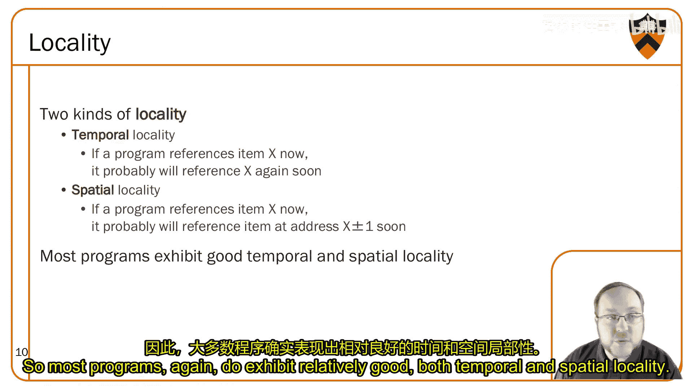

That might be a little abstract and kind of hard to tease out the difference between those two。

 So here's a concrete example。 just computing the sum of an array of elements。

This has fantastic locality， both temporal and spatial。😊，Temporally。

 the loop runs over and over again， so I'm accessing the same instructions over and over。

 and I'm accessing the same variables。 I and and sum over and over and over。

I exit to it now I'll X again soon， it's a relatively tight loop。

 so it's both the repetition and the short duration in between excesses。Spatcially。

 every single time that the processor processes the instructions representing that plus equal。

 they're followed by the instruction for plus plus the I plus plus that comes immediately after it。

In assembly language again， quick spoiler， four loops are typically represented as while loops。

 That is to say that the increment step at the end of the loop has really dropped down to happen immediately after the the loop body。

 And this is not uncommon。 This is how we think of it anyway。

 It's just a matter of the instruction itself goes immediately after the last instruction in the body。

 So we are truly doing this uninterrupted sequence of of instructions， we're not jumping around。

 even though in the C code， we do have to jump back up to the top of the loop to see that third bit in the loop signature。

So yeah， so that means that the plus equal comes immediately before the plus plus every single time。

And then there is a jump back up to check the conditional that happens immediately after that。

And then as far as the data， we walk through the array consecutively。

 every single time we access an element in the array。

 We are sure that we're going to access the next element of the array the very next time through the loop。

 The only time this doesn't hold is when the loop finally breaks。 But at that point。

 there's no data there。 There is no next item in the loop。

 And we've maximized our spatial our spatial locality by accessing every member of the loop in sequence。

 Every member of the array rather in sequence。😊，We'll take advantage of natural locality and code by having a cache。

This gives us the ability to use frequently reference items that we're going to access over and over。

 even if they're not quite repeated enough to stay in the registers。In particular。

 this is beneficial for instructions。 We don't normally load the actual instructions from the text section into our general purpose registers for reuse。

 but they are certainly often reused。 They are often repeated。So furthermore。

 instructions from the text section， we know they're not going to change。

 So that means that we can happily add them to caches or to other levels in the hierarchy。

And we don't have to worry about cash coherence。 That is， we don't have to determine。

 did this change， If so， am I using an outdated version。

 How do I make sure that the persistent version in the in the back end is actually updated。

 How do I make sure that I'm not using two different versions that aren't out of date。

None of this is a worry with the text section when we say we are never going to change this。

This has just been a really very small example of caching and in particular on a low level systems topic。

 but caching is pervasive bordering on ubiquitous in in all levels of computer science。

 So caching websites for faster geographically distributed access， for instance。

 something like Akimi， caching DNS entries for resolution of IP addresses to domain names。

 and even in something as simple as in software， the killering in Emax so that you can cut a couple of different things in a row and then pacee back any of the last several things that you've cut。

And in all of these cases， the goal is primarily speed with a side of flexibility。

So we can think of storage as structured in levels by convention level numbers increase going down。

 So faster， smaller devices have lower numbers than larger， slower devices。

So as we discussed earlier， there's typically a trade off between speed and size。

 Things engineered to be very fast， typicallyy have small capacities。

 The hidden variable here is is normally cost。 Things that are engineered be very fast are very expensive and thus affordable only at that limited capacity。

And this isn't even really a study。 Have fun。 Get enough sleep。 Pick too conundrum。

It's really a miniaturized size。Large capacity， fast， cheap。Of those four， pick one。So reading this。

 this schematic from the bottom to the top at every additional cash level up。

 So towards a lower number， we store a subset of the previous level。

It's presumed here that we're getting faster， but it comes at a great decrease in incapacity。

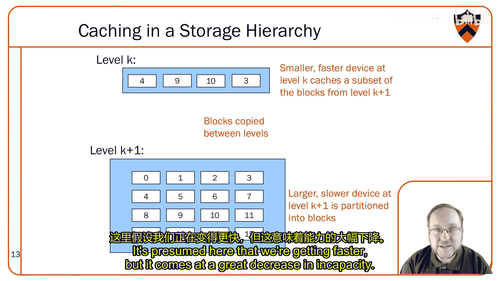

The mechanics of cash management are that when we need to access some data。

 we're going to check for it。 the lowest level of cash here， level K。 If it's there， then great。

 we've just gotten a data that we need from the fastest cash that we could find。

 And we've avoided having to go out to， to slower levels of cash or big， S main memory to find it。

When we find it at a given level， that's called a cash hit like in battleship。

So in the case where it isn't in level K， though， this is a cash miss， again， like in battleship。

And in the event of a cash miss， we're going to have to go check for it in level K plus 1。

If we find it in level K plus1， that's a hit， And it's better than another miss。

 but still not as good as having had it in level K。

So a general assumption is made that temporal locality is common。

 and so we'll try to avoid future cash misses at level K， even though we found it at level K plus1。

And so we will bring it in and put it in level K。This， though， because level K is probably empty。

 probably not empty。 It is probably in fact， full。 That's why we had it stored in K plus one in the first place。

 because it didn't fit in K。 This means that we're going to have to kick something out of level K。

 That's currently at level K in order to bring this new item in。

It gets even more complicated from there because as we kick something out of level K。

Depending on the exact details or semantics of policies， if that value in the cash has changed。

Just doing that hit on level K plus 1 might end up having an entire right out to lower level lower levels in the hierarchy。

 even disc。 because were so because we， we might have changed something there。

 And now it has to be coherent throughout。So we're paying for not even having a hit by having to go through the sought item at a lower level and also paying for the eviction of the item it replaces。

With this， we definitely want to prioritize getting cash hits and minimize misses。

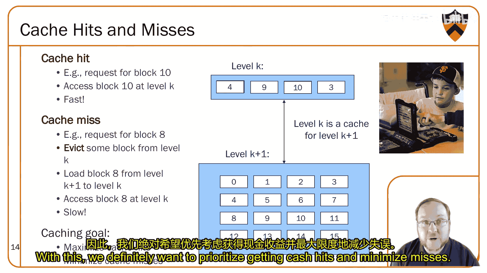

So ideally， to minimize misses and maximizeim hits。

 the subset we store at each successive level is the subset well most need in the near future。

But it's impossible to know the future。 So what， so that's why knowing the locality properties of our programs are important。

 We can't know absolutely what's going to be needed next。

 but we can design algorithms to exploit patterns in what probably will be needed next or often will be needed next。

Eventually， though， we will still have to determine not just what to put in the subset in cash level K。

 but also when we add something new， what to evict。

If our premise is that we should always have the exact things we'll most need in the near future。

 the best possible eviction policy is to to evict the block that will next access the farthest into the future。

Ideally， something that willll never access again at all。Similarly。

 the worst possible eviction policy is one that always evicts the data that we're just about to request。

 This would reduce our excess time to be that of main memory for all operations。

 this is known as thrashing， cash thrshing， in particular。Of course。

 neither of these is feasible generally because we don't have an angel oracle。

 or we also don't have a devil oracle to tell us the perfect move to do or the perfectly wrong move to do。

When designing a policy that is actually feasible， though。

 we have to do trade off for how much work it is to determine the right item to be evicted。

This endeps mean ends up meaning that at a very low level， like the instruction cash for a processor。

 the policies are actually really simple because they have to be implemented in hardware at the or at the very lowest level of O S code with absolutely minimal overhead。

But up at higher levels， for example， caching for web pages。

 there can be extraordinarily complex policies because the storage to maintain the metadata or the algorithmic time to compute the best evic T is insignificant compared with the gains of avoiding transcontinental data transfer。

😊，A reasonable eviction policy that doesn't rely on an oracle again。

 comes down to this assumption that most programs exhibit good locality。

It's the LRU least recently used policy。We evict the cash member that has been used least recently。

If the past is a good predictor of the future， then if something hasn't been accessed for a long time。

 perhaps it won't be accessed again for a long time to the future， either。

This is generally a good idea， but， of course， it has its limitations。

 You can certainly imagine a loop with 11 instructions and a cache that can store 10 instructions。

 When you hit that 11th instruction in order to put it in the cache。

 you're going to kick out the first， which was the very next one up。😊，In this case。

 you'd end up never having a cash hit， even though your cache is big enough to store over 90% of the data you need。

But this is， of course， a well tailored counter example that's probably an unfair straw man。

 But it's something to keep in mind。The L R。 U heuristic has another less than great property。

 It's kind of expensive to implement。 At least exactly。

 You must keep track of the time or the sequencing in which each f was last accessed。

 And then you have to keep the ordering among these。

 So a pure L R U is typically issued for approximation thereof。

 Ca policy is an absolute rich area of work， particularly in the approximation space。

 that continues to be the state of the art research interest at many different levels of the system hierarchy。

 including even these lowest levels。So here's a real question from an old exam。

For cashching in a memory hierarchy。What is the best motivation for a larger cash block size。

 That is， why should we try to have larger block sizes？ What might that benefit us。Take a moment。

 Think it through， see if you can come up with whether this is temporal locality， spatial locality。

 both or neither。The answer here is B temporalemp locality was the characteristic that if we use some data once。

 we'll use it again soon。 This is the motivation for cashching， in general。

But it's not specifically for larger block sizes that contain more data beyond just what we accessed。

 So temporal aelity， not really here。Spatial locality， on the other hand。

 was the characteristic that if we use some data once， we'll use its neighbors soon。

 So if we pull in those neighbors as part of our first read， then the workload。

 if it exhibits good spatial locality， will reap those benefits。

 It won't have to pull in each of the subsequent neighbors。

 They'll already be in some some lower level of the hierarchies， cache somewhere。

So the example I showed before， adding an array of numbers is a relatively simple one。Further。

 because it has great locality， both in space and time。

 it's maybe too perfect of a picture to leave you with the topic。😊，So let's consider one more， again。

 canonical example that that doesn't go into the full depth of all of the active research areas in the field。

 obviously， but lets you consider another angle on this problem。

So matrixtri multiplication is a classic example where a smart locality aware code can have a tremendous benefit on performance。

This is using the naive triply nested loop algorithm。

 not fancy things like Strens's algorithm or Coppersmith Viinerad， although as an aside。

 that the Coppersmith Vinarad， the 2。4 nesting rather than end the N cube it's end about 2。

4 run Raz here in the department did some fantastic theoretical work on lower bounds for variances of this。

 So if you're interested in that sort of very theoretical bent on really core algorithmic processes and computational problem solving。

 you should definitely look that up。But again， we're going to focus on the simple triply nested cubic version。

 and we can actually get significantly different performance on actual workloads just depending on what order we nest our loops。

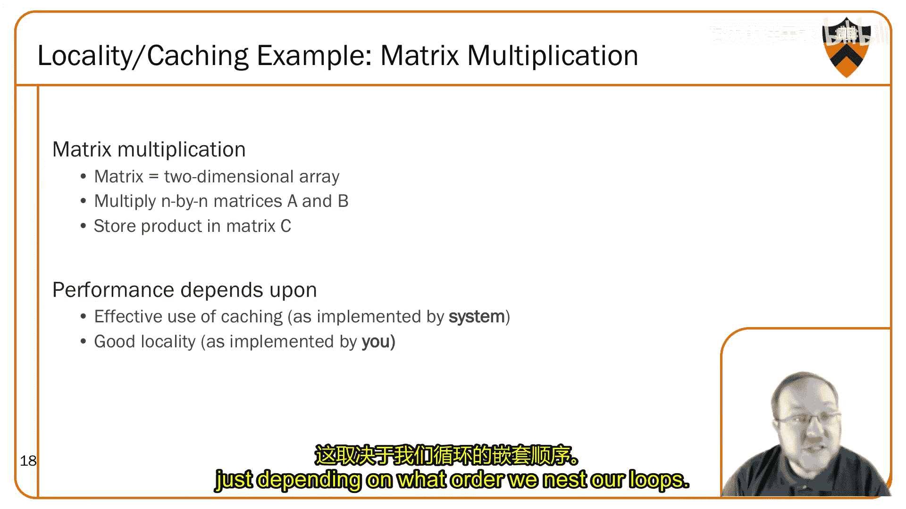

To day， to get into this is a quick note， perhaps a reminder， perhaps something new。

 like in Java C represents 2D arrays in memory in row major order。 That is。

 we go across each successive row in a matrix， finishing all the elements in one row before seeing any elements in the next。

😊，There's no reason it has to be this way， for instance， Forran uses column major order。

 but all of the C language and its successor represent 2D arrays in row major order。

But because of this row major order， it means that for good performance。

 when the expression A of I J appears in a loop， I want the value of I to change more slowly than the value of J。

This will result in accessing a bunch of sequential items in memory in short succession。

So it ends up being worth while to have read in the whole block because you'll end up using a bunch more data from the same read。

 that's spatial locality。Contrast where if the expression a of I J appears in a loop over a column。

 you're going to be jumping。 So here you might jump from 18， then 21， then 24。

 These are all at non consecutive locations in memory。 And so that way， if。

 if the matrix were of a more real size。 rather than just a whole bunch of small numbers。

 If it were a bigger size where you read in a row so big that it takes up the entirety of a memory block。

You end up only getting one single useful value out of that entire read before you have to do another read。

 because you'll you'll go to the next， next thing down the column。

 You'll have to grab in an entirely new row。 And thus， it would be a cash miss。

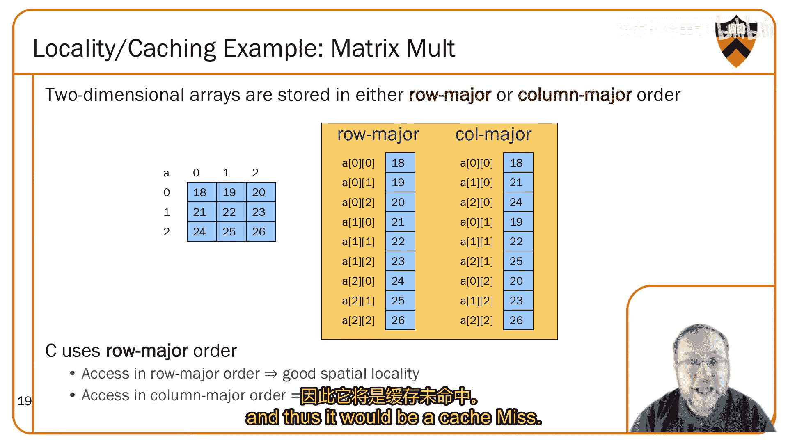

So let's come back to this naive triple loop matrix multiplication location。

Recall that to multiply a times B， you take the row of A in the column of B。

 You multiply the pairs of elements by each other and sum up those products。

That sum becomes the single element in the result。 and you do this for all rows and A。

 all columns in B， and you create all elements in C。Okay。

 so high school math or early college math review done。

 let's assume here that all three square matric， all three matrices are square and they're the same size。

 just to make the calculation easy and the analysis easy。So on the slide。

 you have a piece of code arguably the most natural way to write the matrix multiplication calculation。

 The innermost loop reading right to left， we're accessing B by column K is changing more than J。

 So each time through the loop， we have to find a new row。

But the other two have the more preferred pattern。In a。

 we're accessing by row each time through the innermost loop。

 we repeatedly see every column in the row， which are all consecutive in memory。

 So that's good spatial locality。😊，In C， we're doing even better each time through the innermost loop。

 we continue to reference the same element。This is temporal locality。

And between each execution of the innermost loop， we still only move across the row in C。

 So we have some good spatial locality properties as well。 if the problem is small enough to。

 to take advantage of that。So two out of three is in bed。At least it certainly could be worse。

 Consider this alternative， which gets the same answer。

 But in a timing test takes more than twice as long to run as the previous version。

Here in the plus equal step in the inner loop。For C， I is changing faster than J。 for A。

 I is changing faster than K and for B， K is changing faster than J。So for C And A。

 then every single time through the inner loop， they have to do a read to find a new row。

 And since they're going through down in the column。Now it's not one。 It's2。

And B is the best here since it doesn't change each time through the inner loop。

 It still has that that same temporal locality。 But in between inner loops。

 it has to change bros like the others。 It doesn't get any spatial locality behavior because， again。

 it's going down a column。 So really， all， all three of these are exhibiting bad cache performance。

 And again， it costs a factor of 2 x the， the time versus the previous version。Furthermore。

 the previous version wasn't even as well as we can do。Here's the third way to write the code。For C。

 J is now changing faster than I。 That is we set I。

 and then we get to read or write many Js in a row all through the inner loop。For a。

 neither I nor K changes inside the loops。 So we have that temporal locality， and even better。

 K is changing faster than I。 So that is， we get many k's in a row。

 and we get the spatial locality in between inner loops。And finally， for B。

 J is changing faster than K。 So we set K， and we get to read many J's in a row through the inner loop。

So in this version， we see we're going to access a row in all three matrices。

 maximizing spatial locality。 And indeed， our timing test confirms this was about 10 per cent faster than the first version。

😊，And obviously， that makes it all the more faster than the terribly slow version。As an aside。

 a smart compiler might be able to， to do this optimization for you because it can see that this is a sum of products。

 And thus it knows it's commutative and associative。 But that's sort of beside the point here。

 The takeaway is that locality and caching can have a significant impact on what are otherwise completely equivalent computations。

And certainly， in the general case， we can't rely on the compiler to make smart adjustments like this for us。

 We'll have to be able to know about the locality and the other characteristics of the workloads that we're running for the code that we're writing。

So we're close to finishing up， but here's another nice old exam problem。

 one that has sort of the synthesis vibe here where you have to really understand something。

 not just go through the motions of plug and chug or to just regurgitate definitions。

So imagine that instead of row major order， C did store multidisional arrays in column major order。

How would loop ordering have to change to get locality of performance to get good locality for performance？

Take a moment。 You can pop back to the previous slides， see the code there。

 see if you can reason about what order we should use for these loops in a column major format。

So the answer here is the worstest performance that we saw two slides back。The problem then。

 was that every operation was traversing a column instead of a row。

 But now that's exactly what we want to do。

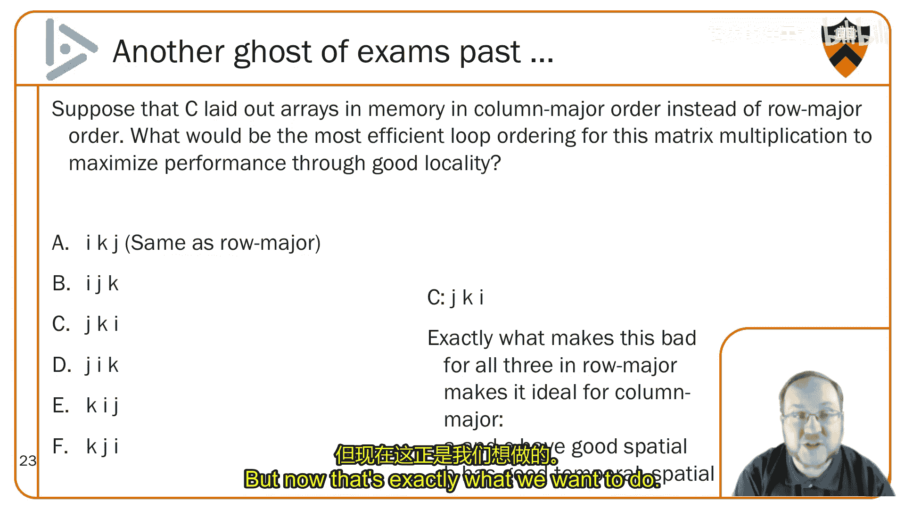

So we have C， J K i。To finish up， here are some general observations about the hierarchy。

We have trade offs when considering how much data to fetch at a time。 If we use a large block size。

 it takes more time to transfer the data。But then the data transfer happens less often。

Using a large block size， though， uses up more of the capacity with fewer reads。

 which can then dampen the effect from temporal locality since fewer separate reads data can be stored in the cache。

That means a smaller set of items can be efficiently reaccessed。On the other hand。

 we can better exploit spatial locality since there's more data from around where we just accessed it that has already been fetched into the catch。

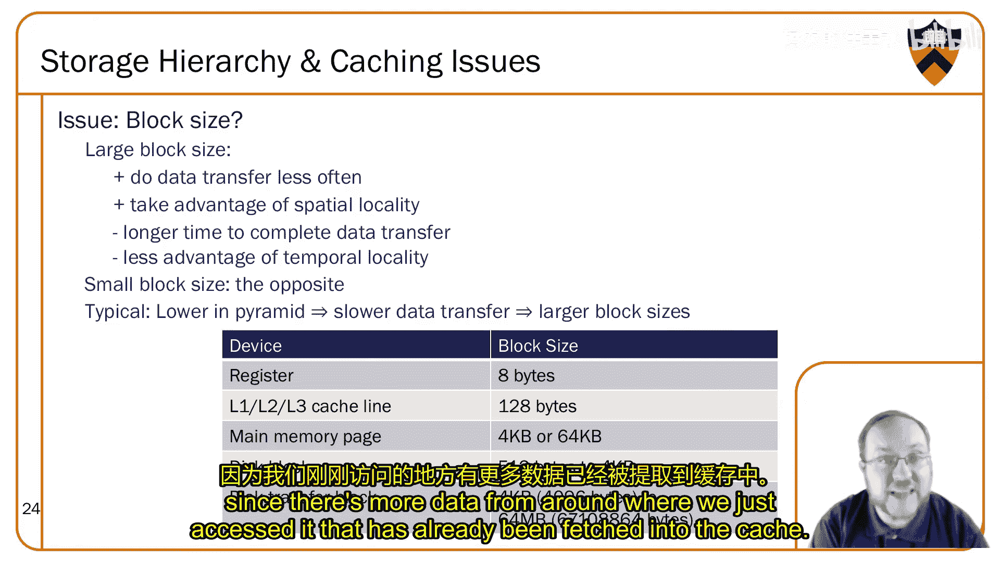

The second question we might have is， who will manage the cash。 And again。

 the answer here may change at different levels。The use of registers is managed by the assembly language programmer or the asmbr or the compiler。

The next level， the L 1 through L3 caches are managed by hardware because they have to operate really quickly and make intelligent decisions about workloads and persistence versus eviction so that when the register needs something。

 hopefully it's coming from here and not further down the pyramid。Main memories managed by the O S。

 along with the hardware， because this level requires more advanced algorithms。

 which are worth their complexity due to the exponential blow up that we saw in latency。

 because this is the level where we can start to make informed decisions about how to manage virtual memory access to physical memory。

And then in secondary and remote storage， there's a mix。

 The storage might be managed at the byte level by a close to the hardware raid controller。

 but the file or folder or file system level。 It might actually be managed by a complex software an expert system from something like code 42 or Dbox for syncing with the cloud。

 or it might even come down to the end user， the end user might decide what files are worth saving or backing up or what have you。

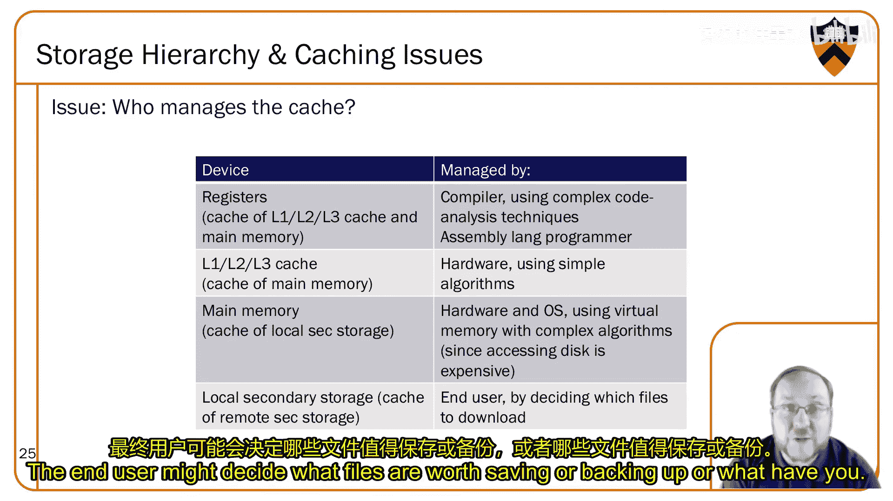

So next time， we'll get started with arm。 No， not the creepy conjoined arms from the canting ribbisa of Tremaine Arm。

 the A Art 64 architecture and assembly language that we'll be covering for the rest for the rest of this term。

 including assignments 5 and 6。

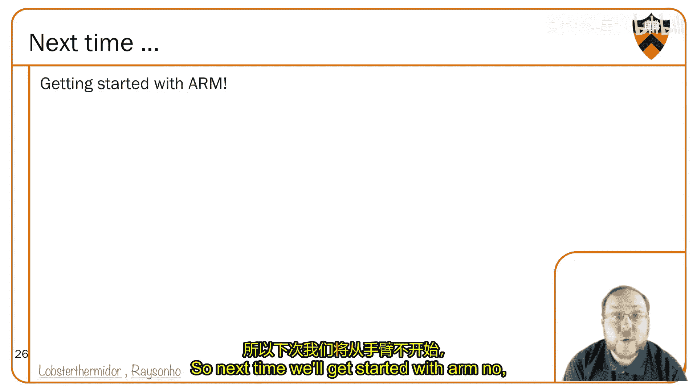

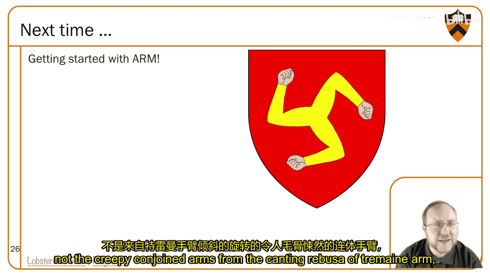

Before those assignments， though， is， of course， finishing up assignment 3 due to day in case you haven't noticed。

 And then assignment 4 that we talked about last time that you'll be discussing this week in precept。

 The specification for assignment 4 is out on the course website。 It's due next week。

 So do get started quickly。 Good luck。😊。