# 【全集 秋季版】普林斯顿大学 C语言系统编程 中英字幕 p21 Lecture 21 - 汇编语言 part1 -BV1u1feBoEsK_p21-

Welcome back to Co 217 lecturecture thus far in the course。

 we've focused on the C programming language and programming in the large。

 call it softwareware engineering。But now we move on to something completely different。

 We'll start to look under the hood at what happens when we invoke that shiny four stage G C C 2 17 build command that we've talked so much about a downward tour from the C programming language to assembly language and eventually down to the machine language instructions that the processor actually runs。

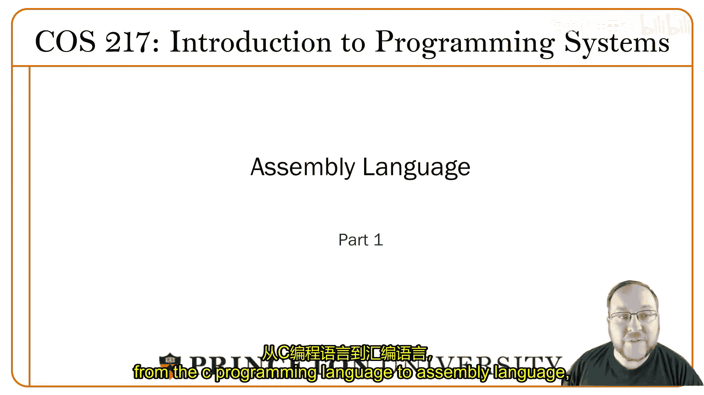

Our approach is not unlike what we did foresee in lectures。

 we'll have partial assembly language programme。That have no forward references。

 at least as much as we can can avoid。 But that means that using only the lecture material。

 you wouldn't be able to write complete programs until after the final assembly language lecture。

Pcepts， on the other hand， will start from the very beginning with complete assembly language programme。

 but this will， by necessity， have some forward references that will have to be either explained on the fly or glossed over and then patched up later。

In that sense， the lectures and the precepts truly are complementary。

 and I hope that both will be a help to you， even if you may naturally prefer one over the other。

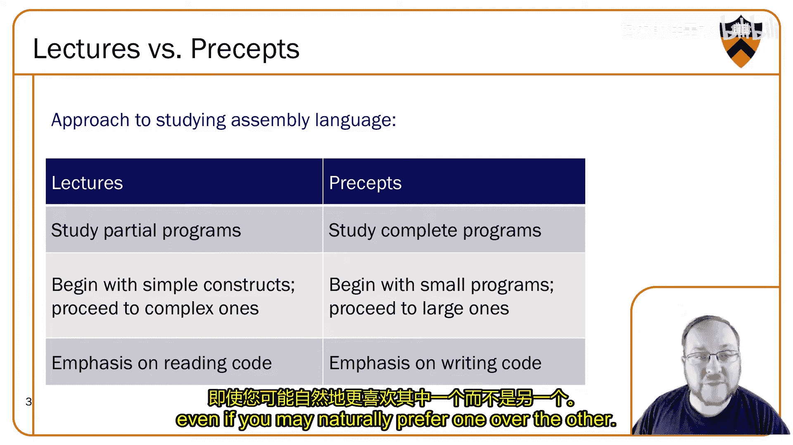

So in this language levels tour， we're going to see how some of our programming in the large topics。

 namely abstraction and modularity， are not aspects of programming in a high level language or in programming in C specifically。

 but rather are more fundamental concepts that are ubiquitous to program design at any level。

So seeing full languages at at multiple levels helps reinforce this idea of full systems built on top of other full systems that progressively get more abstract。

 more modular and more user friendly。So let's begin with an overview of what we mean by high level language and low level language in the first place。

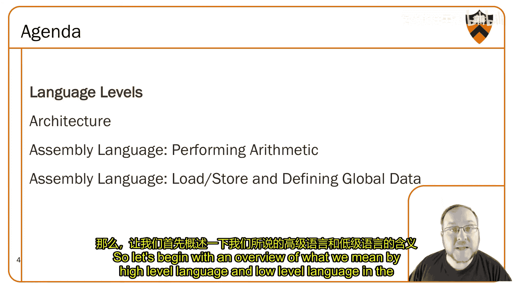

At this point， you can feel comfortable saying that you have a really thorough introductory amount of knowledge in two different languages。

 Java and C。But these are both high level languages they share to one a degree or another。

 Several common characteristics。 They're portable， though， not completely， as we've seen in sea。

They're complex。 consider the line n gets n times 3 plus 1。This has a variable read， a multiply。

 an add， and a variable write all in one line。Or the while loop。

 which is a fundamental building block of sea programming， but contains multiple different parts。

 a condition to check an arbitrary loop body to execute logic for going back and checking the conditional again at the end and logic for skipping past the body when the condition eventually fails。

Both C and Java are also largely human readable。Some more so than others。

 see is perhaps cryptic to someone with no programming experience。

 but you could nevertheless read off this programme in English。

 and a structurally inclined non programmer would probably get the idea of it。 At least everything。

 except may be the bit wise operation。At the diametrically opposite end， there are machine languages。

 They're not portable at all。 The machine language of X 86，64 processors。

 which dominate the desktop and laptop market， are completely different than the machine language of a spark processor or a MIPS processor。

 or indeed， the machine language of an arm processor that we'll be using in this class。

 armm processors tend to dominate the mobile device and embedded systems market。

They're not as complex in the sense that we have very simple， foundational tasks in each instruction。

 again， in varying degrees between different architectures。 But typically。

 there's nothing like the fundamental but very multi step loop。 And also in terms of readability。

 This isn't readable in by human in any real sense。Assembly language sits somewhere in the middle。

 moderation in all things， as it were。It's not portable。

 it's a thin human readable layer on top of machine languages。

 so if it's just sitting on top of machine language， it's no more portable than they are。

The assembly languages for X8664 and Spark and MIps and arm are completely different。

If you're planning to program an assembly language， you are abandoning all hope of portability。

 just as you would be if you were programming in machine language itself。But like machine language。

 it is simple。 It's， it's easier to learn a language like。Asmbly language than it is to learn C。

 frankly， it has a lot of relatively small， compact principles that you can then compose together。

 There's not as much of this high level difficult logic that all gets packed into one operation like you see in C。

At the very least， it's a push。But on the other hand， it's not very expressive。

It's the other side of the same coin with each assembly language instruction being so simple。

 it takes many instructions to do any given job。Now， in terms of readability， I said。

 assembly language is this human readable shell on top of machine language。

But you might argue at that at the moment。 You might say this doesn't look very human readable。

 but stay tuned and we'll fix that。

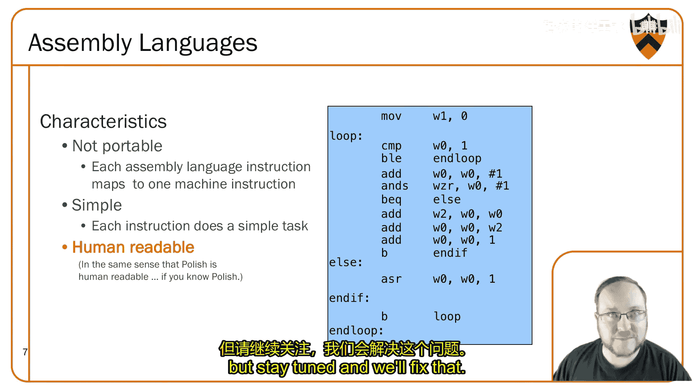

So let's talk a little bit about motivation。 I know that many of you will never again write assembly language after this course。

 and that's okay。 Nevertheless， I truly believe in this section of this course。

 knowing what's really happening inside of program can help you find bugs。

 It can help you improve time or space performance。

 and it can improve your or at least inform your program design。

Knowing about assembly language can help you know what's running under the hood so you can actually write assembly language to write faster code or to write a more tuned code to an application。

 For instance， there are some instructions that the Gcc compiler doesn't even know about。

 but are valid instructions that you could use if if you knew about it and found that it fit your application。

Furthermore， knowing about assembly language can help you write better code at a high level language too。

If you know about assembly language and how the high level language code maps to assembly language。

 then you'll be able to use high level language constructs that are fast and avoid those that are slow。

So even if you never again program in assembly language。

 it's worth knowing at least a little bit about assembly language。Furthermore， this all。

 this is Arrguino that you don't want to ever program an assembly language again。

 You might actually want to continue doing so。Sure， many。

 maybe even most computer scientists spend their careers developing computing applications for the needs of others。

But some computer scientists must design the computers， must design the architectures。

 must design the compilers that those other computer scientists use。

Maybe you'll want to take that path。And if you do decide to take that path。

 you'll need to program an assembly language or at least be conversant with those who do。

So that was assembly language in general。 What about arm。

 Typically one doesn't write assembly language for high level systems。

 So choosing one that is typical for embedded systems。

 choosing an architecture that is typical for embedded systems， is a natural choice。

 Arm is the dominant hardware set for embedded systems and mobile devices and other low level devices。

 low level hardware that you might actually want to write assembly language for。

 So I think it's a good fit。 Furthermore， it is simpler。

 as we'll talk about soon when we get into its instruction set。So with that motivation。

 let's look at the underlying architecture， including a quick refresher of some of the computing components material from Co 126。

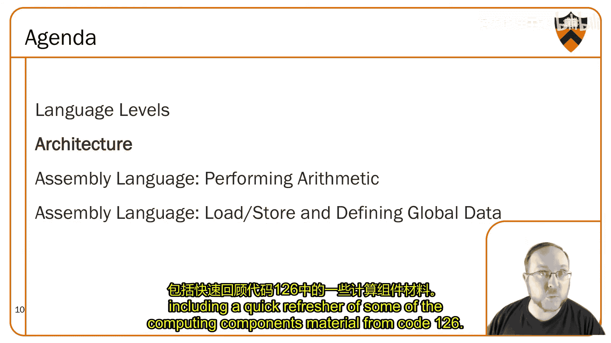

So fundamentally， the arm architecture and its alternative in this course that we used to do the X86 architecture。

 they all come back to the work of John Vanon Neun。

 so let me have a brief aside here about him he worked at Princeton and the IAS。

 the research institution that is also in town during most of his career and you might have actually heard of him only from the fact that there's a building on campus named for him a building so far east on campus that even engineers are like really。

 that's a hall and for Forbe Zes it's practically a transcontinental voyage。But yeah。

 so he was frighteningly genius As a six year old， he could multiply and divide 8 digit numbers in his head。

 And he had this child like Naivete to say， he asked his mother when he saw other people staring off in the space。

 I wonder what complex thing they're computing right now。

As though every kid and every person in general would would just do this。嗯。

So he was part of the Hungarian Golden intellectual generation that produced a bunch of Nobel Prize winners and other people who were fundamentally important in various fields。

 many of the sciences， including computer science。But he was perhaps the leader of that generation。

 But when when physics nobelist Eugene Vigner was was asked how Hungary had produced this generation of geniuses。

 He actually demurd from answering。 he disagreed with the premise in the first place。 He said。

 having experienced Vanon Neuman， he could confidently say that there was only one genius in the bunch。

 And this was， again， the father of the Hygen bomb。

 the father of the nuclear chain reaction and other nobelists in this in this cohort。

Going one further， another Nobel laureate to Hansboha speculated。

I have sometimes wondered whether a brain like von Neuummann's does not indicate a species superior to that of man。

So we're talking about truly one of the geniuses along the lines of， you know an Einstein Gaus。

 an Euler， that type。But that his geography aside， let let's jump into the actual reason why he's on the slide at the time of his work and experimental architecture for these newfingd computer things was one in which there were distinct memories。

 distinct physical memories for programs versus the data that those programs acted on。

This has come to be known as the Harvard architectureect。

Von Neumman was a pioneer in developing one of the first implementations of a different paradigm。

One in which the programs and the data shared the same memory。This。

 by contrast to the Harvard architecture came to be known as the Princeton Archit。And it is。

 of course obligatory to point out that the Prince and architecture proved to be more successful than the Harvard architecture His。

That being said， EdVc， as a whole， the machine that this was a part of was a joint project with Ed and Moley at Penn。

 and really it was an engineering feat than more than core science。

 The idea itself is attributable to another decade。

 at least before that to variations on Tring's UTMs that you learned about in 126。But nevertheless。

 what will never skip an opportunity to boast up Princeton and take a pot shot at Harvard。

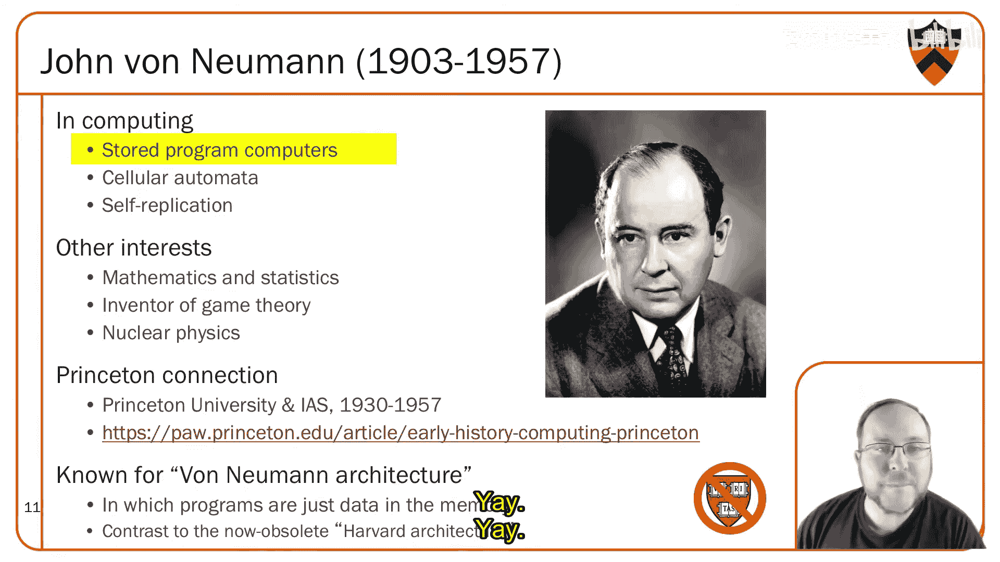

So in the Vanon Neuman architecture， fundamentally， there are two hardware units。

 the processor and the memory。In reality， there may be several CPUs of various flavors。

 whether that's traditional CPUs， multi course CPUs， specialty processors like GPs， and furthermore。

 there might be multiple RAM chips。Then there's， as we saw last time。

 multiple different levels of cache between the processor and the RAM。

And then there's other hardware， disks， network devices， all of that。

 So this is certainly an simplification， but the abstract view of there's one processor and one memory will suffice for us。

In the in the physical realm in hardware， the CPU and the RA are really just two different sorts of integrated circuits or chips。

 They communicate over wires on the motherboard。 This wire is called the Data bus。

 and so there's the RA random access memory chip and the CPU or the central processing unit chip。

We further are going to break down the CPU into three structures。

 these are the same three that we talk about in 126， the control unit。

 the ALU and the Regs ALU here is arithmetic and logic unit。

The control unit is the operational control of the CPU， the manager， if you will。

It interprets instructions that the ALU will then compute on。

 and it controls data transfer between the CPU and memory。The ALU is the brain or the calculator；

 it does the actual processing of the instructions and of the data required by the instructions。

Big math module。And then finally， registers， as we talked about last time are small。

 very fast on chip on CPU storage。You can think of them as a series of small bins that are on the chip。

 They offer blazingly fast excess。 weve said last time， less than a nanosecond of latency。

 but they're very small。 There's less than 512 B total across all of the registers on the processor。

What can a program use such a small amount of memory for Well in a program。

 these may be allocated to store a variable or a pointer to a location in the program or a pointer to a section of memory。

 or even just use a scratch space during a multi step calculation。Nevertheless。

 despite being few of them， despite being very small， these registers are a critical resource。

So as the control unit gets an instruction to process the ALU actually does the processing itself。

 for example， in an arithmetic operation we'll take in the data from two source registers。

 complete the operation and put the result back into the designated destination register。

 so the control unit decides what data comes from what register or how to get the data into those registers in the first place。

 and the ALU actually does the math。So clearly if registers are so small。

 taking less than 1 k of bytes overall， clearly our programs need a lot more space than that。

 and that's where RAM comes in。It's on the order of a billion to tens of billions of bytes in most normal laptops。

 which is a lot more than 512 bytes， to be sure， but again， upwards of 100 nanoseconds of latency。

 so 100 x slower。Ram is our primary storage location for all the data our program is using while running。

 which， as we talked about in the Vanon Neuman architecture， that includes the program itself。

The actual instructions themselves。So now having seen the fundamental of the structure we'll be dealing with。

 but before going head first into the details of the arm architecture and the arm instruction set for the AAR 64。

 let me ask you to just remember what you learned about toy in 126。So the processor。

 we said A U and control unit just as we saw。There are instructions that if you think back to the instructions set。

 they consisted of an op code and either an address and a register or a pair of registers。

There were 16 registers in total named zero through F and one special register of them was special and they only contained zero ever。

 that was the zero register。There was an extra register that wasn't this number crunching possibility place to store data。

 instead it was always the location of the next instruction to be executed。

 That was the program counter。There were 256 words in main memory， each with their own address。

 And conventionally， we addressed them in Hex。And memory could store numbers that that's what it did。

 We can interpret those as unsigned ins， as signed ins。

 as memory addresses or as instructions themselves。Here's the thing。

Arm is going to be almost exactly the same。 All we have to do is change the numbers， scale it up。

We have more instructions necessitating a larger variety of instruction formats。

 but the core is still the same， op code and some destination in some source。

There are 32 registers in arm， each of which stores 64 bits。But again， one of which is always zero。

Two extra registers that we have that contain pointers to important parts of memory。

 we have a program counter just like in toy， and we also have a pointer to the top of the stack。

The stack frame where we are currently executing。There is a representation of main memory， again。

 each location with its own address conventionally addressed in hex。

 and memory can again store numbers， un signed ins， memory addresses or instructions。

 however we choose to interpret them。This is actually really familiar。 It's not something brand new。

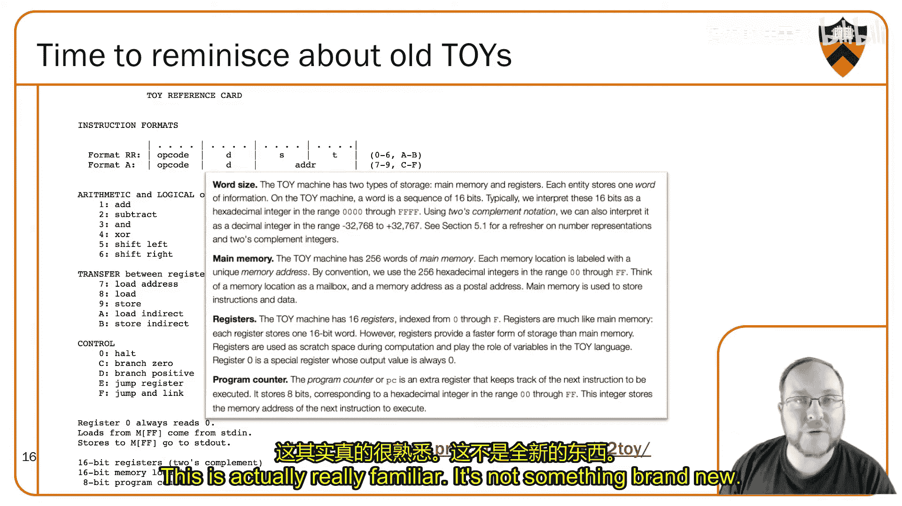

Let's go one step deeper in Toy， there was a rather rigid load manipulate store paradigm。

If the data was in memory， we had to first load it into a register。

 then we could manipulate it within registers， putting each successive result of each operation back into a new register。

 and then store the final result after we've done all of our computation back out into memory。

Arm is the same。Again， the exact same load store architecture in Toy。

 there was a tremendously limited set of instructions。

 If you wanted to do something complicated at all， you would have to compose together several to maybe even many instructions。

 But on the plus side， it was super easy to remember all of the the instructions that there were。

 and understand really them all pretty deeply。 Okay， maybe not branch in link。😊，But again。

 arm is the same。 There's relatively few instructions that we're ever going to worry about in this course。

 And you'll get to know them reasonably deeply。This choice of having a small instruction set is emblematic of the risk idea。

 the reduced instruction set computer as opposed to the cis or a complicated or complex instruction set computer。

So risk has a simple set that encompasses all the things you need to do。

 but you might have to compose them together to do anything of real substance。Siss。

 on the other hand， has a complicated set， It has an expanded set of operations。

 including some things that do wildly specific operations。

 including some even that don't follow the standard load， manipulate store paradigm。

But in order to make best use of this， you have to know what it can do， what they are。

 and it's much harder to internalize the scope of the instruction set as a whole。And furthermore。

 at the hardware level， if we have these complicated instructions。

 we need complicated hardware to make it work。 The actual hardware architecture of risk machines tends to be simpler。

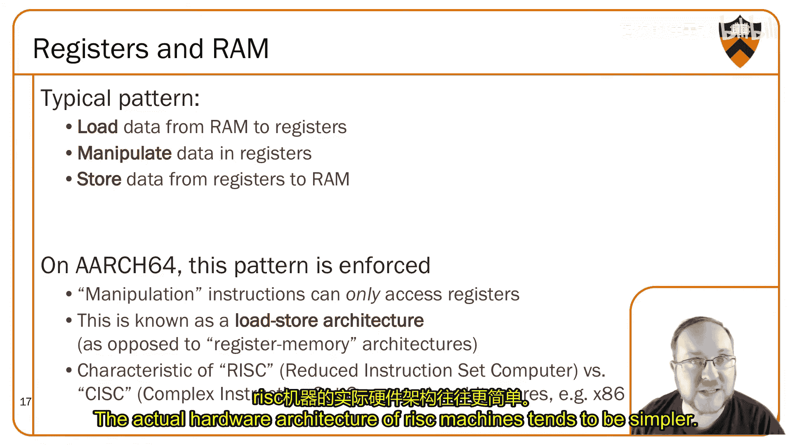

Okay， so now I hope that I've convinced you this again。

 this isn't a completely new thing that you've never seen before at all。

What you learned about about toy truly does relate to what we're going to be doing with arm。

 at least at a high level。So let's dive in， but I should as the department placement officer。

 I would be remiss to not acknowledge there are some of you who didn't take 126 and to whom you're going。

 wait， what is this， I have no idea what you're talking about， you claim I know this。

 I swear I don't。If this sounds overwhelmingly new。That's okay。

 I'd encourage you to hit up the 126 materials， take an overview of some ofy the toy materials。

 the toy programs。Read the simple things。 I'm not saying go and take， you know， a full month of 126。

 but it would be a reasonable thing。 just go and glance at the materials to see a simpler version before jumping into arm。

All right， so arm has we will do so now， though， Ar has 31 general purpose registers。

 General purpose here is a bit of a misnomer。 they actually several of them have very specialized。

 very specific roles that they play throughout the program。 But when we say general purpose。

 we mean these are registers that we can with some precautions manipulate。We address them by number。

 register  zero through register 30， know that this is decimal， not hex。

 so register 10 is the 11th register， not the 17th。

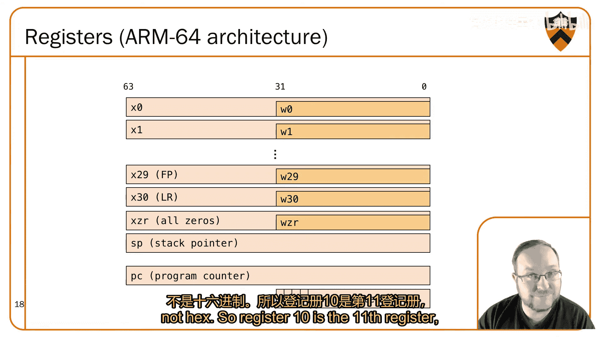

And each of these registers is 64 Bs。 The way we reference it in our program is with X and then the register number。

 Sometimes we only want to use part of the register， though， for example。

 if we're storing an int ints on our system are our 4 bytes， and so we only need 32 Bs。 in this case。

 we can address the lower 32 Bs of a register by W instead of X。Again， as noted before。

 while we call these general purpose registers， some of these actually do have a specific purpose defined in hardware or by software convention。

So we can't just willingy nilly pick whatever register we want。

 we have to use some some acknowledgement that others are already performing a job。

 even if we didn't specifically give it to them。So those were the general purpose registers now on these specific registers。

So whenever a function is called， it pushes memory for its parameters and its local variables onto the top of the stack。

 we know about this， the memory is called the function stack frame。

 just as we've been talking about in C。So there's a register in the ARRT 64 architecture that it' called SP that points onto the top。

 the lowest address of the currently executing function stack frame。

So this is how we're going to eventually do function calls and local variables。

 but that won't be for a few lectures yet。As in toy， we have a program counter。

 it points to the location of the next instruction that will be executed in memory。

We know that this means that we're pointing into the text section because that's where our instructions lie and the control unit is responsible for changing the PC automatically as it processes instructions。

 it might increment from one instruction to the next if there's sequential control flow or it may jump to a completely new part of the text section if there's a more complicated flow like a conditional loop or a function call。

The last special register is one that we didn't see in toy。In toy。

 our two branch instructions took a register as an argument in arm， they don't。 Instead。

 before we do a conditional branch， we observe some characteristics of some previous instruction。

 typicallyy a CP or compare operation。And for example， we might say。

 did it set a flag for was the result zero or did it set a flag for did overflow occur？

These conditions were stored as bits in the Pe State register。

 and so Pe State is our last special register that we need to care about。

We won't typically access P state directly， instead we will do so indirectly by doing conditional operations。

 conditional branches。All right， so with those fundamentals down about the architecture。

 about a brief idea of the instruction set， or at least what it will have to have。

 let's move on to the instruction set， the assembly language and see some programme snippets。

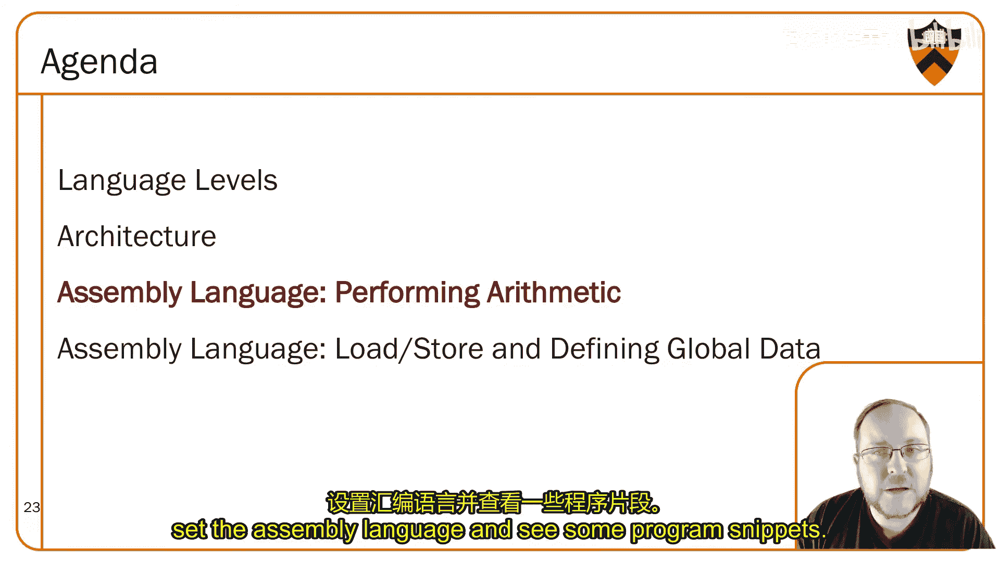

Recall from before that the ALU's view of an arithmetic instruction。Now。

 you know what the flags are for if you were confused at the previous diagram。

 So let's look at what does an instruction actually look like if it's one of these arithmetic operations。

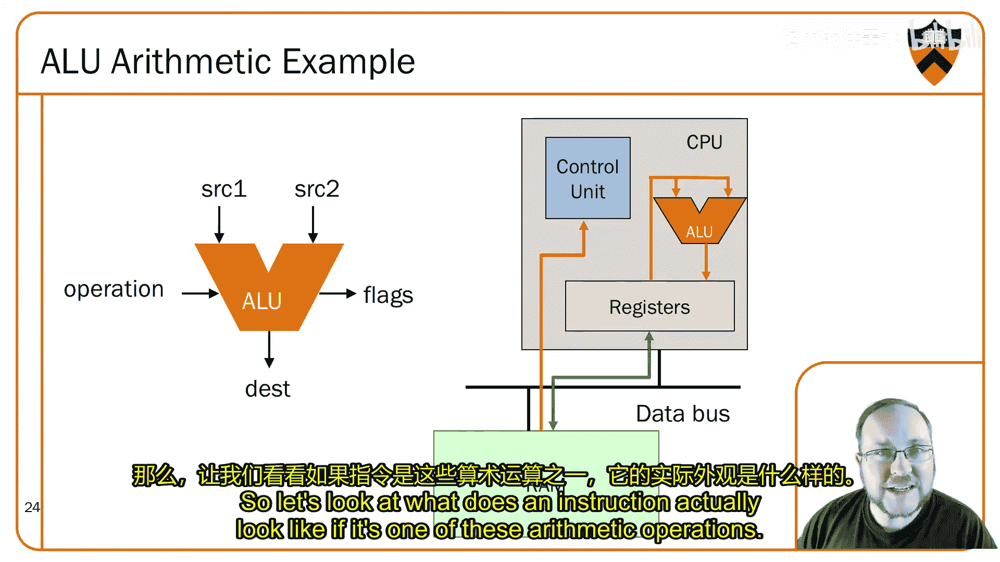

Each instruction has at least a somewhat semantically meaningful name。

Typically then we have the destination register followed by the source registers。

 so if you were know haven't learned to love the stir copy argument ordering yet。

 here's more of a chance for you to learn to love it。In some cases， instead of a second register。

 the second source might be a constant value called an immediate。

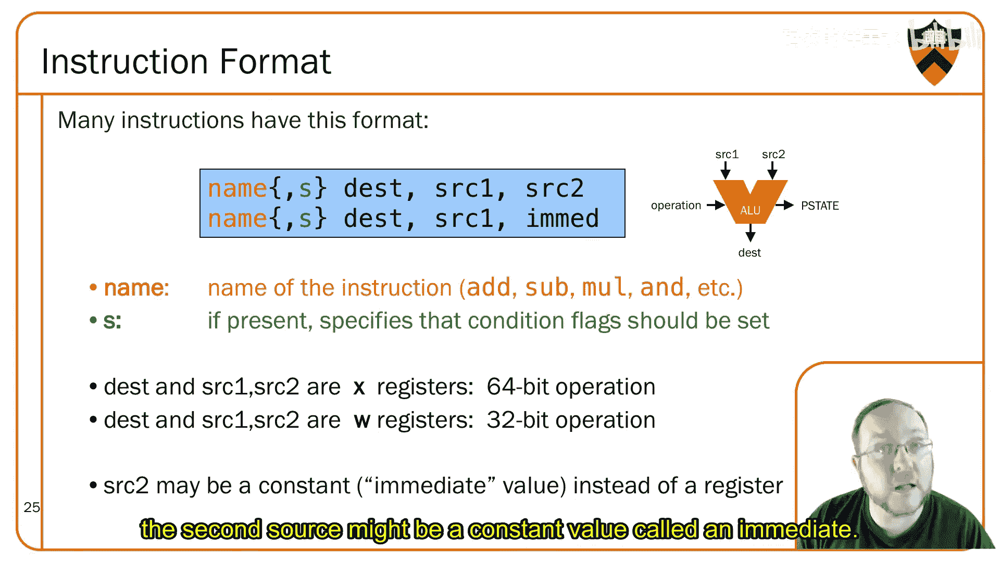

So here's our first bit of assembly code。The perimeter of a rectangle is the sum of all of its sides。

 so that's twice the sum of the width and the height。 Here's a C program that will do this。

Note that we're assuming here global variables， and the reason for this is that we won't see how to do local variables until quite a bit later。

 it comes along with the whole function calls and stack bit。

So with these variables mapped into these registers。

 we need an add instruction and a multiply instruction。V娃。Except wait。LSL， is that multiply。

 Shouldn't that be M UL or something like it， Well， LSL is actually a left shift。

 but recall that left shift by  one bit is actually multiplying by2。

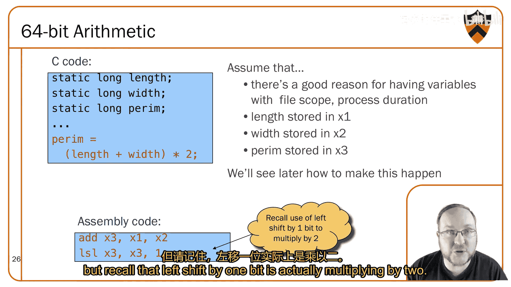

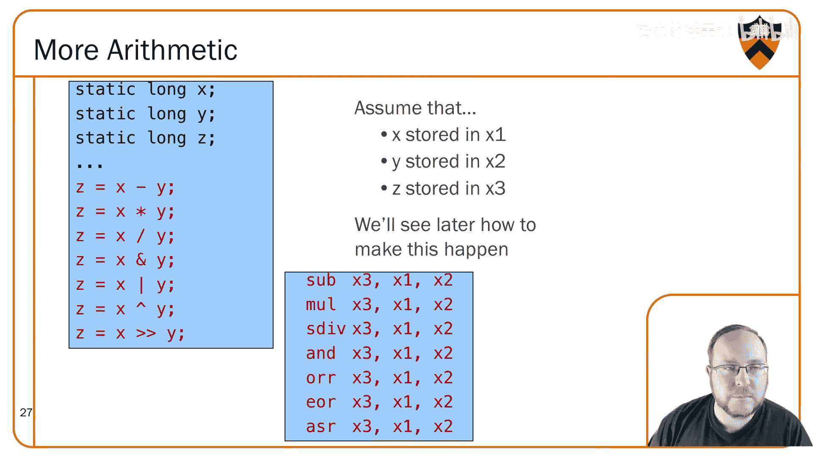

Note one more thing here， the book uses an  Otthorpe that is the number sign or the hashtag before immediate values。

 which can be a useful signal to readers that notice this isn't X1， this isn't W1。

 this isn't some register one， this is actually the number one。Again， the book uses this。

 by and large it isn't something we're going to do on our slides， it's not required。

 but you're welcome to do it in your code if you'd like。

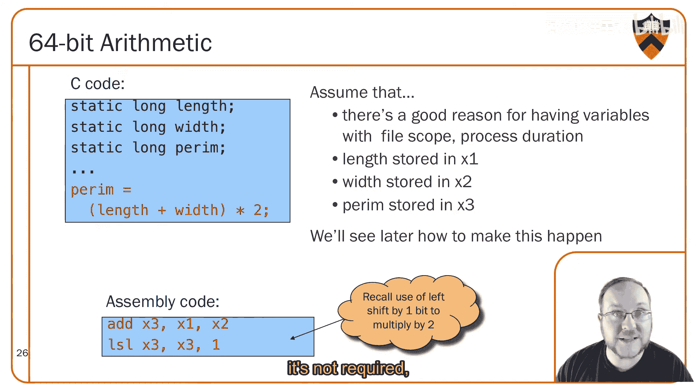

All right， so now for some more arithmetic operations in C and what they look like in assembly language。

Here just a demonstration of operations， there's not even a pretense of there being a program or an application。

 this is just a pure data dump of here are the things about arm。So most of the names are intuitive。

 but some need some parsing， in particular， exclusive or being EO instead of XOR is something that students trip over。

 also recall that we talked about shifts on the previous slide。

 C doesn't have a standard for what to do with right shifting。

Whether it maintains the sign of the signed integer or whether it always puts a zero to fill in the bits on the left。

But assembly language does。 There are separate instructions for arithmetic and logical shifts， right。

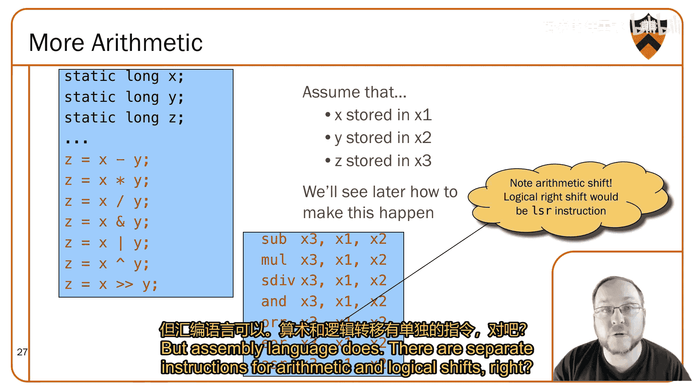

Some similar instructions aren't exactly what they seem though。

Though we're under the hood already just talking about assembly language in the first place。

 Let's dive just a little bit farther under the hood to talk about aliases or short cuts。

You might think that moving a variable from one register to another would be a really primitive operation for。

 for an assembly language， but it's actually accomplished in hardware by Biwise oring the0 register。

 This works because anything ord with itself is sorry， Anything ord with 0 is itself。Similarly。

 we might think of unitary negation as of multily， multiplying a value by negative  one。

 but it's actually implemented in hardware as a subtraction from the zero register。

And this is a good thing because subtraction is typically faster than multiplication。

There are other examples of this where the language gives us an instruction that is semantically meaningful。

 but actually implements it under the hood as an alias or a shortcut to some other instruction。

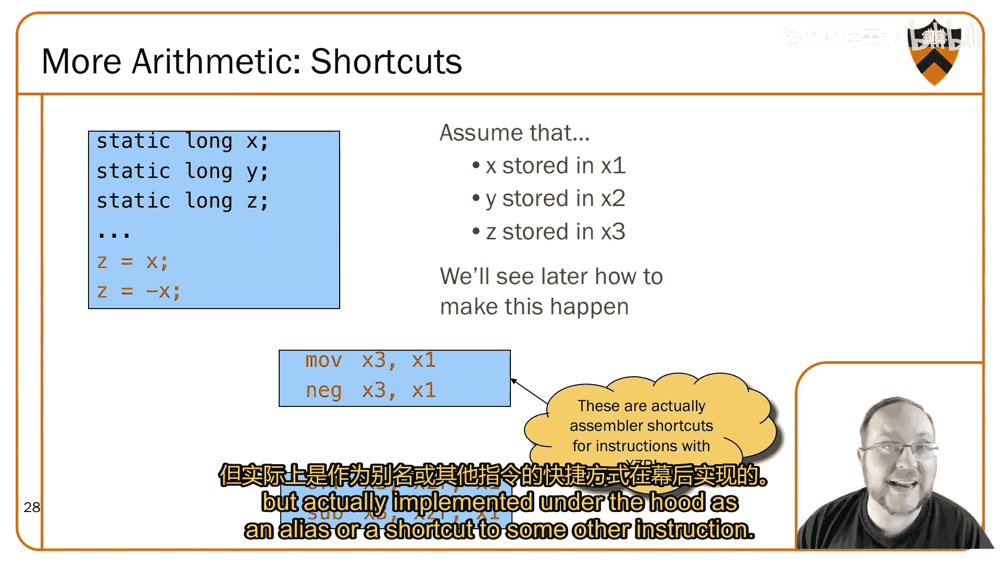

So one thing we haven't mentioned yet when talking about in arithmetic in C。

 we had to worry about s versus unsigned。But with two's compliment， we。

 we got this nice benefit of that algorithm to find that the bit manipulations under the hood for most operations were the same。

 whether we were talking about signed or unsigned arithmetic。

 And it was just how we interpreted the final result。Because of this。

 we get the advantage that in arm。The instructions for these arithmetic operations are the same。

With only a few exceptions。We'll see in a future lecture when we talk about control flow that the s difference will normally appear not in the values and not in the arithmetic instructions themselves that we use to manipulate those values。

 But instead in the comparison instructions that we make to decide on a conditional branch later on。

All right， continuing with our， we've seen something。

 but we've missed some of the things we know about in C。 thus far。

 we've been dealing only with 64 B arithmetic， which makes sense。

 given that our registers we set are 64 Bs。 But what if we wanted to use ints instead of longs in something like our perimeter program from before。

So we can use the W naming for the lower half registers instead of the full things。

 we saw this was a thing， here's how it's relevant to our programs。When we're using longs。

 those are 64 bit or 8 byte constructs， it makes sense to use the X register for addresses that we know are8 bytes makes sense to use the X register。

 but when we have ints in our programs， we should be using the W version of the registers。There are。

 of course， in C even smaller data types， but there are no smaller addressable portions of registers with their own names。

 so we're going to use the W registers for shorts or for chars。

but that's actually okay that matches with C because the instructions for manipulating these values are the same。

And that's okay because as in C， there's an implicit promotion of char or short to int for arithmetic。

You might not remember this from a very early lecture。

 but indeed all arithmetic that you do on shorts or on chas is really an intoporation。

And this matches with the hardware in the assembly language。

 we're going to use W registers and exact the exact same actual instructions。That's for arithmetic。

 though。 In a few slides， we'll see there are size specific load and store operations for getting data in and out of these registers and memory。

 which makes sense。 You can't very well write out the full4 byte register to a single byte of memory and reading in to a4 byte register from a single byte of memory Certainly we must have some some way of doing this without just saying。

 oh， I'm going to read into memory that I never initialized。

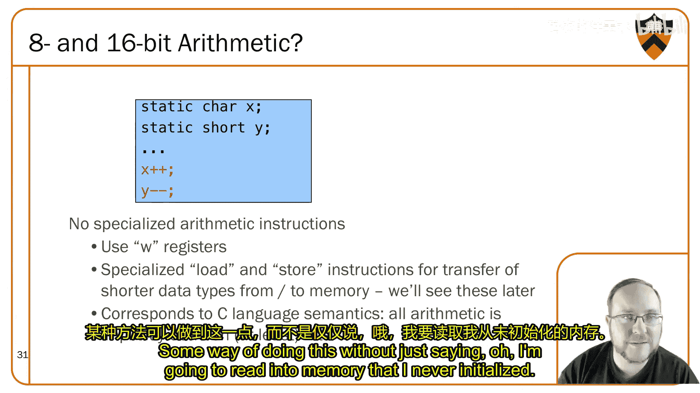

So that was manipulating in terms of the load manip store paradigm that was manipulating。

 so let's go ahead and now talk about getting data into and out of registers and back into memory。

So unlike in toy where we could put a literal memory address into our instruction， in arm。

 continuing its very pure register based load store architecture。

 to an even further degree even than toy， we have to get that memory address into a register to make that register effectively a pointer。

You thought you were done with pointers， not by a long shot。So then we once we have this pointer。

 we dereference the pointer to get the memory location itself for the load or the store。

The way we indicate this in arm is by putting the register name in brackets。

 I think this is utterly beautiful， because brackets are a dereencing operator for memory。

 which we think of as a big array of data， And that matches up perfectly with C。

 where indexing into arrays was done with the bracket operator。

 which we saw was really an implicit dereference to the start of the array。

 So it's an absolutely perfect symmetry。 between the syntax of C and the syntax of this assembly language。

😊，Again， note the ordering here for load word loading from the memory address referenced by the second upper end into the first upper end register。

And for a store， we're storing from the first upper end register into the memory address referenced by the the second upper end register。

 So the memory upper end always comes second。 That's the the easiest way to remember this。

 But it is tricky to get bogged down in wait。 Which direction is the data flow going here。

But if you think about it as the memory always comes second， you'll get the right answer。

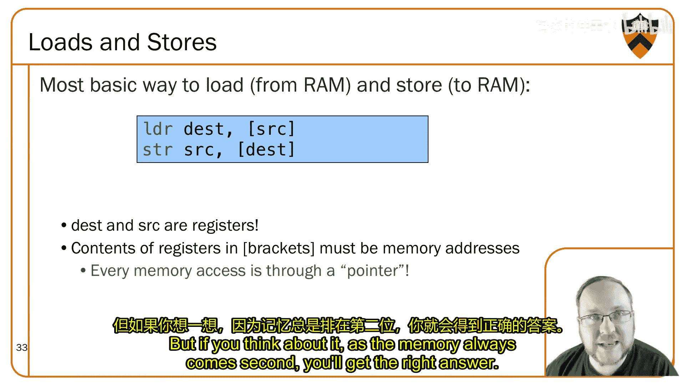

So as mentioned before， there are some specific instructions for reading a byte or two bytes。

 both signed and unsigned， as well as some additional semantic instructions for how to fill in the register contents when reading something less than 8 bytes。

 For now， though， let's stick to 4 and 8 byte quantities just to make things easier。

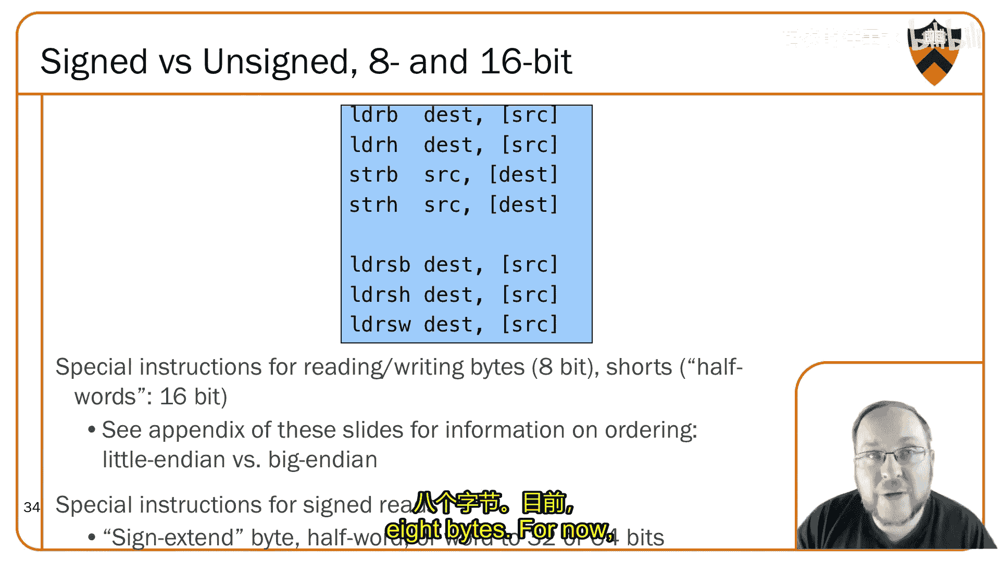

All right。 So we're just about ready for a full example。 But one thing to note。

 We mentioned that in loads and stores， we'll use registers containing memory addresses as pointers。

 That means we'll need to get the memory address into that point into that register to serve as a pointer in the first place。

😊，This will depend on what section of memory the address is in。

 but for now let's consider file scope and process duration variables so that it will always be in the data or BSS section。

This sounds like it makes it more complicated because data and BSS are new to us as of only a couple of precepts ago。

 but in assembly language it actually will make it easier initially。

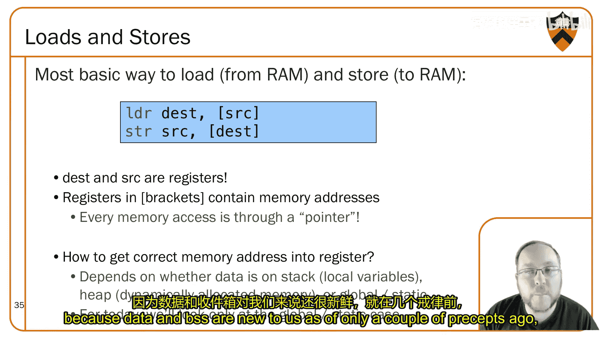

All right， so here's the perimeter program built out just a little bit。And here's its assembly code。

It's plausibly human readable to us at this point。 But if it's still overwhelming。

 that's totally understandable。 So let's take it step by step。

We can mark or name a spot in memory with a label。 So， for example。

The length colon is this is the location in memory where the program will store the length variable。

And the dot word directive tells the asssembler to allocate four bytes of memory at the current location in memory and store the following value there。

So that's the label and adopt word at that label it's just。

 this is how we allocate memory in the data or BS sections。But first。

 we need to see how to define data that lives in those sections。

 We need to get to that section in the first place。 So let， let's， you know， not skip too far ahead。

 Let's look one at a time。 The dots section directive tells the asmbler now we're in the right section of memory。

 So in this case， the data section or the text section。And this works for RO data， data。

 BSS and text， we'll see how to use the stack in a future lecture and we won't be using the heap for dynamic allocation in this course。

 so there's nothing in the heap at all。So we said that we talked about the label。

 this is how we can mark the location in the memory to refer back to it。

 The label names are meaningful。 They're referred to by name in the program themselves。

 and they should hopefully be semantically meaningful。

 typicallyy if we're translitating from C to assembly。

 hopefully this is know a variable name or the name of a string prompt or something like that。Again。

 the dot word directive is just telling the assembler。

 please allocate memory for byte specifically and put this value in it。

And note that the dot word here is declaring an int in the data section specific。

 Other data types will have different size specifiers。

 and other sections will actually have different directives that we'll use。 For instance。

 the BSS section uses different directives since it will not need to initialize a value。

We'll talk about those near the end of this lecture。

So now we start in on the text section and where do we start in。 Well， Main， of course。

 we know that main is a function that gets called from underscore start。

 and we know we didn't write underscore start。 So that must mean that main has to be visible outside its own file。

In C， we accomplish this by default。 we do it implicitly because external linkages is the default。

 So so long as we don't accidentally put the word static in front of main， everything's good。In arm。

 though， internal linkage is the default。 And so whereas in C。

 we have to specify static for internal In arm， we have to explicitly specify globally visible symbols with the dot global directive。

So Maine gets a dot global。So now once we've advanced and we're inside the memory location that begin that main begins。

 that main points to， we can finally answer the question of how we get the memory address into a register to be used as a pointer for the load restore。

There's a pseudo instruction called ADR。The address that gets the memory address of a label and points it to a register。

So ADBR X0 length says， go find that address that length was labeled at and put it in the X0 register。

So having those addresses， we can load and store， do load and store operations that we saw in isolation before。

We did the ADR in the previous line， so we have an x0 containing an address。

This means we should think of X 0 as a pointer。 And that's just what a pointer is in C。 After all。

 it's a variable whose contents are a memory address。

We dereference the pointer using the bracket notation as the source or second operation of the load and as the destination or second again upper end of the store。

Finally， we can finish out the function using register 0。

 W 0 here is because it's an int to store the return value。

 Note that we've been using register 0 here。 So unlike in toy， the0 register。

 the one that's always 0 is not actually register 0。In， in。Our arm it will be W0R or x0。

 so W0 or x0 here is semantically but the return value。

 it is where we are going to put the return value in order to return。

And then the RE instruction is the instruction that actually causes the program counter to jump to the new location in the text section rather than just continuing to the next instruction。

 it's how we return from a function。We'll see a lot more detail about function returns and functions in general and program control in general later。

So finally， that's having stepped through each of the individual instructions。In the code。

 let's trace。At the beginning of the execution， all the data section is filled in。Main starts。

 and the first operation is to establish x0 as the pointer to the length。

So we do that and the x0 now we can draw that as a nice little arrow there。

 and so we want to dereference that pointer to length and load the value we get by following the arrow and we load it into W1。

So we do that， and now we're going to change x0 to be a pointer to the width。

So we have register W1 has one and x0 now points at the width variable。So again。

 we dereference the pointer， we followed the arrow and load into W2 this time。

 so W2 gets the value 2。Next， we add W1 and W2， getting3， so1 plus2 is3， and we overwrite W1。

 so just like in toy， the source in the destination register can in fact be the same。

 It will do the operation on the old value and then write back the new value into overwrite the register。

Our next operation is a left shift， we shift the value 3 left by one bit。

So what was previously 30 zeros followed by 11 becomes 29 zeros followed by 110。

 because when we shift left we fill in with a zero and so we get。At this point。

The value6 there because we did we have 110 there that's a 4 and a2 and a 0 is4 plus two is6。

 but what we really did was we got that value 3 and we multiplied by  two that's how we get or  six。

Soon next we're going to do another ADR to change the pointer X0 once again。

And then we dereence the pointer again。 But this time in a store。

 So it's like dereencing on the left hand side of a C assignment， rather than on the right hand side。

 We're going to store into the spot we get when we follow the arrow。By convention again。

 the return value is put into register zero， so because we say that our programs when they're successful。

 they return zero and because our C program here return zero。

 we have to put zero into the register it's a W0 because again main returns an int。

 so it's a 4 byte quantity that's a W register， not an X register。And now we return to the call。

 our program is done。

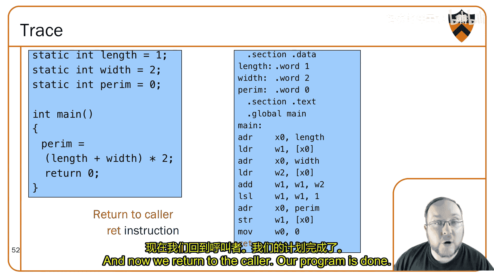

All right， so there are two appendix sections in this lecture， I'm going to go through them quickly。

 but I encourage you to take a little bit of time to walk through them in some more detail because again。

 I don't want to have complete information overload。But consider this C code here。

 Each of these is a file scope process duration variable。

 and each is given an explicit initialization。That means they belong in the data section。

 it's just as that we saw before， I is exactly like we saw before with the word directive for a data section variable that is an int。

Dot short for two bytes。 This matches the C type name and dot quad for 8 bytes。

 The naming there is an anachronism， but it has persisted。嗯。It's not shown on this slide。

 but it's actually valid label because it's not a valid label。 and because in C 89。

 we have no type for it， no integer type for it， but armm also supports dotocta for a 16 by variable。

 which would be the equivalent of a C 99 long long int。Somebody's going to point it out。

 So I'll come clean on it right now。 We're being slightly inconsistent here。

 Dot short is actually an alias for dot H word， half a word， which is the standard arm directive。

But we stop there with the aliases with good reason。

 because using the aliases with the C types can get an arm programmer into trouble。Yes。

 there is a dot in directive that does in fact do the exact same thing as dot word。

But there's also a dot long alias that does the exact same thing as dot word。

 Both dot in and dot long give us 4 byte quantities。

 So that's why we do differentiate with dot word and dot quad。

 So you're not tempted to use dot int and tempted to use dot long and get it disastrously wrong。

A couple more notes， the aliases that we showed you on the previous slide。They I'm sorry。

 we've shown you labels to go on the previous line， but they can go on the same line。

 that's totally okay。嗯。It's basically whatever looks better to you。

 and it might depend on the context。Also note that we saw global in the context of Maine saying that Maine is externally visible。

 but。To announce the same property of a variable， we can do it dot global on a variable just as well in this case on a variable。

 which we say is a quantity of memory that happens to reside at a particular label。

 so dot global on a label， totally fine， even if that isn't a function， even if it's a variable。

I mentioned that B，SS would be special。 It doesn't use the dot word or dot quad， et cetera。

 because it has no need to be able to specify an initial value。

 That's how variables ended up in BS S in the first place。 was that in the C programme。

 they didn't get an initial value， and so they went into BSS where they can just be presumed to be 0。

So instead the BSS section instead of dot word dot quad uses dot skip。

 which is an alias for dot space， it's a directive to specify the number of bytes to skip in between labels。

 that is the number of bytes allocated for that symbol that label。Finally， the RO data section。

 we've been noting since the earliest days of this class that the compiler places string literals into the RO data section。

But if you're not using a compiler at this point and you want a string literal to be in the R data section。

 you need to put it there yourself。The dot string directive does just that。

 It allocates enough memory for the string， including the， the null biteite at the end。

 the backslashder at the end， and it stores that string into the allocated memory。

The second appendix in these slides discusses Indianianness If you haven't run into this concept before。

 I encourage you to take a close look into the slides。

 these slides and also pages 27 and 28 in Pit and Newgeta， I think it's also on page 520 in King。

 but that's going to be in a different instruction set。So when we have multi bitete constructs。

 say an int that takes four Bs， there are two natural ways that we might think to represent them in memory。

 One would be to start writing from the most significant bit and fill the memory until it's done。

This sort of makes sense if we think about a four byte construct。

 the most significant bit being on the left， that's how we normally think of numbers。

 and this would result in the most significant bite of memory being stored at the lowest memory address because we think about writing memory from top to bottom。

We'll call this big Indian because it's in yes， it's a reference to Jonathan Swift's satire and Gulliver's Travels。

 but the big Indian in the sense of the big end goes first。

The opposite then would be the little Indian。Little Indian says that the least significant bite of a multibte entity is stored first。

 and this is actually what arm does， what the A 64 architecture does。

 and so what the arm instructions set has to do。Note， though， this is not being stored backwards。

 Don't think that all of the bits are flipped from the least significant bit all the way。

 the most significant bits。 These are a bite at a time。So it's bite by bite。

 The least significant bite goes first， Then the next least significant bite all the way to the last thing stored is the most significant bite。

 But within the bite themselves， the bits are in order， as you would expect。

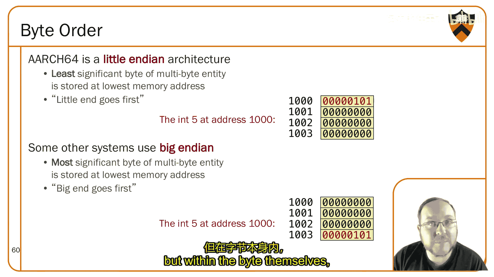

This has implications in some programs， for example the C code here is not portable。

It will have a different output on a big Indian computer because it steps through the bys1 by one。

 but those bys are stored in different orders， depending on Indianness。

 So the order we reach them going one by one will change。

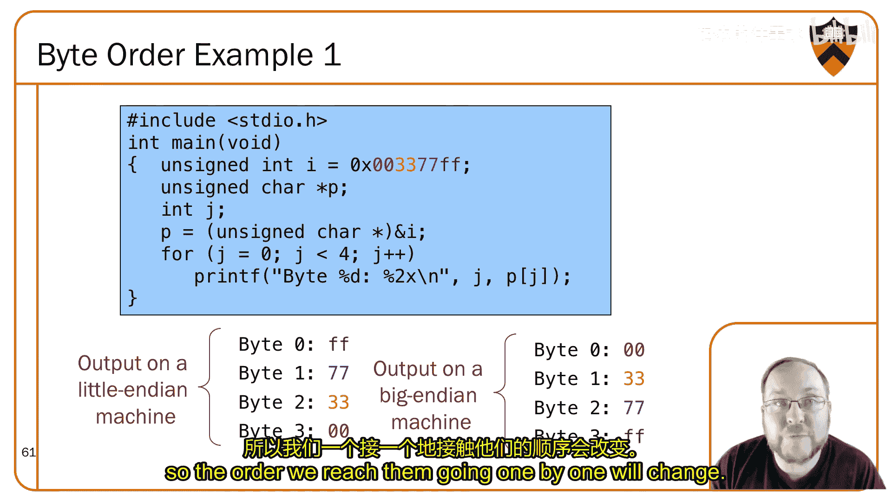

So too， it can carry over into our assembly code when we're dealing with individual bytes from a multi multibyte data construct。

In this code on Arlab， the program returns 7 because A A 64 is little Indian。

 so grabbing the lowest address in the word grabs the bite that has7 in it。A big Indian machine。

 on the other hand， would return 0。 The lowest address in the。

 in the word would result in its most significant bite， which would be 0。

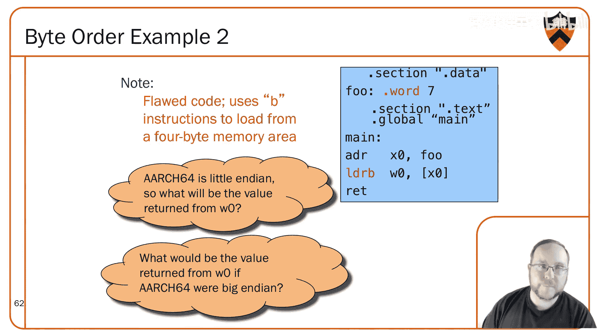

So this was a huge introduction， and yet we've barely scratched the surface。

Next week you'll have two precepts and another two lectures all on arm。

 and the following week you'll have another lecture and another two precepts on arm。

There's a lot still to go。One thing， one last thing that I do want to address， there is， of course。

 in this country a rather important civic occasion on Tuesday。

 we will be having precept at regular times， but if you're working the polls or doing a get out the vote operation or you know you'll be waiting in along。

 hopefully socially distance line or even if you just want to stay curled up on your couch and watch the breaking news as it comes in。

 that's totally okay， just please plan on it， plan ahead。

 plan to either go to one of the for Monday precepts do follow the procedures on the policy page or to another precept on Tuesday that better fits your schedule based on on what your plans are。

If all else fails， you can always find the recorded lecture。

 the recorded precepts on Kaltura on Canvas， but we do urge you to try and attend some precept as usual。

There's also a lecture released on Ection Day， but so long as you've watched it before the Wednesday or Thursday precept。

 you'll be fine， there's no urgency to do it immediately on Tuesday。

So I've been thrilled to see partner posts for soliciting partners on Ed， and I hope that。

You're getting up to speed on assignment4 if you haven't started， do please find a partner。

 do reach out and see if we can find everybody to be matchmakerrs as it were and get up to speed on the new assignment as soon as you can。

 and I'll look forward to meeting with you all in office hours to discuss that assignment。 Good luck。

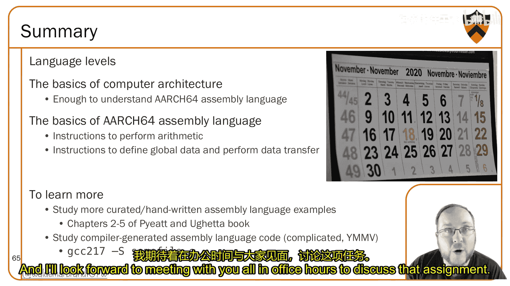