# 【全集 秋季版】普林斯顿大学 C语言系统编程 中英字幕 p22 Lecture 22 - 汇编语言 part2 -BV1u1feBoEsK_p22-

Welcome back to Co 217 Lecture。Today's lecture continues where we left off。

 beginning to explore assembly language Today we'll be talking about control flow， arrays andstructs。

😊，To start off with translating from C to assembly。

 we're going to produce an intermediate version of C that's a bit closer to the structure of the assembly output we want to end up with。

 we'll call this flattened C。In the first assembly lecture。

 I noted that while loops were an example of a C programme component that do a whole lot of separate small steps。

There's a conditional check。 There's the jump over the body。 If the conditional check fails。

 There's the body itself。 And then there's the jump back to the conditional check at the end of the body。

This is where translating to assembly gets tricky as the statements don't flow from one to the next consecutively。

So recall early in the term， we mentioned how go to is awful and will never use it except for one particular purpose。

Welcome to that particular purpose。So that's the bad news。

 our flatten C is going to use labels and go to statements。The benefit， though。

 is that it makes it easy to translate into assembly language。

 You can translate each line of flattened C into one or more lines of assembly instructions that are each independent of all the other sets。

 And if you think of this as a paragraph， you translate one line of C into a paragraph of assembly。

 and it's independent from all the other paragraphs in the assembly code。

So using flatten C turns a large translation job into a series of smaller independent ones。

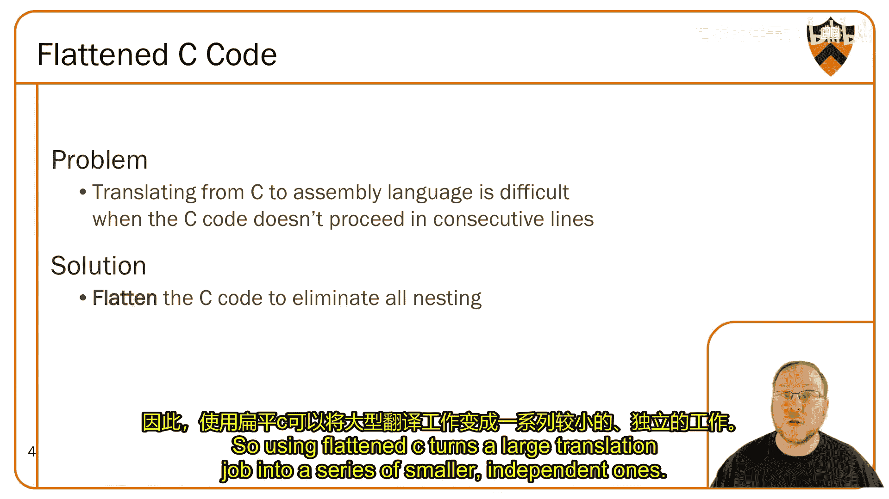

So our general approach is going to be invert the condition and then jump to the end of the block。

We can see this with an if statement， we invert the condition from our original C into the flatten sea。

 and then we jump over the consequent。

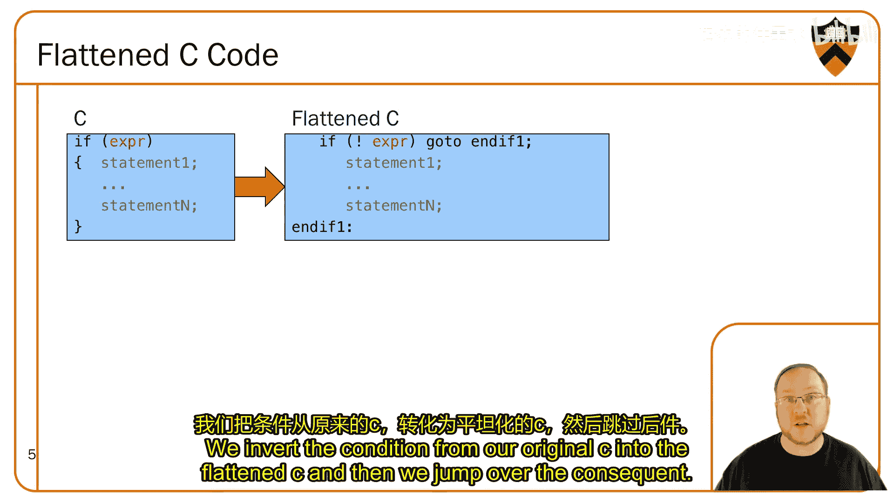

And if theres an else clause， we also need to have at the end of the consequent。

 a jump over the alternative to continue with the code that comes after the if statement in its entirety。

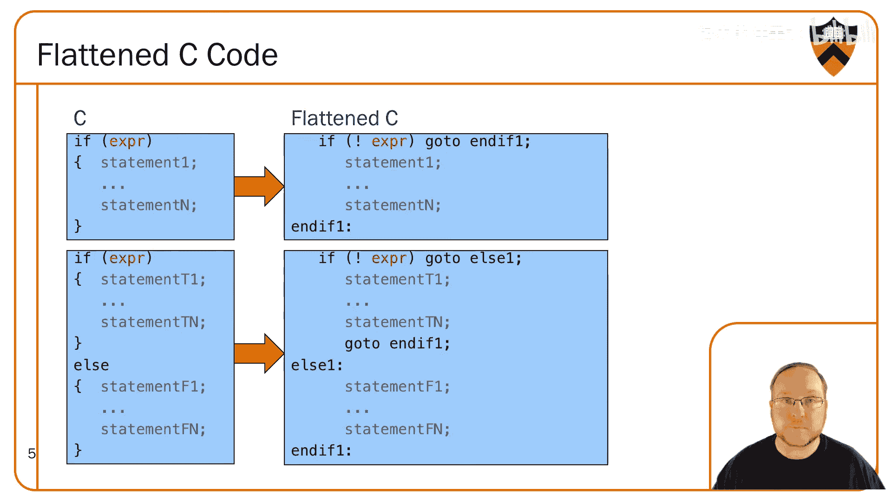

So while loops look a lot like this if L structure。

 except instead of jumping forward over the alternative at the end of the body。

We jump backwards towards the condition test to check it again。And in a fore loop。

 the easiest thing to do is to put the update step at the end of the body。

 basically converting a for loop into a while loop。

That's pretty much it in terms of the mechanics of flatten C。 but before we move on。

 I'd like to make one note about how you should try to approach the process of developing this code。

First， obviously， you have to have a correctly working C program。Without that。

 making a translation is just going to duplicate the problems already extant in your C program。

So then once you have a working regular C programme， you can translate from C to Flten C。 Now。

 you should do a complete regression test， make sure that everything that was working before is still working now。

If it isn't， then there's no point in going forward。 All you would be doing is。

Converting the errors in your flatency into errors in assembly。

 And it's probably easier to solve them here and now。

 rather than propagating them down the line and having to solve them later in a language that is lower level and that you might be less familiar with。

Once you've passed your regression testing and have a properly working flattenency program。

 now you can do your translation to assembly。At this point you should again do a full regression testing。

 you should make sure that everything that was working is still working。At this point。

 if you have a bug in your assembly code， you know that it is very likely that it was a translation error。

 You made a mistake in writing the assembly and didn't faithfully capture everything from the flatten C rather than having some latent logic bug or something else that was wrong with your original code that would be really tough to track down。

So using this approach， if there are any errors in the assembly language， now。

 you know where to look。 You don't need to think about the algorithm。 You don't need to look and say。

 did I do the translation to flatten C， right？ No， you can just look and say， okay。

 my flatten C works。 My assembly doesn't。 What's different。And note in office hours。

 if you come with an assembly bug， almost certainly。

 the first thing your preceptor is going to ask you is， so let me see your flat and C。

 because if if that's not working， there's no point in digging into the assembly。

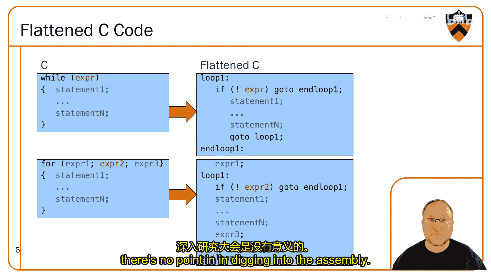

Okay， so with that tool as a new tool in our toolbox， let's drop down a level into assembly language。

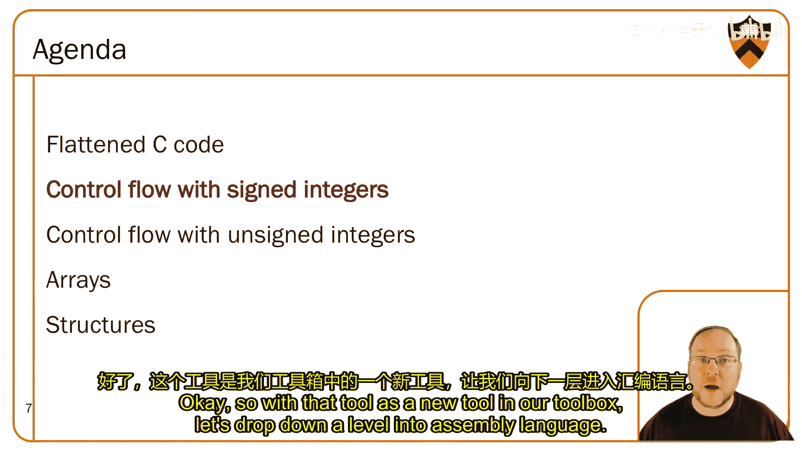

Here's our first C snippet that we want to translate。

Remember what we saw before and take a moment to just think about what it would be in Fl and Sea。

Better yet pause the video and write it down， just like with our multiple choice。

 I click or type questions。We've said that it's too easy for you to sort of lie to yourself and say。

 oh yeah， I knew that once the answer appears on the screen so here go ahead and pause the video。

 write down what you think the flat and C will be and then come back。Okay， so here's the flatten C。

 we invert the condition and then jump to the end of the block。

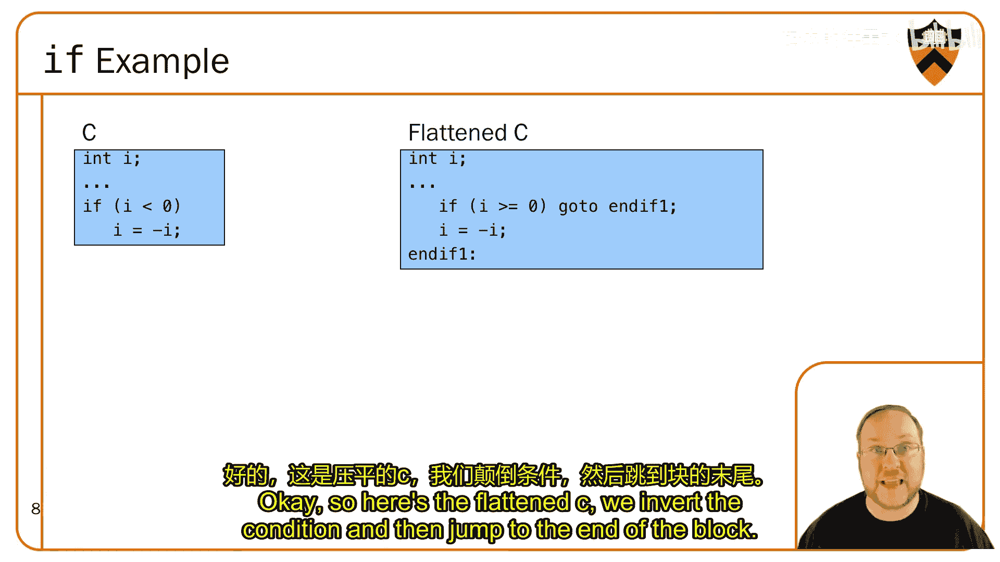

So now let's take a crack at the assembly code in the assembly code。

 there's a dot section directive to announce the BSS section， and then in blue dot skip directive。

 dot skip 4 to provide sufficient space to store an int。Later on， in the text section of the code。

 we get to our if statement。 Again， in blue， we get I's address into a register。

 and it needs to be an X named register because addresses are all 8 bytes。

Using that register X0 as a pointer in the LDR operation。

 we follow the arrow and arrive at the location of I in memory， and we load the value of I into W1。

In this case， it's a W register because there's only four bytes allocated at that location since I is an int。

Then in red， we compare the value of W1。With0， this sets the flags in the P State register。

Still in red， we branch if the result of the comparison was greater than or equal to。

Note that this means that the ordering of the arguments to CMP match the flatten C。

 not the original C。But this is convenient because we have said that flatten C is closer to what our assembly language is going to look like。

If the result was not greater than or equal to， so that means that I was less than zero so we needed to do the consequent in the original C。

That means we didn't jump away so we can do it。 The green instruction is the unary negation of the contents of W1。

 putting that result right back into W1。Because there's no else clause。

 the execution continues at the very next line after the consequent。

 And so we don't need to branch at the end of the consequent。

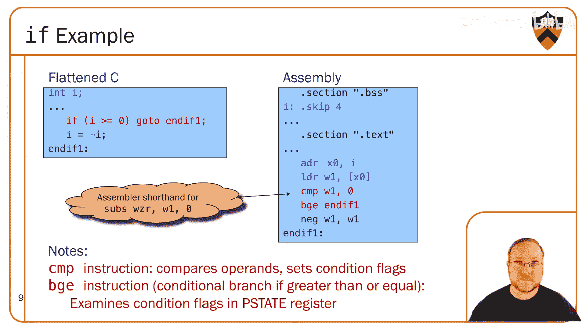

That was a lot at once， but we can add one more wrinkle into the mix and else closes。So again。

 take a moment to think about what would the flatten C here have。

 will there be any changes to the consequent from what we saw before？

And how would we represent the alternative？Pause the video here if you want to write down your solution。

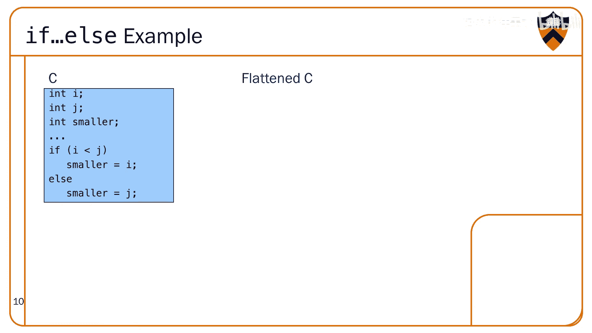

Okay， so for the conditional， we invert the condition and jump over the consequence just as before。

For the consequent， we do it and then jump over the alternative at this point because there's more code that comes after it before we finish the if statement as a whole。

And finally， for the alternative。We write the alternative and we just keep going。

 there's nothing to jump over here。

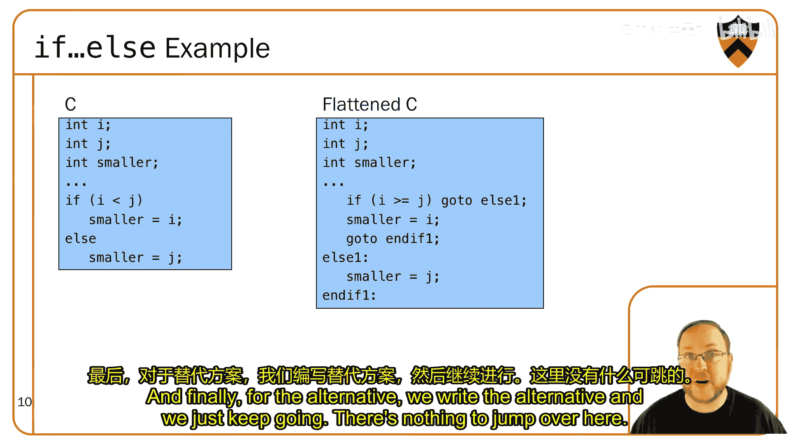

So now let's see it in assembly in blue， we get I's value in J's value by getting their respective addresses into registers and completing the LDR operations to get the values themselves into memory values of themselves from memory into registers。

In Maroon， we do the comparison comparing I with J， again。

 note that the semantics of the conditional branch fits the flat and C。

 if I is greater than or equal to J， that should go to the alternative， so jump there。

Inside the consequent in green， we set smaller to I。

 grabbing the address of smaller and then dereferencing the pointer to store from the register I as held in W1 from before。

 into that location which is now referenced by x0。At the end of the consequent。

 we can't just go to the next line because that's where the alternative is。

 So we need to jump over the alternative clause。 This is an unconditional branch， So just B。

The alternative also grabs the address of smaller into x0 and dereferences it this time distort store W2's contents that is J into smaller。

You might note that seeing as we did the ADR of x0 in both the consequent and the alternative。

 we certainly could optimize this by doing the ADR before the CMP。

But that really only saves us one instruction in our text section。

 it doesn't actually save us an instruction in our execution。

Because only one of those two ADRrs will get executed depending on which path we go down。

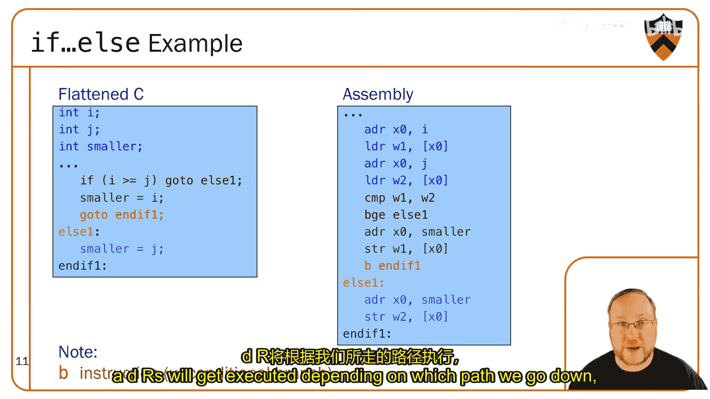

But it is potentially useful。So now we've seen conditionals， what about iteration？

Here's a simple iterative program to compute and factorial pause the video and write out your flatency。

Okay， so just like with the if statement， we're going to invert the conditional and jump over that block。

Then we have the body of the loop。 And at the end， we need to implement the behavior of the C loop。

 which goes back up to the top of the loop to check the conditional again。

 So we have a label at the top of the loop to go back up to it。Thus， we have a label。

 the initial check， which might or might not pass the body and a jump back to that check。

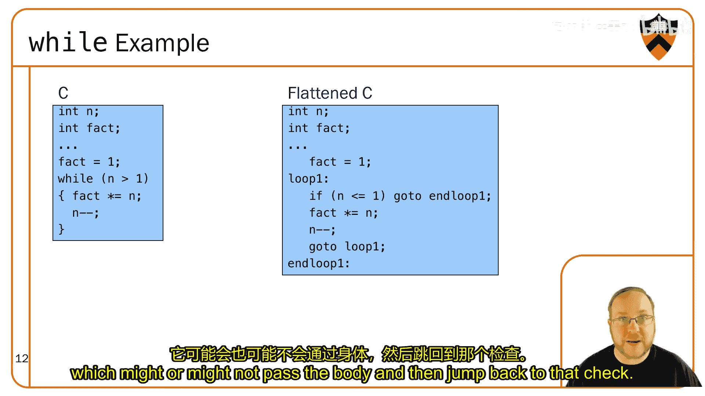

So here's the assembly version In blue， we get the value of n by our tried and true at this point。

 AD R plus LDR idiom。We use a register for fact， we don't need to load its value from memory because we're just starting it off at one right before the loop。

So we put the immediate value1 into the register in the green instruction。

In red we do the comparison and if it fails， we leave the loop， again。

 the conditional branch semantics here match the CMP ordering in the flatten C。Otherwise。

 if it doesn't fail， the maroon is a multiplication to accumulate fact in W2。

 and the light blue is a subtraction to decrement N in W1。

So note that we could write these values out to locations in memory every time we change fact and every time we change n。

 we could write the values out to where the variables live in memory。But frankly。

 it would be silly inside the context of a loop， we can keep using the values in a register until we're done with them。

And especially since memory is so much slower than our registers in terms of latency。

 it would just be a really poor performance for no real gain algorithmically。

To do it each step rather than just once when we're done。But then at the end of the loop。

 body in dark blue， we unconditional branch back to the top of the loop and check the loop condition again。

Eventually， the loop condition will fail， and we will。

End up doing this branch less than or equal to the end of the loop。At that point。

 we can actually store out from W2 into fact our final answer。

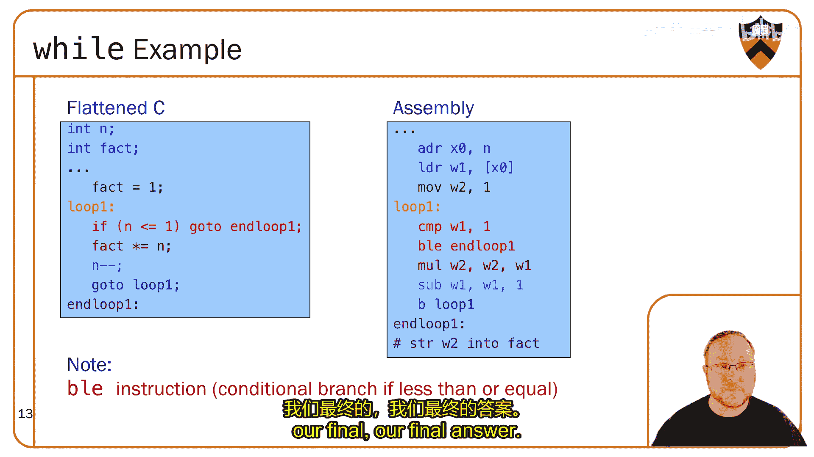

So similar to our factorial snippet， here's an iterative exponentiation computer。

 we compute the base to the exponent power and store into power。

 pauseuse the video and see if you can write out the flatency。

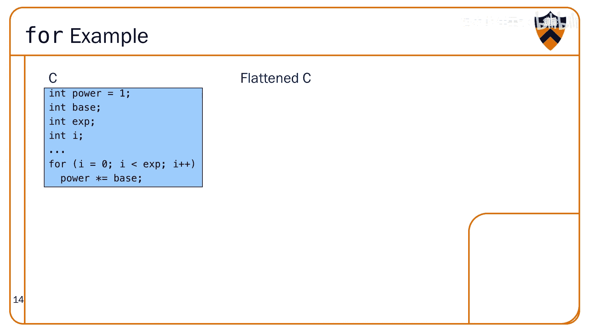

Our convention for a three part4 loop， we initialize before the loop。

 We then have the loop sustaining condition check。 It goes up the top of the loop。

And then we have the update step at the bottom of the loop body just before jumping back up to do the check again。

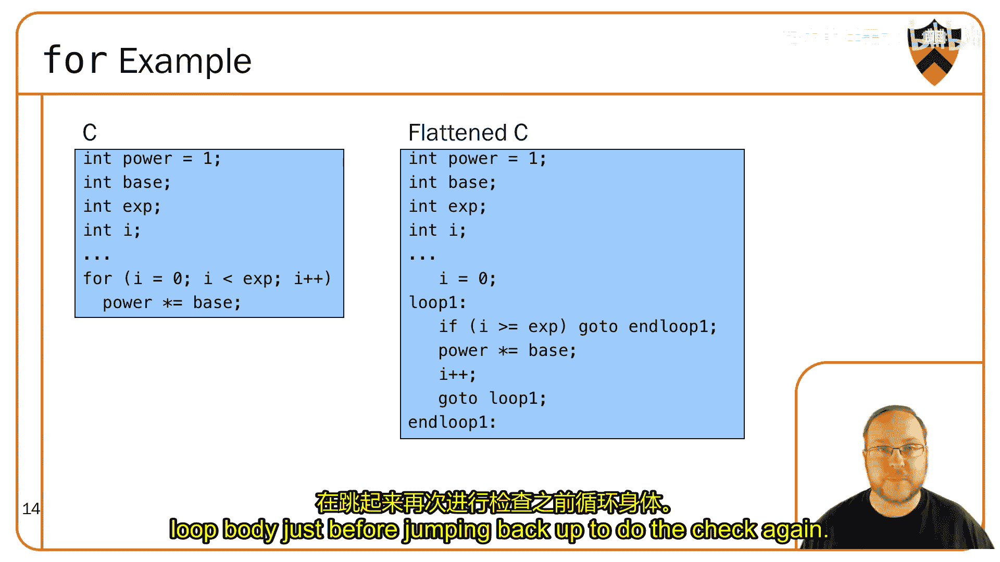

In precept 14， you covered some new memory sections。

 I mentioned several of them last lecture and one already today day。

 but it occurs to me that you didn't really cover it much in lecture。

 So because it wasn't immediately relevant to an assignment。

 It's possible maybe even likely that some students didn't fully internalize this。 So P quiz。

 which variables are in which section of memory。 As that this is like the code from the previous slide。

 So they're all file scope and process duration variables。

 which is all we've seen in assembly thus far。 So we know that it's not the stack。

 that would be if it was a local variable or a parameter。

 And there's no dynamic memory management here。 So we know it's not the heap。

So that leaves these options。So is it DE， which one is for initialized and which one is for uninitialized data is where we put things that have explicit initializations。

Things that don't have explicit initializations go in BSS and assume the value0。

Recall that even if we had initialized power to be zero， it still would have gone in data。

 even though it would have had the same value that could have been assumed in BSS。

So here the answer is E。

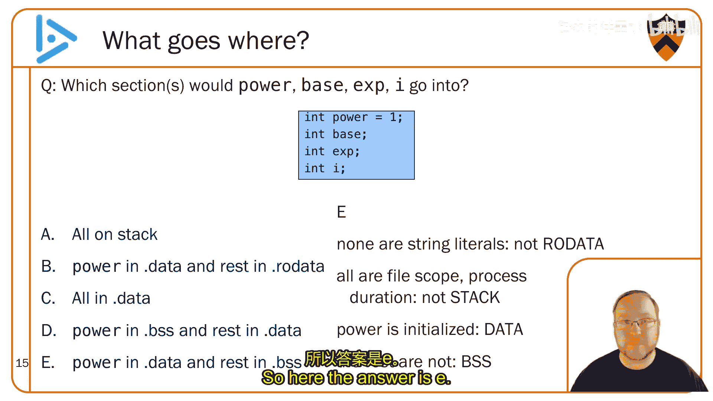

Okay， so now let's see the assembly for this this exponentiation example first。

 the variables power is in data， it's an int， so that's a dot word directive and its value is one。

The rest are all ints in BSS， so in BSS， we just do a do skip of four bytes for each of them。

And now the code， in blue， our ADR LDR combinations， we load power into W1。

 base into W2 and X into W3。In Maroon， then we use W4 for I and we initialize it to zero as the first piece of our forelip。

In red， we have the loop sustaintaining condition check with a CMP between W4 that we're using for I and W3 that we're using for X。

And then a condition chair， a conditional branch matching the flatten sea ordering。

The body of the loop is in green， a multipier that accumulates the register we're using for power。

And finally， the update step at the end of the body in light blue。

 an ad that accumulates the register we're using for I。

Then we do an unconditional branch back to the check。Note that we could。Again。

 have updated all of these variables in memory throughout the computation。 But again。

 why pay that several order of magnitude cost， and we should only do it probably once at the the final version。

But on that note。Here we in the previous slide we just said store out the final answer。

 and here again we just say store out W1 into power。But that's not necessarily sufficient。We might。

 at some point， make。Further use of eye assuming we've gone through the loop。Certainly。

 we've written code like that before that says， O， we dropped out of the loop or did a break。 Well。

 which one did we do， Let's check the loop variable to see which happened。So if that were the case。

 we would have to go through and actually store I back into its location in the BSS section。

 but for this code， we don't see any further use of I， so we'll skip that。In general。

 if we're not going to use our variables again and they're sitting in a register possibly modified from their value and memory。

 there's no point to storing them back into memory。

 even though it does make it arguably less true to the original C program in which their values would have been updated in memory。

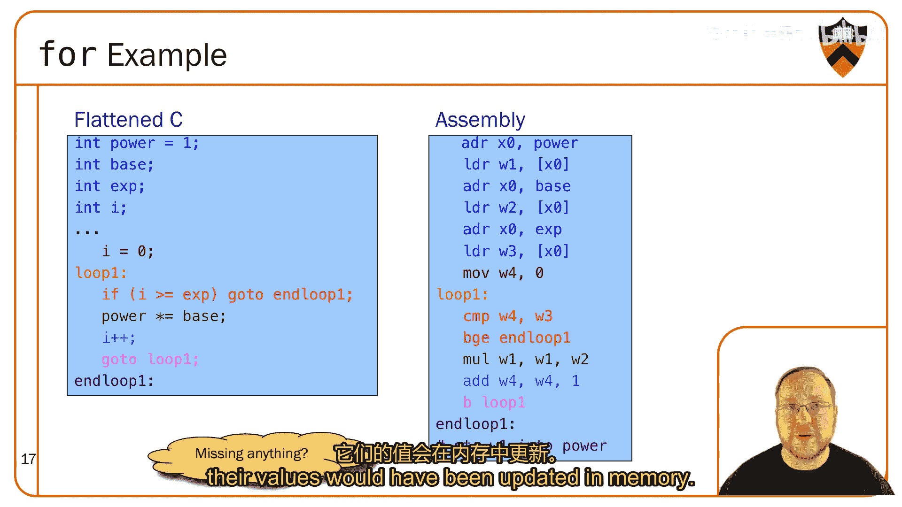

So now you've seen some examples of control flow note that in all of these examples we were using ints。

Specifically， int not unsigned it。 We were using signed numbers。

 and we did it even when it was sort of silly like in factorial。

 And these comparisons were what we would expect equal， not equal， less than less than or equal。

 greater， greater than or equal to。 But now let's see what would change if we used unsigned numbers。

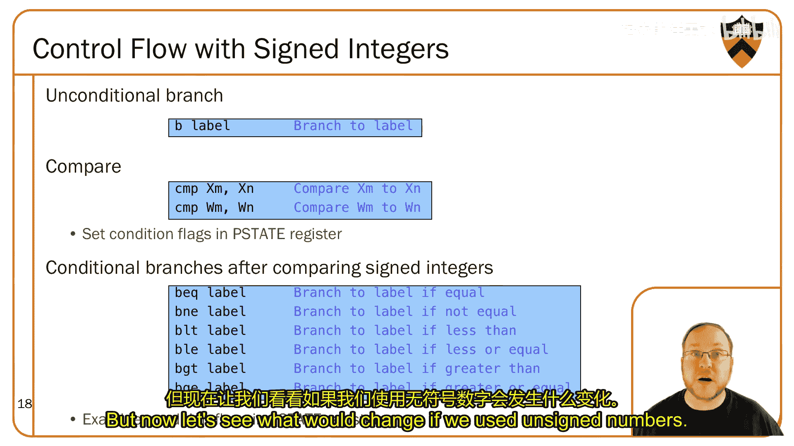

So as mentioned in our first assembly language lecture。

 our values stored in assembly language might represent either signed or unsigned numbers for most most arithmetic operations。

 it doesn't matter because the Biwise algorithm would be the same。 Thanks， tos compliment。

But it does matter for division and to the theme of this lecture， it matters for control flow。

Pause the video and think a moment about the question at the bottom of the slide。

If these are signed ins。The first value is  -1， and the second value is 0。If these are unsigned ins。

 the second value is still0。But the first value is large。 It's a bit over4 and a quarter billion。

Negative one is less than 0， but zero is less than 4 billion。

 so if we're using the same comparison instruction。

 we're going to need different branch instructions。

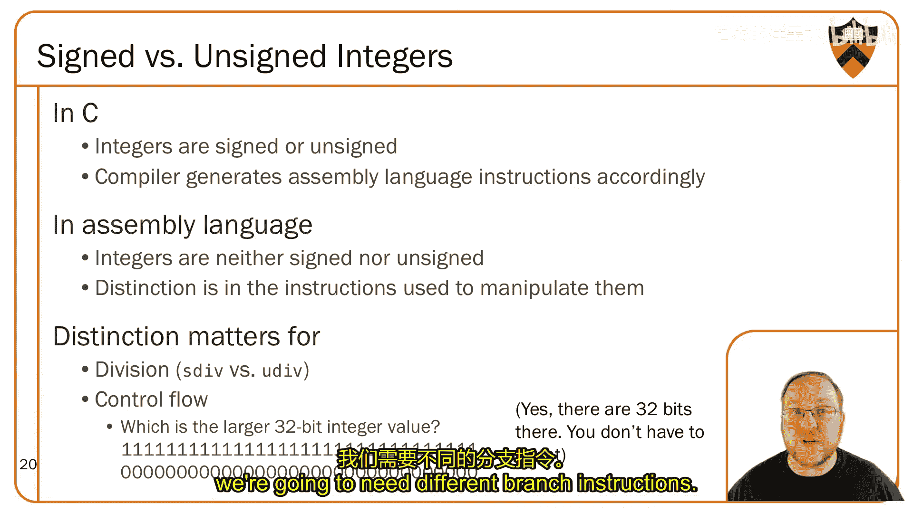

So here were our previous versions。And here are the unsigned versions。

 Everything on the slide in light gray is the same between signed and unsigned。

The comparison operation is the same。 The unconditional branches don't look in any flag。

 so they don't need to change。The equal and not equal。

 just check the flag that sets whether all the bits were the same。 So again。

 they don't need to change。But for numerical comparison。

 we have to differentiate signed and unsigned comparison to account for this0 is less than 4 billion。

 but 0 is greater than negative  one。We use this lower instead of less。 So B， L。

 O and lower or same instead of less than or equal to。 And we use higher instead of greater。

 This is sort of a curious naming equal to same was required because of the use of lower that had the same L as less than。

Perhaps below and above might have been a better choice is English language options for which to base the assembly language mnemonic。

 but lower and higher is the standard terminology， so they had to change equal to same fine。嗯。

Just like in the first half of the semester， I guaranteed you that you would get bitten by a switch fall through at some point。

 I can almost guarantee you that you will get bitten by the using signed conditional branches with unsigned values。

Almost certainly in A5， if not in A5， then sometime in your life。But for a5。

 it's so common that I'm tempted to pin to pin an editable post in Ed that's just a counter for I got bitten by this bug。

 So do be careful any time that you're using unsigned values， Think about it。 say。

 I know I'm using unsigned。 I know this is fundamentally different。

 I can't just do less than or equal to。 I have to do lower or same。

 and the same with greater than or equal to and greater than for for higher or same， so。

Don't say I didn't warn you if nothing else。

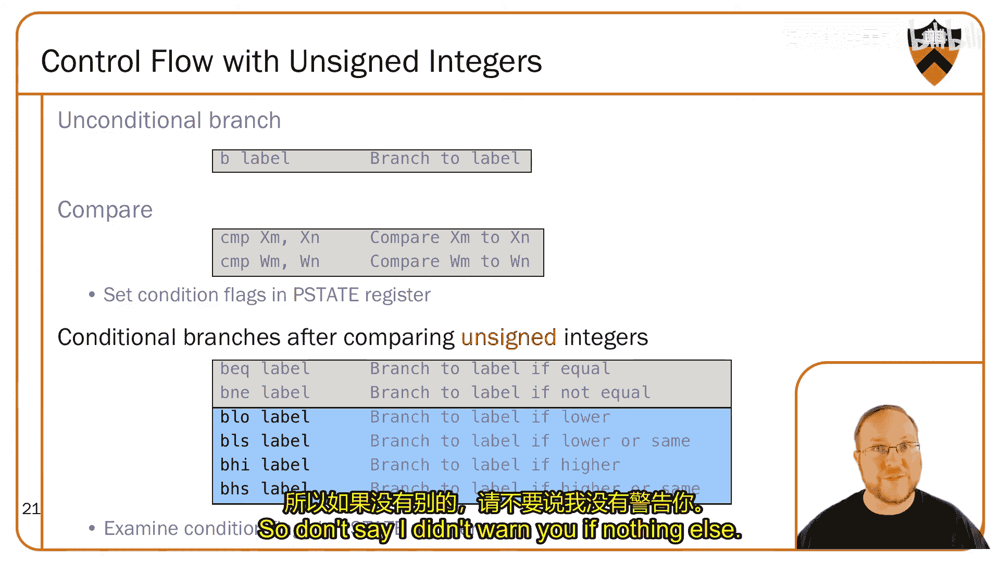

So in hopes to minimize this this rhetorical counter oned， though。

 let's change the most egregious of our examples。 recallll our factorial program。

 Let's change the flatten C in only one way to have unsigned ints instead of ints。

The only thing here that needs to change to represent this in assembly then。

Is the conditional branch instead of branching on less than or equal to， we branch。

 we branch on lower or same。 So it isn't a big change。

 It isn't something that's hard where you have to say， not only do I have to remember to do it。

 but I have to remember how to do it。 No， how to do it's pretty easy。 It's remembering to do it。

 That's the tricky part。

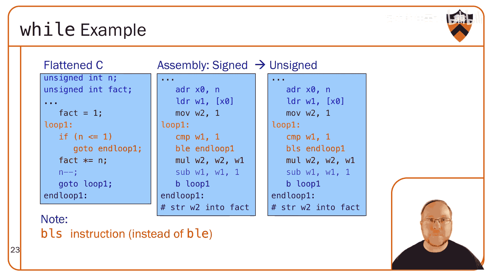

Sort of as an aside， there are two other fun control flow instructions to note CBZ and CBN Z。

 So if you liked in toy the opcode C that took a register and branched if and only if it was0。

 these are your equivalents。 It's not necessarily used all that often， But if you have a check for0。

 for example， a loop counting down， this could be a convenient thing to use as opposed to having to get the value 0 into a register or to remember to use the0 register that's always0。

 So So these are just handy shortcuts。

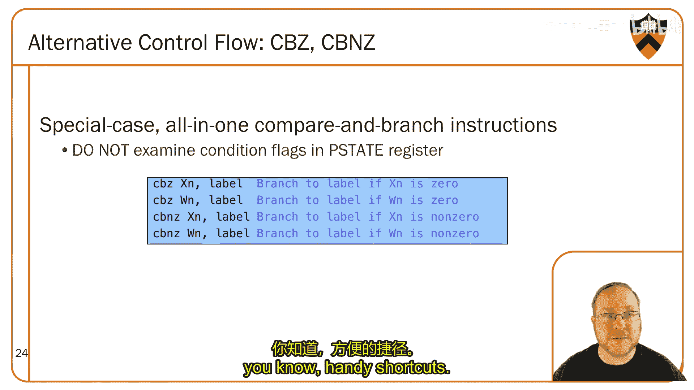

All right， so everything we've seen thus far has just been simple data Ins or longs。

 Let's see how we'd work with one of our other favorites C constructs， arrays。

Here's a snippet of array code that has an array of 100"s。 And somewhere in the alighted section。

 we set a value into the array elements。 So now we want to retrieve the value from one such element。

😊，A of two。 presumably， this is in the context of a loop or something like that。 So we have a of I。

Our registers only store  eight bytes， so clearly we can't get the entirety of the array into a register at once。

 so instead we're going to have to figure out the address in memory of A of I and then go and fetch it do a load from that memory address directly rather than getting all of it and finding it in large inside the large chunk of data。

So recall that in C， data is contiguous in an array。

 and the zeroth element is at a lower address than the CaF element。

Also recall that A of I is really the same thing as D reference of a plus I and further recall that a plus I has this implicit multiplication thing going on where we're implicitly that the addition is actually adding I times the size of the elements of a。

That's a lot of recall， so backup up， pause， make sure that all works for you。But if it does。

 let's look at the BSS section。The array has no initial values， so it's in BSS， it's 100 inch。

 so that's 400 bytes。I is a long， so that's 8 Bs。 and N is an int。 So that's another  four Bs。

Now let's go to the array processing code in the text section。

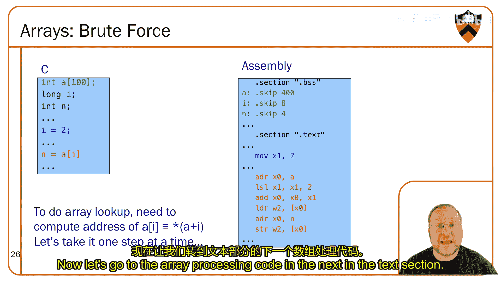

Here， the diagram shows some of the registers。 a fragment of the B， S。

 S section of memory using pretend addresses inexplicably in decimal。 But hey。

 despite all of the drilling for the， the first half of the course。

 we know that decimal is probably still easier for most of us to count。 So let's go with it。

 We use the pretend addresses because we， we don't know where this will actually be in in actual addresses in memory。

 So this is easier to just reason about。So in the C code we set I to be2。

 so let's get that right out of the way， we'll use x1 for I， we do need x1， not W1 since I is along。

 and we move 2 into it。As before recall that if we're going to need the value in eye and memory sometime later。

 we do eventually have to put it back， not just get it into a register。

 but from the limited code we have here， the register is sufficient and we won't worry about the mapping that says。

 everything that we do with this register needs to be parroted back into the actual memory location。

Okay， so now if we're going to do dereference of quantity a plus I， we need the value of a。

 the implicit pointer to the start of the array， the address or the base pointer of the array。

So we can do that with our trustee ADR pseudo instruction。

 just like we've seen it get the address of lots of other things in data or BSS。

 we can get the address of an array。Namely， the address of the zeroth by of that array。

Our exact register choice here is arbitrary。 We choose x0 here for convenience that it's a small number。

 We'll talk about the actual rules for register use later on， but for now。

 let's stick with the first few registers。 So x0 becomes 1000。Now， the first curious operation。

 we shift x1 left by 2 bits。Why 2 Bs？ Is it because we want the index 2， Well， actually， no。

 the index 2 is the reason we move 2 in 1。Shifting left by two bits multiplies by four。

That's the size of an int， so this is actually the implicit multiplication in our dereference of a+ I。

So x1 is now the Ih element's byte offset from the start of the array。

 so whereas we have index of I is index2， these are in。

 so it's eight bytes off of the start of the array。If x1 is now the bite offset set， well now x1。

 X x1 is the bite offset set x 0， we said already has the base address。

 All we have to do is add these two together， and we get the address of the Ih element of the array。

So now that we have the address of A of 2。We do the LDR。

 This goes to the memory pointed to by the second upper end。

 it fetches the value into the first opera end， so that's dereencing the pointer just like we've already seen。

 and we get the 42 out of memory location 1008 and load it into W2。

Recall that the original C code had n being assigned A of I and said n gets A of I。

 so we continue to become familiar with the idiom of pairing an ADR with a memory access。

 in this case it's a store so here we're going to do the ADR we'll put it in x0 because we have no further need for the arrays the array address so we can reuse that register。

We do the store of the result we pulled out of the array into some other variable and we're done。Now。

 perhaps she's noticed that these are these slides called this the brute force approach。

 This is because we calculated our array addresses by hand in multiple separate steps。

But arm provides us with a more compact way to do this That's probably faster and is certainly better in terms of use of registers。

Perhaps at the expense of a bit more complicated code to， to read。

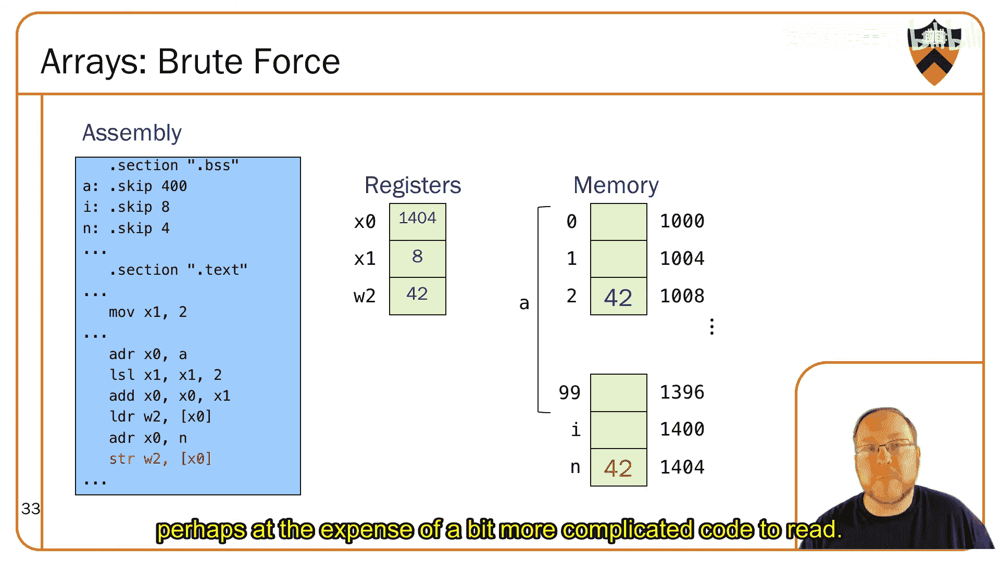

So let's look at this alternative。Instead of doing the left shift operation as and an addd operation as separate instructions。

 we can pack these two operations into the pointer dereference itself using what's called register offset addressing mode。

Look at the load in the rightmost box。We have LDRW2。So that's the same。We're loading into W 2。

 But instead of loading from W 0， that was the the result of three steps， an ADR and LSL and an ad。

We have x0 and two other arguments。X1 and LSL2。This is an assembly language shortcut for add the contents of x0 to the result of shifting the contents of x1 by 2 to the left。

So it's the same operations。Just all shoved together into a single， very compact addressing mode。

Note also that the register offset here doesn't change either x is 1 or x 0。

 unlike the brud force approach， This is particularly nice if we want to use the base address of an array over and over again。

 as we're， looping through an array or something like that。 And if we want to keep the index again。

 unsullied instead of having it be shifted。Again， if we're looping。

 we don't want our loop control variable to be moving wildly。

 We likely want it to increment one by one or decrement one by one。

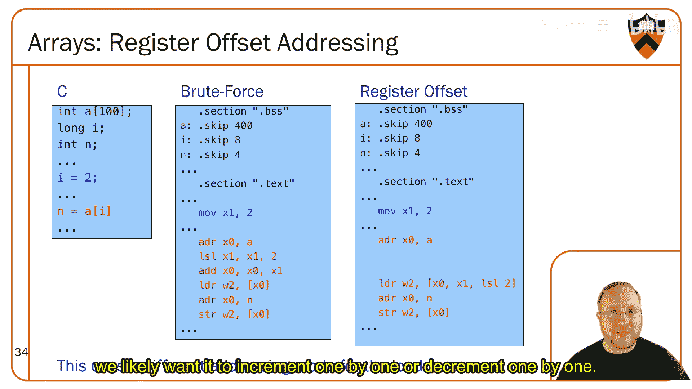

There are， in fact， a number of different addressing modes。

 The only one we'd seen thus far that the follow the pointer is just just alone is second here on this list。

 But that's actually a short cut for， for the offset。 When we want to offset by 0 bytes。

 we don't have to provide the offset explicitly。 But the more general case。

 when we want to offset by some number of bys。 We can say take the address and move forward or backwards by some immediate value。

And that's the first version here。The third version gives it a little bit more flexibility even it takes the offset in a register rather than it' immediate value Once we talk about machine language in another couple weeks。

 we will see why there is a limitation on the immediate values。

 but not on the registers for the offset and it comes down to how many bits are required to store a literal number in the instruction versus the identifier for for the register。

So we have the third version that's a little bit better still。

 it's still adding or subtracting some value， but we are not as limited to this range。Finally。

 the last version is the one we just saw with as。If it's an array of characters， well。

 we don't actually need the LSL because they're one by each。

 So we don't need to shift to do this implicit multiplication。If it's an array of shorts。

 those are two bys each。 so we'll need to shift 1 B to the left。

4 bys like we saw for ints is shifting 2 to the left。 And if we were dealing with an array of longs。

 we want to shift three to the left because that's the equivalent of two multiplying by two to the third。

 which is 8 for8 bys in a long。This slide， although only a single slide packs a lot of information into it。

 So I'd strongly encourage you to go and play with some of these。

 play with the examples because understanding the various addressing schemes is going to be really critical in assignment 5 you'll be seeing code and you'll say I have no idea what this is going why is it doing this。

 This is weird And so if you you're conversant and fluent in understanding why we have these supercomp addressing modes。

 it will help you， it will also help you when you get a write code because you're going to want to keep these these values of a base pointer or an index without having to have two different registers。

 two different variables to keep them。This will help you with dealing with array arrays and also with structures。

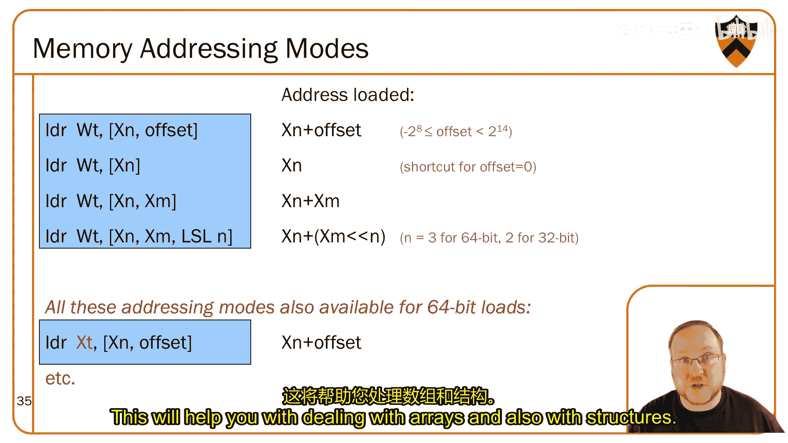

So speaking of structures， finally today we're going to talk about how to manipulate structures in assembly language programs。

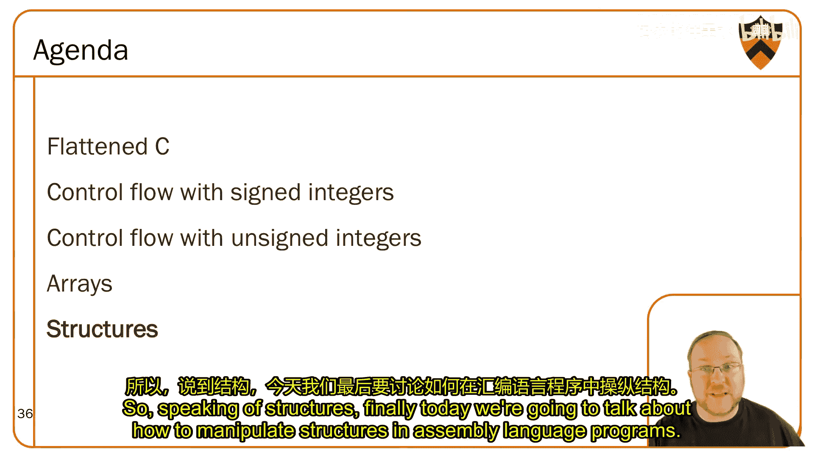

So consider this C structure at S on the left。 We can create an instance ofstruct S called mystruct。

 and then we use the dot operator to access his fields for reading or writing。 This is nothing new。

So again， let's try to start off with the brute force of our translation into assembly。

While the structure has two ins， so that's  eight bytes， let's allocate enough space in BSS for that。

Cstructs are by the C standard required to be stored in the memory order with their fields in order。

 So that means that I is going go first at the address of my struct A D R to find that address。

 store it， S T R to store it。 Great。 Now for J， what's the address of J。

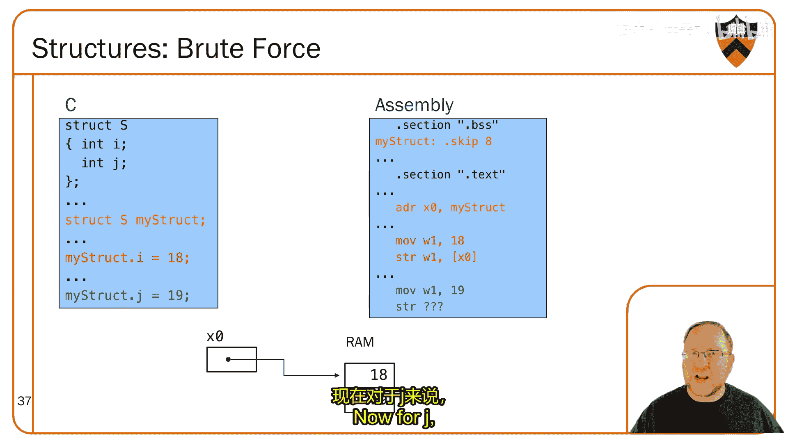

C was what we use for arrays among these options。So maybe it's that， but can we do better。

pauseuse the video， take a look and see， can we make any of these work。

 can we make some of these work， I there one best choice here？So as I said。

 C was what we use for arrays when we wanted to have some sort of implicit multiplication。

 So here we could make this work if we have a register value 1。

 we could left shift it by 2 B to get the value 4。 And then that gets added on to x 0 to get the spot for J。

But we can make B work， and we'd have to add4 to x0 to get the spot for J。That changes x0。

 maybe there's again a better option here。D could work even a bit better because we do the addition operation rather than having to change X0。

 but now we'd need a4 and a register somewhere。But if D works with a4 and register。

 that means that a works with the immediate value for as the offset。

 so a is really the cleanest here in that it requires no additional setup。

 no other register to get a value and no register being having its value changed。

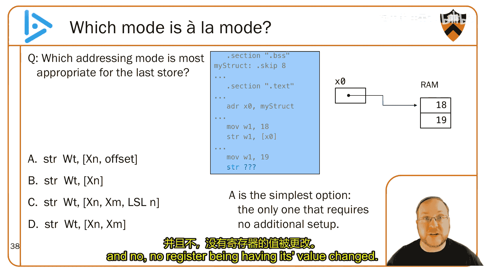

So here's our result with A， and this works。We are going to here do a move W119。

That puts 19 in the register that we want to store out of。

 And then we store from W 1 into x 0 comma 4。 That is x 0 plus 4。 And this works。 but be careful。

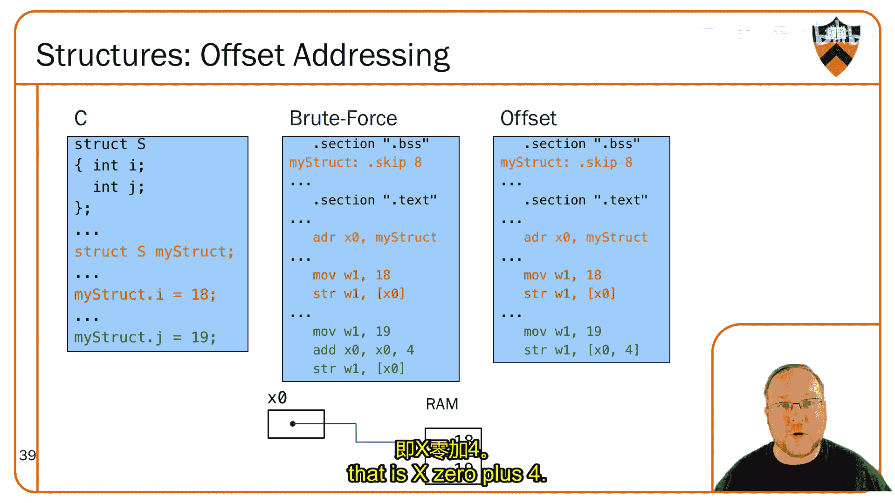

Because here's another program， this looks just like the one we did。

 except that it has a character as the first field。Shouldn't be a problem， right。

 The the program should be just the same， except that it'll have an ST R B instead of STR because we're only writing out one by and we'll have to do a register offset set of one rather than a register offset of four。

 Super easy， right。Well， anytime I use that tone， the answer is always wrong。

 So when you learned aboutstructs way back earlier in the term， it was mentioned。

 but maybe not emphasize that the size of a struct is at least as big as the sum of its field sizes because for performance reasons。

 the architecture may prefer that all of the fields in memory are addressable on nice alignment。

 say a multiple of two or four or8 or 16， and because of this there could be padding inside the struct。

And lo and behold， here， we do， in fact， have a three bite pad in between the character and the int。

The character at the beginning of the struct， everything's good。 But now the compiler would say。

 I don't really like having that int on1 B on1 B beyond。

 I'd like to have it 4 B beyond the beginning of the struct。So it puts a three byte pad。

The thing to remember here is that if you're going to compose assembly language that uses structures that were placed in memory by a compiler。

Then you must know what the compiler does in terms of adding padding。

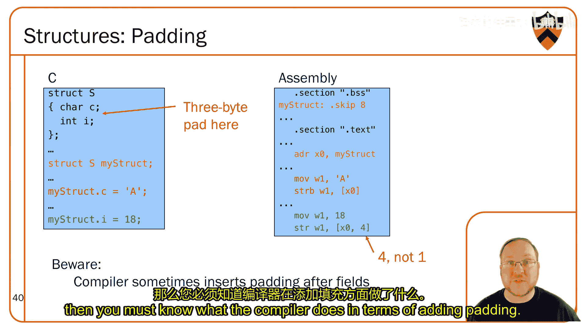

So this slide shows the address alignments for data within structures。

One other thing to note here is additionally， if it's within an array。

 the compiler can even add some padding at the end of a struct， Traing padding to a struct。

 And that just means that every first field will be aligned。 Basically。

 you can have the entire struct。 Then you pad to get to the next nice。

 nicely aligned address so that the next element of the array will be aligned itself。

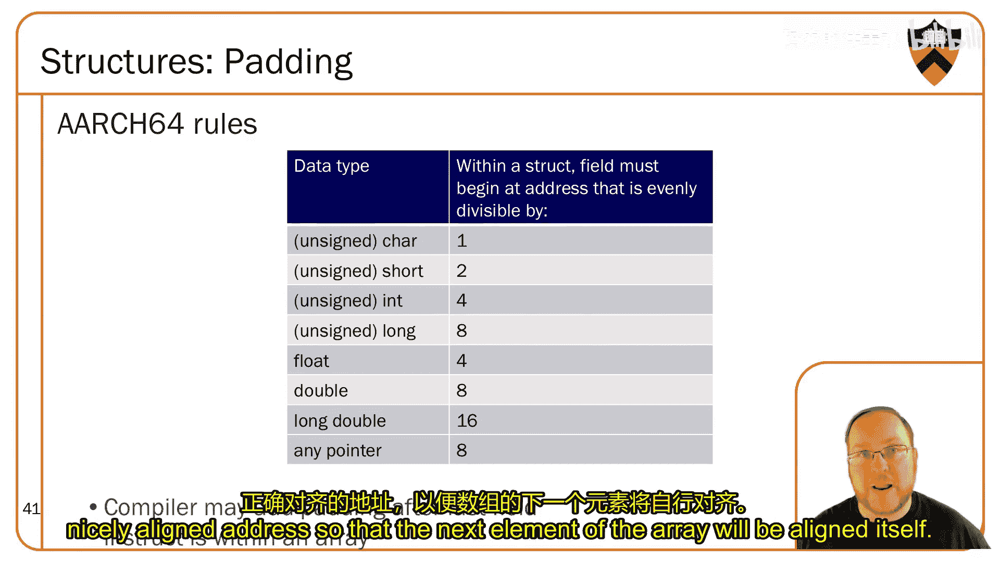

All right， so with that introduction to flatten C and branching。

 you'll be ready to start on the first part of assignment 5， which will be released on Thursday。

AndAgain， it's a partner assignment， we encourage you to find a partner。

 it's especially useful for the nitty gritty debugging in assembly language。We of course。

 as always encourage you to start early， you'll have two and a half to three weeks on this assignment。

 this goes all the way up towards the end of classes， but do please start early。

 this is traditionally thought of as the longest of the assignments in the course。Furthermore。

 with the discussion of arrays andstructs and the fancy addressing modes。

 you're almost ready for the larger second portion of that assignment。

 But there is still a little bit more to cover yet。 And we'll talk about that on Thursday。 Also。

 you'll continue working on on these topics all of next week in precept。 Good luck。😊。

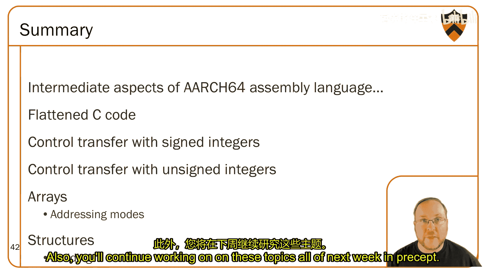