# C语言系统编程：22：汇编语言 part2

在本节课中，我们将继续学习汇编语言，重点探讨控制流、数组和结构体的实现。我们将学习如何通过“扁平化C语言”作为中间步骤，将C语言程序翻译成汇编代码，并理解其中的关键概念和技巧。

## 从C语言到汇编：扁平化C语言

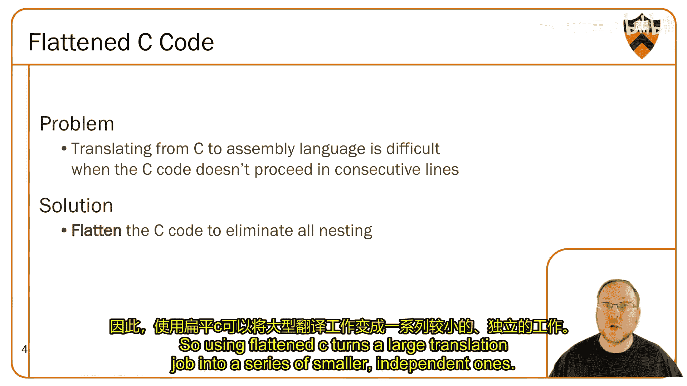

上一节我们介绍了汇编语言的基础。本节中，我们来看看如何将包含复杂控制流的C语言程序翻译成汇编代码。直接翻译可能很棘手，因为语句并非总是顺序执行。为此，我们引入一个中间表示——“扁平化C语言”。

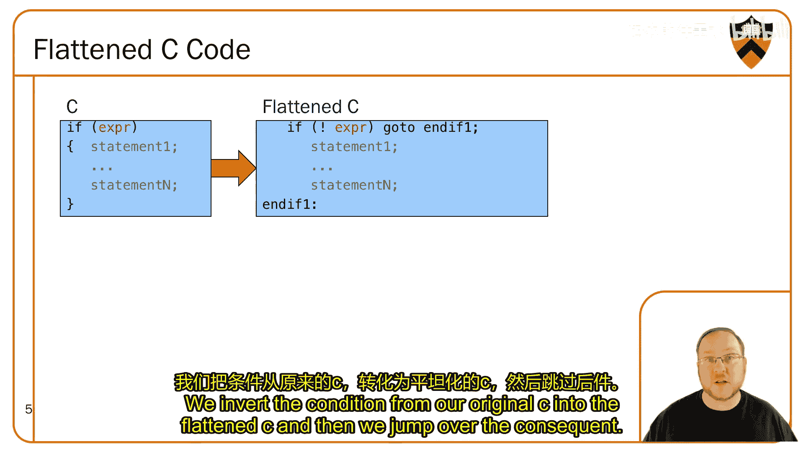

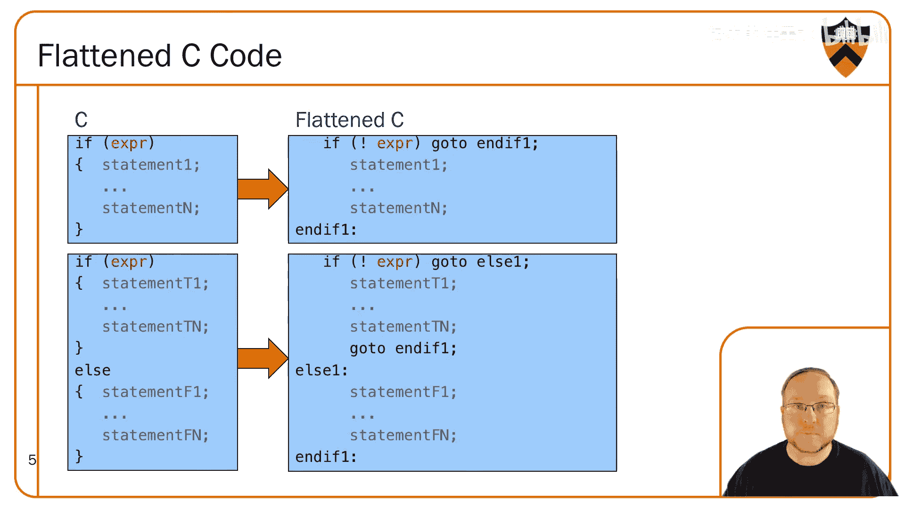

扁平化C语言使用标签（labels）和 `goto` 语句来明确控制流的跳转。虽然C语言中通常避免使用 `goto`，但在这里它是一个有用的工具，因为它能清晰地映射到汇编语言的条件分支和无条件跳转指令。

将C语言转换为扁平化C语言的一般方法是：**反转条件并跳转到代码块末尾**。

以下是具体转换示例：

### If 语句的转换

对于一个简单的 `if` 语句，我们反转其条件。如果条件不成立，则使用 `goto` 跳过后面的执行块。

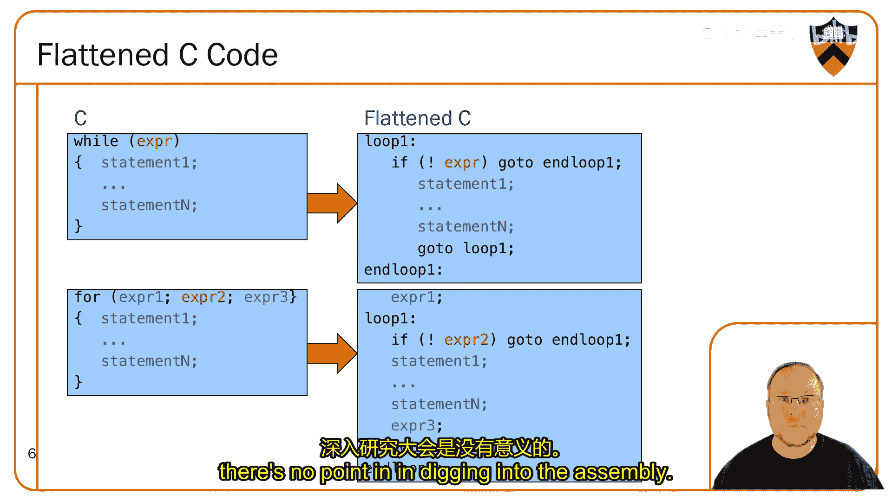

**原始C代码：**
```c
if (i < 0) {
    i = -i;
}
```

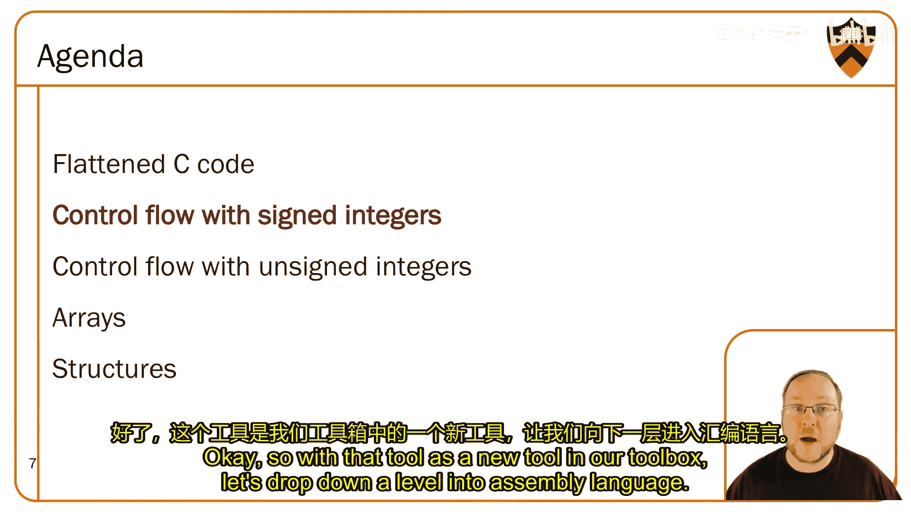

**扁平化C代码：**
```c
    if (!(i < 0)) goto end_if;
    i = -i;
end_if:
```

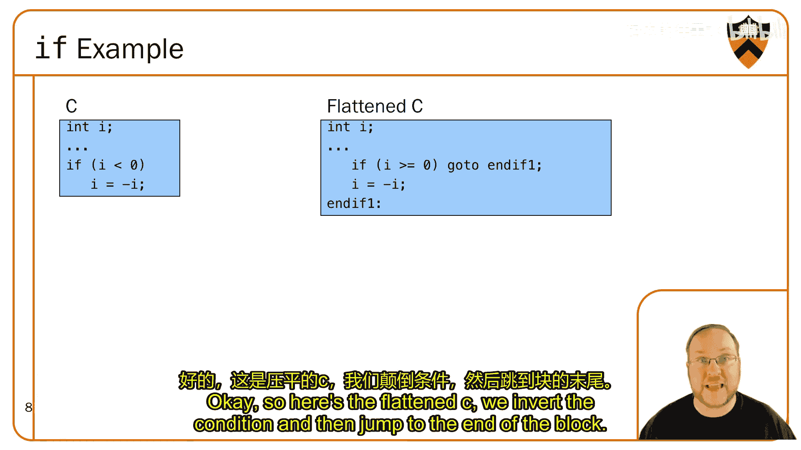

### If-Else 语句的转换

对于包含 `else` 的语句，我们不仅需要在条件不成立时跳过 `if` 块，还需要在 `if` 块执行结束后，跳过 `else` 块。

**原始C代码：**
```c
if (i < j) {
    smaller = i;
} else {
    smaller = j;
}
```

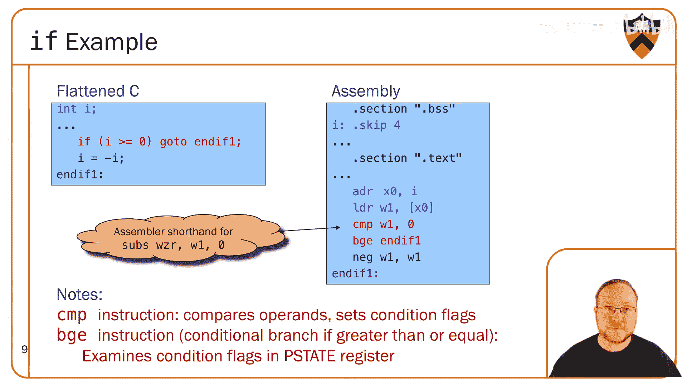

**扁平化C代码：**
```c
    if (!(i < j)) goto else_clause;
    smaller = i;
    goto end_if;
else_clause:
    smaller = j;
end_if:
```

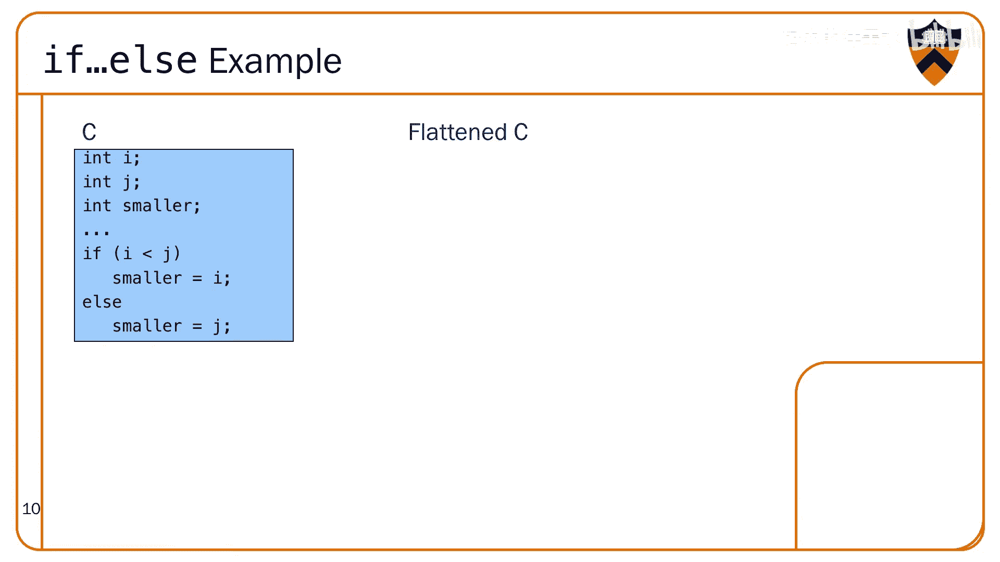

### While 循环的转换

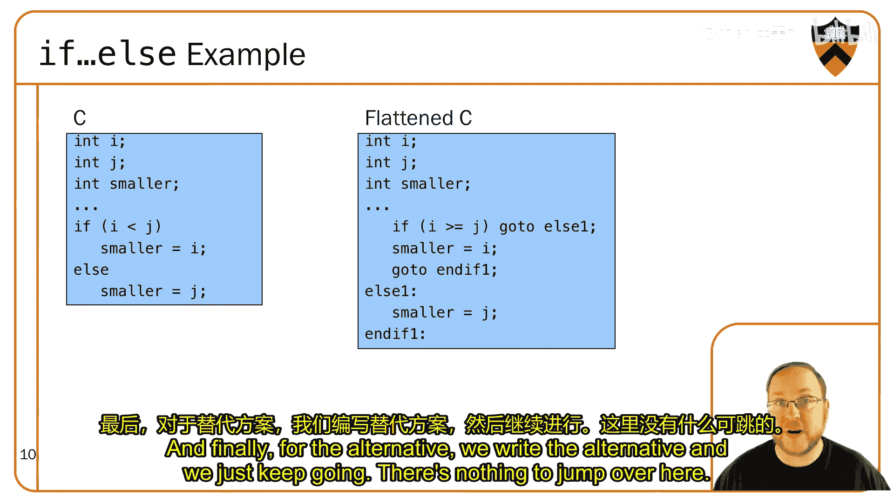

`while` 循环类似于 `if` 结构，但在循环体结束时，我们需要跳转回条件检查处，而不是向前跳转。

**原始C代码：**
```c
while (n > 0) {
    fact *= n;
    n--;
}
```

**扁平化C代码：**
```c
loop_start:
    if (!(n > 0)) goto loop_end;
    fact *= n;
    n--;
    goto loop_start;
loop_end:
```

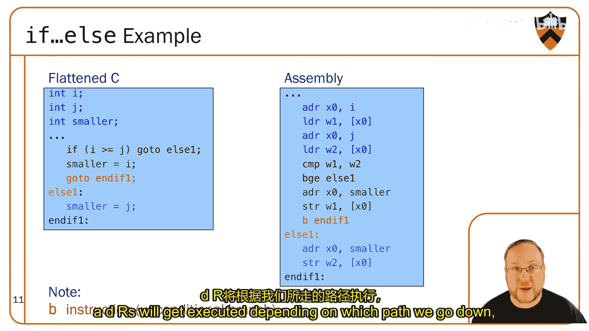

### For 循环的转换

处理 `for` 循环最简单的方法是将其转换为等价的 `while` 循环，将更新步骤放在循环体末尾。

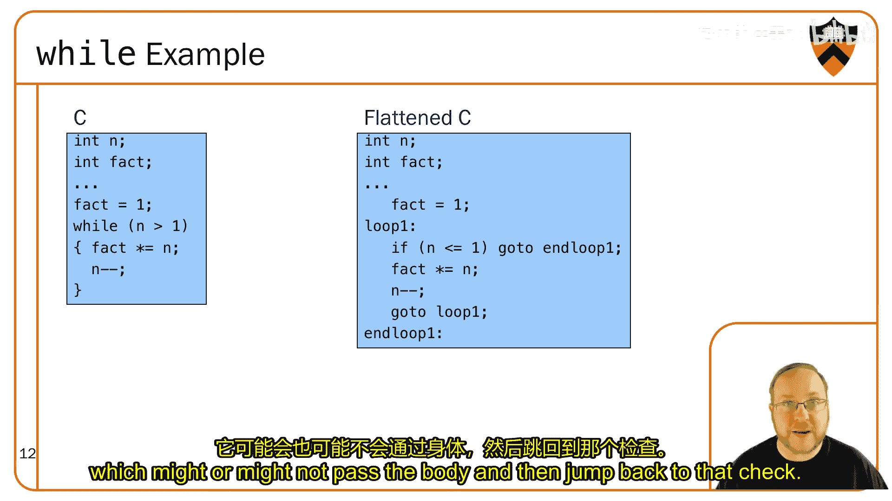

**开发流程建议**

在开始翻译前，请遵循以下步骤：
1.  **确保C程序正确**：首先，你的原始C程序必须能正确运行。
2.  **翻译为扁平化C并测试**：将C程序转换为扁平化C语言，并进行完整的回归测试，确保功能不变。
3.  **翻译为汇编并测试**：将通过测试的扁平化C代码翻译成汇编语言，再次进行回归测试。如果此时出现错误，很可能是翻译过程出了问题，而非原始逻辑错误，这更易于调试。

## 汇编语言中的控制流

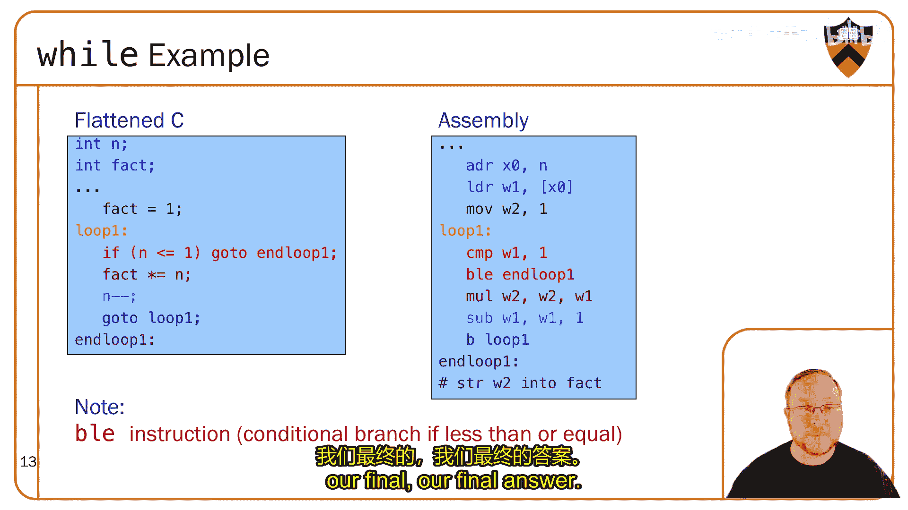

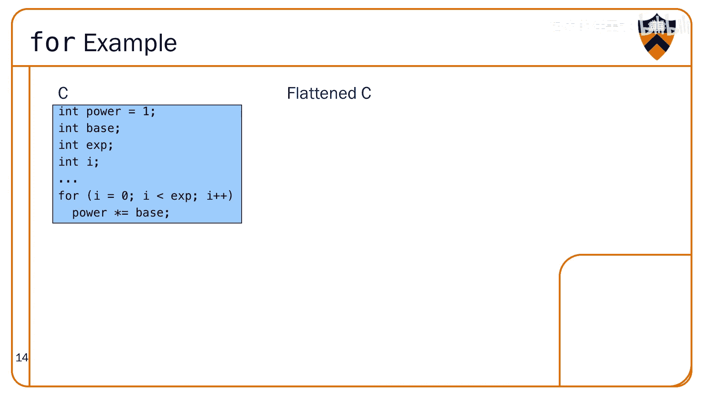

掌握了扁平化C语言这个工具后，我们现在可以深入汇编层，看看这些控制结构是如何实现的。

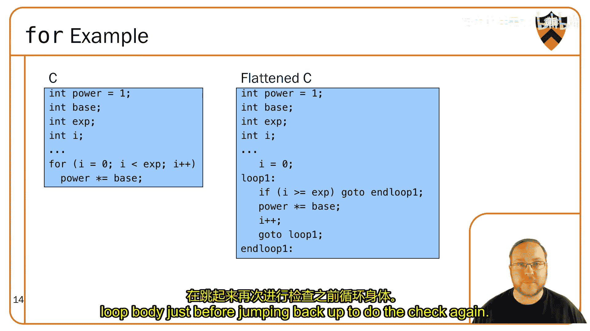

### If 语句的汇编实现

我们以之前的 `if (i < 0)` 为例。假设 `i` 是一个存储在 `.bss` 段的 `int` 类型变量。

**汇编代码：**
```assembly
        .section .bss
i:      .skip 4          // 为 int 类型的 i 分配4字节空间

        .section .text
        // 将 i 的值加载到寄存器 W1 中
        ADR  X0, i       // 获取 i 的地址到 X0
        LDR  W1, [X0]    // 将 i 的值加载到 W1

        // 条件检查：if (!(i < 0)) goto end_if;
        CMP  W1, #0      // 比较 i 和 0
        B.GE end_if      // 如果 i >= 0 (即 !(i<0))，则跳转到 end_if

        // if 块主体：i = -i;
        NEG  W1, W1      // W1 = -W1
        STR  W1, [X0]    // 将结果存回 i 的内存地址

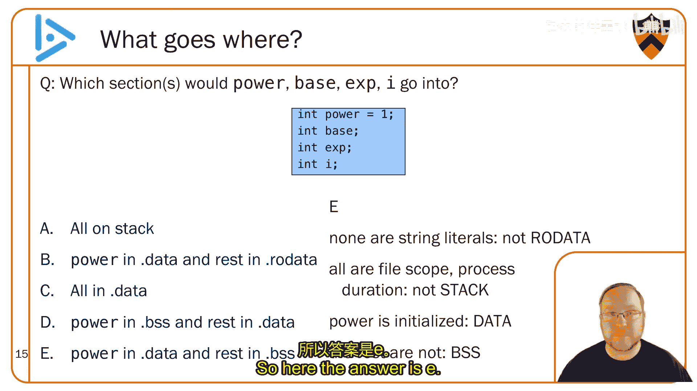

end_if:
        // 后续代码...
```
*   **蓝色**指令用于将数据从内存加载到寄存器。
*   **红色**指令执行比较和条件分支。注意，`B.GE`（大于或等于时分支）对应的是扁平化C中反转后的条件 `!(i < 0)`。
*   **绿色**指令是 `if` 块内的操作。

### If-Else 语句的汇编实现

现在看带有 `else` 的版本，假设 `i`, `j`, `smaller` 都是 `int` 类型变量。

**汇编代码：**
```assembly
        // 加载 i 和 j 的值到寄存器
        ADR  X0, i
        LDR  W1, [X0]    // W1 = i
        ADR  X0, j
        LDR  W2, [X0]    // W2 = j

        // 条件检查：if (!(i < j)) goto else_clause;
        CMP  W1, W2      // 比较 i 和 j
        B.GE else_clause // 如果 i >= j，跳转到 else 块

        // if 块：smaller = i;
        ADR  X0, smaller
        STR  W1, [X0]    // 存储 i 到 smaller
        B    end_if      // 跳过 else 块

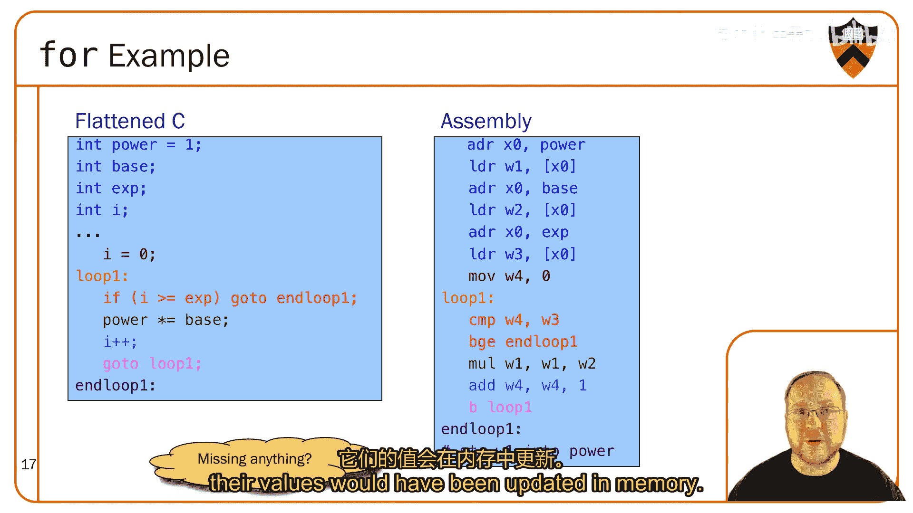

else_clause:
        // else 块：smaller = j;
        ADR  X0, smaller
        STR  W2, [X0]    // 存储 j 到 smaller

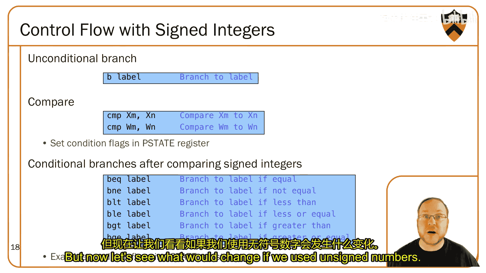

end_if:
```
*   在 `if` 块结束后，需要使用无条件分支 `B end_if` 来跳过 `else` 块。
*   为了优化，可以将获取 `smaller` 地址的 `ADR` 指令提到条件判断之前，因为无论执行哪个分支都需要它。

### While 循环的汇编实现

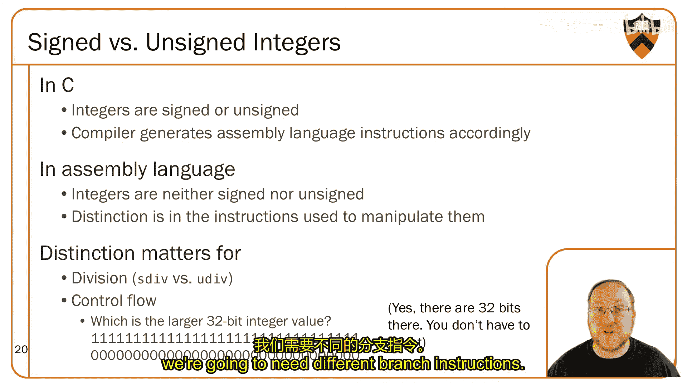

以计算阶乘的 `while` 循环为例。我们可以在循环体内将变量保存在寄存器中，以提高效率，最后再将结果存回内存。

**汇编代码：**
```assembly
        // 初始化：fact = 1;
        MOV  W2, #1      // W2 用作 fact，初始化为1
        ADR  X0, n
        LDR  W1, [X0]    // W1 用作 n

loop_start:
        // 条件检查：while (n > 0)
        CMP  W1, #0
        B.LE loop_end    // 如果 n <= 0，跳出循环

        // 循环体：fact *= n; n--;
        MUL  W2, W2, W1  // fact = fact * n
        SUB  W1, W1, #1  // n = n - 1

        B    loop_start  // 跳回循环开始

loop_end:
        // 循环结束，将最终结果存回内存
        ADR  X0, fact
        STR  W2, [X0]
```
*   循环控制变量 `n` 和累加器 `fact` 在循环期间一直保存在寄存器 `W1` 和 `W2` 中，避免了频繁访问较慢的内存。
*   只有在循环结束后，才将最终结果写回 `fact` 对应的内存位置。

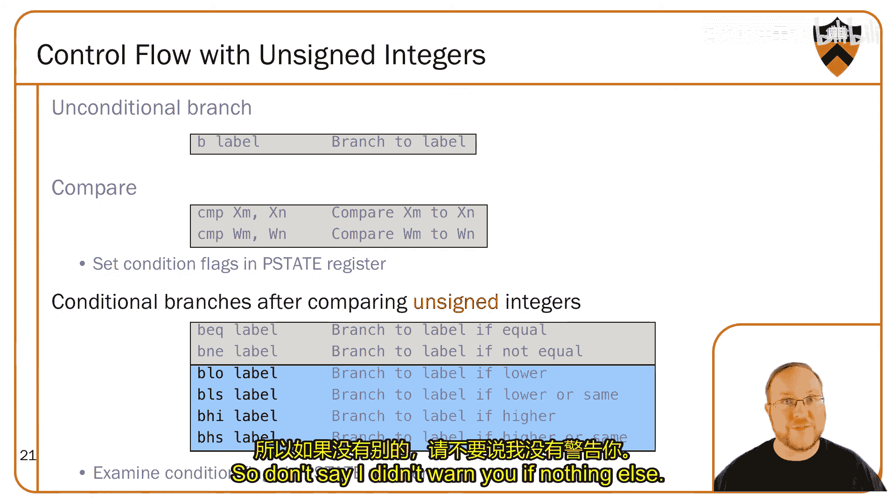

### For 循环的汇编实现

`for` 循环的汇编实现与 `while` 循环类似，但需要显式处理初始化、条件检查和更新三个部分。

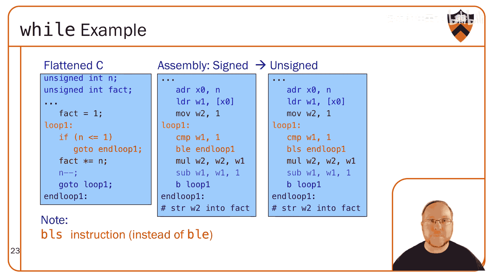

**C代码示例：** `for (i=0; i<x; i++) { power *= base; }`

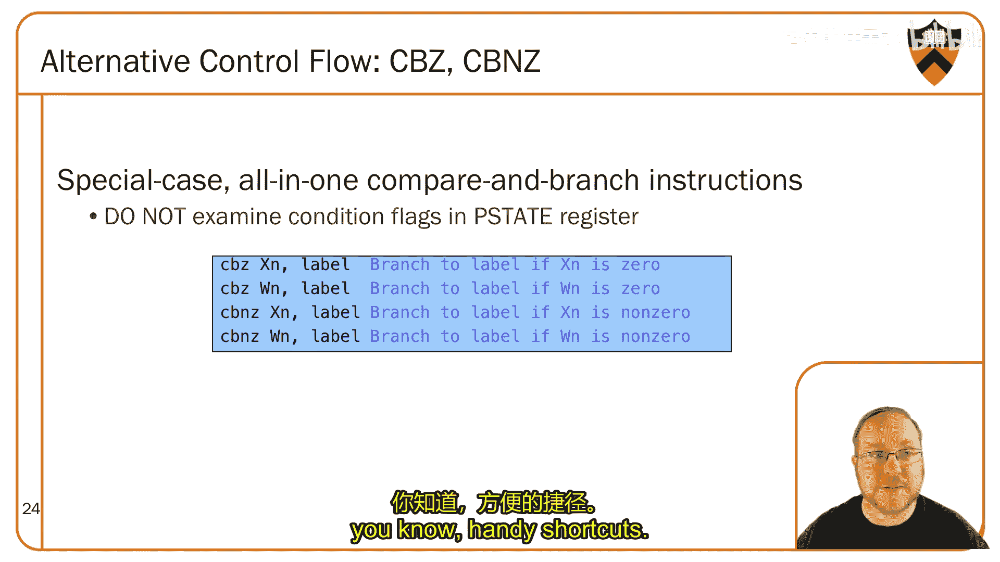

**汇编代码：**
```assembly
        // 初始化：i = 0;
        MOV  W4, #0      // W4 用作 i

loop_start:
        // 条件检查：i < x
        CMP  W4, W3      // W3 持有 x 的值
        B.HS loop_end    // 如果 i >= x (无符号比较)，跳出循环

        // 循环体：power *= base;
        MUL  W1, W1, W2  // W1=power, W2=base

        // 更新：i++
        ADD  W4, W4, #1

        B    loop_start

loop_end:
        STR  W1, [X0]    // 将 power 存回内存
```

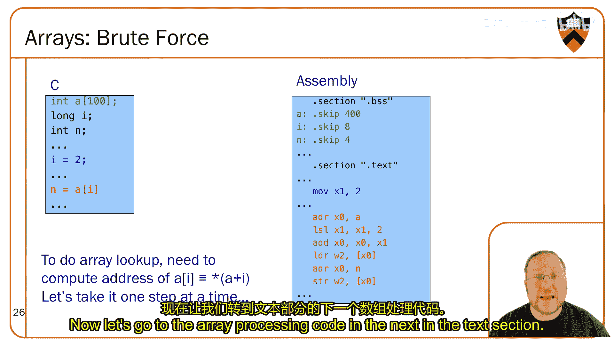

## 有符号数与无符号数的比较

之前我们的比较都默认使用有符号数（`int`）。当使用无符号数（`unsigned int`）时，比较和分支指令需要改变。

*   有符号比较使用：`B.LT` (小于), `B.LE` (小于等于), `B.GT` (大于), `B.GE` (大于等于)。
*   无符号比较使用：`B.LO` (低于), `B.LS` (低于或相同), `B.HI` (高于), `B.HS` (高于或相同)。

**关键区别：**
对于相同的位模式，有符号和无符号的解释不同。例如，位模式 `0xFFFFFFFF`：
*   作为有符号 `int`，值是 `-1`。
*   作为无符号 `unsigned int`，值是 `4294967295`。

因此，比较 `-1 < 0` 成立，但比较 `4294967295 < 0` 不成立。在汇编中，我们必须根据变量的实际类型选择正确的分支指令。

**示例：** 将之前的阶乘程序改为使用 `unsigned int`，只需将循环条件分支从 `B.LE` 改为 `B.LS`（低于或相同时跳出循环）。

## 数组的访问

在汇编中处理数组时，我们无法将整个数组装入寄存器。我们需要计算目标元素的地址，然后从该地址加载或向该地址存储。

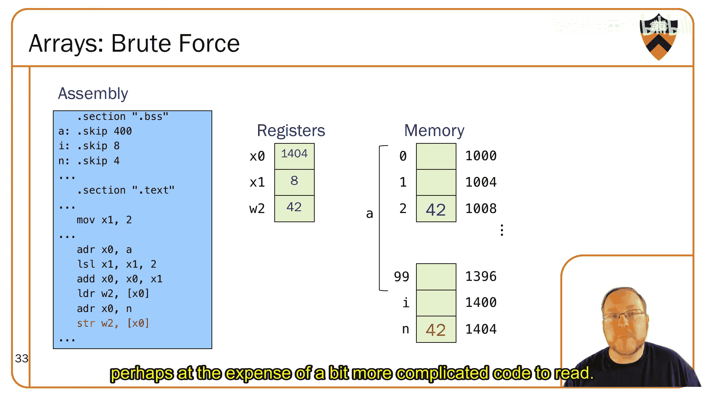

数组元素 `a[i]` 的地址计算公式为：
`address = base_address_of_a + i * sizeof(element_type)`

### 基础方法（分步计算）

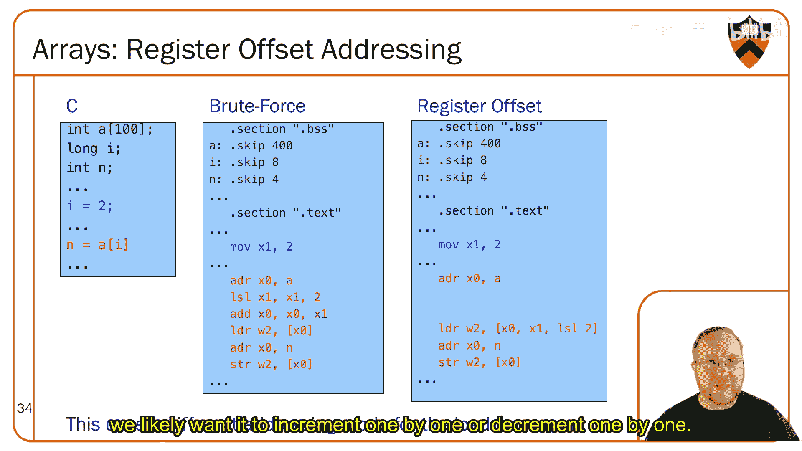

1.  获取数组基地址。
2.  计算索引 `i` 的字节偏移量（`i * sizeof(int)`），通过左移实现乘法（`int` 左移2位）。
3.  将基地址与字节偏移量相加，得到元素地址。
4.  使用 `LDR` 或 `STR` 指令访问该地址。

**示例：** `n = a[i];` （假设 `a` 是 `int` 数组）
```assembly
        // 假设 i 的值在 X1 中
        ADR  X0, a       // X0 = 数组 a 的基地址
        LSL  X1, X1, #2  // X1 = i * 4 (字节偏移)
        ADD  X0, X0, X1  // X0 = &a[i]
        LDR  W2, [X0]    // W2 = a[i]
        ADR  X0, n
        STR  W2, [X0]    // n = a[i]
```

### 高效方法（使用寄存器偏移寻址）

ARM汇编提供了更紧凑的寻址模式，可以在一条指令内完成偏移量计算和内存访问。

**语法：** `LDR Wd, [Xn, Xm, LSL #shift]`
含义：从地址 `Xn + (Xm << shift)` 处加载数据到 `Wd`。

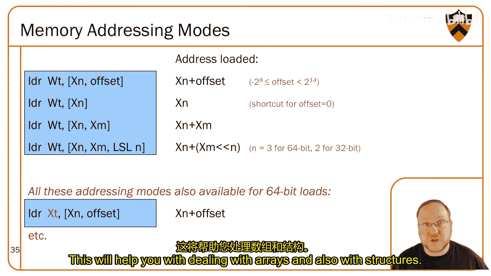

使用这种模式重写上面的例子：
```assembly
        ADR  X0, a       // X0 = 数组基地址
        // 假设 i 的值在 X1 中
        LDR  W2, [X0, X1, LSL #2] // W2 = a[i] (X1自动左移2位作为偏移)
        STR  W2, [X0_n]           // n = a[i]，假设 X0_n 是 n 的地址
```
这种方法更高效，保留了基地址寄存器 `X0` 和索引寄存器 `X1` 的原始值，在循环中尤其有用。

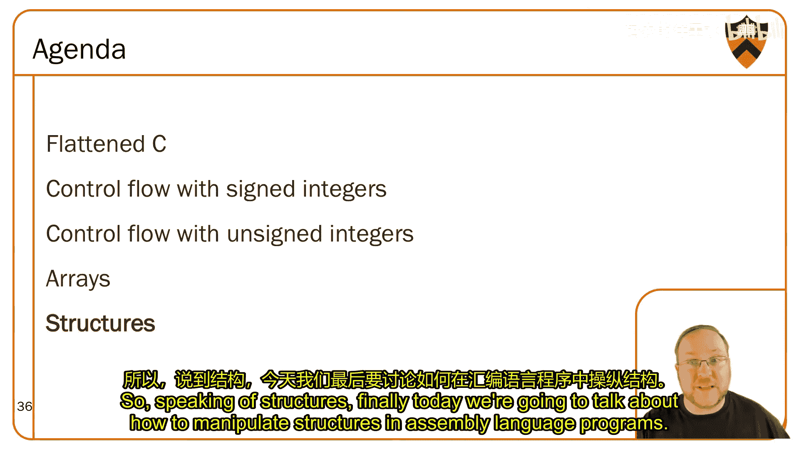

## 结构体的访问

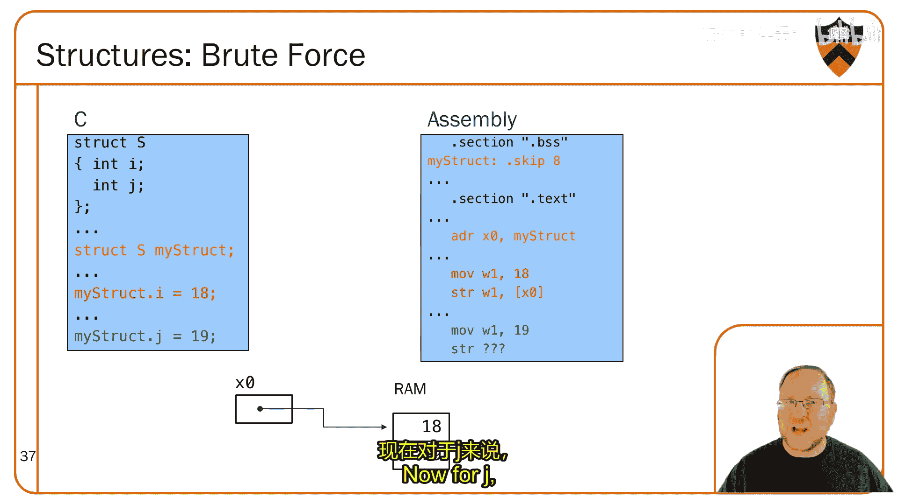

访问结构体字段需要知道每个字段在结构体内部的偏移量（offset）。

### 简单结构体

考虑以下结构体：
```c
struct S {
    int i;
    int j;
} mystruct;
```
字段 `i` 的偏移量是0，字段 `j` 的偏移量是4（因为 `int` 占4字节）。

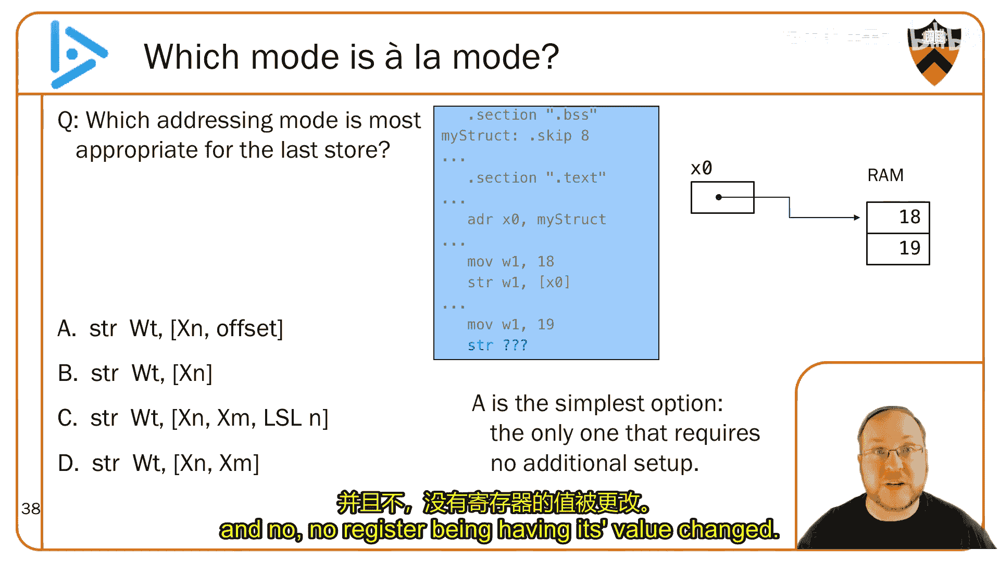

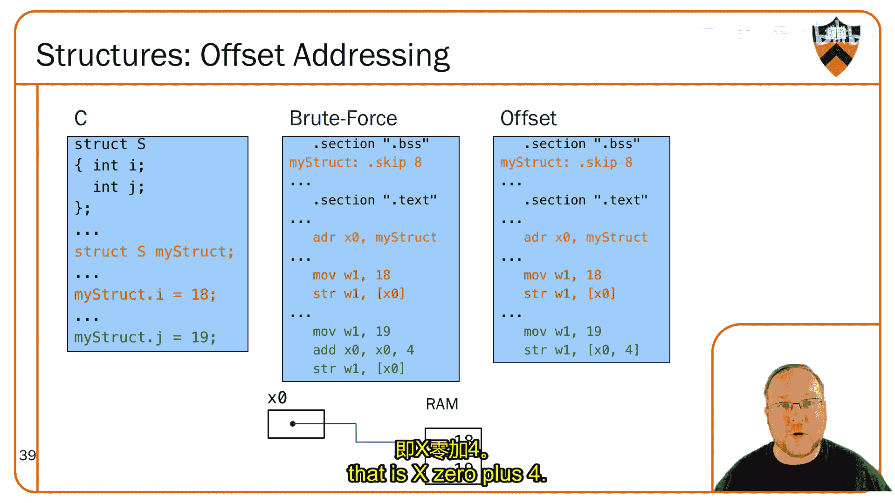

**汇编访问 `mystruct.j = 19;`：**
```assembly
        ADR  X0, mystruct // X0 指向结构体起始地址
        MOV  W1, #19
        STR  W1, [X0, #4] // 将19存储到偏移4字节处（j字段）
```
这里使用了**立即数偏移寻址模式** `[Xn, #imm]`。

### 注意结构体对齐与填充

编译器为了性能，可能会在结构体字段之间插入填充字节（padding），以确保每个字段都从其类型所需的对齐地址开始。

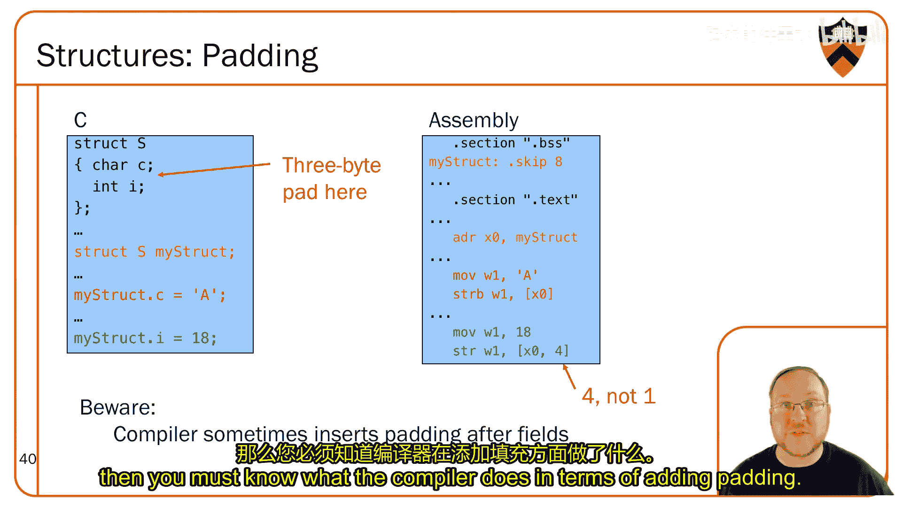

例如：
```c
struct T {
    char c;
    int i;
};
```
虽然 `char` 占1字节，`int` 占4字节，但编译器很可能在 `c` 之后插入3字节的填充，使得 `i` 的偏移量是4而不是1。因此，在汇编中访问由编译器布局的结构体时，**必须知晓并遵循编译器的填充规则**。

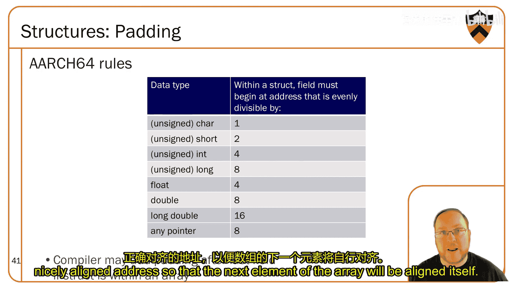

## 总结

本节课中我们一起学习了如何将C语言的控制流、数组和结构体翻译成汇编语言。
*   我们引入了**扁平化C语言**作为翻译的中间步骤，它使用 `goto` 来明确跳转逻辑。
*   我们详细分析了 **`if`、`if-else`、`while`、`for`** 在汇编中的实现方式，重点是条件反转和标签的使用。
*   我们区分了有符号数和无符号数比较对应的不同**分支指令**。
*   我们探讨了**数组**的访问，学习了如何计算元素地址，并介绍了高效的寄存器偏移寻址模式。
*   我们了解了**结构体**的访问，关键是计算字段偏移量，并特别注意了编译器可能进行的**结构体填充**。

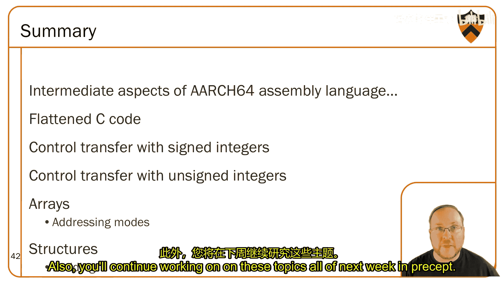

掌握这些概念对于完成后续的汇编语言编程任务至关重要。请务必动手实践，通过编写和调试代码来加深理解。