# 【全集 秋季版】普林斯顿大学 C语言系统编程 中英字幕 p23 Lecture 23 - 汇编语言函数 -BV1u1feBoEsK_p23-

Welcome back to Co 2，17 lecture。This is the third lecture of the assembly language part of the course。

 where we really dig in and see what we've been missing to be able to translate typical programs from a high level language like C into assembly language。

 In particular， our programs thus far have been quite artificial。 We've been using only the B， S。

 S and data sections for our functions data， and we haven't actually seen how our main function interacts with any other functions。

😊，So this lecture will'll be talking about the challenges of functions and the approach that ArM takes to overcome these challenges to support this fundamental programming primitive。

The challenge of functions really encompasses quite a few of separate items， how to call a function。

 how to pass arguments to a function， how to establish its stack frame。

Had a return of value from the function and indeed how to return from a function at all to get back to where the you called it。

All of these have to work together under a single set of assumptions and conventions and have to do so in a way that doesn't make function calls unduly expensive。

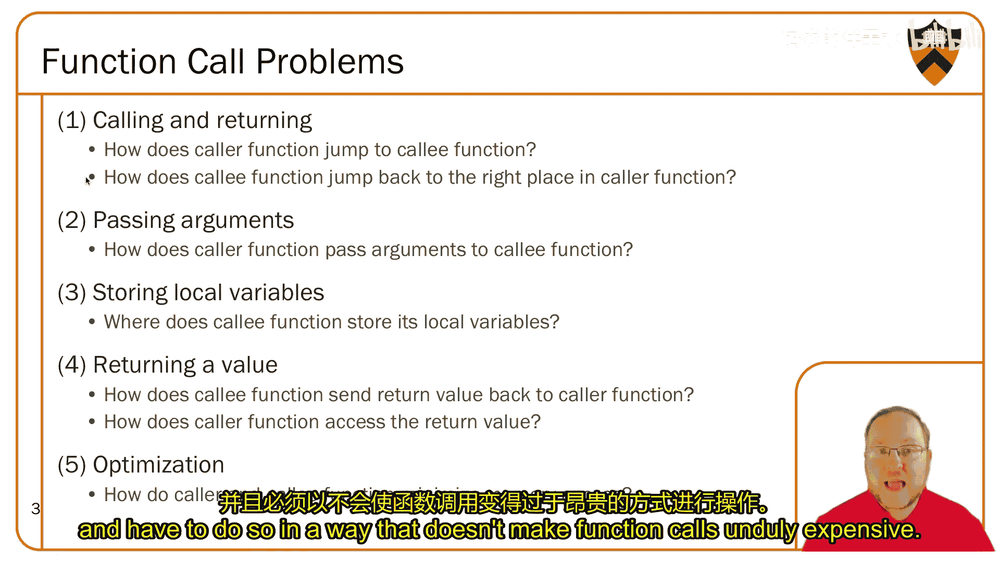

So to explore function calls， let's start off with a straightforward function that。

 despite being straightforward， has some nice properties for pushing or prodding and stressing how function calls are going to get handled in arm。

It takes two longs as parameters， and it returns the sum of their absolute values。

 It's not concise or， you know， especially idiomatic。 It's just plain step by step。

 We declare three local variables。 We pass some a parameter into a library function， two times。

We store the results of each call into a local variable， and then we add those partial results。

Storing them in the third variable and return that。

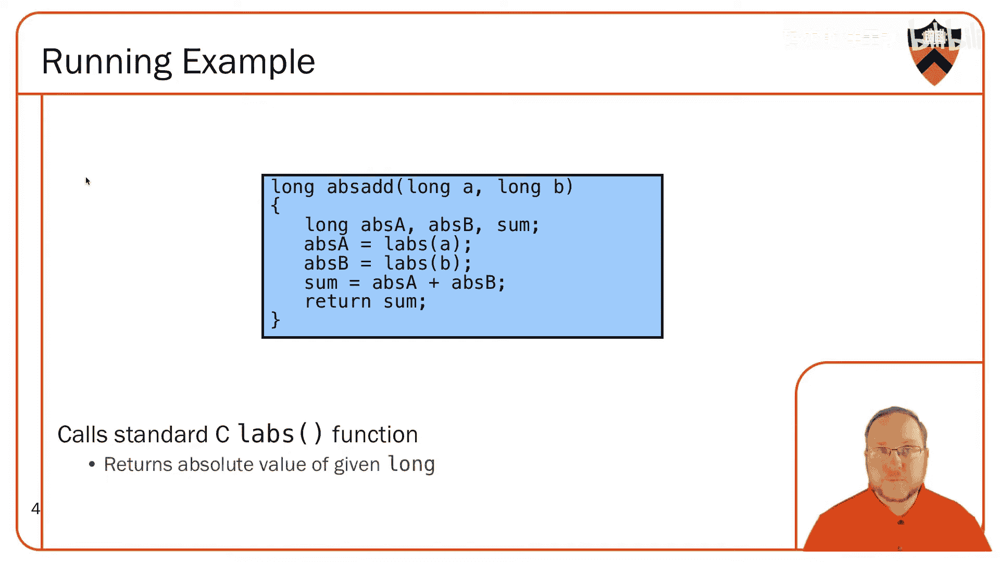

So let's consider the problems one at a time， starting with how to call a function and indeed。

 how to get back from that function。

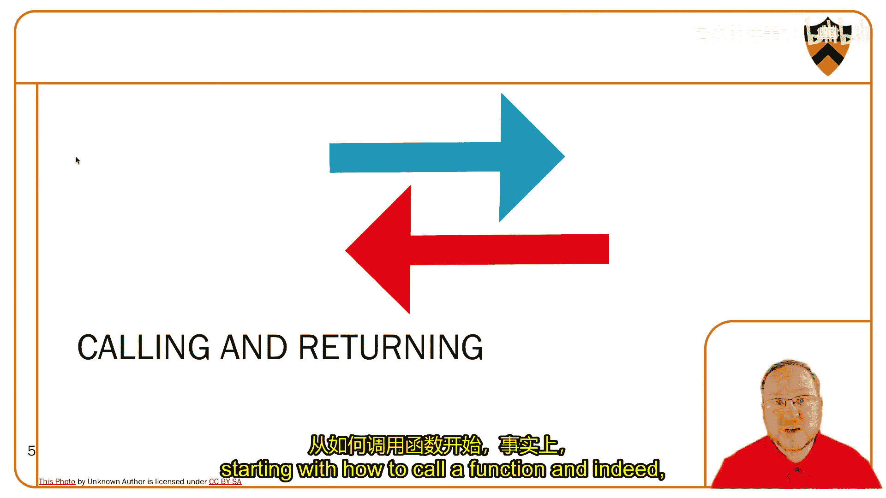

So the first thing we need to figure out is how to actually stop running at one location in the text section and go start running somewhere。

 somewhere else， again， presumably in the text section。Then just as importantly。

 we need to get back to the place where we made that call once it's complete。

 once that function is complete。 Otherwise， we'd just call our first function and never get back into our own code。

 That's not the point of function。 So we need to be able to design a way to call a function and also get back。

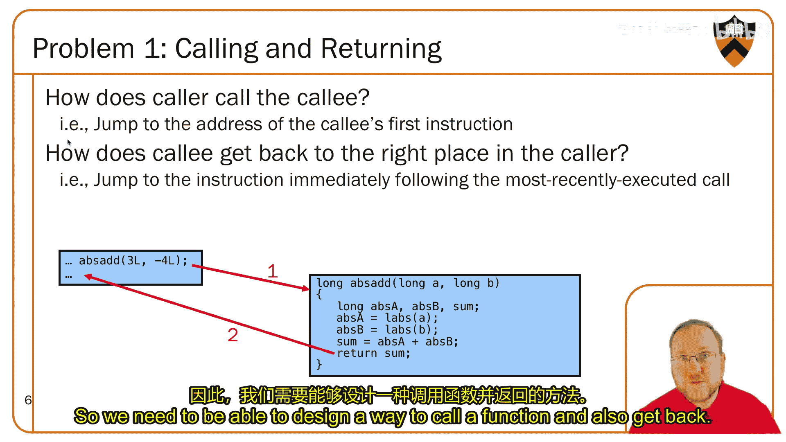

So how do we do that？Take a few seconds， think about what instructions we'd need to accomplish this。

This is posed as an eye clicker question， but instead of revealing the answer and talking about it directly。

 I'd like to trace out some of these possibilities。

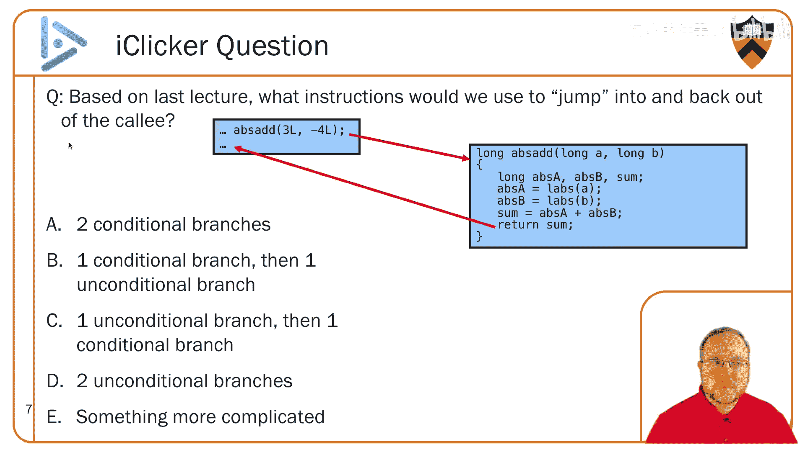

So what do we remember from last lecture about control flow。

 We can use the B instruction to do an unconditional branch to a label。

We saw with main that our functions are indicated by labels。

 just a label in the text section after we've done a dot section to declare announce that we are in the text section now I can put labels and that can be a function So calling it straightforward。

 we have branch to G in this case。And by the exact same structure， just in the opposite direction。

 we can get back。This looks great on the slide。 but as you might expect。

 the slide is entitled attempted solution。 After all， There is a problem。 So take a few moments。

 pauseuse the video here and see if you can figure out what the problem is with this approach。😊。

So this looked great on the last slide。 But really， why do we define functions？

 Typically we do so so that we can use the subroutine over and over and over and over again。

 potentially in different contexts。😊，Like this one。

Now we don't have a clear answer at this point for where we should branch back to from G。

 because it's called from multiple different places。

So we need additional context as part of the function call itself。That context。

 that information needs to be passed along in the same way that we've been doing with anything else in our。

 we're using registers。So we could fix this with some additional context in a register before using the B to perform a function call。

 we would put the address immediately after that B instruction into some register。

 And then at the end of G。We would just do a branch。 We do a B to the location in that register。

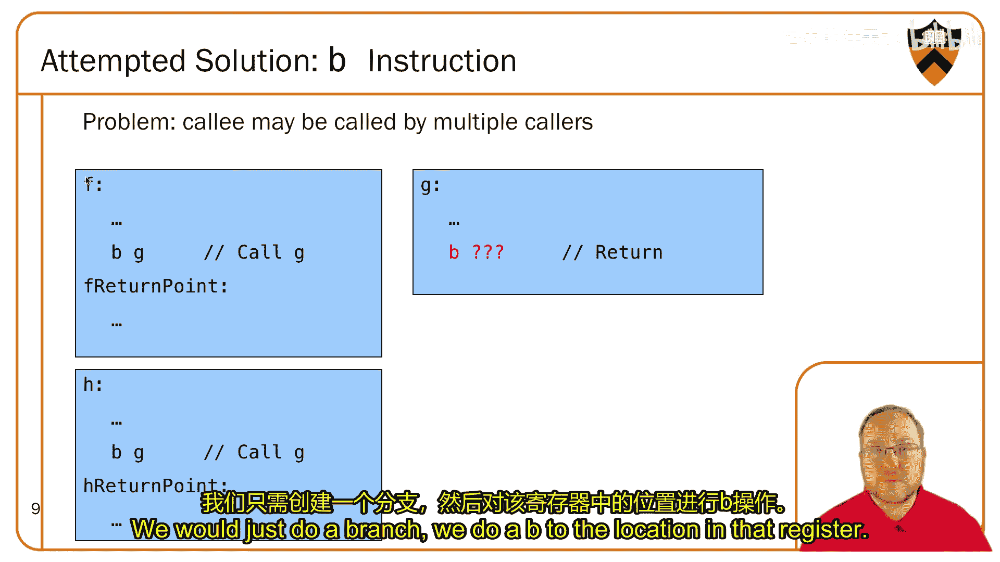

That would look something like this。It's not ideal， though。

We still need to add an ADR instruction to fill the register before every single function call。

We stilled need an explicit label after every single function call in order to be referenced by the ADR。

And we needed a convention of what register to use。

 Because the caller and Colee both have to know about it。 The caller has to fill it。

 and the callee has to reference it in the branch back。So this works， at least pretty much。

 but it's unsatisfying。Nevertheless， this is certainly along the lines of what Ar does。

 it just gives us some niceties to remove some of that ugliness。We said there were three problems。

 we needed an ADR to fill the register before every function call， no longer。

The BL instruction automatically puts the return point into X30。

 it automatically says this is the next address to go back to。

It's we said that we needed a convention for what register to use。

Because the caller and collealie had to both know about it。 There's no way out of this one。

I just said X 30 is it， and that is， in fact， the register that we're defined to use。

 But that's actually the X 30's role is defined in hardware。

 So it's not just some fly by night convention。 So we have。

 you know one good thing that we don't need to do an ADR。

 one O thing that we have a specialized register for this。

And then the last thing is we still need an explicit label after every single function call in order to be referenced by the ADR。

But now we don't because the， the we have a return。Operation。

 the return instruction that will automatically go and look at what the value is in X 30。

 rather than having to have an explicit argument。啊。So with BL。

 Arma allows us to do a function call with the appropriate context in a single instruction， BL。

And we can get back from it again in a single instruction RE。

And that's without having to sort of clutter our code with a bunch of labels that are only used for function calls。

Alas， though， the title is still only a partial solution。 And again。

 see if you can figure out what the issue is here。This will work。

 The The code on the slide is absolutely correct。But it isn't sufficient for real programs。

 So pause the video， take a few seconds and think about what could go wrong。

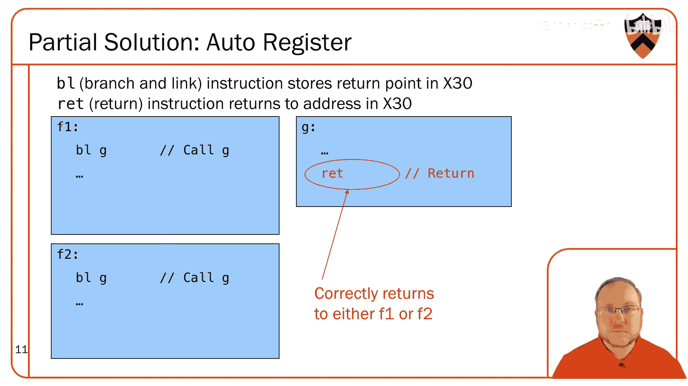

Here's a more complicated example， F calls G and G calls H。Well， when F callss G。

Location 1 is put into X 30。Now when G calls H， location 2。

 the location in G that H should return back to is put in text 30。

This is just from the previous slide of what BL does。So we finish off with H。

 and we return back to the location stored in X 30。 That is location 2。

 Everything's going great so far。 Now we finish off with G。

 and we return back to the location stored in X 30。😊，Which is the location 2， still inside G。

What happened to that address of location 1 and F。G now doesn't know where to return to。

So we need a way to store each function's context beyond just the registers。

 We need this to be able to save an older value of the context when we go on to do other things。

 And then once we come back from doing those other things to restore that older version of the context that that saved value。

Well what data structure is this？It's a LIFO structure。

And that means that we're talking about a stack。 And so in terms of our C programming that we've learned so far。

 we need a stack frame。In which to store the relevant information for for each function invocation。

We want to say， O， I am going to store my stuff here。

 Now I'm going to make make another function call。 It gets its own stack frame。 Everything's fine。

 When we pop the stack， when it returns to me， I still have all of my information。

 no matter what that other function did。

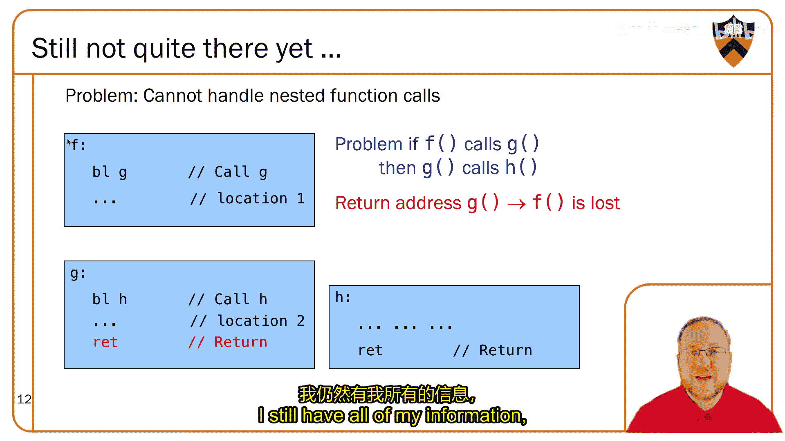

So in C programs， we saw stack frames that represented this temporary space to be used by functions and basically functions that were that were active。

 They had been called but not yet returned。So a function stack frame is。

 in fact the exact spot that we can stash that x30 value。

At the start of a function so that the function can make more function calls。

 If we stash X 30 at the start of a function， now we call Bel。 Bel is going to modify that X 30。

And that's okay when we come back from that B， when the B L returns the the function that we call with B L returns。

We come back and say， oh， I'm okay。 I still know where I have to go back to because I can restore my restore the X 30 that was originally there because I stored it in my stack frame。

Put another away。 All those stack frames that we've been showing you this entire time were kindest sort of a lie。

 At least there was an omission。 In addition to all of the local variables and parameters that we told you were stored in the stack。

 There's also an added X 30 register value。 That's always been there， but we just never mentioned。

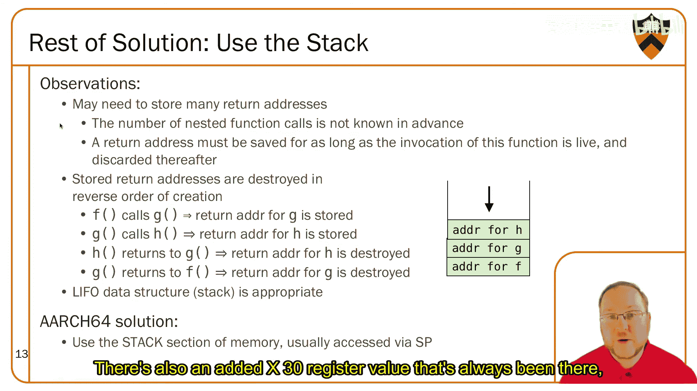

Here's what that looks like in principle。 In each function。

 we save X 30's value into the stack frame， and then we go about our business。

 And at the very end of the function， when we're ready to return。

 we restore the value into X 30 from the stack。So now， for the particulars。

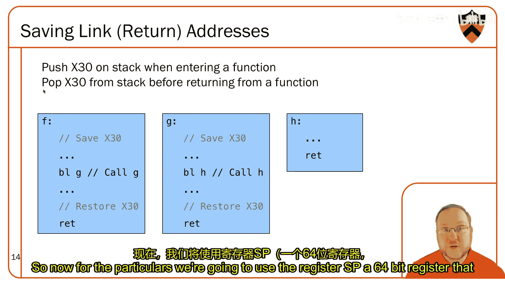

We're going to use the register S P a 64 B register that we first saw in the first assembly language lecture。

 It was one of our special purpose registers。 It's used to point to the top of the stack。

 S P with stack pointer。 What this means is that the it's the beginning of the active stack frame。

 Any new function will have its stack frame pushed on top of this point。

To designate space for a function stack frame， we just move S。

We think of putting things on top of the stack。 And since that means lower memory addresses the way that we draw it out on the screen。

 you know， higher up on the screen， lower numbers。 we push on a new stack frame that means subtracting from S P。

Note that Ar has an architecture requirement that S must be aligned to 16 bys。

 So even if we have nothing else on the stack except for X 30， that's just an address or just 8 bys。

 we're still going to have to allocate， if you will。

 by subtracting 16 by off of S in order to to get space for the 8 by that we need。And do watch out。

 this is a tricky thing that you can often overlook when you start writing your programs。

 especially when you start having more complicated stack friends and so you start saying。

 I know exactly what's there I have。You know， exactly this many things。

 I can do the multiplication or the addition of all of the different variables I want to store on the stack。

 Put that。 That's the sizeus of my stack。 Everything's good。If it's not a multiple of 16。

 you're going to get a really bizarre error message that isn't helpful at all， so do watch out。

So just allocating the space would be worthless if we couldn't use the space。

We can load from the location that S P points to or an offset relative to it and store into the location it points to or an offset relative to it。

 You remember the fancy register offset and scaled register offset addressing modes from last lecture。

 At least I hope you do。 because stay tuned。 We're going to use that extensively with S P。Here。

 though， we're just placing X 30 into the value right at the very top of the stack frame。

 so there is no need for any of the explicit offsets。When we're done with this function。

 we have to restore X30's value。 So we did that。 Now we can give up the space on the stack。

 That is to say， pop the stack frame。 And how do we do that？ Well。

 we allocated the stack frame by subtracting S P。 Now we can add back to S P。

 We can add back in the size of the stack frame to to give up this stack。

But do notice that the values don't go away。 The memory in the deactivated stack frame here isn't erased。

 It's just now beyond the top of the stack。And that's actually how we've been thinking about it in C。

 So there's nothing new here。 We weren't lying to you in this case。

 It's nothing that's extraordinary or unexpected。 It's just worth noting that there is still data there。

 We're just not supposed to access it because it's not in the active step。

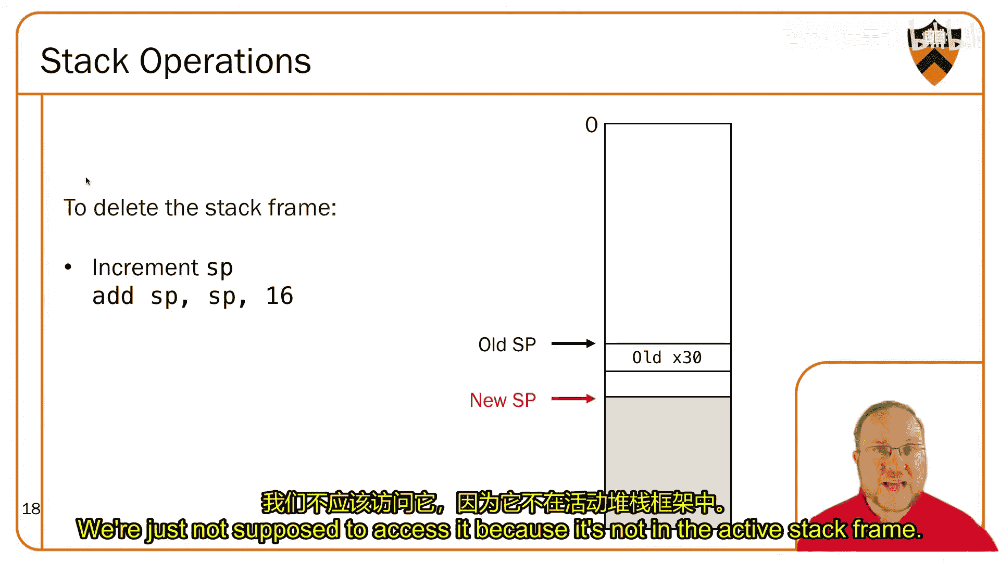

All right。 So now drawing something that you've been seeing since the very first precept in。

 in assembly language。The function prologue and function epilogue。 And initially。

 you were just basically told every function has to have one。 And it was just as mysterious as。

 you know，126's public static void main string bracket as type of things。 But now。

 I hope the fog is beginning to lift。In the prologue。

 what we're doing is we're making room for our stack and then saving into that space on the stack。

 the register that has the return address that we that that this function is supposed to return back to we're saving X 30 to say。

 O， when I'm done。Branch back there。In the epilogue， then， we're going to recover that address。

 We're going to put it back into X 30。And we need to do this because if we've made any function calls。

 X 30 is their return address somewhere inside of us as opposed to where we want to go back to。

And then we're going to tear down the stack frame。 We're going to say， okay。

 I'm about to leave this function。 I don't need my stack frame anymore more。Add back to S。

 And so that's what we see here。Hopefully， this makes a little bit of sense now。

 given the context as to why we have this， this prologue and epilogue as the the borders of almost every function we've seen。

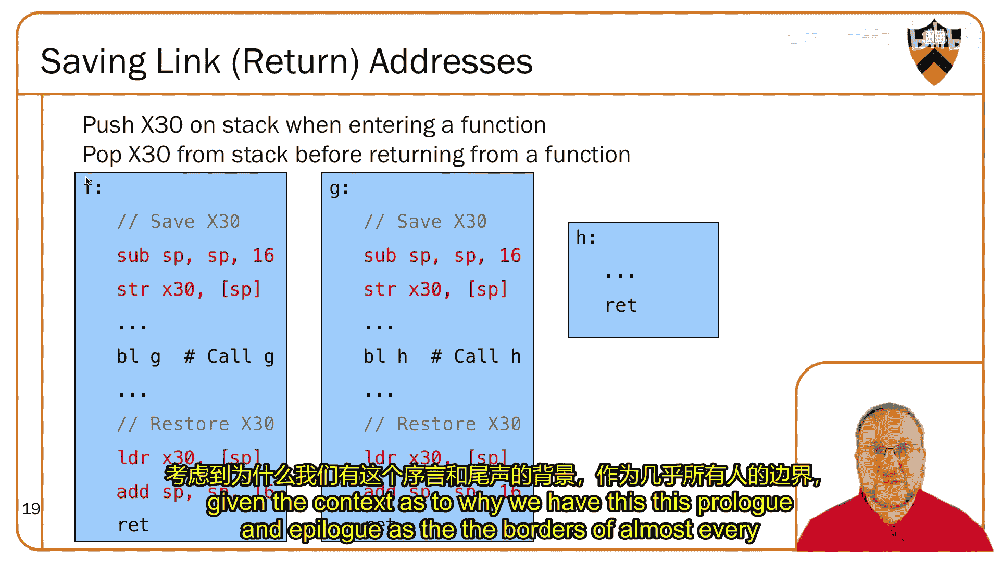

All right。 So now let's come back to this running example we had with the absolute values。

 We can translate a little bit of this running example into assembly language。We now say， okay。

 Ab's ad has a prologue。It has an epilogue， and then it has two instructions， two B。

 L instructions that make function calls to L Ebs， which is just a standard library function and。嗯。

We are going to we're going to just have this bit here。 Now， I know that you're going to say， put。

We're not done yet， and I know we're going to build it up one at a time。

 but at this point we've cut out some of the pieces that were previously entirely just comments or entirely just pseudocode。

 Now we can say we've set up the stack frame， we tear down the stack frame in between we make two function calls。

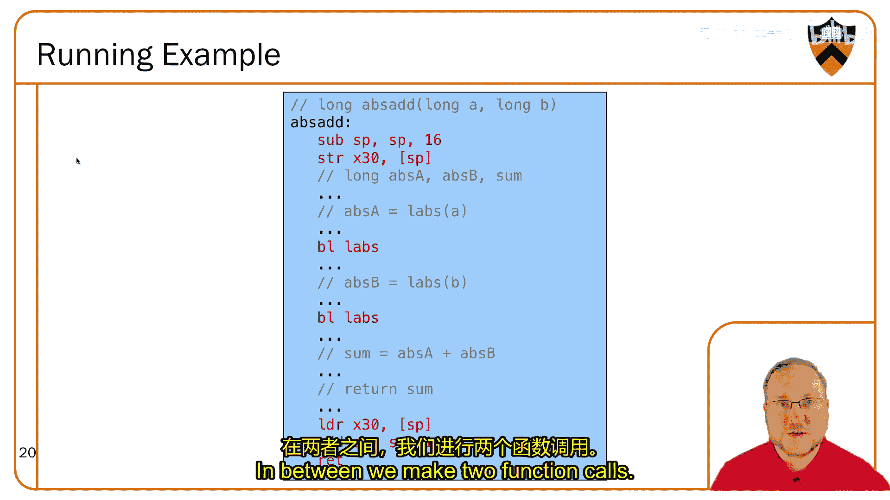

Willll see what to do next。And that was a lot to take in， but we have a long way to go。

 You saw that there is still a whole bunch of ellipses or missing pieces in that example。

So take heartt， though， That was the most complicated problem that we had to solve。

 And it was also the most critical building block to thinking about how we how we're going to solve the other problems。

 So it seems like， maybe that's， that's a big jump。 And that's okay。 You can go back。

 You can think about that one。The others won't be quite as much of an intellectual hurdle to get over。

So now we can make function calls。 We can do that BL。But functions take arguments。

 and we haven't shown how to get data into the function up until now。

 all of the data we've seen was just stored somewhere in a global variable。

 And that won't do going forward。

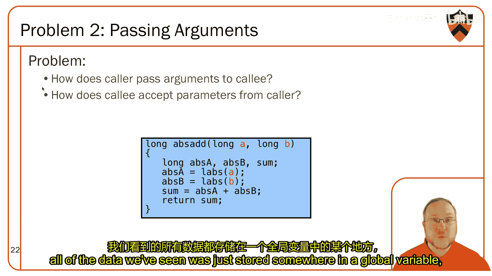

So just like with the return addresses， arguments are something that is handed to the callee by the caller。

 and the caller has to save it somewhere。 At least it's going to have to save it somewhere If it's going to make its own function calls using the same paradigm。

The place that we put X 30， the return address was the stack because we couldn't know how many function calls would happen。

And here。For our parameters， our arguments， the exact same premise applies。

Perhaps you recall from the initial arm precept handout。

 it noted the first eight arguments to the function are passed in in x0 through x7。

 So these are just like x30。Just more of them。Note that it is possible to pass even more arguments。

 Just you'll have to reference them on the stack frame directly， and we won't deal with this in 217。

 Similarlyly， because the registers are only 64 B。s and it's certainly possible to have data structures that are bigger than that。

 for example，structs。 again， we're going to pass them in on the the stack directly use a stack reference。

 But again， we won't use， we won't do this in 217。 So you don't need to worry about it。

 But if you do see references to it in some of the materials that we've given you。

 this is why there's a little bit more complication than just。X0 through x7 and nothing more。

So as with X 30， if we want to call our own nested functions， or in this case。

 if we just want to use x0 through x 7 as variables while retaining their argument value。

 we'll need to store these values in the stack for safe keeping。Once on the stack。

 then we can reference these variables as offsets from S。

 just like we implicitly did with X 30 at offset 0。

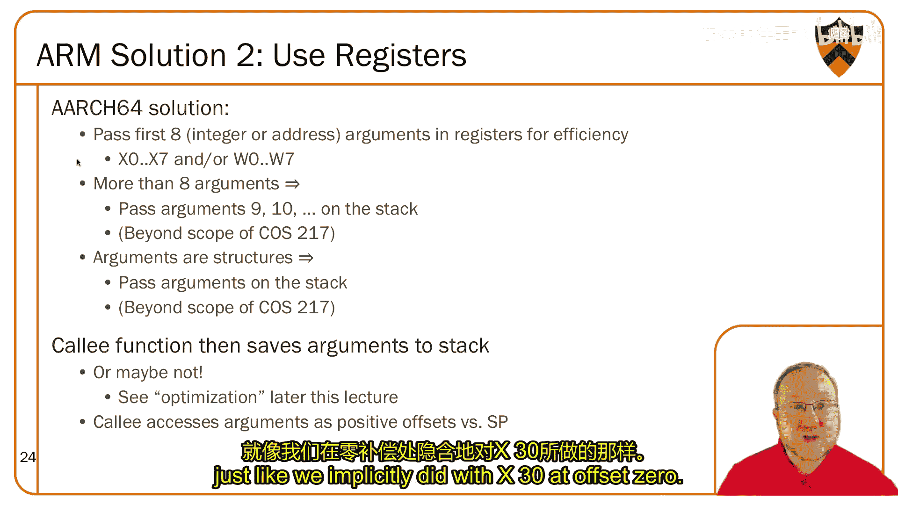

In our running example， we'll definitely save to the stack because other things that we might do will corrupt the values of x0 and x1。

In particular， when we make a function call to to L Abbs。

 we'll have to put those arguments into the same set of registers that our arguments came in。

 came in in。So let's look at the assembly。We add up we add all of the things we had before。

 the setup from our previous version， but now we have two more STR instructions to save register values to stack memory。

Note the register offset addressing and how that places them at 8 and 16 by beyond S P that is added to S P。

 And that means down into the current stack frame。 Reca S P points to the very top of the stack frame。

But we do put it below the stashed x30。This is sort of arbitrary。

 We can put our variables that we want to our arguments and and other things that we want to store onto the stack。

 onto the stack in any order that we'd like。 Most of the code that we give you is going to put x 30 right at the top of the stack and then the parameters and then the local variables。

 and what have you。So， so we now have done two more stores。 we've stashed A and B onto the stack。

 And now when we're ready to call L Abbs， we'll have to get A in tax0。

That's not a problem because it's already there。 So we could just go straight and say immediately go to the B L。

 But in the spirit of establishing an idiom。 And because after all。

 there are some more circles of ellipses there。 So conceivably。

 that might do something else to overwrite X 0。 Let's go and do a load。

 We'll do an LDR from S P come a 16。 That is， you know，16 bys at a S P。

 we'll treat that as a pointer， go out to memory and actually fetch the value that's there。

 that's our stored value of a and load it into X0。😊，Similarly， before the second call to L Abbs。

 now we'll certainly have to do that load because we know that B isn't an x zero。At the very least。

 a is in x0， and in fact， there's something else there altogether together。So now we're all set。

 we've loaded A in T0 and then called LAs， now we load B in T0 and called LAs。

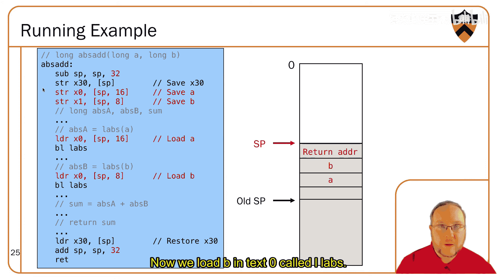

嗯。