# 【全集 秋季版】普林斯顿大学 C语言系统编程 中英字幕 p26 Lecture 26 - 性能提升 -BV1u1feBoEsK_p26-

Welcome back to Co 217 lecture In today's lecture。 we're going to talk about performance profiling and optimization with the immediate caveat that were in dangerous territory。

 luminaries like those on this first slide tell us that it is a near occasion of sin and to be avoided unless absolutely necessary and until absolutely necessary。

This is the last stop on our programming in the large road show。

 We've seen topics relating to design and implementation， debugging and testing。

 primarily the development portion of software engineering。

Now we'll see a topic related more to the maintenance phase of software engineering， specifically。

 over time it is often necessary to improve the performance of a program to fit changing requirements or emerging use cases。

So with those luminaries warnings from the previous slide in mind。

 let's go ahead and look at some performance improvement techniques and tools。

We'll want to focus on finding where in the programme needs or could benefit from improvement using the appropriate tools。

 and then we'll figure out what are fruitful avenues of approach to realizing this improvement。

Versus those avenues that are either unlikely to render any benefit or are likely already available from the compiler without our own intervention。

Prefer， perhaps before we ask what we should optimize and how we should optimize。

 we should heed those warnings and consider， should we optimize at all。

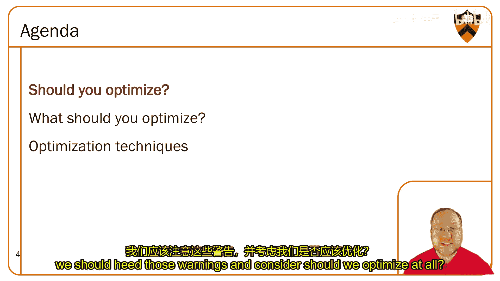

On the plus side， there's getting your programme to run faster。

 I probably don't need to say much about the merits of that。

 but it's worth noting that the goal doesn't start out with。 how do I make my program run faster。

 The goal starts out trying to answer the following questions。How slow is my program？

Where is my program slow and why is it slow there。

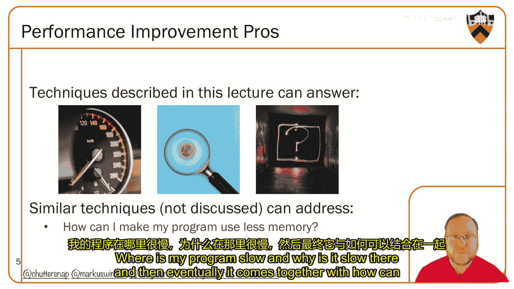

And then eventually， it comes together with， how can I make my program run faster。

On the minus side to doing this， though， are some considerations that you might not have thought of before。

 If you start with a perfectly good program in terms of style， design， readability。

 ease of maintenance， correctness， but poorer or insufficient in terms of performance。

 you'll probably have to change one of those good properties in order to fix the performance。

 that might mean unrolling loops and inlining function calls， making your code a mess of cloned code。

 it might mean putting variables in registers and never in memory at all， we saw that last lecture。

 this could make it tricky for debugging and especially if you're you're focused on memory locations。

 to track， instead of register values to track。 And just as when you're making any change to your code。

 And especially when you're trying to be smart about it or tricky about it。😊。

It's very possible to break something， so it ams up our testing requirement for really strong regression testing。

After all， in what Linus Akinson calls Knahan's leverver。

 referring to a passage from the second chapter of the elements of programming style by Knahan and Pluger。

Another great book。 We don't use it because it its examples are a bit dated since it was written in Fortn and P L1。

 but the the programming pearls of wisdom are still totally valid。

 So that book says everyone knows that debugging is twice as hard as writing a program in the first place。

 So if you're as clever as you can be when you write it， how will you ever debug it。

You of course know Knahan， perhaps you don't know PJ Pluger。

 he's another prolific author of books about software engineering。

 he's also a serial entrepreneur and a member of the C and C++ Standard Committees。And beyond that。

 he's even an award winning fiction author。 And why do I go on about it Because， well， Nach。

 he's a Princeton alum class of 65。

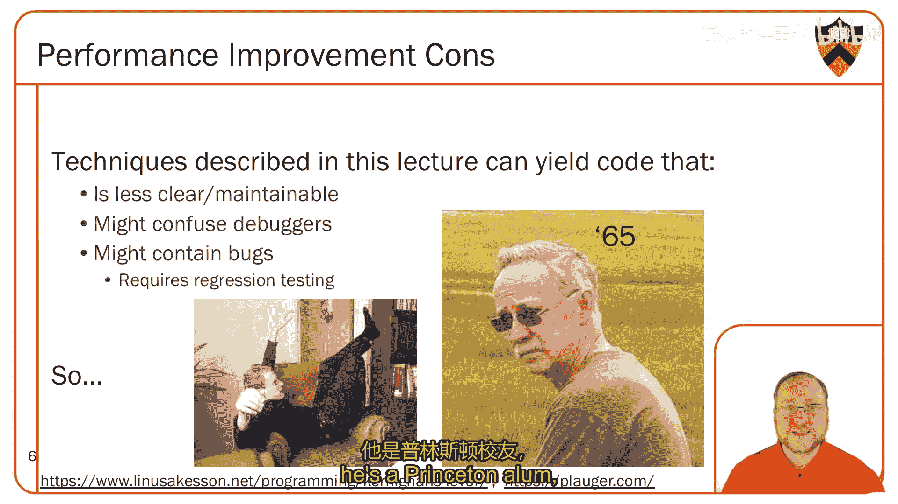

So taking a page from another Carnahan treatise， this time。

 the one suggested in this class's reading， we have yet another admonition。 In particular。

 we should consider both the computer cost and the people cost。

 Comp cost is the cost in terms of time and space of of compiling and executing your program。

 People cost is the cost of labor associated with maintaining your program over time。

 In the general In the general case， People cost is much more expensive than computer cost。

Optimization reduces computer cost， but often makes the code less clear and increases people cost to maintain it。

 sufficienticly opaque optimization can turn your $200000 per year developer back into that kit in intro programming who。

Hits that wall for the first time and realizes I don't understand why this doesn't work。

 has an even more dangerous cousin called。 I don't understand why this does work。

So in the general case， optimization may well yield a net negative financial to to your company。

 And so in that case， we are well advised to do optimization only with a compelling reason。

 even if we are going to teach you good techniques for doing so。Okay。

 so all that foreboding and scare tactics out of the way。 Let's move forward。

 The simplest thing you can do to see if your program is taking too long is， well， time it。

This is the UniX equivalent of taking a stopwatch to your code。You can use the time command。

 and it will give you these， these three output numbers Note that they。

Aren't named particularly usefully。 So， so let's take a look at them。

 Real here is that wall clock time。 It's really the equivalent of taking that stopwa Use is how much of that time was spent with your processor。

 your processor on the processor actively chugging along and then system time you might have seen in passing。

 we've talked about system calls， which are functions that ask the Os to do something for us。

 And so if you've ever seen this output or heard about system time， there you have it。

 it's the time that our program spends in the Os kernel running in the operating system at to fulfill one of our requests。

So typically， we care mostly about the user time， but in some case。

 a very high system time can indicate a problem of its own。Do note that the， the real time on。

 on the time command can be much higher than the user time。 For example。

 if you have a program that waits for input or if it's waiting on other processes in this example。

 no big difference。 The input comes from a file。 So we're not waiting for some user to type glaccily slowly。

 and the the program was being run effectively alone on the machine。

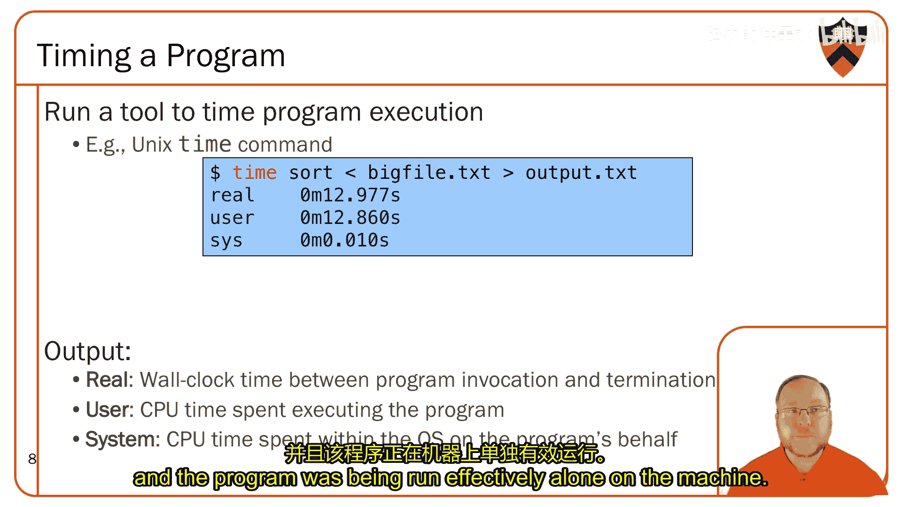

So one way to get better performance is to ask the compiler to do it for you。Minus O。

 that's capital O note the difference from minus lowercase O that specifies the name of the executable minus capital O has a ton of options at various granularities from do upper due optimization for me as sort of a just blanket statement all the way down to turn on this specific type of optimization。

 but not that one。Here are some relatively high level optimization levels that we might use in assignment 5 or 6 for this course。

So we have a minus00 that says turn it off。us01 also Alias just minus0 says do some optimization。

 minus02 does a little bit more aggressive optimization， it'll take a longer compile time。

 but potentially be able to harvest more interesting optimizations and further more advancing to minus3 minus03 which again will take longer but do additionally more aggressive optimizations。

So you might wonder， why don't you always build with optimization？ Well， certainly one aspect。

 the compiler will take longer to run it， but the difference between a 10 of a second and two1s of a second。

 not a big deal， but as as alluded to on a previous slide when built with optimization。

 a program could store values of some variables in registers alone， instead of in memory。

 And that would mean that if we go through and track in G looking at our source code。 And we say。

 show me the memory location for this register。 sorry for this variable。

 It's not there because it's in a register。 And so it would make G difficult or impossible to to track line by line with the source code。

So as a suggestion， initially， when you're building for your purposes， build without optimization。

 then once everything's debug。Build with optimization for your customers， though do of course。

 at least try it out after building with optimization to make sure that nothing breaks that you have no assumptions or anything else in your code that could actually become incorrect with optimization。

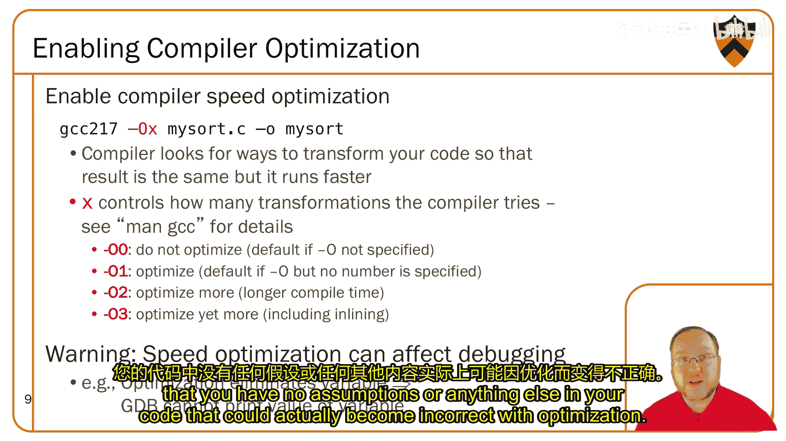

All right。 So now you timed it。 And yep， your clients were right。

 It takes way too long relative to their requirements。 What now。

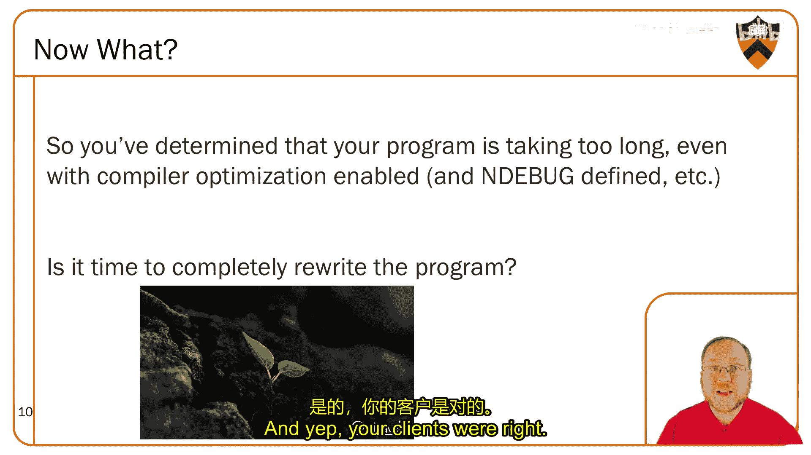

At this point， if it's taking too long， you need a bit more information than just the raw amount of time it took。

 It ran for 10 seconds Is't helpful。 We need something more like it ran for 10 seconds。

9 of which were in the fo function。 So that way， you know what to try to make fester。Or even better。

 this function is called millions of times。 So you know that any small optimization would pay huge dividends。

One level more fine grain than how to， How long does this program take。

 but still relatively coarse traineded overall is just how long does this function take。

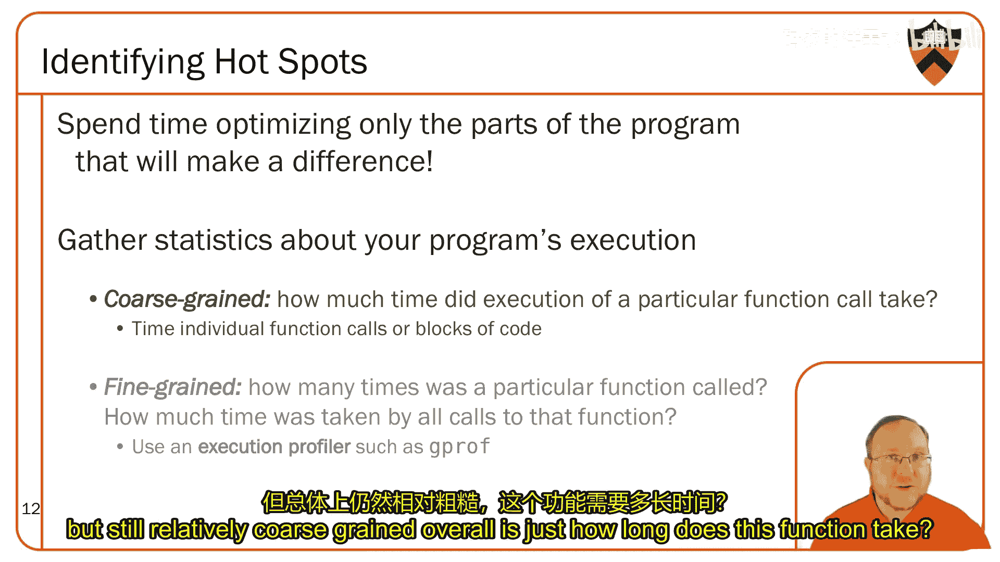

Theres a library called cis time that has a bunch of time handling functions。 For example。

 in this code， you can ask what time is it right now， then run some stuff。

 and then ask what time is it right now again， with those two。

 you can subtract the latter minus minus the former。

 and it will tell you how much wall clock time has elapsed It's a bit awkward because the resolution shows seconds and microseconds。

 so the calculation isn't pretty。 we put it on the slide， but it's really awkward。

 but there are actually two more substantive problems than that。 N one。

 wall clock time might be artificially high if we're waiting on input or something like that。

 at least relative to user or system time。 And number two， this actually isn't a function in C 90。

 it came along later and was standardized in C 99 and the Po environment。

So an alternative is to measure the CPU time。 How many times did your your computer clock go tick while your function was running。

 There's a function for this defined in the C time library。 It's called clock。

 But because this function is just a count function。

 We have to do some work to get it to our units of time。 Naly。

 we have to divide by the number of clock ticks per second。Perhaps oddly。

 the Posss requires that clock ticks per second equals a flat number independent of the actual resolution。

 So this is a bit odd， but it works for our purposes。

 we can certainly use this to get a sense of the time of how long our program took。

 it should be relatively accurate to actual wall clock type time。

 but even if it's not will at least be consistent within different functions within your code。

This type of measurement shouldnt measure shouldn't matter too much based on system load or based on waiting on IO because the CPU time is frozen during these weights。

 Think of it as your code has to be actively running in order for it to remember to click the clock。

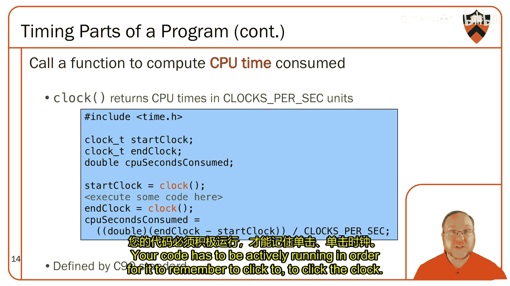

So that's going to tell you how long this code took each time it was called。

 But you might also care how often it was called or how many different times it was called。

The combination of those two will tell you how important it is。

 The total time it runs across all calls is a metric that sort of combines these in terms of being interesting to optimize。

So something that runs for a long time relative to other operations may be worth optimizing because it takes a long time。

 It takes a big chunk of the total operation time。But if it perhaps runs sufficiently rarely that its total time isn't significant。

 we won't care too much。 Think about the hash table expansion from assignment 3。It was super slow。

 but we did it so rarely that we， it was dwarfed by the other operations in any reasonable workload。

 And so we were willing to put up with it。Something that runs for a small time might still be worth optimizing because we do it so often。

 Thus， the total time is big。 Further， when something is very short， but called often。

 there's a multiplier effect of a bang for your buck， if you will， on even small improvements。

Concretely， consider saving one second from a function that runs once versus 1 millisecond from something that runs 100000 times。

 The former is one second of savings。 The latter is 100 seconds of savings。So in a way。

 what we really need to know all of this information， to know what we want to attack。

 And the way that we can get this information about how often functions are run is by using an execution profiler。

 The standard one in the Ganu Linux platform is G Prof for a well， Ganu profiler。

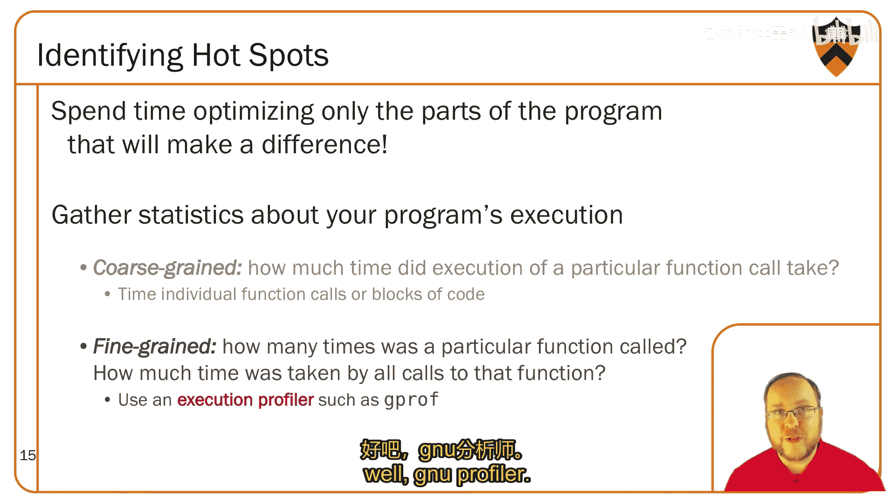

So GProf was revolutionary。 It appeared in a Sgplan PLDI， which is the premier PL conference。

 particularly as it relates to implementation in real systems， way back in 1982。

 And by the end of the 80s， the concept was so mainstream that implementing a version of it was actually given as an assignment right here in Co 217。

 So this paper was considered one of the top 50 most influential programming language papers of all time and was credited with revolutionizing the performance analysis field。

 and it' still relevant today， as we'll see。To show off GProf。

 let's use a really simple example program。 It fills up an array with a bunch of random numbers。

 And then as we sort that function， you will see the swap function from the sort here and the partition from the sort here。

 You may recognize this as the algorithm for Quick sort。 If you're not familiar with Quick sort。

 don't worry about it on the slide， it's just a driving example。So finally。

 here is the top level quick method and the main function that populates the array and sorts it。

Again， don't worry about the details of the algorithm。 and obviously this is pretty artificial。

 We're filling in with random data， we're sorting the array。

 and then we're just returning without doing any actual output。

 but it's for demonstration of a computationally intensive function。So with this program。

 we want to dive in and see whether the program takes a long time and determine what portion of the code consumes the most time。

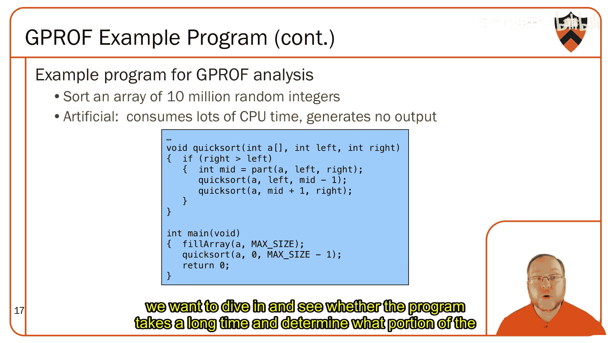

The way that Gprof works is by sampling the code as it runs to tally up what function are we in。

 what's the the back trace of how we got here， et cetera。 So specifically。

 it arranges for Sigprof a signal to arrive at your process continuously at a fixed time interval。

 typically hundreds or maybe low thousands of times per second。Each time the signal arrives。

 GProf notes what function it was interrupting。So that way， using a Monte Carlo approach。

 if we do this often enough， we'll get a pretty good sense of the execution trajectory and characteristics of the program。

So because at process termination， GProf knows the total process time and the percentage of time spent in each function。

 it can infer the time spent in each function。But in order to do all of this。

 we have to tell the compiler to build the program to be instrumented in such a way。

 Once we do that with the minus Pg flag， we run it as usual， in addition to running， though。

 the executable will also now produce a log file that can be parsed by the tool the GProf tool to create a textual report。

 So this should feel familiar。 This is just like Miinfo。 we build it in a special way。

 we run the program as usual， that tool will specially built executable will then produce a log file that we can then use a tool to generate a report from。

So when we generate the report， it comes in a few different sections。

 We won't go through all the info， but here's a general idea。

The most interesting one is this table on each line is a function with corresponding information。

 The leftmost column is just a big summary that shows what percentage of total run time was spent in each function。

 It's in descending order by amount。 So you can immediately see what the critical bits are。

The third column is the total amount of time spent in the function across all calls to it。

 I've skipped the second column because it's just a cumulative sum down this third column。

 which is how they get the the total percentage in the first。 But yeah。

 so the third is just the the total amount of time。 The fourth column is the total number of calls。

 The fifth is a normalized amount of time spent specifically in each of those calls。

 Think of this as the third column divided by the fourth。

And then the sixth column is a sort of normalized amount of time per each of those calls。

 considering from start to finish。 So that includes all of the time that were technically in that function。

 waiting on its descendants to return back to it。

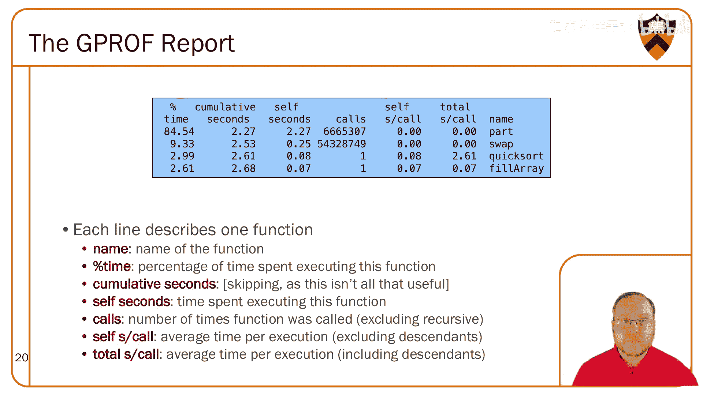

GProf also produces even more information about the trajectory of the program。

 think of it as describing the graph of execution， where each function is a node in the graph and each function call is an edge in the graph。

In other words， what function calls what other functions， We won't worry about this too much for now。

 for our purposes， the first table is sufficient， though we will ask you in assignment 5 to submit the entire report。

 not just that one table。

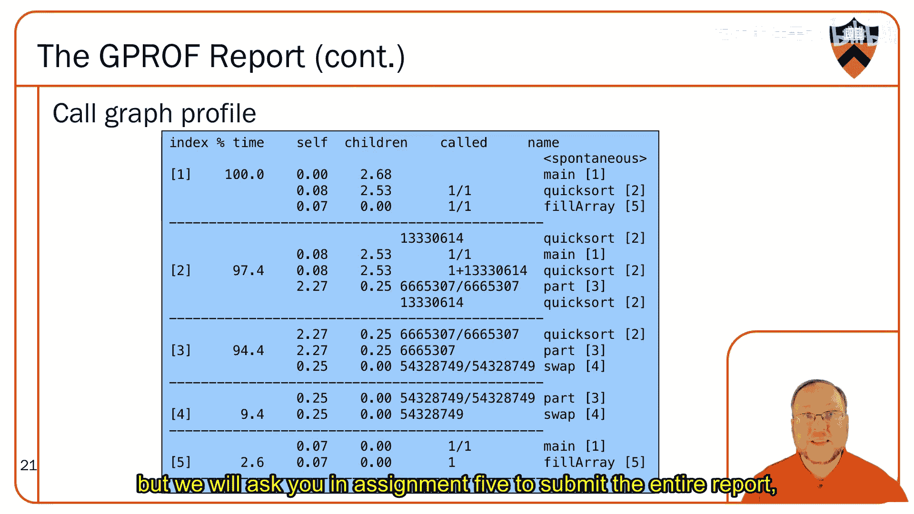

So back to that first report， we can interpret it as this。 Phil Ray is called only once。

 and it doesn't take much of the final time。 So it's totally not worth trying to optimize。Quicksort。

 similarly， doesn't seem to be a bottleneck。 Its descendants do a lot of work。

 but Quick sort doesn't really do much itself。Swamp is called an absolute ton of times in a program that takes less than 3 seconds to run。

 It's called 54 million times。 But each call is so minuscule that they add up together all 54 million of them to be less than 10% of the program。

 So even if we made it orders of magnitude faster to swap， frankly， unlikely。

 the upside is still only about 10 per cent gain in our program。

 So Amdal's law suggests that with perhaps worth looking at， but it shouldn't be our primary target。

Partition， on the other hand， takes up 85 per cent of the program running time。

 And so any gain we make here could make a gigantic improvement in the program overall。

 And furthermore， there are still millions of calls to it。

 So even a small improvement could prove impactful when multiplied out。

So that was a crash course on how to run GProf， which we will ask you to do in this assignment。

 but once you know that the function， which function you want to optimize。

 now you need some techniques for how to do so。How do we actually make things faster。

 What can we attempt to do or what shouldn't we attempt to do。

 Because we know the compiler will already do it for us if we just ask。So certainly one option。

 not discounting it at all， is to work smarter and use a better algorithm。

 either in terms of asymptotic efficiency or one better tune to the workloads that we know that our program will tend to deal with。

So sometimes those come， unfortunately， at a cost of readability or maintainability or other qualities。

Furthermore， 226 is all about this stuff， so we won't focus on that here in 217。Instead。

 let's think more observationally about our code as we find patterns that seem to beg for optimization。

 Let's use our empirical knowledge that we've accumulated about what works and in particular。

 knowledge of what of how code may be used。 And we can start to think about。

 could a compiler do this for us。 Is this likely to prove fruitful。

And so let's try some examples to get cracking on this。So here's our first example。

 We have a function G that has return F of x plus f of x plus F of x plus f of x。

 and it sure would be nice that if consider if F of x takes a whole lot of time。

 it' would be nice if a compiler would say 1 plus1 plus1 plus 1 equals4 great。

 so I can absolutely do this optimization。😊，The compiler certainly knows about the relationship between addition and multiplication。

 but can it be sure that the computation here of f of x plus f of x plus f of x plus f of x is equal to four times f of x。

Pause the video and take a moment to convince yourself of your claim one way or the other。

The answer here is sometimes， but not always。 Let's consider an example of when this wouldn't be a valid change。

What happens if F of X isn't deterministic， For example， it has some some baked in non determinism。

A random number generator， a random number calculator inside， for instance。

Or what if F of X has a side effect， What if F is scanf or print F。

 where it interacts with a stream or another function that updates a global variable。

 This optimization would fundamentally change the way the program works。Further。

 F might not even be known at compile time。 if the compiler doesn't have access to F。

 maybe it can do additional analysis to to see how it's used， but it's pretty unlikely。 And frankly。

 even if the compiler does have access to F。 again。

 maybe it can look at the code of F now and and make a better call。 But in the general case。

 it still probably can't。However， if you as the programmer， perhaps you can。

 because you have more knowledge。If you can't see F。

 you can maybe read the interface for F and see what it claims to do。

Or maybe you wrote F and you have a better sense of exactly what it does do。

 Certainly better than the compiler's code analysis。Here's another example。

 The computation n times I is the invariant in the inner loop。

 It would be more more efficient to compute it in the outer loop rather than computing it over and over and over again inside。

So can the compiler do this again， Pause the video， convince yourself， yes， sometimes or no。

The answer here is probably yes。 The compiler has the full information。

 It knows that nothing is changing in an or I， And it can figure out that if you pull out that computation。

 that it will do it only once。But it's still probably better to do yourself。

 There's no mystery for you。 So if you notice this， if you can easily see it yourself。

 why leave it up to the compiler to maybe or maybe not get it。Take another look at this coat。

 Is there another optimization available here。 Again。

 pause and see if you can find something else that you might be able to optimize by hand。

So let's look at the values of N I initially at's 0， then it's n， then it's 2 n。

 Its in I is incrementing by one， and n isn't changing。

 So one very minor optimization I could do is instead of redoing the multiplication each time through the loop。

 I could just add another n each time。 Ed is typically faster to the multiplication。

 So this could be a very small optimization that would work based on how this snippet is written。

And frankly， a smart compiler might be able to do this for us as well。Here's another one。

 pretty similar to the previous one for each character in a string， do something with it。

But it's certainly inefficient to do it this way。 Each loop sustain standing condition shack recomputes the sternlin。

Assuming the string's length isn't being modified by the body。 we shouldn't need to recompute it。

However， the compiler would need to figure out several things in order to make this optimization。

 First， it would need to be able to confirm that the string's length isn't being modified by the body。

If there are any function calls or anything like that inside， it has no guarantee of this。

 And furthermore， it needs to figure out what Stirlin does。

Just because Sterlin is part of the standard library doesn't mean that it doesn't have side effects or any of these other factors that we we've already considered。

And frankly， the compiler probably can't figure these things out。 You， on the other hand。

 certainly can。Here's yet another one to consider。 A function takes in two pointers。

 adds the second integer it points to to the first integer it points to。 Then it does it again。

 Could the compiler do this optimization for you。Convince yourself， A， B or C。 Yes， sometimes or no。

So no one will have gotten the reference on the slide's title that comes from a show that finished in 2006。

 but the answer is the compiler can't do it for you because it might not even be right。

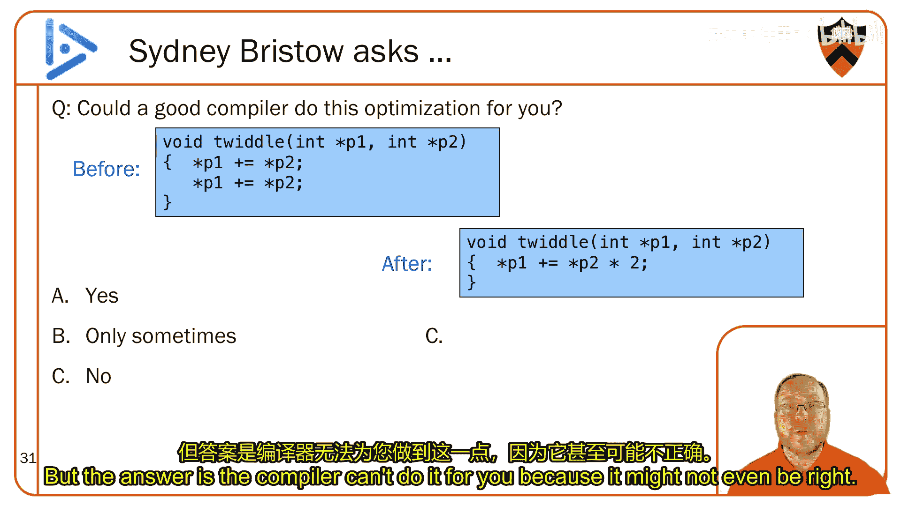

Suppose P1 and P2 point to the exact same int in memory。 Say that int is 2。The first version。

 star P1 plus equals star P2 assigns4 to that place in memory。

When we repeat the star P1 plus equal star P 2， that assigns 8 then to that place in memory。

 So if it was originally 2， we've done 4 x。 The second version。

 star P1 plus equal star P 2 plus 2 does  two1s2。Plus two is six。

So you could make this optimization if and only if you're guaranteed that they're not aliases。

 but the compiler has no way to know whether they're aliases or not。

 It doesn't have a sense of what other pointer operations are being done in the code。

 So it can't do this。This was seen as a flaw， and in fact。

 in later versions of the language in the C 99 version， added the restrict keyword。

 which is applied to a pointer， and it assures the compiler that the object reference by P will be accessed only ever through P。

So in this case， the compiler would feel free to do the optimization because if the restrict keyword was used。

 because it would know that they're not aliases。

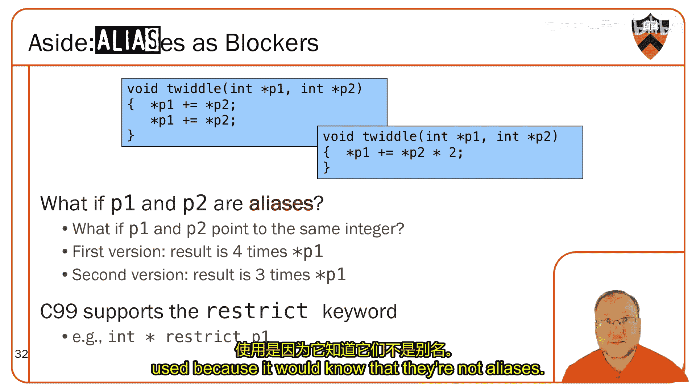

All right， so so enough with the trick questions， I want to finish up this lecture with two more optimization techniques。

We've always been told there's overhead associated with calling a function。

 Now that we just have covered assembly language， we know exactly what that overhead is。

 We have to jump to a different part of the text section。

 We have to do the prologue where we add to the stack and then save our old X 30。Afterwards。

 we have to do the epilogue， we restore our oldX30 and we tear down the stack。

 and finally we have to jump back to the original spot in the text section。

Inlining a function call eliminates all of that overhead。

 Inlining is just taking the body of the function， putting it into the code where the function call would have happened and adjusting the variables to fit the parameters that would have been passed to the function。

A good compiler can inline the call of G here， but only if it has access to the definition of G。

 which we know it is is not always the case。 Sometimes functions are only the function definitions are only eventually resolved at at link time。

So C99 and beyond support the inline keyword， which is a way for the programmer to provide a suggestion to the compiler that it inline calls of a specific function whenever it can。

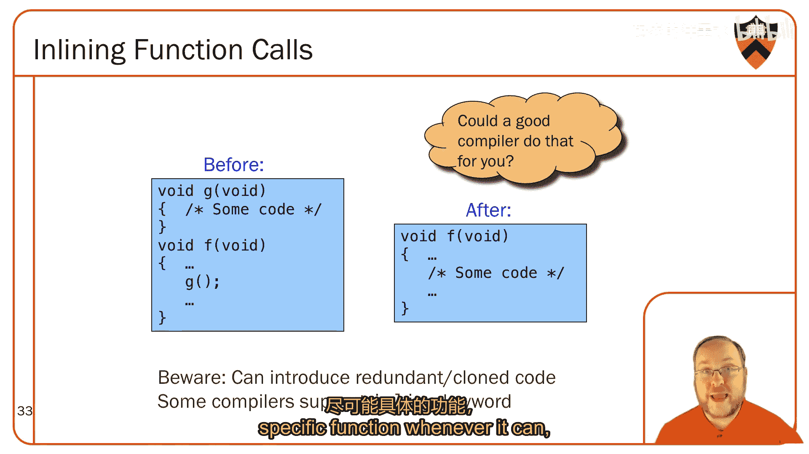

But C 90 doesn't support this。So just as there's overhead associated with jumping for a function。

 there is for a loop as well， the compare instruction and then the conditional jump instruction。

So furthermore， in advance architectures， it's not just that we have to do this。

 The issue is that the processor might be working on multiple instructions all at once。

 It might be executing instruction X， decoding instruction X plus1， fetching instruction X plus 2。

 But this， this pipeline， as it's called this pipeline of instructions。Eventually。

 we're going to run into a branch。 And so the processor at that point will have to do branch prediction。

 If it wants to continue this pipeline， it's going to have to basically guess which instruction will come next。

And loops have the potential to trash this pipeline。

 If the processor guesses wrong about its branch prediction。

 all of the work where it it's started to pull in and maybe even start to execute the things that come after this branch will all go to waste。

 None of it will come to fruition。 And so it will have lost the investment that it did by this pipeline。

This as you might expect， dramatically slows down execution。 And so one way around this。

 certainly one。Excellent area of research is to improve branch prediction。

 but a way around this problem as a whole is unrolling the loop。

It avoids this overhead because it processes more things unconditionally。

 processes more separate things in between each conditional operation that could。

 in theory trash the pipeline。So loop unrolling in the right circumstances can be advantageous。

 but it certainly comes， as you can see on the slide at the cost of way less readable。

 way less maintainable code。Note that some compilers do produce code that can support this optimization。

 for example， GCC has the F unroll loops， command line option that provides a suggestion to the compiler to unroll loops whenever it can。

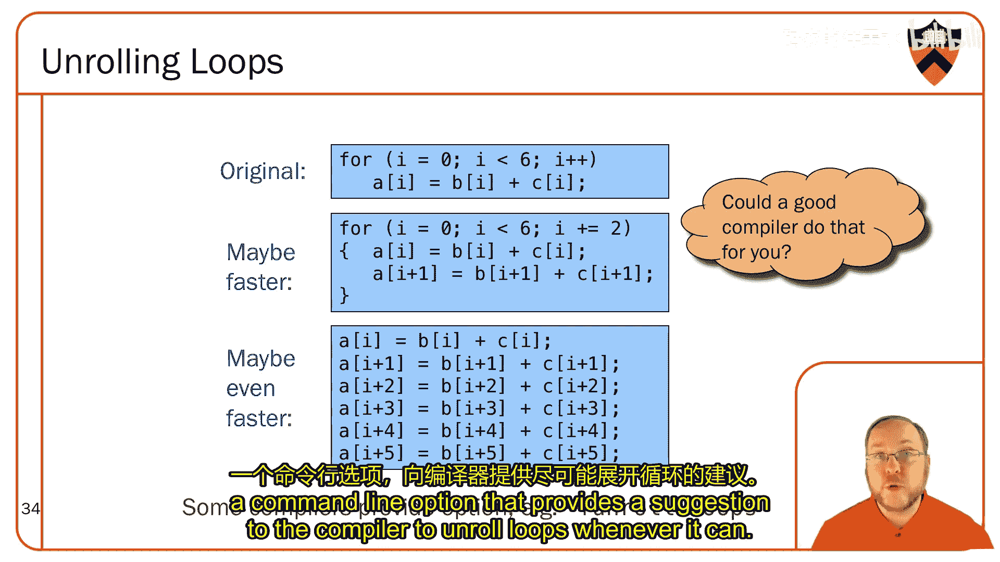

So finally， we catch right back up to what we've been focusing on the last couple weeks。

 scrapping the compiler altogether and writing code natively in a lower level language。

 This sounds great。 Well， at least to some of you。😊。

And there are instructions that the compiler doesn't even know about or that the compiler doesn't know how to make very good use of。

 that we can do research for ourselves in the Ar Develops guide and our other architecture manuals to utilize to their greatest extent。

But before you get too excited， remember， compilers do have decades of cutting edge research going into their design。

 They're tremendously clever and fantastically detailed。😊。

So just like with the examples we've seen where I've cherry picked some things that you can do。

 but the compiler can't handwritten assembly code。Were we're picking at the margins here。

 And you'll see that in in this assignment that's out now。

 where we will have you do great work in assembly， but。Initially。

 even when you're handwriting assembly code， it very well can be slower than the compiler generated code。

 especially when as is the case for part 2D， the assembly is written somewhat naively and the compiler is run with speed optimization activated。

And so even with， as we have in assignment 5， a perfectly set up problem that we know exactly the pattern to exploit。

 and we're doing all the right things。 It gets us to kind of only about as good as the compiler。

 And it takes a phenomenal effort to actually best it。😊，That said， good luck doing so。

 It is possible。 And I， as I said in the the first part of the last lecture。

 I hope that the puzzle aspect of the challenge portion of this assignment appeals to many of you。

So this was our last lecture dealing with the assembly language and performance portion of the downward tour。

This culminates with assignment 5 due the last day of class in the final three lectures of the semester。

 we'll be advancing on to assignment 6。 the dean's state assignment。

 which will entail taking the elevator down one level further to talk about machine language。

 I'm sure you're hyped。

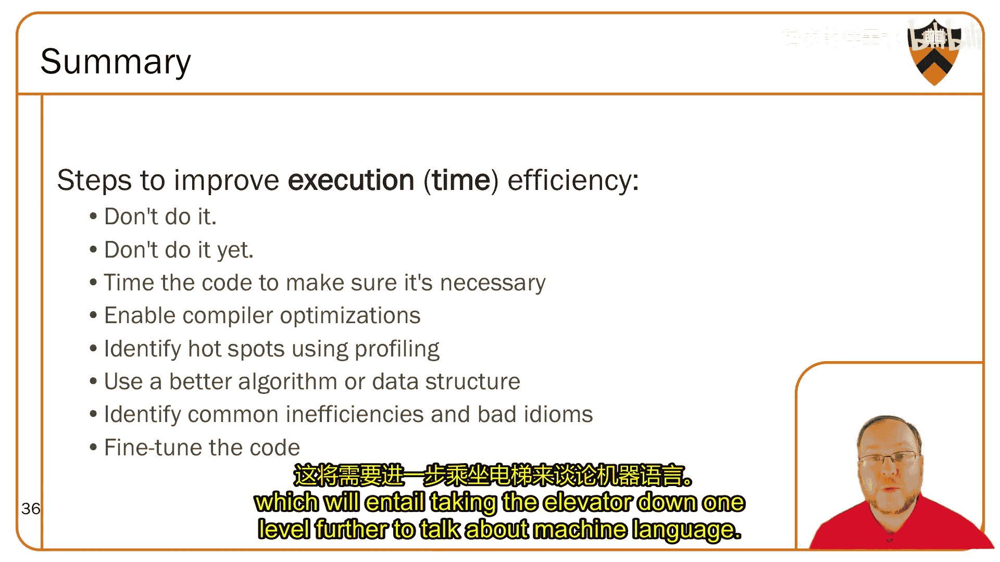