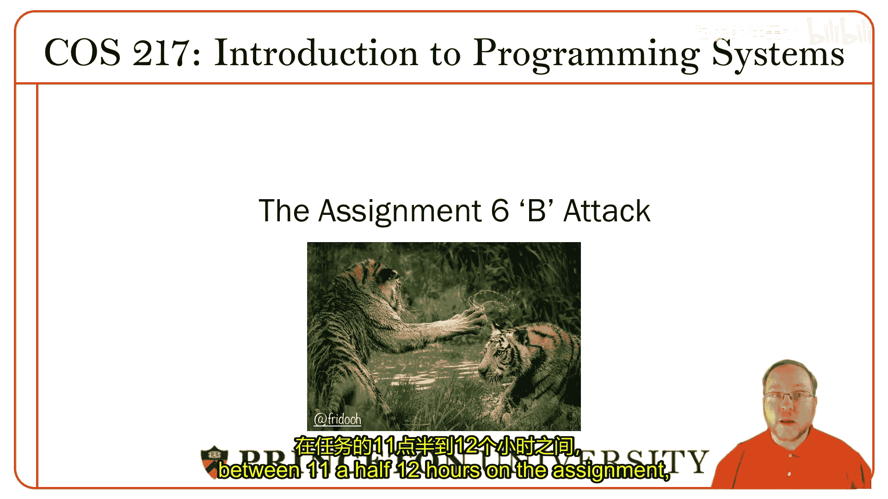
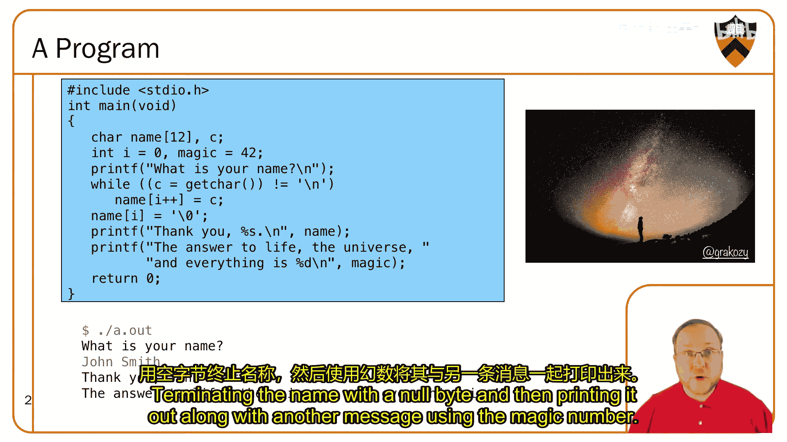
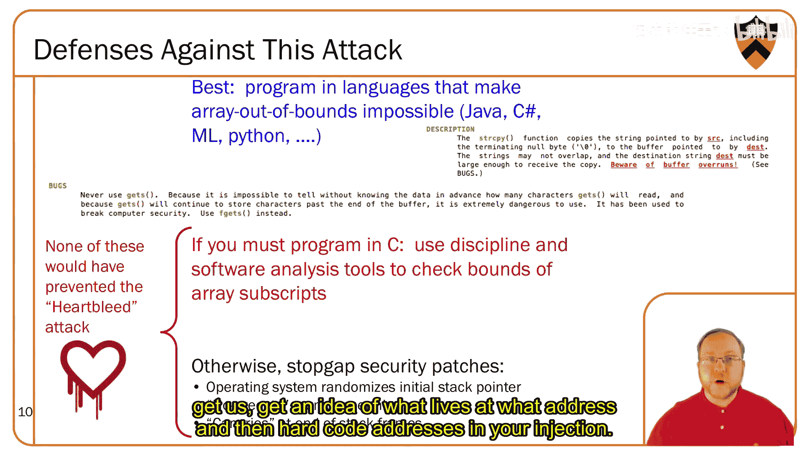
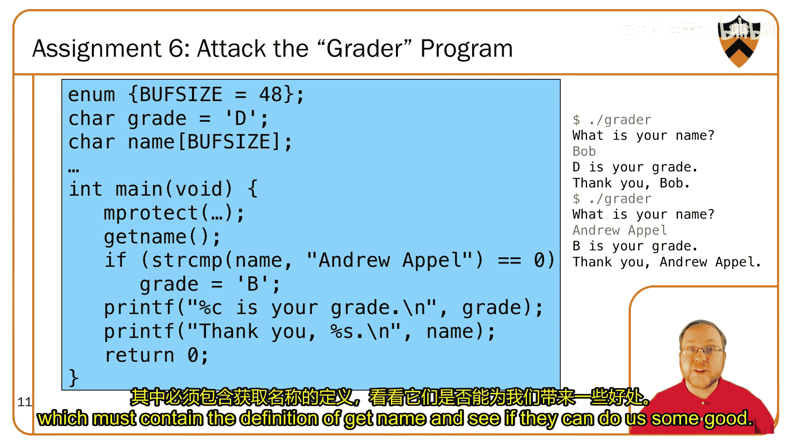
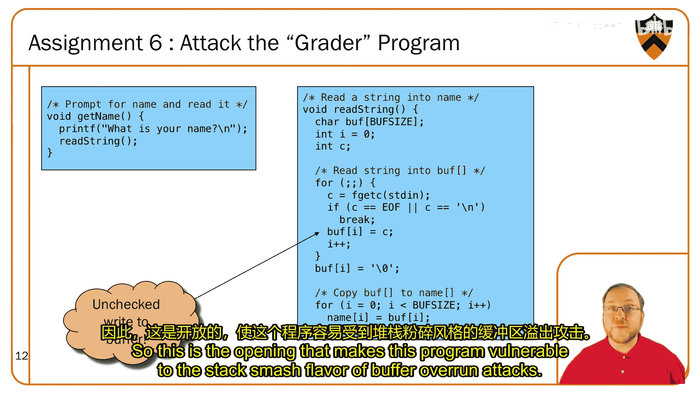
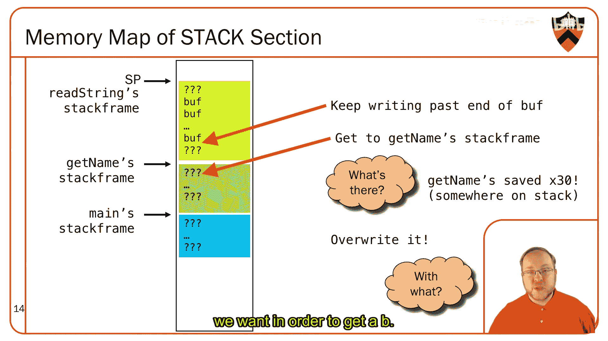
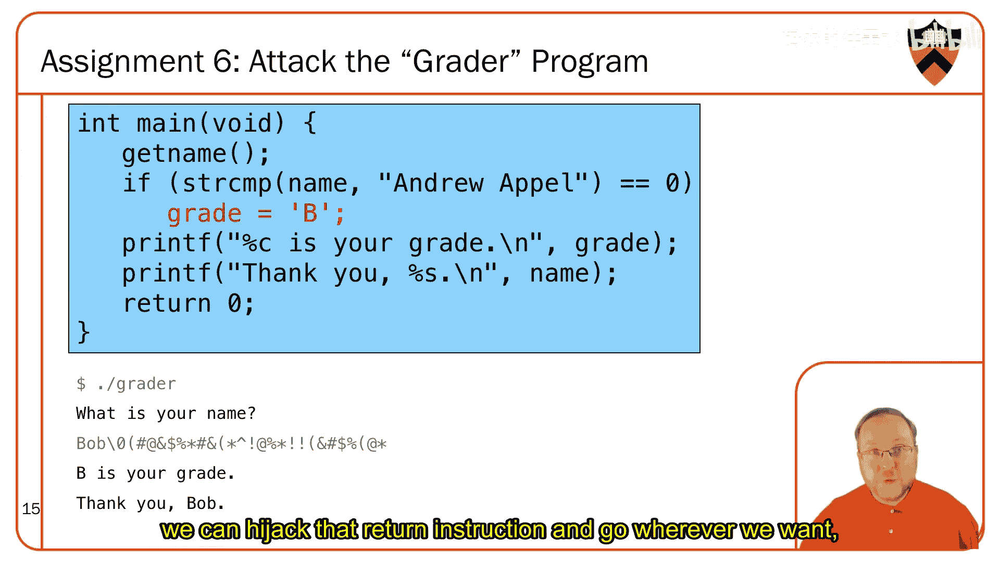
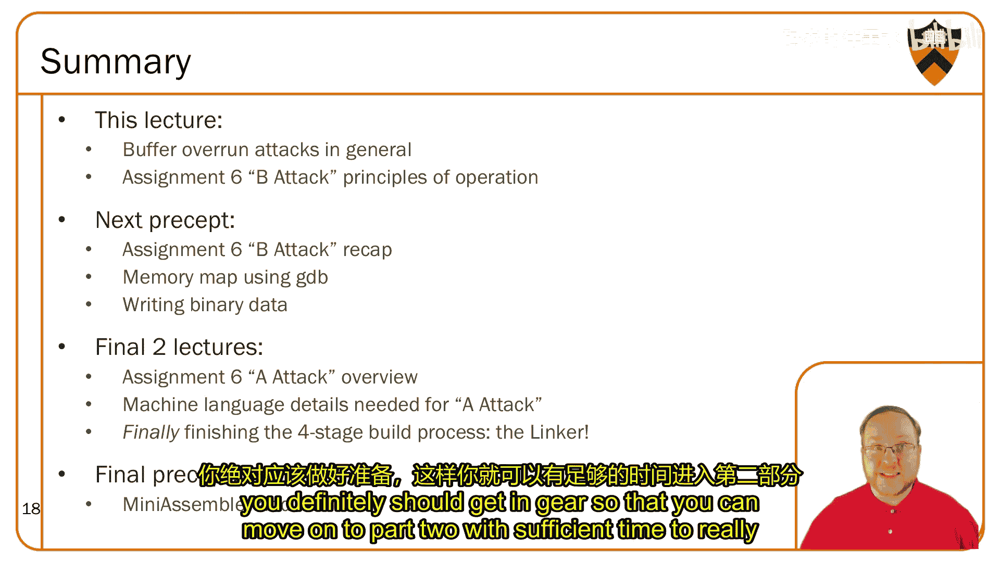

# 【全集 秋季版】普林斯顿大学 C语言系统编程 中英字幕 p27 Lecture 27 - 缓冲区溢出 -BV1u1feBoEsK_p27-

Welcome back to Co 217 Leture。With only a week to go on assignment 5 and coming down the home stretch of the semester as a whole。

 it's time to talk about the dean's date assignment。The Dean's state assignment for this course。

 this term is going to be the buffer overrun assignment。

 This is the first term in which we've done the buffer overrun assignment as our dean's state assignment。

 but I hope that it won't be too stressful for you during your reading period。In in years past。

 this has always been one of the most popular assignments among students in this course。

 and it isn't as taxing as some of the others that we've seen and that you're seeing now in previous semesters since we've moved from X86 to arm。

 students have reported on average taking between 12 sorry between 11 a half and 12 hours on the assignment。

 which is a partnered assignment。

Before we dig in， though， I want to look at another C programme that has some interesting characteristics。

 namely sloppy code that will be susceptible to a common mode of attack。

 which will eventually lead us to another such program that constitutes the bulk of assignment 6。

So take a moment to consider the code on the slide。Nothing really seems that unusual。

 There's some bad style。 perhaps。 for example， we know that get cha returns an in to not a cha。

 but it's pretty typical。 There are variable declarations for a name buffer and a character and an encounter and a magic number。

There's a prompt to instruct the user to enter a name。

We read the name one character at a time until we get to a new line。

Terminating the name with aulbte and then printing it out along with another message using the magic number or done。

 and when we run it， it looks great。

Of course， for some unfortunate souls， 12 characters isn't going to get it done as far as buffered for storing their name。

 but hey， the program asks me to enter my name， so I will。And whoa。

Rather than some sort of nice message that says your name is too long or even crashing with array index out of bounds or something like that。

 like you might see in Java， we get， well， that。Why how？

Where did the E and my last name go and why is there a new line in my last name？Furthermore。

 what is that number， Douglas Adams definitely didn't write about that。 Let's go investigate。

So all of these were local variables， and we know where local variables go， they go on the stack。

But we have always said that we couldn't be sure in exactly what order they'd be placed on the stack and the exact details when we were looking at all of our programs exclusively in C were sort of irrelevant。

Now they're going to be very relevant now that we've gone into assembly language and are in fact going even deeper into machine language。

In this case， they were put on the stack in order almost。The name。 and then C。 But before C。

 there were three bites of patting darn characters。 they complicate everything。 Then we have magic。

 and then I。😊，Above the name on the stack is the value of x 30 that we want to return to。

 just like we've seen in many of our programs thus far。

 it has to be stored somewhere on the stack here because this function calls other functions。

So our offsets from SP are hex 0 is x30， Hex8 is the name， Hex 17 is C。

 Hex 18 is magic and hex1C is I。In this program， each read changes the value of C。

 And then if it isn't a new line。That that value in C。

 that new value read in is copied into an element of the name。

So my name uses all 12 of the bytes in name just for Christopher and the space。

But the loop doesn't end because it hasn't seen a new line yet。

 So then the M O R in my surname fills the first three Bs after the the name array proper。

 which are the padding。The E in Moreetti goes into C， which then is copied into name 15。

 but that's the same location as C。 And so it gets overwritten immediately upon the next read。

And eventually after the last read of the new line。

 the final value in that location will be the new line character。

And so that actually explains both why I'm missing an E in my last name。

 and as well as eventually why it is a new line character， why my name is printed over two lines。

When we read the first tea in Moreetti。We're now down to magic。

So we overwrite the 42 with the character T， which is hex 74。

Note that this is because the 42 is actually stored in the first byte of the int。

 This is a little Indian machine。 so our our lowest order by comes first。

The three higher order bytes here were0 with the value 42 and remained0 with the value He 7，4。

On the next T， that makes magic the hex value Hex 7，4， Hex 7，4 as the two bytes of the number。

 The two higher order bytes remain0。 but now we have a much larger number。 We have 29000。

The I then makes magic 6911092 because it's hex 6，9，7，4，7，4。 And again。

 the the one higher order by the the fourth B of the int remained 0。

 So we haven't gone into even larger numbers。 but we have filled up three of the four Bs of int。

 even though only one was actually used， the other three were 0 initially。😊，And then finally。

 the new line character is read in that overwrites C for the last time and it breaks the loop。

So there's our first example of how overflowing a buffer can change the behavior of a program by overriding data adjacent to that buffer Here we read in too much data and ended up getting both a corruption of the name string。

 and also a really bizarre corruption of the number， the magic number that's printed at the end。

But it gets worse。If we keep writing， not only can we blow away magic。

 we can also fall off the function stack frame altogether。

And what's inside the previous function stack frame？Often enough at the top of it。

 it's the previous function stored return address。 the address that it initially has in X 30 that then stores away for safekeeping。

But if we keep writing， that safekeing is no longer very safe。That means that if we keep writing。

 we can change where the function that called us returns to。

If we just put an invalid value there into that spot that has the stored return address。

That will that invalid value will eventually be reloaded into x 30 when the function goes to return。

And then it'll be jumped to by the return instruction。In this program's case。

 it actually does something a little bit different because this is main。

 main was called by underscore start， and so if we go into underscore Start stack frame。

 it doesn't actually have a return address stored from x30。

 because underscore start by definition as soon as it gets back from main is going to clean up and then exit but we still might be doing some damage overwriting some of underscore start data。

 but in the more general case here， if we write down into the previous function stack frame。

 say that this where a helper function and we。Had a address that was returning back into main。 Now。

 the old S would be pointing into main stack frame and main does have sorry the the helper function does have a function returning into main。

And so putting a bad value here would cause it to return to an invalid location。

When the processor jumps that location， either the jump would fail or as soon as we attempted to execute code at that location。

 it would fail， this would be a se fault。So this would be bad。

 we could seg fault due to overriding the stack frame that's right below us。Worse again， though。

 rather than an invalid location。 The old X 30 could be overwritten with the address of a valid location。

 Indeed， a specially targeted location。 say somewhere in the text section that you weren't supposed to be able to get to on this logical path。

This is the crux of assignment 6's B attack， we'll see details of it in a few minutes。But first。

 we have to note that it can even be worse in yet again。Indeed。

 rather than overwriting with an address someplace that we already have in the code that could have been executed。

You could instead have a function return to a location that has had another injection happen to it。

 someplace that we have via another attack mechanism already copied some malicious code。😊。

In assignment 6 is A attack， this will be the BSS section。

So rather than just changing the logic of the program among its own code。

 you can cause the program to do something that it was never programmed to do in any case。

This is completely turning the program to do your bidding instead of its own purpose。Very dangerous。

 Very scary。The good news， though， is that it's pretty easy to avoid buffer over on attacks。

 The bad news for this class， at least， though， is that the best defense against these attacks is pretty much don't write in C and other like type languages that don't automatically do bounce checking。

😊，Failing that this is the reason why， as you see on the screen that the men pages from St copypy and from。

From getES says you know，Stir copy isn't really great。

 if at all possible you should use stir and copy to sort of bound your copying and GES is absolutely horrid and should always always always be using F getsES instead。

But again， lest you think that all hope is lost， operating operating systems researchers are really cool and have done some really interesting things。

 Modern operating systems have developed some very slick security measures For example。

 rules that you can only execute code from within the text section。 So makes sense。 I mean。

 the text section is where we store our machine code。

 We usually don't want to execute code outside of it。 So this seems like a good rule。

 or making it so the stack starts at a different location each time the program runs。

 just to make it harder to to profile code get get an idea of what lives at what address and then hard code addresses in your injection。

😊。

So now we come to assignment 6 in this program， which we have specially arranged both in how it was compiled and with this call to imp protectect so that it reduces its shields。

 It turns off some of the defences we just mentioned。We have， again。

 a program that looks pretty normal。 We have main that calls a function to get a name。

That name is stored in a buffer in the BSS section。

 we know that it's in the BSS section because name is outside of any function and was not given in initial value。

Then upon return to Maine， the program looks at the string that was input from standard input and compares it with Professor Appel's name。

If it is indeed， Professor Appel， he gets a B。And they say that grade deflation is dead。Otherwise。

 the user's grade is unmodified from the default value that we see up for grade in the initialization of D。

You presumably don't want to get a D。 So perhaps there's another way around this Be beside being an endowed professor in the computer science department。

 So let's see the alighted out portions here， which must contain the definition of get name and see if they can do us some some good。

Well， getname simply writes the prompt and then calls read stringing。 There's basically nothing here。

Read string declares a local buffer that's the same size as the one in BSs。

It reads in the name into the local buffer until either a new line is red or we get the end of input。

After reading everything in the local buffer， it fills up the buffer in BS S from its local buffer。

Raising your guard for a potential for buffer overrun possibilities。

 take a moment to look at this code and see if you can find a problem。

This code doesn't check whether we're still in bounds。Within the bounds of the buffer on the stack。

The loop is guarded only by E O F in the new line character。 So with no check of the index。

 that means we can keep writing beyond the end of the array so long as we don't enter a new line。

And then if we keep writing beyond that， we can in fact。

 write all of the way off of Read stringing stack frame to whatever lies below it in memory。

We know what lies below in memory。 What comes before a function stack frame is the stack frame of the function that called it。

 So this is the opening that makes this program vulnerable to the stack smash flavor of buffer overrun attacks。

😊。

So your job is to execute three different stack smashes to earn yourself a B and A or an a plus respectively。

This lecture covers the B attack in some detail， and then you'll get a follow up sort of review and some details on the concepts of how to make it happen in the second precept this week。

The next lecture and the final lecture of the course will be an overview of the A&A+ attacks and then so that's in the second lecture of this week and then in the final lecture the lecture next week。

 we will really dive into machine language to see how to make this happen because you'll need to know a little bit about machine language in order to execute the A&A+ attacks。

Before we get into the gory details， let me just give you a 30 to 60 second overview of the B attack here。

You're going to overflow the local buffer in readstring。

Presumably with nullbytes or something like it to get far enough down to overwrite all the way out of its stack frame and overwrite into the return value that is the stored value of x30 in getname stack。

Then you'll happily let Reedstring return。 Readedstring returns。 Where does it return to， Well。

 where was it called from， Get name， Everything's good， Get name is now done， though。

 And when it goes to return， instead of returning back to the S main from where it was called。

 it will go to the S main that sets the grade B for Professor Appel。

 having skipped over the check to make sure that you are Professor Appel。😊。

So the program will now set the grade B for you and then complete its printing by returning as normal from there on out。

This sounds overwhelming， so let's take it step by step。In order to construct this attack。

 it is absolutely critical that you complete a memory map。

 That is an accounting of exactly what data is where in memory during the execution of your program。

 This is necessary because you'll need to know what data that what the data that you're going to overwrite what its address is。

 and furthermore， what data youre going to overwrite it with。 if you have to write in new addresses。

 you need to know where you're going as well。This lecture gives you the principles of the attack。

 but leaves out all of the actual memory addresses。 So in the assignment。

 you'll have to fill out the details with the exact addresses。

 both in your memory map document and also in the exploit input that you'll construct to actually do this buffer overrun attack and get yourself a better grade。

Next precept will tell you how to use GDP to help generating that memory map。

So here's a generalized view of part of the stack section in our program during the execution of Readstring。

Recall from the previous slides read string is that third function main calls get name。

 get name calls read stringing and read stringing is the one with the unchecked right to its buffer。

So the read string function is going to keep reading from standard input and filling its buffer。

If we overfill the buffer， what happens？Well， eventually we'll get to get named stack frame。

And what do we know is stored in get named stack frame or really the stack frame of any function that calls another function？

Its initial value of x30， the value that it needs to return to the address that it needs to return to when it's done。

 which has to be stored away for safekeeping because it's going to call another function that's going to use x30 to be the address here to return back to。

So if we want to change the program's behavior， we can overwrite that value that's stored on the stack that will eventually be put in D 30。

If we override it with a new address that will continue the flow of control in a way that in this case we want in order to get a b。

But what is that address？Let's flip back to the code from before。

There already exists in the text section for this program。

 some set of instructions that assigns a student a B grade。

There has to be because Professor Appel gets one。So there's an assignment in Maine that handles this case。

 You're not Professor Appel。 So you would have never been able to execute that code with your name。

But now we can overwrite getname stored X30。And then when getname reloads X 30 from that stored value and then jumps to that location via the return instruction。

 we can hijack that return instruction and go wherever we want。

 including the instructions that set the grade of B。

To do that， you again need to rely on this memory map。

 a completed memory map this time of the text section。

So here's a generalized view of part of the text section。 There's more in our entire program。

 We know， for instance， that the machine code defining printf was brought in from the standard library by the linker。

 and then there's underscore start， and maybe various other things。

 But this is enough to get us started， These are the principles。 in order to hijack。

 get names return to take you to the location of getting the grade to be。

 You have to know where in the text section。 the instructions corresponding to that C assignment live。

That's more than the pseudocode or pseudo flat C that we see here Instead we need the actual memory address for every actual machine language instruction。

But assuming you've done your memory map， you do know this。 And if you know it。

 then you can use that address to write as part of your exploit way back when we said we're going to overwrite get names X 30。

 Well this is the address that we want to overwrite it with。So now that you know what the address is。

 you're ready to build the exploit string。So what is this string。

 well first it has to have your name because that's still what the program will prompt you for。

 and it's still what the program will use in its final print statement。But whereas in a normal input。

 the program would replace the new line to fill the nullbite for you here。

 you're going to want to keep writing beyond the extent of your name。

 So you'll need to fill in the nullbite for your for yourself。

 because then you'll provide enough filler after the nullbite to get to the location where get names X 30 was stored。

 You can't just say， okay， I'm done after your name。 That's the whole point。

After you've written out your name and an albte to end your name and then filler to get down to the enough bytes written that we will overwrite the rest of read strings。

 stack frame and go into get names， then you'll write out the address in main that you want to replace X 30 with。

It'd be nice if you could just type all of this into a file。

 but it won't work because after the name in the buffer， you need to put the nullbite worse。

 when we go to write the address， we're going to have a problem because if we try to write out the address as a number or something like that。

 it's going to print as just the ASI values of each digit。 And that's not what we want。

 We want the binary data that is。The the binary data is the address。There are various approaches。

 we can use print F or putchar or their variants that write to a specified file stream that's F print F and put C。

 so we can use the functions that we know about， we just need to be careful with it。

 we can't just go you know printing things without thinking about is this the ASI value or is this a binary value。

Basically the same principle of why we couldn't just type it into a file。

 how do you write the nullbyte， things like that， we again need to be careful about what functions we're calling to generate this data as well。

Furthermore， I'll give you a hint here and you'll see this in the precept handout mentioned。

 there is a function actually made for writing binary data instead of printing ASI。

 It's called Fright， so you should use the main page， look it up。And again。

 you'll see these options in precept this week。So that's it for the B attack at this point you're down to the final two lectures and the final two precepts。

 and as mentioned earlier， they will continue on the topic of assignment 6。

 moving on to the A attack。I hope you're making good progress on assignment 5 as a nag。

 If you haven't finished part 1 yet， you definitely should get in gear so that you can move on to part 2 with sufficient time to really dig in before the deadline。

 Good luck。

