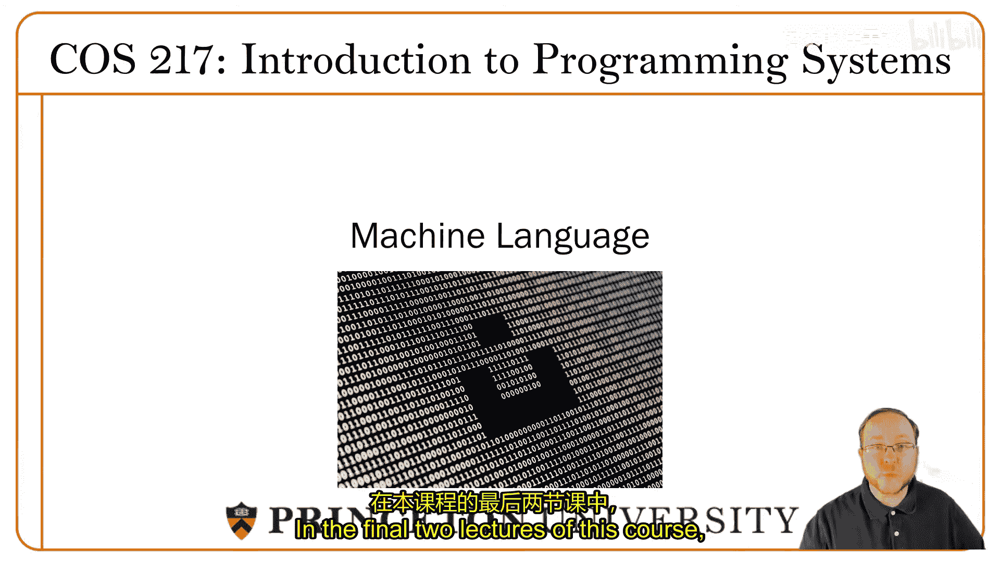
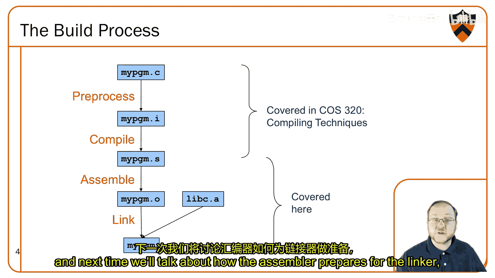
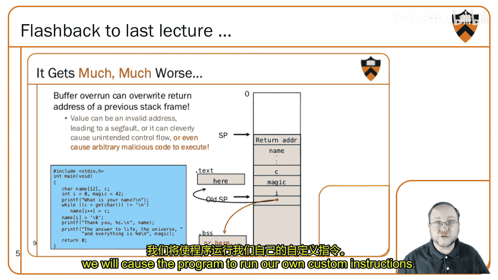
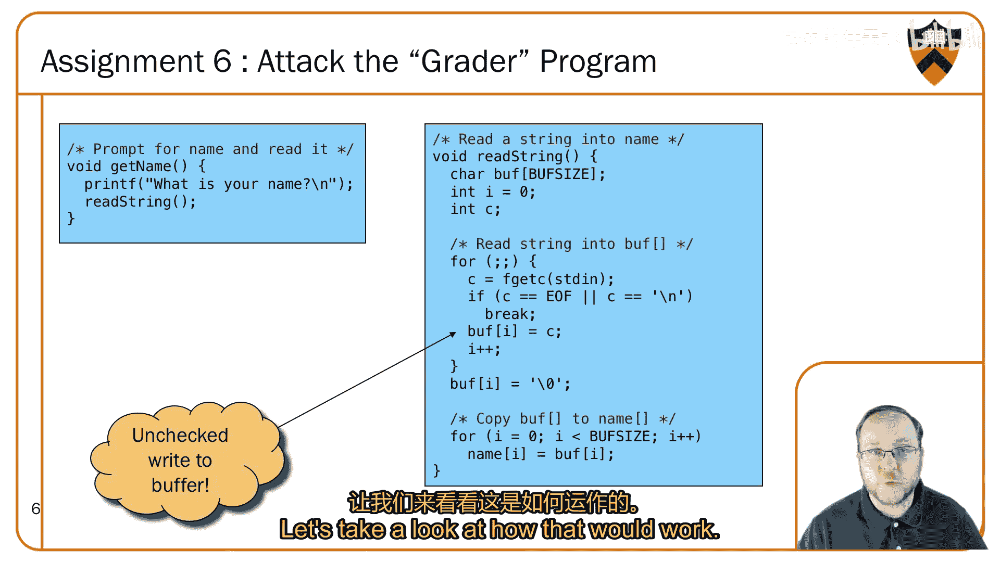
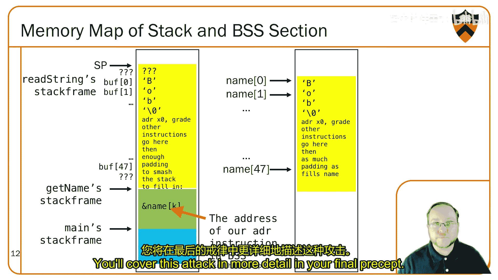
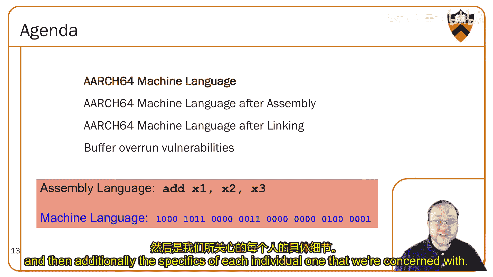
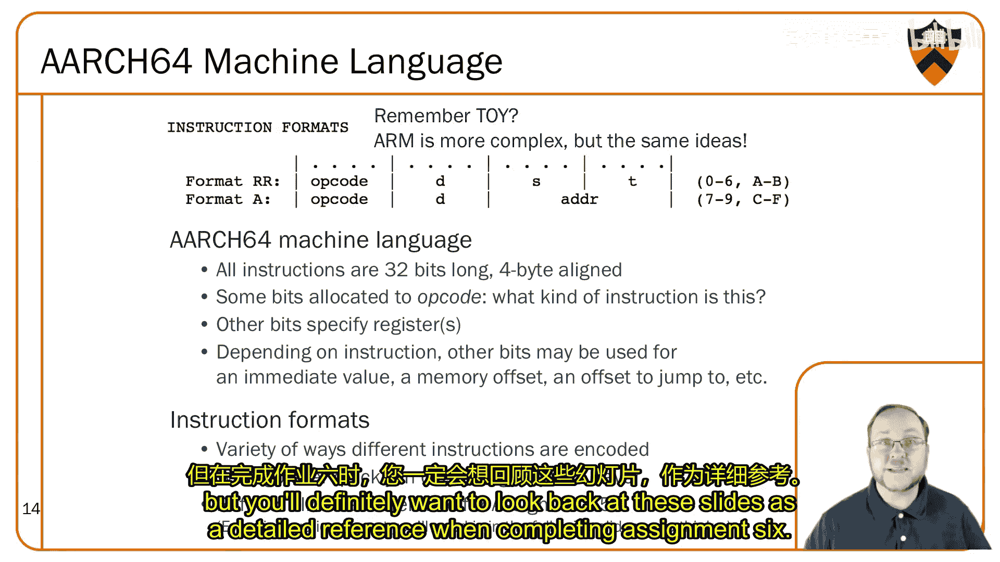
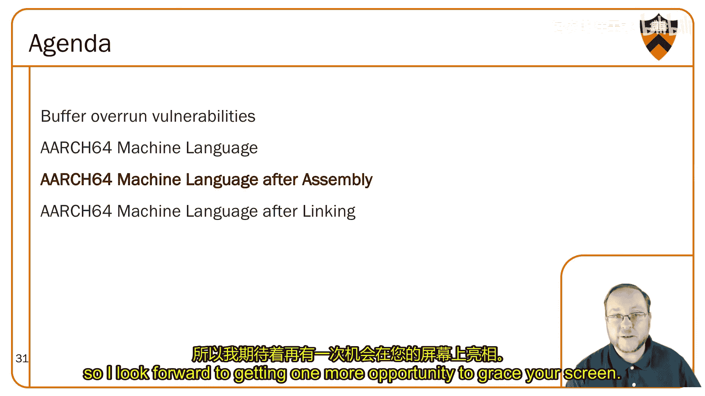

# 【全集 秋季版】普林斯顿大学 C语言系统编程 中英字幕 p28 Lecture 28 - 汇编器 -BV1u1feBoEsK_p28-

Welcome back to Cot 217 lecture In the final two lectures of this course。

 we're finishing out our downward language level tour with a foray into machine language。😊。

We do so with three motivations in mind。Now that we've seen assembly language。

 which we know has a direct correspondence to the instructions run by the processor。That's good。

 but we're still left to bitten the dark as to how it works。

So learning about machine language can connect the dots from assembly language。

 which is still human readable， at least for us now。

 to the actual bits that the hardware sees and interprets as instructions。Second。

 as noted in the last lecture， assignment 6 is A and a plus attacks require that you write some machine language of your own。

 not necessarily a lot。 And with a fair bit of scaffolding。

 But you have to know enough about arm instructions in machine language to make use of that scaffolding to build yourself a miniature version of an asmbler。

And finally， we get to remove one more lie。 call it a convenient oversimplification if you don't like the word lie。

That you've been dealing with since the beginning of your computer science education and one that we've been percolating down throughout our C and assembly language coverage。

 that can finally go away as we dive into exactly what the assembler and linker do at the bit level。

😊，We'll address the first two of these motivations today。 First。

 we'll talk about machine code at a high level。 Then we'll see how it comes into play with the A attack and then finish up with a lot of arm specifics that you can use as reference in constructing your attacks。

We've seen that high level languages can be extremely portable。

 and even ones known to be less portable， like C are still largely portable at the lower levels。

 though， this doesn't hold at all。 We saw this at the assembly language level。

 but it is at least as big an issue at the machine code level。

One can think of assembly language as just a one to one mapping from assembly instructions into machine language instructions。

So while impractical， one could at least imagine mapping many or even most of the assembly instructions onto the machine languages for different architectures。

Think of it as a sort of extension of what already happens with the same assembly language being used for different specific processors within the same architecture family。

But I struggle to even think about what it would mean to have completely different architectures share the exact same set of bits defining each of the instructions in their respective machine languages。

 This doesn't make any sense to me。That means that this portability of high level languages requires someone else to have done the careful translation of the higher level language into the system appropriate lower level language。

We've been relying on this assumption throughout the four stage build process that we've seen virtually this entire course。

 As a reminder， the four stage build process， we have initially the preproces。

 which brings in declarations from a header file， fills in macro replacements and throw back to assignment 1 decomments。

Then there's the compiler。 It translates from C to assembly language。 We've now done this by hand。

 but obviously， there's a lot more to it。That's about all we're going to say for these first two stages。

 But if you're interested， Co 320 is a departmental that allows you to build a compiler of your own and deal with all of those gory details。

In this course， though， we do still have a little bit of material to cover about the assembling and linking process。

The assembler translates from assembly language into machine language based on knowledge of the correct mapping from the assembly language to the machine language for each instruction in the instruction set。

And finally， the linker resolves all of the unfulfilled references within the program and brings external code from libraries and pieces together the final executable。

😊，It reads a combination of machine language generated by the assembbller and certain asssembler produce directives that help the linker do its job。

Today we'll talk about translating simple instructions into machine language。

 and next time we'll talk about how the assembler prepares for the linker and then the role of the linker itself。

You may be asking yourself， even argue and know that I buy why we're doing assembly language。

 Why would I care about the bit level details of machine language。 Well。

 let me flash back to this slide from the last lecture。

We covered this idea of jumping elsewhere in the text section last time。

 Now we can think about the so called much， much worse alternative。

 if we can inject executable code into the data of our program and then jump to the location that we've injected it。

 we will cause the program to run our own custom instructions。

Recall assignment 6 built around the greater program that fails to detect this right out of bounds and is thus susceptible to a buffer overrun attack in the B attack。

 We didn't care what we put in the buffer array。 After our name。

 we just wanted to complete the stack smash to get down to get named stack frame and correct its stored return address so that we could return a different location。

 returned to a different location in Maine from where it was called。In the A attack， though。

 while we're still going to write off of the end of buff and get into get named stack。

 we're going to do a more complicated attack。Notice that after we get to EOF and or read a new line character。

 Read string copies the values that were read in the local Buff into the name buffer in the BSS section。

That means that， as suggested on that last much， much， much， much， much worse possibility slide。

 if we write instructions into the buff array， they'll get copied into the B， S S section for us。

 And then once they're there。Instead of overr get names return value with someplace in Maine。

 we can have it branch to the name array in the BS S section where those instructions have been injected and start executing them there。

 Let's take a look at how that would work。

Let's look closely at the stack and BS S sections for the A attack。 Again。

 I won't provide the full details with memory addresses or what goes where on the stack because you'll be determining those as you fill in your memory map。

 but this should give you the idea of the principles of operation of the A attack。Initially。

 when we enter into Read stringing， here are the contents of memory。

The B array in Read string is a local variable， it wasn't given an initialization。

 so the contents are just whatever bits happen to be in memory there already。

In the global name array， though， all the bits are zero since it's in BSS。First off。

 you will need to enter your name into the program so that eventually way back in Maine at the very last print。

 it will Thank you by name like it's supposed to。If we weren't trying to attack the program。

 you'd then just hit enter at the end of this line or close the input stream so that the program's call to FGt C would return to EOF。

And then the function would fill in the nullbte after your name for you。

But we don't want to end the loop， so we can't do that。But if we don't put a nullbte。

 then the very last print will print beyond the net the end of our name。 So after our name。

 we have to actually also enter a nullbite to terminate the name string。

 even though we are not terminating the loop。Now， with that mundane portion of our input complete。

 we can inject our attack code instructions into the program by entering them after our name so that they get copied over into the BSS section after everything is read in。

But what attack instructions are those？Our principle of attack for getting an A is going to be as follows。

 Store the character A into the memory location that holds the grade variable。

 This will require three pieces， getting the character A into a register。

 getting the address of the grade variable and then doing the store from that register where we put the a into the memory location referenced by the the the register where we put the address。

Then the last step will be to branch back into Maine to just after the call to get named。

We can't just return there because we can't use the red instruction。

The X 30 value that that get name would have had， we overrote in order to get to these instructions in the BS S section in the first place。

 So we're going to have to do a branch to get back into main。

But now with our name written and nuinated and with a solid plan of what our attack code instructions are going to be。

 we can inject those instructions。For example， here we have the。

The arm instruction defined the address of the grade variable in the program's data section of memory。

We need to put that instruction into Buff after our name and the trailing nullbite。

But we could just write an A and then a D and then an R and then a space For one thing。

 there won't be nearly enough room in the BSS array for all the instructions we need。

But more importantly， these are ASciI characters that are a representation of the instruction in assembly language。

 That's not how executable code is represented in a program。So to pull off this attack。

 we need to know what the machine language instruction corresponding to each of these assembly instructions looks like bit by bit。

And that will be the focus of the second half of this lecture。 But before we get there。

 let's just finish off the operation of the A attack。

So we write the rest of the instructions to change the grade in Buff in Read string stack frame。Now。

 we redo the steps from the B attack。 We fill out the rest of the buff array with arbitrary data until we write off the end of buff。

 and then eventually out of reads readed string's stack frame entirely。

And then eventually overwrite the stored x30 value in get name stack frame。

Where we will overwrite it not only with an address in the text section。But instead。

 with the address where the first of our injected instructions will be stored。They're not there yet。

 but they will be copied over into the BSS section， and we know where they'll be so we can。

 we can know that address a priori。So finally， the Read string F get C returns EOF。

 we've filled the buff with our name， a Nollbyte， the attack instructions。

 and enough padding to write into get named stack frame where we have written the address and the ADR instruction will be copied。

So now we just have to actually do that， get the data from the stack to the BSS。

And that's actually taking Karen。Taking care of Flors by the second loop。

 which copies exactly 48 bytes from buff to name。At this point。

 Reed stringing returns to where it got called from， getname。

And the call to read string in is the last thing in getname。 So it's done too。

 getname restores x 30 from its stack and returns。But because of what we've done instead of returning back to Maine。

 the program counter gets set to the name array in the BSS section。

 where we begin to execute our injected code and earn RA A。

You'll cover this attack in more detail in your final precept。

So now let's turn to the details of arm machine code。

We know what the assembly instructions look like。 We can now read them in English just at a glance。

 Add X1 x2 x3 is add the contents of 64 bit registers， x2 and x3 and stored the result in x1。

And here's what the corresponding machine language instruction looks like。

But it's not at all apparent， Not at all human readable。It must， we know。

 contain the encoding of the verb in each of the nouns， if you will。

But even with intense inspection without substantial documentation， we can't make much of this。

 We could try to guess like， hey， I see a one at the very， very end。

 Maybe that's corresponding to X 1。As it ends up， it is， but it was nothing but a lucky guess。

 So we'll need to learn the overall structure of machine language instructions。

 And then additionally， the specifics of each individual one that we're concerned with。

Let's start off with the farmer。 What pieces are part of a machine language instruction。Well。

 let's think back to our old friend toy。All instructions were the same size， four hexets or 16 bits。

But we did have multiple different formats for instructions。

 Each one had an op code which indicated the operation was this is the verb， if you will。

But some had two source registers and one destination register。 These were the nouns。

 Others had a different set of nouns， an address or an immediate value to go with the destination register。

 So we have multiple different formats。 Arm is going to look similar in some respects。

All instructions are 32 bits long， this is an advantage of the risk architecture。

 but there are a variety of different instruction formats。

All of the instructions are stored in places in memory that have an address of a multiple of four that's a requirement of the hardware。

 This is to promote hardware simplicity， but also for reasons we'll see later that involve trying to get as much data into each instruction as we can。

And each will have an up code and then bits identifying the registers， the memory offsets。

 the immediate values， et cea。 So it's actually a very similar principle to what we've seen in toy。

So the rest of this lecture is going to fly through a bunch of examples of these。

 but you'll definitely want to look back at these slides as a detailed reference when completing assignment 6。

All right， so since all arm instructions are 32 B， we can be consistent about identifying them。

 We'll start out with the least significant bit and index from 0。 So on the right here is bit 0。

 While the most significant bit on the left is bit 31。Of course。

 even though we've ordered the bits from most to least significant here on the slide。

 the bite order in memory is still little Indian。Before we start our breakdown of the instruction。

 though， we need at least one more vocabulary term， operation group。

This is a grouping of op codes that shares a common bond。 For instance。

 branch instructions or three registered data processing instructions。

The operation group is encoded in bits 25 through 28。 The red ones on the slide。 But as you can see。

 as indicated by the x's for each group in the list， every operation group identifier。

Does't necessarily use each of these bits。When those bits are not used for the identifier of the up group。

 they are typically repurposed， often for the detailed up code。

We'll take each of these operation groups in turn， seeing one or more examples of each that might be relevant to you in assignment 6。

So our first op group will be the data processing instructions with three registers。

 we'll need the verb， the up code。That's put as an extension beyond the operation group。

1 to the right in Bi 24， and additionally over there on the left in bit 30。

We'll also need three nouns， the first source register represented here in green。

 the second source register， which is an orange and the destination register， the blue bits。

Note that each of these registers is allocated five bits as the identifier。

 This is the perfect amount to uniquely identify 32 registers， count 0 through 31。Conveniently。

 we have 31 registers count 0 through 30， encoded as their own number in binary。

 We also sometimes use either the0 register X， Z R or the stack pointer register S P in our instructions。

 And so when we do that， those get encoded as 31。We also need to specify whether these registers are W or X registers。

 so that's the most significant bit， bit 31 here。And we can also specify whether the instruction should modify P states。

 N， Zc and V condition flags， that's bit29。So let's look at a concrete example。

 the add instruction from the motivation slide three slides ago。So our verb now is explicitly add。

 not just an operation doing data processing on two registers， putting the result in a third。 No。

 we're doing add。 That means that we're able to fill in bits 24，28 and 30。

 as well as the operation group。😊，So these are the  Burgundy bits。

 they are the operation group extended to the upcode。And our nouns are now explicit， too。

 The green bits 0，0，0，1，0。 We see that's number 2 in binary。

 So that represents Reg 2 as the first source。 The orange bit 0，0，0，1，1， That's 3。

 So register 3 is the second source。 And the blue bits，4，0 and a1。 That's 1。

 So register 1 is the destination。😊，The pink bit at the far left is a one indicating these are x2。

 x3， and x1， not W2， W3 and W1。And this is add， not add S。 So the can bit 29 is0。

That's all the info we need， all the remaining bits here are zero。So take some time， pause the slide。

 if you will， and see how we can break the 32 bits down into separate fields。

 each filled in to encode a piece of information that we already know about the assembly instruction。

If this example is overwhelming， look back again over it until you do。

 you can go back to the previous slide with the overall opcode and operation group and then come back to this one for the concrete example。

 examples that come after all build on this same sort of structure and format。

 so it would be foolhardy to rush into them without a really solid grounding where you can understand what's on these slides。

Okay， so our second op group will be data processing that has a destination register and then either a source registered in an immediate or just an immediate。

 The two varieties will have slightly different formats to fit these， these variants。

So our op code in  Burgundy again spreads out beyond the core op group bits。

 The most significant bit in pink over on the left indicates whether we're dealing with Ws or X's。

 same thing as before。In one of these， the cN bit 29 is there to distinguish whether to set condition flags or not。

 but it doesn't actually exist， there is no S variant in the other one。

The destination is still the five least significant bits。 this is a recurring theme。

 most operations will try to share a similar structure which simplifies the hardware that has to interpret these instructions。

But now， whereas5 bits were enough to indicate all of our registers of note。

We need a lot more bits to indicate an immediate value of any reasonable size Here we'll use 12 to 16 Bs for the immediate value。

 which is a much more considerable range， though still not that big。2 to the 10 is 1024。

 so2 to the 12 is 4096 and  two is 16 is only 64K。So again。

 let's see a concrete example this time one for each of the two variants。

Our verb is now explicitly subs， not just an operation that does data processing on a register and immediate。

 That means we're able to fill in bits 24 and 28 and 30， as well as the operation group。😊。

So those are the  Burgundy bits。And our nouns， again， are now explicit。 This is the first variant。

 We have a source register。 So we look at the green bits，0，0，0，1，0。

 We see that's the number  two in binary， representing R 2 as as the first source。

 The orange bits interpreted in binary represent a1 in the places 2，8 and 32。

 So that's 42 in decimal。😊，The blue bits， all zeros and then a one， that's one。

 so Reg  one is the destination。The pink bit on the far left indicates that registerister2 and Register1 here are W2 and W1。

 not their longer X versions。And this is subs， not just sub S， so c is the can bit bit 29 is 1。嗯。

So again， now we've reached all of the information that we need， this is subS， it's on W registers。

 it has a register one is' the destination， it comes from register 2 with an immediate value of 42。

Here's the second variant of data processing within an immediate。

 this time only with an immediate source and a destination register。

Here we have a few more bits dedicated to the upcode。Even with the reduced instruction set。

 there's still quite a few different operations that we have to be able to specify。

 But beyond the verb， we actually only have two nouns now， the immediate value and the register。

 So let's take a look at the immediate first， since that's what's expanded。

The orange bits interpreted in binary have a lot more leading zero。

 so they could represent a much bigger immediate if we wanted them to。 But in this case。

 we still only have bits for the the two's place， the eighths place and 32's place turned on。

 So those are still the the offset 42， the immediate value 42。

The blue bits are still register one as the destination。

 and we still need to specify whether it's W or x as a register。

 so now we've decided that this is a bit that has a1 bit， so it's X。

So next we'll move on to some more complicated cases that aren't as easy to interpret， but again。

 if these are still confusing to you， go ahead， pause the slide， see if you can draw it out yourself。

 take it a bit at a time and see， is this one of the bits we care about if it is， what does it mean？

So thus far， our constant values， the immediate operarans have been absolute values。 We saw 42。

 that meant 42， but consider that some literal values might be too big。 For instance。

 how could we possibly possibly put an entire arbitrary 64 B address into a 32 B instruction。

 We can't Thus， we have to work around this this constraint？

 Some instructions will use relatively values instead。

 Two different instructions in the text section are likely to be in a relatively small number of bytes apart from each other。

 Certainly not far enough apart to need 64 B to address the difference。

So addresses and numbers that are well aligned。 recall well aligned here means some multiple of a specified power of  two。

 often four or or 16。 Numb that are are well aligned require fewer bits to store if we know about this property。

To see why， consider in decimal that if I ask you to represent the number 2500 as the number of hundreds。

 you can do this with just 25， just two digits， as opposed to the four of the full 2500， because。

 you know， the trailing to digits are zeros。So our next group is branches。

 which will have an op code， a relative address， which we know must be 32 Bs long and 4 byte aligned based on what we claimed about instructions。

 If every instruction is 32 B long and 4 bys aligned， branches reference instructions。

 so it must reference something with those properties。And potentially a branch has a condition code。

We won't store the entire address because we can't we can't store an entire 64 bit address in a 32bit instruction。

 so we'll store a relative address， which should be smaller。

And we won't store the last two bits of that relative address because when we subtract two numbers that are both multiples of four。

 we know the result will be a multiple of four。So let's take a look at a few examples。First。

 the unconditional branch。The only two pieces of this instruction are the op code in burgundy。

 as usual， and the relative address bits in orange。 In this case， the orange looks gigantic。

But we interpret this as two's complement。 We can branch forward or backward。

 so a relative address can be either positive or negative。So we flip all the bits and add one。

 this turns the 24 leading ones into zeros and a trailing 11。This looks like negative 3。

 but it's not。 This is the result of right shifting the value by 2。

 So that means we have to left shift it to restore those two trailing  zeroes。 We end up with 1，1，0。

0， which is 12。But we did do the two's complement to get this value because it was negative。

 so our relative address here is negative 12。We're jumping backwards in the program。

And since each instruction is four bytes， negative 12 as an offset means jumping back three instructions。

The BL instruction， remember this is to make a function call。

 is very similar to the unconditional branch。It actually is unconditional。

 It's just that there has to be a little bit of extra encoding to specify the detail that it has to to to。

Put x 30 as the the value immediately after the call。

 So that is it has to fill in the return address for the function that it is calling。

And this means that it needs a different up code1，00，1，0，1 versus 0，0，0，10，1。

 and this is really just there to say。Okay， in one of these variants。

 I have to do something with x30 and then unconditionally jump in the other one。

 I don't have to do anything， I just unconditionally jump。So other than that， though。

 it works identically， and all of the rest of the bits other than the upcode are just the relative address rightshift two places。

The last example of a branch instruction is a conditional branch here。

 recall that we have fewer bits for the relative address because we have to use some of the bits for that condition code。

In this case， we have four bits， so there are 16 conditions that we can represent in branches。

 though not all of them are actually used， there's a B and V instruction。

 which is a mnemonic for Bra never， but here we have 1101。

 which is for L and the full table of all of the mappings from the4 bit code to the assembly language mnemonics will be in a precept handout。

 It's taken from C12 4 of the arm architecture reference manual。

 but you can just reference the precept handout for the A attack and very likely your a plus attack。

So in this instruction， we have 19 bits for the relative address。

 which works identically to how we've seen it before。 Note in this example。

 we're branching three instructions later rather than three instructions earlier。

 just for demonstration and variety。 So we didn't have to do the twos complement conversion。

 We can just take the number at face value。 but we do still have to left shift it by two bits because the addresses were multiples of four。

 and we shaved off those trailing  two zeros to make better use of the limited bits that we have in the instruction。

So the Penultums operation group that well consider our memory operations loading and storing here。

 even though we're dealing with memory， recall that our operations use registers and dereference them。

 so we don't have to store actual memory addresses in the instruction。We do， though。

 have to consider more complicated memory addressing modes。 We'll see two here。

 register immediate offsets and register register offsets where the value of the offset is stored in some other register。

And we'll see in passing a mention that the black bits of additional information are where we would store the scaled register offset mode if we were using that。

Furthermore， we also have a more complicated source and destination metadata than just X or W。

 these instructions have to differentiate between loading and storing a byte a short and int or long。

So let's look at three variants， one with a register offset。

 one with an immediate offset and one that stores only a single bite。

 That last one should perk your ears up a little bit as you try to think about writing the character A into the spot in memory where the character D initially resides in the A attack。

So I hope at this point you've become a pro at deciphering these slides。

 at least as long as I keep color coding them。But let's run through this one again in a moderate detail。

We now have two pink bits as the most significant bits on the left instead of just one。

Both are one here， so we're dealing with X registers。

We have the op code for load using the register offset addressing mode。

And then we have the first source register in green is an actual source register， so here x1。

And the second source register in orange is the offset register here， x2。

And then the destination register， as is typically the case。

 is the least significant five bits marked in blue here indicating x0。For the immediate offset。

 let's do a store for variety because there's not a whole lot of difference at first glance。

The the two pink bits indicate the size， which is either a by a short an in long。 again。

 the op code is in burggundy， and though arm does choose to use a slightly slightly shorter op code here。

 it gets an extra bit for the offset versus before offsets could be larger。

 whereas the register is always just going to be a five bit register name。

 So we want to maximize the possible size of the offset。For hardware consistency。

 we're still going to use the least significant bit for the first operaand in blue。

 But because this is a store， the semantics are flipped from most instructions。

 And so this isn't actually the destination。 It is， in fact， the source。

The green bits represent the second opera， typically we've thought of this as the source register。

 but likewise because this is a store， these are actually the destination。Here。

 armM uses 31 to represent SP since XzR0 isn't a useful memory location to offset from。

 and we will instead often offset from the stack pointer。

And that leaves the rest of the of the bits as the offset value。

 Note here that because the pink bits were 1，1， we're dealing with longs。

 So we know the address should be a multiple of 8 for good architectural alignment。 And thus。

 we can assume the address will have three trailing zeroes。 Thus。

 we can save some bits by shaving off the the three last bits in the offset right shifting by three。

But if it's stored rightshift by three to interpret it。

 we have to do the opposite and left shift by3 to restore the three leading zeroes。 Sorry。

 the three trailing zeroes。 So when we see this 1，1 value， that's really 1，1，0，0，0， which is 24。

Now let's compare the STR we just saw with STRB。The bid allocations， the colors， if you will。

 are identical。 The up code is identical， too。Its still register， plus offset。The register values。

 in fact， are also the same Storing from register 0 and storing into an offset from S P register encoding 31。

 What has changed， though， is the two pink bits。 They're now 0，0， meaning a single by。

 We saw this 3 slides back introducing the operator group，0，0 is a single by，0，1 is a short，1。

0 is an int and 1，1 is along。Since this is a single by， we don't necessarily have8 byte alignment。

 And thus， the offset is not right shifted in the instruction。 So interpret it。

 we don't shift back to the left。 We interpret it as it is to get 24。

 This means we have relatively less range of offsets by one than we did by 8。

The last instruction that we'll talk about is ADR。It has the bits 100 x like the operation group for data processing with an immediate and register。

 but it's a special case， it's distinct from that other opgroup。For an ADR。

 we might be referencing something farther away in memory。

 unlike with a branch where we're just jumping within the text section。

 except in your A And A plus attack。 So we might have a label in text or R data or data or B， S S。

 and we'd like to be able to maximize our range of our relative address。

So to get 21 bits for the relative address， but maintain where the destination and the up code go。

 we have to split up the bits。The two lower order bits are in bit 29 and 30， the mint bits here。

The 19 higher order bits of the relative address are in 20323 through 5 in orange。

 This means we're going to have to do some bitwaacking in order to interpret these instructions。

 Let's take a look。Let's try a small offset so that the numbers are easy。

 but still will' still show what we need to do。Here。

 you're familiar with the destination register as the least significant bits。 And we see the up code。

 So that leaves us with only the tricky split offset。 The orange bits， the 19 high order bits。

 the mint bits are the two low order bits。 so we can just concatenate the mint ones onto the end of the orange ones。

😊，Of course， the actual bitwise operations to accomplish this would be more involved。

 but on the slide， oh， I can concatenate it。 it's nice and easy。 when we concate 1。

0 onto the end of 11，0，0， we get 1，1，0，0，10。 That's 32 plus 16 plus 2。

We have a relative address of 50 by。So now that you've seen a few instructions that are ready to run。

 we'll be ready to go even slightly lower next time and see how instructions actually get constructed by the asmbler and then fixed up by the linker。

In this lecture we've seen a bunch of relative addresses and offsets what happens when those addresses aren't known at aem time。

 for instance they're an external library。That hasn't been linked yet。

 or maybe they're in a different section of memory that we don't know the address of yet。

That's all next time to finish up the concept baked into your miniassembler implementation for A and A+ attacks。

And indeed， next time not only finishes off the details for assignment 6。

 but it also finishes up the course material as a whole。

 so I look forward to getting one more opportunity to grace your screen。

Until then though， keep working hard on assignment five and good luck。

