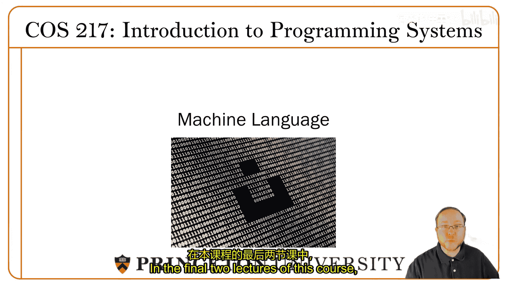
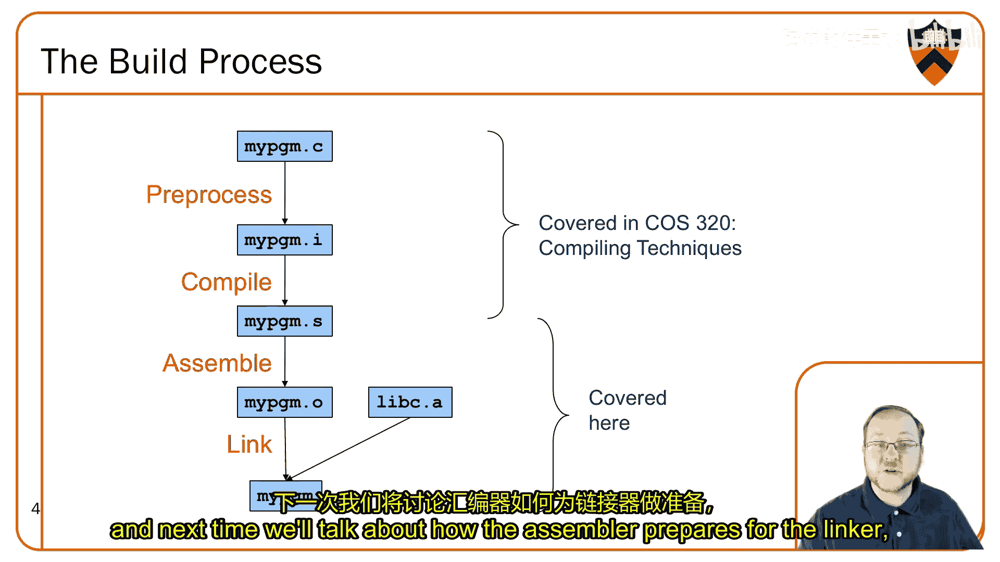
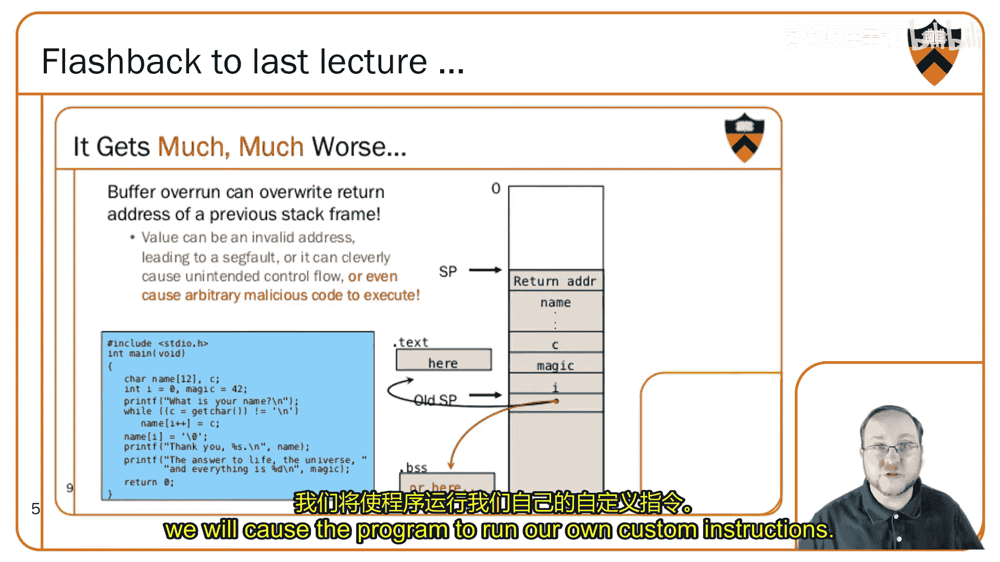
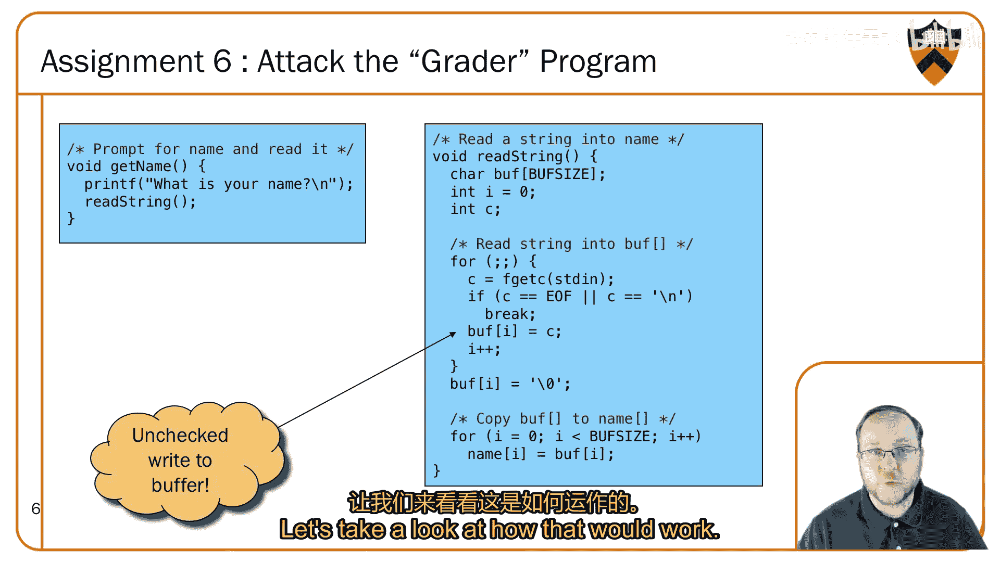
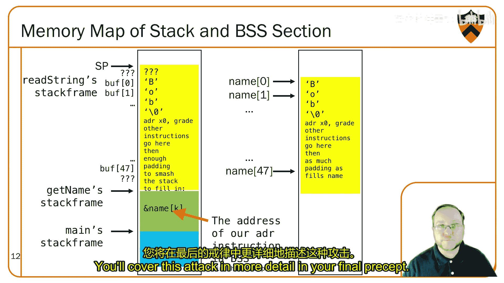
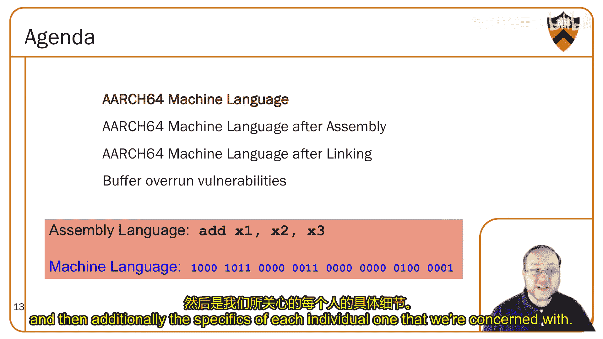
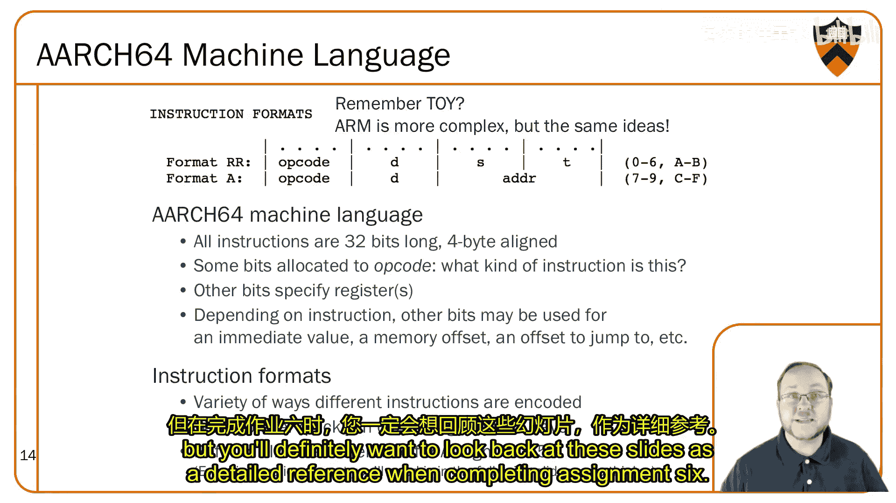
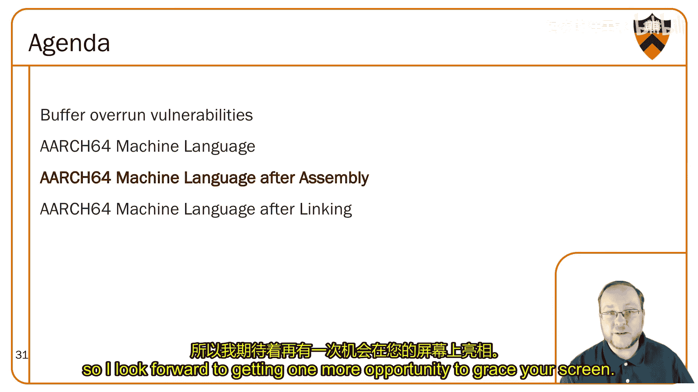

# C语言系统编程：28：汇编器与机器语言 🖥️

在本节课中，我们将学习机器语言的基础知识，了解汇编器如何将汇编指令翻译成处理器能直接执行的二进制代码。这对于理解计算机底层工作原理以及完成课程作业至关重要。

上一节我们探讨了汇编语言，知道它与处理器执行的指令有直接对应关系。本节中我们来看看机器语言，它是连接人类可读的汇编语言与硬件实际执行的比特位之间的桥梁。

## 动机与背景

我们学习机器语言有三个主要动机：
1.  连接汇编语言与硬件：理解汇编指令如何被编码成具体的比特序列，从而被硬件解释和执行。
2.  完成课程作业：作业6（A和A+攻击）要求你编写一些机器语言代码，你需要了解ARM指令的机器语言编码才能利用提供的框架构建一个微型汇编器。
3.  揭示底层细节：我们将深入探究汇编器和链接器在比特层面的具体工作，消除之前为了简化而引入的一些概念。

高级语言具有很好的可移植性，但这种可移植性依赖于编译器、汇编器和链接器将高级语言代码翻译成适合特定系统的低级语言代码。我们一直依赖的四阶段构建过程如下：
*   **预处理器**：处理头文件、宏替换和注释。
*   **编译器**：将C语言翻译成汇编语言。
*   **汇编器**：将汇编语言翻译成机器语言。
*   **链接器**：解析程序中未解决的引用，合并外部库代码，生成最终可执行文件。

今天我们将重点讨论汇编器的工作，即如何将简单的汇编指令翻译成机器语言。

## A攻击原理回顾

在B攻击中，我们通过缓冲区溢出修改了返回地址。在A攻击中，我们将执行更复杂的操作：向程序中注入可执行代码。

以下是A攻击的核心步骤：
1.  **注入代码**：我们将攻击指令（机器码）作为“名字”的一部分输入。`read_string`函数会将这些指令从栈上的缓冲区复制到BSS段的`name`数组中。
2.  **覆盖返回地址**：像B攻击一样，我们溢出缓冲区，覆盖`get_name`函数的返回地址。但这次，我们将其覆盖为BSS段中`name`数组（即我们注入的代码）的起始地址。
3.  **执行注入代码**：当`get_name`函数返回时，程序将跳转到我们注入的代码处开始执行。这些代码的任务是将字符 `‘A’` 写入存储成绩变量的内存位置，然后跳转回`main`函数继续执行。

为了实现这个攻击，我们需要知道每条汇编指令对应的机器语言是什么样子。

## ARM机器语言详解

所有ARM指令都是32位长，并且存储在4字节对齐的内存地址中。每条指令都包含操作码（动词）和操作数（名词，如寄存器、立即数、内存偏移量等）的编码。

我们按位来标识指令，从最低有效位（最右边）的位0到最高有效位（最左边）的位31。指令格式根据“操作组”进行分类，操作组由位25到位28的部分位标识。

以下是几个关键操作组及其指令格式的示例：

### 1. 三寄存器数据处理指令
这类指令的格式用于像 `ADD X1, X2, X3` 这样的操作。
*   **操作码**：分布在位24、28、30以及操作组标识位中。
*   **寄存器**：三个寄存器各用5位编码（可标识32个寄存器）。源寄存器1（绿色）、源寄存器2（橙色）、目的寄存器（蓝色）。
*   **其他**：位31指示使用W还是X寄存器；位29指示是否设置条件标志位（如`ADDS`中的`S`）。

**示例：`ADD X1, X2, X3`**
*   操作码字段对应 `ADD`。
*   源寄存器1（X2）编码为 `00010`（十进制2）。
*   源寄存器2（X3）编码为 `00011`（十进制3）。
*   目的寄存器（X1）编码为 `00001`（十进制1）。
*   位31为1，表示使用64位X寄存器。
*   位29为0，表示不设置条件标志（不是`ADDS`）。

### 2. 含立即数的数据处理指令
这类指令格式用于像 `SUBS W1, W2, #42` 或 `MOV X1, #42` 这样的操作。
*   有两种变体：寄存器-立即数，或仅有立即数。
*   **立即数**：使用12到16位来编码立即数值，范围有限（例如12位可表示0-4095）。
*   **寄存器**：目的寄存器（蓝色）和可能的源寄存器（绿色）各用5位编码。

**示例：`SUBS W1, W2, #42`**
*   操作码字段对应 `SUBS`。
*   源寄存器（W2）编码为 `00010`。
*   立即数42编码在橙色字段中（二进制表示为...101010，即32+8+2）。
*   目的寄存器（W1）编码为 `00001`。
*   位31为0，表示使用32位W寄存器。
*   位29为1，表示设置条件标志（是`SUBS`）。

### 3. 分支指令
这类指令用于跳转，如 `B`、`BL`、`B.EQ`。
*   **相对地址**：由于指令长度限制，存储的是相对于当前程序计数器（PC）的偏移量，而不是绝对地址。因为指令地址是4的倍数，偏移量的最后两位总是0，所以存储时会省略这两位以节省空间，使用时再左移两位恢复。
*   **条件码**：对于条件分支（如`B.EQ`），需要用4位来编码条件。

**示例：无条件分支 `B` （跳转偏移 -12）**
*   操作码字段对应 `B`。
*   橙色字段存储偏移量。假设编码值为全1...1101，经过补码转换并左移两位后，得到偏移量-12字节（即向后跳转3条指令）。

**示例：条件分支 `B.EQ` （跳转偏移 +12）**
*   操作码字段包含条件码 `EQ` 的编码。
*   橙色字段存储偏移量。假设编码值为...0011，左移两位后得到偏移量+12字节（即向前跳转3条指令）。

### 4. 内存加载/存储指令
这类指令用于读写内存，如 `LDR`、`STR`、`STRB`。
*   **寻址模式**：支持寄存器+立即数偏移、寄存器+寄存器偏移等模式。
*   **数据类型**：通过位31和位30（粉色）区分操作的数据大小：字节（00）、半字（01）、字（10）、双字（11）。
*   **偏移量处理**：对于需要对齐的数据类型（如双字需8字节对齐），偏移量在编码时会右移（除以对齐因子）以节省空间，解码时再左移恢复。

**示例：存储字节 `STRB W0, [SP, #24]`**
*   操作码字段对应 `STR` 的寄存器+立即数偏移模式。
*   粉色位为 `00`，表示字节操作。
*   源寄存器（W0）编码为 `00000`（蓝色）。
*   基址寄存器（SP）编码为 `11111`（十进制31，绿色）。
*   立即数偏移24直接编码在橙色字段中（因为字节操作不需要对齐移位）。

**示例：存储双字 `STR X0, [SP, #24]`**
*   与上例类似，但粉色位为 `11`，表示双字操作。
*   立即数偏移24在编码时会右移3位（因为8字节对齐），所以橙色字段存储的值是 `3`（24 / 8）。使用时需要左移3位恢复为24。

### 5. 加载地址指令（ADR）
`ADR` 指令用于将标签的地址加载到寄存器，其相对地址的编码方式比较特殊。
*   **相对地址拆分**：21位的相对地址被拆分成两部分：高19位存储在位23-5（橙色），低2位存储在位30-29（薄荷色）。
*   **地址计算**：需要将这两部分拼接起来，然后进行符号扩展和适当的移位，才能得到完整的相对地址。

**示例：`ADR X0, label` （相对偏移 +50）**
*   操作码字段对应 `ADR`。
*   目的寄存器（X0）编码为 `00000`。
*   假设橙色字段（高19位）为 `1100`，薄荷色字段（低2位）为 `10`。拼接后得到 `110010`（二进制），即十进制50。这就是相对于当前PC的偏移量。

## 总结与下节预告

本节课我们一起学习了机器语言的基础知识，特别是ARM指令集中几种关键指令的编码格式。我们了解了如何将人类可读的汇编指令（如 `ADD X1, X2, X3`）翻译成32位的二进制机器码，这些机器码包含了操作码、寄存器标识、立即数或偏移量等所有必要信息。这对于理解计算机底层执行机制和完成缓冲区溢出攻击作业至关重要。

然而，在汇编时，有些地址（如外部库函数或其他段的标签）可能还是未知的。下一节课，我们将探讨汇编器如何为这些未知地址生成“占位符”，以及链接器如何最终解析和修补这些地址，从而完成可执行文件的创建。这将是本课程的最后一部分内容，也将为你完成作业6的A和A+攻击画上圆满的句号。