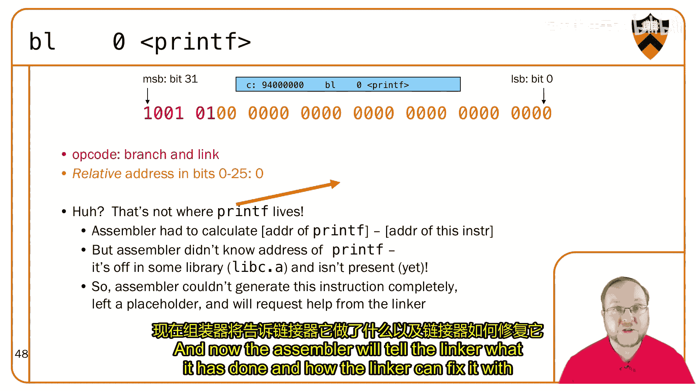
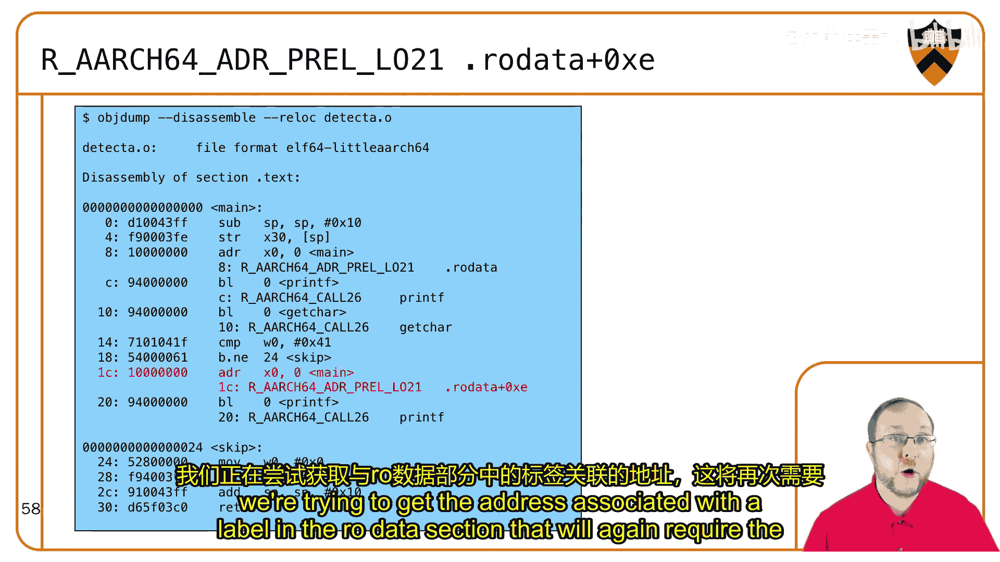
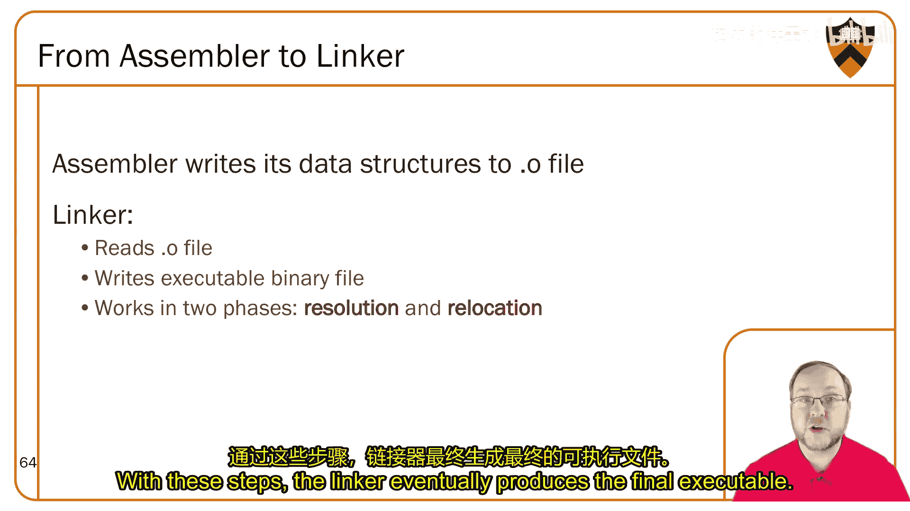
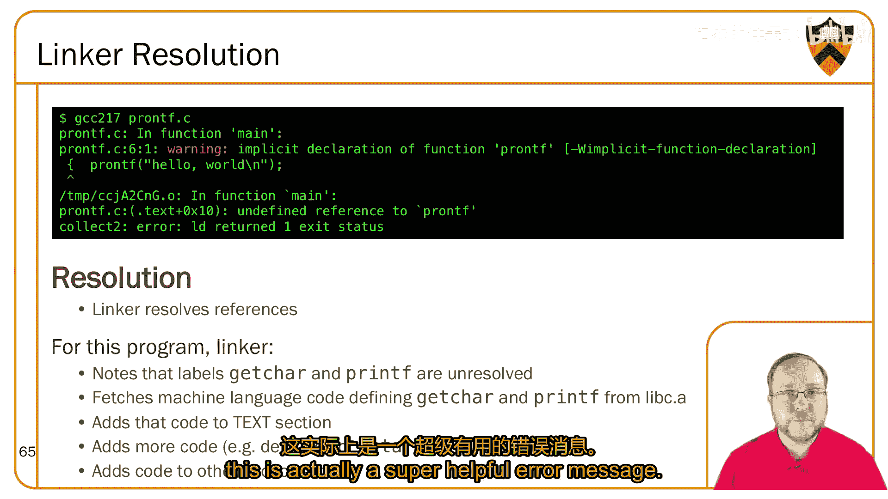
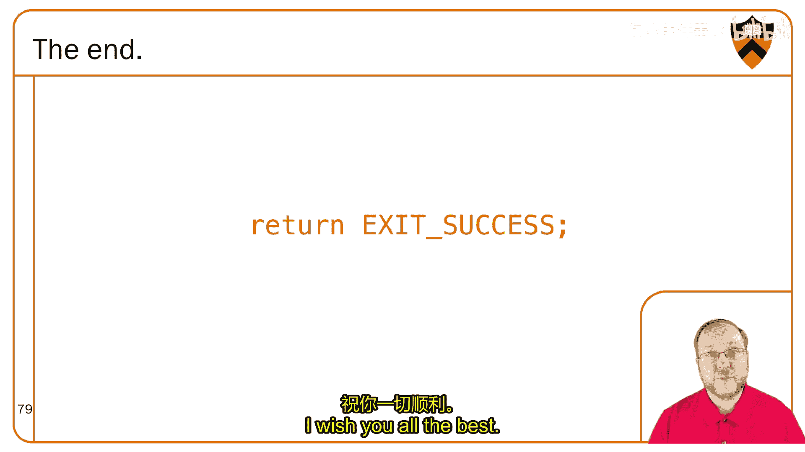

# 【全集 秋季版】普林斯顿大学 C语言系统编程 中英字幕 p29 Lecture 29 - 链接器 -BV1u1feBoEsK_p29-

Welcome back to Co 217 lecturec。This is the second half of our machine language coverage。 thus far。

 we've seen what instructions look like in machine language， but that wasn't the whole story。

 The instructions we've seen only had references to other locations that were known at assembly time。

 For example， a jump to a label that's four instructions later in the code。

That won't always happen for instance， what happens if we call a library function like printf？

We know from earlier in the course that this is where the linker comes in。

 but now we'll get to see how the assembler lets the linker know what it needs help with and then what the linker actually does。

To dive into this， we need a program to study。 Here's a program that prompts the user to enter a character。

 checks if that character that was entered is the capital A and prints High， if it is。

The program isn't very interesting on its face， but let's look at the assembly version。

 which references labels within our own text section。

 within another section and in the text section but contained in another file that we don't have access to at assembly time。

In the RO data section， we have the prompt string followed by the high message string。

Then we go into the text section， and after our prologue。

 we have an ADR of one of those strings and then a call to printf。

 which is of course found in an external library。We also have a call to getchar。

 again found in an external library。Then there's a conditional branch that jumps to another spot in our own text section within this file。

There's another ADR referencing our RO data section and another call to Printf。After the skip label。

 there's the conventional setting of the return value， the epilogue and the Re instruction。

So now we have to answer， what does the asmbler do to generate machine language for this when it doesn't know what addresses or offsets。

Are for several of these references。We can see exactly what the the asmbler generates in a dot O file by using the Oge dump command。

 which will potentially prove useful in assignment 6。 Perhaps surprisingly。

 we don't actually see any addresses here。 We see that R O data starts at 0。 Surely。

 that's not a valid address。 And in fact， using only what we've learned in this class。

 We can prove this can't be the address。 Sting literals are what we store in R O data。

 And we can dereence them。 for example， to print them or to see what the first character is。

 Only for reading， of course。😊，But we can't de reference。 No pointers。

 and no pointers are pointers that point at the address 0。 Thus， this better not be an address。

 And indeed， it also makes sense for another reason。

 We've learned that finalizing the address of each section in the executable is the linker's job。

 But now， if you think about it， we can reason that the assembler can't do it。

Think about if you have a module like your string module or SIim table or Big Intad。

There's no way the asmbler can possibly know when creating S TRA A dot O or S table hash do O or other implementation object files。

 what clients will end up linking against them。So it can't finalize any of the addresses for things in your module because that would risk a conflict if the asmbler for the client of the module。

Put something else at that same location。So at this point， we can't have addresses。

 but we can have offsets。Displacements from other things。 in this case。

 the start of this file entries files entries in R O data。

This file's entries in R data will eventually be combined with other files R data sections。

 but they will be held together that they're contiguous。

The asmbler has enough information to know right now the type a cha is the first string in the R data section that it knows about。

 so let's call that offset zero for now。High is the second string。 It comes right after it。

 And since the prompt string has 14 characters， remembering the nullbite。

 high can start it off set 14， which is hex E。With a different set of command line arguments。

 Obdm can also show you the text section and even do the disassembly for use that you can read your previously dreaded。

 But now hopefully super comfy assembly language rather than having to read the machine language directly。

This is perhaps more useful if we have an arbitrary dot O file or instead of just a dot file built from code that we already had。

Note， though， that the machine language is there。The 8 hex digits are a compact way of representing the 32 B in the instruction。

 so you can， if you want or need， expand these out to get the full 32 B string for the instructions like we saw last lecture。

 We'll dive into the actual instructions in a second。 But first。

 let's just look around at that first column of the output by from O dumpump。

Just like with the RO data section， the assembler can't generate actual addresses for the instructions。

The reasoning is the same。 If the dot O files had addresses。

 then there would surely be conflicts that would arise。 For example。

 the assembler put some local function in detect A dot O in the same location that the asmbler way back when put printf and S T D I O。

だ。So these are just offsets。 We're counting by four because each instruction is4 bytes。

 when we have a label like main or S， it appears to have an address， but again， it's just the offset。

 So again， let's look at each of these instructions one at a time now。At offsetet zero。

 which is to say the beginning of the text section in this source file。

 we have the beginning of Ma's prologue， a subcom to make space for main stack frame。

When we expand out the hex machine code D to 1，1，0，1，1 to 0，0，0，1， and so on。

 we see each individual bit。 But， of course， you aren't expected to remember all of the components of the instruction。

 So perhaps at best。 I can hope that you'll remember the last 5 Bs or the destination register。

 And actually， yeah， that looks right。51s makes a 31。 So that's S P。😊。

It would be handy if I could pull up the formatted slides from last time， so let's do that。

Here's what a sub looks like， primarily as a reminder。

The operation group bits within the full op code or in Burgundy， the instruction width。

 whether to use 64 Bs or 32 Bs is in pink。 The determiner for whether or not this instruction sets the condition flags in P state is in Can。

The second source operan， in this case an immediate is in orange， the first source opera。

 the register SP is in green， and as noteded before the destination also register SP is in blue。

So far so good， exactly like we saw in our previous lecture。😊。

The next instruction was the second part of the prologue。

 stashing the value of x30 onto the stack so that we can recover it to be used by the reT instruction at the end。

Again， nothing new here， we're storing an8 byte value， so the width is 11。

 we're storing it until location that SP points2， not an offset， so the orange offset is0。

This is a store so the usual semantics of source and destination are flipped。

 and thus we're storing X30 in blue into the location that register SP points to in green。

The third instruction is the ADR to get the prompts address into x30 into x0 in order to pass that to printf。

But this is weird。It says main there， not message one。

Recall that ADR was a bit funky with the disconnected relative address with the more significant bits of the relative address in orange and the disconnected least significant bits in green。

But okay， let's parse it out。 The op code is normal。 The destination register is 0。

 which corresponds to x0， so that's good。But when we put together the two parts of the relative address。

 we get zero。But if it's zero bytes away from this instruction。

 doesn't that make it this instruction？But this instruction certainly isn't the prompt string。

This is， in fact， a placeholder left by the assembler because it can't finish the job right here。

 Message 1 is in R data。 This instruction is in text。

 The assembler has no idea where those two sections will go in the final executable。

 so it can't know the distance between this instruction and that label。

So it leaves leaves zeros as placeholders， and it will need to leave a message for the linker to say this is just a placeholder。

 When you figure out the location of our O data and of text。

 Can you do the do the subtraction and fill it in here， thanks。Going back to the output from Obdump。

 perhaps you've noticed that we've been ignoring a bunch of lines going so far as to gray them out on each of the slides。

 Let's look at them Now。 there are after some instructions。

 annotations that list the offset of the instruction and some other information。

These are relocation records， which are annotations that the asmbler will leave for the linker。

 Ptive calls for help， if you will。Here's our first one， it's a bit cryptic。

 we see the8 is the offset of the ADR instruction that the asmbler couldn't finish。

We see some big string that has Aar 64。 Okay， that's the name of the arm architecture。

 that makes sense。 And in ADR， which we might guess either represents the word address or corresponds to the instruction that needs fixing。

As it ends up， it will be the former。And then there's some other substr that doesn't really mean much to us。

And then we see R O data， the section that the assembler didn't have enough information about。

 But there's just too much here。 It's hard to pull together。Here's how we can decipher it。

 here's how we can look at a relocation record。Again。

 it's a plaintive plea from the asmbler to the linker。

 so let's imagine it is a sort of formal requisition order。

8 is the offset in the text section that contains the instruction that needs to be fixed once the linker figures out where it puts stuff。

R A Art 64 is， in fact， the architecture。It's asking for an address relative to this instruction that is relative to the PC。

 so P REL is a program counter relative。And that's the program counter when that instruction is going to be executed。

It notes that there's room for 21 bits and that these will be the low order bits of the relative address of this instruction。

It notes that the R data section address is the address that's needed in addition to the address of the text section to fill in what is here after all。

We could note really this is R datata plus 0 because we're not looking for the address of the R data section itself per se。

 but rather the address of message 1， which is at the zero byte offset from that section。

So this is all of the information the linker is going to need to fix up this instruction in into its final form for the executable。

That's one relocation record down four more to go。Our next instruction is the BL call to Printf。

Now that we know a little bit more about placeholder data and instructions。

 we can see just from the hex that this is going to have a placeholder in it。

 we're certainly not branching to memory location zero。

 so let's take a look and see what this placeholder is doing。Indeed， we have an op code for BL。

 then the entirety of the relative address is zero。

The assembler needs to calculate the relative address between this instruction and printf。

 but it doesn't know where printf will be。 It's often another file。Prrintf's label。

 needed to complete the relative address won't be here until the linker does its thing and gathers up all of the functions that are referenced to shove them all together into a unified text section。

So the asmbler is forced to fill in a placeholder of zero。

And now the asmbler will tell the linker what it has done and how the linker can fix it with another relocation record。

So here is that that that relocation record。 Let's dive into it again。

 Connu our play on the form of a prim androper written correspondence for consistency。

 and also because I'm really hoping that the ridiculousness of the tools running the build process。

 having this stodgy， aristocratic， Julian fellows worthy the messaging is enough to make you stick to make it stick in your mind。

So let's go step by step。C is the offset in the text section。

In this object file that contains the instruction that needs to be fixed once the text sections are finalized。

R A 64 is again， the architecture。The assembbller is asking the linker to fix the relative address in a function call。

 which consists of 26 bits。The function it needs is the address for is printf。

And it needs it in order to subtract that address from this instructions address to generate that relative address。

So again， this is all the information that the linker needs in order to fix up the instruction into its final form for the asmbler completing the asmber's work and putting it into the final executable。

So that's two relocation records down， two more to go。

 but they'll be of the same form that we've already seen。 So the hard part is behind us。

 This is a good point to stop and go back and look at these first two examples to make sure you've got it before we move on。

We turn around from calling Printf， and we immediately call getchar。 again。

 that 0 is the target of the B L portends that the asmbler can't finish the job here either。

 And it makes sense because getchar， again， is in the standard Iio Library。So again， with a BL。

 we have a 26 bit relative address that the assembler fills in with all zeros， just like for printf。

And again， the assembler will leave the requisition order for the linker。

 asking that it patch the proper 26 bit address of relative between getchar and the current instruction。

 and it will do that at offset Hex 10 wherever those two addresses end up being。

After the call to getchar， we have to figure out if we read a or not。

 We'll do a comparison between W 0 returned by getchar and an immediate value。

 A Hex 41 is the ASI code for capital A decimal 65。

Perhaps you recall from a few lectures ago that CMP is really just a convenient。

 semanally meaningful alias for subtraction that sets the conditioned flags and throws away the results。

So when we look at CMP， the op code is actually that first subs subtract with setting the flags。

 in this case it's subtracting an immediate。It's a W register。

 so the width is zero because it's 32 bits。The can bit 29 is a one for yes。

 the whole point of cP is to set the flags in P state。

The sources are the register 0 and the immediate value Hex 41， decimal 65。

And because setting the bits is actually all we want to do， we're happy to throw away the result。

 and so the destination register is WZR， that's the always zero register。

 which we will be we can write to with impunity， it won't change anything no matter how often we write to it。

Note that this instruction then uses 31 for WZR， as opposed to some of the others we've seen that use 31 for S。

 And as a reminder， if you ever need to check for any given instruction。

 whether the register encoding 31 is S or WzR or X Z R。

 you can go and check out the very first arm precept handout， which lists that。

The next instruction is another branch。But it's different because this time it's not calling BL on some external function。

 instead it's a conditional jump to just another spot within the text section that's defined here in this file。

In terms of the C code， it' saying， if we didn't read A， don't print I。For this instruction。

 the assembler has what it needs to complete the instruction。

It will be exactly as we saw it in the last lecture。 We know the offset of this instruction。

 and we know the offset of the skip label。It is certain that the text section instructions in this file aren't going to get sliced and diiced and rearranged among themselves in the final executable。

 they're just going to be plunked down as one of several coherent code blocks。Thus。

 the difference in offsets will also be the difference in addresses。

The assembler does the equivalent subtraction， it can subtract offsets knowing that that will be the same result as the subtraction of addresses so it can complete the instruction with no further help required from the linker。

 and thus there is no relocation record generated。Now we see another ADR。

 and again we're trying to get the address associated with a label in the RO data section。

That will again require the linker。So we ask again the linker。

 perhaps this time in the vernacular for for variety。 Hey， at offsetet 1 C。

 I can't quite finish this When you figure out where you're going to put my codes part of the R data section。

 can you add offset E to that address， Subtract it from the address you you're putting at 1 C at and then fill that in to the instruction。

Okay， thanks bye。So this is the same thing that we've seen before of how it deals with the relocation records for for data that is in RO data。

The last instruction that the asmbler needs help with is， like the previous function call。

 another B L instruction with its relative address filled in with placeholder zeros。

 pending that the linker reading the corresponding relocation record and finishing the job with Prif's address。

 This will be exactly the same as we saw with the last two Bls。😊，So in light of that。

 can you pause the video here to translate this relocation record。

 as shown on the slide into a note from the assembler to the linker。As we've seen before。

 the BL leaves 26 bits for the relative address empty and asks the linker to fill in the relative addresses between wherever it put Prif and wherever this instruction is。

We finish off with four more instructions， all of which the assembler can handle by itself。

Don't get scared of all of those zeros and instruction at offsetet 24。The sorry at hex 24。

 it is not placeholder data， it's just that we're dealing with Reg zero and an immediate value zero。

For further practice， though， you could in principle。

 do exact breakdowns of what we've been doing in these slides and look at every single one of these hex values and make sure you understand what every bit in those hex values corresponds to in this instruction。

All right， so that finishes off the assembler now on to the linker， which now。

 in addition to all the jobs we knew it had to do。It has even more， namely。

 it has to deal with relocation record requests from the asmbler。

The linker takes as its input all of the do0 files created by the assembler for all of the files in the program and combines them together。

The linker has two phases while considering the merge data from the dotO files， first is resolution。

Which involves resolving references。 The second is relocation。

 which involves moving code around as needed and then fixing the instructions to have actual relative addresses。

 not just offsets。With these steps， the linker eventually produces the final executable。

In the resolution section， where we'll be resolving references。

 Let's think about one specific example of doing so。

 The linker will notice some B L instructions have a reference to a label that doesn't exist in any of the files provided。

for instance， getcharA or printf。It will fix this by going out to Libs C do A。

 which is just a big archive file made by the AR tool。 It's like a tarr file。

 except there's noy directory structure， and it will find the corresponding standard library do O file that contains the functions machine code。

 and then it will add that machine code into its combined text section。If it doesn't find it。

 that's where you get the not all that friendly linker errors。 as shown on the screen here。 L D。

 the Ganu Lier， return an exit status to collect 2， which is Gcc's linker utility。

 And the error message may be gruff， but I think it's actually really useful。

 It gives us all the information we want to know。 The file name where there's a problem。

 In this case， frontntf dot C， The function name where the code exists。 that is the problem。 main。

The offset hex 1，0 beyond the start of the text section and the symbol itself that was undefined Prontf。

 All of these are printed in the error message。 So I think that even though it's gruff and it's intimidating at first when you see this and you don't understand what L D or what collect two are。

It actually shows us a lot， and now that you know a little bit more。

 this is actually a super helpful error message。

The second linker phase is relocation。 with two jobs。 First， it moves code around because， after all。

 your text section started at offset 0 and Lib C's text section started at offset 0。

 but only one of you can actually be at offset 0 from the beginning of our unified final text section。

And then once things are in place。At this point， we know the final addresses。

The linker has to go through and fill in the missing numbers for the relative addresses that in the text section or the R data section。

 to the new addresses in the text section into these instructions that had placeholders in them。

Once it's done for all of the object files and for all of the memory sections。

 it packages up all of this together into the Linux executable file format and completes its work。

So just as we could use Ob dump to look at object files contents。

 we can also use it to look at the final executable。 And when we do， we see actual addresses。

 for example， starting at Hex 400，710， not offsets from the beginning of the R data section。

 which was starting at 0。Similarly， we can also use it to look at the text section in the final executable。

 and when we do， we again see actual addresses In our assembly code。

 Sip was 9 instructions beyond main at 4 bys per instruction。 that's 36 byte or hex 24， Hex 24。

We saw that。What this one， they were both offset。 Main was offset 0， and skipkip was offset Hex 2，4。

Now， we have full addresses for main and a full address for S。

 but their relative positioning is preserved。 The address for S is still hex2，4 higher，4，0，0，6，7。

4 versus 4，0，0，6，5，0。😊，There's also additional code beyond the code that we wrote。 Why is that？

While we already talked about how the linker will have dragged in the machine code for print A and forgetchar。

 It will also have given us some code for underscore Stark that calls main in the beginning of the program and assorted other functions of the C runtime framework。

So now， having seen what is there， we should also point out what isn't Now there are no relocation records left。

Alas， this means that Firestone Library will not be able to display the love notes from the asmbler sent to the linker。

Emily Hale is set。We look at the ADR and we see an absolute address and a note that this is message 1。

 we look at the BL and we see the actual address and the assembly code and note that this is printf。

We're looking good。But let's dive into the machine code one more last time。

 just to see the final results of the instructions that required all of this extra work。First。

 for an ADR instruction to get the address of a string in the RO data section。

We now know that the current instructions address visible here。

And we saw a few slides back that message1， the first real data in the RO data section was 400720。

We can do the math and get that the former is C8 after the letter。Does the instruction match。

 we do the concatenation of the green onto the orange， and indeed the relative address is C8。

Similarly for BL， the assembly for the instruction lists an actual location in the new combined text section。

We see this gigantic set of leading ones in the relative address。But remember。

 this is two's complement。 So it's just a negative number。 It's the negative of 1，0，1，1，1，1，1。

But also， remember that to shift left by 2 Bs， to restore the two Bs we chopped off because we could due to the alignment guarantee。

 So this is actually the negative 1，0，1，1，1，1，1，0，0。

Negative means the location we're jumping to is before the current instruction。

 this number is hex 17 C bytes， so this is indeed what the subtraction 40，0。

65 c minus 4004 E0 would give us。1，7 C by difference。

The rest of the instructions are more of the same。 We no longer have offsets。 We have addresses。

 and we no longer have placeholder data and relocation records。 We have fully flged。

 ready to run instructions。So this finally closes the book on the four stage build process that we've been talking about since some of our first class meetings。

And with a thorough understanding of what's going on at the machine code level。

 you're now ready to go off and write the miniassembler portion of assignment 6 in order to generate the machine code for the assembly statements that you want to inject into the greater program for the a and A plus attacks。

😊，By completing machine code， this also completes our language level tour， and with it Co217 itself。

So now we move on to the end game of the course。Assignment 6 is available。

 You're able to work on it with partners as you've been able to for the last few assignments。

 and we really do encourage you to work with partners as we've been grading it's。😊。

Obvious and evident that partnerships tend to produce much better results than working alone。

So assignment 6 is due at 5 pm Eastern on Dean's State， if you do have a late day left。

 you can take it， but it will only buy you until midnight， 1159 on Dean State。

 it won't give you the full 24 hours， but on the other hand it doesn't gain you anything to not use it either there is no benefit to having leftover late days。

Beyond Dean's state， of course， university policy requires the intervention of your Res College Dean or director of studiesies in order to make further accommodations by the course staff。

All right， so I think the nearly three quarterss of you for participating in the survey about our exam schedule。

 it came out remarkably close to an even split， something like 31，3336 the last time that I saw it。

 So given that parody， we've chosen to split the difference and go with the middle option of one study day after Dean's date and then a three day exam period that takes us up to the university deadline for take home exams we'll have extensive office hours over reading period and especially on that study day after Dean's date and we'll announce the exact schedule for that on Ed in the coming days。

So taking a look back at this course， it's quite broad。

 its's intent on having you become a more mature programmer in preparation for upper level systems and application courses that will require you to have honed this tool set is a broad mandate。

 So I hope that you feel good about yourself for having learned so much material and indeed having persevered through a remarkable Princeton experience that is an unthinkable circumstances and frankly。

 a life experience that may well defined this generation。😊。

I'm certainly in awe of your resilience and the focus shown by students in this course。

 this term in light of all of that loomingzeitgeist that's really uncomfortable in the world today。

 so I congratulate you for coming through this course successfully。I also thank you。

 This semester has been uniquely challenging， but I've had fun when the opportunity has presented itself to break through the sometimes impersonal wall of Zoom windows and really engage with students in such a way that's reminiscent of office hours in teaching in person。

 So thank you， particularly those of you who were regular attendees and active participants in watch parties in office hours for each of the course staff and in precepts for making it the most normal that it can be。

😊，In this term， I've personally learned a lot about conducting a course。

 as we've adjusted the course topic material in 2017 to better fit its purpose within the department。

 about teaching online and all the differences that entails and about perseverance。

 So I hope you can say the same of your own accord that you learned a lot that you manage to have some fun。

 despite the conditions。😊，I hope to see you on Zoom during office hours and in the final assignment and for exam prep。

So good luck with the end of assignment 5 with assignment 6 and the exam。

 I really hope that they go well for you。 I wish you all the best。

