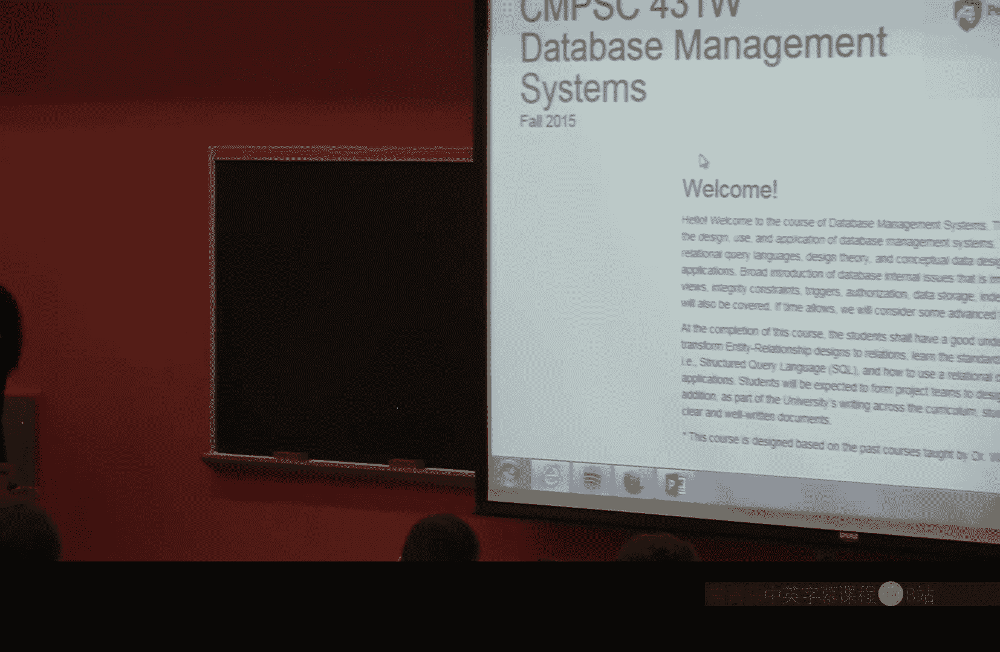
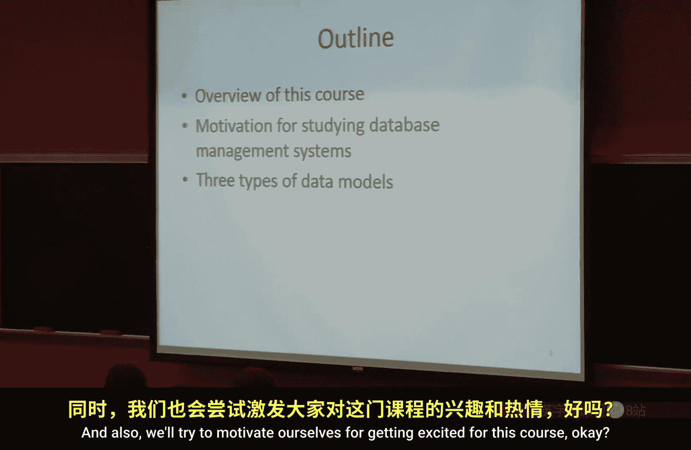
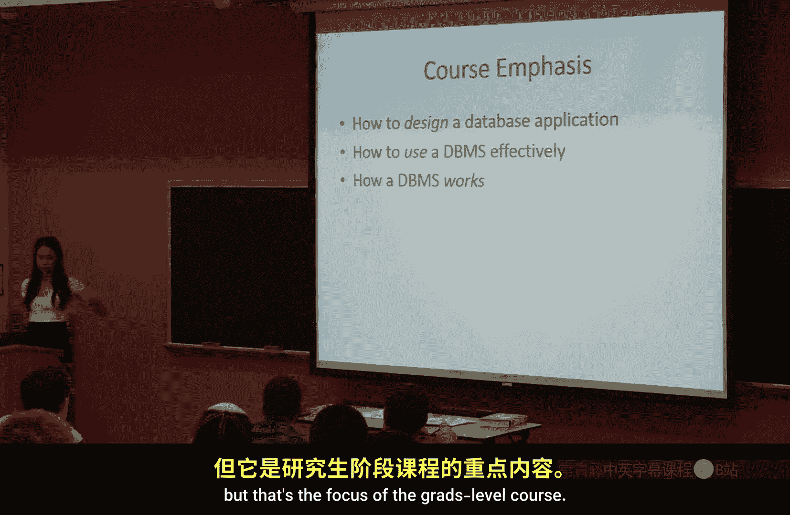
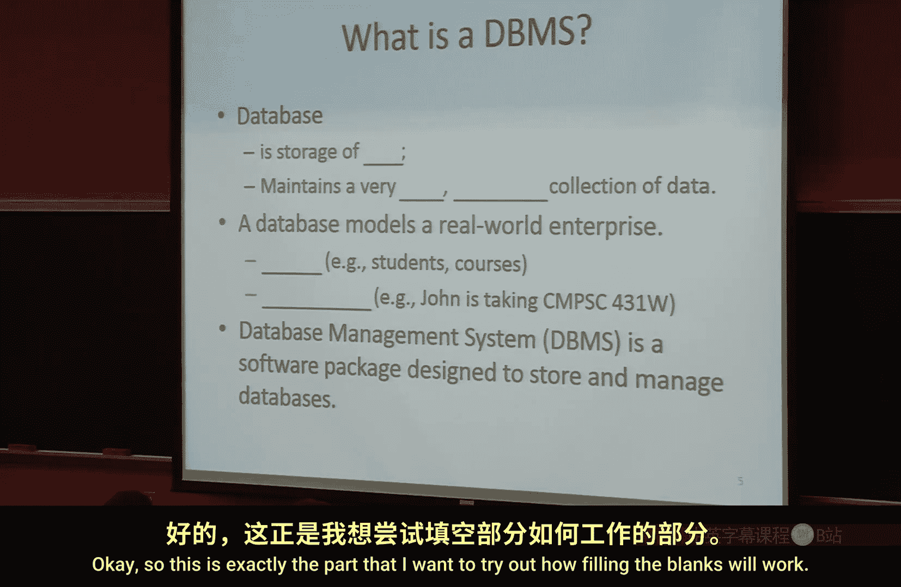
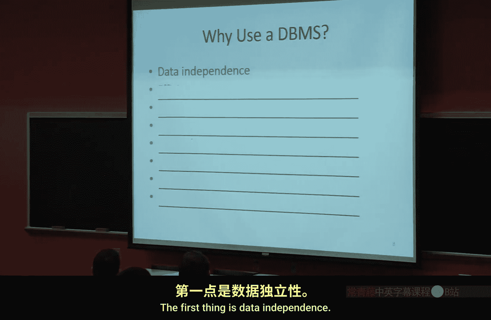
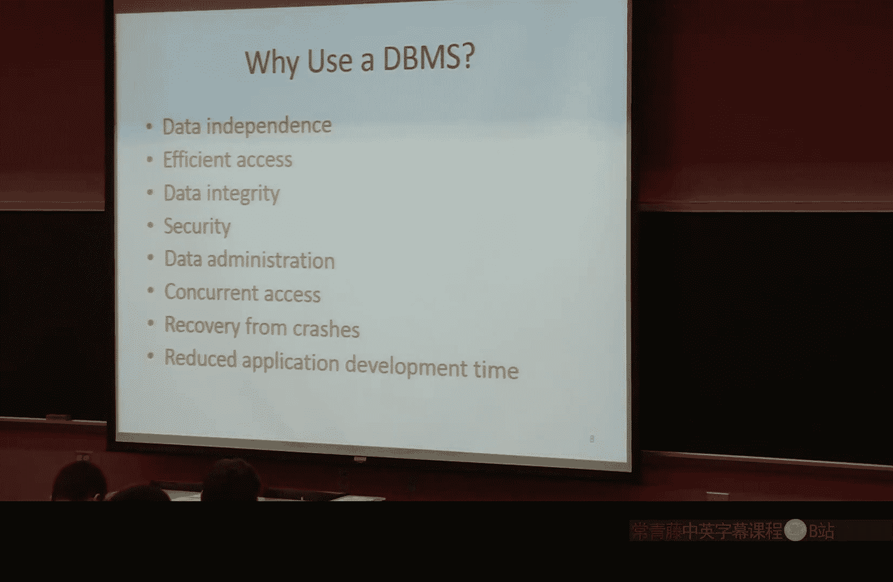
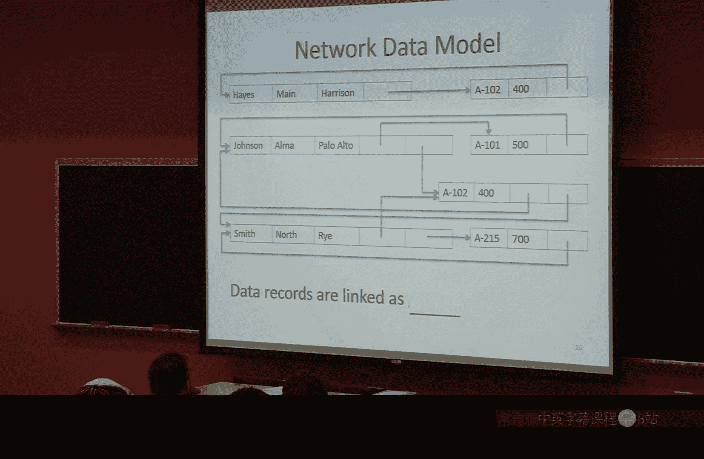
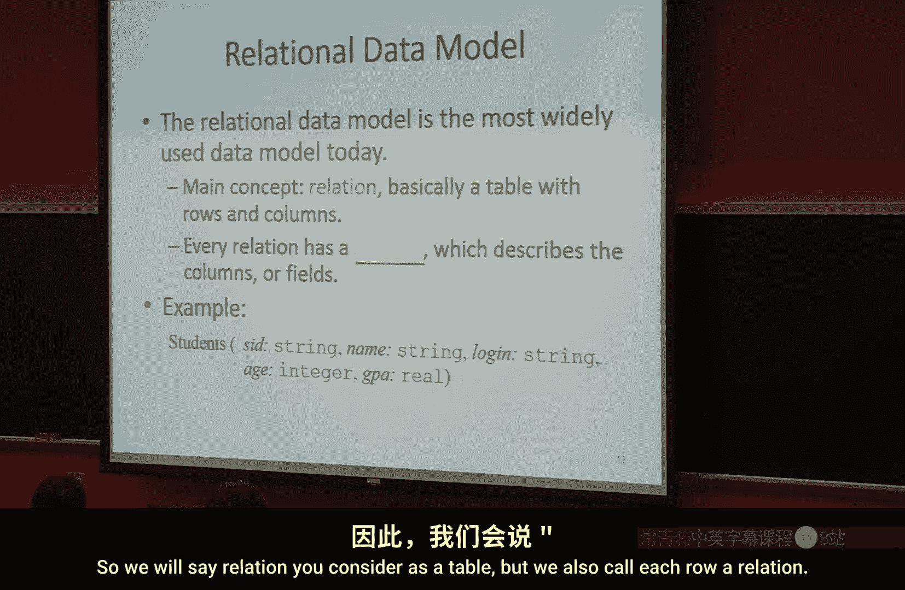

# 001：数据库管理系统导论 - 第1部分

在本节课中，我们将要学习数据库管理系统的基础概念，包括其定义、重要性、与传统文件系统的对比，以及三种主要的数据模型。课程将以概述开始，逐步深入核心概念。

## 课程概述与规则

欢迎来到数据库管理系统课程。我是本学期的讲师Yuslin，是计算机科学与工程系的博士候选人。

课程时间为每周一、三、五上午8点至8点50分。除常规课程外，期中考试将在晚间进行，项目演示也将占用额外时间。

我的办公时间为周一和周三下课后。本课程有一位学习助理（LA）Douglas Jordan，他将主要协助项目相关工作。

课程评分构成如下：
*   **考试（总计40%）**：两次期中考试各占13%，期末考试占14%。
*   **团队项目（总计35%）**：分为三个阶段，分别占5%、10%和20%。
*   **作业（总计15%）**：共六次作业，取五次最高分计入总成绩。
*   **课堂测验（总计10%）**：将进行突击测验，无故缺席者得零分。

所有作业需使用标准信纸，并在左上角装订。不接受迟交。请通过Angel系统与我或学习助理沟通。所有课程将被录制并上传至网站供复习。

## 什么是数据库与数据库管理系统

上一节我们介绍了课程的基本规则，本节中我们来看看数据库的核心定义。



**数据库**是一个存储了大量、集成化数据的仓库。它用于对现实世界中的企业或系统进行建模，主要包含两个核心组件：**实体**和**关系**。

**数据库管理系统**是一个专门用于存储和管理数据库的软件包。



## 为何需要数据库管理系统



了解了基本定义后，我们自然会问：为什么需要专门的数据库管理系统？与传统的文件系统相比，它有哪些优势？

传统文件系统是应用程序访问的独立文件集合。使用文件系统管理数据存在以下主要缺点：
*   **数据分离与孤立**：文件之间缺乏关联，难以协调具有关系的数据。
*   **数据冗余**：为建立关联而重复存储数据，浪费空间且可能导致数据不一致。
*   **程序依赖性与文件格式不兼容**：数据存储格式与特定应用程序或操作系统紧密绑定，难以迁移。



相比之下，数据库管理系统具有显著优势：
*   **数据独立性**：应用程序开发者无需了解数据在磁盘上的具体存储方式。
*   **高效访问**：通过查询快速检索数据，无需遍历所有文件。
*   **数据完整性**：通过**完整性约束**确保数据符合业务规则（例如，部门预算足够才能雇佣新员工）。
*   **安全性**：更容易管理不同用户的访问权限。
*   **并发控制**：安全处理多用户同时访问和修改同一数据的情况（例如，避免航班座位重复预订）。
*   **故障恢复**：能更好地从系统崩溃中恢复数据。
*   **减少应用开发时间**：提供了标准化的数据访问接口。

## 数据模型简介

在认识到数据库管理系统的优势后，我们需要一种方法来描述和组织数据。这就是数据模型的作用。

**数据模型**是一组用于描述存储数据的高级概念，它连接了底层的存储细节。主要有三种数据模型：
1.  **网络数据模型**：早期的数据模型，使用链接将不同类型的实体连接起来，结构类似图。
2.  **层次数据模型**：数据以树形结构组织，具有清晰的层级关系。
3.  **关系数据模型**：这是本课程的重点，也是当今使用最广泛的数据模型。其核心概念是**关系**，即一个由行和列组成的表格。



## 关系数据模型初探

上一节我们提到了三种数据模型，本节我们将初步了解本课程的核心——关系数据模型。

在关系数据模型中，**关系**基本上可以看作是一张表。每张表有一个**模式**，用于定义其结构。

以下是一个学生表的模式示例：
```sql
Students(sid: string, name: string, login: string, age: integer, gpa: real)
```
这个模式定义了`Students`表包含五个**属性**（列）：学号（字符串）、姓名（字符串）、登录名（字符串）、年龄（整数）和平均绩点（实数）。每一行代表一个学生的记录。



需要注意的是，在数据库设计中，像“年龄”这种每年都会变化的属性，存储“出生日期”并计算年龄通常是更好的选择。



## 课后任务与总结



本节课中我们一起学习了数据库和数据库管理系统的基本概念，比较了其与文件系统的优劣，并初步了解了三种数据模型，特别是关系模型。

以下是本节课后的任务：
*   注册GitHub和Asana账户（链接在课程网站）。
*   组建4-5人的项目团队，并在周五前提交名单。
*   阅读教材第1.1至1.5节。
*   阅读Angel系统上发布的详细项目描述。


我们将在下节课深入探讨关系数据模型。