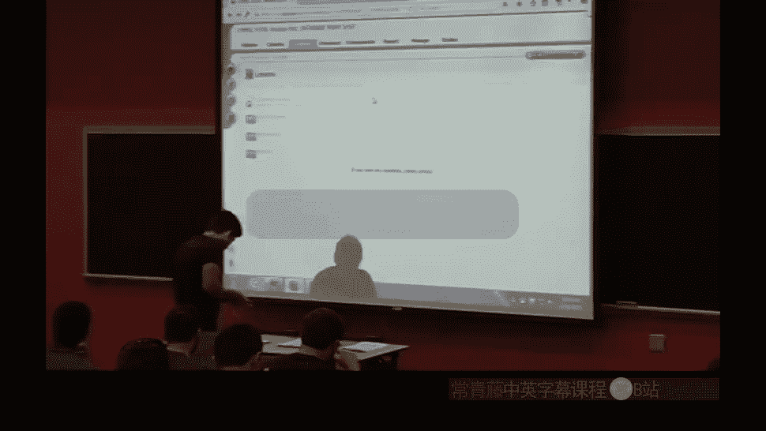
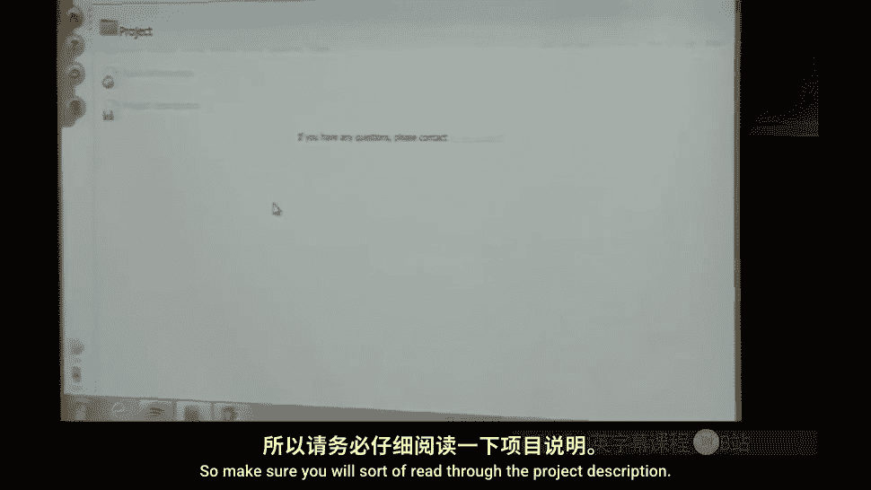
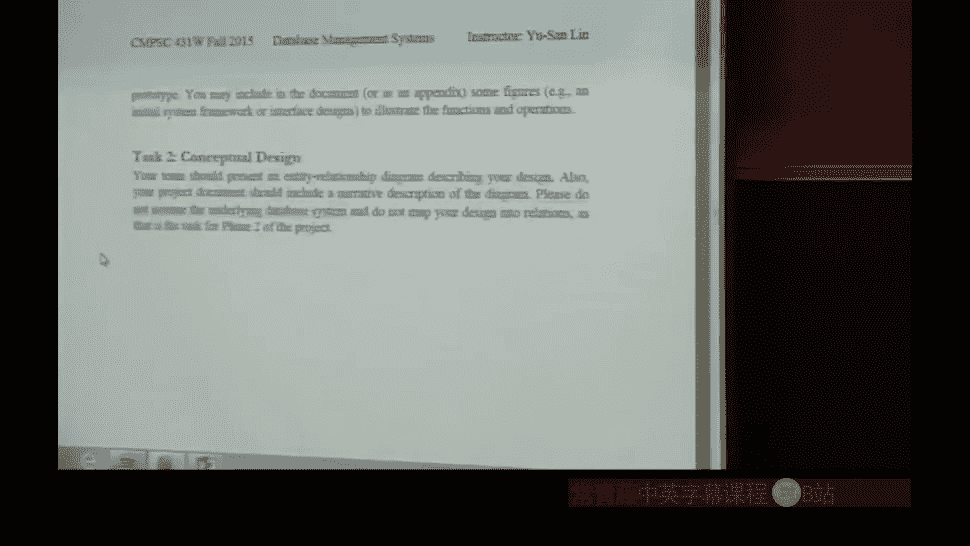
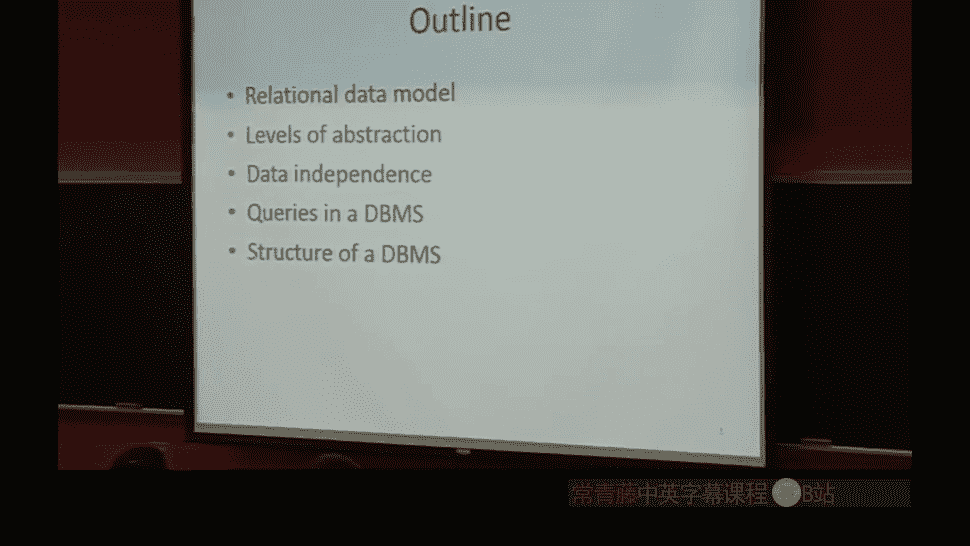

# 002：数据库管理系统导论 - 第2部分









## 概述
在本节课中，我们将继续学习数据库管理系统的基础知识。我们将深入探讨关系数据模型、数据库的抽象层次、查询语言以及DBMS的整体结构。这些核心概念是理解后续课程内容的基础。

---

## 关系数据模型回顾
上一节我们介绍了数据库的基本概念，本节中我们来看看关系数据模型的具体细节。

关系数据模型的核心概念是**关系**。一个关系可以看作是一张表。每张表都有一个**模式**，它定义了表的结构，包括列名和数据类型。

*   **关系**：指整个表本身。
*   **记录**：指表中的每一行。
*   **属性**：指表中的每一列。

例如，一个“学生”表的关系模式可能定义为：`学生(学号, 姓名, 登录邮箱, 年龄, 平均绩点)`。其中，“学生”是关系名，括号内的是属性。每一行代表一名学生的具体信息，即一条记录。

---

## 数据库的抽象层次
为了管理复杂性和实现数据独立性，数据库系统通常采用三层抽象结构。

以下是数据库的三级模式结构：

1.  **外部模式**：也称为视图层。这是用户能看到的数据层次。不同用户（如学生和教师）可以看到同一个数据库的不同视图，从而隐藏他们不需要的数据。
2.  **概念模式**：也称为逻辑层。它描述了整个数据库的逻辑结构，包括有哪些实体、实体有哪些属性以及实体之间的关系。在关系模型中，概念模式由一组关系模式定义。
3.  **内部模式**：也称为物理层。它描述了数据在物理存储设备（如磁盘）上实际是如何存储的，例如使用何种文件组织方式、如何建立索引等。

这种分层结构带来了关键优势：**数据独立性**。

*   **逻辑数据独立性**：修改概念模式（如增加新的实体或关系）时，无需修改外部应用程序。
*   **物理数据独立性**：修改内部模式（如更换存储设备或索引方法）时，无需修改概念模式。

---

## 查询与事务
数据库不仅仅是存储数据，更重要的是能够查询和更新数据。

### 查询语言
用户向数据库提出的问题称为**查询**。用于表达查询的语言是**查询语言**。最常用的查询语言是**SQL**。

以下是一个SQL查询示例，用于查找学号为“53688”的学生姓名：
```sql
SELECT name FROM students WHERE sid = ‘53688’;
```

### 事务
**事务**是数据库系统中一个逻辑工作单元，代表用户执行的一组操作（例如，从ATM取款、预订机票）。事务必须满足ACID属性以保证数据的正确性。

以下是事务的四个核心属性：

*   **原子性**：事务中的所有操作要么全部完成，要么全部不执行。不存在中间状态。
*   **一致性**：事务执行必须使数据库从一个一致状态转变到另一个一致状态，不违反任何数据完整性约束。
*   **隔离性**：并发执行多个事务时，每个事务的执行不应受其他事务干扰。最终结果应与串行执行这些事务的结果相同。
*   **持久性**：一旦事务成功提交，它对数据库的修改就是永久性的，即使系统发生故障也不会丢失。

---

## 数据库管理系统的结构
一个典型的DBMS由多个协同工作的模块组成。

以下是DBMS的主要组件结构：

1.  **查询处理引擎**：负责解析、优化和执行用户查询。
    *   **解析器与翻译器**：理解SQL查询的语法和语义。
    *   **优化器**：生成一个高效执行查询的计划。
    *   **执行引擎**：负责执行查询计划。
2.  **存储管理器**：负责在磁盘上存储、检索和更新数据。
    *   **文件与存取方法管理器**：管理数据库文件（可视为关系的集合）和索引结构。
    *   **缓冲区管理器**：负责将数据从磁盘调入内存，以及将修改写回磁盘。
    *   **磁盘空间管理器**：管理磁盘块的分配与回收。
3.  **事务管理器**：确保事务的ACID属性。
    *   **并发控制管理器**：通过加锁等机制管理并发事务，确保隔离性。
    *   **恢复管理器**：通过日志等手段，在系统故障后能将数据库恢复到一致状态。

---

## 总结
本节课中我们一起学习了数据库管理系统的几个核心部分。我们明确了关系数据模型中的基本术语（关系、记录、属性），理解了三级抽象层次（外部、概念、内部）及其带来的数据独立性优势。我们还介绍了用于检索数据的查询语言和保证数据可靠性的ACID事务概念。最后，我们概览了DBMS的模块化结构，包括查询处理、存储管理和事务管理三大组件。掌握这些基础知识，将为后续深入学习数据建模、SQL语言和系统实现打下坚实的基础。