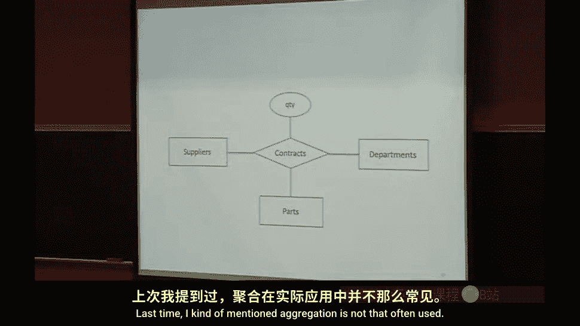
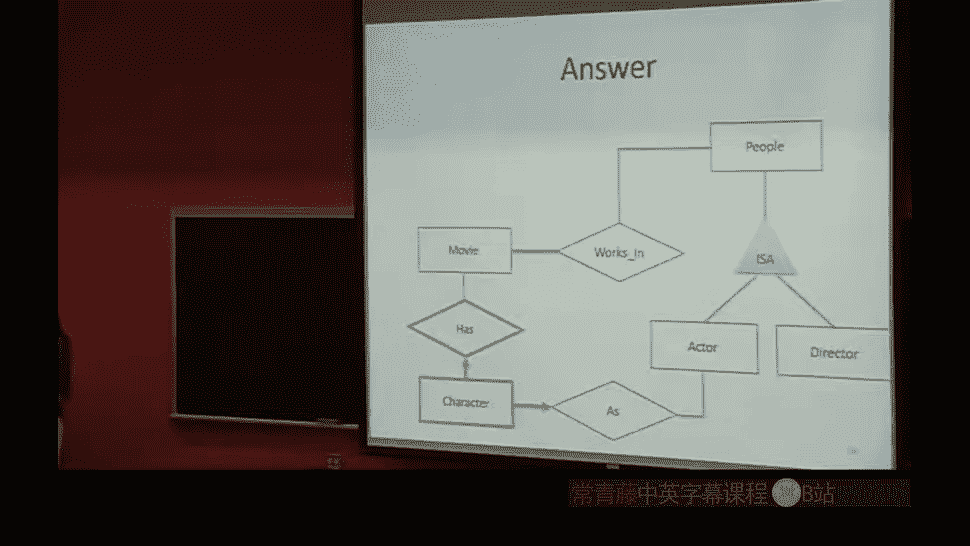

# 004：实体关系模型（ER模型）- 第3部分与关系模型

在本节课中，我们将继续学习实体关系模型（ER模型）的设计，并探讨如何将ER模型转换为关系模型。我们将通过具体的例子来理解如何应用关键约束、弱实体集和聚合等概念，并最终介绍关系模型的基本结构。

## 从ER模型到关系模型

上一节我们介绍了ER模型中的基本概念和设计原则。本节中，我们来看看如何将设计好的ER图转换为关系模型中的表结构，并处理一些复杂的设计场景。

### 处理“管理”关系与预算属性

考虑一个“管理”的二元关系，它连接“员工”和“部门”实体集，并带有一个关键约束：一个部门最多只能由一名经理管理。

**关系模式**可以表示为：
`Manages(employee_id, department_id)`

然而，如果我们想为经理分配一个覆盖其所有管理部门的**总预算**，问题就出现了。预算属性应该附加在哪里？

*   附加在“员工”实体上？但并非所有员工都是经理。
*   附加在“管理”关系上？但一位经理可能管理多个部门，预算会重复存储。

解决方案是引入一个新的实体集，例如“经理”，作为“员工”的一个子类。这样，预算属性就可以附加在“经理”实体上。这种设计在概念上更清晰，尽管在实现上，“经理”实体可能通过一个外键与“员工”实体关联。

### 保单与家属的弱实体设计

另一个例子涉及“员工”、“保单”和“家属”。最初的设计可能让“家属”作为“员工”的弱实体。但业务规则可能要求：
1.  一份保单不能由两名或以上员工共同拥有。
2.  每份保单必须由一名员工持有。
3.  每个家属由保单号和政策共同唯一标识（即家属是“保单”的弱实体）。

为了满足这些要求，我们需要重新设计。以下是关键步骤：

1.  **建立“员工-拥有-保单”关系**：在“员工”和“保单”之间建立“拥有”关系。通过设置**关键约束**（从保单到员工为多对一）来满足规则1。通过设置**完全参与约束**（保单必须参与关系）来满足规则2。
2.  **建立“保单-受益人-家属”关系**：将“家属”设计为“保单”的**弱实体**，通过“受益人”关系连接。弱实体的标识通过粗线和`identifying relationship`的标注来体现。

这种设计清晰地分离了概念，并满足了所有业务规则。

### 三元关系与聚合

有时我们会遇到涉及三个实体集的关系，例如“供应商-供应-零件”合同，并带有“数量”属性。这可以建模为一个**三元关系**`Supplies`。

**三元关系模式**可以表示为：
`Supplies(supplier_id, part_id, project_id, quantity)`

聚合是一种抽象，允许我们将一个关系及其关联的实体集视为一个整体，以便与另一个实体集建立关系。例如，如果我们想记录“公司”对“供应商-供应-零件”这个整体合同的“监控”情况，可以使用聚合。

然而，如果我们不关心“公司”的监控信息，就可以简化设计，直接从“项目”连接到“供应”关系，而不必使用聚合。是否使用聚合取决于具体的业务需求。

### ER模型设计要点回顾

在进行ER模型概念设计时，需要关注以下几点：

以下是设计时需要考虑的关键元素：
*   **基本构建块**：识别实体集、属性、关系集。
*   **约束类型**：考虑键约束（一对一、一对多、多对多）、参与约束（完全/部分）。
*   **实体类型**：区分强实体与弱实体。
*   **特殊概念**：应用继承（ISA层次结构）、聚合等高级概念。
*   **设计决策**：决定是否使用属性、实体集或关系集来表示一个概念。有时，将属性提升为实体集（如“经理”）或关系集能带来更好的设计。

### 电影行业数据库设计练习

让我们通过一个电影行业数据库的设计练习来应用这些概念。需求如下：
1.  电影行业人员可以是演员或导演（ISA层次结构）。
2.  人员在电影中工作（“工作于”关系）。
3.  每部电影至少有一名人员参与其中（从“电影”到“工作于”关系的**完全参与约束**）。
4.  电影有角色（“有”关系）。
5.  一个角色只属于一部电影（从“角色”到“有”关系的**键约束**，一对一）。
6.  如果没有电影，角色就不能存在（从“角色”到“有”关系的**完全参与约束**）。
7.  一个角色必须由恰好一名演员扮演（“扮演”关系，并带有从“角色”到“扮演”的**键约束**和**完全参与约束**）。

根据这些需求，我们可以绘制出相应的ER图，其中包含了ISA层次结构、多个二元关系以及各种约束。

## 关系模型介绍

将ER模型转换后，我们就进入了关系模型。关系模型是大多数现代数据库系统的理论基础。

### 基本概念

关系模型的核心是**关系**，可以直观地理解为一张**表**。

以下是关系模型中的核心术语：
*   **关系**：对应一张表。
*   **元组**：对应表中的一行。
*   **属性**：对应表中的一列。
*   **域**：每个属性允许取值的集合。
*   **关系模式**：关系的结构描述，包括关系名和属性名列表。例如：`学生(学号, 姓名, 年龄)`。
*   **关系实例**：在特定时刻，关系中所包含元组的集合。

**关系模式**的数学表示是属性的有序n元组：`R(A1, A2, ..., An)`
**关系实例**是域笛卡尔积的一个子集：`r ⊆ dom(A1) × dom(A2) × ... × dom(An)`

### 关系的性质

关系中的元组是**无序**的。我们通过**主键**（一个或多个能唯一标识元组的属性）来区分不同的元组。在物理存储层面，数据库系统可能会使用索引等数据结构来优化访问顺序和速度，但这并不改变关系在逻辑层面的无序性。

---

本节课中我们一起学习了如何将复杂的ER模型设计转换为关系模型，包括处理带有属性的关系、弱实体集以及三元关系。我们还介绍了关系模型的基本概念，包括关系、元组、属性、域和模式。理解这些概念是设计高效、合理数据库模式的基础。