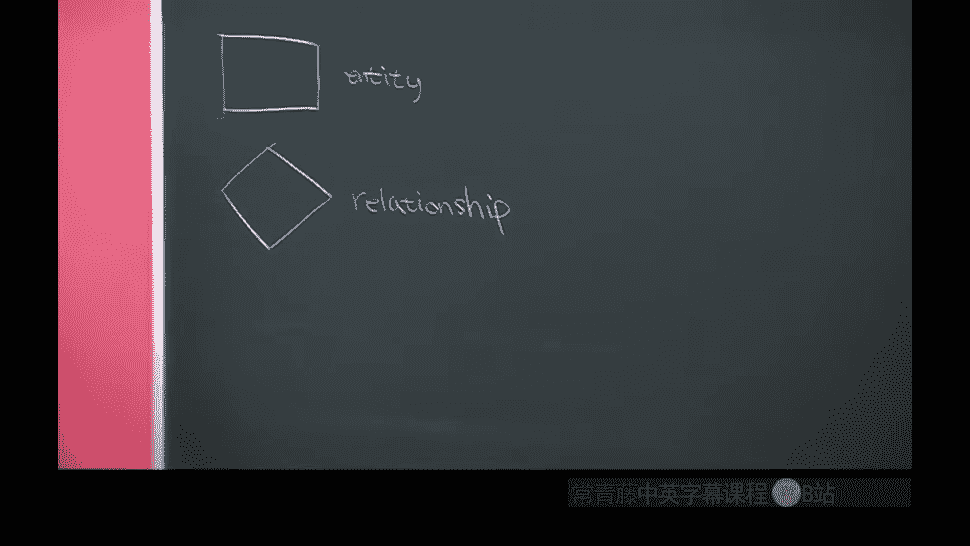
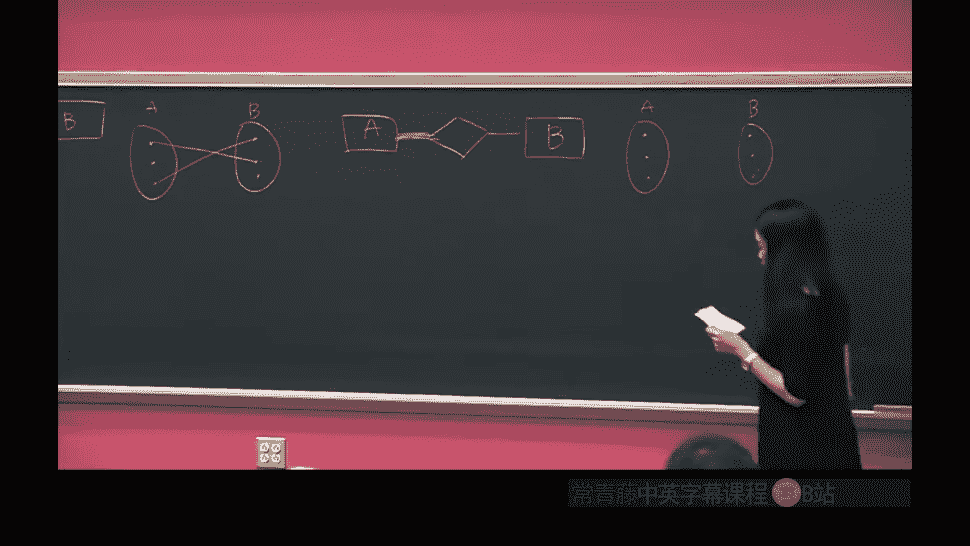
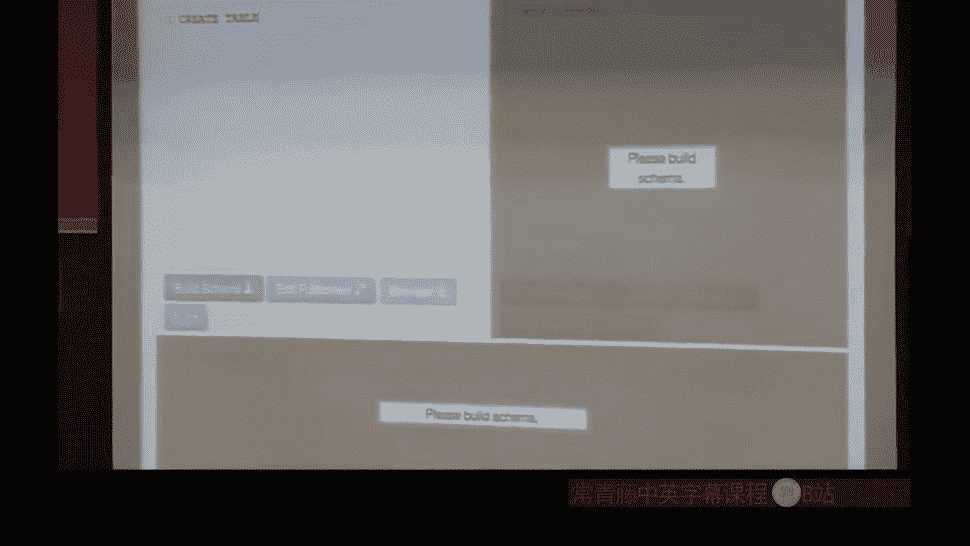
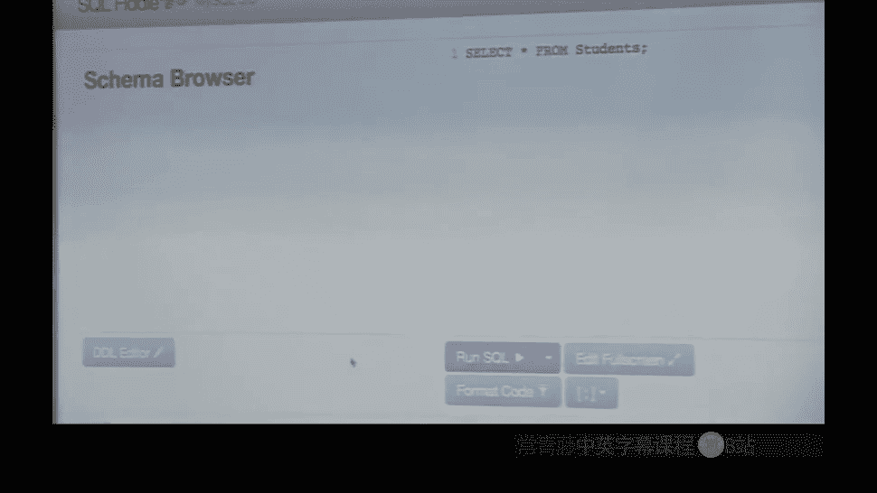

# 005：关系模型（续）与SQL编程导论 - 第1部分

## 概述
在本节课中，我们将首先回顾实体-关系模型的核心概念，然后正式介绍关系模型中的域约束。接着，我们将开始学习SQL编程的基础部分——数据定义语言，包括如何创建表、插入、修改和删除数据。

---



## ER模型快速回顾
上一节我们介绍了关系模型的基础，本节我们先来快速回顾一下ER模型的核心构造。

ER模型有三个基本构造块。

以下是三个基本构造块：
*   **实体集**：用矩形表示。
*   **关系集**：用菱形表示。
*   **属性**：用椭圆形表示。

除了基本构造，我们还有表示约束的符号。

以下是关于键约束的说明：
*   如果两个实体集之间是一条简单的直线，表示**多对多**关系。
*   如果关系线上有一个箭头从A指向B，表示对于B中的每个实体，**至多**对应A中的一个实体。这构成了从A到B的**一对多**关系。
*   如果关系线两端都有箭头，则表示**一对一**关系。



以上情况都没有强制每个实体都必须参与关系。要表示“必须参与”的约束，我们需要使用参与约束。

以下是关于参与约束的说明：
*   用**粗线**表示“完全参与”约束。例如，如果从A到B的连线在A端是粗线，则表示A中的每个实体都**至少**参与一个关系到B。
*   可以将键约束（箭头）和参与约束（粗线）结合使用。例如，A到B的连线在A端是粗线且带有指向B的箭头，则表示A中的每个实体都**恰好**参与一个关系到B。

除了基本构造和约束，ER模型还有一些特殊构造。

以下是三种特殊构造：
1.  **弱实体集**：用双线矩形表示。弱实体集需要通过一个双线菱形表示的联系，依赖于一个常规实体集（标识实体集）而存在。弱实体集的分辨符（部分键）用虚下划线标明。
2.  **概化/特化**：用三角形和连线表示。三角形指向超类，连线连接子类。读作“B是A”，“C是A”，“D是A”。
3.  **聚合**：用虚线框表示。用于将实体及其之间的联系作为一个整体，再与其他实体建立联系。

---

## 域约束
回顾完ER模型，我们接着来看关系模型中一个重要的概念——域约束。

域约束是指：出现在某一列中的值必须取自于与该列关联的域。

我们可以用以下方式形式化地定义一个满足域约束的关系模式实例：
**r(R) = {t1, t2, ..., tn}** 其中，每个元组 **ti** 满足模式 **R** 上定义的域约束。

例如，一个学生表实例如下：
**学生 = { (SID: 5000, name: ‘Dave’, age: 19), … }**

在SQL中，我们通常称这些“关系”为“表”。

---

## SQL数据定义语言导论
本节我们将开始学习SQL编程。SQL语言中负责定义和修改数据结构的部分称为数据定义语言。

DDL是SQL中用于创建、删除或修改数据库结构（如表）的部分。与之相对的是数据操作语言，用于查询和修改表中的数据。

以下是本节课将涉及的几个基本DDL命令：
*   `CREATE TABLE`：用于创建新表。
*   `INSERT INTO`：用于向表中插入新数据。
*   `UPDATE`：用于修改表中现有的数据。
*   `DELETE FROM`：用于从表中删除数据。
*   `ALTER TABLE`：用于修改现有表的结构。
*   `DROP TABLE`：用于删除整个表（包括结构和数据）。
*   `TRUNCATE TABLE`：用于删除表中的所有数据，但保留表结构。



### 创建表
我们首先学习如何创建表。创建表时需要指定表名和列的定义。

创建学生表的SQL语句如下：
```sql
CREATE TABLE student (
    sid CHAR(5),
    name VARCHAR(20),
    age INT
);
```
执行`CREATE TABLE`语句后，数据库中就创建了一个具有指定列和数据类型（域约束）的空表。注意，此时我们尚未指定主键等完整性约束。

### 插入数据
表创建好后，我们需要向其中添加数据。使用`INSERT INTO`语句可以插入新的数据行。

向学生表插入一条数据的SQL语句如下：
```sql
INSERT INTO student (sid, name, age)
VALUES (‘12345’, ‘Smith’, 20);
```
要查询插入的数据，可以使用`SELECT`语句：
```sql
SELECT * FROM student;
```
若要一次性插入多条数据，可以在`VALUES`子句中包含多个元组，用逗号分隔。

### 更新数据
如果我们需要修改表中已有的数据，可以使用`UPDATE`语句。

将学生Smith的年龄增加1岁的SQL语句如下：
```sql
UPDATE student
SET age = age + 1
WHERE name = ‘Smith’;
```
`WHERE`子句用于指定要更新哪些行。在涉及多表时，为避免列名歧义，可以使用表别名（如`s.age`）。

### 删除数据
要从表中移除数据，可以使用`DELETE FROM`语句。

删除名为Smith的学生的SQL语句如下：
```sql
DELETE FROM student
WHERE name = ‘Smith’;
```
此操作会删除所有满足`WHERE`条件的行。

### 修改表结构
有时在创建表后，需要添加新的列。这时可以使用`ALTER TABLE`语句。

为学生表添加一个`first_year`列的SQL语句如下：
```sql
ALTER TABLE student
ADD first_year INT;
```
对于表中已存在的行，新添加的列的值将是`NULL`（空值）。

### 删除表
最后，我们学习如何删除表。有两种方式：`TRUNCATE`和`DROP`。

清空学生表所有数据但保留表结构的SQL语句如下：
```sql
TRUNCATE TABLE student;
```
彻底删除学生表（包括结构和数据）的SQL语句如下：
```sql
DROP TABLE student;
```
`TRUNCATE`只删除数据，表定义仍在。`DROP`会完全移除表，之后该表就不存在了。

---



## 完整性约束
在结束之前，我们简要提一下完整性约束。域约束就是完整性约束的一种。

完整性约束是数据库在任何时候都必须满足的条件。它们主要在模式定义时（如`CREATE TABLE`）被声明，并在数据更新（如`INSERT`， `UPDATE`）时由数据库管理系统强制执行，以确保数据的一致性和正确性。

---

## 总结
本节课我们一起学习了以下内容：
1.  回顾了ER模型的三个基本构造（实体、关系、属性）、键约束、参与约束以及弱实体、概化、聚合等特殊构造。
2.  明确了关系模型中的域约束概念。
3.  正式开始了SQL编程的学习，重点介绍了数据定义语言的基本命令，包括`CREATE TABLE`， `INSERT INTO`， `UPDATE`， `DELETE FROM`， `ALTER TABLE`， `TRUNCATE TABLE`和`DROP TABLE`的使用方法。
4.  了解了完整性约束的基本概念和作用时机。

下节课我们将继续SQL编程的学习，并完成剩余的练习。