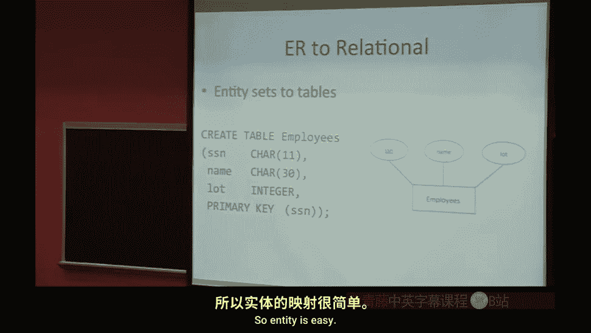

# 007：SQL编程导论 - 第3部分 🗄️


在本节课中，我们将继续学习SQL编程，重点包括如何为已创建的表添加外键约束、查看表结构、理解约束行为，以及将ER模型转换为SQL模式。我们还将通过一些练习来巩固这些概念。


## 课程公告与回顾

上一节我们介绍了如何创建基本的表结构。本节中，我们来看看如何修改和增强这些表。

首先是一些课程相关的公告：
*   作业一可以提交到指定表格。
*   新作业已发布，两周后截止。
*   项目报告需同时提交纸质版和电子版至指定Dropbox。
*   项目演示幻灯片需在演示前夜提交，以便统一编译。

关于上节课的SQL编程内容，我们创建了两个表：`students` 和 `enroll`。在 `enroll` 表中，我们尚未指定任何外键约束。


## 修改表与添加约束

今天，我们将学习如何修改已存在的表，特别是如何添加外键约束，而无需删除并重建整个表。

### 查看表结构

在修改之前，了解如何查看表的详细定义很有用。
*   使用 `DESCRIBE <表名>;` 可以查看表的简单模式，但它不会显示外键信息。
*   使用 `SHOW CREATE TABLE <表名>;` 可以查看完整的表创建语句，包括引擎设置和所有约束。


### 更改存储引擎


在CSE的MySQL中，默认存储引擎可能不支持外键功能。我们需要确保表使用InnoDB引擎。
你可以在创建表时指定引擎，也可以在之后修改：
```sql
ALTER TABLE <表名> ENGINE = InnoDB;
```

### 添加外键约束

为已存在的表添加外键需要几个步骤。以下是核心命令：
```sql
SET foreign_key_checks = 0; -- 临时禁用外键检查
ALTER TABLE <子表名>
ADD FOREIGN KEY (<外键字段>)
REFERENCES <父表名>(<主键字段>)
ON DELETE <操作> ON UPDATE <操作>; -- 例如 CASCADE 或 NO ACTION
SET foreign_key_checks = 1; -- 重新启用外键检查
```
**注意**：直接执行 `ALTER TABLE` 添加外键可能会因表被锁定而失败，因此通常需要先禁用外键检查。


## 外键约束行为实践

现在，我们基于已添加外键的 `enroll` 表（引用 `students` 表），来理解不同操作的结果。假设我们定义了 `ON DELETE CASCADE` 和 `ON UPDATE NO ACTION`。


以下是几个需要思考的操作场景：


1.  **从 `enroll` 表中删除学生ID为‘53650’的元组。**
    *   **结果**：仅 `enroll` 表中对应的行被删除。`students` 表中的记录保持不变。因为约束定义的是当`students`表发生删除时，才对`enroll`表进行级联操作。

2.  **向 `enroll` 表插入一个 `students` 表中不存在的学生ID。**
    *   **结果**：操作将被拒绝，因为它违反了引用完整性约束。

3.  **在 `students` 表中删除学生ID为‘53666’的元组。**
    *   **结果**：由于设置了 `ON DELETE CASCADE`，`students` 表中的该行被删除，同时 `enroll` 表中所有引用此学生ID的行也会被自动删除。

4.  **尝试将 `students` 表中学生ID‘53688’更新为‘53600’。**
    *   **结果**：由于设置了 `ON UPDATE NO ACTION`，如果 `enroll` 表中有行引用了‘53688’，则此更新操作会失败并报错。

**关键理解**：外键约束中定义的 `ON DELETE` 和 `ON UPDATE` 规则，指的是当**父表**（被引用的表）发生相应操作时，对**子表**（引用表）采取的行动。

## 基础查询：选择特定字段



到目前为止，我们主要使用 `SELECT *` 查询所有字段。如果我们只想返回部分字段，可以明确指定列名：
```sql
SELECT name, login FROM students WHERE age > 20;
```
我们也可以为表设置别名，这在多表查询时非常有用，可以避免歧义并简化语句：
```sql
SELECT S.name, E.cid
FROM students S, enroll E
WHERE S.sid = E.sid AND E.grade = ‘A’;
```
这条查询结合了 `students` 和 `enroll` 表，返回成绩为A的学生的姓名和课程ID。

## 从ER图到关系模式

在作业和项目后续阶段，你需要将ER图转换为SQL模式。以下是一些基本转换规则。

### 映射实体集

简单的实体集可以直接映射为包含所有属性的表，并指定主键。

### 映射关系集

将关系集转换为表时，表的属性必须包含：
*   所有参与实体集的**主键**（作为外键）。
*   关系集本身的任何**描述性属性**。
这些外键的组合通常构成该表的超键。在确定主键时，需要考虑关系的基数约束。

以下是不同情况的示例：

*   **多对多关系**：所有参与实体的主键组合起来作为关系表的主键。
*   **一对一或一对多关系**：主键可以是“一”方实体的主键。例如，如果每个部门最多由一位员工管理，那么`manages`关系表的主键可以是部门ID，因为一个部门ID最多只对应一个管理关系。有时，这种关系甚至可以合并到“一”方实体表中作为外键。

### 处理参与约束与弱实体

*   **全参与约束**：例如“每个部门必须有一位经理”，这通常通过在应用程序逻辑或更复杂的约束中确保外键不允许NULL值来实现。
*   **弱实体集**：弱实体没有独立的主键。其对应的表必须包含：
    *   所有者实体的主键（作为外键）。
    *   弱实体自身的部分键。
    *   主键由所有者实体的主键和弱实体的部分键共同组成。
    *   外键通常设置 `ON DELETE CASCADE`，表示当所有者实体被删除时，弱实体也随之删除。

## 课堂练习

请思考如何为以下场景设计表结构（可以尝试在MySQL中实现或写下方案）：
*   实体：`Employee` (ssn, name, ...), `Policy` (policyid, cost, ...)
*   关系：`Dependent` 是 `Employee` 的弱实体（partial key: name）。`Beneficiary` 是一个关系，连接 `Policy` 和 `Dependent`。
*   考虑所有标明的键约束和参与约束。

你需要创建哪些表？主键和外键应如何设计？

## 总结与提醒

本节课中我们一起学习了：
1.  如何使用 `ALTER TABLE` 为现有表添加外键约束。
2.  如何利用 `SHOW CREATE TABLE` 查看完整表定义。
3.  理解了 `ON DELETE` 和 `ON UPDATE` 规则的实际影响。
4.  学习了基础的选择查询和表别名使用。
5.  探讨了将ER模型中的实体集、关系集（包括涉及基数约束和弱实体的情况）转换为SQL关系模式的基本方法。

请确保你的MySQL环境工作正常，因为后续作业需要你编写并执行SQL语句。如有任何设置问题，请及时寻求帮助。