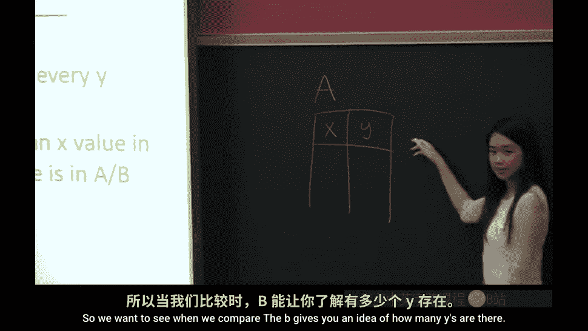
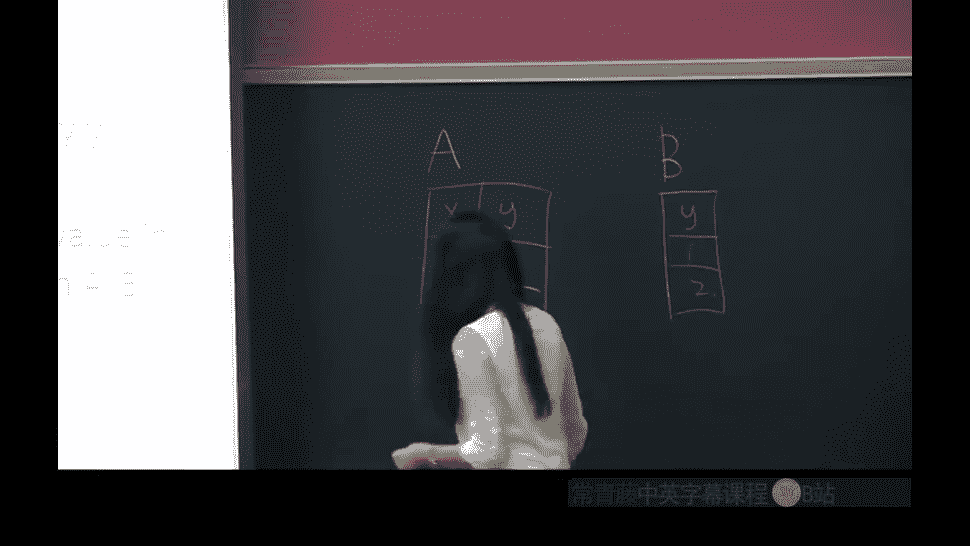
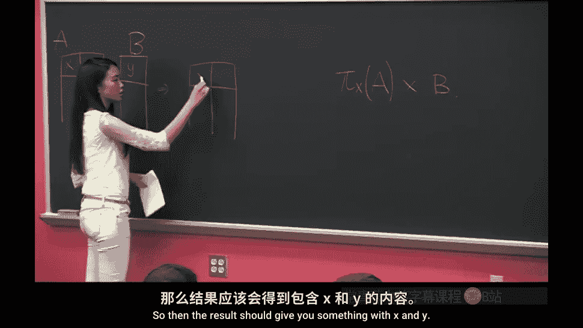

# 009：关系代数 - 第3部分 🧮


在本节课中，我们将继续学习关系代数，重点介绍重命名、连接和除法这三个重要操作符。我们将通过具体的例子和步骤，帮助你理解这些概念如何在实际查询中应用。

上一节我们介绍了关系代数的基本操作符，如选择、投影和集合运算。本节中，我们来看看如何通过重命名解决属性名冲突，以及如何使用连接和除法来组合和筛选数据。

## 重命名操作

当进行关系运算（特别是笛卡尔积）时，来自不同关系的属性可能具有相同的名称，这会造成混淆。重命名操作可以解决这个问题，它允许我们为关系或属性指定新的名称。

重命名操作符是 **ρ**。其语法为：
```
ρ(R, E)
```
或
```
ρ(F, E)
```
其中：
*   `E` 是一个关系代数表达式。
*   `R` 是结果关系的新名称。
*   `F` 是一个重命名列表，格式为 `旧名1 -> 新名1, 旧名2 -> 新名2, ...`，用于指定属性的新名称。

以下是重命名的一个关键作用：
*   **解决命名冲突**：例如，对 `S1` 和 `R1` 做笛卡尔积后，两个关系都有 `SID` 属性。通过重命名，我们可以将它们区分为 `SID1` 和 `SID2`。
*   **简化复杂表达式**：可以将冗长复杂的关系代数表达式分解为多个步骤，并为中间结果命名，使逻辑更清晰。

## 连接操作

连接是组合两个或多个关系中信息的最常用、最有用的操作之一。它本质上是**笛卡尔积后接选择操作**的简写。

连接操作符是 **⋈**。连接主要有三种类型：

### 条件连接
条件连接根据指定的条件 `C` 来组合两个关系 `R` 和 `S`。它等价于先做笛卡尔积再进行选择。
```
R ⋈_C S = σ_C (R × S)
```
例如，`S1 ⋈_{S1.SID < R1.SID} R1` 会连接 `S1` 和 `R1`，只保留 `S1` 中 `SID` 小于 `R1` 中 `SID` 的那些元组组合。

### 等值连接
等值连接是条件连接的一种特例，其连接条件 `C` 只包含相等比较。在结果模式中，用于相等比较的属性只保留一份。
```
R ⋈_{R.A = S.B} S
```

### 自然连接
自然连接是等值连接的进一步特例。它不指定任何条件，而是自动比较两个关系中所有同名的属性，要求它们在对应元组上相等。结果中同名属性只出现一次。
```
R ⋈ S
```
自然连接在实际中不如条件连接和等值连接常用。

使用连接操作而非单独的笛卡尔积和选择，主要优点是更简洁，并且能避免生成巨大的中间结果表，从而提高效率。

## 除法操作





除法操作用于查询“与所有...”相关的情形，例如“查找预订了所有船只的船员姓名”。

给定关系 `A(X, Y)` 和 `B(Y)`，`A ÷ B` 的结果是包含所有 `X` 值的集合，这些 `X` 值在关系 `A` 中与关系 `B` 中**每一个** `Y` 值都有关联。

其形式化定义为：
```
A ÷ B = { x | ∀ y ∈ B, (x, y) ∈ A }
```
换句话说，结果中的 `x` 值，其关联的 `Y` 值集合必须包含 `B` 中所有的 `Y` 值。

我们可以用已学的基本操作符来表达除法操作，其思路是找出“不合格”的 `X` 值，然后从所有 `X` 值中排除它们。以下是使用基本操作实现 `A ÷ B` 的步骤：


1.  计算所有可能的 `(X, Y)` 组合：`π_X(A) × B`
2.  找出实际在 `A` 中不存在的组合：`(π_X(A) × B) - A`
3.  从这些不存在的组合中，提取出“不合格”的 `X` 值：`π_X((π_X(A) × B) - A)`
4.  从 `A` 的所有 `X` 值中排除这些“不合格”的 `X` 值，得到最终结果：`π_X(A) - π_X((π_X(A) × B) - A)`



这个推导过程展示了除法如何通过更基本的投影、笛卡尔积和差集运算来实现。

## 课程总结

本节课中我们一起学习了关系代数中三个重要的高级操作：
1.  **重命名**：用于解决属性名冲突和管理复杂表达式。
2.  **连接**：高效组合多个关系信息的核心操作，包括条件连接、等值连接和自然连接。
3.  **除法**：用于处理“针对所有...”类型的查询，可以通过基本操作符组合实现。

理解这些操作符是掌握关系数据库查询基础的关键。下一讲我们将可能深入更多查询优化或实际应用的内容。