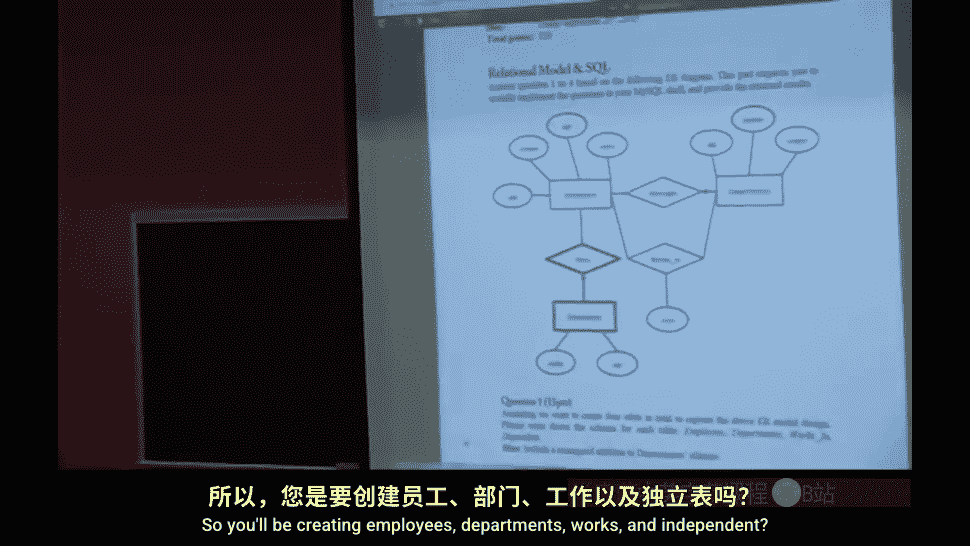
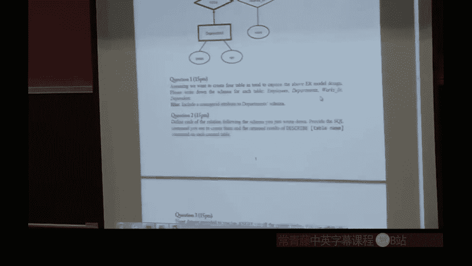
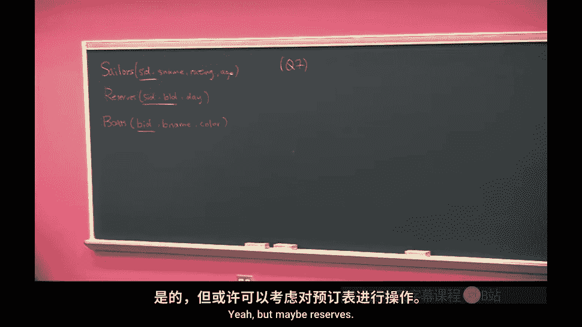
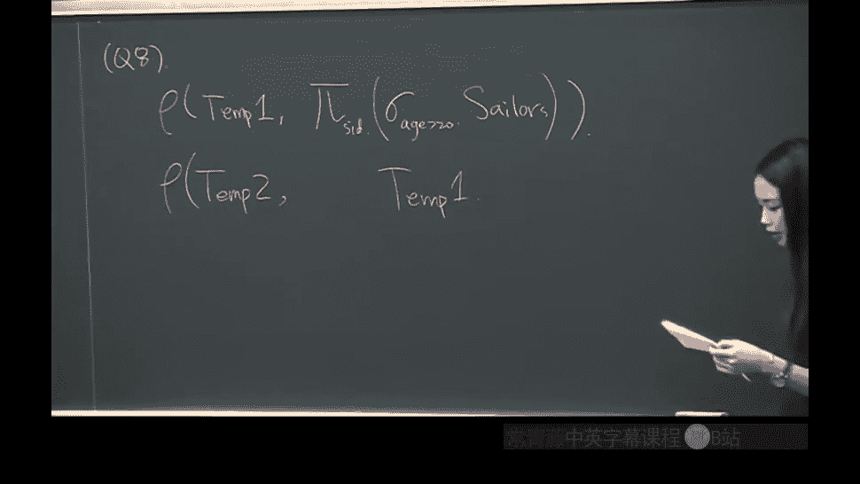

# 011：关系代数与关系演算





在本节课中，我们将学习关系代数的剩余部分，包括一个重要的新运算符，并初步了解关系演算的概念。课程内容将涵盖查询实践、聚合操作以及两种关系演算的简介。


## 作业提醒与答疑



本周五将截止提交第二次作业。如有任何疑问，可以在今天联系我或明天联系助教。

对于SQL部分，请确保提交输出结果的截图。

## 回顾与引入新运算符

上一节我们完成了大部分关系代数运算符的练习。本节我们将继续完成剩余的查询，并介绍一个之前未讨论的运算符——聚合运算符。

首先，我们回顾一下上节课使用的数据库模式。

## 查询实践：关系代数

以下是几个查询示例，我们将使用关系代数表达式来解决它们。



### 查询7：查找预订了至少两艘船的船员姓名

这个查询要求我们找出预订了至少两艘不同船只的船员。以下是解决此问题的一种方法。

1.  首先，我们需要对 `Reserves` 关系进行自连接，以找出同一个船员预订了不同船只的记录。
2.  为了避免混淆，我们需要重命名连接中涉及的属性。
3.  最后，我们通过连接 `Sailors` 关系来获取船员的姓名。

具体的关系代数表达式如下：
```plaintext
π sname (σ (R1.bid ≠ R2.bid) (ρ R1(bid1, sid, day) (Reserves) ⨝ ρ R2(bid2, sid, day) (Reserves) ⨝ Sailors))
```
这个表达式的核心在于通过自连接和选择条件 `bid1 ≠ bid2` 来确保找到的是预订了至少两艘不同船只的船员。

### 查询8：查找年龄超过20岁且未预订任何船只的船员ID

这个查询涉及“未做某事”的逻辑，通常使用差集运算来处理。

1.  首先，找出所有年龄超过20岁的船员ID。
2.  然后，找出年龄超过20岁且预订了船只的船员ID。
3.  最后，计算两个集合的差集。

具体的关系代数表达式如下：
```plaintext
π sid (σ age > 20 (Sailors)) - π sid (σ age > 20 (Sailors) ⨝ Reserves)
```
差集运算要求两个关系具有相同的模式（即相同的属性），因此我们在两个部分都只投影了 `sid` 属性。

### 查询9：查找预订了所有船只的船员姓名

当查询中出现“所有”这个关键词时，我们通常考虑使用除法运算。

1.  除法运算要求被除数关系有两个属性（例如X和Y），除数关系有一个属性（Y）。
2.  在本查询中，我们关心船员和船只的对应关系。因此，我们从 `Reserves` 关系中投影出 `sid` 和 `bid` 作为被除数。
3.  从 `Boats` 关系中投影出 `bid` 作为除数。
4.  除法运算的结果是那些与所有船只ID都关联的船员ID。
5.  最后，连接 `Sailors` 表以获取船员姓名。

具体的关系代数表达式如下：
```plaintext
π sname ((π sid, bid (Reserves)) ÷ (π bid (Boats)) ⨝ Sailors)
```

### 查询10：查找预订了所有名为“Interlake”的船只的船员姓名

这个查询与查询9类似，但除数集合是通过选择条件（船名）动态生成的。

1.  首先，从 `Boats` 表中选择船名为“Interlake”的船只，并投影出 `bid`，作为除数。
2.  从 `Reserves` 表中投影出 `sid` 和 `bid` 作为被除数。
3.  执行除法运算，得到预订了所有名为“Interlake”船只的船员ID。
4.  连接 `Sailors` 表获取姓名。

具体的关系代数表达式如下：
```plaintext
π sname ((π sid, bid (Reserves)) ÷ (π bid (σ bname=‘Interlake’ (Boats))) ⨝ Sailors)
```
与查询1（查找预订了特定船只ID的船员）不同，当“所有”指向一个可能包含多个实体的集合（如同名船只）时，必须使用除法运算。

## 聚合运算符 (α)

到目前为止，我们学习的运算符主要用于检索和连接数据，不涉及计算（如计数、求平均值）。聚合运算符 `α` 填补了这一空白。

聚合运算符有两种形式。

### 形式一：无分组的聚合

这种形式对整个关系或某一列进行单一计算，例如求所有船员的平均年龄。

公式为：**α_{func(attr)} (R)**

*   `func`：聚合函数，如 `avg`, `max`, `min`, `sum`, `count`。
*   `attr`：要计算聚合函数的属性。
*   `R`：输入关系。

**示例：求所有船员的平均年龄**
```plaintext
α_{avg(age)} (Sailors)
```
结果是一个单行单列的关系，例如 `| avg_age |`。

**示例：求预订了蓝色船只的船员数量**
```plaintext
α_{count(sid)} (σ color=‘blue’ (Reserves ⨝ Boats))
```
首先通过连接和选择找到预订蓝色船只的记录，然后对船员ID进行计数。

### 形式二：带分组的聚合

这种形式先按一个或多个属性对关系进行分组，然后在每个组内进行聚合计算。

公式为：**α_{grouping_attr, func(attr)} (R)**

*   `grouping_attr`：用于分组的属性。
*   `func(attr)`：在每个组内执行的聚合函数。
*   `R`：输入关系。

**示例：按评级分组，找出每个组内的最大年龄**
```plaintext
α_{rating, max(age)} (Sailors)
```
结果是一个关系，包含 `rating` 和 `max_age` 两列，行数等于不同的评级数量。

**示例：按颜色分组，统计每种颜色的船只数量**
```plaintext
α_{color, count(bid)} (Boats)
```
结果是一个关系，包含 `color` 和 `count` 两列，行数等于不同的颜色数量。

聚合运算的结果始终是一个关系（表）。

## 关系演算简介

关系演算是描述查询结果的另一种方式，它更侧重于“要什么”，而不是“怎么做”。它分为两种变体。

### 元组关系演算

在TRC中，变量代表元组（即行），查询形式为：`{ T | P(T) }`，表示所有满足公式 `P` 的元组 `T` 的集合。

**基本构件（原子公式）：**
*   `T ∈ R`：元组T在关系R中。
*   `T.a θ S.b` 或 `T.a θ constant`：比较元组属性与另一个属性或常量。

**公式组合：**
可以使用逻辑连接词 `∧` (AND), `∨` (OR), `¬` (NOT) 以及量词 `∃` (存在), `∀` (所有) 来组合原子公式。

**示例：查找评级大于7的所有船员**
```plaintext
{ S | S ∈ Sailors ∧ S.rating > 7 }
```
这里，`S` 是一个元组变量，遍历 `Sailors` 关系，公式 `P(S)` 是 `S.rating > 7`。

### 域关系演算

在DRC中，变量代表属性的值（域），而不是整个元组。它的表达形式与TRC类似，但变量直接对应于字段值。

本节课我们主要介绍了元组关系演算的基本概念，后续课程会进行更深入的探讨。期中考试的重点将放在关系代数上。

## 总结

本节课我们一起学习了关系代数的剩余部分，包括通过多个查询示例巩固了连接、选择、投影、差集和除法运算。我们重点介绍了新的**聚合运算符 (α)**，它用于执行计数、求平均值、最大值等计算，并分为无分组和带分组两种形式。最后，我们简要介绍了**关系演算**的概念，特别是元组关系演算，它作为一种非过程化的查询描述方式，通过逻辑公式来定义结果集。

请记住完成本周五截止的作业，并准备下周一的复习课。期中考试相关信息也已公布，如有冲突请及时告知。